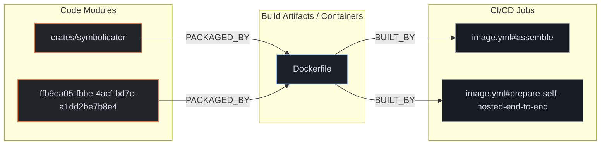

# Repository Architecture Analysis: getsentry/symbolicator

## Metadata
- **SHA**: `5b27326580c4a174f26f3c511b9f058c80ca09fb`
- **Primary Ecosystem**: Rust

## Quality Metrics
- **ast_engine**: fallback
- **avg_cognitive_complexity**: 0.0
- **avg_cyclomatic_complexity**: 0.0
- **component_count**: 154
- **dead_code_count**: 0
- **dead_code_symbols**: 0 entry(ies)
- **duplication_pct**: 0.0
- **file_complexities**: 0 entry(ies)
- **files_analyzed**: 154
- **fitness_passed**: True
- **fitness_violation_count**: 0
- **framework**: Axum / Actix / Rocket
- **import_edges**: 0 entry(ies)
- **loc**: 41735
- **max_cognitive_complexity**: 0
- **max_cyclomatic_complexity**: 0
- **sloc**: 30271
- **test_file_count**: 145

# Architecture: getsentry/symbolicator

## Context
- **Repository**: `getsentry/symbolicator`
- **SHA**: `5b27326580c4a174f26f3c511b9f058c80ca09fb`
- **Ecosystem**: Rust
- **Framework**: Axum / Actix / Rocket

## Building Block View

```mermaid
graph TD;
  classDef atlasRoot fill:#004882,stroke:#a3c9ff,stroke-width:2px,color:#d3e4ff
  classDef atlasCategory fill:#212428,stroke:#E87A48,stroke-width:1.5px,color:#dfe3eb
  classDef atlasWorkflow fill:#1b2026,stroke:#a3c9ff,stroke-width:1.5px,color:#dfe3eb
  classDef atlasJob fill:#171c22,stroke:#8d9199,stroke-width:1px,color:#dfe3eb
  classDef atlasTarget fill:#005227,stroke:#8bd99b,stroke-width:1.5px,color:#a7f6b6
  classDef atlasAlert fill:#93000a,stroke:#ffb4ab,stroke-width:1.5px,color:#ffdad6
  classDef atlasMore fill:#252a31,stroke:#8d9199,stroke-dasharray:4 4,color:#c3c6cf
    repo_root(["getsentry/symbolicator (154 components)"]):::atlasRoot
    subgraph sg_dir_0_crates_symbolicator_service["crates/symbolicator-service (49)"]
      direction TB
      dir_0_crates_symbolicator_service["crates/symbolicator-service (49)"]:::atlasCategory
      sub_0_0_src_download["src/download (14)"]:::atlasWorkflow
      dir_0_crates_symbolicator_service --> sub_0_0_src_download
      sub_0_1_src_caching["src/caching (11)"]:::atlasWorkflow
      dir_0_crates_symbolicator_service --> sub_0_1_src_caching
      sub_0_2_src["src (9)"]:::atlasWorkflow
      dir_0_crates_symbolicator_service --> sub_0_2_src
      sub_0_more["+3 more submodules (15)"]:::atlasMore
      dir_0_crates_symbolicator_service --> sub_0_more
    end
    repo_root --> dir_0_crates_symbolicator_service
    subgraph sg_dir_1_crates_symbolicator_native["crates/symbolicator-native (34)"]
      direction TB
      dir_1_crates_symbolicator_native["crates/symbolicator-native (34)"]:::atlasCategory
      sub_1_0_src["src (25)"]:::atlasWorkflow
      dir_1_crates_symbolicator_native --> sub_1_0_src
      sub_1_1_tests["tests (9)"]:::atlasWorkflow
      dir_1_crates_symbolicator_native --> sub_1_1_tests
    end
    repo_root --> dir_1_crates_symbolicator_native
    subgraph sg_dir_2_crates_symbolicator["crates/symbolicator (19)"]
      direction TB
      dir_2_crates_symbolicator["crates/symbolicator (19)"]:::atlasCategory
      sub_2_0_src["src (18)"]:::atlasWorkflow
      dir_2_crates_symbolicator --> sub_2_0_src
      sub_2_1__module_root_["(module root) (1)"]:::atlasWorkflow
      dir_2_crates_symbolicator --> sub_2_1__module_root_
    end
    repo_root --> dir_2_crates_symbolicator
    subgraph sg_dir_3_crates_symbolicator_js["crates/symbolicator-js (14)"]
      direction TB
      dir_3_crates_symbolicator_js["crates/symbolicator-js (14)"]:::atlasCategory
      sub_3_0_src["src (10)"]:::atlasWorkflow
      dir_3_crates_symbolicator_js --> sub_3_0_src
      sub_3_1_tests["tests (4)"]:::atlasWorkflow
      dir_3_crates_symbolicator_js --> sub_3_1_tests
    end
    repo_root --> dir_3_crates_symbolicator_js
    subgraph sg_dir_4_crates_symbolicator_sources["crates/symbolicator-sources (13)"]
      direction TB
      dir_4_crates_symbolicator_sources["crates/symbolicator-sources (13)"]:::atlasCategory
      sub_4_0_src["src (7)"]:::atlasWorkflow
      dir_4_crates_symbolicator_sources --> sub_4_0_src
      sub_4_1_src_sources["src/sources (6)"]:::atlasWorkflow
      dir_4_crates_symbolicator_sources --> sub_4_1_src_sources
    end
    repo_root --> dir_4_crates_symbolicator_sources
    dir_other_modules["+8 more modules (25)"]:::atlasMore
    repo_root --> dir_other_modules
```

## Component Details

Showing top 60 representative components out of 154 across 13 module group(s):

- **Module `crates/symbolicator-service`** (49 components — module: 49)
- **Module `crates/symbolicator-native`** (34 components — module: 34)
- **Module `crates/symbolicator`** (19 components — module: 19)
- **Module `crates/symbolicator-js`** (14 components — module: 14)
- **Module `crates/symbolicator-sources`** (13 components — module: 13)
- **Module `crates/symbolicator-proguard`** (8 components — module: 8)
- **Module `crates/symbolicli`** (5 components — module: 5)
- **Module `crates/symbolicator-stress`** (4 components — module: 4)
- **Module `crates/symsorter`** (4 components — module: 4)
- **Module `crates/process-event`** (1 components — module: 1)
- **Module `crates/symbolicator-crash`** (1 components — module: 1)
- **Module `crates/symbolicator-test`** (1 components — module: 1)

- **api_lookup** (`crates/symbolicator-js/src/api_lookup.rs`): module
- **app** (`crates/symsorter/src/app.rs`): module
- **apple** (`crates/symbolicator-native/src/symbolication/apple.rs`): module
- **applecrashreport** (`crates/symbolicator/src/endpoints/applecrashreport.rs`): module
- **attachments** (`crates/symbolicator-native/src/symbolication/attachments.rs`): module
- **azure** (`crates/symbolicator-service/src/download/azure.rs`): module
- **azure** (`crates/symbolicator-sources/src/sources/azure.rs`): module
- **bitcode** (`crates/symbolicator-native/src/caches/bitcode.rs`): module
- **build** (`crates/symbolicator/build.rs`): module
- **bundle_lookup** (`crates/symbolicator-js/src/bundle_lookup.rs`): module
- **cache_error** (`crates/symbolicator-service/src/caching/cache_error.rs`): module
- **cache_key** (`crates/symbolicator-service/src/caching/cache_key.rs`): module
- **candidates** (`crates/symbolicator-service/src/objects/candidates.rs`): module
- **cficaches** (`crates/symbolicator-native/src/caches/cficaches.rs`): module
- **cleanup** (`crates/symbolicator-service/src/caching/cleanup.rs`): module
- **cli** (`crates/symbolicator/src/cli.rs`): module
- **cogs** (`crates/symbolicator-service/src/cogs.rs`): module
- **compression** (`crates/symbolicator-service/src/download/compression.rs`): module
- **config** (`crates/symbolicator-service/src/caching/config.rs`): module
- **config** (`crates/symbolicator-service/src/caching/shared_cache/config.rs`): module
- **config** (`crates/symbolicator-service/src/config.rs`): module
- **config** (`crates/symsorter/src/config.rs`): module
- **data_cache** (`crates/symbolicator-service/src/objects/data_cache.rs`): module
- **debug_id_lookup** (`crates/symbolicator-js/tests/integration/debug_id_lookup.rs`): module
- **defer** (`crates/symbolicator-service/src/utils/defer.rs`): module
- **demangle** (`crates/symbolicator-native/src/symbolication/demangle.rs`): module
- **deny_list** (`crates/symbolicator-service/src/download/deny_list.rs`): module
- **derived** (`crates/symbolicator-native/src/caches/derived.rs`): module
- **destination** (`crates/symbolicator-service/src/download/destination.rs`): module
- **dotnet** (`crates/symbolicator-native/src/symbolication/dotnet.rs`): module
- **e2e** (`crates/symbolicator-native/tests/integration/e2e.rs`): module
- **error** (`crates/symbolicator/src/endpoints/error.rs`): module
- **event** (`crates/symbolicli/src/event.rs`): module
- **fetch_file** (`crates/symbolicator-service/src/download/fetch_file.rs`): module
- **filesystem** (`crates/symbolicator-service/src/download/filesystem.rs`): module
- **filesystem** (`crates/symbolicator-sources/src/sources/filesystem.rs`): module
- **filetype** (`crates/symbolicator-sources/src/filetype.rs`): module
- **formatting** (`crates/symbolicator-native/src/symbolication/native/variables/formatting.rs`): module
- **fs** (`crates/symbolicator-service/src/caching/fs.rs`): module
- **fs** (`crates/symbolicator-service/src/utils/fs.rs`): module
- **futures** (`crates/symbolicator-service/src/utils/futures.rs`): module
- **gcs** (`crates/symbolicator-service/src/download/gcs.rs`): module
- **gcs** (`crates/symbolicator-service/src/utils/gcs.rs`): module
- **gcs** (`crates/symbolicator-sources/src/sources/gcs.rs`): module
- **healthcheck** (`crates/symbolicator/src/healthcheck.rs`): module
- **hex** (`crates/symbolicator-service/src/utils/hex.rs`): module
- **http** (`crates/symbolicator-service/src/download/http.rs`): module
- **http** (`crates/symbolicator-service/src/utils/http.rs`): module
- **http** (`crates/symbolicator-sources/src/sources/http.rs`): module
- **il2cpp** (`crates/symbolicator-native/src/caches/il2cpp.rs`): module
- **index** (`crates/symbolicator-service/src/download/index.rs`): module
- **index** (`crates/symbolicator-sources/src/index.rs`): module
- **interface** (`crates/symbolicator-js/src/interface.rs`): module
- **interface** (`crates/symbolicator-proguard/src/interface.rs`): module
- **js_local_source** (`crates/symbolicli/src/js_local_source.rs`): module
- **lib** (`crates/symbolicator-crash/src/lib.rs`): module
- **lib** (`crates/symbolicator-js/src/lib.rs`): module
- **lib** (`crates/symbolicator-native/src/lib.rs`): module
- **lib** (`crates/symbolicator-proguard/src/lib.rs`): module
- **lib** (`crates/symbolicator-service/src/lib.rs`): module

## 6-Dimension Repository Scorecard

- **Overall Grade**: `D` (60.50/100)
- **Technical Debt Score**: 39.50
- **Estimated Remediation Effort**: 80.88h

| Dimension | Grade | Score | Weight | Details |
| :--- | :---: | :---: | :---: | :--- |
| Code Quality | `A` | 100.00 | 0.20 | avg_cc=0.00, max_cc=0, duplication=0.00%, dead_code=0 |
| Dependency Health | `A` | 100.00 | 0.15 | dependencies=899, outdated=0, vulnerable=0, has_lockfile=True |
| Maintainability | `A` | 100.00 | 0.15 | avg_cognitive=0.00, max_cognitive=0, fitness_violations=0, oversized_files=0 |
| Pipeline Health | `F` | 0.00 | 0.15 | workflows=10, operational_antipatterns=29, parallel_branches=True |
| Security | `F` | 0.00 | 0.20 | vulnerabilities=0, secrets=3, pipeline_security_findings=31 |
| Test Coverage | `C` | 70.00 | 0.15 | coverage=unavailable, ci_test_job=True, test_files_detected=True |

## Architecture Fitness & Workspace Boundaries

### Workspace Packages
- **process-event** (`crates/process-event`, rust, cargo)
- **symbolicator** (`crates/symbolicator`, rust, cargo) -> internal deps: `symbolicator-crash, symbolicator-js, symbolicator-native, symbolicator-proguard, symbolicator-service, symbolicator-sources, symbolicator-test`
- **symbolicator-crash** (`crates/symbolicator-crash`, rust, cargo)
- **symbolicator-js** (`crates/symbolicator-js`, rust, cargo) -> internal deps: `symbolicator-service, symbolicator-sources, symbolicator-test`
- **symbolicator-native** (`crates/symbolicator-native`, rust, cargo) -> internal deps: `symbolicator-service, symbolicator-sources, symbolicator-test`
- **symbolicator-proguard** (`crates/symbolicator-proguard`, rust, cargo) -> internal deps: `symbolicator-service, symbolicator-sources, symbolicator-test`
- **symbolicator-service** (`crates/symbolicator-service`, rust, cargo) -> internal deps: `symbolicator-sources, symbolicator-test`
- **symbolicator-sources** (`crates/symbolicator-sources`, rust, cargo)
- **symbolicator-stress** (`crates/symbolicator-stress`, rust, cargo) -> internal deps: `symbolicator-js, symbolicator-native, symbolicator-service, symbolicator-test`
- **symbolicator-test** (`crates/symbolicator-test`, rust, cargo) -> internal deps: `symbolicator-sources`
- **symbolicli** (`crates/symbolicli`, rust, cargo) -> internal deps: `symbolicator-js, symbolicator-native, symbolicator-service, symbolicator-sources`
- **symsorter** (`crates/symsorter`, rust, cargo)
- **wasm-split** (`crates/wasm-split`, rust, cargo)

## Supply Chain Dependencies, Vulnerabilities & Secrets

- **Dependencies Parsed**: 899 | **Vulnerabilities**: 0 | **Secrets**: 3

### Secret Findings (Redacted)
- **[HIGH] `ATRUSS-SEC-005`** at `.github/workflows/validate-pipelines.yml:49` (`id_token_audience: '6105***REDACTED***'`)
- **[HIGH] `ATRUSS-SEC-005`** at `docs/api/index.md:43` (`"secret_key": "Lqnc***REDACTED***",`)
- **[HIGH] `ATRUSS-SEC-005`** at `docs/api/index.md:59` (`"secret_key": "Lqnc***REDACTED***",`)

### Inventory Sample
- `devservices` `1.2.1` (PyPI, `pyproject.toml`)
- `devservices` `1.2.1` (PyPI, `uv.lock`)
- `mkdocs` `1.6.1` (PyPI, `pyproject.toml`)
- `mkdocs` `1.6.1` (PyPI, `uv.lock`)
- `mkdocs-material` `9.6.17` (PyPI, `pyproject.toml`)
- `mkdocs-material` `9.7.7` (PyPI, `uv.lock`)
- `pre-commit` `4.2.0` (PyPI, `pyproject.toml`)
- `pre-commit` `4.2.0` (PyPI, `uv.lock`)
- `pygments` `2.20.0` (PyPI, `pyproject.toml`)
- `pygments` `2.20.0` (PyPI, `uv.lock`)
- `sentry-devenv` `1.28.0` (PyPI, `pyproject.toml`)
- `sentry-devenv` `1.28.0` (PyPI, `uv.lock`)
- `anyhow` `*` (cargo, `crates/process-event/Cargo.toml`)
- `anyhow` `*` (cargo, `crates/symbolicator-native/Cargo.toml`)
- `anyhow` `*` (cargo, `crates/symbolicator-service/Cargo.toml`)
- `anyhow` `*` (cargo, `crates/symbolicator-sources/Cargo.toml`)
- `anyhow` `*` (cargo, `crates/symbolicator-stress/Cargo.toml`)
- `anyhow` `*` (cargo, `crates/symbolicator/Cargo.toml`)
- `anyhow` `*` (cargo, `crates/symbolicli/Cargo.toml`)
- `anyhow` `*` (cargo, `crates/symsorter/Cargo.toml`)
- `anyhow` `*` (cargo, `crates/wasm-split/Cargo.toml`)
- `apple-crash-report-parser` `*` (cargo, `crates/symbolicator-native/Cargo.toml`)
- `async-compression` `*` (cargo, `crates/symbolicator-service/Cargo.toml`)
- `async-trait` `*` (cargo, `crates/symbolicator-native/Cargo.toml`)
- `aws-config` `*` (cargo, `crates/symbolicator-service/Cargo.toml`)
- `aws-credential-types` `*` (cargo, `crates/symbolicator-service/Cargo.toml`)
- `aws-sdk-s3` `*` (cargo, `crates/symbolicator-service/Cargo.toml`)
- `aws-smithy-types` `*` (cargo, `crates/symbolicator-service/Cargo.toml`)
- `aws-smithy-xml` `*` (cargo, `crates/symbolicator-service/Cargo.toml`)
- `aws-types` `*` (cargo, `crates/symbolicator-sources/Cargo.toml`)
- ... (+869 more dependencies)

## Section 7: Code-to-Cloud Deployment Traceability

- `crates/symbolicator` (code_module) --[PACKAGED_BY]--> `Dockerfile` (container)
- `ffb9ea05-fbbe-4acf-bd7c-a1dd2be7b8e4` (code_module) --[PACKAGED_BY]--> `Dockerfile` (container)
- `Dockerfile` (container) --[BUILT_BY]--> `image.yml#assemble` (ci_job)
- `Dockerfile` (container) --[BUILT_BY]--> `image.yml#prepare-self-hosted-end-to-end` (ci_job)

## CI/CD Pipeline Topology

```mermaid
graph TD;
  classDef atlasRoot fill:#004882,stroke:#a3c9ff,stroke-width:2px,color:#d3e4ff
  classDef atlasCategory fill:#212428,stroke:#E87A48,stroke-width:1.5px,color:#dfe3eb
  classDef atlasWorkflow fill:#1b2026,stroke:#a3c9ff,stroke-width:1.5px,color:#dfe3eb
  classDef atlasJob fill:#171c22,stroke:#8d9199,stroke-width:1px,color:#dfe3eb
  classDef atlasTarget fill:#005227,stroke:#8bd99b,stroke-width:1.5px,color:#a7f6b6
  classDef atlasAlert fill:#93000a,stroke:#ffb4ab,stroke-width:1.5px,color:#ffdad6
  classDef atlasMore fill:#252a31,stroke:#8d9199,stroke-dasharray:4 4,color:#c3c6cf
  pipeline_root(["getsentry/symbolicator (10 workflows)"]):::atlasRoot
  subgraph sg_grp_0_CI___Verification["CI & Verification (4 workflows · 14 jobs)"]
    direction TB
    subgraph sg_wf_1_CI["CI (6 jobs)"]
      direction TB
      wf_1_CI(["Trigger: CI"]):::atlasWorkflow
      job_1_lints["lints"]:::atlasJob
      job_1_test["test"]:::atlasJob
      job_1_test_against_latest_sentry["test_against_latest_sentry"]:::atlasJob
      wf_1_CI --> job_1_lints
      wf_1_CI --> job_1_test
      wf_1_CI --> job_1_test_against_latest_sentry
    end
    pipeline_root --> wf_1_CI
    subgraph sg_wf_3_Enforce_License_Compliance["Enforce License Compliance (1 jobs)"]
      direction TB
      wf_3_Enforce_License_Compliance(["Trigger: Enforce License Compliance"]):::atlasWorkflow
      job_3_enforce_license_compliance["enforce-license-compliance"]:::atlasJob
      wf_3_Enforce_License_Compliance --> job_3_enforce_license_compliance
    end
    pipeline_root --> wf_3_Enforce_License_Compliance
    subgraph sg_wf_4_image["image (6 jobs)"]
      direction TB
      wf_4_image(["Trigger: image"]):::atlasWorkflow
      job_4_build_setup["build-setup"]:::atlasJob
      job_4_build_binaries["build-binaries"]:::atlasJob
      job_4_assemble["assemble"]:::atlasJob
      wf_4_image --> job_4_build_setup
      job_4_build_setup --> job_4_build_binaries
      job_4_build_setup --> job_4_assemble
      job_4_build_binaries --> job_4_assemble
    end
    pipeline_root --> wf_4_image
    subgraph sg_wf_5_pre_commit["pre-commit (1 jobs)"]
      direction TB
      wf_5_pre_commit(["Trigger: pre-commit"]):::atlasWorkflow
      job_5_pre_commit["pre-commit"]:::atlasJob
      wf_5_pre_commit --> job_5_pre_commit
    end
    pipeline_root --> wf_5_pre_commit
  end
  subgraph sg_grp_1_Release___Deploy["Release & Deploy (4 workflows · 8 jobs)"]
    direction TB
    subgraph sg_wf_0_Release_build["Release build (4 jobs)"]
      direction TB
      wf_0_Release_build(["Trigger: Release build"]):::atlasWorkflow
      job_0_linux["linux"]:::atlasJob
      job_0_mac["mac"]:::atlasJob
      job_0_windows["windows"]:::atlasJob
      wf_0_Release_build --> job_0_linux
      wf_0_Release_build --> job_0_mac
      wf_0_Release_build --> job_0_windows
    end
    pipeline_root --> wf_0_Release_build
    subgraph sg_wf_2_Publish_Docs["Publish Docs (1 jobs)"]
      direction TB
      wf_2_Publish_Docs(["Trigger: Publish Docs"]):::atlasWorkflow
      job_2_docs["docs"]:::atlasJob
      wf_2_Publish_Docs --> job_2_docs
    end
    pipeline_root --> wf_2_Publish_Docs
    subgraph sg_wf_6_Release["Release (1 jobs)"]
      direction TB
      wf_6_Release(["Trigger: Release"]):::atlasWorkflow
      job_6_release["release"]:::atlasJob
      wf_6_Release --> job_6_release
    end
    pipeline_root --> wf_6_Release
    subgraph sg_wf_8_Validate_Deployment_Pipelines["Validate Deployment Pipelines (2 jobs)"]
      direction TB
      wf_8_Validate_Deployment_Pipelines(["Trigger: Validate Deployment Pipelines"]):::atlasWorkflow
      job_8_files_changed["files-changed"]:::atlasJob
      job_8_validate["validate"]:::atlasJob
      wf_8_Validate_Deployment_Pipelines --> job_8_files_changed
      job_8_files_changed --> job_8_validate
    end
    pipeline_root --> wf_8_Validate_Deployment_Pipelines
  end
  subgraph sg_grp_2_Scheduled___Manual["Scheduled & Manual (2 workflows · 3 jobs)"]
    direction TB
    subgraph sg_wf_7_Update_Dependencies["Update Dependencies (1 jobs)"]
      direction TB
      wf_7_Update_Dependencies(["Trigger: Update Dependencies"]):::atlasWorkflow
      job_7_native["native"]:::atlasJob
      wf_7_Update_Dependencies --> job_7_native
    end
    pipeline_root --> wf_7_Update_Dependencies
    wf_9_Weekly_CI["Weekly CI (2 jobs)"]:::atlasWorkflow
    pipeline_root --> wf_9_Weekly_CI
  end
```

