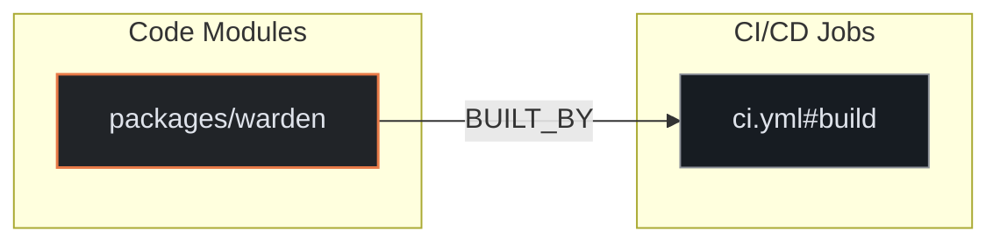

# Repository Architecture Analysis: getsentry/warden

## Metadata
- **SHA**: `a1b65ab5a58fd9b91b96d6a828b7624bd15c5766`
- **Primary Ecosystem**: JavaScript/TypeScript

## Quality Metrics
- **ast_engine**: tree-sitter
- **avg_cognitive_complexity**: 4.36
- **avg_cyclomatic_complexity**: 4.33
- **component_count**: 61
- **dead_code_count**: 6
- **dead_code_symbols**: 6 entry(ies)
- **duplication_pct**: 87.4
- **file_complexities**: 25 entry(ies)
- **files_analyzed**: 414
- **fitness_passed**: False
- **fitness_violation_count**: 3
- **framework**: Astro
- **import_edges**: 100 entry(ies)
- **loc**: 104961
- **max_cognitive_complexity**: 147
- **max_cyclomatic_complexity**: 73
- **sloc**: 88159
- **test_file_count**: 146

# Architecture: getsentry/warden

## Context
- **Repository**: `getsentry/warden`
- **SHA**: `a1b65ab5a58fd9b91b96d6a828b7624bd15c5766`
- **Ecosystem**: JavaScript/TypeScript
- **Framework**: Astro

## Building Block View

```mermaid
graph TD;
  classDef atlasRoot fill:#004882,stroke:#a3c9ff,stroke-width:2px,color:#d3e4ff
  classDef atlasCategory fill:#212428,stroke:#E87A48,stroke-width:1.5px,color:#dfe3eb
  classDef atlasWorkflow fill:#1b2026,stroke:#a3c9ff,stroke-width:1.5px,color:#dfe3eb
  classDef atlasJob fill:#171c22,stroke:#8d9199,stroke-width:1px,color:#dfe3eb
  classDef atlasTarget fill:#005227,stroke:#8bd99b,stroke-width:1.5px,color:#a7f6b6
  classDef atlasAlert fill:#93000a,stroke:#ffb4ab,stroke-width:1.5px,color:#ffdad6
  classDef atlasMore fill:#252a31,stroke:#8d9199,stroke-dasharray:4 4,color:#c3c6cf
    repo_root(["getsentry/warden (61 components)"]):::atlasRoot
    subgraph sg_dir_0_packages["packages (49)"]
      direction TB
      dir_0_packages["packages (49)"]:::atlasCategory
      sub_0_0_warden_service["warden-service (37)"]:::atlasWorkflow
      dir_0_packages --> sub_0_0_warden_service
      sub_0_1_evals["evals (8)"]:::atlasWorkflow
      dir_0_packages --> sub_0_1_evals
      sub_0_2_warden["warden (2)"]:::atlasWorkflow
      dir_0_packages --> sub_0_2_warden
      sub_0_more["+2 more submodules (2)"]:::atlasMore
      dir_0_packages --> sub_0_more
    end
    repo_root --> dir_0_packages
    subgraph sg_dir_1_apps["apps (11)"]
      direction TB
      dir_1_apps["apps (11)"]:::atlasCategory
      sub_1_0_warden_service_src["warden-service/src (9)"]:::atlasWorkflow
      dir_1_apps --> sub_1_0_warden_service_src
      sub_1_1_warden_service["warden-service (1)"]:::atlasWorkflow
      dir_1_apps --> sub_1_1_warden_service
      sub_1_2_warden_service_api["warden-service/api (1)"]:::atlasWorkflow
      dir_1_apps --> sub_1_2_warden_service_api
    end
    repo_root --> dir_1_apps
    dir_2__root_["(root) (1)"]:::atlasCategory
    repo_root --> dir_2__root_
```

## Component Details

Showing top 60 representative components out of 61 across 3 module group(s):

- **Module `packages`** (49 components — API_ROUTE: 36, MODULE: 7, UI_COMPONENT: 6)
- **Module `apps`** (11 components — UI_COMPONENT: 9, MODULE: 1, API_ROUTE: 1)
- **Module `(root)`** (1 components — MODULE: 1)

- **@acme/build-tools** (`packages/evals/fixtures/postinstall-env-webhook/package.json`): MODULE
- **@acme/checkout-web** (`packages/evals/fixtures/benign-release-tooling/package.json`): MODULE
- **@sentry/warden** (`packages/warden/package.json`): MODULE
- **@sentry/warden-service** (`packages/warden-service/package.json`): MODULE
- **@sentry/warden-service-api** (`packages/warden-service-api/package.json`): MODULE
- **API_api_index** (`apps/warden-service/api/index.ts`): API_ROUTE
- **Account** (`apps/warden-service/src/client/account.tsx`): UI_COMPONENT
- **App** (`apps/warden-service/src/client/app.tsx`): UI_COMPONENT
- **AutoCounter** (`packages/evals/fixtures/stale-closure/counter.tsx`): UI_COMPONENT
- **AutoSaveEditor** (`packages/evals/fixtures/stale-autosave-closure/editor.tsx`): UI_COMPONENT
- **BaseField** (`packages/evals/fixtures/sentry-form-hash-navigation-search/baseField.tsx`): UI_COMPONENT
- **DELETE_api_auth_session** (`packages/warden-service/src/dashboard-auth.ts`): API_ROUTE
- **DELETE_api_v1_admin_repositories_:id** (`packages/warden-service/src/administration/routes.ts`): API_ROUTE
- **DELETE_api_v1_admin_runs_:id** (`packages/warden-service/src/administration/routes.ts`): API_ROUTE
- **DELETE_api_v1_admin_tenant** (`packages/warden-service/src/administration/routes.ts`): API_ROUTE
- **DELETE_api_v1_personal-tokens_:id** (`packages/warden-service/src/personal-tokens/routes.ts`): API_ROUTE
- **DashboardDetailWithInjectedProps** (`packages/evals/fixtures/sentry-dashboard-delete-side-nav-stale/detail.tsx`): UI_COMPONENT
- **DateTime** (`apps/warden-service/src/client/format.tsx`): UI_COMPONENT
- **Filters** (`apps/warden-service/src/client/filters.tsx`): UI_COMPONENT
- **FindingArticle** (`apps/warden-service/src/client/findings.tsx`): UI_COMPONENT
- **Findings** (`apps/warden-service/src/client/findings.tsx`): UI_COMPONENT
- **GET_api_auth_login** (`packages/warden-service/src/google-auth.ts`): API_ROUTE
- **GET_api_internal_jobs_tick** (`packages/warden-service/src/jobs/routes.ts`): API_ROUTE
- **GET_api_v1_admin_retention** (`packages/warden-service/src/administration/routes.ts`): API_ROUTE
- **GET_api_v1_auth_context** (`packages/warden-service/src/app.ts`): API_ROUTE
- **GET_api_v1_costs** (`packages/warden-service/src/history/routes.ts`): API_ROUTE
- **GET_api_v1_costs_breakdowns** (`packages/warden-service/src/history/routes.ts`): API_ROUTE
- **GET_api_v1_dashboard_summary** (`packages/warden-service/src/history/routes.ts`): API_ROUTE
- **GET_api_v1_export** (`packages/warden-service/src/administration/routes.ts`): API_ROUTE
- **GET_api_v1_findings** (`packages/warden-service/src/history/routes.ts`): API_ROUTE
- **GET_api_v1_findings_:id** (`packages/warden-service/src/history/routes.ts`): API_ROUTE
- **GET_api_v1_history_dimensions** (`packages/warden-service/src/history/routes.ts`): API_ROUTE
- **GET_api_v1_memories** (`packages/warden-service/src/memory/routes.ts`): API_ROUTE
- **GET_api_v1_memories_:id** (`packages/warden-service/src/memory/routes.ts`): API_ROUTE
- **GET_api_v1_outcomes_summary** (`packages/warden-service/src/history/routes.ts`): API_ROUTE
- **GET_api_v1_personal-tokens** (`packages/warden-service/src/personal-tokens/routes.ts`): API_ROUTE
- **GET_api_v1_repositories** (`packages/warden-service/src/history/routes.ts`): API_ROUTE
- **GET_api_v1_runs** (`packages/warden-service/src/history/routes.ts`): API_ROUTE
- **GET_api_v1_runs_:id** (`packages/warden-service/src/history/routes.ts`): API_ROUTE
- **GET_api_v1_skills** (`packages/warden-service/src/history/routes.ts`): API_ROUTE
- **GET_assets_app.js** (`packages/warden-service/src/app.ts`): API_ROUTE
- **GET_assets_styles.css** (`packages/warden-service/src/app.ts`): API_ROUTE
- **GET_findings_:id** (`packages/warden-service/src/app.ts`): API_ROUTE
- **LiveStatusList** (`packages/warden/src/cli/output/live-status.tsx`): UI_COMPONENT
- **MetricIssueChart** (`packages/evals/fixtures/sentry-metric-issue-chart-open-period/metricIssueChart.tsx`): UI_COMPONENT
- **POST_api_auth_session** (`packages/warden-service/src/dashboard-auth.ts`): API_ROUTE
- **POST_api_internal_db_migrate** (`packages/warden-service/src/jobs/routes.ts`): API_ROUTE
- **POST_api_internal_jobs_tick** (`packages/warden-service/src/jobs/routes.ts`): API_ROUTE
- **POST_api_v1_memories** (`packages/warden-service/src/memory/routes.ts`): API_ROUTE
- **POST_api_v1_memories_:id_feedback** (`packages/warden-service/src/memory/routes.ts`): API_ROUTE
- **POST_api_v1_memory_recall** (`packages/warden-service/src/memory/routes.ts`): API_ROUTE
- **POST_api_v1_personal-tokens** (`packages/warden-service/src/personal-tokens/routes.ts`): API_ROUTE
- **POST_api_v1_runs** (`packages/warden-service/src/runs/routes.ts`): API_ROUTE
- **PUT_api_v1_admin_retention** (`packages/warden-service/src/administration/routes.ts`): API_ROUTE
- **RuntimeProvider** (`apps/warden-service/src/client/runtime.tsx`): UI_COMPONENT
- **ThemeToggle** (`apps/warden-service/src/client/theme.tsx`): UI_COMPONENT
- **Usage** (`apps/warden-service/src/client/usage.tsx`): UI_COMPONENT
- **warden-docs** (`packages/docs/package.json`): MODULE
- **warden-evals** (`packages/evals/package.json`): MODULE
- **warden-monorepo** (`package.json`): MODULE

## 6-Dimension Repository Scorecard

- **Overall Grade**: `F` (47.79/100)
- **Technical Debt Score**: 52.21
- **Estimated Remediation Effort**: 87.53h

| Dimension | Grade | Score | Weight | Details |
| :--- | :---: | :---: | :---: | :--- |
| Code Quality | `F` | 32.68 | 0.20 | avg_cc=4.33, max_cc=73, duplication=87.40%, dead_code=6 |
| Dependency Health | `A` | 100.00 | 0.15 | dependencies=1474, outdated=0, vulnerable=0, has_lockfile=True |
| Maintainability | `F` | 37.00 | 0.15 | avg_cognitive=4.36, max_cognitive=147, fitness_violations=3, oversized_files=23 |
| Pipeline Health | `F` | 56.00 | 0.15 | workflows=8, operational_antipatterns=9, parallel_branches=False |
| Security | `F` | 9.00 | 0.20 | vulnerabilities=0, secrets=1, pipeline_security_findings=6 |
| Test Coverage | `C` | 70.00 | 0.15 | coverage=unavailable, ci_test_job=True, test_files_detected=True |

## Architecture Fitness & Workspace Boundaries

- **[MEDIUM] `ATRUSS-ARCH-005` (COMPLEXITY_THRESHOLD)**: Repository duplication_pct (87.4) exceeds policy threshold (15.0).
- **[MEDIUM] `ATRUSS-ARCH-005` (COMPLEXITY_THRESHOLD)**: Repository max_cognitive_complexity (147.0) exceeds policy threshold (25.0).
- **[MEDIUM] `ATRUSS-ARCH-005` (COMPLEXITY_THRESHOLD)**: Repository max_cyclomatic_complexity (73.0) exceeds policy threshold (20.0).

### Workspace Packages
- **warden-service-app** (`apps/warden-service`, react_ts_js, pnpm) -> internal deps: `@sentry/warden-service, @sentry/warden-service-api`
- **warden-docs** (`packages/docs`, react_ts_js, pnpm) -> internal deps: `@sentry/warden`
- **warden-evals** (`packages/evals`, react_ts_js, pnpm) -> internal deps: `@sentry/warden`
- **@sentry/warden** (`packages/warden`, react_ts_js, pnpm) -> internal deps: `@sentry/warden-service-api`
- **@sentry/warden-service** (`packages/warden-service`, react_ts_js, pnpm) -> internal deps: `@sentry/warden-service-api`
- **@sentry/warden-service-api** (`packages/warden-service-api`, react_ts_js, pnpm)

## Supply Chain Dependencies, Vulnerabilities & Secrets

- **Dependencies Parsed**: 1474 | **Vulnerabilities**: 0 | **Secrets**: 1

### Secret Findings (Redacted)
- **[CRITICAL] `ATRUSS-SEC-004`** at `packages/warden/src/cli/commands/setup-app.test.ts:20` (`-----BEGIN ... PRIVATE KEY----- [REDACTED]`)

### Inventory Sample
- `@ai-sdk/gateway` `3.0.173` (npm, `apps/warden-service/package.json`)
- `@ai-sdk/gateway` `3.0.173` (npm, `pnpm-lock.yaml`)
- `@anthropic-ai/claude-agent-sdk` `0.3.150` (npm, `packages/warden/package.json`)
- `@anthropic-ai/claude-agent-sdk` `0.3.150` (npm, `pnpm-lock.yaml`)
- `@anthropic-ai/sdk` `0.124.0` (npm, `pnpm-lock.yaml`)
- `@anthropic-ai/sdk` `0.98.0` (npm, `packages/warden/package.json`)
- `@anthropic-ai/sdk` `0.98.0` (npm, `pnpm-lock.yaml`)
- `@astrojs/mdx` `7.0.8` (npm, `packages/docs/package.json`)
- `@astrojs/mdx` `7.0.8` (npm, `pnpm-lock.yaml`)
- `@astrojs/starlight` `0.41.9` (npm, `packages/docs/package.json`)
- `@astrojs/starlight` `0.41.9` (npm, `pnpm-lock.yaml`)
- `@earendil-works/pi-ai` `0.86.1` (npm, `packages/warden/package.json`)
- `@earendil-works/pi-ai` `0.86.1` (npm, `pnpm-lock.yaml`)
- `@earendil-works/pi-coding-agent` `0.86.1` (npm, `packages/warden/package.json`)
- `@earendil-works/pi-coding-agent` `0.86.1` (npm, `pnpm-lock.yaml`)
- `@fontsource-variable/rubik` `5.2.8` (npm, `packages/docs/package.json`)
- `@fontsource-variable/rubik` `5.2.8` (npm, `pnpm-lock.yaml`)
- `@fontsource/geist-mono` `5.2.8` (npm, `packages/docs/package.json`)
- `@fontsource/geist-mono` `5.2.8` (npm, `pnpm-lock.yaml`)
- `@fontsource/ibm-plex-mono` `5.2.7` (npm, `packages/docs/package.json`)
- `@fontsource/ibm-plex-mono` `5.2.7` (npm, `pnpm-lock.yaml`)
- `@hono/node-server` `1.19.17` (npm, `apps/warden-service/package.json`)
- `@hono/node-server` `1.19.17` (npm, `packages/warden-service/package.json`)
- `@hono/node-server` `1.19.17` (npm, `pnpm-lock.yaml`)
- `@inquirer/select` `5.1.5` (npm, `packages/warden/package.json`)
- `@inquirer/select` `5.1.5` (npm, `pnpm-lock.yaml`)
- `@modelcontextprotocol/sdk` `1.31.0` (npm, `packages/warden/package.json`)
- `@modelcontextprotocol/sdk` `1.32.1` (npm, `pnpm-lock.yaml`)
- `@neondatabase/serverless` `1.1.0` (npm, `packages/warden-service/package.json`)
- `@neondatabase/serverless` `1.1.0` (npm, `pnpm-lock.yaml`)
- ... (+1444 more dependencies)

## Section 7: Code-to-Cloud Deployment Traceability

- `packages/warden` (code_module) --[BUILT_BY]--> `ci.yml#build` (ci_job)

## CI/CD Pipeline Topology

```mermaid
graph TD;
  classDef atlasRoot fill:#004882,stroke:#a3c9ff,stroke-width:2px,color:#d3e4ff
  classDef atlasCategory fill:#212428,stroke:#E87A48,stroke-width:1.5px,color:#dfe3eb
  classDef atlasWorkflow fill:#1b2026,stroke:#a3c9ff,stroke-width:1.5px,color:#dfe3eb
  classDef atlasJob fill:#171c22,stroke:#8d9199,stroke-width:1px,color:#dfe3eb
  classDef atlasTarget fill:#005227,stroke:#8bd99b,stroke-width:1.5px,color:#a7f6b6
  classDef atlasAlert fill:#93000a,stroke:#ffb4ab,stroke-width:1.5px,color:#ffdad6
  classDef atlasMore fill:#252a31,stroke:#8d9199,stroke-dasharray:4 4,color:#c3c6cf
  pipeline_root(["getsentry/warden (8 workflows)"]):::atlasRoot
  subgraph sg_grp_0_CI___Verification["CI & Verification (4 workflows · 4 jobs)"]
    direction TB
    subgraph sg_wf_0_Action_Bundle["Action Bundle (1 jobs)"]
      direction TB
      wf_0_Action_Bundle(["Trigger: Action Bundle"]):::atlasWorkflow
      job_0_build["build"]:::atlasJob
      wf_0_Action_Bundle --> job_0_build
    end
    pipeline_root --> wf_0_Action_Bundle
    subgraph sg_wf_1_CI["CI (1 jobs)"]
      direction TB
      wf_1_CI(["Trigger: CI"]):::atlasWorkflow
      job_1_build["build"]:::atlasJob
      wf_1_CI --> job_1_build
    end
    pipeline_root --> wf_1_CI
    subgraph sg_wf_4_Docs["Docs (1 jobs)"]
      direction TB
      wf_4_Docs(["Trigger: Docs"]):::atlasWorkflow
      job_4_build["build"]:::atlasJob
      wf_4_Docs --> job_4_build
    end
    pipeline_root --> wf_4_Docs
    subgraph sg_wf_7_Warden["Warden (1 jobs)"]
      direction TB
      wf_7_Warden(["Trigger: Warden"]):::atlasWorkflow
      job_7_review["review"]:::atlasJob
      wf_7_Warden --> job_7_review
    end
    pipeline_root --> wf_7_Warden
  end
  subgraph sg_grp_1_Automation___Other["Automation & Other (1 workflows · 1 jobs)"]
    direction TB
    subgraph sg_wf_3_Commit_Action_Bundle["Commit Action Bundle (1 jobs)"]
      direction TB
      wf_3_Commit_Action_Bundle(["Trigger: Commit Action Bundle"]):::atlasWorkflow
      job_3_commit["commit"]:::atlasJob
      wf_3_Commit_Action_Bundle --> job_3_commit
    end
    pipeline_root --> wf_3_Commit_Action_Bundle
  end
  subgraph sg_grp_2_Release___Deploy["Release & Deploy (1 workflows · 1 jobs)"]
    direction TB
    subgraph sg_wf_6_Release["Release (1 jobs)"]
      direction TB
      wf_6_Release(["Trigger: Release"]):::atlasWorkflow
      job_6_release["release"]:::atlasJob
      wf_6_Release --> job_6_release
    end
    pipeline_root --> wf_6_Release
  end
  subgraph sg_grp_3_Scheduled___Manual["Scheduled & Manual (1 workflows · 2 jobs)"]
    direction TB
    subgraph sg_wf_5_Evals["Evals (2 jobs)"]
      direction TB
      wf_5_Evals(["Trigger: Evals"]):::atlasWorkflow
      job_5_should_run["should-run"]:::atlasJob
      job_5_evals["evals"]:::atlasJob
      wf_5_Evals --> job_5_should_run
      job_5_should_run --> job_5_evals
    end
    pipeline_root --> wf_5_Evals
  end
  subgraph sg_grp_4_Security___Governance["Security & Governance (1 workflows · 1 jobs)"]
    direction TB
    subgraph sg_wf_2_CodeQL["CodeQL (1 jobs)"]
      direction TB
      wf_2_CodeQL(["Trigger: CodeQL"]):::atlasWorkflow
      job_2_analyze["analyze"]:::atlasJob
      wf_2_CodeQL --> job_2_analyze
    end
    pipeline_root --> wf_2_CodeQL
  end
```

