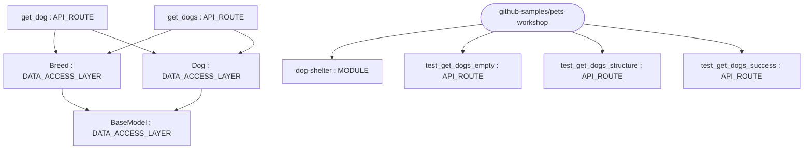
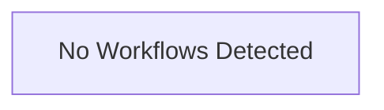

# Repository Architecture Analysis: github-samples/pets-workshop

## Metadata
- **SHA**: `d2437a6f3dbb1fe4bd5e97790ccc12c42cbfc03a`
- **Primary Ecosystem**: JavaScript/TypeScript

## Quality Metrics
- **avg_cyclomatic_complexity**: 2.0
- **component_count**: 9
- **files_analyzed**: 15
- **framework**: Astro
- **loc**: 880
- **max_cyclomatic_complexity**: 9
- **sloc**: 653

# Architecture: github-samples/pets-workshop

## Context
- **Repository**: `github-samples/pets-workshop`
- **SHA**: `d2437a6f3dbb1fe4bd5e97790ccc12c42cbfc03a`
- **Ecosystem**: JavaScript/TypeScript
- **Framework**: Unknown

## Building Block View

## Component Details
- **dog-shelter** (`app/client/package.json`): MODULE
- **get_dogs** (`app/server/app.py`): API_ROUTE (deps: Breed, Dog)
- **get_dog** (`app/server/app.py`): API_ROUTE (deps: Breed, Dog)
- **BaseModel** (`app/server/models/base.py`): DATA_ACCESS_LAYER
- **Breed** (`app/server/models/breed.py`): DATA_ACCESS_LAYER (deps: BaseModel)
- **Dog** (`app/server/models/dog.py`): DATA_ACCESS_LAYER (deps: BaseModel)
- **test_get_dogs_success** (`app/server/test_app.py`): API_ROUTE
- **test_get_dogs_empty** (`app/server/test_app.py`): API_ROUTE
- **test_get_dogs_structure** (`app/server/test_app.py`): API_ROUTE

## CI/CD Pipeline Topology

