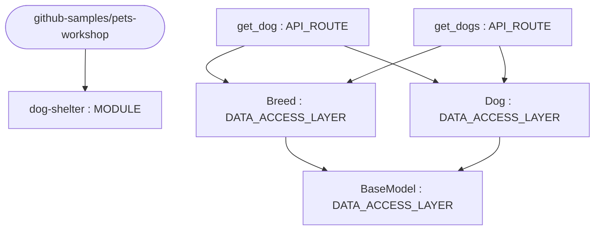
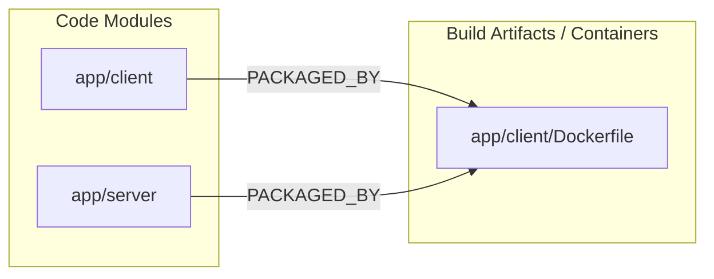
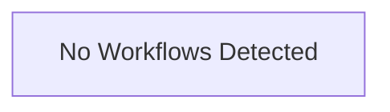

# Repository Architecture Analysis: github-samples/pets-workshop

## Metadata
- **SHA**: `d2437a6f3dbb1fe4bd5e97790ccc12c42cbfc03a`
- **Primary Ecosystem**: JavaScript/TypeScript

## Quality Metrics
- **ast_engine**: tree-sitter
- **avg_cognitive_complexity**: 0.94
- **avg_cyclomatic_complexity**: 1.89
- **component_count**: 6
- **dead_code_count**: 0
- **dead_code_symbols**: 0 entry(ies)
- **duplication_pct**: 68.88
- **file_complexities**: 15 entry(ies)
- **files_analyzed**: 15
- **fitness_passed**: False
- **fitness_violation_count**: 1
- **framework**: Astro
- **import_edges**: 75 entry(ies)
- **loc**: 880
- **max_cognitive_complexity**: 11
- **max_cyclomatic_complexity**: 9
- **sloc**: 653
- **test_file_count**: 5

# Architecture: github-samples/pets-workshop

## Context
- **Repository**: `github-samples/pets-workshop`
- **SHA**: `d2437a6f3dbb1fe4bd5e97790ccc12c42cbfc03a`
- **Ecosystem**: JavaScript/TypeScript
- **Framework**: Astro

## Building Block View

## Component Details
- **dog-shelter** (`app/client/package.json`): MODULE
- **get_dogs** (`app/server/app.py`): API_ROUTE (deps: Breed, Dog)
- **get_dog** (`app/server/app.py`): API_ROUTE (deps: Breed, Dog)
- **BaseModel** (`app/server/models/base.py`): DATA_ACCESS_LAYER
- **Breed** (`app/server/models/breed.py`): DATA_ACCESS_LAYER (deps: BaseModel)
- **Dog** (`app/server/models/dog.py`): DATA_ACCESS_LAYER (deps: BaseModel)

## 6-Dimension Repository Scorecard

- **Overall Grade**: `B` (80.60/100)
- **Technical Debt Score**: 19.40
- **Estimated Remediation Effort**: 20.13h

| Dimension | Grade | Score | Weight | Details |
| :--- | :---: | :---: | :---: | :--- |
| Code Quality | `C` | 75.00 | 0.20 | avg_cc=1.89, max_cc=9, duplication=68.88%, dead_code=0 |
| Dependency Health | `A` | 100.00 | 0.15 | dependencies=407, outdated=0, vulnerable=0, has_lockfile=True |
| Maintainability | `A` | 94.00 | 0.15 | avg_cognitive=0.94, max_cognitive=11, fitness_violations=1, oversized_files=0 |
| Pipeline Health | `F` | 40.00 | 0.15 | workflows=0 |
| Security | `A` | 100.00 | 0.20 | vulnerabilities=0, secrets=0, pipeline_security_findings=0 |
| Test Coverage | `C` | 70.00 | 0.15 | coverage=unavailable, ci_test_job=False, test_files_detected=True |

## Architecture Fitness & Workspace Boundaries

- **[MEDIUM] `ATRUSS-ARCH-005` (COMPLEXITY_THRESHOLD)**: Repository duplication_pct (68.88) exceeds policy threshold (15.0).

## Supply Chain Dependencies, Vulnerabilities & Secrets

- **Dependencies Parsed**: 407 | **Vulnerabilities**: 0 | **Secrets**: 0

### Inventory Sample
- `flask` `*` (PyPI, `app/server/requirements.txt`)
- `flask_sqlalchemy` `*` (PyPI, `app/server/requirements.txt`)
- `sqlalchemy` `*` (PyPI, `app/server/requirements.txt`)
- `@astrojs/node` `10.0.4` (npm, `app/client/package-lock.json`)
- `@astrojs/node` `10.0.4` (npm, `app/client/package.json`)
- `@playwright/test` `1.59.1` (npm, `app/client/package-lock.json`)
- `@playwright/test` `1.59.1` (npm, `app/client/package.json`)
- `@tailwindcss/vite` `4.2.2` (npm, `app/client/package-lock.json`)
- `@tailwindcss/vite` `4.2.2` (npm, `app/client/package.json`)
- `@types/node` `25.6.0` (npm, `app/client/package-lock.json`)
- `@types/node` `25.6.0` (npm, `app/client/package.json`)
- `astro` `6.1.6` (npm, `app/client/package-lock.json`)
- `astro` `6.1.6` (npm, `app/client/package.json`)
- `cross-env` `10.1.0` (npm, `app/client/package-lock.json`)
- `cross-env` `10.1.0` (npm, `app/client/package.json`)
- `esbuild-wasm` `0.28.0` (npm, `app/client/package-lock.json`)
- `esbuild-wasm` `0.28.0` (npm, `app/client/package.json`)
- `tailwindcss` `4.2.2` (npm, `app/client/package-lock.json`)
- `tailwindcss` `4.2.2` (npm, `app/client/package.json`)
- `typescript` `6.0.2` (npm, `app/client/package-lock.json`)
- `typescript` `6.0.2` (npm, `app/client/package.json`)
- `@astrojs/compiler` `3.0.1` (npm, `app/client/package-lock.json`)
- `@astrojs/internal-helpers` `0.8.0` (npm, `app/client/package-lock.json`)
- `@astrojs/markdown-remark` `7.1.0` (npm, `app/client/package-lock.json`)
- `@astrojs/prism` `4.0.1` (npm, `app/client/package-lock.json`)
- `@astrojs/telemetry` `3.3.0` (npm, `app/client/package-lock.json`)
- `@babel/helper-string-parser` `7.27.1` (npm, `app/client/package-lock.json`)
- `@babel/helper-validator-identifier` `7.28.5` (npm, `app/client/package-lock.json`)
- `@babel/parser` `7.29.2` (npm, `app/client/package-lock.json`)
- `@babel/types` `7.29.0` (npm, `app/client/package-lock.json`)
- ... (+377 more dependencies)

## Section 7: Code-to-Cloud Deployment Traceability

- `app/client` (code_module) --[PACKAGED_BY]--> `app/client/Dockerfile` (container)
- `app/server` (code_module) --[PACKAGED_BY]--> `app/client/Dockerfile` (container)

## CI/CD Pipeline Topology

