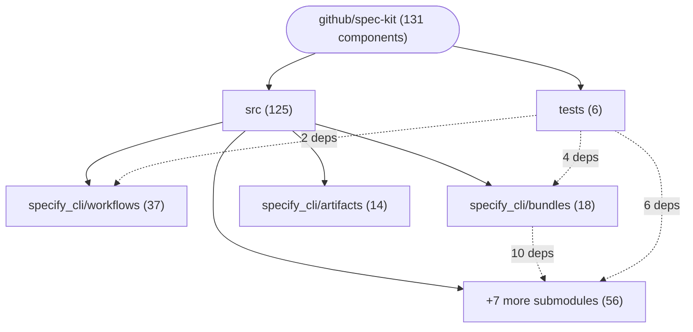

# Repository Architecture Analysis: github/spec-kit

## Metadata
- **SHA**: `2ee2b1e8005905db05f5717300a469b3068b908f`
- **Primary Ecosystem**: Python

## Quality Metrics
- **avg_cyclomatic_complexity**: 4.26
- **component_count**: 131
- **files_analyzed**: 706
- **framework**: Unknown
- **loc**: 286059
- **max_cyclomatic_complexity**: 154
- **sloc**: 234670

# Architecture: github/spec-kit

## Context
- **Repository**: `github/spec-kit`
- **SHA**: `2ee2b1e8005905db05f5717300a469b3068b908f`
- **Ecosystem**: Python
- **Framework**: Unknown

## Building Block View

## Component Details

Showing top 60 representative components out of 131 across 2 module group(s):

- **Module `src`** (125 components — CLI_COMMAND: 91, DATA_ACCESS_LAYER: 26, SERVICE: 8)
- **Module `tests`** (6 components — SERVICE: 5, CLI_COMMAND: 1)

- **_FakeManager** (`tests/specify_cli/bundles/test_primitives.py`): SERVICE (deps: ExtensionManager, PresetManager, _ExtensionKindManager, _PresetKindManager, _StepKindManager, _WorkflowKindManager)
- **TestExtensionManager** (`tests/test_extensions.py`): SERVICE (deps: ConfigManager, ExtensionManager)
- **_ExtensionKindManager** (`src/specify_cli/bundles/primitives.py`): SERVICE (deps: ExtensionManager, PresetManager)
- **_KindManager** (`src/specify_cli/bundles/primitives.py`): SERVICE (deps: ExtensionManager, PresetManager)
- **_PresetKindManager** (`src/specify_cli/bundles/primitives.py`): SERVICE (deps: ExtensionManager, PresetManager)
- **_StepKindManager** (`src/specify_cli/bundles/primitives.py`): SERVICE (deps: ExtensionManager, PresetManager)
- **_WorkflowKindManager** (`src/specify_cli/bundles/primitives.py`): SERVICE (deps: ExtensionManager, PresetManager)
- **init** (`src/specify_cli/command_init.py`): CLI_COMMAND (deps: ExtensionManager, PresetManager)
- **probe** (`tests/specify_cli/workflows/test_mcp.py`): CLI_COMMAND (deps: WorkflowListToolInput, WorkflowListToolResult)
- **PatchedManager** (`tests/specify_cli/extensions/test_command_list.py`): SERVICE (deps: ExtensionManager)
- **TestPresetManager** (`tests/specify_cli/presets/test_manager.py`): SERVICE (deps: PresetManager)
- **VersionRuntimeResult** (`src/specify_cli/mcp_version.py`): DATA_ACCESS_LAYER (deps: VersionResult)
- **VersionSystemResult** (`src/specify_cli/mcp_version.py`): DATA_ACCESS_LAYER (deps: VersionResult)
- **VersionToolResult** (`src/specify_cli/mcp_version.py`): DATA_ACCESS_LAYER (deps: VersionResult)
- **_CliError** (`src/specify_cli/mcp_server/executor.py`): DATA_ACCESS_LAYER (deps: VersionResult)
- **_CliFailure** (`src/specify_cli/mcp_server/executor.py`): DATA_ACCESS_LAYER (deps: VersionResult)
- **bundle_add** (`src/specify_cli/bundles/command_add.py`): CLI_COMMAND (deps: bundle_install)
- **bundle_init** (`src/specify_cli/bundles/command_init.py`): CLI_COMMAND (deps: bundle_install)
- **ArtifactInfoHookResult** (`src/specify_cli/artifacts/mcp_info.py`): DATA_ACCESS_LAYER
- **ArtifactInfoHookStackEntryResult** (`src/specify_cli/artifacts/mcp_info.py`): DATA_ACCESS_LAYER
- **ArtifactInfoNamedResult** (`src/specify_cli/artifacts/mcp_info.py`): DATA_ACCESS_LAYER
- **ArtifactInfoStackEntryResult** (`src/specify_cli/artifacts/mcp_info.py`): DATA_ACCESS_LAYER
- **ArtifactInfoToolInput** (`src/specify_cli/artifacts/mcp_info.py`): DATA_ACCESS_LAYER
- **ArtifactListHookRowResult** (`src/specify_cli/artifacts/mcp_list.py`): DATA_ACCESS_LAYER
- **ArtifactListHookStackEntryResult** (`src/specify_cli/artifacts/mcp_list.py`): DATA_ACCESS_LAYER
- **ArtifactListRowResult** (`src/specify_cli/artifacts/mcp_list.py`): DATA_ACCESS_LAYER
- **ArtifactListStackEntryResult** (`src/specify_cli/artifacts/mcp_list.py`): DATA_ACCESS_LAYER
- **ArtifactListToolInput** (`src/specify_cli/artifacts/mcp_list.py`): DATA_ACCESS_LAYER
- **ArtifactListToolResult** (`src/specify_cli/artifacts/mcp_list.py`): DATA_ACCESS_LAYER
- **CommandArgument** (`src/specify_cli/mcp_server/catalog.py`): DATA_ACCESS_LAYER
- **CommandDescription** (`src/specify_cli/mcp_server/catalog.py`): DATA_ACCESS_LAYER
- **CommandList** (`src/specify_cli/mcp_server/catalog.py`): DATA_ACCESS_LAYER
- **ConfigManager** (`src/specify_cli/extensions/__init__.py`): SERVICE
- **ExtensionManager** (`src/specify_cli/extensions/__init__.py`): SERVICE
- **PresetManager** (`src/specify_cli/presets/_manager.py`): SERVICE
- **RuntimeInfo** (`src/specify_cli/mcp_server/catalog.py`): DATA_ACCESS_LAYER
- **SystemInfo** (`src/specify_cli/mcp_server/catalog.py`): DATA_ACCESS_LAYER
- **VersionResult** (`src/specify_cli/mcp_server/catalog.py`): DATA_ACCESS_LAYER
- **WorkflowEntryResult** (`src/specify_cli/workflows/mcp_list.py`): DATA_ACCESS_LAYER
- **WorkflowListToolInput** (`src/specify_cli/workflows/mcp_list.py`): DATA_ACCESS_LAYER
- **WorkflowListToolResult** (`src/specify_cli/workflows/mcp_list.py`): DATA_ACCESS_LAYER
- **WorkflowWarningResult** (`src/specify_cli/workflows/mcp_list.py`): DATA_ACCESS_LAYER
- **_Manager** (`tests/specify_cli/extensions/test_command_update_discovery.py`): SERVICE
- **artifact_info** (`src/specify_cli/artifacts/command_info.py`): CLI_COMMAND
- **artifact_list** (`src/specify_cli/artifacts/command_list.py`): CLI_COMMAND
- **artifact_lookup** (`src/specify_cli/artifacts/command_lookup.py`): CLI_COMMAND
- **bundle_build** (`src/specify_cli/bundles/command_build.py`): CLI_COMMAND
- **bundle_info** (`src/specify_cli/bundles/command_info.py`): CLI_COMMAND
- **bundle_install** (`src/specify_cli/bundles/command_install.py`): CLI_COMMAND
- **bundle_list** (`src/specify_cli/bundles/command_list.py`): CLI_COMMAND
- **bundle_remove** (`src/specify_cli/bundles/command_remove.py`): CLI_COMMAND
- **bundle_search** (`src/specify_cli/bundles/command_search.py`): CLI_COMMAND
- **bundle_update** (`src/specify_cli/bundles/command_update.py`): CLI_COMMAND
- **bundle_validate** (`src/specify_cli/bundles/command_validate.py`): CLI_COMMAND
- **catalog_add** (`src/specify_cli/bundles/catalog/command_add.py`): CLI_COMMAND
- **catalog_add** (`src/specify_cli/extensions/catalog/command_add.py`): CLI_COMMAND
- **catalog_list** (`src/specify_cli/bundles/catalog/command_list.py`): CLI_COMMAND
- **catalog_list** (`src/specify_cli/extensions/catalog/command_list.py`): CLI_COMMAND
- **catalog_remove** (`src/specify_cli/bundles/catalog/command_remove.py`): CLI_COMMAND
- **catalog_remove** (`src/specify_cli/extensions/catalog/command_remove.py`): CLI_COMMAND

## CI/CD Pipeline Topology

