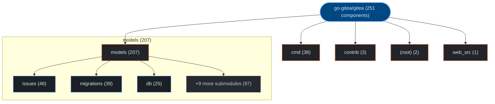
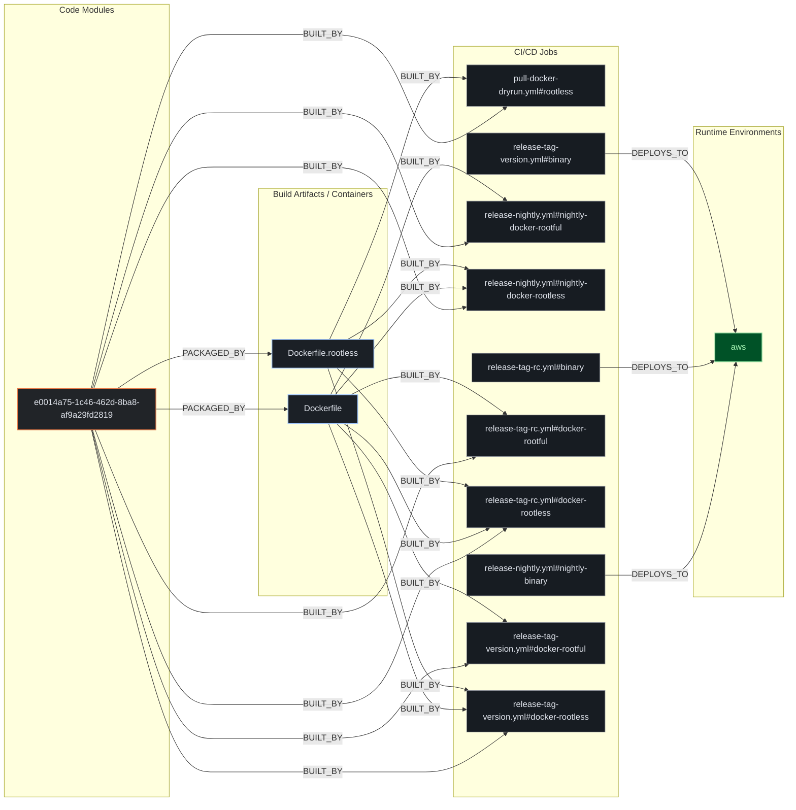

# Repository Architecture Analysis: go-gitea/gitea

## Metadata
- **SHA**: `4afec63b13068b4d39f2780a6016aed12ed4237f`
- **Primary Ecosystem**: Go

## Quality Metrics
- **ast_engine**: tree-sitter
- **avg_cognitive_complexity**: 0.0
- **avg_cyclomatic_complexity**: 0.0
- **component_count**: 251
- **dead_code_count**: 0
- **dead_code_symbols**: 0 entry(ies)
- **duplication_pct**: 0.0
- **file_complexities**: 0 entry(ies)
- **files_analyzed**: 2318
- **fitness_passed**: True
- **fitness_violation_count**: 0
- **framework**: Go Service
- **import_edges**: 0 entry(ies)
- **loc**: 369297
- **max_cognitive_complexity**: 0
- **max_cyclomatic_complexity**: 0
- **sloc**: 284877
- **test_file_count**: 1584

# Architecture: go-gitea/gitea

## Context
- **Repository**: `go-gitea/gitea`
- **SHA**: `4afec63b13068b4d39f2780a6016aed12ed4237f`
- **Ecosystem**: Go
- **Framework**: Go Service

## Building Block View

## Component Details

Showing top 60 representative components out of 251 across 5 module group(s):

- **Module `models`** (207 components — module: 207)
- **Module `cmd`** (38 components — module: 38)
- **Module `contrib`** (3 components — module: 3)
- **Module `(root)`** (2 components — module: 2)
- **Module `web_src`** (1 components — MODULE: 1)

- **action** (`models/activities/action.go`): module
- **action_list** (`models/activities/action_list.go`): module
- **action_test** (`models/activities/action_test.go`): module
- **actions** (`cmd/actions.go`): module
- **admin** (`cmd/admin.go`): module
- **admin_auth_ldap** (`cmd/admin_auth_ldap.go`): module
- **admin_auth_ldap_test** (`cmd/admin_auth_ldap_test.go`): module
- **admin_user** (`cmd/admin_user.go`): module
- **admin_user_change_password** (`cmd/admin_user_change_password.go`): module
- **admin_user_create** (`cmd/admin_user_create.go`): module
- **admin_user_delete** (`cmd/admin_user_delete.go`): module
- **admin_user_generate_access_token** (`cmd/admin_user_generate_access_token.go`): module
- **admin_user_list** (`cmd/admin_user_list.go`): module
- **admin_user_must_change_password** (`cmd/admin_user_must_change_password.go`): module
- **artifact** (`models/actions/artifact.go`): module
- **assignees** (`models/issues/assignees.go`): module
- **assignees_test** (`models/issues/assignees_test.go`): module
- **avatar** (`models/avatars/avatar.go`): module
- **avatar_test** (`models/avatars/avatar_test.go`): module
- **backport** (`contrib/backport/backport.go`): module
- **branch** (`models/git/branch.go`): module
- **branch_list** (`models/git/branch_list.go`): module
- **branch_test** (`models/git/branch_test.go`): module
- **build** (`build.go`): module
- **cert** (`cmd/cert.go`): module
- **cmd** (`cmd/cmd.go`): module
- **comment** (`models/issues/comment.go`): module
- **comment_code** (`models/issues/comment_code.go`): module
- **comment_list** (`models/issues/comment_list.go`): module
- **comment_test** (`models/issues/comment_test.go`): module
- **commit_status** (`models/git/commit_status.go`): module
- **commit_status_test** (`models/git/commit_status_test.go`): module
- **common** (`models/db/common.go`): module
- **consistency** (`models/db/consistency.go`): module
- **content_history** (`models/issues/content_history.go`): module
- **content_history_test** (`models/issues/content_history_test.go`): module
- **context** (`models/db/context.go`): module
- **context_committer_test** (`models/db/context_committer_test.go`): module
- **context_test** (`models/db/context_test.go`): module
- **convert** (`models/db/convert.go`): module
- **db** (`models/db/install/db.go`): module
- **db** (`models/migrations/base/db.go`): module
- **db_test** (`models/migrations/base/db_test.go`): module
- **dbfile** (`models/dbfs/dbfile.go`): module
- **dbfs** (`models/dbfs/dbfs.go`): module
- **dbfs_test** (`models/dbfs/dbfs_test.go`): module
- **dependency** (`models/issues/dependency.go`): module
- **dependency_test** (`models/issues/dependency_test.go`): module
- **docs** (`cmd/docs.go`): module
- **doctor** (`cmd/doctor.go`): module
- **doctor_convert** (`cmd/doctor_convert.go`): module
- **doctor_test** (`cmd/doctor_test.go`): module
- **dump** (`cmd/dump.go`): module
- **dump_repo** (`cmd/dump_repo.go`): module
- **embedded** (`cmd/embedded.go`): module
- **engine** (`models/db/engine.go`): module
- **engine_test** (`models/db/engine_test.go`): module
- **environment-to-ini** (`contrib/environment-to-ini/environment-to-ini.go`): module
- **error** (`models/asymkey/error.go`): module
- **error** (`models/db/error.go`): module

## 6-Dimension Repository Scorecard

- **Overall Grade**: `D` (60.50/100)
- **Technical Debt Score**: 39.50
- **Estimated Remediation Effort**: 170.38h

| Dimension | Grade | Score | Weight | Details |
| :--- | :---: | :---: | :---: | :--- |
| Code Quality | `A` | 100.00 | 0.20 | avg_cc=0.00, max_cc=0, duplication=0.00%, dead_code=0 |
| Dependency Health | `A` | 100.00 | 0.15 | dependencies=2131, outdated=0, vulnerable=0, has_lockfile=True |
| Maintainability | `A` | 100.00 | 0.15 | avg_cognitive=0.00, max_cognitive=0, fitness_violations=0, oversized_files=0 |
| Pipeline Health | `F` | 0.00 | 0.15 | workflows=13, operational_antipatterns=52, parallel_branches=True |
| Security | `F` | 0.00 | 0.20 | vulnerabilities=0, secrets=15, pipeline_security_findings=59 |
| Test Coverage | `C` | 70.00 | 0.15 | coverage=unavailable, ci_test_job=True, test_files_detected=True |

## Supply Chain Dependencies, Vulnerabilities & Secrets

- **Dependencies Parsed**: 2131 | **Vulnerabilities**: 0 | **Secrets**: 15

### Secret Findings (Redacted)
- **[HIGH] `ATRUSS-SEC-005`** at `docs/content/development/oauth2-provider.en-us.md:140` (`"access_token": "eyJh***REDACTED***",`)
- **[HIGH] `ATRUSS-SEC-005`** at `docs/content/development/oauth2-provider.en-us.md:143` (`"refresh_token": "eyJh***REDACTED***"`)
- **[HIGH] `ATRUSS-SEC-005`** at `docs/content/development/oauth2-provider.en-us.md:204` (`"access_token": "eyJh***REDACTED***",`)
- **[HIGH] `ATRUSS-SEC-005`** at `docs/content/development/oauth2-provider.en-us.md:207` (`"refresh_token": "eyJh***REDACTED***"`)
- **[HIGH] `ATRUSS-SEC-005`** at `docs/content/development/oauth2-provider.zh-cn.md:126` (`"access_token": "eyJh***REDACTED***",`)
- **[HIGH] `ATRUSS-SEC-005`** at `docs/content/development/oauth2-provider.zh-cn.md:129` (`"refresh_token": "eyJh***REDACTED***"`)
- **[HIGH] `ATRUSS-SEC-005`** at `docs/content/usage/webhooks.en-us.md:53` (`"secret": "3gEs***REDACTED***",`)
- **[HIGH] `ATRUSS-SEC-005`** at `docs/content/usage/webhooks.zh-cn.md:51` (`"secret": "3gEs***REDACTED***",`)
- **[CRITICAL] `ATRUSS-SEC-004`** at `models/asymkey/ssh_key_test.go:203` (`-----BEGIN ... PRIVATE KEY----- [REDACTED]`)
- **[CRITICAL] `ATRUSS-SEC-004`** at `models/asymkey/ssh_key_test.go:245` (`-----BEGIN ... PRIVATE KEY----- [REDACTED]`)
- **[CRITICAL] `ATRUSS-SEC-004`** at `models/asymkey/ssh_key_test.go:288` (`-----BEGIN ... PRIVATE KEY----- [REDACTED]`)
- **[HIGH] `ATRUSS-SEC-005`** at `models/fixtures/oauth2_application.yml:6` (`client_secret: "$2a$***REDACTED***" # bcrypt of "4MK8Na6R55smdCY0WuCCumZ6hjRPnGY5saWVRHHjJiA=`)
- **[HIGH] `ATRUSS-SEC-005`** at `models/fixtures/oauth2_application.yml:16` (`client_secret: "$2a$***REDACTED***" # bcrypt of "4MK8Na6R55smdCY0WuCCumZ6hjRPnGY5saWVRHHjJiA=`)
- **[HIGH] `ATRUSS-SEC-005`** at `models/fixtures/two_factor.yml:4` (`secret: KlDp***REDACTED***`)
- **[CRITICAL] `ATRUSS-SEC-004`** at `modules/util/keypair_test.go:26` (`-----BEGIN ... PRIVATE KEY----- [REDACTED]`)

### Inventory Sample
- `djlint` `1.34.0` (PyPI, `poetry.lock`)
- `djlint` `1.34.0` (PyPI, `pyproject.toml`)
- `yamllint` `1.32.0` (PyPI, `poetry.lock`)
- `yamllint` `1.32.0` (PyPI, `pyproject.toml`)
- `code.gitea.io/actions-proto-go` `0.3.1` (golang, `go.mod`)
- `code.gitea.io/gitea-vet` `0.2.3` (golang, `go.mod`)
- `code.gitea.io/sdk/gitea` `0.16.0` (golang, `go.mod`)
- `codeberg.org/gusted/mcaptcha` `0.0.0-20220723083913-4f3072e1d570` (golang, `go.mod`)
- `gitea.com/go-chi/binding` `0.0.0-20230415142243-04b515c6d669` (golang, `go.mod`)
- `gitea.com/go-chi/cache` `0.2.0` (golang, `go.mod`)
- `gitea.com/go-chi/captcha` `0.0.0-20230415143339-2c0754df4384` (golang, `go.mod`)
- `gitea.com/go-chi/session` `0.0.0-20230613035928-39541325faa3` (golang, `go.mod`)
- `gitea.com/lunny/dingtalk_webhook` `0.0.0-20171025031554-e3534c89ef96` (golang, `go.mod`)
- `gitea.com/lunny/levelqueue` `0.4.2-0.20230414023320-3c0159fe0fe4` (golang, `go.mod`)
- `github.com/42wim/sshsig` `0.0.0-20211121163825-841cf5bbc121` (golang, `go.mod`)
- `github.com/Azure/go-ntlmssp` `0.0.0-20221128193559-754e69321358` (golang, `go.mod`)
- `github.com/NYTimes/gziphandler` `1.1.1` (golang, `go.mod`)
- `github.com/PuerkitoBio/goquery` `1.8.1` (golang, `go.mod`)
- `github.com/alecthomas/chroma/v2` `2.13.0` (golang, `go.mod`)
- `github.com/blakesmith/ar` `0.0.0-20190502131153-809d4375e1fb` (golang, `go.mod`)
- `github.com/blevesearch/bleve/v2` `2.3.10` (golang, `go.mod`)
- `github.com/bufbuild/connect-go` `1.10.0` (golang, `go.mod`)
- `github.com/buildkite/terminal-to-html/v3` `3.9.1` (golang, `go.mod`)
- `github.com/caddyserver/certmagic` `0.19.2` (golang, `go.mod`)
- `github.com/chi-middleware/proxy` `1.1.1` (golang, `go.mod`)
- `github.com/denisenkom/go-mssqldb` `0.12.3` (golang, `go.mod`)
- `github.com/dimiro1/reply` `0.0.0-20200315094148-d0136a4c9e21` (golang, `go.mod`)
- `github.com/djherbis/buffer` `1.2.0` (golang, `go.mod`)
- `github.com/djherbis/nio/v3` `3.0.1` (golang, `go.mod`)
- `github.com/dsnet/compress` `0.0.2-0.20210315054119-f66993602bf5` (golang, `go.mod`)
- ... (+2101 more dependencies)

## Section 7: Code-to-Cloud Deployment Traceability

- `release-nightly.yml#nightly-binary` (ci_job) --[DEPLOYS_TO]--> `aws` (environment)
- `release-tag-rc.yml#binary` (ci_job) --[DEPLOYS_TO]--> `aws` (environment)
- `release-tag-version.yml#binary` (ci_job) --[DEPLOYS_TO]--> `aws` (environment)
- `e0014a75-1c46-462d-8ba8-af9a29fd2819` (code_module) --[BUILT_BY]--> `pull-docker-dryrun.yml#rootless` (ci_job)
- `e0014a75-1c46-462d-8ba8-af9a29fd2819` (code_module) --[BUILT_BY]--> `release-nightly.yml#nightly-docker-rootful` (ci_job)
- `e0014a75-1c46-462d-8ba8-af9a29fd2819` (code_module) --[BUILT_BY]--> `release-nightly.yml#nightly-docker-rootless` (ci_job)
- `e0014a75-1c46-462d-8ba8-af9a29fd2819` (code_module) --[BUILT_BY]--> `release-tag-rc.yml#docker-rootful` (ci_job)
- `e0014a75-1c46-462d-8ba8-af9a29fd2819` (code_module) --[BUILT_BY]--> `release-tag-rc.yml#docker-rootless` (ci_job)
- `e0014a75-1c46-462d-8ba8-af9a29fd2819` (code_module) --[BUILT_BY]--> `release-tag-version.yml#docker-rootful` (ci_job)
- `e0014a75-1c46-462d-8ba8-af9a29fd2819` (code_module) --[BUILT_BY]--> `release-tag-version.yml#docker-rootless` (ci_job)
- `e0014a75-1c46-462d-8ba8-af9a29fd2819` (code_module) --[PACKAGED_BY]--> `Dockerfile` (container)
- `e0014a75-1c46-462d-8ba8-af9a29fd2819` (code_module) --[PACKAGED_BY]--> `Dockerfile.rootless` (container)
- `Dockerfile` (container) --[BUILT_BY]--> `release-nightly.yml#nightly-docker-rootful` (ci_job)
- `Dockerfile` (container) --[BUILT_BY]--> `release-nightly.yml#nightly-docker-rootless` (ci_job)
- `Dockerfile` (container) --[BUILT_BY]--> `release-tag-rc.yml#docker-rootful` (ci_job)
- `Dockerfile` (container) --[BUILT_BY]--> `release-tag-rc.yml#docker-rootless` (ci_job)
- `Dockerfile` (container) --[BUILT_BY]--> `release-tag-version.yml#docker-rootful` (ci_job)
- `Dockerfile` (container) --[BUILT_BY]--> `release-tag-version.yml#docker-rootless` (ci_job)
- `Dockerfile.rootless` (container) --[BUILT_BY]--> `pull-docker-dryrun.yml#rootless` (ci_job)
- `Dockerfile.rootless` (container) --[BUILT_BY]--> `release-nightly.yml#nightly-docker-rootless` (ci_job)
- `Dockerfile.rootless` (container) --[BUILT_BY]--> `release-tag-rc.yml#docker-rootless` (ci_job)
- `Dockerfile.rootless` (container) --[BUILT_BY]--> `release-tag-version.yml#docker-rootless` (ci_job)

## CI/CD Pipeline Topology

```mermaid
graph TD;
  classDef atlasRoot fill:#004882,stroke:#a3c9ff,stroke-width:2px,color:#d3e4ff
  classDef atlasCategory fill:#212428,stroke:#E87A48,stroke-width:1.5px,color:#dfe3eb
  classDef atlasWorkflow fill:#1b2026,stroke:#a3c9ff,stroke-width:1.5px,color:#dfe3eb
  classDef atlasJob fill:#171c22,stroke:#8d9199,stroke-width:1px,color:#dfe3eb
  classDef atlasTarget fill:#005227,stroke:#8bd99b,stroke-width:1.5px,color:#a7f6b6
  classDef atlasAlert fill:#93000a,stroke:#ffb4ab,stroke-width:1.5px,color:#ffdad6
  classDef atlasMore fill:#252a31,stroke:#8d9199,stroke-dasharray:4 4,color:#c3c6cf
  pipeline_root(["go-gitea/gitea (13 workflows)"]):::atlasRoot
  subgraph sg_grp_0_CI___Verification["CI & Verification (5 workflows · 26 jobs)"]
    direction TB
    subgraph sg_wf_5_compliance["compliance (13 jobs)"]
      direction TB
      wf_5_compliance(["Trigger: compliance"]):::atlasWorkflow
      job_5_files_changed["files-changed"]:::atlasJob
      job_5_lint_backend["lint-backend"]:::atlasJob
      job_5_lint_templates["lint-templates"]:::atlasJob
      wf_5_compliance --> job_5_files_changed
      job_5_files_changed --> job_5_lint_backend
      job_5_files_changed --> job_5_lint_templates
    end
    pipeline_root --> wf_5_compliance
    subgraph sg_wf_6_db_tests["db-tests (7 jobs)"]
      direction TB
      wf_6_db_tests(["Trigger: db-tests"]):::atlasWorkflow
      job_6_files_changed["files-changed"]:::atlasJob
      job_6_test_pgsql["test-pgsql"]:::atlasJob
      job_6_test_sqlite["test-sqlite"]:::atlasJob
      wf_6_db_tests --> job_6_files_changed
      job_6_files_changed --> job_6_test_pgsql
      job_6_files_changed --> job_6_test_sqlite
    end
    pipeline_root --> wf_6_db_tests
    subgraph sg_wf_7_docker_dryrun["docker-dryrun (3 jobs)"]
      direction TB
      wf_7_docker_dryrun(["Trigger: docker-dryrun"]):::atlasWorkflow
      job_7_files_changed["files-changed"]:::atlasJob
      job_7_regular["regular"]:::atlasJob
      job_7_rootless["rootless"]:::atlasJob
      wf_7_docker_dryrun --> job_7_files_changed
      job_7_files_changed --> job_7_regular
      job_7_files_changed --> job_7_rootless
    end
    pipeline_root --> wf_7_docker_dryrun
  end
  subgraph sg_grp_1_Release___Deploy["Release & Deploy (3 workflows · 9 jobs)"]
    direction TB
    subgraph sg_wf_10_release_nightly["release-nightly (3 jobs)"]
      direction TB
      wf_10_release_nightly(["Trigger: release-nightly"]):::atlasWorkflow
      job_10_nightly_binary["nightly-binary"]:::atlasJob
      job_10_nightly_docker_rootful["nightly-docker-rootful"]:::atlasJob
      job_10_nightly_docker_rootless["nightly-docker-rootless"]:::atlasJob
      wf_10_release_nightly --> job_10_nightly_binary
      wf_10_release_nightly --> job_10_nightly_docker_rootful
      wf_10_release_nightly --> job_10_nightly_docker_rootless
    end
    pipeline_root --> wf_10_release_nightly
    subgraph sg_wf_11_release_tag_rc["release-tag-rc (3 jobs)"]
      direction TB
      wf_11_release_tag_rc(["Trigger: release-tag-rc"]):::atlasWorkflow
      job_11_binary["binary"]:::atlasJob
      job_11_docker_rootful["docker-rootful"]:::atlasJob
      job_11_docker_rootless["docker-rootless"]:::atlasJob
      wf_11_release_tag_rc --> job_11_binary
      wf_11_release_tag_rc --> job_11_docker_rootful
      wf_11_release_tag_rc --> job_11_docker_rootless
    end
    pipeline_root --> wf_11_release_tag_rc
  end
  subgraph sg_grp_2_Automation___Other["Automation & Other (2 workflows · 2 jobs)"]
    direction TB
    subgraph sg_wf_3_disk_clean["disk-clean (1 jobs)"]
      direction TB
      wf_3_disk_clean(["Trigger: disk-clean"]):::atlasWorkflow
      job_3_triage["triage"]:::atlasJob
      wf_3_disk_clean --> job_3_triage
    end
    pipeline_root --> wf_3_disk_clean
    wf_4_files_changed["files-changed (1 jobs)"]:::atlasWorkflow
    pipeline_root --> wf_4_files_changed
  end
  subgraph sg_grp_3_Scheduled___Manual["Scheduled & Manual (2 workflows · 3 jobs)"]
    direction TB
    wf_0_cron_licenses["cron-licenses (1 jobs)"]:::atlasWorkflow
    pipeline_root --> wf_0_cron_licenses
    wf_2_cron_translations["cron-translations (2 jobs)"]:::atlasWorkflow
    pipeline_root --> wf_2_cron_translations
  end
  subgraph sg_grp_4_Security___Governance["Security & Governance (1 workflows · 1 jobs)"]
    direction TB
    wf_1_cron_lock["cron-lock (1 jobs)"]:::atlasWorkflow
    pipeline_root --> wf_1_cron_lock
  end
  wf_more["+3 more workflows"]:::atlasMore
  pipeline_root --> wf_more
```

