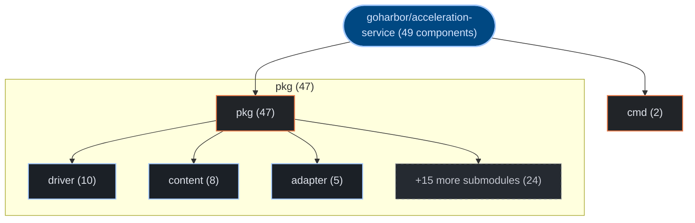
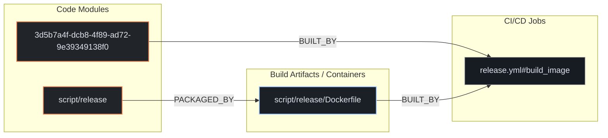
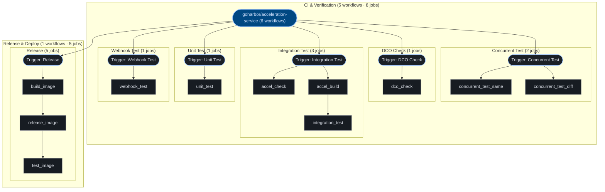

# Repository Architecture Analysis: goharbor/acceleration-service

## Metadata
- **SHA**: `e6d9bc66bfd9bb5a19f47f1f7478fe41b98f4ddf`
- **Primary Ecosystem**: Go

## Quality Metrics
- **ast_engine**: fallback
- **avg_cognitive_complexity**: 0.0
- **avg_cyclomatic_complexity**: 0.0
- **component_count**: 49
- **dead_code_count**: 0
- **dead_code_symbols**: 0 entry(ies)
- **duplication_pct**: 0.0
- **file_complexities**: 0 entry(ies)
- **files_analyzed**: 49
- **fitness_passed**: True
- **fitness_violation_count**: 0
- **framework**: Go Gin / Echo / Fiber
- **import_edges**: 0 entry(ies)
- **loc**: 6933
- **max_cognitive_complexity**: 0
- **max_cyclomatic_complexity**: 0
- **sloc**: 5187
- **test_file_count**: 7

# Architecture: goharbor/acceleration-service

## Context
- **Repository**: `goharbor/acceleration-service`
- **SHA**: `e6d9bc66bfd9bb5a19f47f1f7478fe41b98f4ddf`
- **Ecosystem**: Go
- **Framework**: Go Gin / Echo / Fiber

## Building Block View

## Component Details
- **main** (`cmd/accelctl/main.go`): module
- **main** (`cmd/acceld/main.go`): module
- **adapter** (`pkg/adapter/adapter.go`): module
- **rule** (`pkg/adapter/rule.go`): module
- **rule_test** (`pkg/adapter/rule_test.go`): module
- **worker** (`pkg/adapter/worker.go`): module
- **annotation** (`pkg/adapter/annotation/annotation.go`): module
- **cache** (`pkg/cache/cache.go`): module
- **cache_test** (`pkg/cache/cache_test.go`): module
- **client** (`pkg/client/client.go`): module
- **convert** (`pkg/client/convert.go`): module
- **config** (`pkg/config/config.go`): module
- **bucket** (`pkg/content/bucket.go`): module
- **cache_test** (`pkg/content/cache_test.go`): module
- **content** (`pkg/content/content.go`): module
- **content_test** (`pkg/content/content_test.go`): module
- **lease** (`pkg/content/lease.go`): module
- **local** (`pkg/content/local.go`): module
- **ported** (`pkg/content/ported.go`): module
- **provider** (`pkg/content/provider.go`): module
- **converter** (`pkg/converter/converter.go`): module
- **metric** (`pkg/converter/metric.go`): module
- **opts** (`pkg/converter/opts.go`): module
- **daemon** (`pkg/daemon/daemon.go`): module
- **driver** (`pkg/driver/driver.go`): module
- **estargz** (`pkg/driver/estargz/estargz.go`): module
- **nydus** (`pkg/driver/nydus/nydus.go`): module
- **nydus_test** (`pkg/driver/nydus/nydus_test.go`): module
- **parser** (`pkg/driver/nydus/parser/parser.go`): module
- **archive** (`pkg/driver/nydus/utils/archive.go`): module
- **archive_test** (`pkg/driver/nydus/utils/archive_test.go`): module
- **constant** (`pkg/driver/nydus/utils/constant.go`): module
- **utils** (`pkg/driver/nydus/utils/utils.go`): module
- **utils_test** (`pkg/driver/nydus/utils/utils_test.go`): module
- **errors** (`pkg/errdefs/errors.go`): module
- **handler** (`pkg/handler/handler.go`): module
- **metrics** (`pkg/metrics/metrics.go`): module
- **model** (`pkg/model/model.go`): module
- **platformutil** (`pkg/platformutil/platformutil.go`): module
- **ported** (`pkg/remote/ported.go`): module
- **resolve** (`pkg/remote/resolve.go`): module
- **health** (`pkg/router/health.go`): module
- **router** (`pkg/router/router.go`): module
- **task_create** (`pkg/router/task_create.go`): module
- **task_list** (`pkg/router/task_list.go`): module
- **server** (`pkg/server/server.go`): module
- **util** (`pkg/server/util/util.go`): module
- **manager** (`pkg/task/manager.go`): module
- **utils** (`pkg/utils/utils.go`): module

## 6-Dimension Repository Scorecard

- **Overall Grade**: `D` (60.35/100)
- **Technical Debt Score**: 39.65
- **Estimated Remediation Effort**: 50.91h

| Dimension | Grade | Score | Weight | Details |
| :--- | :---: | :---: | :---: | :--- |
| Code Quality | `A` | 100.00 | 0.20 | avg_cc=0.00, max_cc=0, duplication=0.00%, dead_code=0 |
| Dependency Health | `B` | 85.00 | 0.15 | dependencies=118, outdated=0, vulnerable=0, has_lockfile=False |
| Maintainability | `A` | 100.00 | 0.15 | avg_cognitive=0.00, max_cognitive=0, fitness_violations=0, oversized_files=0 |
| Pipeline Health | `F` | 14.00 | 0.15 | workflows=6, operational_antipatterns=16, parallel_branches=True |
| Security | `F` | 0.00 | 0.20 | vulnerabilities=0, secrets=0, pipeline_security_findings=20 |
| Test Coverage | `C` | 70.00 | 0.15 | coverage=unavailable, ci_test_job=True, test_files_detected=True |

## Supply Chain Dependencies, Vulnerabilities & Secrets

- **Dependencies Parsed**: 118 | **Vulnerabilities**: 0 | **Secrets**: 0

### Inventory Sample
- `github.com/containerd/containerd/v2` `2.0.2` (golang, `go.mod`)
- `github.com/containerd/errdefs` `1.0.0` (golang, `go.mod`)
- `github.com/containerd/log` `0.1.0` (golang, `go.mod`)
- `github.com/containerd/nydus-snapshotter` `0.15.7` (golang, `go.mod`)
- `github.com/containerd/platforms` `1.0.0-rc.1` (golang, `go.mod`)
- `github.com/containerd/stargz-snapshotter` `0.16.3` (golang, `go.mod`)
- `github.com/containerd/stargz-snapshotter/estargz` `0.16.3` (golang, `go.mod`)
- `github.com/distribution/reference` `0.6.0` (golang, `go.mod`)
- `github.com/docker/cli` `27.3.1+incompatible` (golang, `go.mod`)
- `github.com/dustin/go-humanize` `1.0.1` (golang, `go.mod`)
- `github.com/google/uuid` `1.6.0` (golang, `go.mod`)
- `github.com/hashicorp/golang-lru/v2` `2.0.7` (golang, `go.mod`)
- `github.com/labstack/echo-contrib` `0.17.1` (golang, `go.mod`)
- `github.com/labstack/echo/v4` `4.12.0` (golang, `go.mod`)
- `github.com/labstack/gommon` `0.4.2` (golang, `go.mod`)
- `github.com/opencontainers/go-digest` `1.0.0` (golang, `go.mod`)
- `github.com/opencontainers/image-spec` `1.1.0` (golang, `go.mod`)
- `github.com/pkg/errors` `0.9.1` (golang, `go.mod`)
- `github.com/prometheus/client_golang` `1.20.5` (golang, `go.mod`)
- `github.com/sirupsen/logrus` `1.9.3` (golang, `go.mod`)
- `github.com/stretchr/testify` `1.10.0` (golang, `go.mod`)
- `github.com/urfave/cli/v2` `2.27.5` (golang, `go.mod`)
- `go.etcd.io/bbolt` `1.3.11` (golang, `go.mod`)
- `golang.org/x/sync` `0.9.0` (golang, `go.mod`)
- `gopkg.in/yaml.v3` `3.0.1` (golang, `go.mod`)
- `github.com/AdaLogics/go-fuzz-headers` `0.0.0-20240806141605-e8a1dd7889d6` (golang, `go.mod`)
- `github.com/AdamKorcz/go-118-fuzz-build` `0.0.0-20231105174938-2b5cbb29f3e2` (golang, `go.mod`)
- `github.com/Microsoft/go-winio` `0.6.2` (golang, `go.mod`)
- `github.com/Microsoft/hcsshim` `0.12.9` (golang, `go.mod`)
- `github.com/aliyun/aliyun-oss-go-sdk` `3.0.2+incompatible` (golang, `go.mod`)
- ... (+88 more dependencies)

## Section 7: Code-to-Cloud Deployment Traceability

- `3d5b7a4f-dcb8-4f89-ad72-9e39349138f0` (code_module) --[BUILT_BY]--> `release.yml#build_image` (ci_job)
- `script/release` (code_module) --[PACKAGED_BY]--> `script/release/Dockerfile` (container)
- `script/release/Dockerfile` (container) --[BUILT_BY]--> `release.yml#build_image` (ci_job)

## CI/CD Pipeline Topology

