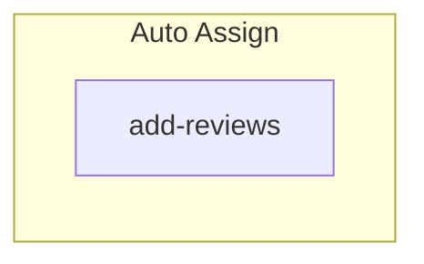

# Repository Architecture Analysis: goharbor/community

## Metadata
- **SHA**: `58c9d106428b98f55ae2a891e1c64f0715280144`
- **Primary Ecosystem**: Unknown

## Quality Metrics
- **ast_engine**: tree-sitter
- **avg_cognitive_complexity**: 0.0
- **avg_cyclomatic_complexity**: 0.0
- **component_count**: 0
- **dead_code_count**: 0
- **dead_code_symbols**: 0 entry(ies)
- **duplication_pct**: 0.0
- **file_complexities**: 0 entry(ies)
- **files_analyzed**: 0
- **fitness_passed**: True
- **fitness_violation_count**: 0
- **framework**: Unknown
- **import_edges**: 0 entry(ies)
- **loc**: 0
- **max_cognitive_complexity**: 0
- **max_cyclomatic_complexity**: 0
- **sloc**: 0

## 6-Dimension Repository Scorecard

- **Overall Grade**: `C` (77.05/100)
- **Technical Debt Score**: 22.95
- **Estimated Remediation Effort**: 13.24h

| Dimension | Grade | Score | Weight | Details |
| :--- | :---: | :---: | :---: | :--- |
| Code Quality | `A` | 100.00 | 0.20 | avg_cc=0.00, max_cc=0, duplication=0.00%, dead_code=0 |
| Dependency Health | `A` | 90.00 | 0.15 | dependencies=0 (no manifests parsed) |
| Maintainability | `A` | 100.00 | 0.15 | avg_cognitive=0.00, max_cognitive=0, fitness_violations=0, oversized_files=0 |
| Pipeline Health | `A` | 97.00 | 0.15 | workflows=1, operational_antipatterns=1, parallel_branches=False |
| Security | `F` | 40.00 | 0.20 | vulnerabilities=0, secrets=2, pipeline_security_findings=2 |
| Test Coverage | `F` | 40.00 | 0.15 | coverage=unavailable, ci_test_job=False, test_files_detected=False |

## Supply Chain Dependencies, Vulnerabilities & Secrets

- **Dependencies Parsed**: 0 | **Vulnerabilities**: 0 | **Secrets**: 2

### Secret Findings (Redacted)
- **[HIGH] `ATRUSS-SEC-005`** at `proposals/robot.md:78` (`token: "rKgj***REDACTED***"`)
- **[HIGH] `ATRUSS-SEC-005`** at `proposals/robot.md:144` (`"auth": "Zmcm***REDACTED***",`)

## CI/CD Pipeline Topology

