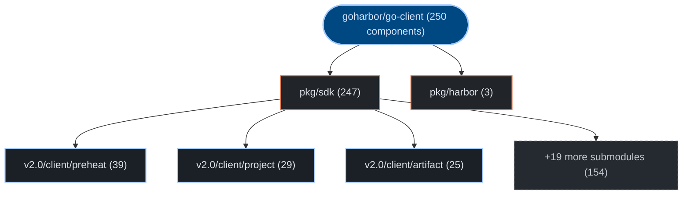
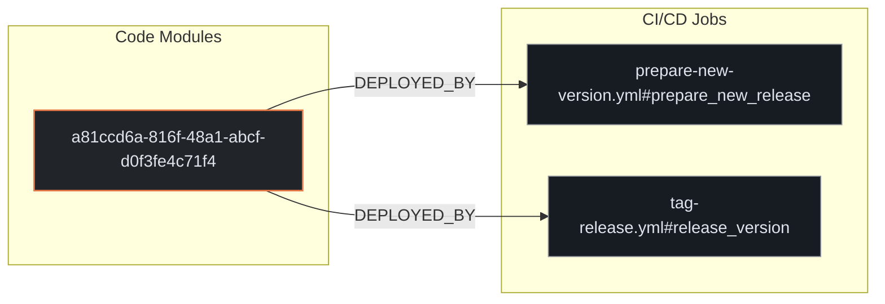
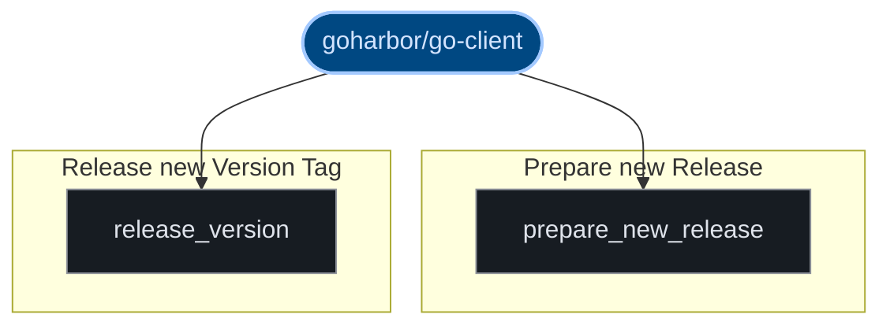

# Repository Architecture Analysis: goharbor/go-client

## Metadata
- **SHA**: `ab47876d7d77e0172c7806c1faf51176f22668ff`
- **Primary Ecosystem**: Go

## Quality Metrics
- **ast_engine**: fallback
- **avg_cognitive_complexity**: 0.0
- **avg_cyclomatic_complexity**: 0.0
- **component_count**: 250
- **dead_code_count**: 0
- **dead_code_symbols**: 0 entry(ies)
- **duplication_pct**: 0.0
- **file_complexities**: 0 entry(ies)
- **files_analyzed**: 611
- **fitness_passed**: True
- **fitness_violation_count**: 0
- **framework**: Unknown
- **import_edges**: 0 entry(ies)
- **loc**: 164605
- **max_cognitive_complexity**: 0
- **max_cyclomatic_complexity**: 0
- **sloc**: 101481
- **test_file_count**: 2

# Architecture: goharbor/go-client

## Context
- **Repository**: `goharbor/go-client`
- **SHA**: `ab47876d7d77e0172c7806c1faf51176f22668ff`
- **Ecosystem**: Go
- **Framework**: Unknown

## Building Block View

## Component Details

Showing top 60 representative components out of 250 across 2 module group(s):

- **Module `pkg/sdk`** (247 components — module: 247)
- **Module `pkg/harbor`** (3 components — module: 3)

- **action_get_job_log_parameters** (`pkg/sdk/v2.0/client/jobservice/action_get_job_log_parameters.go`): module
- **action_get_job_log_responses** (`pkg/sdk/v2.0/client/jobservice/action_get_job_log_responses.go`): module
- **action_pending_jobs_parameters** (`pkg/sdk/v2.0/client/jobservice/action_pending_jobs_parameters.go`): module
- **action_pending_jobs_responses** (`pkg/sdk/v2.0/client/jobservice/action_pending_jobs_responses.go`): module
- **add_label_parameters** (`pkg/sdk/v2.0/client/artifact/add_label_parameters.go`): module
- **add_label_responses** (`pkg/sdk/v2.0/client/artifact/add_label_responses.go`): module
- **add_project_metadatas_parameters** (`pkg/sdk/v2.0/client/project_metadata/add_project_metadatas_parameters.go`): module
- **add_project_metadatas_responses** (`pkg/sdk/v2.0/client/project_metadata/add_project_metadatas_responses.go`): module
- **artifact_client** (`pkg/sdk/v2.0/client/artifact/artifact_client.go`): module
- **auditlog_client** (`pkg/sdk/v2.0/client/auditlog/auditlog_client.go`): module
- **client** (`pkg/harbor/client.go`): module
- **client_test** (`pkg/harbor/client_test.go`): module
- **configure_client** (`pkg/sdk/v2.0/client/configure/configure_client.go`): module
- **copy_artifact_parameters** (`pkg/sdk/v2.0/client/artifact/copy_artifact_parameters.go`): module
- **copy_artifact_responses** (`pkg/sdk/v2.0/client/artifact/copy_artifact_responses.go`): module
- **create_gc_schedule_parameters** (`pkg/sdk/v2.0/client/gc/create_gc_schedule_parameters.go`): module
- **create_gc_schedule_responses** (`pkg/sdk/v2.0/client/gc/create_gc_schedule_responses.go`): module
- **create_immu_rule_parameters** (`pkg/sdk/v2.0/client/immutable/create_immu_rule_parameters.go`): module
- **create_immu_rule_responses** (`pkg/sdk/v2.0/client/immutable/create_immu_rule_responses.go`): module
- **create_instance_parameters** (`pkg/sdk/v2.0/client/preheat/create_instance_parameters.go`): module
- **create_instance_responses** (`pkg/sdk/v2.0/client/preheat/create_instance_responses.go`): module
- **create_label_parameters** (`pkg/sdk/v2.0/client/label/create_label_parameters.go`): module
- **create_label_responses** (`pkg/sdk/v2.0/client/label/create_label_responses.go`): module
- **create_policy_parameters** (`pkg/sdk/v2.0/client/preheat/create_policy_parameters.go`): module
- **create_policy_responses** (`pkg/sdk/v2.0/client/preheat/create_policy_responses.go`): module
- **create_project_member_parameters** (`pkg/sdk/v2.0/client/member/create_project_member_parameters.go`): module
- **create_project_member_responses** (`pkg/sdk/v2.0/client/member/create_project_member_responses.go`): module
- **create_project_parameters** (`pkg/sdk/v2.0/client/project/create_project_parameters.go`): module
- **create_project_responses** (`pkg/sdk/v2.0/client/project/create_project_responses.go`): module
- **create_purge_schedule_parameters** (`pkg/sdk/v2.0/client/purge/create_purge_schedule_parameters.go`): module
- **create_purge_schedule_responses** (`pkg/sdk/v2.0/client/purge/create_purge_schedule_responses.go`): module
- **create_registry_parameters** (`pkg/sdk/v2.0/client/registry/create_registry_parameters.go`): module
- **create_registry_responses** (`pkg/sdk/v2.0/client/registry/create_registry_responses.go`): module
- **create_replication_policy_parameters** (`pkg/sdk/v2.0/client/replication/create_replication_policy_parameters.go`): module
- **create_replication_policy_responses** (`pkg/sdk/v2.0/client/replication/create_replication_policy_responses.go`): module
- **create_tag_parameters** (`pkg/sdk/v2.0/client/artifact/create_tag_parameters.go`): module
- **create_tag_responses** (`pkg/sdk/v2.0/client/artifact/create_tag_responses.go`): module
- **delete_artifact_parameters** (`pkg/sdk/v2.0/client/artifact/delete_artifact_parameters.go`): module
- **delete_artifact_responses** (`pkg/sdk/v2.0/client/artifact/delete_artifact_responses.go`): module
- **delete_immu_rule_parameters** (`pkg/sdk/v2.0/client/immutable/delete_immu_rule_parameters.go`): module
- **delete_immu_rule_responses** (`pkg/sdk/v2.0/client/immutable/delete_immu_rule_responses.go`): module
- **delete_instance_parameters** (`pkg/sdk/v2.0/client/preheat/delete_instance_parameters.go`): module
- **delete_instance_responses** (`pkg/sdk/v2.0/client/preheat/delete_instance_responses.go`): module
- **delete_label_parameters** (`pkg/sdk/v2.0/client/label/delete_label_parameters.go`): module
- **delete_label_responses** (`pkg/sdk/v2.0/client/label/delete_label_responses.go`): module
- **delete_policy_parameters** (`pkg/sdk/v2.0/client/preheat/delete_policy_parameters.go`): module
- **delete_policy_responses** (`pkg/sdk/v2.0/client/preheat/delete_policy_responses.go`): module
- **delete_project_member_parameters** (`pkg/sdk/v2.0/client/member/delete_project_member_parameters.go`): module
- **delete_project_member_responses** (`pkg/sdk/v2.0/client/member/delete_project_member_responses.go`): module
- **delete_project_metadata_parameters** (`pkg/sdk/v2.0/client/project_metadata/delete_project_metadata_parameters.go`): module
- **delete_project_metadata_responses** (`pkg/sdk/v2.0/client/project_metadata/delete_project_metadata_responses.go`): module
- **delete_project_parameters** (`pkg/sdk/v2.0/client/project/delete_project_parameters.go`): module
- **delete_project_responses** (`pkg/sdk/v2.0/client/project/delete_project_responses.go`): module
- **delete_registry_parameters** (`pkg/sdk/v2.0/client/registry/delete_registry_parameters.go`): module
- **delete_registry_responses** (`pkg/sdk/v2.0/client/registry/delete_registry_responses.go`): module
- **delete_replication_policy_parameters** (`pkg/sdk/v2.0/client/replication/delete_replication_policy_parameters.go`): module
- **delete_replication_policy_responses** (`pkg/sdk/v2.0/client/replication/delete_replication_policy_responses.go`): module
- **delete_tag_parameters** (`pkg/sdk/v2.0/client/artifact/delete_tag_parameters.go`): module
- **delete_tag_responses** (`pkg/sdk/v2.0/client/artifact/delete_tag_responses.go`): module
- **gc_client** (`pkg/sdk/v2.0/client/gc/gc_client.go`): module

## 6-Dimension Repository Scorecard

- **Overall Grade**: `B` (86.35/100)
- **Technical Debt Score**: 13.65
- **Estimated Remediation Effort**: 8.41h

| Dimension | Grade | Score | Weight | Details |
| :--- | :---: | :---: | :---: | :--- |
| Code Quality | `A` | 100.00 | 0.20 | avg_cc=0.00, max_cc=0, duplication=0.00%, dead_code=0 |
| Dependency Health | `B` | 85.00 | 0.15 | dependencies=29, outdated=0, vulnerable=0, has_lockfile=False |
| Maintainability | `A` | 100.00 | 0.15 | avg_cognitive=0.00, max_cognitive=0, fitness_violations=0, oversized_files=0 |
| Pipeline Health | `F` | 54.00 | 0.15 | workflows=2, operational_antipatterns=4, parallel_branches=False |
| Security | `A` | 100.00 | 0.20 | vulnerabilities=0, secrets=0, pipeline_security_findings=0 |
| Test Coverage | `C` | 70.00 | 0.15 | coverage=unavailable, ci_test_job=False, test_files_detected=True |

## Supply Chain Dependencies, Vulnerabilities & Secrets

- **Dependencies Parsed**: 29 | **Vulnerabilities**: 0 | **Secrets**: 0

### Inventory Sample
- `github.com/go-openapi/errors` `0.20.1` (golang, `go.mod`)
- `github.com/go-openapi/runtime` `0.21.0` (golang, `go.mod`)
- `github.com/go-openapi/strfmt` `0.21.0` (golang, `go.mod`)
- `github.com/go-openapi/swag` `0.19.15` (golang, `go.mod`)
- `github.com/go-openapi/validate` `0.20.3` (golang, `go.mod`)
- `github.com/stretchr/testify` `1.7.0` (golang, `go.mod`)
- `github.com/PuerkitoBio/purell` `1.1.1` (golang, `go.mod`)
- `github.com/PuerkitoBio/urlesc` `0.0.0-20170810143723-de5bf2ad4578` (golang, `go.mod`)
- `github.com/asaskevich/govalidator` `0.0.0-20210307081110-f21760c49a8d` (golang, `go.mod`)
- `github.com/davecgh/go-spew` `1.1.1` (golang, `go.mod`)
- `github.com/go-openapi/analysis` `0.20.1` (golang, `go.mod`)
- `github.com/go-openapi/jsonpointer` `0.19.5` (golang, `go.mod`)
- `github.com/go-openapi/jsonreference` `0.19.6` (golang, `go.mod`)
- `github.com/go-openapi/loads` `0.21.0` (golang, `go.mod`)
- `github.com/go-openapi/spec` `0.20.4` (golang, `go.mod`)
- `github.com/go-stack/stack` `1.8.0` (golang, `go.mod`)
- `github.com/google/go-cmp` `0.5.6` (golang, `go.mod`)
- `github.com/google/uuid` `1.1.2` (golang, `go.mod`)
- `github.com/josharian/intern` `1.0.0` (golang, `go.mod`)
- `github.com/mailru/easyjson` `0.7.6` (golang, `go.mod`)
- `github.com/mitchellh/mapstructure` `1.4.1` (golang, `go.mod`)
- `github.com/oklog/ulid` `1.3.1` (golang, `go.mod`)
- `github.com/opentracing/opentracing-go` `1.2.0` (golang, `go.mod`)
- `github.com/pmezard/go-difflib` `1.0.0` (golang, `go.mod`)
- `go.mongodb.org/mongo-driver` `1.7.3` (golang, `go.mod`)
- `golang.org/x/net` `0.0.0-20210902165921-8d991716f632` (golang, `go.mod`)
- `golang.org/x/text` `0.3.7` (golang, `go.mod`)
- `gopkg.in/yaml.v2` `2.4.0` (golang, `go.mod`)
- `gopkg.in/yaml.v3` `3.0.0-20210107192922-496545a6307b` (golang, `go.mod`)

## Section 7: Code-to-Cloud Deployment Traceability

- `a81ccd6a-816f-48a1-abcf-d0f3fe4c71f4` (code_module) --[DEPLOYED_BY]--> `prepare-new-version.yml#prepare_new_release` (ci_job)
- `a81ccd6a-816f-48a1-abcf-d0f3fe4c71f4` (code_module) --[DEPLOYED_BY]--> `tag-release.yml#release_version` (ci_job)

## CI/CD Pipeline Topology

