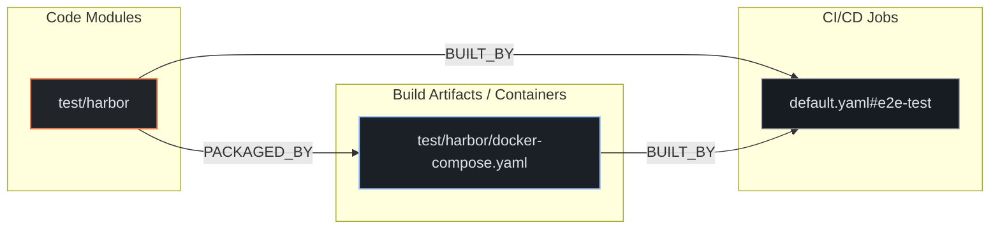
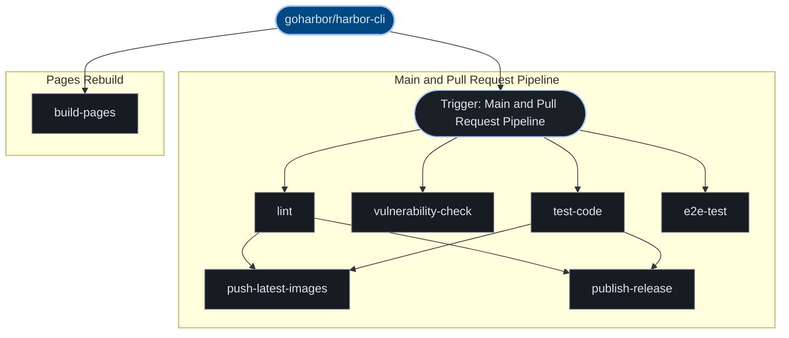

# Repository Architecture Analysis: goharbor/harbor-cli

## Metadata
- **SHA**: `c99361631b4eeebbfef9dc5b0eb2d8796a1f0439`
- **Primary Ecosystem**: Go

## Quality Metrics
- **ast_engine**: fallback
- **avg_cognitive_complexity**: 0.0
- **avg_cyclomatic_complexity**: 0.0
- **component_count**: 254
- **dead_code_count**: 0
- **dead_code_symbols**: 0 entry(ies)
- **duplication_pct**: 0.0
- **file_complexities**: 0 entry(ies)
- **files_analyzed**: 380
- **fitness_passed**: True
- **fitness_violation_count**: 0
- **framework**: Go Service
- **import_edges**: 0 entry(ies)
- **loc**: 40493
- **max_cognitive_complexity**: 0
- **max_cyclomatic_complexity**: 0
- **sloc**: 29976
- **test_file_count**: 44

# Architecture: goharbor/harbor-cli

## Context
- **Repository**: `goharbor/harbor-cli`
- **SHA**: `c99361631b4eeebbfef9dc5b0eb2d8796a1f0439`
- **Ecosystem**: Go
- **Framework**: Go Service

## Building Block View

```mermaid
graph TD;
  classDef atlasRoot fill:#004882,stroke:#a3c9ff,stroke-width:2px,color:#d3e4ff
  classDef atlasCategory fill:#212428,stroke:#E87A48,stroke-width:1.5px,color:#dfe3eb
  classDef atlasWorkflow fill:#1b2026,stroke:#a3c9ff,stroke-width:1.5px,color:#dfe3eb
  classDef atlasJob fill:#171c22,stroke:#8d9199,stroke-width:1px,color:#dfe3eb
  classDef atlasTarget fill:#005227,stroke:#8bd99b,stroke-width:1.5px,color:#a7f6b6
  classDef atlasAlert fill:#93000a,stroke:#ffb4ab,stroke-width:1.5px,color:#ffdad6
  classDef atlasMore fill:#252a31,stroke:#8d9199,stroke-dasharray:4 4,color:#c3c6cf
    repo_root(["goharbor/harbor-cli (254 components)"]):::atlasRoot
    subgraph sg_dir_0_cmd["cmd (186)"]
      direction TB
      dir_0_cmd["cmd (186)"]:::atlasCategory
      sub_0_0_harbor_root["harbor/root (184)"]:::atlasWorkflow
      dir_0_cmd --> sub_0_0_harbor_root
      sub_0_1_harbor["harbor (1)"]:::atlasWorkflow
      dir_0_cmd --> sub_0_1_harbor
      sub_0_2_harbor_internal["harbor/internal (1)"]:::atlasWorkflow
      dir_0_cmd --> sub_0_2_harbor_internal
    end
    repo_root --> dir_0_cmd
    subgraph sg_dir_1_pkg["pkg (45)"]
      direction TB
      dir_1_pkg["pkg (45)"]:::atlasCategory
      sub_1_0_api["api (32)"]:::atlasWorkflow
      dir_1_pkg --> sub_1_0_api
      sub_1_1_config["config (3)"]:::atlasWorkflow
      dir_1_pkg --> sub_1_1_config
      sub_1_2_errors["errors (3)"]:::atlasWorkflow
      dir_1_pkg --> sub_1_2_errors
      sub_1_more["+5 more submodules (7)"]:::atlasMore
      dir_1_pkg --> sub_1_more
    end
    repo_root --> dir_1_pkg
    dir_2__dagger[".dagger (16)"]:::atlasCategory
    repo_root --> dir_2__dagger
    dir_3_test["test (4)"]:::atlasCategory
    repo_root --> dir_3_test
    dir_4_doc["doc (3)"]:::atlasCategory
    repo_root --> dir_4_doc
```

## Component Details

Showing top 60 representative components out of 254 across 5 module group(s):

- **Module `cmd`** (186 components — module: 186)
- **Module `pkg`** (45 components — module: 45)
- **Module `.dagger`** (16 components — module: 16)
- **Module `test`** (4 components — module: 4)
- **Module `doc`** (3 components — module: 3)

- **add** (`cmd/harbor/root/artifact/label/add.go`): module
- **add** (`cmd/harbor/root/cve/add.go`): module
- **apk** (`.dagger/apk.go`): module
- **apply** (`cmd/harbor/root/configurations/apply.go`): module
- **apt** (`.dagger/apt.go`): module
- **archive** (`.dagger/archive.go`): module
- **artifact_handler** (`pkg/api/artifact_handler.go`): module
- **auditLogs_handler** (`pkg/api/auditLogs_handler.go`): module
- **build** (`.dagger/build.go`): module
- **buildDev** (`.dagger/buildDev.go`): module
- **checksum** (`.dagger/checksum.go`): module
- **client** (`pkg/utils/client.go`): module
- **client_test** (`pkg/utils/client_test.go`): module
- **cmd** (`cmd/harbor/root/artifact/cmd.go`): module
- **cmd** (`cmd/harbor/root/artifact/label/cmd.go`): module
- **cmd** (`cmd/harbor/root/cmd.go`): module
- **cmd** (`cmd/harbor/root/configurations/cmd.go`): module
- **cmd** (`cmd/harbor/root/context/cmd.go`): module
- **cmd** (`cmd/harbor/root/cve/cmd.go`): module
- **cmd** (`cmd/harbor/root/instance/cmd.go`): module
- **cmd** (`cmd/harbor/root/jobservice/cmd.go`): module
- **cmd** (`cmd/harbor/root/jobservice/queues/cmd.go`): module
- **cmd** (`cmd/harbor/root/labels/cmd.go`): module
- **cmd** (`cmd/harbor/root/ldap/cmd.go`): module
- **cmd** (`cmd/harbor/root/project/cmd.go`): module
- **cmd** (`cmd/harbor/root/project/config/cmd.go`): module
- **cmd** (`cmd/harbor/root/quota/cmd.go`): module
- **cmd** (`cmd/harbor/root/registry/cmd.go`): module
- **cmd** (`cmd/harbor/root/replication/cmd.go`): module
- **cmd** (`cmd/harbor/root/repository/cmd.go`): module
- **cmd** (`cmd/harbor/root/robot/cmd.go`): module
- **cmd** (`cmd/harbor/root/scan_all/cmd.go`): module
- **cmd** (`cmd/harbor/root/scanner/cmd.go`): module
- **cmd** (`cmd/harbor/root/schedule/cmd.go`): module
- **cmd** (`cmd/harbor/root/tag/cmd.go`): module
- **cmd** (`cmd/harbor/root/tag/immutable/cmd.go`): module
- **cmd** (`cmd/harbor/root/tag/retention/cmd.go`): module
- **cmd** (`cmd/harbor/root/user/cmd.go`): module
- **cmd** (`cmd/harbor/root/vulnerability/cmd.go`): module
- **cmd** (`cmd/harbor/root/webhook/cmd.go`): module
- **config** (`test/harbor/config/jobservice/config.yml`): module
- **config** (`test/harbor/config/registry/config.yml`): module
- **config** (`test/harbor/config/registryctl/config.yml`): module
- **config_cmd_test** (`cmd/harbor/root/context/config_cmd_test.go`): module
- **configurations_handler** (`pkg/api/configurations_handler.go`): module
- **constants** (`pkg/constants/constants.go`): module
- **create** (`cmd/harbor/root/artifact/tags/create.go`): module
- **create** (`cmd/harbor/root/instance/create.go`): module
- **create** (`cmd/harbor/root/labels/create.go`): module
- **create** (`cmd/harbor/root/project/create.go`): module
- **create** (`cmd/harbor/root/project/member/create.go`): module
- **create** (`cmd/harbor/root/project/preheat/policy/create.go`): module
- **create** (`cmd/harbor/root/project/robot/create.go`): module
- **create** (`cmd/harbor/root/registry/create.go`): module
- **create** (`cmd/harbor/root/replication/policies/create.go`): module
- **create** (`cmd/harbor/root/robot/create.go`): module
- **create** (`cmd/harbor/root/scanner/create.go`): module
- **create** (`cmd/harbor/root/tag/immutable/create.go`): module
- **create** (`cmd/harbor/root/tag/retention/create.go`): module
- **create** (`cmd/harbor/root/user/create.go`): module

## 6-Dimension Repository Scorecard

- **Overall Grade**: `B` (89.65/100)
- **Technical Debt Score**: 10.35
- **Estimated Remediation Effort**: 7.09h

| Dimension | Grade | Score | Weight | Details |
| :--- | :---: | :---: | :---: | :--- |
| Code Quality | `A` | 100.00 | 0.20 | avg_cc=0.00, max_cc=0, duplication=0.00%, dead_code=0 |
| Dependency Health | `B` | 85.00 | 0.15 | dependencies=114, outdated=0, vulnerable=0, has_lockfile=False |
| Maintainability | `A` | 100.00 | 0.15 | avg_cognitive=0.00, max_cognitive=0, fitness_violations=0, oversized_files=0 |
| Pipeline Health | `B` | 84.00 | 0.15 | workflows=2, operational_antipatterns=7, parallel_branches=True |
| Security | `A` | 94.00 | 0.20 | vulnerabilities=0, secrets=0, pipeline_security_findings=1 |
| Test Coverage | `C` | 70.00 | 0.15 | coverage=unavailable, ci_test_job=True, test_files_detected=True |

## Supply Chain Dependencies, Vulnerabilities & Secrets

- **Dependencies Parsed**: 114 | **Vulnerabilities**: 0 | **Secrets**: 0

### Inventory Sample
- `github.com/99designs/gqlgen` `0.17.81` (golang, `.dagger/go.mod`)
- `github.com/Khan/genqlient` `0.8.1` (golang, `.dagger/go.mod`)
- `github.com/atotto/clipboard` `0.1.4` (golang, `go.mod`)
- `github.com/charmbracelet/bubbles` `1.0.0` (golang, `go.mod`)
- `github.com/charmbracelet/bubbletea` `1.3.10` (golang, `go.mod`)
- `github.com/charmbracelet/huh` `1.0.0` (golang, `go.mod`)
- `github.com/charmbracelet/lipgloss` `1.1.0` (golang, `go.mod`)
- `github.com/charmbracelet/x/ansi` `0.11.8` (golang, `go.mod`)
- `github.com/go-openapi/strfmt` `0.27.0` (golang, `go.mod`)
- `github.com/gocarina/gocsv` `0.0.0-20240520201108-78e41c74b4b1` (golang, `go.mod`)
- `github.com/goharbor/go-client` `0.213.1` (golang, `go.mod`)
- `github.com/sahilm/fuzzy` `0.1.3` (golang, `go.mod`)
- `github.com/sirupsen/logrus` `1.10.2` (golang, `go.mod`)
- `github.com/spf13/cobra` `1.10.2` (golang, `go.mod`)
- `github.com/spf13/pflag` `1.0.10` (golang, `go.mod`)
- `github.com/spf13/viper` `1.21.0` (golang, `go.mod`)
- `github.com/stretchr/testify` `1.12.1` (golang, `go.mod`)
- `github.com/vektah/gqlparser/v2` `2.5.30` (golang, `.dagger/go.mod`)
- `github.com/zalando/go-keyring` `0.2.8` (golang, `go.mod`)
- `go.opentelemetry.io/otel` `1.38.0` (golang, `.dagger/go.mod`)
- `go.opentelemetry.io/otel/exporters/otlp/otlplog/otlploggrpc` `0.14.0` (golang, `.dagger/go.mod`)
- `go.opentelemetry.io/otel/exporters/otlp/otlplog/otlploghttp` `0.14.0` (golang, `.dagger/go.mod`)
- `go.opentelemetry.io/otel/exporters/otlp/otlpmetric/otlpmetricgrpc` `1.38.0` (golang, `.dagger/go.mod`)
- `go.opentelemetry.io/otel/exporters/otlp/otlpmetric/otlpmetrichttp` `1.38.0` (golang, `.dagger/go.mod`)
- `go.opentelemetry.io/otel/exporters/otlp/otlptrace/otlptracegrpc` `1.38.0` (golang, `.dagger/go.mod`)
- `go.opentelemetry.io/otel/exporters/otlp/otlptrace/otlptracehttp` `1.38.0` (golang, `.dagger/go.mod`)
- `go.opentelemetry.io/otel/log` `0.14.0` (golang, `.dagger/go.mod`)
- `go.opentelemetry.io/otel/metric` `1.38.0` (golang, `.dagger/go.mod`)
- `go.opentelemetry.io/otel/sdk` `1.38.0` (golang, `.dagger/go.mod`)
- `go.opentelemetry.io/otel/sdk/log` `0.14.0` (golang, `.dagger/go.mod`)
- ... (+84 more dependencies)

## Section 7: Code-to-Cloud Deployment Traceability

- `test/harbor` (code_module) --[BUILT_BY]--> `default.yaml#e2e-test` (ci_job)
- `test/harbor` (code_module) --[PACKAGED_BY]--> `test/harbor/docker-compose.yaml` (container)
- `test/harbor/docker-compose.yaml` (container) --[BUILT_BY]--> `default.yaml#e2e-test` (ci_job)

## CI/CD Pipeline Topology

