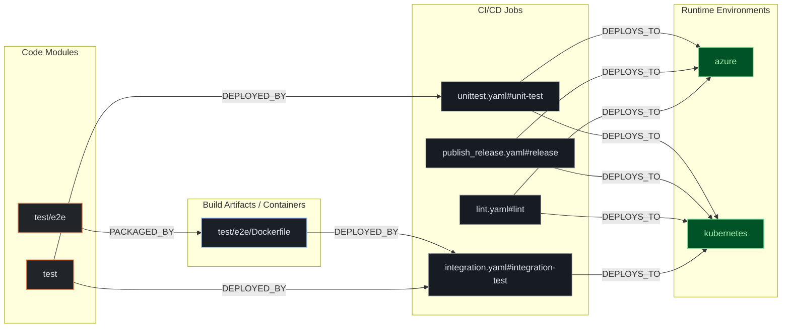
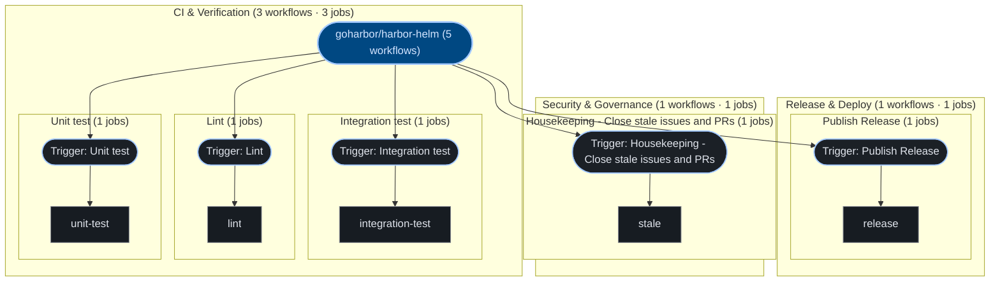

# Repository Architecture Analysis: goharbor/harbor-helm

## Metadata
- **SHA**: `ed46e35fc022100d90c9fd743e72ddc8b5b82de4`
- **Primary Ecosystem**: Go

## Quality Metrics
- **ast_engine**: fallback
- **avg_cognitive_complexity**: 0.0
- **avg_cyclomatic_complexity**: 0.0
- **component_count**: 4
- **dead_code_count**: 0
- **dead_code_symbols**: 0 entry(ies)
- **duplication_pct**: 0.0
- **file_complexities**: 0 entry(ies)
- **files_analyzed**: 4
- **fitness_passed**: True
- **fitness_violation_count**: 0
- **framework**: Unknown
- **import_edges**: 0 entry(ies)
- **loc**: 243
- **max_cognitive_complexity**: 0
- **max_cyclomatic_complexity**: 0
- **sloc**: 207
- **test_file_count**: 24

# Architecture: goharbor/harbor-helm

## Context
- **Repository**: `goharbor/harbor-helm`
- **SHA**: `ed46e35fc022100d90c9fd743e72ddc8b5b82de4`
- **Ecosystem**: Go
- **Framework**: Unknown

## Building Block View

```mermaid
graph TD;
  classDef atlasRoot fill:#004882,stroke:#a3c9ff,stroke-width:2px,color:#d3e4ff
  classDef atlasCategory fill:#212428,stroke:#E87A48,stroke-width:1.5px,color:#dfe3eb
  classDef atlasWorkflow fill:#1b2026,stroke:#a3c9ff,stroke-width:1.5px,color:#dfe3eb
  classDef atlasJob fill:#171c22,stroke:#8d9199,stroke-width:1px,color:#dfe3eb
  classDef atlasTarget fill:#005227,stroke:#8bd99b,stroke-width:1.5px,color:#a7f6b6
  classDef atlasAlert fill:#93000a,stroke:#ffb4ab,stroke-width:1.5px,color:#ffdad6
  classDef atlasMore fill:#252a31,stroke:#8d9199,stroke-dasharray:4 4,color:#c3c6cf
    test["test : module"]:::atlasJob
    base["base : module"]:::atlasJob
    ingress_test["ingress_test : module"]:::atlasJob
    node_port_test["node_port_test : module"]:::atlasJob
```

## Component Details
- **test** (`test/test.go`): module
- **base** (`test/integration/base.go`): module
- **ingress_test** (`test/integration/ingress_test.go`): module
- **node_port_test** (`test/integration/node_port_test.go`): module

## 6-Dimension Repository Scorecard

- **Overall Grade**: `F` (58.40/100)
- **Technical Debt Score**: 41.60
- **Estimated Remediation Effort**: 41.90h

| Dimension | Grade | Score | Weight | Details |
| :--- | :---: | :---: | :---: | :--- |
| Code Quality | `A` | 100.00 | 0.20 | avg_cc=0.00, max_cc=0, duplication=0.00%, dead_code=0 |
| Dependency Health | `B` | 85.00 | 0.15 | dependencies=3, outdated=0, vulnerable=0, has_lockfile=False |
| Maintainability | `A` | 100.00 | 0.15 | avg_cognitive=0.00, max_cognitive=0, fitness_violations=0, oversized_files=0 |
| Pipeline Health | `F` | 1.00 | 0.15 | workflows=5, operational_antipatterns=10, parallel_branches=False |
| Security | `F` | 0.00 | 0.20 | vulnerabilities=0, secrets=1, pipeline_security_findings=12 |
| Test Coverage | `C` | 70.00 | 0.15 | coverage=unavailable, ci_test_job=True, test_files_detected=True |

## Supply Chain Dependencies, Vulnerabilities & Secrets

- **Dependencies Parsed**: 3 | **Vulnerabilities**: 0 | **Secrets**: 1

### Secret Findings (Redacted)
- **[HIGH] `ATRUSS-SEC-005`** at `values.yaml:917` (`# htpasswdString: "harb***REDACTED***" # example string, bcrypt is the only accepted hashing algorithm in htpasswd here.`)

### Inventory Sample
- `github.com/gruntwork-io/terratest` `0.38.1` (golang, `test/go.mod`)
- `github.com/stretchr/testify` `1.7.0` (golang, `test/go.mod`)
- `k8s.io/api` `0.20.6` (golang, `test/go.mod`)

## Section 7: Code-to-Cloud Deployment Traceability

- `integration.yaml#integration-test` (ci_job) --[DEPLOYS_TO]--> `kubernetes` (environment)
- `lint.yaml#lint` (ci_job) --[DEPLOYS_TO]--> `azure` (environment)
- `lint.yaml#lint` (ci_job) --[DEPLOYS_TO]--> `kubernetes` (environment)
- `publish_release.yaml#release` (ci_job) --[DEPLOYS_TO]--> `azure` (environment)
- `publish_release.yaml#release` (ci_job) --[DEPLOYS_TO]--> `kubernetes` (environment)
- `unittest.yaml#unit-test` (ci_job) --[DEPLOYS_TO]--> `azure` (environment)
- `unittest.yaml#unit-test` (ci_job) --[DEPLOYS_TO]--> `kubernetes` (environment)
- `test` (code_module) --[DEPLOYED_BY]--> `integration.yaml#integration-test` (ci_job)
- `test` (code_module) --[DEPLOYED_BY]--> `unittest.yaml#unit-test` (ci_job)
- `test/e2e` (code_module) --[PACKAGED_BY]--> `test/e2e/Dockerfile` (container)
- `test/e2e/Dockerfile` (container) --[DEPLOYED_BY]--> `integration.yaml#integration-test` (ci_job)

## CI/CD Pipeline Topology

