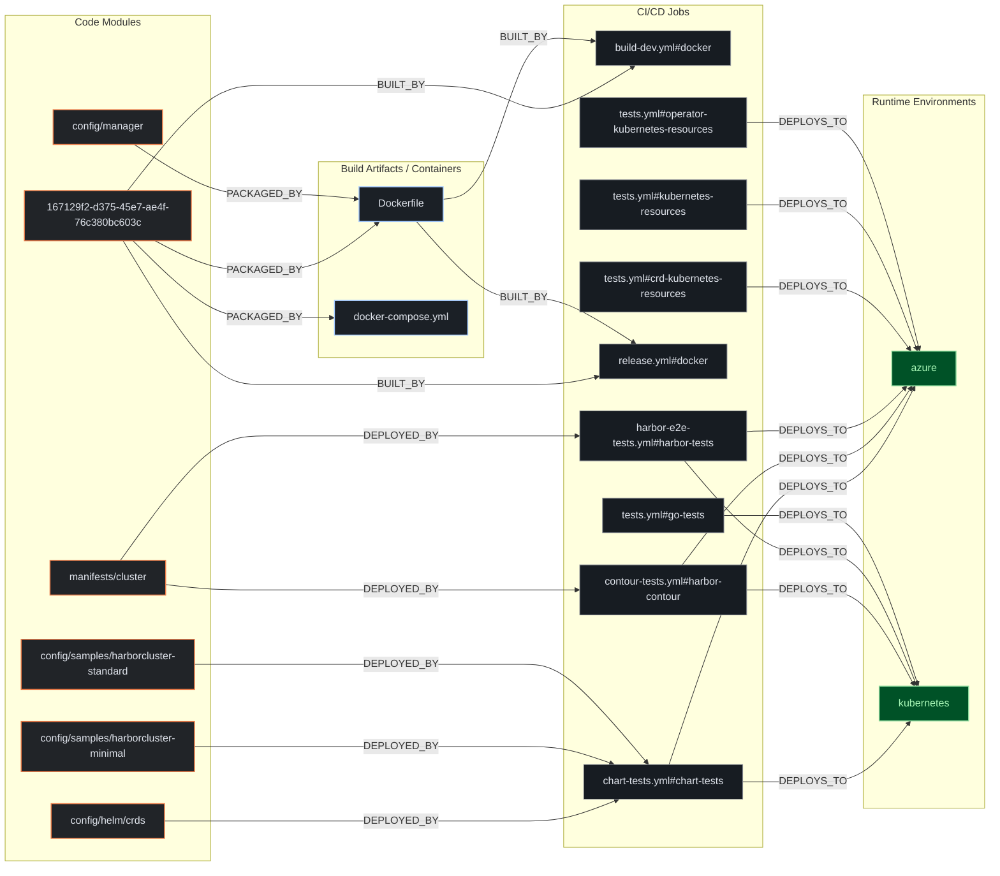

# Repository Architecture Analysis: goharbor/harbor-operator

## Metadata
- **SHA**: `b369ee6a0e39c9979993328e97b6aed6c61dd7dd`
- **Primary Ecosystem**: Go

## Quality Metrics
- **ast_engine**: fallback
- **avg_cognitive_complexity**: 0.0
- **avg_cyclomatic_complexity**: 0.0
- **component_count**: 362
- **dead_code_count**: 0
- **dead_code_symbols**: 0 entry(ies)
- **duplication_pct**: 0.0
- **file_complexities**: 0 entry(ies)
- **files_analyzed**: 503
- **fitness_passed**: True
- **fitness_violation_count**: 0
- **framework**: Go Service
- **import_edges**: 0 entry(ies)
- **loc**: 60296
- **max_cognitive_complexity**: 0
- **max_cyclomatic_complexity**: 0
- **sloc**: 43094
- **test_file_count**: 85

# Architecture: goharbor/harbor-operator

## Context
- **Repository**: `goharbor/harbor-operator`
- **SHA**: `b369ee6a0e39c9979993328e97b6aed6c61dd7dd`
- **Ecosystem**: Go
- **Framework**: Go Service

## Building Block View

```mermaid
graph TD;
  classDef atlasRoot fill:#004882,stroke:#a3c9ff,stroke-width:2px,color:#d3e4ff
  classDef atlasCategory fill:#212428,stroke:#E87A48,stroke-width:1.5px,color:#dfe3eb
  classDef atlasWorkflow fill:#1b2026,stroke:#a3c9ff,stroke-width:1.5px,color:#dfe3eb
  classDef atlasJob fill:#171c22,stroke:#8d9199,stroke-width:1px,color:#dfe3eb
  classDef atlasTarget fill:#005227,stroke:#8bd99b,stroke-width:1.5px,color:#a7f6b6
  classDef atlasAlert fill:#93000a,stroke:#ffb4ab,stroke-width:1.5px,color:#ffdad6
  classDef atlasMore fill:#252a31,stroke:#8d9199,stroke-dasharray:4 4,color:#c3c6cf
    repo_root(["goharbor/harbor-operator (362 components)"]):::atlasRoot
    dir_0_controllers["controllers (140)"]:::atlasCategory
    repo_root --> dir_0_controllers
    sub_0_0_goharbor["goharbor (138)"]:::atlasWorkflow
    dir_0_controllers --> sub_0_0_goharbor
    sub_0_1__module_root_["(module root) (2)"]:::atlasWorkflow
    dir_0_controllers --> sub_0_1__module_root_
    dir_1_apis["apis (97)"]:::atlasCategory
    repo_root --> dir_1_apis
    sub_1_0_goharbor_io["goharbor.io (78)"]:::atlasWorkflow
    dir_1_apis --> sub_1_0_goharbor_io
    sub_1_1_meta["meta (19)"]:::atlasWorkflow
    dir_1_apis --> sub_1_1_meta
    dir_2_config["config (97)"]:::atlasCategory
    repo_root --> dir_2_config
    sub_2_0_crd["crd (30)"]:::atlasWorkflow
    dir_2_config --> sub_2_0_crd
    sub_2_1_helm["helm (29)"]:::atlasWorkflow
    dir_2_config --> sub_2_1_helm
    sub_2_2_config["config (16)"]:::atlasWorkflow
    dir_2_config --> sub_2_2_config
    sub_2_more["+3 more submodules (22)"]:::atlasMore
    dir_2_config --> sub_2_more
    dir_3_charts["charts (15)"]:::atlasCategory
    repo_root --> dir_3_charts
    sub_3_0_harbor_operator_templates["harbor-operator/templates (13)"]:::atlasWorkflow
    dir_3_charts --> sub_3_0_harbor_operator_templates
    sub_3_1_harbor_operator["harbor-operator (2)"]:::atlasWorkflow
    dir_3_charts --> sub_3_1_harbor_operator
    dir_4_pkg["pkg (11)"]:::atlasCategory
    repo_root --> dir_4_pkg
    sub_4_0_cluster["cluster (10)"]:::atlasWorkflow
    dir_4_pkg --> sub_4_0_cluster
    sub_4_1_builder["builder (1)"]:::atlasWorkflow
    dir_4_pkg --> sub_4_1_builder
    dir_other_modules["+1 more modules (2)"]:::atlasMore
    repo_root --> dir_other_modules
```

## Component Details

Showing top 60 representative components out of 362 across 6 module group(s):

- **Module `controllers`** (140 components — module: 140)
- **Module `apis`** (97 components — module: 97)
- **Module `config`** (97 components — module: 97)
- **Module `charts`** (15 components — module: 15)
- **Module `pkg`** (11 components — module: 11)
- **Module `(root)`** (2 components — module: 2)

- **Chart** (`charts/harbor-operator/Chart.yaml`): module
- **builder** (`pkg/builder/builder.go`): module
- **cainjection_in_chartmuseums** (`config/crd/patches/cainjection_in_chartmuseums.yaml`): module
- **cainjection_in_cores** (`config/crd/patches/cainjection_in_cores.yaml`): module
- **cainjection_in_exporters** (`config/crd/patches/cainjection_in_exporters.yaml`): module
- **cainjection_in_harborclusters** (`config/crd/patches/cainjection_in_harborclusters.yaml`): module
- **cainjection_in_harbors** (`config/crd/patches/cainjection_in_harbors.yaml`): module
- **cainjection_in_harborserverconfigurations** (`config/crd/patches/cainjection_in_harborserverconfigurations.yaml`): module
- **cainjection_in_jobservices** (`config/crd/patches/cainjection_in_jobservices.yaml`): module
- **cainjection_in_notaryservers** (`config/crd/patches/cainjection_in_notaryservers.yaml`): module
- **cainjection_in_notarysigners** (`config/crd/patches/cainjection_in_notarysigners.yaml`): module
- **cainjection_in_portals** (`config/crd/patches/cainjection_in_portals.yaml`): module
- **cainjection_in_pullsecretbindings** (`config/crd/patches/cainjection_in_pullsecretbindings.yaml`): module
- **cainjection_in_registries** (`config/crd/patches/cainjection_in_registries.yaml`): module
- **cainjection_in_registrycontrollers** (`config/crd/patches/cainjection_in_registrycontrollers.yaml`): module
- **cainjection_in_trivies** (`config/crd/patches/cainjection_in_trivies.yaml`): module
- **certificate** (`charts/harbor-operator/templates/certificate.yaml`): module
- **certificate** (`config/certmanager/certificate.yaml`): module
- **certificate** (`config/kustomizeconfig/certificate.yaml`): module
- **certificate** (`controllers/goharbor/internal/test/certificate/certificate.go`): module
- **chartmuseum** (`config/kustomizeconfig/chartmuseum.yaml`): module
- **chartmuseum** (`controllers/goharbor/chartmuseum/chartmuseum.go`): module
- **chartmuseum** (`controllers/goharbor/harbor/chartmuseum.go`): module
- **chartmuseum-ctrl** (`config/config/controllers/chartmuseum-ctrl.yaml`): module
- **chartmuseum_conversion** (`apis/goharbor.io/v1alpha3/chartmuseum_conversion.go`): module
- **chartmuseum_conversion** (`apis/goharbor.io/v1beta1/chartmuseum_conversion.go`): module
- **chartmuseum_test** (`controllers/goharbor/chartmuseum/chartmuseum_test.go`): module
- **chartmuseum_test** (`controllers/goharbor/chartmuseum_test.go`): module
- **chartmuseum_types** (`apis/goharbor.io/v1alpha3/chartmuseum_types.go`): module
- **chartmuseum_types** (`apis/goharbor.io/v1beta1/chartmuseum_types.go`): module
- **chartmuseum_webhook** (`apis/goharbor.io/v1beta1/chartmuseum_webhook.go`): module
- **chartmuseums_service** (`config/helm/crds/patches/chartmuseums_service.yaml`): module
- **client** (`controllers/goharbor/internal/test/client.go`): module
- **clusterrole** (`charts/harbor-operator/templates/clusterrole.yaml`): module
- **clusterrolebinding** (`charts/harbor-operator/templates/clusterrolebinding.yaml`): module
- **cm_reconciler** (`controllers/goharbor/configuration/cm_reconciler.go`): module
- **component** (`apis/meta/v1alpha1/component.go`): module
- **component_string** (`apis/meta/v1alpha1/component_string.go`): module
- **config** (`config/config/config.yaml`): module
- **configmap** (`charts/harbor-operator/templates/configmap.yaml`): module
- **configs** (`controllers/goharbor/chartmuseum/configs.go`): module
- **configs** (`controllers/goharbor/core/configs.go`): module
- **configs** (`controllers/goharbor/jobservice/configs.go`): module
- **configs** (`controllers/goharbor/notaryserver/configs.go`): module
- **configs** (`controllers/goharbor/notarysigner/configs.go`): module
- **configs** (`controllers/goharbor/portal/configs.go`): module
- **configs** (`controllers/goharbor/registry/configs.go`): module
- **configs** (`controllers/goharbor/trivy/configs.go`): module
- **constants** (`pkg/cluster/controllers/cache/constants.go`): module
- **context** (`controllers/goharbor/internal/test/context.go`): module
- **controller_string** (`controllers/controller_string.go`): module
- **controller_test** (`controllers/goharbor/controller_test.go`): module
- **controllers** (`controllers/controllers.go`): module
- **controllers** (`controllers/goharbor/internal/test/controllers/controllers.go`): module
- **core** (`config/kustomizeconfig/core.yaml`): module
- **core** (`controllers/goharbor/core/core.go`): module
- **core** (`controllers/goharbor/harbor/core.go`): module
- **core-ctrl** (`config/config/controllers/core-ctrl.yaml`): module
- **core_conversion** (`apis/goharbor.io/v1alpha3/core_conversion.go`): module
- **core_conversion** (`apis/goharbor.io/v1beta1/core_conversion.go`): module

## 6-Dimension Repository Scorecard

- **Overall Grade**: `F` (58.25/100)
- **Technical Debt Score**: 41.75
- **Estimated Remediation Effort**: 116.94h

| Dimension | Grade | Score | Weight | Details |
| :--- | :---: | :---: | :---: | :--- |
| Code Quality | `A` | 100.00 | 0.20 | avg_cc=0.00, max_cc=0, duplication=0.00%, dead_code=0 |
| Dependency Health | `B` | 85.00 | 0.15 | dependencies=147, outdated=0, vulnerable=0, has_lockfile=False |
| Maintainability | `A` | 100.00 | 0.15 | avg_cognitive=0.00, max_cognitive=0, fitness_violations=0, oversized_files=0 |
| Pipeline Health | `F` | 0.00 | 0.15 | workflows=8, operational_antipatterns=28, parallel_branches=True |
| Security | `F` | 0.00 | 0.20 | vulnerabilities=0, secrets=7, pipeline_security_findings=44 |
| Test Coverage | `C` | 70.00 | 0.15 | coverage=unavailable, ci_test_job=True, test_files_detected=True |

## Supply Chain Dependencies, Vulnerabilities & Secrets

- **Dependencies Parsed**: 147 | **Vulnerabilities**: 0 | **Secrets**: 7

### Secret Findings (Redacted)
- **[HIGH] `ATRUSS-SEC-005`** at `config/samples/harborcluster-minimal/https.yaml:7` (`tls.key: LS0t***REDACTED***`)
- **[HIGH] `ATRUSS-SEC-005`** at `docs/LCM/backup-psql-data.md:59` (`export PGPASSWORD='UT6J***REDACTED***'`)
- **[HIGH] `ATRUSS-SEC-005`** at `manifests/samples/full_stack.yaml:35` (`tls.key: LS0t***REDACTED***`)
- **[HIGH] `ATRUSS-SEC-005`** at `manifests/samples/minimal_stack_fs.yaml:24` (`tls.key: LS0t***REDACTED***`)
- **[HIGH] `ATRUSS-SEC-005`** at `manifests/samples/minimal_stack_incluster.yaml:35` (`tls.key: LS0t***REDACTED***`)
- **[HIGH] `ATRUSS-SEC-005`** at `manifests/samples/standard_stack.yaml:44` (`tls.key: LS0t***REDACTED***`)
- **[HIGH] `ATRUSS-SEC-005`** at `manifests/samples/standard_stack_fs.yaml:35` (`tls.key: LS0t***REDACTED***`)

### Inventory Sample
- `github.com/Masterminds/semver` `1.5.0` (golang, `go.mod`)
- `github.com/Masterminds/sprig` `2.22.0+incompatible` (golang, `go.mod`)
- `github.com/containers/image/v5` `5.16.1` (golang, `go.mod`)
- `github.com/go-kit/kit` `0.10.0` (golang, `go.mod`)
- `github.com/go-logr/logr` `1.2.4` (golang, `go.mod`)
- `github.com/go-openapi/runtime` `0.21.0` (golang, `go.mod`)
- `github.com/go-redis/redis` `6.15.9+incompatible` (golang, `go.mod`)
- `github.com/goharbor/go-client` `0.26.2` (golang, `go.mod`)
- `github.com/goharbor/harbor/src` `0.0.0-20220526154154-b0506782b47d` (golang, `go.mod`)
- `github.com/jaegertracing/jaeger-lib` `2.2.0+incompatible` (golang, `go.mod`)
- `github.com/jetstack/cert-manager` `1.1.0` (golang, `go.mod`)
- `github.com/markbates/pkger` `0.17.1` (golang, `go.mod`)
- `github.com/minio/minio-go/v6` `6.0.57` (golang, `go.mod`)
- `github.com/onsi/ginkgo/v2` `2.6.0` (golang, `go.mod`)
- `github.com/onsi/gomega` `1.24.1` (golang, `go.mod`)
- `github.com/opentracing-contrib/go-stdlib` `1.0.0` (golang, `go.mod`)
- `github.com/opentracing/opentracing-go` `1.2.0` (golang, `go.mod`)
- `github.com/ovh/configstore` `0.3.2` (golang, `go.mod`)
- `github.com/pkg/errors` `0.9.1` (golang, `go.mod`)
- `github.com/prometheus/client_golang` `1.14.0` (golang, `go.mod`)
- `github.com/sethvargo/go-password` `0.1.3` (golang, `go.mod`)
- `github.com/sirupsen/logrus` `1.8.1` (golang, `go.mod`)
- `github.com/spotahome/redis-operator` `1.1.1` (golang, `go.mod`)
- `github.com/stretchr/testify` `1.8.2` (golang, `go.mod`)
- `github.com/theupdateframework/notary` `0.6.1` (golang, `go.mod`)
- `github.com/uber/jaeger-client-go` `2.24.0+incompatible` (golang, `go.mod`)
- `github.com/uber/jaeger-lib` `2.2.0+incompatible` (golang, `go.mod`)
- `github.com/umisama/go-regexpcache` `0.0.0-20150417035358-2444a542492f` (golang, `go.mod`)
- `github.com/zalando/postgres-operator` `1.6.1` (golang, `go.mod`)
- `go.uber.org/zap` `1.24.0` (golang, `go.mod`)
- ... (+117 more dependencies)

## Section 7: Code-to-Cloud Deployment Traceability

- `chart-tests.yml#chart-tests` (ci_job) --[DEPLOYS_TO]--> `azure` (environment)
- `chart-tests.yml#chart-tests` (ci_job) --[DEPLOYS_TO]--> `kubernetes` (environment)
- `contour-tests.yml#harbor-contour` (ci_job) --[DEPLOYS_TO]--> `azure` (environment)
- `contour-tests.yml#harbor-contour` (ci_job) --[DEPLOYS_TO]--> `kubernetes` (environment)
- `harbor-e2e-tests.yml#harbor-tests` (ci_job) --[DEPLOYS_TO]--> `azure` (environment)
- `harbor-e2e-tests.yml#harbor-tests` (ci_job) --[DEPLOYS_TO]--> `kubernetes` (environment)
- `tests.yml#crd-kubernetes-resources` (ci_job) --[DEPLOYS_TO]--> `azure` (environment)
- `tests.yml#go-tests` (ci_job) --[DEPLOYS_TO]--> `kubernetes` (environment)
- `tests.yml#kubernetes-resources` (ci_job) --[DEPLOYS_TO]--> `azure` (environment)
- `tests.yml#operator-kubernetes-resources` (ci_job) --[DEPLOYS_TO]--> `azure` (environment)
- `167129f2-d375-45e7-ae4f-76c380bc603c` (code_module) --[BUILT_BY]--> `build-dev.yml#docker` (ci_job)
- `167129f2-d375-45e7-ae4f-76c380bc603c` (code_module) --[BUILT_BY]--> `release.yml#docker` (ci_job)
- `167129f2-d375-45e7-ae4f-76c380bc603c` (code_module) --[PACKAGED_BY]--> `Dockerfile` (container)
- `167129f2-d375-45e7-ae4f-76c380bc603c` (code_module) --[PACKAGED_BY]--> `docker-compose.yml` (container)
- `config/helm/crds` (code_module) --[DEPLOYED_BY]--> `chart-tests.yml#chart-tests` (ci_job)
- `config/manager` (code_module) --[PACKAGED_BY]--> `Dockerfile` (container)
- `config/samples/harborcluster-minimal` (code_module) --[DEPLOYED_BY]--> `chart-tests.yml#chart-tests` (ci_job)
- `config/samples/harborcluster-standard` (code_module) --[DEPLOYED_BY]--> `chart-tests.yml#chart-tests` (ci_job)
- `manifests/cluster` (code_module) --[DEPLOYED_BY]--> `contour-tests.yml#harbor-contour` (ci_job)
- `manifests/cluster` (code_module) --[DEPLOYED_BY]--> `harbor-e2e-tests.yml#harbor-tests` (ci_job)
- `Dockerfile` (container) --[BUILT_BY]--> `build-dev.yml#docker` (ci_job)
- `Dockerfile` (container) --[BUILT_BY]--> `release.yml#docker` (ci_job)

## CI/CD Pipeline Topology

```mermaid
graph TD;
  classDef atlasRoot fill:#004882,stroke:#a3c9ff,stroke-width:2px,color:#d3e4ff
  classDef atlasCategory fill:#212428,stroke:#E87A48,stroke-width:1.5px,color:#dfe3eb
  classDef atlasWorkflow fill:#1b2026,stroke:#a3c9ff,stroke-width:1.5px,color:#dfe3eb
  classDef atlasJob fill:#171c22,stroke:#8d9199,stroke-width:1px,color:#dfe3eb
  classDef atlasTarget fill:#005227,stroke:#8bd99b,stroke-width:1.5px,color:#a7f6b6
  classDef atlasAlert fill:#93000a,stroke:#ffb4ab,stroke-width:1.5px,color:#ffdad6
  classDef atlasMore fill:#252a31,stroke:#8d9199,stroke-dasharray:4 4,color:#c3c6cf
  pipeline_root(["goharbor/harbor-operator (8 workflows)"]):::atlasRoot
  grp_0_CI___Verification["CI & Verification (6 workflows · 16 jobs)"]:::atlasCategory
  pipeline_root --> grp_0_CI___Verification
  wf_0_Auto_Assign["Auto Assign (1 jobs)"]:::atlasWorkflow
  grp_0_CI___Verification --> wf_0_Auto_Assign
  job_0_add_reviews["add-reviews"]:::atlasJob
  wf_0_Auto_Assign --> job_0_add_reviews
  wf_1_Dev_Image["Dev Image (2 jobs)"]:::atlasWorkflow
  grp_0_CI___Verification --> wf_1_Dev_Image
  job_1_docker["docker"]:::atlasJob
  job_1_charts["charts"]:::atlasJob
  wf_1_Dev_Image --> job_1_docker
  wf_1_Dev_Image --> job_1_charts
  wf_2_Chart_Tests["Chart Tests (1 jobs)"]:::atlasWorkflow
  grp_0_CI___Verification --> wf_2_Chart_Tests
  job_2_chart_tests["chart-tests"]:::atlasJob
  wf_2_Chart_Tests --> job_2_chart_tests
  wf_4_Contour_Tests["Contour Tests (1 jobs)"]:::atlasWorkflow
  grp_0_CI___Verification --> wf_4_Contour_Tests
  job_4_harbor_contour["harbor-contour"]:::atlasJob
  wf_4_Contour_Tests --> job_4_harbor_contour
  wf_5_Harbor_E2E_Tests["Harbor E2E Tests (1 jobs)"]:::atlasWorkflow
  grp_0_CI___Verification --> wf_5_Harbor_E2E_Tests
  job_5_harbor_tests["harbor-tests"]:::atlasJob
  wf_5_Harbor_E2E_Tests --> job_5_harbor_tests
  wf_7_Tests["Tests (10 jobs)"]:::atlasWorkflow
  grp_0_CI___Verification --> wf_7_Tests
  job_7_docker_build_test["docker-build-test"]:::atlasJob
  job_7_docker_lint["docker-lint"]:::atlasJob
  job_7_go_lint["go-lint"]:::atlasJob
  wf_7_Tests --> job_7_docker_build_test
  wf_7_Tests --> job_7_docker_lint
  wf_7_Tests --> job_7_go_lint
  grp_1_Release___Deploy["Release & Deploy (1 workflows · 2 jobs)"]:::atlasCategory
  pipeline_root --> grp_1_Release___Deploy
  wf_6_Release["Release (2 jobs)"]:::atlasWorkflow
  grp_1_Release___Deploy --> wf_6_Release
  job_6_goreleaser["goreleaser"]:::atlasJob
  job_6_docker["docker"]:::atlasJob
  wf_6_Release --> job_6_goreleaser
  wf_6_Release --> job_6_docker
  grp_2_Security___Governance["Security & Governance (1 workflows · 1 jobs)"]:::atlasCategory
  pipeline_root --> grp_2_Security___Governance
  wf_3_CodeQL["CodeQL (1 jobs)"]:::atlasWorkflow
  grp_2_Security___Governance --> wf_3_CodeQL
  job_3_analyze["analyze"]:::atlasJob
  wf_3_CodeQL --> job_3_analyze
```

