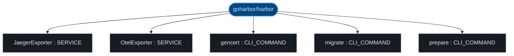

# Repository Architecture Analysis: goharbor/harbor

## Metadata
- **SHA**: `e7dbdea223486b177ce87b6c954eaad756dd0b4f`
- **Primary Ecosystem**: Go

## Quality Metrics
- **ast_engine**: tree-sitter
- **avg_cognitive_complexity**: 3.26
- **avg_cyclomatic_complexity**: 3.6
- **component_count**: 5
- **dead_code_count**: 5
- **dead_code_symbols**: 5 entry(ies)
- **duplication_pct**: 69.3
- **file_complexities**: 25 entry(ies)
- **files_analyzed**: 50
- **fitness_passed**: False
- **fitness_violation_count**: 3
- **framework**: Go Service
- **import_edges**: 100 entry(ies)
- **loc**: 2493
- **max_cognitive_complexity**: 91
- **max_cyclomatic_complexity**: 77
- **sloc**: 1961
- **test_file_count**: 1207

# Architecture: goharbor/harbor

## Context
- **Repository**: `goharbor/harbor`
- **SHA**: `e7dbdea223486b177ce87b6c954eaad756dd0b4f`
- **Ecosystem**: Go
- **Framework**: Go Service

## Building Block View



## Component Details
- **JaegerExporter** (`make/photon/prepare/models.py`): SERVICE
- **OtelExporter** (`make/photon/prepare/models.py`): SERVICE
- **gencert** (`make/photon/prepare/commands/gencerts.py`): CLI_COMMAND
- **migrate** (`make/photon/prepare/commands/migrate.py`): CLI_COMMAND
- **prepare** (`make/photon/prepare/commands/prepare.py`): CLI_COMMAND

## 6-Dimension Repository Scorecard

- **Overall Grade**: `F` (41.57/100)
- **Technical Debt Score**: 58.43
- **Estimated Remediation Effort**: 114.72h

| Dimension | Grade | Score | Weight | Details |
| :--- | :---: | :---: | :---: | :--- |
| Code Quality | `F` | 37.60 | 0.20 | avg_cc=3.60, max_cc=77, duplication=69.30%, dead_code=5 |
| Dependency Health | `A` | 100.00 | 0.15 | dependencies=2193, outdated=0, vulnerable=0, has_lockfile=True |
| Maintainability | `F` | 57.00 | 0.15 | avg_cognitive=3.26, max_cognitive=91, fitness_violations=3, oversized_files=0 |
| Pipeline Health | `F` | 0.00 | 0.15 | workflows=11, operational_antipatterns=21, parallel_branches=True |
| Security | `F` | 0.00 | 0.20 | vulnerabilities=0, secrets=15, pipeline_security_findings=20 |
| Test Coverage | `C` | 70.00 | 0.15 | coverage=unavailable, ci_test_job=True, test_files_detected=True |

## Architecture Fitness & Workspace Boundaries

- **[MEDIUM] `ATRUSS-ARCH-005` (COMPLEXITY_THRESHOLD)**: Repository duplication_pct (69.3) exceeds policy threshold (15.0).
- **[MEDIUM] `ATRUSS-ARCH-005` (COMPLEXITY_THRESHOLD)**: Repository max_cognitive_complexity (91.0) exceeds policy threshold (25.0).
- **[MEDIUM] `ATRUSS-ARCH-005` (COMPLEXITY_THRESHOLD)**: Repository max_cyclomatic_complexity (77.0) exceeds policy threshold (20.0).

## Supply Chain Dependencies, Vulnerabilities & Secrets

- **Dependencies Parsed**: 2193 | **Vulnerabilities**: 0 | **Secrets**: 15

### Secret Findings (Redacted)
- **[CRITICAL] `ATRUSS-SEC-004`** at `src/common/http/transport_test.go:78` (`-----BEGIN ... PRIVATE KEY----- [REDACTED]`)
- **[CRITICAL] `ATRUSS-SEC-004`** at `src/common/http/transport_test.go:154` (`-----BEGIN ... PRIVATE KEY----- [REDACTED]`)
- **[CRITICAL] `ATRUSS-SEC-004`** at `src/common/http/transport_test.go:296` (`-----BEGIN ... PRIVATE KEY----- [REDACTED]`)
- **[HIGH] `ATRUSS-SEC-005`** at `src/common/utils/uaa/test/uaa-token.json:1` (`...,"token_type":"bearer","refresh_token":"eyJh***REDACTED***","expires_in":43199,"jti":"279a6b614a33...`)
- **[HIGH] `ATRUSS-SEC-005`** at `src/common/utils/uaa/test/uaa-token.json:1` (`{"access_token":"eyJh***REDACTED***","token_type":"bearer","refresh_token":...`)
- **[HIGH] `ATRUSS-SEC-005`** at `src/core/controllers/oidc_test.go:17` (`refreshToken:  "eyJh***REDACTED***",`)
- **[HIGH] `ATRUSS-SEC-005`** at `src/core/controllers/oidc_test.go:29` (`refreshToken:  "eyJh***REDACTED***",`)
- **[CRITICAL] `ATRUSS-SEC-004`** at `src/core/service/token/test/private_key.pem:1` (`-----BEGIN ... PRIVATE KEY----- [REDACTED]`)
- **[CRITICAL] `ATRUSS-SEC-004`** at `src/jobservice/server.key:1` (`-----BEGIN ... PRIVATE KEY----- [REDACTED]`)
- **[HIGH] `ATRUSS-SEC-005`** at `src/pkg/oidc/fix_test.go:25` (`Secret: "<enc***REDACTED***",`)
- **[HIGH] `ATRUSS-SEC-005`** at `src/pkg/oidc/metamanager_test.go:17` (`var encSecret = "<enc***REDACTED***"`)
- **[HIGH] `ATRUSS-SEC-005`** at `src/pkg/reg/adapter/awsecr/adapter_test.go:396` (`"authorizationToken" : "QVdT***REDACTED***"`)
- **[HIGH] `ATRUSS-SEC-005`** at `src/pkg/reg/adapter/huawei/huawei_adapter_test.go:33` (`Credential:  &model.Credential{AccessKey: "cn-n***REDACTED***", AccessSecret: "2f7ec95070592fd4838a3aa4fd09338c047fd1cd654b3422197318f97281cd9"},`)
- **[HIGH] `ATRUSS-SEC-005`** at `src/pkg/reg/adapter/huawei/image_registry_test.go:39` (`Credential:  &model.Credential{AccessKey: "cn-n***REDACTED***", AccessSecret: "f31e8e2b948265afdae32e83722a7705fd43e154585ff69e64108247750e5d"},`)
- **[HIGH] `ATRUSS-SEC-005`** at `src/pkg/registry/auth/bearer/authorizer_test.go:32` (`token := "eyJ0***REDACTED***"`)

### Inventory Sample
- `github.com/FZambia/sentinel` `1.1.1` (golang, `src/go.mod`)
- `github.com/Masterminds/semver/v3` `3.5.0` (golang, `src/go.mod`)
- `github.com/aliyun/alibaba-cloud-sdk-go` `1.63.107` (golang, `src/go.mod`)
- `github.com/asaskevich/govalidator` `0.0.0-20230301143203-a9d515a09cc2` (golang, `src/go.mod`)
- `github.com/aws/aws-sdk-go-v2` `1.46.0` (golang, `src/go.mod`)
- `github.com/aws/aws-sdk-go-v2/config` `1.32.20` (golang, `src/go.mod`)
- `github.com/aws/aws-sdk-go-v2/credentials` `1.20.3` (golang, `src/go.mod`)
- `github.com/aws/aws-sdk-go-v2/service/ecr` `1.58.0` (golang, `src/go.mod`)
- `github.com/aws/smithy-go` `1.28.1` (golang, `src/go.mod`)
- `github.com/beego/beego/v2` `2.3.10` (golang, `src/go.mod`)
- `github.com/beego/i18n` `0.0.0-20140604031826-e87155e8f0c0` (golang, `src/go.mod`)
- `github.com/bmatcuk/doublestar` `1.3.4` (golang, `src/go.mod`)
- `github.com/casbin/casbin/v3` `3.11.0` (golang, `src/go.mod`)
- `github.com/cenkalti/backoff/v4` `4.3.0` (golang, `src/go.mod`)
- `github.com/cloudevents/sdk-go/v2` `2.16.2` (golang, `src/go.mod`)
- `github.com/coreos/go-oidc/v3` `3.15.0` (golang, `src/go.mod`)
- `github.com/dghubble/sling` `1.4.2` (golang, `src/go.mod`)
- `github.com/docker/distribution` `2.8.3+incompatible` (golang, `src/go.mod`)
- `github.com/docker/libtrust` `0.0.0-20160708172513-aabc10ec26b7` (golang, `src/go.mod`)
- `github.com/go-asn1-ber/asn1-ber` `1.5.8` (golang, `src/go.mod`)
- `github.com/go-ldap/ldap/v3` `3.4.14` (golang, `src/go.mod`)
- `github.com/go-openapi/errors` `0.22.8` (golang, `src/go.mod`)
- `github.com/go-openapi/loads` `0.25.2` (golang, `src/go.mod`)
- `github.com/go-openapi/runtime` `0.33.2` (golang, `src/go.mod`)
- `github.com/go-openapi/spec` `1.0.0` (golang, `src/go.mod`)
- `github.com/go-openapi/strfmt` `0.27.1` (golang, `src/go.mod`)
- `github.com/go-openapi/swag` `0.23.1` (golang, `src/go.mod`)
- `github.com/go-openapi/validate` `1.0.0` (golang, `src/go.mod`)
- `github.com/gocarina/gocsv` `0.0.0-20210516172204-ca9e8a8ddea8` (golang, `src/go.mod`)
- `github.com/goccy/go-yaml` `1.19.2` (golang, `src/go.mod`)
- ... (+2163 more dependencies)

## Section 7: Code-to-Cloud Deployment Traceability

```mermaid
flowchart LR
    classDef atlasCategory fill:#212428,stroke:#E87A48,stroke-width:1.5px,color:#dfe3eb
    classDef atlasWorkflow fill:#1b2026,stroke:#a3c9ff,stroke-width:1.5px,color:#dfe3eb
    classDef atlasJob fill:#171c22,stroke:#8d9199,stroke-width:1px,color:#dfe3eb
    classDef atlasTarget fill:#005227,stroke:#8bd99b,stroke-width:1.5px,color:#a7f6b6
    subgraph code_modules["Code Modules"]
        mod__oss_scanner[".oss-scanner"]:::atlasCategory
        mod_make_photon_common["make/photon/common"]:::atlasCategory
        mod_make_photon_core["make/photon/core"]:::atlasCategory
        mod_make_photon_db["make/photon/db"]:::atlasCategory
        mod_make_photon_exporter["make/photon/exporter"]:::atlasCategory
        mod_make_photon_jobservice["make/photon/jobservice"]:::atlasCategory
        mod_make_photon_log["make/photon/log"]:::atlasCategory
        mod_make_photon_nginx["make/photon/nginx"]:::atlasCategory
        mod_make_photon_portal["make/photon/portal"]:::atlasCategory
        mod_make_photon_prepare["make/photon/prepare"]:::atlasCategory
        mod_make_photon_registry["make/photon/registry"]:::atlasCategory
        mod_make_photon_registryctl["make/photon/registryctl"]:::atlasCategory
        mod_make_photon_standalone_db_migrator["make/photon/standalone-db-migrator"]:::atlasCategory
        mod_make_photon_trivy_adapter["make/photon/trivy-adapter"]:::atlasCategory
        mod_make_photon_valkey["make/photon/valkey"]:::atlasCategory
        mod_src["src"]:::atlasCategory
        mod_src_portal["src/portal"]:::atlasCategory
        mod_src_portal_app_swagger_ui["src/portal/app-swagger-ui"]:::atlasCategory
        mod_src_portal_docker_build["src/portal/docker-build"]:::atlasCategory
        mod_src_portal_server["src/portal/server"]:::atlasCategory
        mod_tests["tests"]:::atlasCategory
        mod_tests_robot_cases_Group2_Longevity["tests/robot-cases/Group2-Longevity"]:::atlasCategory
        mod_tests_test_engine_image["tests/test-engine-image"]:::atlasCategory
        mod_tools_migrate_chart["tools/migrate_chart"]:::atlasCategory
        mod_tools_mockery["tools/mockery"]:::atlasCategory
        mod_tools_spectral["tools/spectral"]:::atlasCategory
        mod_tools_swagger["tools/swagger"]:::atlasCategory
    end
    subgraph build_artifacts["Build Artifacts / Containers"]
        art__oss_scanner_Dockerfile[".oss-scanner/Dockerfile"]:::atlasWorkflow
        art_make_photon_common_Dockerfile["make/photon/common/Dockerfile"]:::atlasWorkflow
        art_make_photon_core_Dockerfile["make/photon/core/Dockerfile"]:::atlasWorkflow
        art_make_photon_core_Dockerfile_base["make/photon/core/Dockerfile.base"]:::atlasWorkflow
        art_make_photon_db_Dockerfile["make/photon/db/Dockerfile"]:::atlasWorkflow
        art_make_photon_db_Dockerfile_base["make/photon/db/Dockerfile.base"]:::atlasWorkflow
        art_make_photon_exporter_Dockerfile["make/photon/exporter/Dockerfile"]:::atlasWorkflow
        art_make_photon_exporter_Dockerfile_base["make/photon/exporter/Dockerfile.base"]:::atlasWorkflow
        art_make_photon_jobservice_Dockerfile["make/photon/jobservice/Dockerfile"]:::atlasWorkflow
        art_make_photon_jobservice_Dockerfile_base["make/photon/jobservice/Dockerfile.base"]:::atlasWorkflow
        art_make_photon_log_Dockerfile["make/photon/log/Dockerfile"]:::atlasWorkflow
        art_make_photon_log_Dockerfile_base["make/photon/log/Dockerfile.base"]:::atlasWorkflow
        art_make_photon_nginx_Dockerfile["make/photon/nginx/Dockerfile"]:::atlasWorkflow
        art_make_photon_nginx_Dockerfile_base["make/photon/nginx/Dockerfile.base"]:::atlasWorkflow
        art_make_photon_portal_Dockerfile["make/photon/portal/Dockerfile"]:::atlasWorkflow
        art_make_photon_portal_Dockerfile_base["make/photon/portal/Dockerfile.base"]:::atlasWorkflow
        art_make_photon_prepare_Dockerfile["make/photon/prepare/Dockerfile"]:::atlasWorkflow
        art_make_photon_prepare_Dockerfile_base["make/photon/prepare/Dockerfile.base"]:::atlasWorkflow
        art_make_photon_registry_Dockerfile["make/photon/registry/Dockerfile"]:::atlasWorkflow
        art_make_photon_registry_Dockerfile_base["make/photon/registry/Dockerfile.base"]:::atlasWorkflow
        art_make_photon_registry_Dockerfile_binary["make/photon/registry/Dockerfile.binary"]:::atlasWorkflow
        art_make_photon_registryctl_Dockerfile["make/photon/registryctl/Dockerfile"]:::atlasWorkflow
        art_make_photon_registryctl_Dockerfile_base["make/photon/registryctl/Dockerfile.base"]:::atlasWorkflow
        art_make_photon_standalone_db_migrator_Dockerfile["make/photon/standalone-db-migrator/Dockerfile"]:::atlasWorkflow
        art_make_photon_trivy_adapter_Dockerfile["make/photon/trivy-adapter/Dockerfile"]:::atlasWorkflow
        art_make_photon_trivy_adapter_Dockerfile_base["make/photon/trivy-adapter/Dockerfile.base"]:::atlasWorkflow
        art_make_photon_trivy_adapter_Dockerfile_binary["make/photon/trivy-adapter/Dockerfile.binary"]:::atlasWorkflow
        art_make_photon_valkey_Dockerfile["make/photon/valkey/Dockerfile"]:::atlasWorkflow
        art_make_photon_valkey_Dockerfile_base["make/photon/valkey/Dockerfile.base"]:::atlasWorkflow
        art_src_portal_docker_build_Dockerfile["src/portal/docker-build/Dockerfile"]:::atlasWorkflow
        art_tests_docker_compose_test_yml["tests/docker-compose.test.yml"]:::atlasWorkflow
        art_tests_robot_cases_Group2_Longevity_Dockerfile_longevity["tests/robot-cases/Group2-Longevity/Dockerfile.longevity"]:::atlasWorkflow
        art_tests_test_engine_image_Dockerfile_api_test["tests/test-engine-image/Dockerfile.api_test"]:::atlasWorkflow
        art_tests_test_engine_image_Dockerfile_common["tests/test-engine-image/Dockerfile.common"]:::atlasWorkflow
        art_tests_test_engine_image_Dockerfile_ui_test["tests/test-engine-image/Dockerfile.ui_test"]:::atlasWorkflow
        art_tools_migrate_chart_Dockerfile["tools/migrate_chart/Dockerfile"]:::atlasWorkflow
        art_tools_mockery_Dockerfile["tools/mockery/Dockerfile"]:::atlasWorkflow
        art_tools_spectral_Dockerfile["tools/spectral/Dockerfile"]:::atlasWorkflow
        art_tools_swagger_Dockerfile["tools/swagger/Dockerfile"]:::atlasWorkflow
    end
    subgraph ci_jobs["CI/CD Jobs"]
        job_CI_yml_APITEST_DB["CI.yml#APITEST_DB"]:::atlasJob
        job_CI_yml_APITEST_DB_PROXY_CACHE["CI.yml#APITEST_DB_PROXY_CACHE"]:::atlasJob
        job_CI_yml_APITEST_LDAP["CI.yml#APITEST_LDAP"]:::atlasJob
        job_CI_yml_OFFLINE["CI.yml#OFFLINE"]:::atlasJob
        job_CI_yml_UI_UT["CI.yml#UI_UT"]:::atlasJob
        job_CI_yml_UTTEST["CI.yml#UTTEST"]:::atlasJob
        job_build_package_yml_BUILD_BASE_IMAGE["build-package.yml#BUILD_BASE_IMAGE"]:::atlasJob
        job_build_package_yml_BUILD_PACKAGE["build-package.yml#BUILD_PACKAGE"]:::atlasJob
        job_conformance_test_yml_CONFORMANCE_TEST["conformance_test.yml#CONFORMANCE_TEST"]:::atlasJob
        job_publish_release_yml_release["publish_release.yml#release"]:::atlasJob
    end
    subgraph runtime_envs["Runtime Environments"]
        env_aws["aws"]:::atlasTarget
    end
    job_conformance_test_yml_CONFORMANCE_TEST -->|DEPLOYS_TO| env_aws
    job_publish_release_yml_release -->|DEPLOYS_TO| env_aws
    mod__oss_scanner -->|PACKAGED_BY| art__oss_scanner_Dockerfile
    mod_make_photon_common -->|BUILT_BY| job_build_package_yml_BUILD_BASE_IMAGE
    mod_make_photon_common -->|PACKAGED_BY| art__oss_scanner_Dockerfile
    mod_make_photon_common -->|PACKAGED_BY| art_make_photon_common_Dockerfile
    mod_make_photon_common -->|PACKAGED_BY| art_make_photon_core_Dockerfile
    mod_make_photon_common -->|PACKAGED_BY| art_make_photon_exporter_Dockerfile
    mod_make_photon_common -->|PACKAGED_BY| art_make_photon_jobservice_Dockerfile
    mod_make_photon_common -->|PACKAGED_BY| art_make_photon_registry_Dockerfile
    mod_make_photon_common -->|PACKAGED_BY| art_make_photon_registryctl_Dockerfile
    mod_make_photon_common -->|PACKAGED_BY| art_make_photon_trivy_adapter_Dockerfile
    mod_make_photon_common -->|PACKAGED_BY| art_tests_docker_compose_test_yml
    mod_make_photon_common -->|PACKAGED_BY| art_tests_test_engine_image_Dockerfile_common
    mod_make_photon_core -->|PACKAGED_BY| art__oss_scanner_Dockerfile
    mod_make_photon_core -->|PACKAGED_BY| art_make_photon_core_Dockerfile
    mod_make_photon_core -->|PACKAGED_BY| art_make_photon_core_Dockerfile_base
    mod_make_photon_core -->|PACKAGED_BY| art_make_photon_valkey_Dockerfile_base
    mod_make_photon_core -->|PACKAGED_BY| art_tests_docker_compose_test_yml
    mod_make_photon_db -->|PACKAGED_BY| art__oss_scanner_Dockerfile
    mod_make_photon_db -->|PACKAGED_BY| art_make_photon_db_Dockerfile
    mod_make_photon_db -->|PACKAGED_BY| art_make_photon_db_Dockerfile_base
    mod_make_photon_db -->|PACKAGED_BY| art_make_photon_standalone_db_migrator_Dockerfile
    mod_make_photon_db -->|PACKAGED_BY| art_make_photon_valkey_Dockerfile_base
    mod_make_photon_db -->|PACKAGED_BY| art_tests_docker_compose_test_yml
    mod_make_photon_db -->|PACKAGED_BY| art_tests_test_engine_image_Dockerfile_api_test
    mod_make_photon_db -->|PACKAGED_BY| art_tests_test_engine_image_Dockerfile_ui_test
    mod_make_photon_exporter -->|PACKAGED_BY| art__oss_scanner_Dockerfile
    mod_make_photon_exporter -->|PACKAGED_BY| art_make_photon_exporter_Dockerfile
    mod_make_photon_exporter -->|PACKAGED_BY| art_make_photon_exporter_Dockerfile_base
    mod_make_photon_jobservice -->|PACKAGED_BY| art__oss_scanner_Dockerfile
    mod_make_photon_jobservice -->|PACKAGED_BY| art_make_photon_jobservice_Dockerfile
    mod_make_photon_jobservice -->|PACKAGED_BY| art_make_photon_jobservice_Dockerfile_base
    mod_make_photon_log -->|PACKAGED_BY| art_make_photon_core_Dockerfile_base
    mod_make_photon_log -->|PACKAGED_BY| art_make_photon_exporter_Dockerfile_base
    mod_make_photon_log -->|PACKAGED_BY| art_make_photon_jobservice_Dockerfile
    mod_make_photon_log -->|PACKAGED_BY| art_make_photon_jobservice_Dockerfile_base
    mod_make_photon_log -->|PACKAGED_BY| art_make_photon_log_Dockerfile
    mod_make_photon_log -->|PACKAGED_BY| art_make_photon_log_Dockerfile_base
    mod_make_photon_log -->|PACKAGED_BY| art_make_photon_nginx_Dockerfile
    mod_make_photon_log -->|PACKAGED_BY| art_make_photon_nginx_Dockerfile_base
    mod_make_photon_log -->|PACKAGED_BY| art_make_photon_portal_Dockerfile
    mod_make_photon_log -->|PACKAGED_BY| art_make_photon_portal_Dockerfile_base
    mod_make_photon_log -->|PACKAGED_BY| art_make_photon_registry_Dockerfile_base
    mod_make_photon_log -->|PACKAGED_BY| art_make_photon_registryctl_Dockerfile_base
    mod_make_photon_log -->|PACKAGED_BY| art_make_photon_trivy_adapter_Dockerfile_base
    mod_make_photon_log -->|PACKAGED_BY| art_make_photon_valkey_Dockerfile_base
    mod_make_photon_log -->|PACKAGED_BY| art_src_portal_docker_build_Dockerfile
    mod_make_photon_log -->|PACKAGED_BY| art_tools_mockery_Dockerfile
    mod_make_photon_nginx -->|PACKAGED_BY| art_make_photon_nginx_Dockerfile
    mod_make_photon_nginx -->|PACKAGED_BY| art_make_photon_nginx_Dockerfile_base
    mod_make_photon_nginx -->|PACKAGED_BY| art_make_photon_portal_Dockerfile
    mod_make_photon_nginx -->|PACKAGED_BY| art_make_photon_portal_Dockerfile_base
    mod_make_photon_nginx -->|PACKAGED_BY| art_src_portal_docker_build_Dockerfile
    mod_make_photon_portal -->|PACKAGED_BY| art__oss_scanner_Dockerfile
    mod_make_photon_portal -->|PACKAGED_BY| art_make_photon_portal_Dockerfile
    mod_make_photon_portal -->|PACKAGED_BY| art_make_photon_portal_Dockerfile_base
    mod_make_photon_portal -->|PACKAGED_BY| art_src_portal_docker_build_Dockerfile
    mod_make_photon_prepare -->|PACKAGED_BY| art_make_photon_core_Dockerfile
    mod_make_photon_prepare -->|PACKAGED_BY| art_make_photon_prepare_Dockerfile
    mod_make_photon_prepare -->|PACKAGED_BY| art_make_photon_prepare_Dockerfile_base
    mod_make_photon_registry -->|PACKAGED_BY| art__oss_scanner_Dockerfile
    mod_make_photon_registry -->|PACKAGED_BY| art_make_photon_db_Dockerfile
    mod_make_photon_registry -->|PACKAGED_BY| art_make_photon_portal_Dockerfile
    mod_make_photon_registry -->|PACKAGED_BY| art_make_photon_registry_Dockerfile
    mod_make_photon_registry -->|PACKAGED_BY| art_make_photon_registry_Dockerfile_base
    mod_make_photon_registry -->|PACKAGED_BY| art_make_photon_registry_Dockerfile_binary
    mod_make_photon_registry -->|PACKAGED_BY| art_make_photon_registryctl_Dockerfile
    mod_make_photon_registry -->|PACKAGED_BY| art_make_photon_registryctl_Dockerfile_base
    mod_make_photon_registry -->|PACKAGED_BY| art_tests_docker_compose_test_yml
    mod_make_photon_registryctl -->|PACKAGED_BY| art__oss_scanner_Dockerfile
    mod_make_photon_registryctl -->|PACKAGED_BY| art_make_photon_registryctl_Dockerfile
    mod_make_photon_registryctl -->|PACKAGED_BY| art_make_photon_registryctl_Dockerfile_base
    mod_make_photon_standalone_db_migrator -->|PACKAGED_BY| art__oss_scanner_Dockerfile
    mod_make_photon_standalone_db_migrator -->|PACKAGED_BY| art_make_photon_standalone_db_migrator_Dockerfile
    mod_make_photon_trivy_adapter -->|PACKAGED_BY| art_make_photon_trivy_adapter_Dockerfile
    mod_make_photon_trivy_adapter -->|PACKAGED_BY| art_make_photon_trivy_adapter_Dockerfile_base
    mod_make_photon_trivy_adapter -->|PACKAGED_BY| art_make_photon_trivy_adapter_Dockerfile_binary
    mod_make_photon_valkey -->|PACKAGED_BY| art_make_photon_valkey_Dockerfile
    mod_make_photon_valkey -->|PACKAGED_BY| art_make_photon_valkey_Dockerfile_base
    mod_make_photon_valkey -->|PACKAGED_BY| art_tests_docker_compose_test_yml
    mod_src -->|BUILT_BY| job_CI_yml_APITEST_DB
    mod_src -->|BUILT_BY| job_CI_yml_APITEST_DB_PROXY_CACHE
    mod_src -->|BUILT_BY| job_CI_yml_APITEST_LDAP
    mod_src -->|BUILT_BY| job_CI_yml_OFFLINE
    mod_src -->|BUILT_BY| job_CI_yml_UI_UT
    mod_src -->|BUILT_BY| job_CI_yml_UTTEST
    mod_src -->|DEPLOYED_BY| job_build_package_yml_BUILD_PACKAGE
    mod_src -->|DEPLOYED_BY| job_conformance_test_yml_CONFORMANCE_TEST
    mod_src -->|DEPLOYED_BY| job_publish_release_yml_release
    mod_src -->|PACKAGED_BY| art__oss_scanner_Dockerfile
    mod_src -->|PACKAGED_BY| art_make_photon_core_Dockerfile
    mod_src -->|PACKAGED_BY| art_make_photon_exporter_Dockerfile
    mod_src -->|PACKAGED_BY| art_make_photon_portal_Dockerfile
    mod_src -->|PACKAGED_BY| art_make_photon_prepare_Dockerfile
    mod_src -->|PACKAGED_BY| art_make_photon_registry_Dockerfile_binary
    mod_src -->|PACKAGED_BY| art_make_photon_trivy_adapter_Dockerfile_binary
    mod_src -->|PACKAGED_BY| art_src_portal_docker_build_Dockerfile
    mod_src -->|PACKAGED_BY| art_tests_test_engine_image_Dockerfile_common
    mod_src_portal -->|PACKAGED_BY| art__oss_scanner_Dockerfile
    mod_src_portal -->|PACKAGED_BY| art_make_photon_portal_Dockerfile
    mod_src_portal -->|PACKAGED_BY| art_src_portal_docker_build_Dockerfile
    mod_src_portal_app_swagger_ui -->|PACKAGED_BY| art__oss_scanner_Dockerfile
    mod_src_portal_app_swagger_ui -->|PACKAGED_BY| art_make_photon_portal_Dockerfile
    mod_src_portal_app_swagger_ui -->|PACKAGED_BY| art_src_portal_docker_build_Dockerfile
    mod_src_portal_docker_build -->|PACKAGED_BY| art_src_portal_docker_build_Dockerfile
    mod_src_portal_server -->|PACKAGED_BY| art__oss_scanner_Dockerfile
    mod_src_portal_server -->|PACKAGED_BY| art_make_photon_db_Dockerfile_base
    mod_src_portal_server -->|PACKAGED_BY| art_make_photon_valkey_Dockerfile
    mod_src_portal_server -->|PACKAGED_BY| art_make_photon_valkey_Dockerfile_base
    mod_tests -->|BUILT_BY| job_CI_yml_APITEST_DB
    mod_tests -->|BUILT_BY| job_CI_yml_APITEST_DB_PROXY_CACHE
    mod_tests -->|BUILT_BY| job_CI_yml_APITEST_LDAP
    mod_tests -->|BUILT_BY| job_CI_yml_OFFLINE
    mod_tests -->|BUILT_BY| job_CI_yml_UI_UT
    mod_tests -->|BUILT_BY| job_CI_yml_UTTEST
    mod_tests -->|DEPLOYED_BY| job_build_package_yml_BUILD_PACKAGE
    mod_tests -->|DEPLOYED_BY| job_conformance_test_yml_CONFORMANCE_TEST
    mod_tests -->|PACKAGED_BY| art__oss_scanner_Dockerfile
    mod_tests -->|PACKAGED_BY| art_tests_docker_compose_test_yml
    mod_tests_robot_cases_Group2_Longevity -->|PACKAGED_BY| art_tests_robot_cases_Group2_Longevity_Dockerfile_longevity
    mod_tests_test_engine_image -->|PACKAGED_BY| art_tests_test_engine_image_Dockerfile_api_test
    mod_tests_test_engine_image -->|PACKAGED_BY| art_tests_test_engine_image_Dockerfile_common
    mod_tests_test_engine_image -->|PACKAGED_BY| art_tests_test_engine_image_Dockerfile_ui_test
    mod_tools_migrate_chart -->|PACKAGED_BY| art_tools_migrate_chart_Dockerfile
    mod_tools_mockery -->|PACKAGED_BY| art_tools_mockery_Dockerfile
    mod_tools_spectral -->|PACKAGED_BY| art_tools_spectral_Dockerfile
    mod_tools_swagger -->|PACKAGED_BY| art__oss_scanner_Dockerfile
    mod_tools_swagger -->|PACKAGED_BY| art_make_photon_portal_Dockerfile
    mod_tools_swagger -->|PACKAGED_BY| art_src_portal_docker_build_Dockerfile
    mod_tools_swagger -->|PACKAGED_BY| art_tools_swagger_Dockerfile
    art_make_photon_common_Dockerfile -->|BUILT_BY| job_build_package_yml_BUILD_BASE_IMAGE
    art_tests_docker_compose_test_yml -->|BUILT_BY| job_CI_yml_APITEST_DB
    art_tests_docker_compose_test_yml -->|BUILT_BY| job_CI_yml_APITEST_DB_PROXY_CACHE
    art_tests_docker_compose_test_yml -->|BUILT_BY| job_CI_yml_APITEST_LDAP
    art_tests_docker_compose_test_yml -->|BUILT_BY| job_CI_yml_OFFLINE
    art_tests_docker_compose_test_yml -->|BUILT_BY| job_CI_yml_UI_UT
    art_tests_docker_compose_test_yml -->|BUILT_BY| job_CI_yml_UTTEST
    art_tests_docker_compose_test_yml -->|DEPLOYED_BY| job_build_package_yml_BUILD_PACKAGE
    art_tests_docker_compose_test_yml -->|DEPLOYED_BY| job_conformance_test_yml_CONFORMANCE_TEST
```

- `conformance_test.yml#CONFORMANCE_TEST` (ci_job) --[DEPLOYS_TO]--> `aws` (environment)
- `publish_release.yml#release` (ci_job) --[DEPLOYS_TO]--> `aws` (environment)
- `.oss-scanner` (code_module) --[PACKAGED_BY]--> `.oss-scanner/Dockerfile` (container)
- `make/photon/common` (code_module) --[BUILT_BY]--> `build-package.yml#BUILD_BASE_IMAGE` (ci_job)
- `make/photon/common` (code_module) --[PACKAGED_BY]--> `.oss-scanner/Dockerfile` (container)
- `make/photon/common` (code_module) --[PACKAGED_BY]--> `make/photon/common/Dockerfile` (container)
- `make/photon/common` (code_module) --[PACKAGED_BY]--> `make/photon/core/Dockerfile` (container)
- `make/photon/common` (code_module) --[PACKAGED_BY]--> `make/photon/exporter/Dockerfile` (container)
- `make/photon/common` (code_module) --[PACKAGED_BY]--> `make/photon/jobservice/Dockerfile` (container)
- `make/photon/common` (code_module) --[PACKAGED_BY]--> `make/photon/registry/Dockerfile` (container)
- `make/photon/common` (code_module) --[PACKAGED_BY]--> `make/photon/registryctl/Dockerfile` (container)
- `make/photon/common` (code_module) --[PACKAGED_BY]--> `make/photon/trivy-adapter/Dockerfile` (container)
- `make/photon/common` (code_module) --[PACKAGED_BY]--> `tests/docker-compose.test.yml` (container)
- `make/photon/common` (code_module) --[PACKAGED_BY]--> `tests/test-engine-image/Dockerfile.common` (container)
- `make/photon/core` (code_module) --[PACKAGED_BY]--> `.oss-scanner/Dockerfile` (container)
- `make/photon/core` (code_module) --[PACKAGED_BY]--> `make/photon/core/Dockerfile` (container)
- `make/photon/core` (code_module) --[PACKAGED_BY]--> `make/photon/core/Dockerfile.base` (container)
- `make/photon/core` (code_module) --[PACKAGED_BY]--> `make/photon/valkey/Dockerfile.base` (container)
- `make/photon/core` (code_module) --[PACKAGED_BY]--> `tests/docker-compose.test.yml` (container)
- `make/photon/db` (code_module) --[PACKAGED_BY]--> `.oss-scanner/Dockerfile` (container)
- `make/photon/db` (code_module) --[PACKAGED_BY]--> `make/photon/db/Dockerfile` (container)
- `make/photon/db` (code_module) --[PACKAGED_BY]--> `make/photon/db/Dockerfile.base` (container)
- `make/photon/db` (code_module) --[PACKAGED_BY]--> `make/photon/standalone-db-migrator/Dockerfile` (container)
- `make/photon/db` (code_module) --[PACKAGED_BY]--> `make/photon/valkey/Dockerfile.base` (container)
- `make/photon/db` (code_module) --[PACKAGED_BY]--> `tests/docker-compose.test.yml` (container)
- `make/photon/db` (code_module) --[PACKAGED_BY]--> `tests/test-engine-image/Dockerfile.api_test` (container)
- `make/photon/db` (code_module) --[PACKAGED_BY]--> `tests/test-engine-image/Dockerfile.ui_test` (container)
- `make/photon/exporter` (code_module) --[PACKAGED_BY]--> `.oss-scanner/Dockerfile` (container)
- `make/photon/exporter` (code_module) --[PACKAGED_BY]--> `make/photon/exporter/Dockerfile` (container)
- `make/photon/exporter` (code_module) --[PACKAGED_BY]--> `make/photon/exporter/Dockerfile.base` (container)
- `make/photon/jobservice` (code_module) --[PACKAGED_BY]--> `.oss-scanner/Dockerfile` (container)
- `make/photon/jobservice` (code_module) --[PACKAGED_BY]--> `make/photon/jobservice/Dockerfile` (container)
- `make/photon/jobservice` (code_module) --[PACKAGED_BY]--> `make/photon/jobservice/Dockerfile.base` (container)
- `make/photon/log` (code_module) --[PACKAGED_BY]--> `make/photon/core/Dockerfile.base` (container)
- `make/photon/log` (code_module) --[PACKAGED_BY]--> `make/photon/exporter/Dockerfile.base` (container)
- `make/photon/log` (code_module) --[PACKAGED_BY]--> `make/photon/jobservice/Dockerfile` (container)
- `make/photon/log` (code_module) --[PACKAGED_BY]--> `make/photon/jobservice/Dockerfile.base` (container)
- `make/photon/log` (code_module) --[PACKAGED_BY]--> `make/photon/log/Dockerfile` (container)
- `make/photon/log` (code_module) --[PACKAGED_BY]--> `make/photon/log/Dockerfile.base` (container)
- `make/photon/log` (code_module) --[PACKAGED_BY]--> `make/photon/nginx/Dockerfile` (container)


## CI/CD Pipeline Topology

```mermaid
graph TD;
  classDef atlasRoot fill:#004882,stroke:#a3c9ff,stroke-width:2px,color:#d3e4ff
  classDef atlasCategory fill:#212428,stroke:#E87A48,stroke-width:1.5px,color:#dfe3eb
  classDef atlasWorkflow fill:#1b2026,stroke:#a3c9ff,stroke-width:1.5px,color:#dfe3eb
  classDef atlasJob fill:#171c22,stroke:#8d9199,stroke-width:1px,color:#dfe3eb
  classDef atlasTarget fill:#005227,stroke:#8bd99b,stroke-width:1.5px,color:#a7f6b6
  classDef atlasAlert fill:#93000a,stroke:#ffb4ab,stroke-width:1.5px,color:#ffdad6
  classDef atlasMore fill:#252a31,stroke:#8d9199,stroke-dasharray:4 4,color:#c3c6cf
  pipeline_root(["goharbor/harbor (11 workflows)"]):::atlasRoot
  grp_0_CI___Verification["CI & Verification (5 workflows · 17 jobs)"]:::atlasCategory
  pipeline_root --> grp_0_CI___Verification
  wf_0_CI["CI (6 jobs)"]:::atlasWorkflow
  grp_0_CI___Verification --> wf_0_CI
  job_0_UTTEST["UTTEST"]:::atlasJob
  job_0_APITEST_DB["APITEST_DB"]:::atlasJob
  job_0_APITEST_DB_PROXY_CACHE["APITEST_DB_PROXY_CACHE"]:::atlasJob
  wf_0_CI --> job_0_UTTEST
  wf_0_CI --> job_0_APITEST_DB
  wf_0_CI --> job_0_APITEST_DB_PROXY_CACHE
  wf_1_API_Schema_Check["API Schema Check (1 jobs)"]:::atlasWorkflow
  grp_0_CI___Verification --> wf_1_API_Schema_Check
  job_1_check["check"]:::atlasJob
  wf_1_API_Schema_Check --> job_1_check
  wf_3_Build_Package_Workflow["Build Package Workflow (3 jobs)"]:::atlasWorkflow
  grp_0_CI___Verification --> wf_3_Build_Package_Workflow
  job_3_BUILD_BASE_IMAGE["BUILD_BASE_IMAGE"]:::atlasJob
  job_3_BUILD_PACKAGE["BUILD_PACKAGE"]:::atlasJob
  job_3_CREATE_MANIFEST["CREATE_MANIFEST"]:::atlasJob
  wf_3_Build_Package_Workflow --> job_3_BUILD_BASE_IMAGE
  job_3_BUILD_BASE_IMAGE --> job_3_BUILD_PACKAGE
  job_3_BUILD_BASE_IMAGE --> job_3_CREATE_MANIFEST
  job_3_BUILD_PACKAGE --> job_3_CREATE_MANIFEST
  wf_9_CI["CI (6 jobs)"]:::atlasWorkflow
  grp_0_CI___Verification --> wf_9_CI
  job_9_UTTEST["UTTEST"]:::atlasJob
  job_9_APITEST_DB["APITEST_DB"]:::atlasJob
  job_9_APITEST_DB_PROXY_CACHE["APITEST_DB_PROXY_CACHE"]:::atlasJob
  wf_9_CI --> job_9_UTTEST
  wf_9_CI --> job_9_APITEST_DB
  wf_9_CI --> job_9_APITEST_DB_PROXY_CACHE
  grp_1_Scheduled___Manual["Scheduled & Manual (3 workflows · 3 jobs)"]:::atlasCategory
  pipeline_root --> grp_1_Scheduled___Manual
  wf_4_Code_scanning___action["Code scanning - action (1 jobs)"]:::atlasWorkflow
  grp_1_Scheduled___Manual --> wf_4_Code_scanning___action
  job_4_CodeQL_Build["CodeQL-Build"]:::atlasJob
  wf_4_Code_scanning___action --> job_4_CodeQL_Build
  wf_5_CONFORMANCE_TEST["CONFORMANCE_TEST (1 jobs)"]:::atlasWorkflow
  grp_1_Scheduled___Manual --> wf_5_CONFORMANCE_TEST
  job_5_CONFORMANCE_TEST["CONFORMANCE_TEST"]:::atlasJob
  wf_5_CONFORMANCE_TEST --> job_5_CONFORMANCE_TEST
  wf_8_Trivy_Nightly_Scan["Trivy Nightly Scan (1 jobs)"]:::atlasWorkflow
  grp_1_Scheduled___Manual --> wf_8_Trivy_Nightly_Scan
  job_8_nightly_scan["nightly-scan"]:::atlasJob
  wf_8_Trivy_Nightly_Scan --> job_8_nightly_scan
  grp_2_Release___Deploy["Release & Deploy (2 workflows · 2 jobs)"]:::atlasCategory
  pipeline_root --> grp_2_Release___Deploy
  wf_7_Release_Note_Label_Check["Release Note Label Check (1 jobs)"]:::atlasWorkflow
  grp_2_Release___Deploy --> wf_7_Release_Note_Label_Check
  job_7_check_label["check-label"]:::atlasJob
  wf_7_Release_Note_Label_Check --> job_7_check_label
  wf_10_Publish_Release["Publish Release (1 jobs)"]:::atlasWorkflow
  grp_2_Release___Deploy --> wf_10_Publish_Release
  job_10_release["release"]:::atlasJob
  wf_10_Publish_Release --> job_10_release
  grp_3_Security___Governance["Security & Governance (1 workflows · 1 jobs)"]:::atlasCategory
  pipeline_root --> grp_3_Security___Governance
  wf_6_Housekeeping___Close_stale_issues_and_PRs["Housekeeping - Close stale issues and PRs (1 jobs)"]:::atlasWorkflow
  grp_3_Security___Governance --> wf_6_Housekeeping___Close_stale_issues_and_PRs
  job_6_stale["stale"]:::atlasJob
  wf_6_Housekeeping___Close_stale_issues_and_PRs --> job_6_stale
  wf_more["+1 more workflows"]:::atlasMore
  pipeline_root --> wf_more
```


