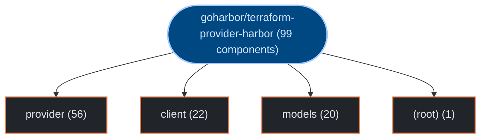
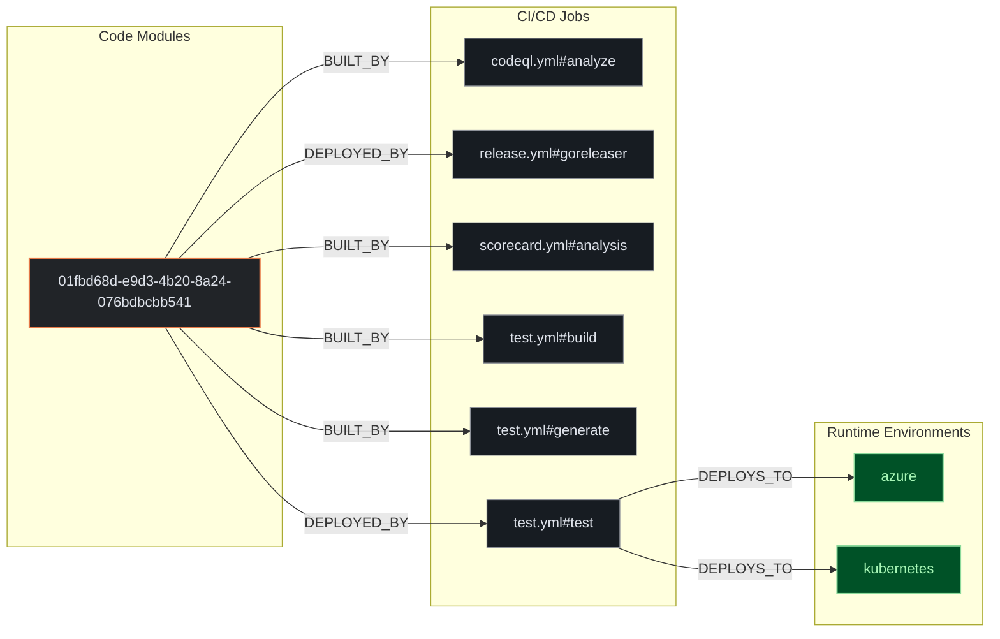
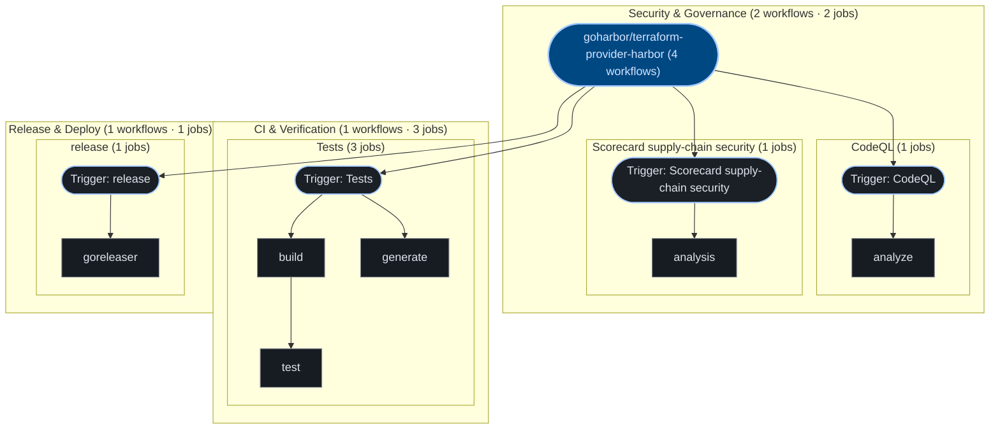

# Repository Architecture Analysis: goharbor/terraform-provider-harbor

## Metadata
- **SHA**: `2e6ad043deb1e1c5199aec8ac88feadc25a7a7bb`
- **Primary Ecosystem**: Go

## Quality Metrics
- **ast_engine**: fallback
- **avg_cognitive_complexity**: 0.0
- **avg_cyclomatic_complexity**: 0.0
- **component_count**: 99
- **dead_code_count**: 0
- **dead_code_symbols**: 0 entry(ies)
- **duplication_pct**: 0.0
- **file_complexities**: 0 entry(ies)
- **files_analyzed**: 99
- **fitness_passed**: True
- **fitness_violation_count**: 0
- **framework**: Go Service
- **import_edges**: 0 entry(ies)
- **loc**: 11080
- **max_cognitive_complexity**: 0
- **max_cyclomatic_complexity**: 0
- **sloc**: 9521
- **test_file_count**: 30

# Architecture: goharbor/terraform-provider-harbor

## Context
- **Repository**: `goharbor/terraform-provider-harbor`
- **SHA**: `2e6ad043deb1e1c5199aec8ac88feadc25a7a7bb`
- **Ecosystem**: Go
- **Framework**: Go Service

## Building Block View

## Component Details

Showing top 60 representative components out of 99 across 4 module group(s):

- **Module `provider`** (56 components — module: 56)
- **Module `client`** (22 components — module: 22)
- **Module `models`** (20 components — module: 20)
- **Module `(root)`** (1 components — module: 1)

- **client** (`client/client.go`): module
- **client_test** (`client/client_test.go`): module
- **config** (`client/config.go`): module
- **config** (`models/config.go`): module
- **data_groups** (`provider/data_groups.go`): module
- **data_project** (`provider/data_project.go`): module
- **data_project_member_groups** (`provider/data_project_member_groups.go`): module
- **data_project_member_users** (`provider/data_project_member_users.go`): module
- **data_project_test** (`provider/data_project_test.go`): module
- **data_projects** (`provider/data_projects.go`): module
- **data_projects_test** (`provider/data_projects_test.go`): module
- **data_registry** (`provider/data_registry.go`): module
- **data_registry_test** (`provider/data_registry_test.go`): module
- **data_robot_accounts** (`provider/data_robot_accounts.go`): module
- **data_users** (`provider/data_users.go`): module
- **group** (`client/group.go`): module
- **group** (`models/group.go`): module
- **group_test** (`client/group_test.go`): module
- **headers** (`models/headers.go`): module
- **immutable_tag_rule** (`client/immutable_tag_rule.go`): module
- **immutable_tag_rule** (`models/immutable_tag_rule.go`): module
- **interogations** (`models/interogations.go`): module
- **labels** (`client/labels.go`): module
- **labels** (`models/labels.go`): module
- **main** (`main.go`): module
- **misc** (`client/misc.go`): module
- **misc_test** (`client/misc_test.go`): module
- **preheat_instance** (`client/preheat_instance.go`): module
- **preheat_instance** (`models/preheat_instance.go`): module
- **project** (`client/project.go`): module
- **project_members** (`client/project_members.go`): module
- **project_members** (`models/project_members.go`): module
- **project_repositories** (`client/project_repositories.go`): module
- **project_webhook** (`client/project_webhook.go`): module
- **project_webhooks** (`models/project_webhooks.go`): module
- **project_webhooks_test** (`models/project_webhooks_test.go`): module
- **projects** (`models/projects.go`): module
- **provider** (`provider/provider.go`): module
- **provider_test** (`provider/provider_test.go`): module
- **quota** (`models/quota.go`): module
- **random** (`provider/random.go`): module
- **random_test** (`provider/random_test.go`): module
- **registry** (`client/registry.go`): module
- **registry** (`models/registry.go`): module
- **registry_test** (`client/registry_test.go`): module
- **replication** (`client/replication.go`): module
- **replications** (`models/replications.go`): module
- **repositories** (`models/repositories.go`): module
- **resource_config_auth** (`provider/resource_config_auth.go`): module
- **resource_config_auth_test** (`provider/resource_config_auth_test.go`): module
- **resource_config_security** (`provider/resource_config_security.go`): module
- **resource_config_system** (`provider/resource_config_system.go`): module
- **resource_config_system_test** (`provider/resource_config_system_test.go`): module
- **resource_garbage_collection** (`provider/resource_garbage_collection.go`): module
- **resource_garbage_collection_test** (`provider/resource_garbage_collection_test.go`): module
- **resource_garbage_collection_unit_test** (`provider/resource_garbage_collection_unit_test.go`): module
- **resource_group** (`provider/resource_group.go`): module
- **resource_harbor_project_webhook** (`provider/resource_harbor_project_webhook.go`): module
- **resource_harbor_project_webhook_test** (`provider/resource_harbor_project_webhook_test.go`): module
- **resource_immutable_tag_rule** (`provider/resource_immutable_tag_rule.go`): module

## 6-Dimension Repository Scorecard

- **Overall Grade**: `D` (69.10/100)
- **Technical Debt Score**: 30.90
- **Estimated Remediation Effort**: 23.23h

| Dimension | Grade | Score | Weight | Details |
| :--- | :---: | :---: | :---: | :--- |
| Code Quality | `A` | 100.00 | 0.20 | avg_cc=0.00, max_cc=0, duplication=0.00%, dead_code=0 |
| Dependency Health | `B` | 85.00 | 0.15 | dependencies=51, outdated=0, vulnerable=0, has_lockfile=False |
| Maintainability | `A` | 100.00 | 0.15 | avg_cognitive=0.00, max_cognitive=0, fitness_violations=0, oversized_files=0 |
| Pipeline Health | `D` | 67.00 | 0.15 | workflows=4, operational_antipatterns=6, parallel_branches=True |
| Security | `F` | 4.00 | 0.20 | vulnerabilities=0, secrets=0, pipeline_security_findings=6 |
| Test Coverage | `C` | 70.00 | 0.15 | coverage=unavailable, ci_test_job=True, test_files_detected=True |

## Supply Chain Dependencies, Vulnerabilities & Secrets

- **Dependencies Parsed**: 51 | **Vulnerabilities**: 0 | **Secrets**: 0

### Inventory Sample
- `github.com/hashicorp/go-cty` `1.5.0` (golang, `go.mod`)
- `github.com/hashicorp/terraform-plugin-sdk/v2` `2.40.1` (golang, `go.mod`)
- `github.com/ProtonMail/go-crypto` `1.4.1` (golang, `go.mod`)
- `github.com/agext/levenshtein` `1.2.3` (golang, `go.mod`)
- `github.com/apparentlymart/go-textseg/v15` `15.0.0` (golang, `go.mod`)
- `github.com/cloudflare/circl` `1.6.3` (golang, `go.mod`)
- `github.com/fatih/color` `1.18.0` (golang, `go.mod`)
- `github.com/golang/protobuf` `1.5.4` (golang, `go.mod`)
- `github.com/google/go-cmp` `0.7.0` (golang, `go.mod`)
- `github.com/hashicorp/errwrap` `1.1.0` (golang, `go.mod`)
- `github.com/hashicorp/go-checkpoint` `0.5.0` (golang, `go.mod`)
- `github.com/hashicorp/go-cleanhttp` `0.5.2` (golang, `go.mod`)
- `github.com/hashicorp/go-hclog` `1.6.3` (golang, `go.mod`)
- `github.com/hashicorp/go-multierror` `1.1.1` (golang, `go.mod`)
- `github.com/hashicorp/go-plugin` `1.7.0` (golang, `go.mod`)
- `github.com/hashicorp/go-retryablehttp` `0.7.8` (golang, `go.mod`)
- `github.com/hashicorp/go-uuid` `1.0.3` (golang, `go.mod`)
- `github.com/hashicorp/go-version` `1.9.0` (golang, `go.mod`)
- `github.com/hashicorp/hc-install` `0.9.4` (golang, `go.mod`)
- `github.com/hashicorp/hcl/v2` `2.24.0` (golang, `go.mod`)
- `github.com/hashicorp/logutils` `1.0.0` (golang, `go.mod`)
- `github.com/hashicorp/terraform-exec` `0.25.1` (golang, `go.mod`)
- `github.com/hashicorp/terraform-json` `0.27.2` (golang, `go.mod`)
- `github.com/hashicorp/terraform-plugin-go` `0.31.0` (golang, `go.mod`)
- `github.com/hashicorp/terraform-plugin-log` `0.10.0` (golang, `go.mod`)
- `github.com/hashicorp/terraform-registry-address` `0.4.0` (golang, `go.mod`)
- `github.com/hashicorp/terraform-svchost` `0.1.1` (golang, `go.mod`)
- `github.com/hashicorp/yamux` `0.1.2` (golang, `go.mod`)
- `github.com/mattn/go-colorable` `0.1.14` (golang, `go.mod`)
- `github.com/mattn/go-isatty` `0.0.20` (golang, `go.mod`)
- ... (+21 more dependencies)

## Section 7: Code-to-Cloud Deployment Traceability

- `test.yml#test` (ci_job) --[DEPLOYS_TO]--> `azure` (environment)
- `test.yml#test` (ci_job) --[DEPLOYS_TO]--> `kubernetes` (environment)
- `01fbd68d-e9d3-4b20-8a24-076bdbcbb541` (code_module) --[BUILT_BY]--> `codeql.yml#analyze` (ci_job)
- `01fbd68d-e9d3-4b20-8a24-076bdbcbb541` (code_module) --[BUILT_BY]--> `scorecard.yml#analysis` (ci_job)
- `01fbd68d-e9d3-4b20-8a24-076bdbcbb541` (code_module) --[BUILT_BY]--> `test.yml#build` (ci_job)
- `01fbd68d-e9d3-4b20-8a24-076bdbcbb541` (code_module) --[BUILT_BY]--> `test.yml#generate` (ci_job)
- `01fbd68d-e9d3-4b20-8a24-076bdbcbb541` (code_module) --[DEPLOYED_BY]--> `release.yml#goreleaser` (ci_job)
- `01fbd68d-e9d3-4b20-8a24-076bdbcbb541` (code_module) --[DEPLOYED_BY]--> `test.yml#test` (ci_job)

## CI/CD Pipeline Topology

