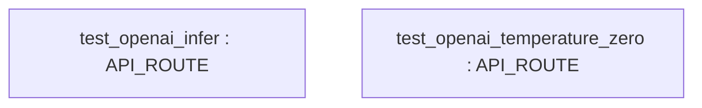
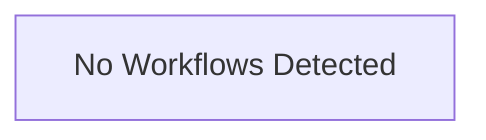

# Repository Architecture Analysis: google/langextract

## Metadata
- **SHA**: `ed3a6bd26f38eaf271a71019cc2da9bd02807b05`
- **Primary Ecosystem**: Python

## Quality Metrics
- **avg_cyclomatic_complexity**: 3.04
- **component_count**: 2
- **files_analyzed**: 29
- **framework**: Unknown
- **loc**: 11266
- **max_cyclomatic_complexity**: 21
- **sloc**: 9437

# Architecture: google/langextract

## Context
- **Repository**: `google/langextract`
- **SHA**: `ed3a6bd26f38eaf271a71019cc2da9bd02807b05`
- **Ecosystem**: Python
- **Framework**: Unknown

## Building Block View

## Component Details
- **test_openai_infer** (`tests/inference_test.py`): API_ROUTE
- **test_openai_temperature_zero** (`tests/inference_test.py`): API_ROUTE

## CI/CD Pipeline Topology

