# Repository Architecture Analysis: grafana/agento11y

## Metadata
- **SHA**: `fad86a9f2cc3b8a05baffb800f49096fbc2b0218`
- **Primary Ecosystem**: Go

## Quality Metrics
- **ast_engine**: tree-sitter
- **avg_cognitive_complexity**: 3.11
- **avg_cyclomatic_complexity**: 3.21
- **component_count**: 281
- **dead_code_count**: 13
- **dead_code_symbols**: 13 entry(ies)
- **duplication_pct**: 8.22
- **file_complexities**: 25 entry(ies)
- **files_analyzed**: 758
- **fitness_passed**: False
- **fitness_violation_count**: 2
- **framework**: Go Service
- **import_edges**: 100 entry(ies)
- **loc**: 261132
- **max_cognitive_complexity**: 53
- **max_cyclomatic_complexity**: 46
- **sloc**: 221723
- **test_file_count**: 630

# Architecture: grafana/agento11y

## Context
- **Repository**: `grafana/agento11y`
- **SHA**: `fad86a9f2cc3b8a05baffb800f49096fbc2b0218`
- **Ecosystem**: Go
- **Framework**: Go Service

## Building Block View

```mermaid
graph TD;
  classDef atlasRoot fill:#004882,stroke:#a3c9ff,stroke-width:2px,color:#d3e4ff
  classDef atlasCategory fill:#212428,stroke:#E87A48,stroke-width:1.5px,color:#dfe3eb
  classDef atlasWorkflow fill:#1b2026,stroke:#a3c9ff,stroke-width:1.5px,color:#dfe3eb
  classDef atlasJob fill:#171c22,stroke:#8d9199,stroke-width:1px,color:#dfe3eb
  classDef atlasTarget fill:#005227,stroke:#8bd99b,stroke-width:1.5px,color:#a7f6b6
  classDef atlasAlert fill:#93000a,stroke:#ffb4ab,stroke-width:1.5px,color:#ffdad6
  classDef atlasMore fill:#252a31,stroke:#8d9199,stroke-dasharray:4 4,color:#c3c6cf
    repo_root(["grafana/agento11y (281 components)"]):::atlasRoot
    dir_0_go["go (137)"]:::atlasCategory
    repo_root --> dir_0_go
    sub_0_0_agento11y["agento11y (101)"]:::atlasWorkflow
    dir_0_go --> sub_0_0_agento11y
    sub_0_1_otelgenai["otelgenai (31)"]:::atlasWorkflow
    dir_0_go --> sub_0_1_otelgenai
    sub_0_2_proto["proto (4)"]:::atlasWorkflow
    dir_0_go --> sub_0_2_proto
    sub_0_more["+1 more submodules (1)"]:::atlasMore
    dir_0_go --> sub_0_more
    dir_1_plugins["plugins (58)"]:::atlasCategory
    repo_root --> dir_1_plugins
    sub_1_0_agento11y_internal["agento11y/internal (56)"]:::atlasWorkflow
    dir_1_plugins --> sub_1_0_agento11y_internal
    sub_1_1_agento11y_cmd["agento11y/cmd (2)"]:::atlasWorkflow
    dir_1_plugins --> sub_1_1_agento11y_cmd
    dir_2_go_providers["go-providers (33)"]:::atlasCategory
    repo_root --> dir_2_go_providers
    sub_2_0_anthropic["anthropic (12)"]:::atlasWorkflow
    dir_2_go_providers --> sub_2_0_anthropic
    sub_2_1_openai["openai (11)"]:::atlasWorkflow
    dir_2_go_providers --> sub_2_1_openai
    sub_2_2_gemini["gemini (10)"]:::atlasWorkflow
    dir_2_go_providers --> sub_2_2_gemini
    dir_3_examples["examples (32)"]:::atlasCategory
    repo_root --> dir_3_examples
    sub_3_0_ai_education_assistant["ai-education-assistant (18)"]:::atlasWorkflow
    dir_3_examples --> sub_3_0_ai_education_assistant
    sub_3_1_experiments["experiments (12)"]:::atlasWorkflow
    dir_3_examples --> sub_3_1_experiments
    sub_3_2_getting_started["getting-started (2)"]:::atlasWorkflow
    dir_3_examples --> sub_3_2_getting_started
    dir_4_dotnet["dotnet (11)"]:::atlasCategory
    repo_root --> dir_4_dotnet
    sub_4_0_src["src (5)"]:::atlasWorkflow
    dir_4_dotnet --> sub_4_0_src
    sub_4_1_tests["tests (5)"]:::atlasWorkflow
    dir_4_dotnet --> sub_4_1_tests
    sub_4_2_examples["examples (1)"]:::atlasWorkflow
    dir_4_dotnet --> sub_4_2_examples
    dir_other_modules["+1 more modules (10)"]:::atlasMore
    repo_root --> dir_other_modules
    sub_4_1_tests -.->|"4 deps"| sub_4_0_src
    sub_4_2_examples -.->|"4 deps"| sub_4_0_src
```

## Component Details

Showing top 60 representative components out of 281 across 6 module group(s):

- **Module `go`** (137 components — module: 137)
- **Module `plugins`** (58 components — module: 58)
- **Module `go-providers`** (33 components — module: 33)
- **Module `examples`** (32 components — module: 12, API_ROUTE: 11, DATA_ACCESS_LAYER: 7)
- **Module `dotnet`** (11 components — MODULE: 9, SERVICE: 2)
- **Module `go-frameworks`** (10 components — module: 10)

- **Grafana.Agento11y.DevExEmitter** (`dotnet/examples/Grafana.Agento11y.DevExEmitter/Grafana.Agento11y.DevExEmitter.csproj`): MODULE (deps: Grafana.Agento11y, Grafana.Agento11y.Anthropic, Grafana.Agento11y.Gemini, Grafana.Agento11y.OpenAI)
- **Grafana.Agento11y.Anthropic** (`dotnet/src/Grafana.Agento11y.Anthropic/Grafana.Agento11y.Anthropic.csproj`): MODULE (deps: Grafana.Agento11y)
- **Grafana.Agento11y.Anthropic.Tests** (`dotnet/tests/Grafana.Agento11y.Anthropic.Tests/Grafana.Agento11y.Anthropic.Tests.csproj`): MODULE (deps: Grafana.Agento11y.Anthropic)
- **Grafana.Agento11y.Gemini** (`dotnet/src/Grafana.Agento11y.Gemini/Grafana.Agento11y.Gemini.csproj`): MODULE (deps: Grafana.Agento11y)
- **Grafana.Agento11y.Gemini.Tests** (`dotnet/tests/Grafana.Agento11y.Gemini.Tests/Grafana.Agento11y.Gemini.Tests.csproj`): MODULE (deps: Grafana.Agento11y.Gemini)
- **Grafana.Agento11y.OpenAI** (`dotnet/src/Grafana.Agento11y.OpenAI/Grafana.Agento11y.OpenAI.csproj`): MODULE (deps: Grafana.Agento11y)
- **Grafana.Agento11y.OpenAI.Tests** (`dotnet/tests/Grafana.Agento11y.OpenAI.Tests/Grafana.Agento11y.OpenAI.Tests.csproj`): MODULE (deps: Grafana.Agento11y.OpenAI)
- **Grafana.Agento11y.Tests** (`dotnet/tests/Grafana.Agento11y.Tests/Grafana.Agento11y.Tests.csproj`): MODULE (deps: Grafana.Agento11y)
- **AssignmentResponse** (`examples/ai-education-assistant/grading-service/app/main.py`): DATA_ACCESS_LAYER
- **ChatRequest** (`examples/ai-education-assistant/education-agent/app/main.py`): DATA_ACCESS_LAYER
- **ChatResponse** (`examples/ai-education-assistant/education-agent/app/main.py`): DATA_ACCESS_LAYER
- **FeedbackRequest** (`examples/ai-education-assistant/education-agent/app/main.py`): DATA_ACCESS_LAYER
- **FeedbackResponse** (`examples/ai-education-assistant/education-agent/app/main.py`): DATA_ACCESS_LAYER
- **Grafana.Agento11y** (`dotnet/src/Grafana.Agento11y/Grafana.Agento11y.csproj`): MODULE
- **IngestService** (`dotnet/tests/Grafana.Agento11y.Tests/TestHelpers.cs`): SERVICE
- **SeedAssignment** (`examples/ai-education-assistant/grading-service/app/main.py`): DATA_ACCESS_LAYER
- **SeedScoresRequest** (`examples/ai-education-assistant/grading-service/app/main.py`): DATA_ACCESS_LAYER
- **UserAgentHandler** (`dotnet/src/Grafana.Agento11y/Exporters.cs`): SERVICE
- **adapter** (`go-frameworks/google-adk/adapter.go`): module
- **adapter_test** (`go-frameworks/google-adk/adapter_test.go`): module
- **agento11y-experiments-typescript** (`examples/experiments/typescript/package.json`): MODULE
- **agento11y-promptfoo-example** (`examples/experiments/promptfoo/package.json`): MODULE
- **artifact** (`go/agento11y/model/artifact.go`): module
- **assignments** (`examples/ai-education-assistant/education-agent/app/main.py`): API_ROUTE
- **boundary_test** (`go/otelgenai/boundary_test.go`): module
- **cache_diagnostics** (`go/agento11y/cache_diagnostics.go`): module
- **cache_diagnostics_test** (`go/agento11y/cache_diagnostics_test.go`): module
- **cache_lock_other** (`go/otelgenai/weavertest/cache_lock_other.go`): module
- **cache_lock_unix** (`go/otelgenai/weavertest/cache_lock_unix.go`): module
- **cache_lock_unix_test** (`go/otelgenai/weavertest/cache_lock_unix_test.go`): module
- **chat** (`examples/ai-education-assistant/education-agent/app/main.py`): API_ROUTE
- **client** (`go/agento11y/client.go`): module
- **client** (`go/agento11y/experiments/client.go`): module
- **client_generation_test** (`go/agento11y/client_generation_test.go`): module
- **client_tags_test** (`go/agento11y/client_tags_test.go`): module
- **client_test** (`go/agento11y/client_test.go`): module
- **codec** (`go/agento11y/codec/codec.go`): module
- **codec_test** (`go/agento11y/codec/codec_test.go`): module
- **codexlog** (`plugins/agento11y/internal/agents/codex/codexlog/codexlog.go`): module
- **codexlog_test** (`plugins/agento11y/internal/agents/codex/codexlog/codexlog_test.go`): module
- **config** (`plugins/agento11y/internal/agents/codex/config/config.go`): module
- **config_test** (`plugins/agento11y/internal/agents/codex/config/config_test.go`): module
- **conformance_helpers_test** (`go/agento11y/conformance_helpers_test.go`): module
- **conformance_test** (`go-frameworks/google-adk/conformance/conformance_test.go`): module
- **conformance_test** (`go-frameworks/google-adk/conformance_test.go`): module
- **conformance_test** (`go-providers/anthropic/conformance_test.go`): module
- **conformance_test** (`go-providers/gemini/conformance_test.go`): module
- **conformance_test** (`go-providers/openai/conformance_test.go`): module
- **conformance_test** (`go/agento11y/conformance_test.go`): module
- **conformance_test** (`go/agento11y/experiments/conformance_test.go`): module
- **conformance_test** (`go/otelgenai/conformance/conformance_test.go`): module
- **content** (`go/otelgenai/content.go`): module
- **content_capture** (`go/agento11y/content_capture.go`): module
- **content_capture_test** (`go/agento11y/content_capture_test.go`): module
- **content_internal_test** (`go/otelgenai/content_internal_test.go`): module
- **content_keys_test** (`go/agento11y/otelhook/content_keys_test.go`): module
- **content_test** (`go/otelgenai/content_test.go`): module
- **contentcapture** (`go/agento11y/contentcapture/contentcapture.go`): module
- **contentcapture_test** (`go/agento11y/contentcapture/contentcapture_test.go`): module
- **context** (`go/agento11y/context.go`): module

## 6-Dimension Repository Scorecard

- **Overall Grade**: `F` (40.32/100)
- **Technical Debt Score**: 59.68
- **Estimated Remediation Effort**: 300.81h

| Dimension | Grade | Score | Weight | Details |
| :--- | :---: | :---: | :---: | :--- |
| Code Quality | `F` | 41.83 | 0.20 | avg_cc=3.21, max_cc=46, duplication=8.22%, dead_code=13 |
| Dependency Health | `A` | 100.00 | 0.15 | dependencies=2828, outdated=0, vulnerable=0, has_lockfile=True |
| Maintainability | `F` | 43.00 | 0.15 | avg_cognitive=3.11, max_cognitive=53, fitness_violations=2, oversized_files=12 |
| Pipeline Health | `F` | 0.00 | 0.15 | workflows=13, operational_antipatterns=51, parallel_branches=True |
| Security | `F` | 0.00 | 0.20 | vulnerabilities=0, secrets=107, pipeline_security_findings=2 |
| Test Coverage | `C` | 70.00 | 0.15 | coverage=unavailable, ci_test_job=True, test_files_detected=True |

## Architecture Fitness & Workspace Boundaries

- **[MEDIUM] `ATRUSS-ARCH-005` (COMPLEXITY_THRESHOLD)**: Repository max_cognitive_complexity (53.0) exceeds policy threshold (25.0).
- **[MEDIUM] `ATRUSS-ARCH-005` (COMPLEXITY_THRESHOLD)**: Repository max_cyclomatic_complexity (46.0) exceeds policy threshold (20.0).

### Workspace Packages
- **github.com/grafana/agento11y/go** (`go`, go, go)
- **github.com/grafana/agento11y/go-frameworks/google-adk** (`go-frameworks/google-adk`, go, go) -> internal deps: `github.com/grafana/agento11y/go`
- **github.com/grafana/agento11y/go-providers/anthropic** (`go-providers/anthropic`, go, go) -> internal deps: `github.com/grafana/agento11y/go`
- **github.com/grafana/agento11y/go-providers/gemini** (`go-providers/gemini`, go, go) -> internal deps: `github.com/grafana/agento11y/go`
- **github.com/grafana/agento11y/go-providers/openai** (`go-providers/openai`, go, go) -> internal deps: `github.com/grafana/agento11y/go`
- **github.com/grafana/agento11y/go/otelgenai/conformance** (`go/otelgenai/conformance`, go, go) -> internal deps: `github.com/grafana/agento11y/go, github.com/grafana/agento11y/go/otelgenai/weavertest`
- **github.com/grafana/agento11y/go/otelgenai/weavertest** (`go/otelgenai/weavertest`, go, go)
- **github.com/grafana/agento11y/plugins/agento11y** (`plugins/agento11y`, go, go) -> internal deps: `github.com/grafana/agento11y/go`
- **@grafana/agento11y** (`js`, react_ts_js, pnpm)
- **@grafana/agento11y-core** (`js-core`, react_ts_js, pnpm)
- **@grafana/agento11y-local-viewer** (`plugins/agento11y`, react_ts_js, pnpm)
- **@grafana/agento11y-opencode** (`plugins/opencode`, react_ts_js, pnpm) -> internal deps: `@grafana/agento11y, @grafana/agento11y-core`
- **@grafana/agento11y-pi** (`plugins/pi`, react_ts_js, pnpm) -> internal deps: `@grafana/agento11y`

## Supply Chain Dependencies, Vulnerabilities & Secrets

- **Dependencies Parsed**: 2828 | **Vulnerabilities**: 0 | **Secrets**: 107

### Secret Findings (Redacted)
- **[HIGH] `ATRUSS-SEC-005`** at `dotnet/tests/Grafana.Agento11y.Tests/RedactionTests.cs:12` (`var secretToken = "glc_***REDACTED***";`)
- **[HIGH] `ATRUSS-SEC-005`** at `dotnet/tests/Grafana.Agento11y.Tests/RedactionTests.cs:98` (`var secretToken = "glc_***REDACTED***";`)
- **[HIGH] `ATRUSS-SEC-005`** at `dotnet/tests/Grafana.Agento11y.Tests/RedactionTests.cs:127` (`var secretToken = "glc_***REDACTED***";`)
- **[CRITICAL] `ATRUSS-SEC-004`** at `dotnet/tests/Grafana.Agento11y.Tests/RedactionTests.cs:211` (`-----BEGIN ... PRIVATE KEY----- [REDACTED]`)
- **[HIGH] `ATRUSS-SEC-005`** at `dotnet/tests/Grafana.Agento11y.Tests/RedactionTests.cs:248` (`var secret = "glc_***REDACTED***";`)
- **[HIGH] `ATRUSS-SEC-005`** at `go/agento11y/experiments/experiments_test.go:530` (`const secret = "glc_***REDACTED***" // trufflehog:ignore`)
- **[HIGH] `ATRUSS-SEC-005`** at `go/agento11y/experiments/experiments_test.go:624` (`const secret = "glc_***REDACTED***" // trufflehog:ignore`)
- **[CRITICAL] `ATRUSS-SEC-002`** at `go/agento11y/otel_export_test.go:254` (`Input: []Message{UserTextMessage("token ghp_***REDACTED***")},`)
- **[CRITICAL] `ATRUSS-SEC-002`** at `go/agento11y/otel_export_test.go:258` (`if strings.Contains(got, "ghp_***REDACTED***") {`)
- **[HIGH] `ATRUSS-SEC-005`** at `go/agento11y/redaction_test.go:18` (`secretToken := "glc_***REDACTED***"`)
- **[HIGH] `ATRUSS-SEC-005`** at `go/agento11y/redaction_test.go:155` (`secretToken := "glc_***REDACTED***"`)
- **[CRITICAL] `ATRUSS-SEC-002`** at `go/agento11y/redaction_test.go:239` (`{"github-pat", "ghp_***REDACTED***"},`)
- **[CRITICAL] `ATRUSS-SEC-004`** at `go/agento11y/redaction_test.go:249` (`-----BEGIN ... PRIVATE KEY----- [REDACTED]`)
- **[HIGH] `ATRUSS-SEC-005`** at `go/agento11y/redaction_test.go:289` (`titleSecret := "glc_***REDACTED***"`)
- **[HIGH] `ATRUSS-SEC-005`** at `go/agento11y/redaction_test.go:352` (`secret := "glc_***REDACTED***"`)
- **[HIGH] `ATRUSS-SEC-005`** at `go/agento11y/redaction_test.go:411` (`secret := "glc_***REDACTED***"`)
- **[HIGH] `ATRUSS-SEC-005`** at `go/agento11y/redaction_test.go:439` (`secret := "glc_***REDACTED***"`)
- **[HIGH] `ATRUSS-SEC-005`** at `js/test/client.redaction.test.mjs:41` (`const secretToken = 'glc_***REDACTED***';`)
- **[CRITICAL] `ATRUSS-SEC-003`** at `js/test/client.redaction.test.mjs:110` (`parts: [{ type: 'text', text: 'key sk-p***REDACTED***' }],`)
- **[HIGH] `ATRUSS-SEC-005`** at `js/test/client.redaction.test.mjs:320` (`const toolDefinitionSecret = 'glc_***REDACTED***';`)
- **[CRITICAL] `ATRUSS-SEC-004`** at `js/test/client.redaction.test.mjs:359` (`-----BEGIN ... PRIVATE KEY----- [REDACTED]`)
- **[HIGH] `ATRUSS-SEC-005`** at `js/test/client.redaction.test.mjs:868` (`const secretToken = 'glc_***REDACTED***';`)
- **[CRITICAL] `ATRUSS-SEC-003`** at `js/test/client.redaction.test.mjs:931` (`parts: [{ type: 'text', text: 'key sk-p***REDACTED***' }],`)
- **[HIGH] `ATRUSS-SEC-005`** at `js/test/experiments.client.test.mjs:433` (`const secret = 'glc_***REDACTED***'; // trufflehog:ignore`)
- **[HIGH] `ATRUSS-SEC-005`** at `plugins/agento11y/internal/agents/claudecode/hook_test.go:1856` (`const secret = "glc_***REDACTED***"`)
- **[CRITICAL] `ATRUSS-SEC-002`** at `plugins/agento11y/internal/agents/claudecode/hook_test.go:2844` (`const secret = "ghp_***REDACTED***"`)
- **[HIGH] `ATRUSS-SEC-005`** at `plugins/agento11y/internal/agents/claudecode/mapper/mapper_test.go:668` (`{Type: "tool_use", ID: "tu_1", Name: "Bash", Input: json.RawMessage(`{"cmd":"deploy.sh","api_key":"kR7f***REDACTED***"}`)},`)
- **[HIGH] `ATRUSS-SEC-005`** at `plugins/agento11y/internal/agents/claudecode/mapper/mapper_test.go:1504` (`{name: "secret", raw: json.RawMessage(`{"token":"glc_***REDACTED***","api_key":"kR7fQ2wLmZ9xTb4vNc1JhY6s"}`)},`)
- **[HIGH] `ATRUSS-SEC-005`** at `plugins/agento11y/internal/agents/claudecode/mapper/mapper_test.go:1504` (`{name: "secret", raw: json.RawMessage(`{"token":"glc_abcdefghijklmnopqrstuvwx","api_key":"kR7f***REDACTED***"}`)},`)
- **[HIGH] `ATRUSS-SEC-005`** at `plugins/agento11y/internal/agents/codex/fragment/fragment_test.go:159` (`const secret = "glc_***REDACTED***" // trufflehog:ignore`)
- **[HIGH] `ATRUSS-SEC-005`** at `plugins/agento11y/internal/agents/codex/hook/handlers_test.go:89` (`secret := "glc_***REDACTED***"`)
- **[HIGH] `ATRUSS-SEC-005`** at `plugins/agento11y/internal/agents/codex/hook/handlers_test.go:368` (`const secret = "glc_***REDACTED***"`)
- **[HIGH] `ATRUSS-SEC-005`** at `plugins/agento11y/internal/agents/codex/hook/handlers_test.go:781` (`const secret = "glc_***REDACTED***" // trufflehog:ignore`)
- **[HIGH] `ATRUSS-SEC-005`** at `plugins/agento11y/internal/agents/codex/mapper/mapper_test.go:40` (`const secret = "glc_***REDACTED***"`)
- **[HIGH] `ATRUSS-SEC-005`** at `plugins/agento11y/internal/agents/codex/mapper/mapper_test.go:120` (`secret := "glc_***REDACTED***"`)
- **[HIGH] `ATRUSS-SEC-005`** at `plugins/agento11y/internal/agents/codex/mapper/mapper_test.go:197` (`secret := "glc_***REDACTED***"`)
- **[HIGH] `ATRUSS-SEC-005`** at `plugins/agento11y/internal/agents/copilot/hook/handlers_test.go:257` (`const secret = "glc_***REDACTED***"`)
- **[HIGH] `ATRUSS-SEC-005`** at `plugins/agento11y/internal/agents/copilot/hook/handlers_test.go:960` (`const token = "glc_***REDACTED***"`)
- **[HIGH] `ATRUSS-SEC-005`** at `plugins/agento11y/internal/agents/copilot/hook/handlers_test.go:961` (`const apiKey = "kR7f***REDACTED***"`)
- **[HIGH] `ATRUSS-SEC-005`** at `plugins/agento11y/internal/agents/copilot/mapper/mapper_test.go:20` (`const testSecret = "glc_***REDACTED***"`)

### Inventory Sample
- `org.junit.platform:junit-platform-launcher` `*` (Maven, `java/core/build.gradle.kts`)
- `org.junit.platform:junit-platform-launcher` `*` (Maven, `java/devex-emitter/build.gradle.kts`)
- `org.junit.platform:junit-platform-launcher` `*` (Maven, `java/frameworks/google-adk/build.gradle.kts`)
- `org.junit.platform:junit-platform-launcher` `*` (Maven, `java/providers/anthropic/build.gradle.kts`)
- `org.junit.platform:junit-platform-launcher` `*` (Maven, `java/providers/gemini/build.gradle.kts`)
- `org.junit.platform:junit-platform-launcher` `*` (Maven, `java/providers/openai/build.gradle.kts`)
- `Anthropic` `*` (NuGet, `dotnet/src/Grafana.Agento11y.Anthropic/Grafana.Agento11y.Anthropic.csproj`)
- `Google.GenAI` `*` (NuGet, `dotnet/src/Grafana.Agento11y.Gemini/Grafana.Agento11y.Gemini.csproj`)
- `Google.Protobuf` `*` (NuGet, `dotnet/src/Grafana.Agento11y/Grafana.Agento11y.csproj`)
- `Grpc.AspNetCore` `*` (NuGet, `dotnet/tests/Grafana.Agento11y.Tests/Grafana.Agento11y.Tests.csproj`)
- `Grpc.Net.Client` `*` (NuGet, `dotnet/src/Grafana.Agento11y/Grafana.Agento11y.csproj`)
- `Grpc.Tools` `*` (NuGet, `dotnet/src/Grafana.Agento11y/Grafana.Agento11y.csproj`)
- `Grpc.Tools` `*` (NuGet, `dotnet/tests/Grafana.Agento11y.Tests/Grafana.Agento11y.Tests.csproj`)
- `Microsoft.NET.Test.Sdk` `*` (NuGet, `dotnet/tests/Grafana.Agento11y.Anthropic.Tests/Grafana.Agento11y.Anthropic.Tests.csproj`)
- `Microsoft.NET.Test.Sdk` `*` (NuGet, `dotnet/tests/Grafana.Agento11y.Gemini.Tests/Grafana.Agento11y.Gemini.Tests.csproj`)
- `Microsoft.NET.Test.Sdk` `*` (NuGet, `dotnet/tests/Grafana.Agento11y.OpenAI.Tests/Grafana.Agento11y.OpenAI.Tests.csproj`)
- `Microsoft.NET.Test.Sdk` `*` (NuGet, `dotnet/tests/Grafana.Agento11y.Tests/Grafana.Agento11y.Tests.csproj`)
- `OpenAI` `*` (NuGet, `dotnet/src/Grafana.Agento11y.OpenAI/Grafana.Agento11y.OpenAI.csproj`)
- `OpenTelemetry` `*` (NuGet, `dotnet/src/Grafana.Agento11y/Grafana.Agento11y.csproj`)
- `OpenTelemetry.Exporter.OpenTelemetryProtocol` `*` (NuGet, `dotnet/src/Grafana.Agento11y/Grafana.Agento11y.csproj`)
- `System.Text.Json` `*` (NuGet, `dotnet/src/Grafana.Agento11y/Grafana.Agento11y.csproj`)
- `coverlet.collector` `*` (NuGet, `dotnet/tests/Grafana.Agento11y.Anthropic.Tests/Grafana.Agento11y.Anthropic.Tests.csproj`)
- `coverlet.collector` `*` (NuGet, `dotnet/tests/Grafana.Agento11y.Gemini.Tests/Grafana.Agento11y.Gemini.Tests.csproj`)
- `coverlet.collector` `*` (NuGet, `dotnet/tests/Grafana.Agento11y.OpenAI.Tests/Grafana.Agento11y.OpenAI.Tests.csproj`)
- `coverlet.collector` `*` (NuGet, `dotnet/tests/Grafana.Agento11y.Tests/Grafana.Agento11y.Tests.csproj`)
- `xunit.runner.visualstudio` `*` (NuGet, `dotnet/tests/Grafana.Agento11y.Anthropic.Tests/Grafana.Agento11y.Anthropic.Tests.csproj`)
- `xunit.runner.visualstudio` `*` (NuGet, `dotnet/tests/Grafana.Agento11y.Gemini.Tests/Grafana.Agento11y.Gemini.Tests.csproj`)
- `xunit.runner.visualstudio` `*` (NuGet, `dotnet/tests/Grafana.Agento11y.OpenAI.Tests/Grafana.Agento11y.OpenAI.Tests.csproj`)
- `xunit.runner.visualstudio` `*` (NuGet, `dotnet/tests/Grafana.Agento11y.Tests/Grafana.Agento11y.Tests.csproj`)
- `xunit.v3` `*` (NuGet, `dotnet/tests/Grafana.Agento11y.Anthropic.Tests/Grafana.Agento11y.Anthropic.Tests.csproj`)
- ... (+2798 more dependencies)

## Section 7: Code-to-Cloud Deployment Traceability

```mermaid
flowchart LR
    classDef atlasCategory fill:#212428,stroke:#E87A48,stroke-width:1.5px,color:#dfe3eb
    classDef atlasWorkflow fill:#1b2026,stroke:#a3c9ff,stroke-width:1.5px,color:#dfe3eb
    classDef atlasJob fill:#171c22,stroke:#8d9199,stroke-width:1px,color:#dfe3eb
    classDef atlasTarget fill:#005227,stroke:#8bd99b,stroke-width:1.5px,color:#a7f6b6
    subgraph code_modules["Code Modules"]
        mod_dotnet["dotnet"]:::atlasCategory
        mod_dotnet_src_Grafana_Agento11y["dotnet/src/Grafana.Agento11y"]:::atlasCategory
        mod_examples_experiments_python["examples/experiments/python"]:::atlasCategory
        mod_examples_getting_started_python["examples/getting-started/python"]:::atlasCategory
        mod_go["go"]:::atlasCategory
        mod_java["java"]:::atlasCategory
        mod_js["js"]:::atlasCategory
        mod_js_core["js-core"]:::atlasCategory
        mod_plugins_agento11y["plugins/agento11y"]:::atlasCategory
        mod_plugins_hermes["plugins/hermes"]:::atlasCategory
        mod_python["python"]:::atlasCategory
        mod_python_frameworks_claude_agent_sdk["python-frameworks/claude-agent-sdk"]:::atlasCategory
        mod_python_frameworks_deepeval["python-frameworks/deepeval"]:::atlasCategory
        mod_python_frameworks_google_adk["python-frameworks/google-adk"]:::atlasCategory
        mod_python_frameworks_harbor["python-frameworks/harbor"]:::atlasCategory
        mod_python_frameworks_langchain["python-frameworks/langchain"]:::atlasCategory
        mod_python_frameworks_langgraph["python-frameworks/langgraph"]:::atlasCategory
        mod_python_frameworks_litellm["python-frameworks/litellm"]:::atlasCategory
        mod_python_frameworks_litellm_example["python-frameworks/litellm/example"]:::atlasCategory
        mod_python_frameworks_llamaindex["python-frameworks/llamaindex"]:::atlasCategory
        mod_python_frameworks_openai_agents["python-frameworks/openai-agents"]:::atlasCategory
        mod_python_frameworks_pydantic_ai["python-frameworks/pydantic-ai"]:::atlasCategory
        mod_python_frameworks_strands["python-frameworks/strands"]:::atlasCategory
        mod_python_providers_anthropic["python-providers/anthropic"]:::atlasCategory
        mod_python_providers_gemini["python-providers/gemini"]:::atlasCategory
        mod_python_providers_openai["python-providers/openai"]:::atlasCategory
    end
    subgraph build_artifacts["Build Artifacts / Containers"]
        art_python_frameworks_litellm_example_Dockerfile["python-frameworks/litellm/example/Dockerfile"]:::atlasWorkflow
        art_python_frameworks_litellm_example_Dockerfile_dockerignore["python-frameworks/litellm/example/Dockerfile.dockerignore"]:::atlasWorkflow
        art_python_frameworks_litellm_example_docker_compose_yaml["python-frameworks/litellm/example/docker-compose.yaml"]:::atlasWorkflow
    end
    subgraph ci_jobs["CI/CD Jobs"]
        job_ci_yml_conformance["ci.yml#conformance"]:::atlasJob
        job_ci_yml_dotnet["ci.yml#dotnet"]:::atlasJob
        job_ci_yml_go["ci.yml#go"]:::atlasJob
        job_ci_yml_go_module["ci.yml#go-module"]:::atlasJob
        job_ci_yml_go_plugin_windows["ci.yml#go-plugin-windows"]:::atlasJob
        job_ci_yml_hermes_test["ci.yml#hermes-test"]:::atlasJob
        job_ci_yml_java["ci.yml#java"]:::atlasJob
        job_ci_yml_typescript["ci.yml#typescript"]:::atlasJob
        job_dotnet_publish_yml_build["dotnet-publish.yml#build"]:::atlasJob
        job_dotnet_publish_yml_publish["dotnet-publish.yml#publish"]:::atlasJob
        job_dotnet_publish_yml_release_pr["dotnet-publish.yml#release-pr"]:::atlasJob
        job_java_publish_yml_build["java-publish.yml#build"]:::atlasJob
        job_java_publish_yml_publish["java-publish.yml#publish"]:::atlasJob
        job_java_publish_yml_release_pr["java-publish.yml#release-pr"]:::atlasJob
        job_js_sdk_publish_yml_build["js-sdk-publish.yml#build"]:::atlasJob
        job_js_sdk_publish_yml_publish["js-sdk-publish.yml#publish"]:::atlasJob
        job_js_sdk_publish_yml_release_pr["js-sdk-publish.yml#release-pr"]:::atlasJob
        job_plugins_publish_yml_prepare["plugins-publish.yml#prepare"]:::atlasJob
        job_plugins_publish_yml_publish["plugins-publish.yml#publish"]:::atlasJob
        job_publish_homebrew_formula_yml_publish["publish-homebrew-formula.yml#publish"]:::atlasJob
        job_python_sdks_publish_yml_build["python-sdks-publish.yml#build"]:::atlasJob
        job_python_sdks_publish_yml_publish_core["python-sdks-publish.yml#publish-core"]:::atlasJob
        job_python_sdks_publish_yml_publish_dependents["python-sdks-publish.yml#publish-dependents"]:::atlasJob
        job_release_agento11y_binaries_yml_release["release-agento11y-binaries.yml#release"]:::atlasJob
        job_release_agento11y_yml_release["release-agento11y.yml#release"]:::atlasJob
        job_release_go_sdk_yml_release["release-go-sdk.yml#release"]:::atlasJob
        job_sdk_github_releases_yml_release["sdk-github-releases.yml#release"]:::atlasJob
        job_tag_agento11y_on_merge_yml_tag["tag-agento11y-on-merge.yml#tag"]:::atlasJob
        job_tag_releases_on_merge_yml_tag["tag-releases-on-merge.yml#tag"]:::atlasJob
    end
    subgraph runtime_envs["Runtime Environments"]
        env_NuGet_org["NuGet.org"]:::atlasTarget
        env_npm_publish["npm-publish"]:::atlasTarget
        env_pypi["pypi"]:::atlasTarget
    end
    job_dotnet_publish_yml_publish -->|DEPLOYS_TO| env_NuGet_org
    job_js_sdk_publish_yml_publish -->|DEPLOYS_TO| env_npm_publish
    job_plugins_publish_yml_publish -->|DEPLOYS_TO| env_npm_publish
    job_python_sdks_publish_yml_publish_core -->|DEPLOYS_TO| env_pypi
    job_python_sdks_publish_yml_publish_dependents -->|DEPLOYS_TO| env_pypi
    mod_dotnet -->|BUILT_BY| job_ci_yml_dotnet
    mod_dotnet -->|BUILT_BY| job_dotnet_publish_yml_build
    mod_dotnet -->|DEPLOYED_BY| job_dotnet_publish_yml_publish
    mod_dotnet -->|DEPLOYED_BY| job_dotnet_publish_yml_release_pr
    mod_dotnet_src_Grafana_Agento11y -->|BUILT_BY| job_ci_yml_dotnet
    mod_examples_experiments_python -->|PACKAGED_BY| art_python_frameworks_litellm_example_Dockerfile
    mod_examples_experiments_python -->|PACKAGED_BY| art_python_frameworks_litellm_example_Dockerfile_dockerignore
    mod_examples_experiments_python -->|PACKAGED_BY| art_python_frameworks_litellm_example_docker_compose_yaml
    mod_examples_getting_started_python -->|PACKAGED_BY| art_python_frameworks_litellm_example_Dockerfile
    mod_examples_getting_started_python -->|PACKAGED_BY| art_python_frameworks_litellm_example_Dockerfile_dockerignore
    mod_examples_getting_started_python -->|PACKAGED_BY| art_python_frameworks_litellm_example_docker_compose_yaml
    mod_go -->|BUILT_BY| job_ci_yml_conformance
    mod_go -->|BUILT_BY| job_ci_yml_go
    mod_go -->|BUILT_BY| job_ci_yml_go_module
    mod_go -->|BUILT_BY| job_ci_yml_go_plugin_windows
    mod_go -->|BUILT_BY| job_python_sdks_publish_yml_build
    mod_go -->|DEPLOYED_BY| job_publish_homebrew_formula_yml_publish
    mod_go -->|DEPLOYED_BY| job_release_agento11y_binaries_yml_release
    mod_go -->|DEPLOYED_BY| job_release_go_sdk_yml_release
    mod_java -->|BUILT_BY| job_ci_yml_java
    mod_java -->|BUILT_BY| job_java_publish_yml_build
    mod_java -->|DEPLOYED_BY| job_java_publish_yml_publish
    mod_java -->|DEPLOYED_BY| job_java_publish_yml_release_pr
    mod_js -->|BUILT_BY| job_ci_yml_typescript
    mod_js -->|BUILT_BY| job_dotnet_publish_yml_build
    mod_js -->|BUILT_BY| job_java_publish_yml_build
    mod_js -->|BUILT_BY| job_js_sdk_publish_yml_build
    mod_js -->|BUILT_BY| job_plugins_publish_yml_prepare
    mod_js -->|BUILT_BY| job_python_sdks_publish_yml_build
    mod_js -->|BUILT_BY| job_tag_releases_on_merge_yml_tag
    mod_js -->|DEPLOYED_BY| job_dotnet_publish_yml_publish
    mod_js -->|DEPLOYED_BY| job_js_sdk_publish_yml_publish
    mod_js -->|DEPLOYED_BY| job_js_sdk_publish_yml_release_pr
    mod_js -->|DEPLOYED_BY| job_release_go_sdk_yml_release
    mod_js -->|DEPLOYED_BY| job_sdk_github_releases_yml_release
    mod_js_core -->|BUILT_BY| job_js_sdk_publish_yml_build
    mod_js_core -->|DEPLOYED_BY| job_js_sdk_publish_yml_publish
    mod_js_core -->|DEPLOYED_BY| job_js_sdk_publish_yml_release_pr
    mod_plugins_agento11y -->|BUILT_BY| job_ci_yml_go_plugin_windows
    mod_plugins_agento11y -->|BUILT_BY| job_tag_agento11y_on_merge_yml_tag
    mod_plugins_agento11y -->|DEPLOYED_BY| job_publish_homebrew_formula_yml_publish
    mod_plugins_agento11y -->|DEPLOYED_BY| job_release_agento11y_binaries_yml_release
    mod_plugins_agento11y -->|DEPLOYED_BY| job_release_agento11y_yml_release
    mod_plugins_agento11y -->|DEPLOYED_BY| job_sdk_github_releases_yml_release
    mod_plugins_hermes -->|BUILT_BY| job_python_sdks_publish_yml_build
    mod_python -->|BUILT_BY| job_ci_yml_hermes_test
    mod_python -->|BUILT_BY| job_python_sdks_publish_yml_build
    mod_python -->|PACKAGED_BY| art_python_frameworks_litellm_example_Dockerfile
    mod_python -->|PACKAGED_BY| art_python_frameworks_litellm_example_Dockerfile_dockerignore
    mod_python -->|PACKAGED_BY| art_python_frameworks_litellm_example_docker_compose_yaml
    mod_python_frameworks_claude_agent_sdk -->|BUILT_BY| job_python_sdks_publish_yml_build
    mod_python_frameworks_deepeval -->|BUILT_BY| job_python_sdks_publish_yml_build
    mod_python_frameworks_google_adk -->|BUILT_BY| job_python_sdks_publish_yml_build
    mod_python_frameworks_harbor -->|BUILT_BY| job_python_sdks_publish_yml_build
    mod_python_frameworks_langchain -->|BUILT_BY| job_python_sdks_publish_yml_build
    mod_python_frameworks_langgraph -->|BUILT_BY| job_python_sdks_publish_yml_build
    mod_python_frameworks_litellm -->|BUILT_BY| job_python_sdks_publish_yml_build
    mod_python_frameworks_litellm -->|PACKAGED_BY| art_python_frameworks_litellm_example_Dockerfile
    mod_python_frameworks_litellm -->|PACKAGED_BY| art_python_frameworks_litellm_example_Dockerfile_dockerignore
    mod_python_frameworks_litellm -->|PACKAGED_BY| art_python_frameworks_litellm_example_docker_compose_yaml
    mod_python_frameworks_litellm_example -->|PACKAGED_BY| art_python_frameworks_litellm_example_Dockerfile
    mod_python_frameworks_litellm_example -->|PACKAGED_BY| art_python_frameworks_litellm_example_Dockerfile_dockerignore
    mod_python_frameworks_litellm_example -->|PACKAGED_BY| art_python_frameworks_litellm_example_docker_compose_yaml
    mod_python_frameworks_llamaindex -->|BUILT_BY| job_python_sdks_publish_yml_build
    mod_python_frameworks_openai_agents -->|BUILT_BY| job_python_sdks_publish_yml_build
    mod_python_frameworks_pydantic_ai -->|BUILT_BY| job_python_sdks_publish_yml_build
    mod_python_frameworks_strands -->|BUILT_BY| job_python_sdks_publish_yml_build
    mod_python_providers_anthropic -->|BUILT_BY| job_python_sdks_publish_yml_build
    mod_python_providers_gemini -->|BUILT_BY| job_python_sdks_publish_yml_build
    mod_python_providers_openai -->|BUILT_BY| job_python_sdks_publish_yml_build
```

- `dotnet-publish.yml#publish` (ci_job) --[DEPLOYS_TO]--> `NuGet.org` (environment)
- `js-sdk-publish.yml#publish` (ci_job) --[DEPLOYS_TO]--> `npm-publish` (environment)
- `plugins-publish.yml#publish` (ci_job) --[DEPLOYS_TO]--> `npm-publish` (environment)
- `python-sdks-publish.yml#publish-core` (ci_job) --[DEPLOYS_TO]--> `pypi` (environment)
- `python-sdks-publish.yml#publish-dependents` (ci_job) --[DEPLOYS_TO]--> `pypi` (environment)
- `dotnet` (code_module) --[BUILT_BY]--> `ci.yml#dotnet` (ci_job)
- `dotnet` (code_module) --[BUILT_BY]--> `dotnet-publish.yml#build` (ci_job)
- `dotnet` (code_module) --[DEPLOYED_BY]--> `dotnet-publish.yml#publish` (ci_job)
- `dotnet` (code_module) --[DEPLOYED_BY]--> `dotnet-publish.yml#release-pr` (ci_job)
- `dotnet/src/Grafana.Agento11y` (code_module) --[BUILT_BY]--> `ci.yml#dotnet` (ci_job)
- `examples/experiments/python` (code_module) --[PACKAGED_BY]--> `python-frameworks/litellm/example/Dockerfile` (container)
- `examples/experiments/python` (code_module) --[PACKAGED_BY]--> `python-frameworks/litellm/example/Dockerfile.dockerignore` (container)
- `examples/experiments/python` (code_module) --[PACKAGED_BY]--> `python-frameworks/litellm/example/docker-compose.yaml` (container)
- `examples/getting-started/python` (code_module) --[PACKAGED_BY]--> `python-frameworks/litellm/example/Dockerfile` (container)
- `examples/getting-started/python` (code_module) --[PACKAGED_BY]--> `python-frameworks/litellm/example/Dockerfile.dockerignore` (container)
- `examples/getting-started/python` (code_module) --[PACKAGED_BY]--> `python-frameworks/litellm/example/docker-compose.yaml` (container)
- `go` (code_module) --[BUILT_BY]--> `ci.yml#conformance` (ci_job)
- `go` (code_module) --[BUILT_BY]--> `ci.yml#go` (ci_job)
- `go` (code_module) --[BUILT_BY]--> `ci.yml#go-module` (ci_job)
- `go` (code_module) --[BUILT_BY]--> `ci.yml#go-plugin-windows` (ci_job)
- `go` (code_module) --[BUILT_BY]--> `python-sdks-publish.yml#build` (ci_job)
- `go` (code_module) --[DEPLOYED_BY]--> `publish-homebrew-formula.yml#publish` (ci_job)
- `go` (code_module) --[DEPLOYED_BY]--> `release-agento11y-binaries.yml#release` (ci_job)
- `go` (code_module) --[DEPLOYED_BY]--> `release-go-sdk.yml#release` (ci_job)
- `java` (code_module) --[BUILT_BY]--> `ci.yml#java` (ci_job)
- `java` (code_module) --[BUILT_BY]--> `java-publish.yml#build` (ci_job)
- `java` (code_module) --[DEPLOYED_BY]--> `java-publish.yml#publish` (ci_job)
- `java` (code_module) --[DEPLOYED_BY]--> `java-publish.yml#release-pr` (ci_job)
- `js` (code_module) --[BUILT_BY]--> `ci.yml#typescript` (ci_job)
- `js` (code_module) --[BUILT_BY]--> `dotnet-publish.yml#build` (ci_job)
- `js` (code_module) --[BUILT_BY]--> `java-publish.yml#build` (ci_job)
- `js` (code_module) --[BUILT_BY]--> `js-sdk-publish.yml#build` (ci_job)
- `js` (code_module) --[BUILT_BY]--> `plugins-publish.yml#prepare` (ci_job)
- `js` (code_module) --[BUILT_BY]--> `python-sdks-publish.yml#build` (ci_job)
- `js` (code_module) --[BUILT_BY]--> `tag-releases-on-merge.yml#tag` (ci_job)
- `js` (code_module) --[DEPLOYED_BY]--> `dotnet-publish.yml#publish` (ci_job)
- `js` (code_module) --[DEPLOYED_BY]--> `js-sdk-publish.yml#publish` (ci_job)
- `js` (code_module) --[DEPLOYED_BY]--> `js-sdk-publish.yml#release-pr` (ci_job)
- `js` (code_module) --[DEPLOYED_BY]--> `release-go-sdk.yml#release` (ci_job)
- `js` (code_module) --[DEPLOYED_BY]--> `sdk-github-releases.yml#release` (ci_job)

## CI/CD Pipeline Topology

```mermaid
graph TD;
  classDef atlasRoot fill:#004882,stroke:#a3c9ff,stroke-width:2px,color:#d3e4ff
  classDef atlasCategory fill:#212428,stroke:#E87A48,stroke-width:1.5px,color:#dfe3eb
  classDef atlasWorkflow fill:#1b2026,stroke:#a3c9ff,stroke-width:1.5px,color:#dfe3eb
  classDef atlasJob fill:#171c22,stroke:#8d9199,stroke-width:1px,color:#dfe3eb
  classDef atlasTarget fill:#005227,stroke:#8bd99b,stroke-width:1.5px,color:#a7f6b6
  classDef atlasAlert fill:#93000a,stroke:#ffb4ab,stroke-width:1.5px,color:#ffdad6
  classDef atlasMore fill:#252a31,stroke:#8d9199,stroke-dasharray:4 4,color:#c3c6cf
  pipeline_root(["grafana/agento11y (13 workflows)"]):::atlasRoot
  subgraph sg_grp_0_Release___Deploy["Release & Deploy (12 workflows · 21 jobs)"]
    direction TB
    subgraph sg_wf_1_Publish__NET_SDK_to_NuGet["Publish .NET SDK to NuGet (3 jobs)"]
      direction TB
      wf_1_Publish__NET_SDK_to_NuGet(["Trigger: Publish .NET SDK to NuGet"]):::atlasWorkflow
      job_1_build["build"]:::atlasJob
      job_1_publish["publish"]:::atlasJob
      job_1_release_pr["release-pr"]:::atlasJob
      wf_1_Publish__NET_SDK_to_NuGet --> job_1_build
      job_1_build --> job_1_publish
      job_1_build --> job_1_release_pr
      job_1_publish --> job_1_release_pr
    end
    pipeline_root --> wf_1_Publish__NET_SDK_to_NuGet
    subgraph sg_wf_2_Publish_Java_SDK_to_Maven_Central["Publish Java SDK to Maven Central (3 jobs)"]
      direction TB
      wf_2_Publish_Java_SDK_to_Maven_Central(["Trigger: Publish Java SDK to Maven Central"]):::atlasWorkflow
      job_2_build["build"]:::atlasJob
      job_2_publish["publish"]:::atlasJob
      job_2_release_pr["release-pr"]:::atlasJob
      wf_2_Publish_Java_SDK_to_Maven_Central --> job_2_build
      job_2_build --> job_2_publish
      job_2_build --> job_2_release_pr
      job_2_publish --> job_2_release_pr
    end
    pipeline_root --> wf_2_Publish_Java_SDK_to_Maven_Central
    subgraph sg_wf_3_Publish_JS_SDK_to_npm["Publish JS SDK to npm (3 jobs)"]
      direction TB
      wf_3_Publish_JS_SDK_to_npm(["Trigger: Publish JS SDK to npm"]):::atlasWorkflow
      job_3_build["build"]:::atlasJob
      job_3_publish["publish"]:::atlasJob
      job_3_release_pr["release-pr"]:::atlasJob
      wf_3_Publish_JS_SDK_to_npm --> job_3_build
      job_3_build --> job_3_publish
      job_3_build --> job_3_release_pr
      job_3_publish --> job_3_release_pr
    end
    pipeline_root --> wf_3_Publish_JS_SDK_to_npm
    subgraph sg_wf_4_Publish_plugins_to_npm["Publish plugins to npm (2 jobs)"]
      direction TB
      wf_4_Publish_plugins_to_npm(["Trigger: Publish plugins to npm"]):::atlasWorkflow
      job_4_prepare["prepare"]:::atlasJob
      job_4_publish["publish"]:::atlasJob
      wf_4_Publish_plugins_to_npm --> job_4_prepare
      job_4_prepare --> job_4_publish
    end
    pipeline_root --> wf_4_Publish_plugins_to_npm
    subgraph sg_wf_5_Publish_Homebrew_Formula["Publish Homebrew Formula (1 jobs)"]
      direction TB
      wf_5_Publish_Homebrew_Formula(["Trigger: Publish Homebrew Formula"]):::atlasWorkflow
      job_5_publish["publish"]:::atlasJob
      wf_5_Publish_Homebrew_Formula --> job_5_publish
    end
    pipeline_root --> wf_5_Publish_Homebrew_Formula
    subgraph sg_wf_6_Publish_Python_SDKs_to_PyPI["Publish Python SDKs to PyPI (3 jobs)"]
      direction TB
      wf_6_Publish_Python_SDKs_to_PyPI(["Trigger: Publish Python SDKs to PyPI"]):::atlasWorkflow
      job_6_build["build"]:::atlasJob
      job_6_publish_core["publish-core"]:::atlasJob
      job_6_publish_dependents["publish-dependents"]:::atlasJob
      wf_6_Publish_Python_SDKs_to_PyPI --> job_6_build
      job_6_build --> job_6_publish_core
      job_6_build --> job_6_publish_dependents
      job_6_publish_core --> job_6_publish_dependents
    end
    pipeline_root --> wf_6_Publish_Python_SDKs_to_PyPI
    subgraph sg_wf_8_Release_plugins_agento11y["Release plugins/agento11y (1 jobs)"]
      direction TB
      wf_8_Release_plugins_agento11y(["Trigger: Release plugins/agento11y"]):::atlasWorkflow
      job_8_release["release"]:::atlasJob
      wf_8_Release_plugins_agento11y --> job_8_release
    end
    pipeline_root --> wf_8_Release_plugins_agento11y
    wf_9_Release_Go_SDK["Release Go SDK (1 jobs)"]:::atlasWorkflow
    pipeline_root --> wf_9_Release_Go_SDK
    wf_10_Publish_SDK_release_notes["Publish SDK release notes (1 jobs)"]:::atlasWorkflow
    pipeline_root --> wf_10_Publish_SDK_release_notes
  end
  subgraph sg_grp_1_CI___Verification["CI & Verification (1 workflows · 14 jobs)"]
    direction TB
    wf_0_CI["CI (14 jobs)"]:::atlasWorkflow
    pipeline_root --> wf_0_CI
  end
  wf_more["+3 more workflows"]:::atlasMore
  pipeline_root --> wf_more
```

