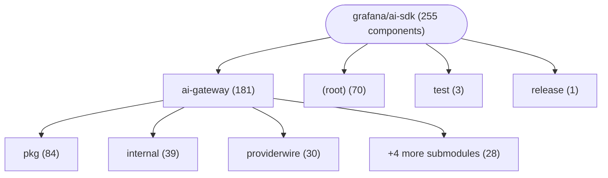
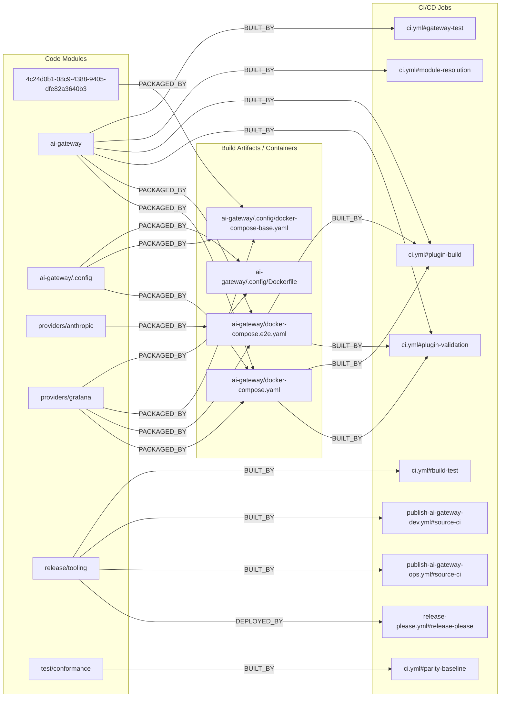
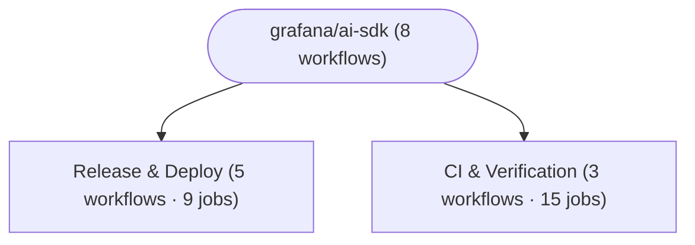

# Repository Architecture Analysis: grafana/ai-sdk

## Metadata
- **SHA**: `edcebe5e9acf9a7a50d89268b534a708c5e201cb`
- **Primary Ecosystem**: Go

## Quality Metrics
- **ast_engine**: tree-sitter
- **avg_cognitive_complexity**: 3.77
- **avg_cyclomatic_complexity**: 3.35
- **component_count**: 255
- **dead_code_count**: 1
- **dead_code_symbols**: 1 entry(ies)
- **duplication_pct**: 6.82
- **file_complexities**: 25 entry(ies)
- **files_analyzed**: 819
- **fitness_passed**: False
- **fitness_violation_count**: 2
- **framework**: Go Service
- **import_edges**: 100 entry(ies)
- **loc**: 198359
- **max_cognitive_complexity**: 75
- **max_cyclomatic_complexity**: 49
- **sloc**: 176552
- **test_file_count**: 1403

# Architecture: grafana/ai-sdk

## Context
- **Repository**: `grafana/ai-sdk`
- **SHA**: `edcebe5e9acf9a7a50d89268b534a708c5e201cb`
- **Ecosystem**: Go
- **Framework**: Go Service

## Building Block View

## Component Details

Showing top 60 representative components out of 255 across 4 module group(s):

- **Module `ai-gateway`** (181 components — module: 180, MODULE: 1)
- **Module `(root)`** (70 components — module: 70)
- **Module `test`** (3 components — MODULE: 3)
- **Module `release`** (1 components — MODULE: 1)

- **@ai-sdk/conformance-tools** (`test/conformance/tools/package.json`): MODULE
- **@ai-sdk/providerwire-v4-contract** (`ai-gateway/test/providerwire-v4/package.json`): MODULE
- **@ai-sdk/test-cli** (`test/cli/package.json`): MODULE
- **@ai-sdk/test-integration** (`test/integration/package.json`): MODULE
- **Magefile** (`ai-gateway/Magefile.go`): module
- **access** (`ai-gateway/pkg/internal/auth/access.go`): module
- **access_test** (`ai-gateway/pkg/internal/auth/access_test.go`): module
- **adapter** (`ai-gateway/internal/testadapter/adapter.go`): module
- **adapter_test** (`ai-gateway/internal/execution/adapter_test.go`): module
- **adapter_test** (`ai-gateway/openai/chatcompletions/adapter_test.go`): module
- **agent** (`agent.go`): module
- **agent_export_timeout_test** (`ai-gateway/pkg/internal/service/agent_export_timeout_test.go`): module
- **agent_test** (`agent_test.go`): module
- **agent_ui_validation** (`agent_ui_validation.go`): module
- **agent_ui_validation_test** (`agent_ui_validation_test.go`): module
- **ai-sdk-release-tooling** (`release/tooling/package.json`): MODULE
- **aigateway_manifest** (`ai-gateway/pkg/internal/manifestdata/aigateway_manifest.go`): module
- **anthropic_policy** (`ai-gateway/pkg/internal/nativeoptions/anthropic_policy.go`): module
- **anthropic_policy_test** (`ai-gateway/pkg/internal/nativeoptions/anthropic_policy_test.go`): module
- **approval_observability_test** (`ai-gateway/pkg/internal/service/approval_observability_test.go`): module
- **approvals_test** (`ai-gateway/providerwire/v4/approvals_test.go`): module
- **attempts** (`ai-gateway/internal/execution/attempts.go`): module
- **attempts_test** (`ai-gateway/internal/execution/attempts_test.go`): module
- **capture_test** (`ai-gateway/internal/execution/capture_test.go`): module
- **catalog** (`ai-gateway/catalog/catalog.go`): module
- **catalog** (`ai-gateway/pkg/internal/service/catalog.go`): module
- **catalog_test** (`ai-gateway/pkg/internal/service/catalog_test.go`): module
- **chunk** (`chunk.go`): module
- **chunk_test** (`chunk_test.go`): module
- **citations** (`ai-gateway/providerwire/v4/citations.go`): module
- **citations** (`citations.go`): module
- **citations_test** (`ai-gateway/providerwire/v4/citations_test.go`): module
- **citations_test** (`citations_test.go`): module
- **classify** (`ai-gateway/internal/execution/classify.go`): module
- **classify_test** (`ai-gateway/internal/execution/classify_test.go`): module
- **compose** (`ai-gateway/pkg/internal/routing/compose.go`): module
- **compose_test** (`ai-gateway/pkg/internal/routing/compose_test.go`): module
- **config** (`ai-gateway/openai/chatcompletions/config.go`): module
- **controls** (`ai-gateway/pkg/internal/routing/controls.go`): module
- **controls_test** (`ai-gateway/pkg/internal/routing/controls_test.go`): module
- **convert** (`convert.go`): module
- **convert_test** (`convert_test.go`): module
- **convert_tool_state_test** (`convert_tool_state_test.go`): module
- **defaults** (`ai-gateway/openai/chatcompletions/defaults.go`): module
- **dependency_test** (`ai-gateway/catalog/dependency_test.go`): module
- **diagnostics** (`ai-gateway/openai/chatcompletions/diagnostics.go`): module
- **discovery** (`ai-gateway/internal/host/discovery.go`): module
- **discovery** (`ai-gateway/providerwire/v4/discovery.go`): module
- **discovery_test** (`ai-gateway/providerwire/v4/discovery_test.go`): module
- **doc** (`ai-gateway/catalog/doc.go`): module
- **doc** (`ai-gateway/internal/execution/doc.go`): module
- **doc** (`ai-gateway/internal/host/doc.go`): module
- **doc** (`ai-gateway/pkg/gateway/doc.go`): module
- **doc** (`ai-gateway/providerwire/v4/doc.go`): module
- **doc** (`doc.go`): module
- **effective_tool_choice_test** (`effective_tool_choice_test.go`): module
- **error** (`ai-gateway/internal/execution/error.go`): module
- **error_response** (`ai-gateway/providerwire/v4/error_response.go`): module
- **error_test** (`ai-gateway/internal/execution/error_test.go`): module
- **errors** (`ai-gateway/catalog/errors.go`): module

## 6-Dimension Repository Scorecard

- **Overall Grade**: `F` (59.97/100)
- **Technical Debt Score**: 40.03
- **Estimated Remediation Effort**: 46.62h

| Dimension | Grade | Score | Weight | Details |
| :--- | :---: | :---: | :---: | :--- |
| Code Quality | `D` | 61.37 | 0.20 | avg_cc=3.35, max_cc=49, duplication=6.82%, dead_code=1 |
| Dependency Health | `A` | 100.00 | 0.15 | dependencies=847, outdated=0, vulnerable=0, has_lockfile=True |
| Maintainability | `F` | 48.00 | 0.15 | avg_cognitive=3.77, max_cognitive=75, fitness_violations=2, oversized_files=3 |
| Pipeline Health | `F` | 0.00 | 0.15 | workflows=8, operational_antipatterns=31, parallel_branches=True |
| Security | `C` | 75.00 | 0.20 | vulnerabilities=0, secrets=1, pipeline_security_findings=0 |
| Test Coverage | `C` | 70.00 | 0.15 | coverage=unavailable, ci_test_job=True, test_files_detected=True |

## Architecture Fitness & Workspace Boundaries

- **[MEDIUM] `ATRUSS-ARCH-005` (COMPLEXITY_THRESHOLD)**: Repository max_cognitive_complexity (75.0) exceeds policy threshold (25.0).
- **[MEDIUM] `ATRUSS-ARCH-005` (COMPLEXITY_THRESHOLD)**: Repository max_cyclomatic_complexity (49.0) exceeds policy threshold (20.0).

### Workspace Packages
- **@grafana/aigateway-app** (`ai-gateway`, react_ts_js, pnpm)
- **@ai-sdk/providerwire-v4-contract** (`ai-gateway/test/providerwire-v4`, react_ts_js, pnpm)
- **@ai-sdk/test-cli** (`test/cli`, react_ts_js, pnpm)
- **@ai-sdk/conformance-tools** (`test/conformance/tools`, react_ts_js, pnpm)
- **@ai-sdk/test-integration** (`test/integration`, react_ts_js, pnpm)

## Supply Chain Dependencies, Vulnerabilities & Secrets

- **Dependencies Parsed**: 847 | **Vulnerabilities**: 0 | **Secrets**: 1

### Secret Findings (Redacted)
- **[CRITICAL] `ATRUSS-SEC-004`** at `ai-gateway/test/providerwire-v4/native-provider-proxy.ts:8` (`-----BEGIN ... PRIVATE KEY----- [REDACTED]`)

### Inventory Sample
- `github.com/anthropics/anthropic-sdk-go` `1.80.0` (golang, `ai-gateway/go.mod`)
- `github.com/anthropics/anthropic-sdk-go` `1.80.0` (golang, `middleware/agentobservability/go.mod`)
- `github.com/anthropics/anthropic-sdk-go` `1.80.0` (golang, `providers/anthropic/go.mod`)
- `github.com/anthropics/anthropic-sdk-go` `1.80.0` (golang, `providers/azure/go.mod`)
- `github.com/anthropics/anthropic-sdk-go` `1.80.0` (golang, `test/conformance/go.mod`)
- `github.com/aws/aws-sdk-go-v2` `1.47.4` (golang, `providers/bedrock/go.mod`)
- `github.com/aws/aws-sdk-go-v2/config` `1.33.10` (golang, `providers/bedrock/go.mod`)
- `github.com/aws/aws-sdk-go-v2/credentials` `1.20.10` (golang, `providers/bedrock/go.mod`)
- `github.com/aws/aws-sdk-go-v2/credentials` `1.20.10` (golang, `test/conformance/go.mod`)
- `github.com/go-jose/go-jose/v4` `4.1.6` (golang, `ai-gateway/go.mod`)
- `github.com/grafana/agento11y/go` `0.20.0` (golang, `ai-gateway/go.mod`)
- `github.com/grafana/agento11y/go` `0.20.0` (golang, `middleware/agentobservability/go.mod`)
- `github.com/grafana/agento11y/go-providers/anthropic` `0.20.0` (golang, `middleware/agentobservability/go.mod`)
- `github.com/grafana/ai-sdk` `0.1.0-alpha.5` (golang, `ai-gateway/go.mod`)
- `github.com/grafana/ai-sdk` `0.1.0-alpha.5` (golang, `examples/agent-chat/go.mod`)
- `github.com/grafana/ai-sdk` `0.1.0-alpha.5` (golang, `examples/structured-extraction/go.mod`)
- `github.com/grafana/ai-sdk` `0.1.0-alpha.5` (golang, `middleware/agentobservability/go.mod`)
- `github.com/grafana/ai-sdk` `0.1.0-alpha.5` (golang, `middleware/enrichment/go.mod`)
- `github.com/grafana/ai-sdk` `0.1.0-alpha.5` (golang, `middleware/logger/go.mod`)
- `github.com/grafana/ai-sdk` `0.1.0-alpha.5` (golang, `middleware/prometheus/go.mod`)
- `github.com/grafana/ai-sdk` `0.1.0-alpha.5` (golang, `providers/anthropic/go.mod`)
- `github.com/grafana/ai-sdk` `0.1.0-alpha.5` (golang, `providers/azure/go.mod`)
- `github.com/grafana/ai-sdk` `0.1.0-alpha.5` (golang, `providers/bedrock/go.mod`)
- `github.com/grafana/ai-sdk` `0.1.0-alpha.5` (golang, `providers/grafana/go.mod`)
- `github.com/grafana/ai-sdk` `0.1.0-alpha.5` (golang, `providers/openai-compatible/go.mod`)
- `github.com/grafana/ai-sdk` `0.1.0-alpha.5` (golang, `providers/openai/go.mod`)
- `github.com/grafana/ai-sdk` `0.1.0-alpha.5` (golang, `test/conformance/go.mod`)
- `github.com/grafana/ai-sdk` `0.1.0-alpha.5` (golang, `test/integration/testserver/go.mod`)
- `github.com/grafana/ai-sdk/middleware/agentobservability` `0.1.0-alpha.2` (golang, `ai-gateway/go.mod`)
- `github.com/grafana/ai-sdk/middleware/logger` `0.1.0-alpha.2` (golang, `ai-gateway/go.mod`)
- ... (+817 more dependencies)

## Section 7: Code-to-Cloud Deployment Traceability

- `4c24d0b1-08c9-4388-9405-dfe82a3640b3` (code_module) --[PACKAGED_BY]--> `ai-gateway/.config/docker-compose-base.yaml` (container)
- `ai-gateway` (code_module) --[BUILT_BY]--> `ci.yml#gateway-test` (ci_job)
- `ai-gateway` (code_module) --[BUILT_BY]--> `ci.yml#module-resolution` (ci_job)
- `ai-gateway` (code_module) --[BUILT_BY]--> `ci.yml#plugin-build` (ci_job)
- `ai-gateway` (code_module) --[BUILT_BY]--> `ci.yml#plugin-validation` (ci_job)
- `ai-gateway` (code_module) --[PACKAGED_BY]--> `ai-gateway/docker-compose.e2e.yaml` (container)
- `ai-gateway` (code_module) --[PACKAGED_BY]--> `ai-gateway/docker-compose.yaml` (container)
- `ai-gateway/.config` (code_module) --[PACKAGED_BY]--> `ai-gateway/.config/Dockerfile` (container)
- `ai-gateway/.config` (code_module) --[PACKAGED_BY]--> `ai-gateway/.config/docker-compose-base.yaml` (container)
- `ai-gateway/.config` (code_module) --[PACKAGED_BY]--> `ai-gateway/docker-compose.yaml` (container)
- `providers/anthropic` (code_module) --[PACKAGED_BY]--> `ai-gateway/docker-compose.e2e.yaml` (container)
- `providers/grafana` (code_module) --[PACKAGED_BY]--> `ai-gateway/.config/Dockerfile` (container)
- `providers/grafana` (code_module) --[PACKAGED_BY]--> `ai-gateway/.config/docker-compose-base.yaml` (container)
- `providers/grafana` (code_module) --[PACKAGED_BY]--> `ai-gateway/docker-compose.e2e.yaml` (container)
- `providers/grafana` (code_module) --[PACKAGED_BY]--> `ai-gateway/docker-compose.yaml` (container)
- `release/tooling` (code_module) --[BUILT_BY]--> `ci.yml#build-test` (ci_job)
- `release/tooling` (code_module) --[BUILT_BY]--> `publish-ai-gateway-dev.yml#source-ci` (ci_job)
- `release/tooling` (code_module) --[BUILT_BY]--> `publish-ai-gateway-ops.yml#source-ci` (ci_job)
- `release/tooling` (code_module) --[DEPLOYED_BY]--> `release-please.yml#release-please` (ci_job)
- `test/conformance` (code_module) --[BUILT_BY]--> `ci.yml#parity-baseline` (ci_job)
- `ai-gateway/docker-compose.e2e.yaml` (container) --[BUILT_BY]--> `ci.yml#plugin-build` (ci_job)
- `ai-gateway/docker-compose.e2e.yaml` (container) --[BUILT_BY]--> `ci.yml#plugin-validation` (ci_job)
- `ai-gateway/docker-compose.yaml` (container) --[BUILT_BY]--> `ci.yml#plugin-build` (ci_job)
- `ai-gateway/docker-compose.yaml` (container) --[BUILT_BY]--> `ci.yml#plugin-validation` (ci_job)

## CI/CD Pipeline Topology

