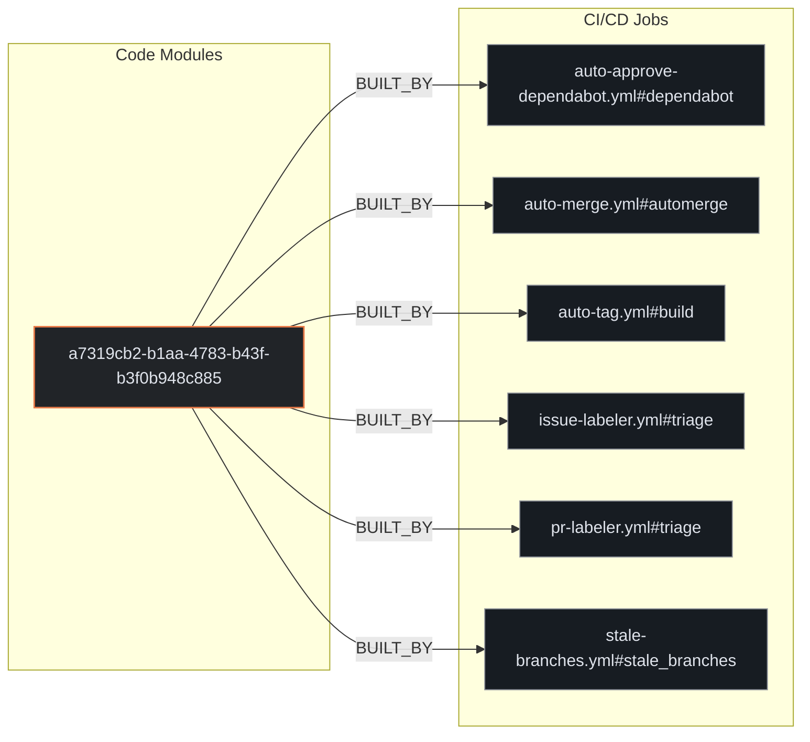
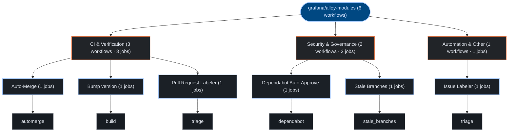

# Repository Architecture Analysis: grafana/alloy-modules

## Metadata
- **SHA**: `9c838a1fd98962edf80393cf5f5f94bbb416ecc1`
- **Primary Ecosystem**: JavaScript/TypeScript

## Quality Metrics
- **ast_engine**: tree-sitter
- **avg_cognitive_complexity**: 0.0
- **avg_cyclomatic_complexity**: 0.0
- **component_count**: 1
- **dead_code_count**: 0
- **dead_code_symbols**: 0 entry(ies)
- **duplication_pct**: 0.0
- **file_complexities**: 0 entry(ies)
- **files_analyzed**: 0
- **fitness_passed**: True
- **fitness_violation_count**: 0
- **framework**: Unknown
- **import_edges**: 0 entry(ies)
- **loc**: 0
- **max_cognitive_complexity**: 0
- **max_cyclomatic_complexity**: 0
- **sloc**: 0

# Architecture: grafana/alloy-modules

## Context
- **Repository**: `grafana/alloy-modules`
- **SHA**: `9c838a1fd98962edf80393cf5f5f94bbb416ecc1`
- **Ecosystem**: JavaScript/TypeScript
- **Framework**: Unknown

## Building Block View

## Component Details
- **flow-modules** (`package.json`): MODULE

## 6-Dimension Repository Scorecard

- **Overall Grade**: `B` (86.05/100)
- **Technical Debt Score**: 13.95
- **Estimated Remediation Effort**: 6.49h

| Dimension | Grade | Score | Weight | Details |
| :--- | :---: | :---: | :---: | :--- |
| Code Quality | `A` | 100.00 | 0.20 | avg_cc=0.00, max_cc=0, duplication=0.00%, dead_code=0 |
| Dependency Health | `B` | 85.00 | 0.15 | dependencies=7, outdated=0, vulnerable=0, has_lockfile=False |
| Maintainability | `A` | 100.00 | 0.15 | avg_cognitive=0.00, max_cognitive=0, fitness_violations=0, oversized_files=0 |
| Pipeline Health | `B` | 82.00 | 0.15 | workflows=6, operational_antipatterns=6, parallel_branches=False |
| Security | `A` | 100.00 | 0.20 | vulnerabilities=0, secrets=0, pipeline_security_findings=0 |
| Test Coverage | `F` | 40.00 | 0.15 | coverage=unavailable, ci_test_job=False, test_files_detected=False |

## Supply Chain Dependencies, Vulnerabilities & Secrets

- **Dependencies Parsed**: 7 | **Vulnerabilities**: 0 | **Secrets**: 0

### Inventory Sample
- `alex` `11.0.1` (npm, `package.json`)
- `editorconfig-checker` `5.1.4` (npm, `package.json`)
- `markdownlint-cli2` `0.13.0` (npm, `package.json`)
- `textlint` `14.2.0` (npm, `package.json`)
- `textlint-rule-common-misspellings` `1.0.1` (npm, `package.json`)
- `textlint-rule-no-todo` `2.0.1` (npm, `package.json`)
- `textlint-rule-terminology` `4.0.1` (npm, `package.json`)

## Section 7: Code-to-Cloud Deployment Traceability

- `a7319cb2-b1aa-4783-b43f-b3f0b948c885` (code_module) --[BUILT_BY]--> `auto-approve-dependabot.yml#dependabot` (ci_job)
- `a7319cb2-b1aa-4783-b43f-b3f0b948c885` (code_module) --[BUILT_BY]--> `auto-merge.yml#automerge` (ci_job)
- `a7319cb2-b1aa-4783-b43f-b3f0b948c885` (code_module) --[BUILT_BY]--> `auto-tag.yml#build` (ci_job)
- `a7319cb2-b1aa-4783-b43f-b3f0b948c885` (code_module) --[BUILT_BY]--> `issue-labeler.yml#triage` (ci_job)
- `a7319cb2-b1aa-4783-b43f-b3f0b948c885` (code_module) --[BUILT_BY]--> `pr-labeler.yml#triage` (ci_job)
- `a7319cb2-b1aa-4783-b43f-b3f0b948c885` (code_module) --[BUILT_BY]--> `stale-branches.yml#stale_branches` (ci_job)

## CI/CD Pipeline Topology

