# Repository Architecture Analysis: grafana/alloy

## Metadata
- **SHA**: `c3e1ae85298ba073c112115a692f8f458a5bcb56`
- **Primary Ecosystem**: Go

## Quality Metrics
- **ast_engine**: tree-sitter
- **avg_cognitive_complexity**: 3.67
- **avg_cyclomatic_complexity**: 3.42
- **component_count**: 351
- **dead_code_count**: 0
- **dead_code_symbols**: 0 entry(ies)
- **duplication_pct**: 0.56
- **file_complexities**: 25 entry(ies)
- **files_analyzed**: 2323
- **fitness_passed**: False
- **fitness_violation_count**: 2
- **framework**: Go Service
- **import_edges**: 100 entry(ies)
- **loc**: 427279
- **max_cognitive_complexity**: 39
- **max_cyclomatic_complexity**: 21
- **sloc**: 343822
- **test_file_count**: 1174

# Architecture: grafana/alloy

## Context
- **Repository**: `grafana/alloy`
- **SHA**: `c3e1ae85298ba073c112115a692f8f458a5bcb56`
- **Ecosystem**: Go
- **Framework**: Go Service

## Building Block View

```mermaid
graph TD;
  classDef atlasRoot fill:#004882,stroke:#a3c9ff,stroke-width:2px,color:#d3e4ff
  classDef atlasCategory fill:#212428,stroke:#E87A48,stroke-width:1.5px,color:#dfe3eb
  classDef atlasWorkflow fill:#1b2026,stroke:#a3c9ff,stroke-width:1.5px,color:#dfe3eb
  classDef atlasJob fill:#171c22,stroke:#8d9199,stroke-width:1px,color:#dfe3eb
  classDef atlasTarget fill:#005227,stroke:#8bd99b,stroke-width:1.5px,color:#a7f6b6
  classDef atlasAlert fill:#93000a,stroke:#ffb4ab,stroke-width:1.5px,color:#ffdad6
  classDef atlasMore fill:#252a31,stroke:#8d9199,stroke-dasharray:4 4,color:#c3c6cf
    repo_root(["grafana/alloy (351 components)"]):::atlasRoot
    subgraph sg_dir_0_internal["internal (142)"]
      direction TB
      dir_0_internal["internal (142)"]:::atlasCategory
      sub_0_0_component["component (102)"]:::atlasWorkflow
      dir_0_internal --> sub_0_0_component
      sub_0_1_alloycli["alloycli (19)"]:::atlasWorkflow
      dir_0_internal --> sub_0_1_alloycli
      sub_0_2_cmd["cmd (13)"]:::atlasWorkflow
      dir_0_internal --> sub_0_2_cmd
      sub_0_more["+3 more submodules (8)"]:::atlasMore
      dir_0_internal --> sub_0_more
    end
    repo_root --> dir_0_internal
    subgraph sg_dir_1_integration_tests["integration-tests (97)"]
      direction TB
      dir_1_integration_tests["integration-tests (97)"]:::atlasCategory
      sub_1_0_k8s["k8s (68)"]:::atlasWorkflow
      dir_1_integration_tests --> sub_1_0_k8s
      sub_1_1_docker["docker (23)"]:::atlasWorkflow
      dir_1_integration_tests --> sub_1_1_docker
      sub_1_2_windows_service["windows-service (5)"]:::atlasWorkflow
      dir_1_integration_tests --> sub_1_2_windows_service
      sub_1_more["+1 more submodules (1)"]:::atlasMore
      dir_1_integration_tests --> sub_1_more
    end
    repo_root --> dir_1_integration_tests
    subgraph sg_dir_2_operations["operations (82)"]
      direction TB
      dir_2_operations["operations (82)"]:::atlasCategory
      sub_2_0_helm_charts_alloy_ci["helm/charts/alloy/ci (59)"]:::atlasWorkflow
      dir_2_operations --> sub_2_0_helm_charts_alloy_ci
      sub_2_1_helm_charts_alloy_templates["helm/charts/alloy/templates (19)"]:::atlasWorkflow
      dir_2_operations --> sub_2_1_helm_charts_alloy_templates
      sub_2_2_helm_charts_alloy["helm/charts/alloy (2)"]:::atlasWorkflow
      dir_2_operations --> sub_2_2_helm_charts_alloy
      sub_2_more["+1 more submodules (2)"]:::atlasMore
      dir_2_operations --> sub_2_more
    end
    repo_root --> dir_2_operations
    subgraph sg_dir_3_collector["collector (12)"]
      direction TB
      dir_3_collector["collector (12)"]:::atlasCategory
      sub_3_0__module_root_["(module root) (9)"]:::atlasWorkflow
      dir_3_collector --> sub_3_0__module_root_
      sub_3_1_otelsupervisor["otelsupervisor (2)"]:::atlasWorkflow
      dir_3_collector --> sub_3_1_otelsupervisor
      sub_3_2_generator["generator (1)"]:::atlasWorkflow
      dir_3_collector --> sub_3_2_generator
    end
    repo_root --> dir_3_collector
    dir_4_extension["extension (7)"]:::atlasCategory
    repo_root --> dir_4_extension
    dir_other_modules["+5 more modules (11)"]:::atlasMore
    repo_root --> dir_other_modules
```



## Component Details

Showing top 60 representative components out of 351 across 10 module group(s):

- **Module `internal`** (142 components — module: 138, UI_COMPONENT: 3, MODULE: 1)
- **Module `integration-tests`** (97 components — module: 97)
- **Module `operations`** (82 components — module: 82)
- **Module `collector`** (12 components — module: 12)
- **Module `extension`** (7 components — module: 7)
- **Module `example`** (6 components — module: 6)
- **Module `(root)`** (2 components — module: 2)
- **Module `build-tools`** (1 components — MODULE: 1)
- **Module `docs`** (1 components — module: 1)
- **Module `flowcmd`** (1 components — module: 1)

- **ComponentView** (`internal/web/ui/src/features/component/ComponentView.tsx`): UI_COMPONENT (deps: HealthLabel)
- **@grafana/alloy-release-please-runner** (`build-tools/release-please-runner/package.json`): MODULE
- **@grafana/alloy-ui** (`internal/web/ui/package.json`): MODULE
- **AlloyValue** (`internal/web/ui/src/features/alloy-syntax-js/RiverValue.tsx`): UI_COMPONENT
- **Chart** (`operations/helm/charts/alloy/Chart.yaml`): module
- **Chart** (`operations/helm/charts/alloy/charts/crds/Chart.yaml`): module
- **HealthLabel** (`internal/web/ui/src/features/component/HealthLabel.tsx`): UI_COMPONENT
- **_agent** (`operations/helm/charts/alloy/templates/containers/_agent.yaml`): module
- **_pod** (`operations/helm/charts/alloy/templates/controllers/_pod.yaml`): module
- **_watch** (`operations/helm/charts/alloy/templates/containers/_watch.yaml`): module
- **additional-serviceaccount-label-values** (`operations/helm/charts/alloy/ci/additional-serviceaccount-label-values.yaml`): module
- **additional_containers** (`integration-tests/docker/additional_containers.go`): module
- **all** (`internal/component/all/all.go`): module
- **all_test** (`internal/component/all/all_test.go`): module
- **alloy** (`integration-tests/k8s/deps/alloy.go`): module
- **alloy_otel** (`integration-tests/k8s/deps/alloy_otel.go`): module
- **alloy_test** (`integration-tests/k8s/deps/alloy_test.go`): module
- **alloycli** (`internal/alloycli/alloycli.go`): module
- **alloycli_test** (`internal/alloycli/alloycli_test.go`): module
- **alloyengine** (`extension/alloyengine/alloyengine.go`): module
- **alloyengine_test** (`extension/alloyengine/alloyengine_test.go`): module
- **alloyseed** (`internal/alloyseed/alloyseed.go`): module
- **alloyseed_test** (`internal/alloyseed/alloyseed_test.go`): module
- **args** (`internal/component/beyla/ebpf/args.go`): module
- **args** (`internal/component/beyla/ebpf/internal/config/args.go`): module
- **args_types** (`internal/component/beyla/ebpf/internal/config/args_types.go`): module
- **automemlimit_cgroups_unsupported** (`internal/alloycli/automemlimit_cgroups_unsupported.go`): module
- **automemlimit_linux** (`internal/alloycli/automemlimit_linux.go`): module
- **automemlimit_nonlinux_test** (`internal/alloycli/automemlimit_nonlinux_test.go`): module
- **batch** (`internal/component/common/loki/batch.go`): module
- **batch** (`internal/component/common/loki/client/batch.go`): module
- **batch_test** (`internal/component/common/loki/batch_test.go`): module
- **batch_test** (`internal/component/common/loki/client/batch_test.go`): module
- **batcher** (`internal/component/common/loki/batcher.go`): module
- **batcher_test** (`internal/component/common/loki/batcher_test.go`): module
- **beyla_embed_amd64** (`internal/component/beyla/ebpf/beyla_embed_amd64.go`): module
- **beyla_embed_arm64** (`internal/component/beyla/ebpf/beyla_embed_arm64.go`): module
- **beyla_java_test** (`integration-tests/docker/tests/beyla-java/beyla_java_test.go`): module
- **beyla_linux** (`internal/component/beyla/ebpf/beyla_linux.go`): module
- **beyla_linux_test** (`internal/component/beyla/ebpf/beyla_linux_test.go`): module
- **beyla_placeholder** (`internal/component/beyla/ebpf/beyla_placeholder.go`): module
- **blackbox_exporter** (`integration-tests/k8s/deps/blackbox_exporter.go`): module
- **clifeature** (`internal/alloycli/clifeature/clifeature.go`): module
- **cluster_builder** (`internal/alloycli/cluster_builder.go`): module
- **cluster_builder_test** (`internal/alloycli/cluster_builder_test.go`): module
- **cluster_service** (`operations/helm/charts/alloy/templates/cluster_service.yaml`): module
- **clustering-values** (`operations/helm/charts/alloy/ci/clustering-values.yaml`): module
- **cmd** (`integration-tests/k8s/harness/cmd.go`): module
- **cmd_convert** (`internal/alloycli/cmd_convert.go`): module
- **cmd_convert_test** (`internal/alloycli/cmd_convert_test.go`): module
- **cmd_fmt** (`internal/alloycli/cmd_fmt.go`): module
- **cmd_fmt_test** (`internal/alloycli/cmd_fmt_test.go`): module
- **cmd_gql** (`internal/alloycli/cmd_gql.go`): module
- **cmd_gql_test** (`internal/alloycli/cmd_gql_test.go`): module
- **cmd_run** (`internal/alloycli/cmd_run.go`): module
- **cmd_tools** (`internal/alloycli/cmd_tools.go`): module
- **cmd_validate** (`internal/alloycli/cmd_validate.go`): module
- **common** (`integration-tests/docker/common/common.go`): module
- **component** (`internal/component/component.go`): module
- **component_health** (`internal/component/component_health.go`): module

## 6-Dimension Repository Scorecard

- **Overall Grade**: `F` (52.65/100)
- **Technical Debt Score**: 47.35
- **Estimated Remediation Effort**: 160.45h

| Dimension | Grade | Score | Weight | Details |
| :--- | :---: | :---: | :---: | :--- |
| Code Quality | `B` | 88.48 | 0.20 | avg_cc=3.42, max_cc=21, duplication=0.56%, dead_code=0 |
| Dependency Health | `A` | 100.00 | 0.15 | dependencies=2786, outdated=0, vulnerable=0, has_lockfile=True |
| Maintainability | `D` | 63.00 | 0.15 | avg_cognitive=3.67, max_cognitive=39, fitness_violations=2, oversized_files=0 |
| Pipeline Health | `F` | 0.00 | 0.15 | workflows=61, operational_antipatterns=144, parallel_branches=True |
| Security | `F` | 0.00 | 0.20 | vulnerabilities=0, secrets=8, pipeline_security_findings=5 |
| Test Coverage | `C` | 70.00 | 0.15 | coverage=unavailable, ci_test_job=True, test_files_detected=True |

## Architecture Fitness & Workspace Boundaries

- **[MEDIUM] `ATRUSS-ARCH-005` (COMPLEXITY_THRESHOLD)**: Repository max_cognitive_complexity (39.0) exceeds policy threshold (25.0).
- **[MEDIUM] `ATRUSS-ARCH-005` (COMPLEXITY_THRESHOLD)**: Repository max_cyclomatic_complexity (21.0) exceeds policy threshold (20.0).

## Supply Chain Dependencies, Vulnerabilities & Secrets

- **Dependencies Parsed**: 2786 | **Vulnerabilities**: 0 | **Secrets**: 8

### Secret Findings (Redacted)
- **[CRITICAL] `ATRUSS-SEC-004`** at `internal/component/common/config/testdata/secrets.go:10` (`-----BEGIN ... PRIVATE KEY----- [REDACTED]`)
- **[CRITICAL] `ATRUSS-SEC-004`** at `internal/component/common/net/config_test.go:198` (`-----BEGIN ... PRIVATE KEY----- [REDACTED]`)
- **[CRITICAL] `ATRUSS-SEC-004`** at `internal/component/common/net/config_test.go:225` (`-----BEGIN ... PRIVATE KEY----- [REDACTED]`)
- **[CRITICAL] `ATRUSS-SEC-004`** at `internal/component/loki/source/internal/kafkatarget/testdata/example.com-key.pem:1` (`-----BEGIN ... PRIVATE KEY----- [REDACTED]`)
- **[CRITICAL] `ATRUSS-SEC-004`** at `internal/component/loki/source/syslog/internal/syslogtarget/syslogtarget_test.go:74` (`-----BEGIN ... PRIVATE KEY----- [REDACTED]`)
- **[CRITICAL] `ATRUSS-SEC-004`** at `internal/component/loki/source/syslog/internal/syslogtarget/syslogtarget_test.go:162` (`-----BEGIN ... PRIVATE KEY----- [REDACTED]`)
- **[CRITICAL] `ATRUSS-SEC-004`** at `internal/component/loki/source/syslog/internal/syslogtarget/syslogtarget_test.go:248` (`-----BEGIN ... PRIVATE KEY----- [REDACTED]`)
- **[HIGH] `ATRUSS-SEC-005`** at `internal/component/otelcol/auth/basic/basic_test.go:30` (`actualPasswordSHA512 = "$6$9***REDACTED***"`)

### Inventory Sample
- `yamllint` `1.38.0` (PyPI, `.mise/locks/yamllint/1.38.0/pyproject.toml`)
- `yamllint` `1.38.0` (PyPI, `.mise/locks/yamllint/1.38.0/uv.lock`)
- `cloud.google.com/go/pubsub/v2` `2.7.0` (golang, `go.mod`)
- `connectrpc.com/connect` `1.20.0` (golang, `go.mod`)
- `github.com/99designs/gqlgen` `0.17.91` (golang, `go.mod`)
- `github.com/Azure/azure-sdk-for-go/sdk/azcore` `1.23.1` (golang, `go.mod`)
- `github.com/Azure/azure-sdk-for-go/sdk/azidentity` `1.14.1` (golang, `go.mod`)
- `github.com/Azure/go-autorest/autorest` `0.11.30` (golang, `go.mod`)
- `github.com/DATA-DOG/go-sqlmock` `1.5.2` (golang, `go.mod`)
- `github.com/DataDog/go-sqllexer` `0.2.4` (golang, `go.mod`)
- `github.com/GoogleCloudPlatform/opentelemetry-operations-go/exporter/collector` `0.62.0` (golang, `go.mod`)
- `github.com/GoogleCloudPlatform/opentelemetry-operations-go/extension/googleclientauthextension` `0.59.0` (golang, `go.mod`)
- `github.com/IBM/sarama` `1.50.3` (golang, `go.mod`)
- `github.com/KimMachineGun/automemlimit` `0.7.5` (golang, `go.mod`)
- `github.com/Lusitaniae/apache_exporter` `0.11.1-0.20220518131644-f9522724dab4` (golang, `go.mod`)
- `github.com/Masterminds/goutils` `1.1.1` (golang, `go.mod`)
- `github.com/Masterminds/sprig/v3` `3.3.0` (golang, `go.mod`)
- `github.com/PuerkitoBio/rehttp` `1.4.0` (golang, `go.mod`)
- `github.com/alecthomas/kingpin/v2` `2.4.0` (golang, `go.mod`)
- `github.com/alecthomas/units` `0.0.0-20240927000941-0f3dac36c52b` (golang, `go.mod`)
- `github.com/aws/aws-sdk-go-v2` `1.47.1` (golang, `go.mod`)
- `github.com/aws/aws-sdk-go-v2/config` `1.33.6` (golang, `go.mod`)
- `github.com/aws/aws-sdk-go-v2/feature/ec2/imds` `1.20.1` (golang, `go.mod`)
- `github.com/aws/aws-sdk-go-v2/service/s3` `1.113.4` (golang, `go.mod`)
- `github.com/aws/aws-sdk-go-v2/service/servicediscovery` `1.49.1` (golang, `go.mod`)
- `github.com/blang/semver/v4` `4.0.0` (golang, `go.mod`)
- `github.com/blang/semver/v4` `4.0.0` (golang, `syntax/go.mod`)
- `github.com/bmatcuk/doublestar/v4` `4.10.2` (golang, `go.mod`)
- `github.com/boynux/squid-exporter` `1.13.0` (golang, `go.mod`)
- `github.com/buger/jsonparser` `1.6.1` (golang, `go.mod`)
- ... (+2756 more dependencies)

## Section 7: Code-to-Cloud Deployment Traceability

```mermaid
flowchart LR
    classDef atlasCategory fill:#212428,stroke:#E87A48,stroke-width:1.5px,color:#dfe3eb
    classDef atlasWorkflow fill:#1b2026,stroke:#a3c9ff,stroke-width:1.5px,color:#dfe3eb
    classDef atlasJob fill:#171c22,stroke:#8d9199,stroke-width:1px,color:#dfe3eb
    classDef atlasTarget fill:#005227,stroke:#8bd99b,stroke-width:1.5px,color:#a7f6b6
    subgraph code_modules["Code Modules"]
        mod_56815150_8027_43e4_8c55_4cf5f2f07153["56815150-8027-43e4-8c55-4cf5f2f07153"]:::atlasCategory
        mod_build_tools_build_image["build-tools/build-image"]:::atlasCategory
        mod_build_tools_release_please_runner["build-tools/release-please-runner"]:::atlasCategory
        mod_collector["collector"]:::atlasCategory
        mod_docs_developer_updating_otel_k6_trace_gen["docs/developer/updating-otel/k6-trace-gen"]:::atlasCategory
        mod_example_docker_compose_images_grizzly["example/docker-compose/images/grizzly"]:::atlasCategory
        mod_example_docker_compose_images_jb["example/docker-compose/images/jb"]:::atlasCategory
        mod_integration_tests_docker["integration-tests/docker"]:::atlasCategory
        mod_integration_tests_docker_tests_beyla_java["integration-tests/docker/tests/beyla-java"]:::atlasCategory
        mod_integration_tests_docker_tests_loki_azure_event_hubs["integration-tests/docker/tests/loki-azure-event-hubs"]:::atlasCategory
        mod_integration_tests_docker_tests_loki_docker["integration-tests/docker/tests/loki-docker"]:::atlasCategory
        mod_integration_tests_docker_tests_oracledb["integration-tests/docker/tests/oracledb"]:::atlasCategory
        mod_integration_tests_k8s_fixtures_otel_gen["integration-tests/k8s/fixtures/otel-gen"]:::atlasCategory
        mod_integration_tests_k8s_fixtures_prom_gen["integration-tests/k8s/fixtures/prom-gen"]:::atlasCategory
        mod_internal_web_ui["internal/web/ui"]:::atlasCategory
        mod_operations_helm_charts_alloy["operations/helm/charts/alloy"]:::atlasCategory
        mod_packaging_homebrew_formula_gen["packaging/homebrew/formula-gen"]:::atlasCategory
        mod_syntax["syntax"]:::atlasCategory
        mod_tools["tools"]:::atlasCategory
    end
    subgraph build_artifacts["Build Artifacts / Containers"]
        art_Dockerfile["Dockerfile"]:::atlasWorkflow
        art_Dockerfile_chisel["Dockerfile.chisel"]:::atlasWorkflow
        art_Dockerfile_windows["Dockerfile.windows"]:::atlasWorkflow
        art_build_tools_build_image_Dockerfile["build-tools/build-image/Dockerfile"]:::atlasWorkflow
        art_docs_developer_updating_otel_k6_trace_gen_docker_compose_yaml["docs/developer/updating-otel/k6-trace-gen/docker-compose.yaml"]:::atlasWorkflow
        art_example_docker_compose_images_grizzly_Dockerfile["example/docker-compose/images/grizzly/Dockerfile"]:::atlasWorkflow
        art_example_docker_compose_images_jb_Dockerfile["example/docker-compose/images/jb/Dockerfile"]:::atlasWorkflow
        art_integration_tests_docker_docker_compose_yaml["integration-tests/docker/docker-compose.yaml"]:::atlasWorkflow
        art_integration_tests_docker_tests_beyla_java_docker_compose_yaml["integration-tests/docker/tests/beyla-java/docker-compose.yaml"]:::atlasWorkflow
        art_integration_tests_docker_tests_loki_azure_event_hubs_docker_compose_yaml["integration-tests/docker/tests/loki-azure-event-hubs/docker-compose.yaml"]:::atlasWorkflow
        art_integration_tests_docker_tests_loki_docker_Dockerfile["integration-tests/docker/tests/loki-docker/Dockerfile"]:::atlasWorkflow
        art_integration_tests_docker_tests_oracledb_Dockerfile_alloy["integration-tests/docker/tests/oracledb/Dockerfile.alloy"]:::atlasWorkflow
        art_integration_tests_k8s_deps_manifests_alloy_otel_yaml["integration-tests/k8s/deps/manifests/alloy-otel.yaml"]:::atlasWorkflow
        art_integration_tests_k8s_deps_manifests_kafka_gen_yaml["integration-tests/k8s/deps/manifests/kafka-gen.yaml"]:::atlasWorkflow
        art_integration_tests_k8s_deps_manifests_log_gen_yaml["integration-tests/k8s/deps/manifests/log-gen.yaml"]:::atlasWorkflow
        art_integration_tests_k8s_deps_manifests_loki_yaml["integration-tests/k8s/deps/manifests/loki.yaml"]:::atlasWorkflow
        art_integration_tests_k8s_deps_manifests_mimir_yaml["integration-tests/k8s/deps/manifests/mimir.yaml"]:::atlasWorkflow
        art_integration_tests_k8s_deps_manifests_mssql_yaml["integration-tests/k8s/deps/manifests/mssql.yaml"]:::atlasWorkflow
        art_integration_tests_k8s_deps_manifests_mysql_yaml["integration-tests/k8s/deps/manifests/mysql.yaml"]:::atlasWorkflow
        art_integration_tests_k8s_deps_manifests_nginx_proxy_yaml["integration-tests/k8s/deps/manifests/nginx-proxy.yaml"]:::atlasWorkflow
        art_integration_tests_k8s_deps_manifests_otel_gen_yaml["integration-tests/k8s/deps/manifests/otel-gen.yaml"]:::atlasWorkflow
        art_integration_tests_k8s_deps_manifests_postgres_yaml["integration-tests/k8s/deps/manifests/postgres.yaml"]:::atlasWorkflow
        art_integration_tests_k8s_deps_manifests_prom_gen_yaml["integration-tests/k8s/deps/manifests/prom-gen.yaml"]:::atlasWorkflow
        art_integration_tests_k8s_fixtures_otel_gen_Dockerfile["integration-tests/k8s/fixtures/otel-gen/Dockerfile"]:::atlasWorkflow
        art_integration_tests_k8s_fixtures_prom_gen_Dockerfile["integration-tests/k8s/fixtures/prom-gen/Dockerfile"]:::atlasWorkflow
        art_integration_tests_k8s_tests_alloyengine_extension_config_collector_yaml["integration-tests/k8s/tests/alloyengine-extension/config/collector.yaml"]:::atlasWorkflow
        art_integration_tests_k8s_tests_beyla_ebpf_config_alloy_values_yaml["integration-tests/k8s/tests/beyla-ebpf/config/alloy-values.yaml"]:::atlasWorkflow
        art_integration_tests_k8s_tests_database_observability_mysql_config_alloy_values_yaml["integration-tests/k8s/tests/database-observability-mysql/config/alloy-values.yaml"]:::atlasWorkflow
        art_integration_tests_k8s_tests_database_observability_postgres_config_alloy_values_yaml["integration-tests/k8s/tests/database-observability-postgres/config/alloy-values.yaml"]:::atlasWorkflow
        art_integration_tests_k8s_tests_database_observability_sql_server_config_alloy_values_yaml["integration-tests/k8s/tests/database-observability-sql-server/config/alloy-values.yaml"]:::atlasWorkflow
        art_integration_tests_k8s_tests_database_observability_sql_server_config_seed_yaml["integration-tests/k8s/tests/database-observability-sql-server/config/seed.yaml"]:::atlasWorkflow
        art_integration_tests_k8s_tests_graphql_config_alloy_values_yaml["integration-tests/k8s/tests/graphql/config/alloy-values.yaml"]:::atlasWorkflow
        art_integration_tests_k8s_tests_loki_source_api_config_alloy_values_yaml["integration-tests/k8s/tests/loki-source-api/config/alloy-values.yaml"]:::atlasWorkflow
        art_integration_tests_k8s_tests_loki_source_file_config_alloy_values_yaml["integration-tests/k8s/tests/loki-source-file/config/alloy-values.yaml"]:::atlasWorkflow
        art_integration_tests_k8s_tests_loki_source_gcplog_config_alloy_values_yaml["integration-tests/k8s/tests/loki-source-gcplog/config/alloy-values.yaml"]:::atlasWorkflow
        art_integration_tests_k8s_tests_loki_source_kafka_config_alloy_values_yaml["integration-tests/k8s/tests/loki-source-kafka/config/alloy-values.yaml"]:::atlasWorkflow
        art_integration_tests_k8s_tests_loki_source_kubernetes_config_alloy_values_yaml["integration-tests/k8s/tests/loki-source-kubernetes/config/alloy-values.yaml"]:::atlasWorkflow
        art_integration_tests_k8s_tests_loki_source_podlogs_config_alloy_values_yaml["integration-tests/k8s/tests/loki-source-podlogs/config/alloy-values.yaml"]:::atlasWorkflow
        art_integration_tests_k8s_tests_loki_source_podlogs_config_podlogs_a_yaml["integration-tests/k8s/tests/loki-source-podlogs/config/podlogs-a.yaml"]:::atlasWorkflow
        art_integration_tests_k8s_tests_loki_source_podlogs_config_podlogs_bc_yaml["integration-tests/k8s/tests/loki-source-podlogs/config/podlogs-bc.yaml"]:::atlasWorkflow
        art_integration_tests_k8s_tests_metamonitor_alloy_config_alloy_values_yaml["integration-tests/k8s/tests/metamonitor-alloy/config/alloy-values.yaml"]:::atlasWorkflow
        art_integration_tests_k8s_tests_metamonitor_otel_config_collector_yaml["integration-tests/k8s/tests/metamonitor-otel/config/collector.yaml"]:::atlasWorkflow
        art_integration_tests_k8s_tests_mimir_alerts_kubernetes_config_alloy_values_yaml["integration-tests/k8s/tests/mimir-alerts-kubernetes/config/alloy-values.yaml"]:::atlasWorkflow
        art_integration_tests_k8s_tests_mimir_alerts_kubernetes_config_workloads_yaml["integration-tests/k8s/tests/mimir-alerts-kubernetes/config/workloads.yaml"]:::atlasWorkflow
        art_integration_tests_k8s_tests_mimir_alerts_kubernetes_expected_expected_1_yml["integration-tests/k8s/tests/mimir-alerts-kubernetes/expected/expected_1.yml"]:::atlasWorkflow
        art_integration_tests_k8s_tests_mimir_alerts_kubernetes_expected_expected_2_yml["integration-tests/k8s/tests/mimir-alerts-kubernetes/expected/expected_2.yml"]:::atlasWorkflow
        art_integration_tests_k8s_tests_otelcol_default_engine_config_alloy_values_yaml["integration-tests/k8s/tests/otelcol-default-engine/config/alloy-values.yaml"]:::atlasWorkflow
        art_integration_tests_k8s_tests_otelcol_entrypoint_config_collector_yaml["integration-tests/k8s/tests/otelcol-entrypoint/config/collector.yaml"]:::atlasWorkflow
        art_integration_tests_k8s_tests_otelcol_receiver_kafka_azure_config_alloy_values_yaml["integration-tests/k8s/tests/otelcol-receiver-kafka-azure/config/alloy-values.yaml"]:::atlasWorkflow
        art_integration_tests_k8s_tests_prometheus_exporter_cadvisor_config_alloy_values_yaml["integration-tests/k8s/tests/prometheus-exporter-cadvisor/config/alloy-values.yaml"]:::atlasWorkflow
        art_integration_tests_k8s_tests_prometheus_exporter_kafka_config_alloy_values_yaml["integration-tests/k8s/tests/prometheus-exporter-kafka/config/alloy-values.yaml"]:::atlasWorkflow
        art_integration_tests_k8s_tests_prometheus_exporter_mssql_config_alloy_values_yaml["integration-tests/k8s/tests/prometheus-exporter-mssql/config/alloy-values.yaml"]:::atlasWorkflow
        art_integration_tests_k8s_tests_prometheus_exporter_redis_config_alloy_values_yaml["integration-tests/k8s/tests/prometheus-exporter-redis/config/alloy-values.yaml"]:::atlasWorkflow
        art_integration_tests_k8s_tests_prometheus_exporter_snmp_config_alloy_values_yaml["integration-tests/k8s/tests/prometheus-exporter-snmp/config/alloy-values.yaml"]:::atlasWorkflow
        art_integration_tests_k8s_tests_prometheus_exporter_unix_config_alloy_values_yaml["integration-tests/k8s/tests/prometheus-exporter-unix/config/alloy-values.yaml"]:::atlasWorkflow
        art_integration_tests_k8s_tests_prometheus_operator_config_alloy_values_yaml["integration-tests/k8s/tests/prometheus-operator/config/alloy-values.yaml"]:::atlasWorkflow
        art_integration_tests_k8s_tests_prometheus_operator_config_workloads_yaml["integration-tests/k8s/tests/prometheus-operator/config/workloads.yaml"]:::atlasWorkflow
        art_integration_tests_k8s_tests_prometheus_write_paths_config_alloy_values_yaml["integration-tests/k8s/tests/prometheus-write-paths/config/alloy-values.yaml"]:::atlasWorkflow
    end
    subgraph ci_jobs["CI/CD Jobs"]
        job_ai_dependency_review_yml_analyze_dependencies["ai-dependency-review.yml#analyze-dependencies"]:::atlasJob
        job_benchmark_pr_yml_benchmark["benchmark-pr.yml#benchmark"]:::atlasJob
        job_bump_formula_pr_yml_homebrew_grafana["bump-formula-pr.yml#homebrew-grafana"]:::atlasJob
        job_check_generate_otel_collector_distro_yml_check["check-generate-otel-collector-distro.yml#check"]:::atlasJob
        job_check_linux_build_image_yml_check_linux_build_image["check-linux-build-image.yml#check-linux-build-image"]:::atlasJob
        job_create_build_image_yml_linux_build_image["create_build_image.yml#linux_build_image"]:::atlasJob
        job_docker_images_yml_linux["docker-images.yml#linux"]:::atlasJob
        job_docker_images_yml_windows["docker-images.yml#windows"]:::atlasJob
        job_helm_install_yml_install["helm-install.yml#install"]:::atlasJob
        job_helm_release_yml_release["helm-release.yml#release"]:::atlasJob
        job_helm_release_yml_setup["helm-release.yml#setup"]:::atlasJob
        job_helm_test_yml_lint["helm-test.yml#lint"]:::atlasJob
        job_helm_test_yml_regenerate_docs["helm-test.yml#regenerate-docs"]:::atlasJob
        job_helm_test_yml_regenerate_tests["helm-test.yml#regenerate-tests"]:::atlasJob
        job_lint_yml_lint_ui["lint.yml#lint_ui"]:::atlasJob
        job_publish_alloy_devel_yml_update_deployment_tools["publish-alloy-devel.yml#update_deployment_tools"]:::atlasJob
        job_release_announce_yml_announce_release["release-announce.yml#announce-release"]:::atlasJob
        job_release_backport_yml_backport["release-backport.yml#backport"]:::atlasJob
        job_release_create_branch_yml_create_branch["release-create-branch.yml#create-branch"]:::atlasJob
        job_release_create_rc_yml_create_rc["release-create-rc.yml#create-rc"]:::atlasJob
        job_release_enrich_release_notes_yml_enrich_release["release-enrich-release-notes.yml#enrich-release"]:::atlasJob
        job_release_please_yml_regenerate_release_please_prs["release-please.yml#regenerate-release-please-prs"]:::atlasJob
        job_release_please_yml_release_please["release-please.yml#release-please"]:::atlasJob
        job_release_publish_alloy_artifacts_yml_sign_alloy_windows["release-publish-alloy-artifacts.yml#sign_alloy_windows"]:::atlasJob
        job_release_publish_alloy_artifacts_yml_sign_alloy_windows_installer["release-publish-alloy-artifacts.yml#sign_alloy_windows_installer"]:::atlasJob
        job_test_mac_yml_cross_compile_mac_to_linux_nocgo["test_mac.yml#cross-compile-mac-to-linux-nocgo"]:::atlasJob
    end
    subgraph runtime_envs["Runtime Environments"]
        env_azure["azure"]:::atlasTarget
        env_azure_trusted_signing["azure-trusted-signing"]:::atlasTarget
        env_kubernetes["kubernetes"]:::atlasTarget
    end
    job_helm_install_yml_install -->|DEPLOYS_TO| env_azure
    job_helm_install_yml_install -->|DEPLOYS_TO| env_kubernetes
    job_helm_release_yml_release -->|DEPLOYS_TO| env_azure
    job_helm_release_yml_release -->|DEPLOYS_TO| env_kubernetes
    job_helm_release_yml_setup -->|DEPLOYS_TO| env_kubernetes
    job_helm_test_yml_lint -->|DEPLOYS_TO| env_azure
    job_helm_test_yml_lint -->|DEPLOYS_TO| env_kubernetes
    job_helm_test_yml_regenerate_docs -->|DEPLOYS_TO| env_kubernetes
    job_helm_test_yml_regenerate_tests -->|DEPLOYS_TO| env_azure
    job_helm_test_yml_regenerate_tests -->|DEPLOYS_TO| env_kubernetes
    job_release_publish_alloy_artifacts_yml_sign_alloy_windows -->|DEPLOYS_TO| env_azure_trusted_signing
    job_release_publish_alloy_artifacts_yml_sign_alloy_windows_installer -->|DEPLOYS_TO| env_azure_trusted_signing
    mod_56815150_8027_43e4_8c55_4cf5f2f07153 -->|BUILT_BY| job_docker_images_yml_linux
    mod_56815150_8027_43e4_8c55_4cf5f2f07153 -->|BUILT_BY| job_docker_images_yml_windows
    mod_56815150_8027_43e4_8c55_4cf5f2f07153 -->|PACKAGED_BY| art_Dockerfile
    mod_56815150_8027_43e4_8c55_4cf5f2f07153 -->|PACKAGED_BY| art_Dockerfile_chisel
    mod_56815150_8027_43e4_8c55_4cf5f2f07153 -->|PACKAGED_BY| art_Dockerfile_windows
    mod_build_tools_build_image -->|BUILT_BY| job_check_linux_build_image_yml_check_linux_build_image
    mod_build_tools_build_image -->|BUILT_BY| job_create_build_image_yml_linux_build_image
    mod_build_tools_build_image -->|PACKAGED_BY| art_Dockerfile
    mod_build_tools_build_image -->|PACKAGED_BY| art_Dockerfile_chisel
    mod_build_tools_build_image -->|PACKAGED_BY| art_Dockerfile_windows
    mod_build_tools_build_image -->|PACKAGED_BY| art_build_tools_build_image_Dockerfile
    mod_build_tools_release_please_runner -->|DEPLOYED_BY| job_release_please_yml_release_please
    mod_collector -->|BUILT_BY| job_check_generate_otel_collector_distro_yml_check
    mod_collector -->|BUILT_BY| job_test_mac_yml_cross_compile_mac_to_linux_nocgo
    mod_collector -->|DEPLOYED_BY| job_release_please_yml_regenerate_release_please_prs
    mod_collector -->|PACKAGED_BY| art_Dockerfile_chisel
    mod_collector -->|PACKAGED_BY| art_integration_tests_k8s_deps_manifests_alloy_otel_yaml
    mod_collector -->|PACKAGED_BY| art_integration_tests_k8s_tests_alloyengine_extension_config_collector_yaml
    mod_collector -->|PACKAGED_BY| art_integration_tests_k8s_tests_metamonitor_otel_config_collector_yaml
    mod_collector -->|PACKAGED_BY| art_integration_tests_k8s_tests_otelcol_entrypoint_config_collector_yaml
    mod_docs_developer_updating_otel_k6_trace_gen -->|PACKAGED_BY| art_docs_developer_updating_otel_k6_trace_gen_docker_compose_yaml
    mod_example_docker_compose_images_grizzly -->|PACKAGED_BY| art_example_docker_compose_images_grizzly_Dockerfile
    mod_example_docker_compose_images_jb -->|PACKAGED_BY| art_build_tools_build_image_Dockerfile
    mod_example_docker_compose_images_jb -->|PACKAGED_BY| art_example_docker_compose_images_jb_Dockerfile
    mod_integration_tests_docker -->|PACKAGED_BY| art_Dockerfile
    mod_integration_tests_docker -->|PACKAGED_BY| art_Dockerfile_chisel
    mod_integration_tests_docker -->|PACKAGED_BY| art_Dockerfile_windows
    mod_integration_tests_docker -->|PACKAGED_BY| art_build_tools_build_image_Dockerfile
    mod_integration_tests_docker -->|PACKAGED_BY| art_docs_developer_updating_otel_k6_trace_gen_docker_compose_yaml
    mod_integration_tests_docker -->|PACKAGED_BY| art_integration_tests_docker_docker_compose_yaml
    mod_integration_tests_docker -->|PACKAGED_BY| art_integration_tests_docker_tests_beyla_java_docker_compose_yaml
    mod_integration_tests_docker -->|PACKAGED_BY| art_integration_tests_docker_tests_loki_azure_event_hubs_docker_compose_yaml
    mod_integration_tests_docker -->|PACKAGED_BY| art_integration_tests_docker_tests_oracledb_Dockerfile_alloy
    mod_integration_tests_docker -->|PACKAGED_BY| art_integration_tests_k8s_deps_manifests_mysql_yaml
    mod_integration_tests_docker -->|PACKAGED_BY| art_integration_tests_k8s_deps_manifests_postgres_yaml
    mod_integration_tests_docker_tests_beyla_java -->|PACKAGED_BY| art_integration_tests_docker_tests_beyla_java_docker_compose_yaml
    mod_integration_tests_docker_tests_loki_azure_event_hubs -->|PACKAGED_BY| art_integration_tests_docker_tests_loki_azure_event_hubs_docker_compose_yaml
    mod_integration_tests_docker_tests_loki_docker -->|PACKAGED_BY| art_integration_tests_docker_tests_loki_docker_Dockerfile
    mod_integration_tests_docker_tests_oracledb -->|PACKAGED_BY| art_integration_tests_docker_tests_oracledb_Dockerfile_alloy
    mod_integration_tests_k8s_fixtures_otel_gen -->|PACKAGED_BY| art_integration_tests_k8s_fixtures_otel_gen_Dockerfile
    mod_integration_tests_k8s_fixtures_otel_gen -->|PACKAGED_BY| art_integration_tests_k8s_deps_manifests_alloy_otel_yaml
    mod_integration_tests_k8s_fixtures_otel_gen -->|PACKAGED_BY| art_integration_tests_k8s_deps_manifests_otel_gen_yaml
    mod_integration_tests_k8s_fixtures_otel_gen -->|PACKAGED_BY| art_integration_tests_k8s_tests_otelcol_entrypoint_config_collector_yaml
    mod_integration_tests_k8s_fixtures_prom_gen -->|PACKAGED_BY| art_integration_tests_k8s_fixtures_prom_gen_Dockerfile
    mod_integration_tests_k8s_fixtures_prom_gen -->|PACKAGED_BY| art_integration_tests_k8s_deps_manifests_prom_gen_yaml
    mod_integration_tests_k8s_fixtures_prom_gen -->|PACKAGED_BY| art_integration_tests_k8s_tests_prometheus_operator_config_workloads_yaml
    mod_internal_web_ui -->|BUILT_BY| job_lint_yml_lint_ui
    mod_internal_web_ui -->|PACKAGED_BY| art_Dockerfile
    mod_internal_web_ui -->|PACKAGED_BY| art_Dockerfile_chisel
    mod_internal_web_ui -->|PACKAGED_BY| art_Dockerfile_windows
    mod_internal_web_ui -->|PACKAGED_BY| art_build_tools_build_image_Dockerfile
    mod_internal_web_ui -->|PACKAGED_BY| art_integration_tests_docker_tests_loki_azure_event_hubs_docker_compose_yaml
    mod_internal_web_ui -->|PACKAGED_BY| art_integration_tests_docker_tests_oracledb_Dockerfile_alloy
    mod_internal_web_ui -->|PACKAGED_BY| art_integration_tests_k8s_fixtures_otel_gen_Dockerfile
    mod_internal_web_ui -->|PACKAGED_BY| art_integration_tests_k8s_fixtures_prom_gen_Dockerfile
    mod_internal_web_ui -->|PACKAGED_BY| art_integration_tests_k8s_tests_mimir_alerts_kubernetes_config_workloads_yaml
    mod_internal_web_ui -->|PACKAGED_BY| art_integration_tests_k8s_tests_mimir_alerts_kubernetes_expected_expected_1_yml
    mod_internal_web_ui -->|PACKAGED_BY| art_integration_tests_k8s_tests_mimir_alerts_kubernetes_expected_expected_2_yml
    mod_operations_helm_charts_alloy -->|DEPLOYED_BY| job_helm_install_yml_install
    mod_operations_helm_charts_alloy -->|DEPLOYED_BY| job_helm_test_yml_lint
    mod_operations_helm_charts_alloy -->|DEPLOYED_BY| job_release_please_yml_release_please
    mod_operations_helm_charts_alloy -->|PACKAGED_BY| art_Dockerfile
    mod_operations_helm_charts_alloy -->|PACKAGED_BY| art_Dockerfile_chisel
    mod_operations_helm_charts_alloy -->|PACKAGED_BY| art_Dockerfile_windows
    mod_operations_helm_charts_alloy -->|PACKAGED_BY| art_integration_tests_docker_docker_compose_yaml
    mod_operations_helm_charts_alloy -->|PACKAGED_BY| art_integration_tests_docker_tests_beyla_java_docker_compose_yaml
    mod_operations_helm_charts_alloy -->|PACKAGED_BY| art_integration_tests_docker_tests_loki_azure_event_hubs_docker_compose_yaml
    mod_operations_helm_charts_alloy -->|PACKAGED_BY| art_integration_tests_docker_tests_oracledb_Dockerfile_alloy
    mod_operations_helm_charts_alloy -->|PACKAGED_BY| art_integration_tests_k8s_deps_manifests_alloy_otel_yaml
    mod_operations_helm_charts_alloy -->|PACKAGED_BY| art_integration_tests_k8s_deps_manifests_log_gen_yaml
    mod_operations_helm_charts_alloy -->|PACKAGED_BY| art_integration_tests_k8s_deps_manifests_loki_yaml
    mod_operations_helm_charts_alloy -->|PACKAGED_BY| art_integration_tests_k8s_deps_manifests_mimir_yaml
    mod_operations_helm_charts_alloy -->|PACKAGED_BY| art_integration_tests_k8s_deps_manifests_mssql_yaml
    mod_operations_helm_charts_alloy -->|PACKAGED_BY| art_integration_tests_k8s_deps_manifests_nginx_proxy_yaml
    mod_operations_helm_charts_alloy -->|PACKAGED_BY| art_integration_tests_k8s_tests_alloyengine_extension_config_collector_yaml
    mod_operations_helm_charts_alloy -->|PACKAGED_BY| art_integration_tests_k8s_tests_beyla_ebpf_config_alloy_values_yaml
    mod_operations_helm_charts_alloy -->|PACKAGED_BY| art_integration_tests_k8s_tests_database_observability_mysql_config_alloy_values_yaml
    mod_operations_helm_charts_alloy -->|PACKAGED_BY| art_integration_tests_k8s_tests_database_observability_postgres_config_alloy_values_yaml
    mod_operations_helm_charts_alloy -->|PACKAGED_BY| art_integration_tests_k8s_tests_database_observability_sql_server_config_alloy_values_yaml
    mod_operations_helm_charts_alloy -->|PACKAGED_BY| art_integration_tests_k8s_tests_database_observability_sql_server_config_seed_yaml
    mod_operations_helm_charts_alloy -->|PACKAGED_BY| art_integration_tests_k8s_tests_graphql_config_alloy_values_yaml
    mod_operations_helm_charts_alloy -->|PACKAGED_BY| art_integration_tests_k8s_tests_loki_source_api_config_alloy_values_yaml
    mod_operations_helm_charts_alloy -->|PACKAGED_BY| art_integration_tests_k8s_tests_loki_source_file_config_alloy_values_yaml
    mod_operations_helm_charts_alloy -->|PACKAGED_BY| art_integration_tests_k8s_tests_loki_source_gcplog_config_alloy_values_yaml
    mod_operations_helm_charts_alloy -->|PACKAGED_BY| art_integration_tests_k8s_tests_loki_source_kafka_config_alloy_values_yaml
    mod_operations_helm_charts_alloy -->|PACKAGED_BY| art_integration_tests_k8s_tests_loki_source_kubernetes_config_alloy_values_yaml
    mod_operations_helm_charts_alloy -->|PACKAGED_BY| art_integration_tests_k8s_tests_loki_source_podlogs_config_alloy_values_yaml
    mod_operations_helm_charts_alloy -->|PACKAGED_BY| art_integration_tests_k8s_tests_loki_source_podlogs_config_podlogs_a_yaml
    mod_operations_helm_charts_alloy -->|PACKAGED_BY| art_integration_tests_k8s_tests_loki_source_podlogs_config_podlogs_bc_yaml
    mod_operations_helm_charts_alloy -->|PACKAGED_BY| art_integration_tests_k8s_tests_metamonitor_alloy_config_alloy_values_yaml
    mod_operations_helm_charts_alloy -->|PACKAGED_BY| art_integration_tests_k8s_tests_metamonitor_otel_config_collector_yaml
    mod_operations_helm_charts_alloy -->|PACKAGED_BY| art_integration_tests_k8s_tests_mimir_alerts_kubernetes_config_alloy_values_yaml
    mod_operations_helm_charts_alloy -->|PACKAGED_BY| art_integration_tests_k8s_tests_mimir_alerts_kubernetes_config_workloads_yaml
    mod_operations_helm_charts_alloy -->|PACKAGED_BY| art_integration_tests_k8s_tests_mimir_alerts_kubernetes_expected_expected_1_yml
    mod_operations_helm_charts_alloy -->|PACKAGED_BY| art_integration_tests_k8s_tests_mimir_alerts_kubernetes_expected_expected_2_yml
    mod_operations_helm_charts_alloy -->|PACKAGED_BY| art_integration_tests_k8s_tests_otelcol_default_engine_config_alloy_values_yaml
    mod_operations_helm_charts_alloy -->|PACKAGED_BY| art_integration_tests_k8s_tests_otelcol_entrypoint_config_collector_yaml
    mod_operations_helm_charts_alloy -->|PACKAGED_BY| art_integration_tests_k8s_tests_otelcol_receiver_kafka_azure_config_alloy_values_yaml
    mod_operations_helm_charts_alloy -->|PACKAGED_BY| art_integration_tests_k8s_tests_prometheus_exporter_cadvisor_config_alloy_values_yaml
    mod_operations_helm_charts_alloy -->|PACKAGED_BY| art_integration_tests_k8s_tests_prometheus_exporter_kafka_config_alloy_values_yaml
    mod_operations_helm_charts_alloy -->|PACKAGED_BY| art_integration_tests_k8s_tests_prometheus_exporter_mssql_config_alloy_values_yaml
    mod_operations_helm_charts_alloy -->|PACKAGED_BY| art_integration_tests_k8s_tests_prometheus_exporter_redis_config_alloy_values_yaml
    mod_operations_helm_charts_alloy -->|PACKAGED_BY| art_integration_tests_k8s_tests_prometheus_exporter_snmp_config_alloy_values_yaml
    mod_operations_helm_charts_alloy -->|PACKAGED_BY| art_integration_tests_k8s_tests_prometheus_exporter_unix_config_alloy_values_yaml
    mod_operations_helm_charts_alloy -->|PACKAGED_BY| art_integration_tests_k8s_tests_prometheus_operator_config_alloy_values_yaml
    mod_operations_helm_charts_alloy -->|PACKAGED_BY| art_integration_tests_k8s_tests_prometheus_operator_config_workloads_yaml
    mod_operations_helm_charts_alloy -->|PACKAGED_BY| art_integration_tests_k8s_tests_prometheus_write_paths_config_alloy_values_yaml
    mod_packaging_homebrew_formula_gen -->|BUILT_BY| job_bump_formula_pr_yml_homebrew_grafana
    mod_syntax -->|DEPLOYED_BY| job_release_announce_yml_announce_release
    mod_syntax -->|PACKAGED_BY| art_Dockerfile
    mod_syntax -->|PACKAGED_BY| art_Dockerfile_chisel
    mod_syntax -->|PACKAGED_BY| art_build_tools_build_image_Dockerfile
    mod_syntax -->|PACKAGED_BY| art_integration_tests_docker_tests_oracledb_Dockerfile_alloy
    mod_syntax -->|PACKAGED_BY| art_integration_tests_k8s_fixtures_otel_gen_Dockerfile
    mod_syntax -->|PACKAGED_BY| art_integration_tests_k8s_fixtures_prom_gen_Dockerfile
    mod_tools -->|BUILT_BY| job_ai_dependency_review_yml_analyze_dependencies
    mod_tools -->|BUILT_BY| job_benchmark_pr_yml_benchmark
    mod_tools -->|BUILT_BY| job_helm_release_yml_setup
    mod_tools -->|BUILT_BY| job_release_backport_yml_backport
    mod_tools -->|BUILT_BY| job_release_create_branch_yml_create_branch
    mod_tools -->|BUILT_BY| job_release_create_rc_yml_create_rc
    mod_tools -->|DEPLOYED_BY| job_publish_alloy_devel_yml_update_deployment_tools
    mod_tools -->|DEPLOYED_BY| job_release_enrich_release_notes_yml_enrich_release
    mod_tools -->|PACKAGED_BY| art_Dockerfile
    mod_tools -->|PACKAGED_BY| art_Dockerfile_chisel
    mod_tools -->|PACKAGED_BY| art_Dockerfile_windows
    mod_tools -->|PACKAGED_BY| art_build_tools_build_image_Dockerfile
    mod_tools -->|PACKAGED_BY| art_integration_tests_docker_tests_beyla_java_docker_compose_yaml
    mod_tools -->|PACKAGED_BY| art_integration_tests_docker_tests_loki_azure_event_hubs_docker_compose_yaml
    mod_tools -->|PACKAGED_BY| art_integration_tests_docker_tests_oracledb_Dockerfile_alloy
    mod_tools -->|PACKAGED_BY| art_integration_tests_k8s_deps_manifests_kafka_gen_yaml
    mod_tools -->|PACKAGED_BY| art_integration_tests_k8s_tests_database_observability_sql_server_config_seed_yaml
    art_Dockerfile -->|BUILT_BY| job_docker_images_yml_linux
    art_Dockerfile -->|BUILT_BY| job_docker_images_yml_windows
    art_Dockerfile_windows -->|BUILT_BY| job_docker_images_yml_windows
    art_build_tools_build_image_Dockerfile -->|BUILT_BY| job_check_linux_build_image_yml_check_linux_build_image
    art_build_tools_build_image_Dockerfile -->|BUILT_BY| job_create_build_image_yml_linux_build_image
    art_integration_tests_docker_docker_compose_yaml -->|PACKAGED_BY| art_integration_tests_k8s_deps_manifests_mysql_yaml
    art_integration_tests_docker_docker_compose_yaml -->|PACKAGED_BY| art_integration_tests_k8s_deps_manifests_postgres_yaml
    art_integration_tests_k8s_fixtures_otel_gen_Dockerfile -->|PACKAGED_BY| art_integration_tests_k8s_deps_manifests_alloy_otel_yaml
    art_integration_tests_k8s_fixtures_otel_gen_Dockerfile -->|PACKAGED_BY| art_integration_tests_k8s_deps_manifests_otel_gen_yaml
    art_integration_tests_k8s_fixtures_otel_gen_Dockerfile -->|PACKAGED_BY| art_integration_tests_k8s_tests_otelcol_entrypoint_config_collector_yaml
    art_integration_tests_k8s_fixtures_prom_gen_Dockerfile -->|PACKAGED_BY| art_integration_tests_k8s_deps_manifests_prom_gen_yaml
    art_integration_tests_k8s_fixtures_prom_gen_Dockerfile -->|PACKAGED_BY| art_integration_tests_k8s_tests_prometheus_operator_config_workloads_yaml
```

- `helm-install.yml#install` (ci_job) --[DEPLOYS_TO]--> `azure` (environment)
- `helm-install.yml#install` (ci_job) --[DEPLOYS_TO]--> `kubernetes` (environment)
- `helm-release.yml#release` (ci_job) --[DEPLOYS_TO]--> `azure` (environment)
- `helm-release.yml#release` (ci_job) --[DEPLOYS_TO]--> `kubernetes` (environment)
- `helm-release.yml#setup` (ci_job) --[DEPLOYS_TO]--> `kubernetes` (environment)
- `helm-test.yml#lint` (ci_job) --[DEPLOYS_TO]--> `azure` (environment)
- `helm-test.yml#lint` (ci_job) --[DEPLOYS_TO]--> `kubernetes` (environment)
- `helm-test.yml#regenerate-docs` (ci_job) --[DEPLOYS_TO]--> `kubernetes` (environment)
- `helm-test.yml#regenerate-tests` (ci_job) --[DEPLOYS_TO]--> `azure` (environment)
- `helm-test.yml#regenerate-tests` (ci_job) --[DEPLOYS_TO]--> `kubernetes` (environment)
- `release-publish-alloy-artifacts.yml#sign_alloy_windows` (ci_job) --[DEPLOYS_TO]--> `azure-trusted-signing` (environment)
- `release-publish-alloy-artifacts.yml#sign_alloy_windows_installer` (ci_job) --[DEPLOYS_TO]--> `azure-trusted-signing` (environment)
- `56815150-8027-43e4-8c55-4cf5f2f07153` (code_module) --[BUILT_BY]--> `docker-images.yml#linux` (ci_job)
- `56815150-8027-43e4-8c55-4cf5f2f07153` (code_module) --[BUILT_BY]--> `docker-images.yml#windows` (ci_job)
- `56815150-8027-43e4-8c55-4cf5f2f07153` (code_module) --[PACKAGED_BY]--> `Dockerfile` (container)
- `56815150-8027-43e4-8c55-4cf5f2f07153` (code_module) --[PACKAGED_BY]--> `Dockerfile.chisel` (container)
- `56815150-8027-43e4-8c55-4cf5f2f07153` (code_module) --[PACKAGED_BY]--> `Dockerfile.windows` (container)
- `build-tools/build-image` (code_module) --[BUILT_BY]--> `check-linux-build-image.yml#check-linux-build-image` (ci_job)
- `build-tools/build-image` (code_module) --[BUILT_BY]--> `create_build_image.yml#linux_build_image` (ci_job)
- `build-tools/build-image` (code_module) --[PACKAGED_BY]--> `Dockerfile` (container)
- `build-tools/build-image` (code_module) --[PACKAGED_BY]--> `Dockerfile.chisel` (container)
- `build-tools/build-image` (code_module) --[PACKAGED_BY]--> `Dockerfile.windows` (container)
- `build-tools/build-image` (code_module) --[PACKAGED_BY]--> `build-tools/build-image/Dockerfile` (container)
- `build-tools/release-please-runner` (code_module) --[DEPLOYED_BY]--> `release-please.yml#release-please` (ci_job)
- `collector` (code_module) --[BUILT_BY]--> `check-generate-otel-collector-distro.yml#check` (ci_job)
- `collector` (code_module) --[BUILT_BY]--> `test_mac.yml#cross-compile-mac-to-linux-nocgo` (ci_job)
- `collector` (code_module) --[DEPLOYED_BY]--> `release-please.yml#regenerate-release-please-prs` (ci_job)
- `collector` (code_module) --[PACKAGED_BY]--> `Dockerfile.chisel` (container)
- `collector` (code_module) --[PACKAGED_BY]--> `integration-tests/k8s/deps/manifests/alloy-otel.yaml` (iac)
- `collector` (code_module) --[PACKAGED_BY]--> `integration-tests/k8s/tests/alloyengine-extension/config/collector.yaml` (iac)
- `collector` (code_module) --[PACKAGED_BY]--> `integration-tests/k8s/tests/metamonitor-otel/config/collector.yaml` (iac)
- `collector` (code_module) --[PACKAGED_BY]--> `integration-tests/k8s/tests/otelcol-entrypoint/config/collector.yaml` (iac)
- `docs/developer/updating-otel/k6-trace-gen` (code_module) --[PACKAGED_BY]--> `docs/developer/updating-otel/k6-trace-gen/docker-compose.yaml` (container)
- `example/docker-compose/images/grizzly` (code_module) --[PACKAGED_BY]--> `example/docker-compose/images/grizzly/Dockerfile` (container)
- `example/docker-compose/images/jb` (code_module) --[PACKAGED_BY]--> `build-tools/build-image/Dockerfile` (container)
- `example/docker-compose/images/jb` (code_module) --[PACKAGED_BY]--> `example/docker-compose/images/jb/Dockerfile` (container)
- `integration-tests/docker` (code_module) --[PACKAGED_BY]--> `Dockerfile` (container)
- `integration-tests/docker` (code_module) --[PACKAGED_BY]--> `Dockerfile.chisel` (container)
- `integration-tests/docker` (code_module) --[PACKAGED_BY]--> `Dockerfile.windows` (container)
- `integration-tests/docker` (code_module) --[PACKAGED_BY]--> `build-tools/build-image/Dockerfile` (container)


## CI/CD Pipeline Topology

```mermaid
graph TD;
  classDef atlasRoot fill:#004882,stroke:#a3c9ff,stroke-width:2px,color:#d3e4ff
  classDef atlasCategory fill:#212428,stroke:#E87A48,stroke-width:1.5px,color:#dfe3eb
  classDef atlasWorkflow fill:#1b2026,stroke:#a3c9ff,stroke-width:1.5px,color:#dfe3eb
  classDef atlasJob fill:#171c22,stroke:#8d9199,stroke-width:1px,color:#dfe3eb
  classDef atlasTarget fill:#005227,stroke:#8bd99b,stroke-width:1.5px,color:#a7f6b6
  classDef atlasAlert fill:#93000a,stroke:#ffb4ab,stroke-width:1.5px,color:#ffdad6
  classDef atlasMore fill:#252a31,stroke:#8d9199,stroke-dasharray:4 4,color:#c3c6cf
  pipeline_root(["grafana/alloy (61 workflows)"]):::atlasRoot
  subgraph sg_grp_0_CI___Verification["CI & Verification (27 workflows · 51 jobs)"]
    direction TB
    subgraph sg_wf_5_Build["Build (5 jobs)"]
      direction TB
      wf_5_Build(["Trigger: Build"]):::atlasWorkflow
      job_5_build_linux["build_linux"]:::atlasJob
      job_5_build_linux_boringcrypto["build_linux_boringcrypto"]:::atlasJob
      job_5_build_mac["build_mac"]:::atlasJob
      wf_5_Build --> job_5_build_linux
      wf_5_Build --> job_5_build_linux_boringcrypto
      wf_5_Build --> job_5_build_mac
    end
    pipeline_root --> wf_5_Build
    subgraph sg_wf_13_Check_Linux_container["Check Linux container (4 jobs)"]
      direction TB
      wf_13_Check_Linux_container(["Trigger: Check Linux container"]):::atlasWorkflow
      job_13_check_linux_container["check-linux-container"]:::atlasJob
      job_13_check_linux_boringcrypto_container["check-linux-boringcrypto-container"]:::atlasJob
      job_13_check_linux_distroless_container["check-linux-distroless-container"]:::atlasJob
      wf_13_Check_Linux_container --> job_13_check_linux_container
      wf_13_Check_Linux_container --> job_13_check_linux_boringcrypto_container
      wf_13_Check_Linux_container --> job_13_check_linux_distroless_container
    end
    pipeline_root --> wf_13_Check_Linux_container
    subgraph sg_wf_52_Runtime_tests["Runtime tests (7 jobs)"]
      direction TB
      wf_52_Runtime_tests(["Trigger: Runtime tests"]):::atlasWorkflow
      job_52_detect_chart_changes["detect_chart_changes"]:::atlasJob
      job_52_build_standard["build_standard"]:::atlasJob
      job_52_build_distroless["build_distroless"]:::atlasJob
      wf_52_Runtime_tests --> job_52_detect_chart_changes
      job_52_detect_chart_changes --> job_52_build_standard
      wf_52_Runtime_tests --> job_52_build_distroless
    end
    pipeline_root --> wf_52_Runtime_tests
  end
  subgraph sg_grp_1_Release___Deploy["Release & Deploy (22 workflows · 43 jobs)"]
    direction TB
    subgraph sg_wf_34_Publish_alloy_devel_containers["Publish alloy-devel containers (6 jobs)"]
      direction TB
      wf_34_Publish_alloy_devel_containers(["Trigger: Publish alloy-devel containers"]):::atlasWorkflow
      job_34_publish_linux_container["publish_linux_container"]:::atlasJob
      job_34_publish_linux_boringcrypto_container["publish_linux_boringcrypto_container"]:::atlasJob
      job_34_publish_linux_distroless_container["publish_linux_distroless_container"]:::atlasJob
      wf_34_Publish_alloy_devel_containers --> job_34_publish_linux_container
      wf_34_Publish_alloy_devel_containers --> job_34_publish_linux_boringcrypto_container
      wf_34_Publish_alloy_devel_containers --> job_34_publish_linux_distroless_container
    end
    pipeline_root --> wf_34_Publish_alloy_devel_containers
    subgraph sg_wf_48_Publish_Alloy_release_artifacts["Publish Alloy release artifacts (11 jobs)"]
      direction TB
      wf_48_Publish_Alloy_release_artifacts(["Trigger: Publish Alloy release artifacts"]):::atlasWorkflow
      job_48_validate["validate"]:::atlasJob
      job_48_publish_linux_container["publish_linux_container"]:::atlasJob
      job_48_publish_linux_boringcrypto_container["publish_linux_boringcrypto_container"]:::atlasJob
      wf_48_Publish_Alloy_release_artifacts --> job_48_validate
      job_48_validate --> job_48_publish_linux_container
      job_48_validate --> job_48_publish_linux_boringcrypto_container
    end
    pipeline_root --> wf_48_Publish_Alloy_release_artifacts
  end
  subgraph sg_grp_2_Scheduled___Manual["Scheduled & Manual (8 workflows · 8 jobs)"]
    direction TB
    subgraph sg_wf_18_Check_Dependencies["Check Dependencies (1 jobs)"]
      direction TB
      wf_18_Check_Dependencies(["Trigger: Check Dependencies"]):::atlasWorkflow
      job_18_check["check"]:::atlasJob
      wf_18_Check_Dependencies --> job_18_check
    end
    pipeline_root --> wf_18_Check_Dependencies
    wf_32_Check_whether_issues_or_PRs_need_attention["Check whether issues or PRs need attention (1 jobs)"]:::atlasWorkflow
    pipeline_root --> wf_32_Check_whether_issues_or_PRs_need_attention
  end
  subgraph sg_grp_3_Automation___Other["Automation & Other (3 workflows · 3 jobs)"]
    direction TB
    wf_2_Apply_labels_on_a_new_issue["Apply labels on a new issue (1 jobs)"]:::atlasWorkflow
    pipeline_root --> wf_2_Apply_labels_on_a_new_issue
    wf_25_Install_Helm_chart["Install Helm chart (1 jobs)"]:::atlasWorkflow
    pipeline_root --> wf_25_Install_Helm_chart
  end
  subgraph sg_grp_4_Security___Governance["Security & Governance (1 workflows · 1 jobs)"]
    direction TB
    wf_3_Lock_closed_issues_and_PRs["Lock closed issues and PRs (1 jobs)"]:::atlasWorkflow
    pipeline_root --> wf_3_Lock_closed_issues_and_PRs
  end
  wf_more["+51 more workflows"]:::atlasMore
  pipeline_root --> wf_more
```


