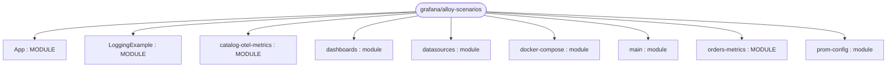
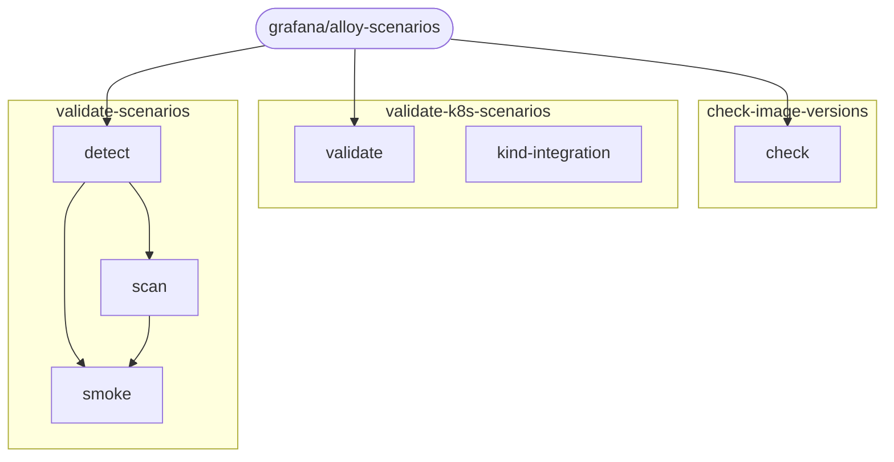

# Repository Architecture Analysis: grafana/alloy-scenarios

## Metadata
- **SHA**: `10a8373825acff859a35d2acaf1fbcdd884e1e1d`
- **Primary Ecosystem**: Python

## Quality Metrics
- **ast_engine**: tree-sitter
- **avg_cognitive_complexity**: 5.83
- **avg_cyclomatic_complexity**: 5.75
- **component_count**: 10
- **dead_code_count**: 0
- **dead_code_symbols**: 0 entry(ies)
- **duplication_pct**: 17.28
- **file_complexities**: 4 entry(ies)
- **files_analyzed**: 10
- **fitness_passed**: False
- **fitness_violation_count**: 1
- **framework**: Flask
- **import_edges**: 22 entry(ies)
- **loc**: 823
- **max_cognitive_complexity**: 11
- **max_cyclomatic_complexity**: 8
- **sloc**: 580

# Architecture: grafana/alloy-scenarios

## Context
- **Repository**: `grafana/alloy-scenarios`
- **SHA**: `10a8373825acff859a35d2acaf1fbcdd884e1e1d`
- **Ecosystem**: Python
- **Framework**: Flask

## Building Block View



## Component Details
- **docker-compose** (`alloy-clustering/docker-compose.yml`): module
- **prom-config** (`alloy-clustering/prom-config.yaml`): module
- **dashboards** (`alloy-clustering/grafana/dashboards/dashboards.yaml`): module
- **datasources** (`alloy-clustering/grafana/datasources/datasources.yaml`): module
- **main** (`app-instrumentation/logging/popular-logging-frameworks/go/main.go`): module
- **LoggingExample** (`app-instrumentation/logging/popular-logging-frameworks/csharp/LoggingExample.csproj`): MODULE
- **orders-metrics** (`app-instrumentation/metrics/opentelemetry-sdk/java/pom.xml`): MODULE
- **App** (`app-instrumentation/metrics/opentelemetry-sdk/csharp/App.csproj`): MODULE
- **main** (`app-instrumentation/metrics/opentelemetry-sdk/go/main.go`): module
- **catalog-otel-metrics** (`app-instrumentation/metrics/opentelemetry-sdk/node/package.json`): MODULE

## 6-Dimension Repository Scorecard

- **Overall Grade**: `C` (78.43/100)
- **Technical Debt Score**: 21.57
- **Estimated Remediation Effort**: 14.35h

| Dimension | Grade | Score | Weight | Details |
| :--- | :---: | :---: | :---: | :--- |
| Code Quality | `D` | 64.00 | 0.20 | avg_cc=5.75, max_cc=8, duplication=17.28%, dead_code=0 |
| Dependency Health | `B` | 85.00 | 0.15 | dependencies=153, outdated=0, vulnerable=0, has_lockfile=False |
| Maintainability | `A` | 91.51 | 0.15 | avg_cognitive=5.83, max_cognitive=11, fitness_violations=1, oversized_files=0 |
| Pipeline Health | `A` | 99.00 | 0.15 | workflows=3, operational_antipatterns=1, parallel_branches=True |
| Security | `D` | 69.00 | 0.20 | vulnerabilities=0, secrets=1, pipeline_security_findings=1 |
| Test Coverage | `C` | 70.00 | 0.15 | coverage=unavailable, ci_test_job=True, test_files_detected=False |

## Architecture Fitness & Workspace Boundaries

- **[MEDIUM] `ATRUSS-ARCH-005` (COMPLEXITY_THRESHOLD)**: Repository duplication_pct (17.28) exceeds policy threshold (15.0).

## Supply Chain Dependencies, Vulnerabilities & Secrets

- **Dependencies Parsed**: 153 | **Vulnerabilities**: 0 | **Secrets**: 1

### Secret Findings (Redacted)
- **[CRITICAL] `ATRUSS-SEC-002`** at `log-secret-filtering/app/main.py:8` (`'Setting API_KEY=ghp_***REDACTED***',`)

### Inventory Sample
- `io.opentelemetry:opentelemetry-api` `*` (Maven, `app-instrumentation/metrics/opentelemetry-sdk/java/pom.xml`)
- `io.opentelemetry:opentelemetry-api` `*` (Maven, `app-instrumentation/traces/opentelemetry-sdk/java/pom.xml`)
- `io.opentelemetry:opentelemetry-exporter-otlp` `*` (Maven, `app-instrumentation/metrics/opentelemetry-sdk/java/pom.xml`)
- `io.opentelemetry:opentelemetry-exporter-otlp` `*` (Maven, `app-instrumentation/traces/opentelemetry-sdk/java/pom.xml`)
- `io.opentelemetry:opentelemetry-sdk` `*` (Maven, `app-instrumentation/metrics/opentelemetry-sdk/java/pom.xml`)
- `io.opentelemetry:opentelemetry-sdk` `*` (Maven, `app-instrumentation/traces/opentelemetry-sdk/java/pom.xml`)
- `io.opentelemetry:opentelemetry-sdk-extension-autoconfigure` `*` (Maven, `app-instrumentation/metrics/opentelemetry-sdk/java/pom.xml`)
- `io.opentelemetry:opentelemetry-sdk-extension-autoconfigure` `*` (Maven, `app-instrumentation/traces/opentelemetry-sdk/java/pom.xml`)
- `io.prometheus:prometheus-metrics-core` `*` (Maven, `app-instrumentation/metrics/prometheus-client/java/pom.xml`)
- `io.prometheus:prometheus-metrics-exporter-httpserver` `*` (Maven, `app-instrumentation/metrics/prometheus-client/java/pom.xml`)
- `Microsoft.Extensions.Hosting` `10.0.11` (NuGet, `app-instrumentation/logging/popular-logging-frameworks/csharp/LoggingExample.csproj`)
- `Microsoft.Extensions.Logging` `10.0.11` (NuGet, `app-instrumentation/logging/popular-logging-frameworks/csharp/LoggingExample.csproj`)
- `Microsoft.Extensions.Logging.Console` `10.0.11` (NuGet, `app-instrumentation/logging/popular-logging-frameworks/csharp/LoggingExample.csproj`)
- `OpenTelemetry` `1.17.0` (NuGet, `app-instrumentation/metrics/opentelemetry-sdk/csharp/App.csproj`)
- `OpenTelemetry` `1.17.0` (NuGet, `app-instrumentation/traces/opentelemetry-sdk/csharp/App.csproj`)
- `OpenTelemetry.Exporter.OpenTelemetryProtocol` `1.17.0` (NuGet, `app-instrumentation/metrics/opentelemetry-sdk/csharp/App.csproj`)
- `OpenTelemetry.Exporter.OpenTelemetryProtocol` `1.17.0` (NuGet, `app-instrumentation/traces/opentelemetry-sdk/csharp/App.csproj`)
- `prometheus-net.AspNetCore` `8.2.1` (NuGet, `app-instrumentation/metrics/prometheus-client/csharp/App.csproj`)
- `datadog` `*` (PyPI, `datadog-receiver-migration/generator/requirements.txt`)
- `ddtrace` `*` (PyPI, `datadog-receiver-migration/generator/requirements.txt`)
- `flask` `*` (PyPI, `otel-basic-tracing/app/requirements.txt`)
- `flask` `*` (PyPI, `otel-examples/cost-control/app/requirements.txt`)
- `flask` `*` (PyPI, `otel-examples/count-connector/app/requirements.txt`)
- `flask` `*` (PyPI, `otel-examples/kafka-buffer/app/requirements.txt`)
- `flask` `*` (PyPI, `otel-examples/multi-pipeline-fanout/app/requirements.txt`)
- `flask` `*` (PyPI, `otel-examples/pii-redaction/app/requirements.txt`)
- `flask` `*` (PyPI, `otel-examples/resource-enrichment/app/requirements.txt`)
- `flask` `*` (PyPI, `otel-span-metrics/app/requirements.txt`)
- `flask` `*` (PyPI, `otel-tail-sampling/app/requirements.txt`)
- `flask` `*` (PyPI, `otel-tracing-service-graphs/app/requirements.txt`)
- ... (+123 more dependencies)

## Section 7: Code-to-Cloud Deployment Traceability

```mermaid
flowchart LR
    subgraph code_modules["Code Modules"]
        mod_alloy_clustering["alloy-clustering"]
        mod_app_instrumentation_logging_popular_logging_frameworks["app-instrumentation/logging/popular-logging-frameworks"]
        mod_app_instrumentation_logging_popular_logging_frameworks_cpp["app-instrumentation/logging/popular-logging-frameworks/cpp"]
        mod_app_instrumentation_logging_popular_logging_frameworks_csharp["app-instrumentation/logging/popular-logging-frameworks/csharp"]
        mod_app_instrumentation_logging_popular_logging_frameworks_go["app-instrumentation/logging/popular-logging-frameworks/go"]
        mod_app_instrumentation_logging_popular_logging_frameworks_java["app-instrumentation/logging/popular-logging-frameworks/java"]
        mod_app_instrumentation_logging_popular_logging_frameworks_javascript["app-instrumentation/logging/popular-logging-frameworks/javascript"]
        mod_app_instrumentation_logging_popular_logging_frameworks_php["app-instrumentation/logging/popular-logging-frameworks/php"]
        mod_app_instrumentation_logging_popular_logging_frameworks_python["app-instrumentation/logging/popular-logging-frameworks/python"]
        mod_app_instrumentation_metrics_opentelemetry_sdk["app-instrumentation/metrics/opentelemetry-sdk"]
        mod_app_instrumentation_metrics_opentelemetry_sdk_csharp["app-instrumentation/metrics/opentelemetry-sdk/csharp"]
        mod_app_instrumentation_metrics_opentelemetry_sdk_go["app-instrumentation/metrics/opentelemetry-sdk/go"]
        mod_app_instrumentation_metrics_opentelemetry_sdk_java["app-instrumentation/metrics/opentelemetry-sdk/java"]
        mod_app_instrumentation_metrics_opentelemetry_sdk_node["app-instrumentation/metrics/opentelemetry-sdk/node"]
        mod_app_instrumentation_metrics_opentelemetry_sdk_python["app-instrumentation/metrics/opentelemetry-sdk/python"]
        mod_app_instrumentation_metrics_prometheus_client["app-instrumentation/metrics/prometheus-client"]
        mod_app_instrumentation_metrics_prometheus_client_csharp["app-instrumentation/metrics/prometheus-client/csharp"]
        mod_app_instrumentation_metrics_prometheus_client_go["app-instrumentation/metrics/prometheus-client/go"]
        mod_app_instrumentation_metrics_prometheus_client_java["app-instrumentation/metrics/prometheus-client/java"]
        mod_app_instrumentation_metrics_prometheus_client_node["app-instrumentation/metrics/prometheus-client/node"]
        mod_app_instrumentation_metrics_prometheus_client_python["app-instrumentation/metrics/prometheus-client/python"]
        mod_app_instrumentation_traces_opentelemetry_sdk["app-instrumentation/traces/opentelemetry-sdk"]
        mod_app_instrumentation_traces_opentelemetry_sdk_csharp["app-instrumentation/traces/opentelemetry-sdk/csharp"]
        mod_app_instrumentation_traces_opentelemetry_sdk_go["app-instrumentation/traces/opentelemetry-sdk/go"]
        mod_app_instrumentation_traces_opentelemetry_sdk_java["app-instrumentation/traces/opentelemetry-sdk/java"]
        mod_app_instrumentation_traces_opentelemetry_sdk_node["app-instrumentation/traces/opentelemetry-sdk/node"]
        mod_app_instrumentation_traces_opentelemetry_sdk_python["app-instrumentation/traces/opentelemetry-sdk/python"]
        mod_aws_firehose_logs["aws-firehose-logs"]
        mod_azure_event_hubs_logs["azure-event-hubs-logs"]
        mod_beyla_zero_code_instrumentation["beyla-zero-code-instrumentation"]
        mod_beyla_zero_code_instrumentation_app["beyla-zero-code-instrumentation/app"]
        mod_blackbox_probing["blackbox-probing"]
        mod_cloudwatch_metrics["cloudwatch-metrics"]
        mod_continuous_profiling["continuous-profiling"]
        mod_continuous_profiling_app["continuous-profiling/app"]
        mod_datadog_receiver_migration["datadog-receiver-migration"]
        mod_datadog_receiver_migration_generator["datadog-receiver-migration/generator"]
        mod_dns_service_discovery["dns-service-discovery"]
        mod_docker_monitoring["docker-monitoring"]
        mod_ebpf_host_profiling["ebpf-host-profiling"]
        mod_ebpf_host_profiling_app["ebpf-host-profiling/app"]
        mod_elasticsearch_monitoring["elasticsearch-monitoring"]
        mod_faro_frontend_observability["faro-frontend-observability"]
        mod_game_of_tracing["game-of-tracing"]
        mod_game_of_tracing_ai_opponent["game-of-tracing/ai_opponent"]
        mod_game_of_tracing_app["game-of-tracing/app"]
        mod_game_of_tracing_war_map["game-of-tracing/war_map"]
        mod_gelf_log_ingestion["gelf-log-ingestion"]
        mod_java_profiling["java-profiling"]
        mod_java_profiling_app["java-profiling/app"]
        mod_kafka["kafka"]
        mod_linux["linux"]
        mod_log_api_gateway["log-api-gateway"]
        mod_log_secret_filtering["log-secret-filtering"]
        mod_log_to_metrics["log-to-metrics"]
        mod_logs_file["logs-file"]
        mod_logs_tcp["logs-tcp"]
        mod_mail_house["mail-house"]
        mod_memcached_monitoring["memcached-monitoring"]
        mod_metric_cardinality_control["metric-cardinality-control"]
        mod_mongodb_monitoring["mongodb-monitoring"]
        mod_mssql_monitoring["mssql-monitoring"]
        mod_mysql_monitoring["mysql-monitoring"]
        mod_nginx_monitoring["nginx-monitoring"]
        mod_otel_basic_tracing["otel-basic-tracing"]
        mod_otel_basic_tracing_app["otel-basic-tracing/app"]
        mod_otel_collector_to_alloy_migration["otel-collector-to-alloy-migration"]
        mod_otel_collector_to_alloy_migration_app["otel-collector-to-alloy-migration/app"]
        mod_otel_examples_cost_control["otel-examples/cost-control"]
        mod_otel_examples_cost_control_app["otel-examples/cost-control/app"]
        mod_otel_examples_count_connector["otel-examples/count-connector"]
        mod_otel_examples_count_connector_app["otel-examples/count-connector/app"]
        mod_otel_examples_filelog_processing["otel-examples/filelog-processing"]
        mod_otel_examples_host_metrics["otel-examples/host-metrics"]
        mod_otel_examples_kafka_buffer["otel-examples/kafka-buffer"]
        mod_otel_examples_kafka_buffer_app["otel-examples/kafka-buffer/app"]
        mod_otel_examples_multi_pipeline_fanout["otel-examples/multi-pipeline-fanout"]
        mod_otel_examples_multi_pipeline_fanout_app["otel-examples/multi-pipeline-fanout/app"]
        mod_otel_examples_ottl_transform["otel-examples/ottl-transform"]
        mod_otel_examples_ottl_transform_app["otel-examples/ottl-transform/app"]
        mod_otel_examples_pii_redaction["otel-examples/pii-redaction"]
        mod_otel_examples_pii_redaction_app["otel-examples/pii-redaction/app"]
        mod_otel_examples_resource_enrichment["otel-examples/resource-enrichment"]
        mod_otel_examples_resource_enrichment_app["otel-examples/resource-enrichment/app"]
        mod_otel_examples_routing_multi_tenant["otel-examples/routing-multi-tenant"]
        mod_otel_examples_routing_multi_tenant_app["otel-examples/routing-multi-tenant/app"]
        mod_otel_jaeger_zipkin_receiver["otel-jaeger-zipkin-receiver"]
        mod_otel_jaeger_zipkin_receiver_app_jaeger_client["otel-jaeger-zipkin-receiver/app/jaeger-client"]
        mod_otel_jaeger_zipkin_receiver_app_zipkin_client["otel-jaeger-zipkin-receiver/app/zipkin-client"]
        mod_otel_loadbalancing["otel-loadbalancing"]
        mod_otel_loadbalancing_app["otel-loadbalancing/app"]
        mod_otel_metrics_pipeline["otel-metrics-pipeline"]
        mod_otel_span_metrics["otel-span-metrics"]
        mod_otel_span_metrics_app["otel-span-metrics/app"]
        mod_otel_tail_sampling["otel-tail-sampling"]
        mod_otel_tail_sampling_app["otel-tail-sampling/app"]
        mod_otel_tracing_service_graphs["otel-tracing-service-graphs"]
        mod_otel_tracing_service_graphs_app["otel-tracing-service-graphs/app"]
        mod_postgres_monitoring["postgres-monitoring"]
        mod_prometheus_pushgateway["prometheus-pushgateway"]
        mod_promtail_to_alloy_migration["promtail-to-alloy-migration"]
        mod_rabbitmq_monitoring["rabbitmq-monitoring"]
        mod_redis_monitoring["redis-monitoring"]
        mod_routing["routing"]
        mod_self_monitoring["self-monitoring"]
        mod_snmp["snmp"]
        mod_snmp_snmpd["snmp/snmpd"]
        mod_statsd_metrics["statsd-metrics"]
        mod_syslog["syslog"]
        mod_systemd_journal["systemd-journal"]
        mod_trace_delivery["trace-delivery"]
        mod_trace_delivery_app["trace-delivery/app"]
        mod_trace_log_correlation_exemplars["trace-log-correlation-exemplars"]
        mod_trace_log_correlation_exemplars_app["trace-log-correlation-exemplars/app"]
        mod_vault_secrets["vault-secrets"]
        mod_windows["windows"]
        mod_windows_events["windows-events"]
    end
    subgraph build_artifacts["Build Artifacts / Containers"]
        art_alloy_clustering_docker_compose_yml["alloy-clustering/docker-compose.yml"]
        art_app_instrumentation_logging_popular_logging_frameworks_cpp_Dockerfile["app-instrumentation/logging/popular-logging-frameworks/cpp/Dockerfile"]
        art_app_instrumentation_logging_popular_logging_frameworks_csharp_Dockerfile["app-instrumentation/logging/popular-logging-frameworks/csharp/Dockerfile"]
        art_app_instrumentation_logging_popular_logging_frameworks_docker_compose_coda_yml["app-instrumentation/logging/popular-logging-frameworks/docker-compose.coda.yml"]
        art_app_instrumentation_logging_popular_logging_frameworks_docker_compose_yml["app-instrumentation/logging/popular-logging-frameworks/docker-compose.yml"]
        art_app_instrumentation_logging_popular_logging_frameworks_go_Dockerfile["app-instrumentation/logging/popular-logging-frameworks/go/Dockerfile"]
        art_app_instrumentation_logging_popular_logging_frameworks_java_Dockerfile["app-instrumentation/logging/popular-logging-frameworks/java/Dockerfile"]
        art_app_instrumentation_logging_popular_logging_frameworks_javascript_Dockerfile["app-instrumentation/logging/popular-logging-frameworks/javascript/Dockerfile"]
        art_app_instrumentation_logging_popular_logging_frameworks_php_Dockerfile["app-instrumentation/logging/popular-logging-frameworks/php/Dockerfile"]
        art_app_instrumentation_logging_popular_logging_frameworks_python_Dockerfile["app-instrumentation/logging/popular-logging-frameworks/python/Dockerfile"]
        art_app_instrumentation_metrics_opentelemetry_sdk_csharp_Dockerfile["app-instrumentation/metrics/opentelemetry-sdk/csharp/Dockerfile"]
        art_app_instrumentation_metrics_opentelemetry_sdk_docker_compose_coda_yml["app-instrumentation/metrics/opentelemetry-sdk/docker-compose.coda.yml"]
        art_app_instrumentation_metrics_opentelemetry_sdk_docker_compose_yml["app-instrumentation/metrics/opentelemetry-sdk/docker-compose.yml"]
        art_app_instrumentation_metrics_opentelemetry_sdk_go_Dockerfile["app-instrumentation/metrics/opentelemetry-sdk/go/Dockerfile"]
        art_app_instrumentation_metrics_opentelemetry_sdk_java_Dockerfile["app-instrumentation/metrics/opentelemetry-sdk/java/Dockerfile"]
        art_app_instrumentation_metrics_opentelemetry_sdk_node_Dockerfile["app-instrumentation/metrics/opentelemetry-sdk/node/Dockerfile"]
        art_app_instrumentation_metrics_opentelemetry_sdk_python_Dockerfile["app-instrumentation/metrics/opentelemetry-sdk/python/Dockerfile"]
        art_app_instrumentation_metrics_prometheus_client_csharp_Dockerfile["app-instrumentation/metrics/prometheus-client/csharp/Dockerfile"]
        art_app_instrumentation_metrics_prometheus_client_docker_compose_coda_yml["app-instrumentation/metrics/prometheus-client/docker-compose.coda.yml"]
        art_app_instrumentation_metrics_prometheus_client_docker_compose_yml["app-instrumentation/metrics/prometheus-client/docker-compose.yml"]
        art_app_instrumentation_metrics_prometheus_client_go_Dockerfile["app-instrumentation/metrics/prometheus-client/go/Dockerfile"]
        art_app_instrumentation_metrics_prometheus_client_java_Dockerfile["app-instrumentation/metrics/prometheus-client/java/Dockerfile"]
        art_app_instrumentation_metrics_prometheus_client_node_Dockerfile["app-instrumentation/metrics/prometheus-client/node/Dockerfile"]
        art_app_instrumentation_metrics_prometheus_client_python_Dockerfile["app-instrumentation/metrics/prometheus-client/python/Dockerfile"]
        art_app_instrumentation_traces_opentelemetry_sdk_csharp_Dockerfile["app-instrumentation/traces/opentelemetry-sdk/csharp/Dockerfile"]
        art_app_instrumentation_traces_opentelemetry_sdk_docker_compose_coda_yml["app-instrumentation/traces/opentelemetry-sdk/docker-compose.coda.yml"]
        art_app_instrumentation_traces_opentelemetry_sdk_docker_compose_yml["app-instrumentation/traces/opentelemetry-sdk/docker-compose.yml"]
        art_app_instrumentation_traces_opentelemetry_sdk_go_Dockerfile["app-instrumentation/traces/opentelemetry-sdk/go/Dockerfile"]
        art_app_instrumentation_traces_opentelemetry_sdk_java_Dockerfile["app-instrumentation/traces/opentelemetry-sdk/java/Dockerfile"]
        art_app_instrumentation_traces_opentelemetry_sdk_node_Dockerfile["app-instrumentation/traces/opentelemetry-sdk/node/Dockerfile"]
        art_app_instrumentation_traces_opentelemetry_sdk_python_Dockerfile["app-instrumentation/traces/opentelemetry-sdk/python/Dockerfile"]
        art_aws_firehose_logs_docker_compose_yml["aws-firehose-logs/docker-compose.yml"]
        art_azure_event_hubs_logs_docker_compose_yml["azure-event-hubs-logs/docker-compose.yml"]
        art_beyla_zero_code_instrumentation_docker_compose_coda_yml["beyla-zero-code-instrumentation/docker-compose.coda.yml"]
        art_beyla_zero_code_instrumentation_docker_compose_yml["beyla-zero-code-instrumentation/docker-compose.yml"]
        art_blackbox_probing_docker_compose_coda_yml["blackbox-probing/docker-compose.coda.yml"]
        art_blackbox_probing_docker_compose_yml["blackbox-probing/docker-compose.yml"]
        art_cloudwatch_metrics_docker_compose_yml["cloudwatch-metrics/docker-compose.yml"]
        art_continuous_profiling_docker_compose_coda_yml["continuous-profiling/docker-compose.coda.yml"]
        art_continuous_profiling_docker_compose_yml["continuous-profiling/docker-compose.yml"]
        art_datadog_receiver_migration_docker_compose_yml["datadog-receiver-migration/docker-compose.yml"]
        art_datadog_receiver_migration_generator_Dockerfile["datadog-receiver-migration/generator/Dockerfile"]
        art_dns_service_discovery_docker_compose_yml["dns-service-discovery/docker-compose.yml"]
        art_docker_monitoring_docker_compose_yml["docker-monitoring/docker-compose.yml"]
        art_ebpf_host_profiling_docker_compose_coda_yml["ebpf-host-profiling/docker-compose.coda.yml"]
        art_ebpf_host_profiling_docker_compose_yml["ebpf-host-profiling/docker-compose.yml"]
        art_elasticsearch_monitoring_docker_compose_coda_yml["elasticsearch-monitoring/docker-compose.coda.yml"]
        art_elasticsearch_monitoring_docker_compose_yml["elasticsearch-monitoring/docker-compose.yml"]
        art_faro_frontend_observability_docker_compose_coda_yml["faro-frontend-observability/docker-compose.coda.yml"]
        art_faro_frontend_observability_docker_compose_yml["faro-frontend-observability/docker-compose.yml"]
        art_game_of_tracing_ai_opponent_Dockerfile["game-of-tracing/ai_opponent/Dockerfile"]
        art_game_of_tracing_app_Dockerfile["game-of-tracing/app/Dockerfile"]
        art_game_of_tracing_docker_compose_otel_yml["game-of-tracing/docker-compose-otel.yml"]
        art_game_of_tracing_docker_compose_coda_yml["game-of-tracing/docker-compose.coda.yml"]
        art_game_of_tracing_docker_compose_yml["game-of-tracing/docker-compose.yml"]
        art_game_of_tracing_war_map_Dockerfile["game-of-tracing/war_map/Dockerfile"]
        art_gelf_log_ingestion_docker_compose_coda_yml["gelf-log-ingestion/docker-compose.coda.yml"]
        art_gelf_log_ingestion_docker_compose_yml["gelf-log-ingestion/docker-compose.yml"]
        art_java_profiling_app_Dockerfile["java-profiling/app/Dockerfile"]
        art_java_profiling_docker_compose_coda_yml["java-profiling/docker-compose.coda.yml"]
        art_java_profiling_docker_compose_yml["java-profiling/docker-compose.yml"]
        art_k8s_events_alloy_deployment_yaml["k8s/events/alloy-deployment.yaml"]
        art_k8s_events_kind_yml["k8s/events/kind.yml"]
        art_k8s_events_loki_values_yml["k8s/events/loki-values.yml"]
        art_k8s_kube_state_metrics_cadvisor_alloy_values_yml["k8s/kube-state-metrics-cadvisor/alloy-values.yml"]
        art_k8s_kube_state_metrics_cadvisor_grafana_values_yml["k8s/kube-state-metrics-cadvisor/grafana-values.yml"]
        art_k8s_kube_state_metrics_cadvisor_kind_yml["k8s/kube-state-metrics-cadvisor/kind.yml"]
        art_k8s_kube_state_metrics_cadvisor_ksm_values_yml["k8s/kube-state-metrics-cadvisor/ksm-values.yml"]
        art_k8s_kube_state_metrics_cadvisor_prometheus_values_yml["k8s/kube-state-metrics-cadvisor/prometheus-values.yml"]
        art_k8s_logs_killercoda_loki_values_yml["k8s/logs/killercoda/loki-values.yml"]
        art_k8s_logs_kind_yml["k8s/logs/kind.yml"]
        art_k8s_logs_loki_values_yml["k8s/logs/loki-values.yml"]
        art_k8s_metrics_kind_yml["k8s/metrics/kind.yml"]
        art_k8s_metrics_prometheus_values_yml["k8s/metrics/prometheus-values.yml"]
        art_k8s_profiling_grafana_values_yml["k8s/profiling/grafana-values.yml"]
        art_k8s_profiling_kind_yml["k8s/profiling/kind.yml"]
        art_k8s_prometheus_operator_probes_kind_yml["k8s/prometheus-operator-probes/kind.yml"]
        art_k8s_tracing_k8s_monitoring_values_yml["k8s/tracing/k8s-monitoring-values.yml"]
        art_k8s_tracing_kind_yml["k8s/tracing/kind.yml"]
        art_kafka_docker_compose_coda_yml["kafka/docker-compose.coda.yml"]
        art_kafka_docker_compose_yml["kafka/docker-compose.yml"]
        art_linux_docker_compose_yml["linux/docker-compose.yml"]
        art_log_api_gateway_docker_compose_coda_yml["log-api-gateway/docker-compose.coda.yml"]
        art_log_api_gateway_docker_compose_yml["log-api-gateway/docker-compose.yml"]
        art_log_secret_filtering_docker_compose_coda_yml["log-secret-filtering/docker-compose.coda.yml"]
        art_log_secret_filtering_docker_compose_yml["log-secret-filtering/docker-compose.yml"]
        art_log_to_metrics_docker_compose_coda_yml["log-to-metrics/docker-compose.coda.yml"]
        art_log_to_metrics_docker_compose_yml["log-to-metrics/docker-compose.yml"]
        art_logs_file_docker_compose_coda_yml["logs-file/docker-compose.coda.yml"]
        art_logs_file_docker_compose_yml["logs-file/docker-compose.yml"]
        art_logs_tcp_docker_compose_coda_yml["logs-tcp/docker-compose.coda.yml"]
        art_logs_tcp_docker_compose_yml["logs-tcp/docker-compose.yml"]
        art_mail_house_docker_compose_coda_yml["mail-house/docker-compose.coda.yml"]
        art_mail_house_docker_compose_yml["mail-house/docker-compose.yml"]
        art_memcached_monitoring_docker_compose_coda_yml["memcached-monitoring/docker-compose.coda.yml"]
        art_memcached_monitoring_docker_compose_yml["memcached-monitoring/docker-compose.yml"]
        art_metric_cardinality_control_docker_compose_coda_yml["metric-cardinality-control/docker-compose.coda.yml"]
        art_metric_cardinality_control_docker_compose_yml["metric-cardinality-control/docker-compose.yml"]
        art_mongodb_monitoring_docker_compose_coda_yml["mongodb-monitoring/docker-compose.coda.yml"]
        art_mongodb_monitoring_docker_compose_yml["mongodb-monitoring/docker-compose.yml"]
        art_mssql_monitoring_docker_compose_coda_yml["mssql-monitoring/docker-compose.coda.yml"]
        art_mssql_monitoring_docker_compose_yml["mssql-monitoring/docker-compose.yml"]
        art_mysql_monitoring_docker_compose_coda_yml["mysql-monitoring/docker-compose.coda.yml"]
        art_mysql_monitoring_docker_compose_yml["mysql-monitoring/docker-compose.yml"]
        art_nginx_monitoring_docker_compose_yml["nginx-monitoring/docker-compose.yml"]
        art_otel_basic_tracing_app_Dockerfile["otel-basic-tracing/app/Dockerfile"]
        art_otel_basic_tracing_docker_compose_otel_yml["otel-basic-tracing/docker-compose-otel.yml"]
        art_otel_basic_tracing_docker_compose_coda_yml["otel-basic-tracing/docker-compose.coda.yml"]
        art_otel_basic_tracing_docker_compose_yml["otel-basic-tracing/docker-compose.yml"]
        art_otel_collector_to_alloy_migration_app_Dockerfile["otel-collector-to-alloy-migration/app/Dockerfile"]
        art_otel_collector_to_alloy_migration_docker_compose_yml["otel-collector-to-alloy-migration/docker-compose.yml"]
        art_otel_examples_cost_control_app_Dockerfile["otel-examples/cost-control/app/Dockerfile"]
        art_otel_examples_cost_control_docker_compose_coda_yml["otel-examples/cost-control/docker-compose.coda.yml"]
        art_otel_examples_cost_control_docker_compose_yml["otel-examples/cost-control/docker-compose.yml"]
        art_otel_examples_count_connector_app_Dockerfile["otel-examples/count-connector/app/Dockerfile"]
        art_otel_examples_count_connector_docker_compose_coda_yml["otel-examples/count-connector/docker-compose.coda.yml"]
        art_otel_examples_count_connector_docker_compose_yml["otel-examples/count-connector/docker-compose.yml"]
        art_otel_examples_filelog_processing_docker_compose_coda_yml["otel-examples/filelog-processing/docker-compose.coda.yml"]
        art_otel_examples_filelog_processing_docker_compose_yml["otel-examples/filelog-processing/docker-compose.yml"]
        art_otel_examples_host_metrics_docker_compose_coda_yml["otel-examples/host-metrics/docker-compose.coda.yml"]
        art_otel_examples_host_metrics_docker_compose_yml["otel-examples/host-metrics/docker-compose.yml"]
        art_otel_examples_kafka_buffer_app_Dockerfile["otel-examples/kafka-buffer/app/Dockerfile"]
        art_otel_examples_kafka_buffer_docker_compose_coda_yml["otel-examples/kafka-buffer/docker-compose.coda.yml"]
        art_otel_examples_kafka_buffer_docker_compose_yml["otel-examples/kafka-buffer/docker-compose.yml"]
        art_otel_examples_multi_pipeline_fanout_app_Dockerfile["otel-examples/multi-pipeline-fanout/app/Dockerfile"]
        art_otel_examples_multi_pipeline_fanout_docker_compose_coda_yml["otel-examples/multi-pipeline-fanout/docker-compose.coda.yml"]
        art_otel_examples_multi_pipeline_fanout_docker_compose_yml["otel-examples/multi-pipeline-fanout/docker-compose.yml"]
        art_otel_examples_ottl_transform_app_Dockerfile["otel-examples/ottl-transform/app/Dockerfile"]
        art_otel_examples_ottl_transform_docker_compose_coda_yml["otel-examples/ottl-transform/docker-compose.coda.yml"]
        art_otel_examples_ottl_transform_docker_compose_yml["otel-examples/ottl-transform/docker-compose.yml"]
        art_otel_examples_pii_redaction_app_Dockerfile["otel-examples/pii-redaction/app/Dockerfile"]
        art_otel_examples_pii_redaction_docker_compose_coda_yml["otel-examples/pii-redaction/docker-compose.coda.yml"]
        art_otel_examples_pii_redaction_docker_compose_yml["otel-examples/pii-redaction/docker-compose.yml"]
        art_otel_examples_resource_enrichment_app_Dockerfile["otel-examples/resource-enrichment/app/Dockerfile"]
        art_otel_examples_resource_enrichment_docker_compose_coda_yml["otel-examples/resource-enrichment/docker-compose.coda.yml"]
        art_otel_examples_resource_enrichment_docker_compose_yml["otel-examples/resource-enrichment/docker-compose.yml"]
        art_otel_examples_routing_multi_tenant_docker_compose_coda_yml["otel-examples/routing-multi-tenant/docker-compose.coda.yml"]
        art_otel_examples_routing_multi_tenant_docker_compose_yml["otel-examples/routing-multi-tenant/docker-compose.yml"]
        art_otel_jaeger_zipkin_receiver_docker_compose_coda_yml["otel-jaeger-zipkin-receiver/docker-compose.coda.yml"]
        art_otel_jaeger_zipkin_receiver_docker_compose_yml["otel-jaeger-zipkin-receiver/docker-compose.yml"]
        art_otel_loadbalancing_app_Dockerfile["otel-loadbalancing/app/Dockerfile"]
        art_otel_loadbalancing_docker_compose_coda_yml["otel-loadbalancing/docker-compose.coda.yml"]
        art_otel_loadbalancing_docker_compose_yml["otel-loadbalancing/docker-compose.yml"]
        art_otel_metrics_pipeline_docker_compose_otel_yml["otel-metrics-pipeline/docker-compose-otel.yml"]
        art_otel_metrics_pipeline_docker_compose_coda_yml["otel-metrics-pipeline/docker-compose.coda.yml"]
        art_otel_metrics_pipeline_docker_compose_yml["otel-metrics-pipeline/docker-compose.yml"]
        art_otel_span_metrics_docker_compose_otel_yml["otel-span-metrics/docker-compose-otel.yml"]
        art_otel_span_metrics_docker_compose_coda_yml["otel-span-metrics/docker-compose.coda.yml"]
        art_otel_span_metrics_docker_compose_yml["otel-span-metrics/docker-compose.yml"]
        art_otel_tail_sampling_app_Dockerfile["otel-tail-sampling/app/Dockerfile"]
        art_otel_tail_sampling_docker_compose_otel_yml["otel-tail-sampling/docker-compose-otel.yml"]
        art_otel_tail_sampling_docker_compose_coda_yml["otel-tail-sampling/docker-compose.coda.yml"]
        art_otel_tail_sampling_docker_compose_yml["otel-tail-sampling/docker-compose.yml"]
        art_otel_tracing_service_graphs_app_Dockerfile["otel-tracing-service-graphs/app/Dockerfile"]
        art_otel_tracing_service_graphs_docker_compose_otel_yml["otel-tracing-service-graphs/docker-compose-otel.yml"]
        art_otel_tracing_service_graphs_docker_compose_coda_yml["otel-tracing-service-graphs/docker-compose.coda.yml"]
        art_otel_tracing_service_graphs_docker_compose_yml["otel-tracing-service-graphs/docker-compose.yml"]
        art_postgres_monitoring_docker_compose_coda_yml["postgres-monitoring/docker-compose.coda.yml"]
        art_postgres_monitoring_docker_compose_yml["postgres-monitoring/docker-compose.yml"]
        art_prometheus_pushgateway_docker_compose_yml["prometheus-pushgateway/docker-compose.yml"]
        art_promtail_to_alloy_migration_docker_compose_coda_yml["promtail-to-alloy-migration/docker-compose.coda.yml"]
        art_promtail_to_alloy_migration_docker_compose_yml["promtail-to-alloy-migration/docker-compose.yml"]
        art_rabbitmq_monitoring_docker_compose_coda_yml["rabbitmq-monitoring/docker-compose.coda.yml"]
        art_rabbitmq_monitoring_docker_compose_yml["rabbitmq-monitoring/docker-compose.yml"]
        art_redis_monitoring_docker_compose_coda_yml["redis-monitoring/docker-compose.coda.yml"]
        art_redis_monitoring_docker_compose_yml["redis-monitoring/docker-compose.yml"]
        art_routing_docker_compose_yaml["routing/docker-compose.yaml"]
        art_self_monitoring_docker_compose_yaml["self-monitoring/docker-compose.yaml"]
        art_snmp_docker_compose_yml["snmp/docker-compose.yml"]
        art_snmp_snmpd_Dockerfile["snmp/snmpd/Dockerfile"]
        art_statsd_metrics_docker_compose_yml["statsd-metrics/docker-compose.yml"]
        art_syslog_docker_compose_coda_yml["syslog/docker-compose.coda.yml"]
        art_syslog_docker_compose_yml["syslog/docker-compose.yml"]
        art_systemd_journal_docker_compose_yml["systemd-journal/docker-compose.yml"]
        art_trace_delivery_app_Dockerfile["trace-delivery/app/Dockerfile"]
        art_trace_delivery_docker_compose_otel_yml["trace-delivery/docker-compose-otel.yml"]
        art_trace_delivery_docker_compose_coda_yml["trace-delivery/docker-compose.coda.yml"]
        art_trace_delivery_docker_compose_yml["trace-delivery/docker-compose.yml"]
        art_trace_log_correlation_exemplars_app_Dockerfile["trace-log-correlation-exemplars/app/Dockerfile"]
        art_trace_log_correlation_exemplars_docker_compose_coda_yml["trace-log-correlation-exemplars/docker-compose.coda.yml"]
        art_trace_log_correlation_exemplars_docker_compose_yml["trace-log-correlation-exemplars/docker-compose.yml"]
        art_vault_secrets_docker_compose_yml["vault-secrets/docker-compose.yml"]
        art_windows_events_docker_compose_yml["windows-events/docker-compose.yml"]
        art_windows_docker_compose_yml["windows/docker-compose.yml"]
    end
    subgraph ci_jobs["CI/CD Jobs"]
        job_validate_k8s_scenarios_yml_kind_integration["validate-k8s-scenarios.yml#kind-integration"]
        job_validate_k8s_scenarios_yml_validate["validate-k8s-scenarios.yml#validate"]
        job_validate_scenarios_yml_scan["validate-scenarios.yml#scan"]
        job_validate_scenarios_yml_smoke["validate-scenarios.yml#smoke"]
    end
    subgraph runtime_envs["Runtime Environments"]
        env_kubernetes["kubernetes"]
    end
    job_validate_k8s_scenarios_yml_kind_integration -->|DEPLOYS_TO| env_kubernetes
    job_validate_k8s_scenarios_yml_validate -->|DEPLOYS_TO| env_kubernetes
    mod_alloy_clustering -->|PACKAGED_BY| art_alloy_clustering_docker_compose_yml
    mod_app_instrumentation_logging_popular_logging_frameworks -->|PACKAGED_BY| art_app_instrumentation_logging_popular_logging_frameworks_docker_compose_coda_yml
    mod_app_instrumentation_logging_popular_logging_frameworks -->|PACKAGED_BY| art_app_instrumentation_logging_popular_logging_frameworks_docker_compose_yml
    mod_app_instrumentation_logging_popular_logging_frameworks_cpp -->|PACKAGED_BY| art_app_instrumentation_logging_popular_logging_frameworks_cpp_Dockerfile
    mod_app_instrumentation_logging_popular_logging_frameworks_cpp -->|PACKAGED_BY| art_app_instrumentation_logging_popular_logging_frameworks_docker_compose_coda_yml
    mod_app_instrumentation_logging_popular_logging_frameworks_cpp -->|PACKAGED_BY| art_app_instrumentation_logging_popular_logging_frameworks_docker_compose_yml
    mod_app_instrumentation_logging_popular_logging_frameworks_csharp -->|PACKAGED_BY| art_app_instrumentation_logging_popular_logging_frameworks_csharp_Dockerfile
    mod_app_instrumentation_logging_popular_logging_frameworks_csharp -->|PACKAGED_BY| art_app_instrumentation_logging_popular_logging_frameworks_docker_compose_coda_yml
    mod_app_instrumentation_logging_popular_logging_frameworks_csharp -->|PACKAGED_BY| art_app_instrumentation_logging_popular_logging_frameworks_docker_compose_yml
    mod_app_instrumentation_logging_popular_logging_frameworks_csharp -->|PACKAGED_BY| art_app_instrumentation_metrics_opentelemetry_sdk_docker_compose_coda_yml
    mod_app_instrumentation_logging_popular_logging_frameworks_csharp -->|PACKAGED_BY| art_app_instrumentation_metrics_opentelemetry_sdk_docker_compose_yml
    mod_app_instrumentation_logging_popular_logging_frameworks_csharp -->|PACKAGED_BY| art_app_instrumentation_metrics_prometheus_client_docker_compose_coda_yml
    mod_app_instrumentation_logging_popular_logging_frameworks_csharp -->|PACKAGED_BY| art_app_instrumentation_metrics_prometheus_client_docker_compose_yml
    mod_app_instrumentation_logging_popular_logging_frameworks_csharp -->|PACKAGED_BY| art_app_instrumentation_traces_opentelemetry_sdk_docker_compose_coda_yml
    mod_app_instrumentation_logging_popular_logging_frameworks_csharp -->|PACKAGED_BY| art_app_instrumentation_traces_opentelemetry_sdk_docker_compose_yml
    mod_app_instrumentation_logging_popular_logging_frameworks_go -->|PACKAGED_BY| art_app_instrumentation_logging_popular_logging_frameworks_docker_compose_coda_yml
    mod_app_instrumentation_logging_popular_logging_frameworks_go -->|PACKAGED_BY| art_app_instrumentation_logging_popular_logging_frameworks_docker_compose_yml
    mod_app_instrumentation_logging_popular_logging_frameworks_go -->|PACKAGED_BY| art_app_instrumentation_logging_popular_logging_frameworks_go_Dockerfile
    mod_app_instrumentation_logging_popular_logging_frameworks_go -->|PACKAGED_BY| art_app_instrumentation_metrics_opentelemetry_sdk_docker_compose_coda_yml
    mod_app_instrumentation_logging_popular_logging_frameworks_go -->|PACKAGED_BY| art_app_instrumentation_metrics_opentelemetry_sdk_docker_compose_yml
    mod_app_instrumentation_logging_popular_logging_frameworks_go -->|PACKAGED_BY| art_app_instrumentation_metrics_opentelemetry_sdk_go_Dockerfile
    mod_app_instrumentation_logging_popular_logging_frameworks_go -->|PACKAGED_BY| art_app_instrumentation_metrics_opentelemetry_sdk_java_Dockerfile
    mod_app_instrumentation_logging_popular_logging_frameworks_go -->|PACKAGED_BY| art_app_instrumentation_metrics_prometheus_client_docker_compose_coda_yml
    mod_app_instrumentation_logging_popular_logging_frameworks_go -->|PACKAGED_BY| art_app_instrumentation_metrics_prometheus_client_docker_compose_yml
    mod_app_instrumentation_logging_popular_logging_frameworks_go -->|PACKAGED_BY| art_app_instrumentation_metrics_prometheus_client_go_Dockerfile
    mod_app_instrumentation_logging_popular_logging_frameworks_go -->|PACKAGED_BY| art_app_instrumentation_metrics_prometheus_client_java_Dockerfile
    mod_app_instrumentation_logging_popular_logging_frameworks_go -->|PACKAGED_BY| art_app_instrumentation_traces_opentelemetry_sdk_docker_compose_coda_yml
    mod_app_instrumentation_logging_popular_logging_frameworks_go -->|PACKAGED_BY| art_app_instrumentation_traces_opentelemetry_sdk_docker_compose_yml
    mod_app_instrumentation_logging_popular_logging_frameworks_go -->|PACKAGED_BY| art_app_instrumentation_traces_opentelemetry_sdk_go_Dockerfile
    mod_app_instrumentation_logging_popular_logging_frameworks_go -->|PACKAGED_BY| art_app_instrumentation_traces_opentelemetry_sdk_java_Dockerfile
    mod_app_instrumentation_logging_popular_logging_frameworks_go -->|PACKAGED_BY| art_beyla_zero_code_instrumentation_docker_compose_coda_yml
    mod_app_instrumentation_logging_popular_logging_frameworks_go -->|PACKAGED_BY| art_beyla_zero_code_instrumentation_docker_compose_yml
    mod_app_instrumentation_logging_popular_logging_frameworks_go -->|PACKAGED_BY| art_continuous_profiling_docker_compose_coda_yml
    mod_app_instrumentation_logging_popular_logging_frameworks_go -->|PACKAGED_BY| art_continuous_profiling_docker_compose_yml
    mod_app_instrumentation_logging_popular_logging_frameworks_go -->|PACKAGED_BY| art_ebpf_host_profiling_docker_compose_coda_yml
    mod_app_instrumentation_logging_popular_logging_frameworks_go -->|PACKAGED_BY| art_ebpf_host_profiling_docker_compose_yml
    mod_app_instrumentation_logging_popular_logging_frameworks_go -->|PACKAGED_BY| art_game_of_tracing_docker_compose_yml
    mod_app_instrumentation_logging_popular_logging_frameworks_go -->|PACKAGED_BY| art_mongodb_monitoring_docker_compose_coda_yml
    mod_app_instrumentation_logging_popular_logging_frameworks_go -->|PACKAGED_BY| art_mongodb_monitoring_docker_compose_yml
    mod_app_instrumentation_logging_popular_logging_frameworks_go -->|PACKAGED_BY| art_otel_basic_tracing_docker_compose_yml
    mod_app_instrumentation_logging_popular_logging_frameworks_go -->|PACKAGED_BY| art_otel_jaeger_zipkin_receiver_docker_compose_yml
    mod_app_instrumentation_logging_popular_logging_frameworks_go -->|PACKAGED_BY| art_otel_tail_sampling_docker_compose_yml
    mod_app_instrumentation_logging_popular_logging_frameworks_go -->|PACKAGED_BY| art_otel_tracing_service_graphs_docker_compose_yml
    mod_app_instrumentation_logging_popular_logging_frameworks_go -->|PACKAGED_BY| art_trace_delivery_docker_compose_yml
    mod_app_instrumentation_logging_popular_logging_frameworks_go -->|PACKAGED_BY| art_k8s_events_loki_values_yml
    mod_app_instrumentation_logging_popular_logging_frameworks_go -->|PACKAGED_BY| art_k8s_logs_killercoda_loki_values_yml
    mod_app_instrumentation_logging_popular_logging_frameworks_go -->|PACKAGED_BY| art_k8s_logs_loki_values_yml
    mod_app_instrumentation_logging_popular_logging_frameworks_java -->|PACKAGED_BY| art_app_instrumentation_logging_popular_logging_frameworks_docker_compose_coda_yml
    mod_app_instrumentation_logging_popular_logging_frameworks_java -->|PACKAGED_BY| art_app_instrumentation_logging_popular_logging_frameworks_docker_compose_yml
    mod_app_instrumentation_logging_popular_logging_frameworks_java -->|PACKAGED_BY| art_app_instrumentation_logging_popular_logging_frameworks_java_Dockerfile
    mod_app_instrumentation_logging_popular_logging_frameworks_java -->|PACKAGED_BY| art_app_instrumentation_metrics_opentelemetry_sdk_docker_compose_coda_yml
    mod_app_instrumentation_logging_popular_logging_frameworks_java -->|PACKAGED_BY| art_app_instrumentation_metrics_opentelemetry_sdk_docker_compose_yml
    mod_app_instrumentation_logging_popular_logging_frameworks_java -->|PACKAGED_BY| art_app_instrumentation_metrics_opentelemetry_sdk_java_Dockerfile
    mod_app_instrumentation_logging_popular_logging_frameworks_java -->|PACKAGED_BY| art_app_instrumentation_metrics_prometheus_client_docker_compose_coda_yml
    mod_app_instrumentation_logging_popular_logging_frameworks_java -->|PACKAGED_BY| art_app_instrumentation_metrics_prometheus_client_docker_compose_yml
    mod_app_instrumentation_logging_popular_logging_frameworks_java -->|PACKAGED_BY| art_app_instrumentation_metrics_prometheus_client_java_Dockerfile
    mod_app_instrumentation_logging_popular_logging_frameworks_java -->|PACKAGED_BY| art_app_instrumentation_traces_opentelemetry_sdk_docker_compose_coda_yml
    mod_app_instrumentation_logging_popular_logging_frameworks_java -->|PACKAGED_BY| art_app_instrumentation_traces_opentelemetry_sdk_docker_compose_yml
    mod_app_instrumentation_logging_popular_logging_frameworks_java -->|PACKAGED_BY| art_app_instrumentation_traces_opentelemetry_sdk_java_Dockerfile
    mod_app_instrumentation_logging_popular_logging_frameworks_java -->|PACKAGED_BY| art_java_profiling_app_Dockerfile
    mod_app_instrumentation_logging_popular_logging_frameworks_java -->|PACKAGED_BY| art_java_profiling_docker_compose_coda_yml
    mod_app_instrumentation_logging_popular_logging_frameworks_java -->|PACKAGED_BY| art_java_profiling_docker_compose_yml
    mod_app_instrumentation_logging_popular_logging_frameworks_javascript -->|PACKAGED_BY| art_app_instrumentation_logging_popular_logging_frameworks_docker_compose_coda_yml
    mod_app_instrumentation_logging_popular_logging_frameworks_javascript -->|PACKAGED_BY| art_app_instrumentation_logging_popular_logging_frameworks_docker_compose_yml
    mod_app_instrumentation_logging_popular_logging_frameworks_javascript -->|PACKAGED_BY| art_app_instrumentation_logging_popular_logging_frameworks_javascript_Dockerfile
    mod_app_instrumentation_logging_popular_logging_frameworks_javascript -->|PACKAGED_BY| art_app_instrumentation_metrics_opentelemetry_sdk_docker_compose_coda_yml
    mod_app_instrumentation_logging_popular_logging_frameworks_javascript -->|PACKAGED_BY| art_app_instrumentation_metrics_opentelemetry_sdk_docker_compose_yml
    mod_app_instrumentation_logging_popular_logging_frameworks_javascript -->|PACKAGED_BY| art_app_instrumentation_traces_opentelemetry_sdk_docker_compose_coda_yml
    mod_app_instrumentation_logging_popular_logging_frameworks_javascript -->|PACKAGED_BY| art_app_instrumentation_traces_opentelemetry_sdk_docker_compose_yml
    mod_app_instrumentation_logging_popular_logging_frameworks_php -->|PACKAGED_BY| art_app_instrumentation_logging_popular_logging_frameworks_docker_compose_coda_yml
    mod_app_instrumentation_logging_popular_logging_frameworks_php -->|PACKAGED_BY| art_app_instrumentation_logging_popular_logging_frameworks_docker_compose_yml
    mod_app_instrumentation_logging_popular_logging_frameworks_php -->|PACKAGED_BY| art_app_instrumentation_logging_popular_logging_frameworks_php_Dockerfile
    mod_app_instrumentation_logging_popular_logging_frameworks_python -->|PACKAGED_BY| art_app_instrumentation_logging_popular_logging_frameworks_docker_compose_coda_yml
    mod_app_instrumentation_logging_popular_logging_frameworks_python -->|PACKAGED_BY| art_app_instrumentation_logging_popular_logging_frameworks_docker_compose_yml
    mod_app_instrumentation_logging_popular_logging_frameworks_python -->|PACKAGED_BY| art_app_instrumentation_logging_popular_logging_frameworks_python_Dockerfile
    mod_app_instrumentation_logging_popular_logging_frameworks_python -->|PACKAGED_BY| art_app_instrumentation_metrics_opentelemetry_sdk_docker_compose_coda_yml
    mod_app_instrumentation_logging_popular_logging_frameworks_python -->|PACKAGED_BY| art_app_instrumentation_metrics_opentelemetry_sdk_docker_compose_yml
    mod_app_instrumentation_logging_popular_logging_frameworks_python -->|PACKAGED_BY| art_app_instrumentation_metrics_opentelemetry_sdk_python_Dockerfile
    mod_app_instrumentation_logging_popular_logging_frameworks_python -->|PACKAGED_BY| art_app_instrumentation_metrics_prometheus_client_docker_compose_coda_yml
    mod_app_instrumentation_logging_popular_logging_frameworks_python -->|PACKAGED_BY| art_app_instrumentation_metrics_prometheus_client_docker_compose_yml
    mod_app_instrumentation_logging_popular_logging_frameworks_python -->|PACKAGED_BY| art_app_instrumentation_metrics_prometheus_client_python_Dockerfile
    mod_app_instrumentation_logging_popular_logging_frameworks_python -->|PACKAGED_BY| art_app_instrumentation_traces_opentelemetry_sdk_docker_compose_coda_yml
    mod_app_instrumentation_logging_popular_logging_frameworks_python -->|PACKAGED_BY| art_app_instrumentation_traces_opentelemetry_sdk_docker_compose_yml
    mod_app_instrumentation_logging_popular_logging_frameworks_python -->|PACKAGED_BY| art_app_instrumentation_traces_opentelemetry_sdk_python_Dockerfile
    mod_app_instrumentation_logging_popular_logging_frameworks_python -->|PACKAGED_BY| art_aws_firehose_logs_docker_compose_yml
    mod_app_instrumentation_logging_popular_logging_frameworks_python -->|PACKAGED_BY| art_cloudwatch_metrics_docker_compose_yml
    mod_app_instrumentation_logging_popular_logging_frameworks_python -->|PACKAGED_BY| art_datadog_receiver_migration_generator_Dockerfile
    mod_app_instrumentation_logging_popular_logging_frameworks_python -->|PACKAGED_BY| art_dns_service_discovery_docker_compose_yml
    mod_app_instrumentation_logging_popular_logging_frameworks_python -->|PACKAGED_BY| art_game_of_tracing_ai_opponent_Dockerfile
    mod_app_instrumentation_logging_popular_logging_frameworks_python -->|PACKAGED_BY| art_game_of_tracing_app_Dockerfile
    mod_app_instrumentation_logging_popular_logging_frameworks_python -->|PACKAGED_BY| art_game_of_tracing_docker_compose_coda_yml
    mod_app_instrumentation_logging_popular_logging_frameworks_python -->|PACKAGED_BY| art_game_of_tracing_docker_compose_yml
    mod_app_instrumentation_logging_popular_logging_frameworks_python -->|PACKAGED_BY| art_game_of_tracing_war_map_Dockerfile
    mod_app_instrumentation_logging_popular_logging_frameworks_python -->|PACKAGED_BY| art_gelf_log_ingestion_docker_compose_coda_yml
    mod_app_instrumentation_logging_popular_logging_frameworks_python -->|PACKAGED_BY| art_gelf_log_ingestion_docker_compose_yml
    mod_app_instrumentation_logging_popular_logging_frameworks_python -->|PACKAGED_BY| art_log_api_gateway_docker_compose_coda_yml
    mod_app_instrumentation_logging_popular_logging_frameworks_python -->|PACKAGED_BY| art_log_api_gateway_docker_compose_yml
    mod_app_instrumentation_logging_popular_logging_frameworks_python -->|PACKAGED_BY| art_log_secret_filtering_docker_compose_coda_yml
    mod_app_instrumentation_logging_popular_logging_frameworks_python -->|PACKAGED_BY| art_log_secret_filtering_docker_compose_yml
    mod_app_instrumentation_logging_popular_logging_frameworks_python -->|PACKAGED_BY| art_log_to_metrics_docker_compose_coda_yml
    mod_app_instrumentation_logging_popular_logging_frameworks_python -->|PACKAGED_BY| art_log_to_metrics_docker_compose_yml
    mod_app_instrumentation_logging_popular_logging_frameworks_python -->|PACKAGED_BY| art_logs_file_docker_compose_coda_yml
    mod_app_instrumentation_logging_popular_logging_frameworks_python -->|PACKAGED_BY| art_logs_file_docker_compose_yml
    mod_app_instrumentation_logging_popular_logging_frameworks_python -->|PACKAGED_BY| art_logs_tcp_docker_compose_coda_yml
    mod_app_instrumentation_logging_popular_logging_frameworks_python -->|PACKAGED_BY| art_logs_tcp_docker_compose_yml
    mod_app_instrumentation_logging_popular_logging_frameworks_python -->|PACKAGED_BY| art_mail_house_docker_compose_coda_yml
    mod_app_instrumentation_logging_popular_logging_frameworks_python -->|PACKAGED_BY| art_mail_house_docker_compose_yml
    mod_app_instrumentation_logging_popular_logging_frameworks_python -->|PACKAGED_BY| art_metric_cardinality_control_docker_compose_coda_yml
    mod_app_instrumentation_logging_popular_logging_frameworks_python -->|PACKAGED_BY| art_metric_cardinality_control_docker_compose_yml
    mod_app_instrumentation_logging_popular_logging_frameworks_python -->|PACKAGED_BY| art_otel_basic_tracing_app_Dockerfile
    mod_app_instrumentation_logging_popular_logging_frameworks_python -->|PACKAGED_BY| art_otel_collector_to_alloy_migration_app_Dockerfile
    mod_app_instrumentation_logging_popular_logging_frameworks_python -->|PACKAGED_BY| art_otel_examples_cost_control_app_Dockerfile
    mod_app_instrumentation_logging_popular_logging_frameworks_python -->|PACKAGED_BY| art_otel_examples_count_connector_app_Dockerfile
    mod_app_instrumentation_logging_popular_logging_frameworks_python -->|PACKAGED_BY| art_otel_examples_filelog_processing_docker_compose_coda_yml
    mod_app_instrumentation_logging_popular_logging_frameworks_python -->|PACKAGED_BY| art_otel_examples_filelog_processing_docker_compose_yml
    mod_app_instrumentation_logging_popular_logging_frameworks_python -->|PACKAGED_BY| art_otel_examples_kafka_buffer_app_Dockerfile
    mod_app_instrumentation_logging_popular_logging_frameworks_python -->|PACKAGED_BY| art_otel_examples_multi_pipeline_fanout_app_Dockerfile
    mod_app_instrumentation_logging_popular_logging_frameworks_python -->|PACKAGED_BY| art_otel_examples_ottl_transform_app_Dockerfile
    mod_app_instrumentation_logging_popular_logging_frameworks_python -->|PACKAGED_BY| art_otel_examples_pii_redaction_app_Dockerfile
    mod_app_instrumentation_logging_popular_logging_frameworks_python -->|PACKAGED_BY| art_otel_examples_resource_enrichment_app_Dockerfile
    mod_app_instrumentation_logging_popular_logging_frameworks_python -->|PACKAGED_BY| art_otel_examples_routing_multi_tenant_docker_compose_coda_yml
    mod_app_instrumentation_logging_popular_logging_frameworks_python -->|PACKAGED_BY| art_otel_examples_routing_multi_tenant_docker_compose_yml
    mod_app_instrumentation_logging_popular_logging_frameworks_python -->|PACKAGED_BY| art_otel_jaeger_zipkin_receiver_docker_compose_coda_yml
    mod_app_instrumentation_logging_popular_logging_frameworks_python -->|PACKAGED_BY| art_otel_jaeger_zipkin_receiver_docker_compose_yml
    mod_app_instrumentation_logging_popular_logging_frameworks_python -->|PACKAGED_BY| art_otel_loadbalancing_app_Dockerfile
    mod_app_instrumentation_logging_popular_logging_frameworks_python -->|PACKAGED_BY| art_otel_metrics_pipeline_docker_compose_coda_yml
    mod_app_instrumentation_logging_popular_logging_frameworks_python -->|PACKAGED_BY| art_otel_metrics_pipeline_docker_compose_yml
    mod_app_instrumentation_logging_popular_logging_frameworks_python -->|PACKAGED_BY| art_otel_span_metrics_docker_compose_coda_yml
    mod_app_instrumentation_logging_popular_logging_frameworks_python -->|PACKAGED_BY| art_otel_span_metrics_docker_compose_yml
    mod_app_instrumentation_logging_popular_logging_frameworks_python -->|PACKAGED_BY| art_otel_tail_sampling_app_Dockerfile
    mod_app_instrumentation_logging_popular_logging_frameworks_python -->|PACKAGED_BY| art_otel_tracing_service_graphs_app_Dockerfile
    mod_app_instrumentation_logging_popular_logging_frameworks_python -->|PACKAGED_BY| art_promtail_to_alloy_migration_docker_compose_coda_yml
    mod_app_instrumentation_logging_popular_logging_frameworks_python -->|PACKAGED_BY| art_promtail_to_alloy_migration_docker_compose_yml
    mod_app_instrumentation_logging_popular_logging_frameworks_python -->|PACKAGED_BY| art_statsd_metrics_docker_compose_yml
    mod_app_instrumentation_logging_popular_logging_frameworks_python -->|PACKAGED_BY| art_syslog_docker_compose_coda_yml
    mod_app_instrumentation_logging_popular_logging_frameworks_python -->|PACKAGED_BY| art_syslog_docker_compose_yml
    mod_app_instrumentation_logging_popular_logging_frameworks_python -->|PACKAGED_BY| art_trace_delivery_app_Dockerfile
    mod_app_instrumentation_logging_popular_logging_frameworks_python -->|PACKAGED_BY| art_trace_log_correlation_exemplars_app_Dockerfile
    mod_app_instrumentation_metrics_opentelemetry_sdk -->|PACKAGED_BY| art_app_instrumentation_metrics_opentelemetry_sdk_docker_compose_coda_yml
    mod_app_instrumentation_metrics_opentelemetry_sdk -->|PACKAGED_BY| art_app_instrumentation_metrics_opentelemetry_sdk_docker_compose_yml
    mod_app_instrumentation_metrics_opentelemetry_sdk -->|PACKAGED_BY| art_otel_metrics_pipeline_docker_compose_coda_yml
    mod_app_instrumentation_metrics_opentelemetry_sdk -->|PACKAGED_BY| art_otel_metrics_pipeline_docker_compose_yml
    mod_app_instrumentation_metrics_opentelemetry_sdk_csharp -->|PACKAGED_BY| art_app_instrumentation_logging_popular_logging_frameworks_docker_compose_coda_yml
    mod_app_instrumentation_metrics_opentelemetry_sdk_csharp -->|PACKAGED_BY| art_app_instrumentation_logging_popular_logging_frameworks_docker_compose_yml
    mod_app_instrumentation_metrics_opentelemetry_sdk_csharp -->|PACKAGED_BY| art_app_instrumentation_metrics_opentelemetry_sdk_csharp_Dockerfile
    mod_app_instrumentation_metrics_opentelemetry_sdk_csharp -->|PACKAGED_BY| art_app_instrumentation_metrics_opentelemetry_sdk_docker_compose_coda_yml
    mod_app_instrumentation_metrics_opentelemetry_sdk_csharp -->|PACKAGED_BY| art_app_instrumentation_metrics_opentelemetry_sdk_docker_compose_yml
    mod_app_instrumentation_metrics_opentelemetry_sdk_csharp -->|PACKAGED_BY| art_app_instrumentation_metrics_prometheus_client_docker_compose_coda_yml
    mod_app_instrumentation_metrics_opentelemetry_sdk_csharp -->|PACKAGED_BY| art_app_instrumentation_metrics_prometheus_client_docker_compose_yml
    mod_app_instrumentation_metrics_opentelemetry_sdk_csharp -->|PACKAGED_BY| art_app_instrumentation_traces_opentelemetry_sdk_docker_compose_coda_yml
    mod_app_instrumentation_metrics_opentelemetry_sdk_csharp -->|PACKAGED_BY| art_app_instrumentation_traces_opentelemetry_sdk_docker_compose_yml
    mod_app_instrumentation_metrics_opentelemetry_sdk_go -->|PACKAGED_BY| art_app_instrumentation_logging_popular_logging_frameworks_docker_compose_coda_yml
    mod_app_instrumentation_metrics_opentelemetry_sdk_go -->|PACKAGED_BY| art_app_instrumentation_logging_popular_logging_frameworks_docker_compose_yml
    mod_app_instrumentation_metrics_opentelemetry_sdk_go -->|PACKAGED_BY| art_app_instrumentation_logging_popular_logging_frameworks_go_Dockerfile
    mod_app_instrumentation_metrics_opentelemetry_sdk_go -->|PACKAGED_BY| art_app_instrumentation_metrics_opentelemetry_sdk_docker_compose_coda_yml
    mod_app_instrumentation_metrics_opentelemetry_sdk_go -->|PACKAGED_BY| art_app_instrumentation_metrics_opentelemetry_sdk_docker_compose_yml
    mod_app_instrumentation_metrics_opentelemetry_sdk_go -->|PACKAGED_BY| art_app_instrumentation_metrics_opentelemetry_sdk_go_Dockerfile
    mod_app_instrumentation_metrics_opentelemetry_sdk_go -->|PACKAGED_BY| art_app_instrumentation_metrics_opentelemetry_sdk_java_Dockerfile
    mod_app_instrumentation_metrics_opentelemetry_sdk_go -->|PACKAGED_BY| art_app_instrumentation_metrics_prometheus_client_docker_compose_coda_yml
    mod_app_instrumentation_metrics_opentelemetry_sdk_go -->|PACKAGED_BY| art_app_instrumentation_metrics_prometheus_client_docker_compose_yml
    mod_app_instrumentation_metrics_opentelemetry_sdk_go -->|PACKAGED_BY| art_app_instrumentation_metrics_prometheus_client_go_Dockerfile
    mod_app_instrumentation_metrics_opentelemetry_sdk_go -->|PACKAGED_BY| art_app_instrumentation_metrics_prometheus_client_java_Dockerfile
    mod_app_instrumentation_metrics_opentelemetry_sdk_go -->|PACKAGED_BY| art_app_instrumentation_traces_opentelemetry_sdk_docker_compose_coda_yml
    mod_app_instrumentation_metrics_opentelemetry_sdk_go -->|PACKAGED_BY| art_app_instrumentation_traces_opentelemetry_sdk_docker_compose_yml
    mod_app_instrumentation_metrics_opentelemetry_sdk_go -->|PACKAGED_BY| art_app_instrumentation_traces_opentelemetry_sdk_go_Dockerfile
    mod_app_instrumentation_metrics_opentelemetry_sdk_go -->|PACKAGED_BY| art_app_instrumentation_traces_opentelemetry_sdk_java_Dockerfile
    mod_app_instrumentation_metrics_opentelemetry_sdk_go -->|PACKAGED_BY| art_beyla_zero_code_instrumentation_docker_compose_coda_yml
    mod_app_instrumentation_metrics_opentelemetry_sdk_go -->|PACKAGED_BY| art_beyla_zero_code_instrumentation_docker_compose_yml
    mod_app_instrumentation_metrics_opentelemetry_sdk_go -->|PACKAGED_BY| art_continuous_profiling_docker_compose_coda_yml
    mod_app_instrumentation_metrics_opentelemetry_sdk_go -->|PACKAGED_BY| art_continuous_profiling_docker_compose_yml
    mod_app_instrumentation_metrics_opentelemetry_sdk_go -->|PACKAGED_BY| art_ebpf_host_profiling_docker_compose_coda_yml
    mod_app_instrumentation_metrics_opentelemetry_sdk_go -->|PACKAGED_BY| art_ebpf_host_profiling_docker_compose_yml
    mod_app_instrumentation_metrics_opentelemetry_sdk_go -->|PACKAGED_BY| art_game_of_tracing_docker_compose_yml
    mod_app_instrumentation_metrics_opentelemetry_sdk_go -->|PACKAGED_BY| art_mongodb_monitoring_docker_compose_coda_yml
    mod_app_instrumentation_metrics_opentelemetry_sdk_go -->|PACKAGED_BY| art_mongodb_monitoring_docker_compose_yml
    mod_app_instrumentation_metrics_opentelemetry_sdk_go -->|PACKAGED_BY| art_otel_basic_tracing_docker_compose_yml
    mod_app_instrumentation_metrics_opentelemetry_sdk_go -->|PACKAGED_BY| art_otel_jaeger_zipkin_receiver_docker_compose_yml
    mod_app_instrumentation_metrics_opentelemetry_sdk_go -->|PACKAGED_BY| art_otel_tail_sampling_docker_compose_yml
    mod_app_instrumentation_metrics_opentelemetry_sdk_go -->|PACKAGED_BY| art_otel_tracing_service_graphs_docker_compose_yml
    mod_app_instrumentation_metrics_opentelemetry_sdk_go -->|PACKAGED_BY| art_trace_delivery_docker_compose_yml
    mod_app_instrumentation_metrics_opentelemetry_sdk_go -->|PACKAGED_BY| art_k8s_events_loki_values_yml
    mod_app_instrumentation_metrics_opentelemetry_sdk_go -->|PACKAGED_BY| art_k8s_logs_killercoda_loki_values_yml
    mod_app_instrumentation_metrics_opentelemetry_sdk_go -->|PACKAGED_BY| art_k8s_logs_loki_values_yml
    mod_app_instrumentation_metrics_opentelemetry_sdk_java -->|PACKAGED_BY| art_app_instrumentation_logging_popular_logging_frameworks_docker_compose_coda_yml
    mod_app_instrumentation_metrics_opentelemetry_sdk_java -->|PACKAGED_BY| art_app_instrumentation_logging_popular_logging_frameworks_docker_compose_yml
    mod_app_instrumentation_metrics_opentelemetry_sdk_java -->|PACKAGED_BY| art_app_instrumentation_logging_popular_logging_frameworks_java_Dockerfile
    mod_app_instrumentation_metrics_opentelemetry_sdk_java -->|PACKAGED_BY| art_app_instrumentation_metrics_opentelemetry_sdk_docker_compose_coda_yml
    mod_app_instrumentation_metrics_opentelemetry_sdk_java -->|PACKAGED_BY| art_app_instrumentation_metrics_opentelemetry_sdk_docker_compose_yml
    mod_app_instrumentation_metrics_opentelemetry_sdk_java -->|PACKAGED_BY| art_app_instrumentation_metrics_opentelemetry_sdk_java_Dockerfile
    mod_app_instrumentation_metrics_opentelemetry_sdk_java -->|PACKAGED_BY| art_app_instrumentation_metrics_prometheus_client_docker_compose_coda_yml
    mod_app_instrumentation_metrics_opentelemetry_sdk_java -->|PACKAGED_BY| art_app_instrumentation_metrics_prometheus_client_docker_compose_yml
    mod_app_instrumentation_metrics_opentelemetry_sdk_java -->|PACKAGED_BY| art_app_instrumentation_metrics_prometheus_client_java_Dockerfile
    mod_app_instrumentation_metrics_opentelemetry_sdk_java -->|PACKAGED_BY| art_app_instrumentation_traces_opentelemetry_sdk_docker_compose_coda_yml
    mod_app_instrumentation_metrics_opentelemetry_sdk_java -->|PACKAGED_BY| art_app_instrumentation_traces_opentelemetry_sdk_docker_compose_yml
    mod_app_instrumentation_metrics_opentelemetry_sdk_java -->|PACKAGED_BY| art_app_instrumentation_traces_opentelemetry_sdk_java_Dockerfile
    mod_app_instrumentation_metrics_opentelemetry_sdk_java -->|PACKAGED_BY| art_java_profiling_app_Dockerfile
    mod_app_instrumentation_metrics_opentelemetry_sdk_java -->|PACKAGED_BY| art_java_profiling_docker_compose_coda_yml
    mod_app_instrumentation_metrics_opentelemetry_sdk_java -->|PACKAGED_BY| art_java_profiling_docker_compose_yml
    mod_app_instrumentation_metrics_opentelemetry_sdk_node -->|PACKAGED_BY| art_alloy_clustering_docker_compose_yml
    mod_app_instrumentation_metrics_opentelemetry_sdk_node -->|PACKAGED_BY| art_app_instrumentation_logging_popular_logging_frameworks_javascript_Dockerfile
    mod_app_instrumentation_metrics_opentelemetry_sdk_node -->|PACKAGED_BY| art_app_instrumentation_metrics_opentelemetry_sdk_docker_compose_coda_yml
    mod_app_instrumentation_metrics_opentelemetry_sdk_node -->|PACKAGED_BY| art_app_instrumentation_metrics_opentelemetry_sdk_docker_compose_yml
    mod_app_instrumentation_metrics_opentelemetry_sdk_node -->|PACKAGED_BY| art_app_instrumentation_metrics_opentelemetry_sdk_node_Dockerfile
    mod_app_instrumentation_metrics_opentelemetry_sdk_node -->|PACKAGED_BY| art_app_instrumentation_metrics_prometheus_client_docker_compose_coda_yml
    mod_app_instrumentation_metrics_opentelemetry_sdk_node -->|PACKAGED_BY| art_app_instrumentation_metrics_prometheus_client_docker_compose_yml
    mod_app_instrumentation_metrics_opentelemetry_sdk_node -->|PACKAGED_BY| art_app_instrumentation_metrics_prometheus_client_node_Dockerfile
    mod_app_instrumentation_metrics_opentelemetry_sdk_node -->|PACKAGED_BY| art_app_instrumentation_traces_opentelemetry_sdk_docker_compose_coda_yml
    mod_app_instrumentation_metrics_opentelemetry_sdk_node -->|PACKAGED_BY| art_app_instrumentation_traces_opentelemetry_sdk_docker_compose_yml
    mod_app_instrumentation_metrics_opentelemetry_sdk_node -->|PACKAGED_BY| art_app_instrumentation_traces_opentelemetry_sdk_node_Dockerfile
    mod_app_instrumentation_metrics_opentelemetry_sdk_node -->|PACKAGED_BY| art_datadog_receiver_migration_docker_compose_yml
    mod_app_instrumentation_metrics_opentelemetry_sdk_node -->|PACKAGED_BY| art_elasticsearch_monitoring_docker_compose_coda_yml
    mod_app_instrumentation_metrics_opentelemetry_sdk_node -->|PACKAGED_BY| art_elasticsearch_monitoring_docker_compose_yml
    mod_app_instrumentation_metrics_opentelemetry_sdk_node -->|PACKAGED_BY| art_kafka_docker_compose_coda_yml
    mod_app_instrumentation_metrics_opentelemetry_sdk_node -->|PACKAGED_BY| art_kafka_docker_compose_yml
    mod_app_instrumentation_metrics_opentelemetry_sdk_node -->|PACKAGED_BY| art_mongodb_monitoring_docker_compose_coda_yml
    mod_app_instrumentation_metrics_opentelemetry_sdk_node -->|PACKAGED_BY| art_mongodb_monitoring_docker_compose_yml
    mod_app_instrumentation_metrics_opentelemetry_sdk_node -->|PACKAGED_BY| art_otel_basic_tracing_docker_compose_yml
    mod_app_instrumentation_metrics_opentelemetry_sdk_node -->|PACKAGED_BY| art_otel_examples_count_connector_docker_compose_yml
    mod_app_instrumentation_metrics_opentelemetry_sdk_node -->|PACKAGED_BY| art_otel_examples_multi_pipeline_fanout_docker_compose_yml
    mod_app_instrumentation_metrics_opentelemetry_sdk_node -->|PACKAGED_BY| art_otel_examples_resource_enrichment_docker_compose_yml
    mod_app_instrumentation_metrics_opentelemetry_sdk_node -->|PACKAGED_BY| art_otel_span_metrics_docker_compose_yml
    mod_app_instrumentation_metrics_opentelemetry_sdk_node -->|PACKAGED_BY| art_otel_tail_sampling_docker_compose_yml
    mod_app_instrumentation_metrics_opentelemetry_sdk_node -->|PACKAGED_BY| art_otel_tracing_service_graphs_docker_compose_yml
    mod_app_instrumentation_metrics_opentelemetry_sdk_node -->|PACKAGED_BY| art_trace_delivery_docker_compose_yml
    mod_app_instrumentation_metrics_opentelemetry_sdk_node -->|PACKAGED_BY| art_k8s_events_kind_yml
    mod_app_instrumentation_metrics_opentelemetry_sdk_node -->|PACKAGED_BY| art_k8s_kube_state_metrics_cadvisor_alloy_values_yml
    mod_app_instrumentation_metrics_opentelemetry_sdk_node -->|PACKAGED_BY| art_k8s_kube_state_metrics_cadvisor_grafana_values_yml
    mod_app_instrumentation_metrics_opentelemetry_sdk_node -->|PACKAGED_BY| art_k8s_kube_state_metrics_cadvisor_kind_yml
    mod_app_instrumentation_metrics_opentelemetry_sdk_node -->|PACKAGED_BY| art_k8s_kube_state_metrics_cadvisor_ksm_values_yml
    mod_app_instrumentation_metrics_opentelemetry_sdk_node -->|PACKAGED_BY| art_k8s_kube_state_metrics_cadvisor_prometheus_values_yml
    mod_app_instrumentation_metrics_opentelemetry_sdk_node -->|PACKAGED_BY| art_k8s_logs_killercoda_loki_values_yml
    mod_app_instrumentation_metrics_opentelemetry_sdk_node -->|PACKAGED_BY| art_k8s_logs_kind_yml
    mod_app_instrumentation_metrics_opentelemetry_sdk_node -->|PACKAGED_BY| art_k8s_metrics_kind_yml
    mod_app_instrumentation_metrics_opentelemetry_sdk_node -->|PACKAGED_BY| art_k8s_metrics_prometheus_values_yml
    mod_app_instrumentation_metrics_opentelemetry_sdk_node -->|PACKAGED_BY| art_k8s_profiling_kind_yml
    mod_app_instrumentation_metrics_opentelemetry_sdk_node -->|PACKAGED_BY| art_k8s_prometheus_operator_probes_kind_yml
    mod_app_instrumentation_metrics_opentelemetry_sdk_node -->|PACKAGED_BY| art_k8s_tracing_kind_yml
    mod_app_instrumentation_metrics_opentelemetry_sdk_python -->|PACKAGED_BY| art_app_instrumentation_logging_popular_logging_frameworks_docker_compose_coda_yml
    mod_app_instrumentation_metrics_opentelemetry_sdk_python -->|PACKAGED_BY| art_app_instrumentation_logging_popular_logging_frameworks_docker_compose_yml
    mod_app_instrumentation_metrics_opentelemetry_sdk_python -->|PACKAGED_BY| art_app_instrumentation_logging_popular_logging_frameworks_python_Dockerfile
    mod_app_instrumentation_metrics_opentelemetry_sdk_python -->|PACKAGED_BY| art_app_instrumentation_metrics_opentelemetry_sdk_docker_compose_coda_yml
    mod_app_instrumentation_metrics_opentelemetry_sdk_python -->|PACKAGED_BY| art_app_instrumentation_metrics_opentelemetry_sdk_docker_compose_yml
    mod_app_instrumentation_metrics_opentelemetry_sdk_python -->|PACKAGED_BY| art_app_instrumentation_metrics_opentelemetry_sdk_python_Dockerfile
    mod_app_instrumentation_metrics_opentelemetry_sdk_python -->|PACKAGED_BY| art_app_instrumentation_metrics_prometheus_client_docker_compose_coda_yml
    mod_app_instrumentation_metrics_opentelemetry_sdk_python -->|PACKAGED_BY| art_app_instrumentation_metrics_prometheus_client_docker_compose_yml
    mod_app_instrumentation_metrics_opentelemetry_sdk_python -->|PACKAGED_BY| art_app_instrumentation_metrics_prometheus_client_python_Dockerfile
    mod_app_instrumentation_metrics_opentelemetry_sdk_python -->|PACKAGED_BY| art_app_instrumentation_traces_opentelemetry_sdk_docker_compose_coda_yml
    mod_app_instrumentation_metrics_opentelemetry_sdk_python -->|PACKAGED_BY| art_app_instrumentation_traces_opentelemetry_sdk_docker_compose_yml
    mod_app_instrumentation_metrics_opentelemetry_sdk_python -->|PACKAGED_BY| art_app_instrumentation_traces_opentelemetry_sdk_python_Dockerfile
    mod_app_instrumentation_metrics_opentelemetry_sdk_python -->|PACKAGED_BY| art_aws_firehose_logs_docker_compose_yml
    mod_app_instrumentation_metrics_opentelemetry_sdk_python -->|PACKAGED_BY| art_cloudwatch_metrics_docker_compose_yml
    mod_app_instrumentation_metrics_opentelemetry_sdk_python -->|PACKAGED_BY| art_datadog_receiver_migration_generator_Dockerfile
    mod_app_instrumentation_metrics_opentelemetry_sdk_python -->|PACKAGED_BY| art_dns_service_discovery_docker_compose_yml
    mod_app_instrumentation_metrics_opentelemetry_sdk_python -->|PACKAGED_BY| art_game_of_tracing_ai_opponent_Dockerfile
    mod_app_instrumentation_metrics_opentelemetry_sdk_python -->|PACKAGED_BY| art_game_of_tracing_app_Dockerfile
    mod_app_instrumentation_metrics_opentelemetry_sdk_python -->|PACKAGED_BY| art_game_of_tracing_docker_compose_coda_yml
    mod_app_instrumentation_metrics_opentelemetry_sdk_python -->|PACKAGED_BY| art_game_of_tracing_docker_compose_yml
    mod_app_instrumentation_metrics_opentelemetry_sdk_python -->|PACKAGED_BY| art_game_of_tracing_war_map_Dockerfile
    mod_app_instrumentation_metrics_opentelemetry_sdk_python -->|PACKAGED_BY| art_gelf_log_ingestion_docker_compose_coda_yml
    mod_app_instrumentation_metrics_opentelemetry_sdk_python -->|PACKAGED_BY| art_gelf_log_ingestion_docker_compose_yml
    mod_app_instrumentation_metrics_opentelemetry_sdk_python -->|PACKAGED_BY| art_log_api_gateway_docker_compose_coda_yml
    mod_app_instrumentation_metrics_opentelemetry_sdk_python -->|PACKAGED_BY| art_log_api_gateway_docker_compose_yml
    mod_app_instrumentation_metrics_opentelemetry_sdk_python -->|PACKAGED_BY| art_log_secret_filtering_docker_compose_coda_yml
    mod_app_instrumentation_metrics_opentelemetry_sdk_python -->|PACKAGED_BY| art_log_secret_filtering_docker_compose_yml
    mod_app_instrumentation_metrics_opentelemetry_sdk_python -->|PACKAGED_BY| art_log_to_metrics_docker_compose_coda_yml
    mod_app_instrumentation_metrics_opentelemetry_sdk_python -->|PACKAGED_BY| art_log_to_metrics_docker_compose_yml
    mod_app_instrumentation_metrics_opentelemetry_sdk_python -->|PACKAGED_BY| art_logs_file_docker_compose_coda_yml
    mod_app_instrumentation_metrics_opentelemetry_sdk_python -->|PACKAGED_BY| art_logs_file_docker_compose_yml
    mod_app_instrumentation_metrics_opentelemetry_sdk_python -->|PACKAGED_BY| art_logs_tcp_docker_compose_coda_yml
    mod_app_instrumentation_metrics_opentelemetry_sdk_python -->|PACKAGED_BY| art_logs_tcp_docker_compose_yml
    mod_app_instrumentation_metrics_opentelemetry_sdk_python -->|PACKAGED_BY| art_mail_house_docker_compose_coda_yml
    mod_app_instrumentation_metrics_opentelemetry_sdk_python -->|PACKAGED_BY| art_mail_house_docker_compose_yml
    mod_app_instrumentation_metrics_opentelemetry_sdk_python -->|PACKAGED_BY| art_metric_cardinality_control_docker_compose_coda_yml
    mod_app_instrumentation_metrics_opentelemetry_sdk_python -->|PACKAGED_BY| art_metric_cardinality_control_docker_compose_yml
    mod_app_instrumentation_metrics_opentelemetry_sdk_python -->|PACKAGED_BY| art_otel_basic_tracing_app_Dockerfile
    mod_app_instrumentation_metrics_opentelemetry_sdk_python -->|PACKAGED_BY| art_otel_collector_to_alloy_migration_app_Dockerfile
    mod_app_instrumentation_metrics_opentelemetry_sdk_python -->|PACKAGED_BY| art_otel_examples_cost_control_app_Dockerfile
    mod_app_instrumentation_metrics_opentelemetry_sdk_python -->|PACKAGED_BY| art_otel_examples_count_connector_app_Dockerfile
    mod_app_instrumentation_metrics_opentelemetry_sdk_python -->|PACKAGED_BY| art_otel_examples_filelog_processing_docker_compose_coda_yml
    mod_app_instrumentation_metrics_opentelemetry_sdk_python -->|PACKAGED_BY| art_otel_examples_filelog_processing_docker_compose_yml
    mod_app_instrumentation_metrics_opentelemetry_sdk_python -->|PACKAGED_BY| art_otel_examples_kafka_buffer_app_Dockerfile
    mod_app_instrumentation_metrics_opentelemetry_sdk_python -->|PACKAGED_BY| art_otel_examples_multi_pipeline_fanout_app_Dockerfile
    mod_app_instrumentation_metrics_opentelemetry_sdk_python -->|PACKAGED_BY| art_otel_examples_ottl_transform_app_Dockerfile
    mod_app_instrumentation_metrics_opentelemetry_sdk_python -->|PACKAGED_BY| art_otel_examples_pii_redaction_app_Dockerfile
    mod_app_instrumentation_metrics_opentelemetry_sdk_python -->|PACKAGED_BY| art_otel_examples_resource_enrichment_app_Dockerfile
    mod_app_instrumentation_metrics_opentelemetry_sdk_python -->|PACKAGED_BY| art_otel_examples_routing_multi_tenant_docker_compose_coda_yml
    mod_app_instrumentation_metrics_opentelemetry_sdk_python -->|PACKAGED_BY| art_otel_examples_routing_multi_tenant_docker_compose_yml
    mod_app_instrumentation_metrics_opentelemetry_sdk_python -->|PACKAGED_BY| art_otel_jaeger_zipkin_receiver_docker_compose_coda_yml
    mod_app_instrumentation_metrics_opentelemetry_sdk_python -->|PACKAGED_BY| art_otel_jaeger_zipkin_receiver_docker_compose_yml
    mod_app_instrumentation_metrics_opentelemetry_sdk_python -->|PACKAGED_BY| art_otel_loadbalancing_app_Dockerfile
    mod_app_instrumentation_metrics_opentelemetry_sdk_python -->|PACKAGED_BY| art_otel_metrics_pipeline_docker_compose_coda_yml
    mod_app_instrumentation_metrics_opentelemetry_sdk_python -->|PACKAGED_BY| art_otel_metrics_pipeline_docker_compose_yml
    mod_app_instrumentation_metrics_opentelemetry_sdk_python -->|PACKAGED_BY| art_otel_span_metrics_docker_compose_coda_yml
    mod_app_instrumentation_metrics_opentelemetry_sdk_python -->|PACKAGED_BY| art_otel_span_metrics_docker_compose_yml
    mod_app_instrumentation_metrics_opentelemetry_sdk_python -->|PACKAGED_BY| art_otel_tail_sampling_app_Dockerfile
    mod_app_instrumentation_metrics_opentelemetry_sdk_python -->|PACKAGED_BY| art_otel_tracing_service_graphs_app_Dockerfile
    mod_app_instrumentation_metrics_opentelemetry_sdk_python -->|PACKAGED_BY| art_promtail_to_alloy_migration_docker_compose_coda_yml
    mod_app_instrumentation_metrics_opentelemetry_sdk_python -->|PACKAGED_BY| art_promtail_to_alloy_migration_docker_compose_yml
    mod_app_instrumentation_metrics_opentelemetry_sdk_python -->|PACKAGED_BY| art_statsd_metrics_docker_compose_yml
    mod_app_instrumentation_metrics_opentelemetry_sdk_python -->|PACKAGED_BY| art_syslog_docker_compose_coda_yml
    mod_app_instrumentation_metrics_opentelemetry_sdk_python -->|PACKAGED_BY| art_syslog_docker_compose_yml
    mod_app_instrumentation_metrics_opentelemetry_sdk_python -->|PACKAGED_BY| art_trace_delivery_app_Dockerfile
    mod_app_instrumentation_metrics_opentelemetry_sdk_python -->|PACKAGED_BY| art_trace_log_correlation_exemplars_app_Dockerfile
    mod_app_instrumentation_metrics_prometheus_client -->|PACKAGED_BY| art_app_instrumentation_metrics_prometheus_client_docker_compose_coda_yml
    mod_app_instrumentation_metrics_prometheus_client -->|PACKAGED_BY| art_app_instrumentation_metrics_prometheus_client_docker_compose_yml
    mod_app_instrumentation_metrics_prometheus_client_csharp -->|PACKAGED_BY| art_app_instrumentation_logging_popular_logging_frameworks_docker_compose_coda_yml
    mod_app_instrumentation_metrics_prometheus_client_csharp -->|PACKAGED_BY| art_app_instrumentation_logging_popular_logging_frameworks_docker_compose_yml
    mod_app_instrumentation_metrics_prometheus_client_csharp -->|PACKAGED_BY| art_app_instrumentation_metrics_opentelemetry_sdk_docker_compose_coda_yml
    mod_app_instrumentation_metrics_prometheus_client_csharp -->|PACKAGED_BY| art_app_instrumentation_metrics_opentelemetry_sdk_docker_compose_yml
    mod_app_instrumentation_metrics_prometheus_client_csharp -->|PACKAGED_BY| art_app_instrumentation_metrics_prometheus_client_csharp_Dockerfile
    mod_app_instrumentation_metrics_prometheus_client_csharp -->|PACKAGED_BY| art_app_instrumentation_metrics_prometheus_client_docker_compose_coda_yml
    mod_app_instrumentation_metrics_prometheus_client_csharp -->|PACKAGED_BY| art_app_instrumentation_metrics_prometheus_client_docker_compose_yml
    mod_app_instrumentation_metrics_prometheus_client_csharp -->|PACKAGED_BY| art_app_instrumentation_traces_opentelemetry_sdk_docker_compose_coda_yml
    mod_app_instrumentation_metrics_prometheus_client_csharp -->|PACKAGED_BY| art_app_instrumentation_traces_opentelemetry_sdk_docker_compose_yml
    mod_app_instrumentation_metrics_prometheus_client_go -->|PACKAGED_BY| art_app_instrumentation_logging_popular_logging_frameworks_docker_compose_coda_yml
    mod_app_instrumentation_metrics_prometheus_client_go -->|PACKAGED_BY| art_app_instrumentation_logging_popular_logging_frameworks_docker_compose_yml
    mod_app_instrumentation_metrics_prometheus_client_go -->|PACKAGED_BY| art_app_instrumentation_logging_popular_logging_frameworks_go_Dockerfile
    mod_app_instrumentation_metrics_prometheus_client_go -->|PACKAGED_BY| art_app_instrumentation_metrics_opentelemetry_sdk_docker_compose_coda_yml
    mod_app_instrumentation_metrics_prometheus_client_go -->|PACKAGED_BY| art_app_instrumentation_metrics_opentelemetry_sdk_docker_compose_yml
    mod_app_instrumentation_metrics_prometheus_client_go -->|PACKAGED_BY| art_app_instrumentation_metrics_opentelemetry_sdk_go_Dockerfile
    mod_app_instrumentation_metrics_prometheus_client_go -->|PACKAGED_BY| art_app_instrumentation_metrics_opentelemetry_sdk_java_Dockerfile
    mod_app_instrumentation_metrics_prometheus_client_go -->|PACKAGED_BY| art_app_instrumentation_metrics_prometheus_client_docker_compose_coda_yml
    mod_app_instrumentation_metrics_prometheus_client_go -->|PACKAGED_BY| art_app_instrumentation_metrics_prometheus_client_docker_compose_yml
    mod_app_instrumentation_metrics_prometheus_client_go -->|PACKAGED_BY| art_app_instrumentation_metrics_prometheus_client_go_Dockerfile
    mod_app_instrumentation_metrics_prometheus_client_go -->|PACKAGED_BY| art_app_instrumentation_metrics_prometheus_client_java_Dockerfile
    mod_app_instrumentation_metrics_prometheus_client_go -->|PACKAGED_BY| art_app_instrumentation_traces_opentelemetry_sdk_docker_compose_coda_yml
    mod_app_instrumentation_metrics_prometheus_client_go -->|PACKAGED_BY| art_app_instrumentation_traces_opentelemetry_sdk_docker_compose_yml
    mod_app_instrumentation_metrics_prometheus_client_go -->|PACKAGED_BY| art_app_instrumentation_traces_opentelemetry_sdk_go_Dockerfile
    mod_app_instrumentation_metrics_prometheus_client_go -->|PACKAGED_BY| art_app_instrumentation_traces_opentelemetry_sdk_java_Dockerfile
    mod_app_instrumentation_metrics_prometheus_client_go -->|PACKAGED_BY| art_beyla_zero_code_instrumentation_docker_compose_coda_yml
    mod_app_instrumentation_metrics_prometheus_client_go -->|PACKAGED_BY| art_beyla_zero_code_instrumentation_docker_compose_yml
    mod_app_instrumentation_metrics_prometheus_client_go -->|PACKAGED_BY| art_continuous_profiling_docker_compose_coda_yml
    mod_app_instrumentation_metrics_prometheus_client_go -->|PACKAGED_BY| art_continuous_profiling_docker_compose_yml
    mod_app_instrumentation_metrics_prometheus_client_go -->|PACKAGED_BY| art_ebpf_host_profiling_docker_compose_coda_yml
    mod_app_instrumentation_metrics_prometheus_client_go -->|PACKAGED_BY| art_ebpf_host_profiling_docker_compose_yml
    mod_app_instrumentation_metrics_prometheus_client_go -->|PACKAGED_BY| art_game_of_tracing_docker_compose_yml
    mod_app_instrumentation_metrics_prometheus_client_go -->|PACKAGED_BY| art_mongodb_monitoring_docker_compose_coda_yml
    mod_app_instrumentation_metrics_prometheus_client_go -->|PACKAGED_BY| art_mongodb_monitoring_docker_compose_yml
    mod_app_instrumentation_metrics_prometheus_client_go -->|PACKAGED_BY| art_otel_basic_tracing_docker_compose_yml
    mod_app_instrumentation_metrics_prometheus_client_go -->|PACKAGED_BY| art_otel_jaeger_zipkin_receiver_docker_compose_yml
    mod_app_instrumentation_metrics_prometheus_client_go -->|PACKAGED_BY| art_otel_tail_sampling_docker_compose_yml
    mod_app_instrumentation_metrics_prometheus_client_go -->|PACKAGED_BY| art_otel_tracing_service_graphs_docker_compose_yml
    mod_app_instrumentation_metrics_prometheus_client_go -->|PACKAGED_BY| art_trace_delivery_docker_compose_yml
    mod_app_instrumentation_metrics_prometheus_client_go -->|PACKAGED_BY| art_k8s_events_loki_values_yml
    mod_app_instrumentation_metrics_prometheus_client_go -->|PACKAGED_BY| art_k8s_logs_killercoda_loki_values_yml
    mod_app_instrumentation_metrics_prometheus_client_go -->|PACKAGED_BY| art_k8s_logs_loki_values_yml
    mod_app_instrumentation_metrics_prometheus_client_java -->|PACKAGED_BY| art_app_instrumentation_logging_popular_logging_frameworks_docker_compose_coda_yml
    mod_app_instrumentation_metrics_prometheus_client_java -->|PACKAGED_BY| art_app_instrumentation_logging_popular_logging_frameworks_docker_compose_yml
    mod_app_instrumentation_metrics_prometheus_client_java -->|PACKAGED_BY| art_app_instrumentation_logging_popular_logging_frameworks_java_Dockerfile
    mod_app_instrumentation_metrics_prometheus_client_java -->|PACKAGED_BY| art_app_instrumentation_metrics_opentelemetry_sdk_docker_compose_coda_yml
    mod_app_instrumentation_metrics_prometheus_client_java -->|PACKAGED_BY| art_app_instrumentation_metrics_opentelemetry_sdk_docker_compose_yml
    mod_app_instrumentation_metrics_prometheus_client_java -->|PACKAGED_BY| art_app_instrumentation_metrics_opentelemetry_sdk_java_Dockerfile
    mod_app_instrumentation_metrics_prometheus_client_java -->|PACKAGED_BY| art_app_instrumentation_metrics_prometheus_client_docker_compose_coda_yml
    mod_app_instrumentation_metrics_prometheus_client_java -->|PACKAGED_BY| art_app_instrumentation_metrics_prometheus_client_docker_compose_yml
    mod_app_instrumentation_metrics_prometheus_client_java -->|PACKAGED_BY| art_app_instrumentation_metrics_prometheus_client_java_Dockerfile
    mod_app_instrumentation_metrics_prometheus_client_java -->|PACKAGED_BY| art_app_instrumentation_traces_opentelemetry_sdk_docker_compose_coda_yml
    mod_app_instrumentation_metrics_prometheus_client_java -->|PACKAGED_BY| art_app_instrumentation_traces_opentelemetry_sdk_docker_compose_yml
    mod_app_instrumentation_metrics_prometheus_client_java -->|PACKAGED_BY| art_app_instrumentation_traces_opentelemetry_sdk_java_Dockerfile
    mod_app_instrumentation_metrics_prometheus_client_java -->|PACKAGED_BY| art_java_profiling_app_Dockerfile
    mod_app_instrumentation_metrics_prometheus_client_java -->|PACKAGED_BY| art_java_profiling_docker_compose_coda_yml
    mod_app_instrumentation_metrics_prometheus_client_java -->|PACKAGED_BY| art_java_profiling_docker_compose_yml
    mod_app_instrumentation_metrics_prometheus_client_node -->|PACKAGED_BY| art_alloy_clustering_docker_compose_yml
    mod_app_instrumentation_metrics_prometheus_client_node -->|PACKAGED_BY| art_app_instrumentation_logging_popular_logging_frameworks_javascript_Dockerfile
    mod_app_instrumentation_metrics_prometheus_client_node -->|PACKAGED_BY| art_app_instrumentation_metrics_opentelemetry_sdk_docker_compose_coda_yml
    mod_app_instrumentation_metrics_prometheus_client_node -->|PACKAGED_BY| art_app_instrumentation_metrics_opentelemetry_sdk_docker_compose_yml
    mod_app_instrumentation_metrics_prometheus_client_node -->|PACKAGED_BY| art_app_instrumentation_metrics_opentelemetry_sdk_node_Dockerfile
    mod_app_instrumentation_metrics_prometheus_client_node -->|PACKAGED_BY| art_app_instrumentation_metrics_prometheus_client_docker_compose_coda_yml
    mod_app_instrumentation_metrics_prometheus_client_node -->|PACKAGED_BY| art_app_instrumentation_metrics_prometheus_client_docker_compose_yml
    mod_app_instrumentation_metrics_prometheus_client_node -->|PACKAGED_BY| art_app_instrumentation_metrics_prometheus_client_node_Dockerfile
    mod_app_instrumentation_metrics_prometheus_client_node -->|PACKAGED_BY| art_app_instrumentation_traces_opentelemetry_sdk_docker_compose_coda_yml
    mod_app_instrumentation_metrics_prometheus_client_node -->|PACKAGED_BY| art_app_instrumentation_traces_opentelemetry_sdk_docker_compose_yml
    mod_app_instrumentation_metrics_prometheus_client_node -->|PACKAGED_BY| art_app_instrumentation_traces_opentelemetry_sdk_node_Dockerfile
    mod_app_instrumentation_metrics_prometheus_client_node -->|PACKAGED_BY| art_datadog_receiver_migration_docker_compose_yml
    mod_app_instrumentation_metrics_prometheus_client_node -->|PACKAGED_BY| art_elasticsearch_monitoring_docker_compose_coda_yml
    mod_app_instrumentation_metrics_prometheus_client_node -->|PACKAGED_BY| art_elasticsearch_monitoring_docker_compose_yml
    mod_app_instrumentation_metrics_prometheus_client_node -->|PACKAGED_BY| art_kafka_docker_compose_coda_yml
    mod_app_instrumentation_metrics_prometheus_client_node -->|PACKAGED_BY| art_kafka_docker_compose_yml
    mod_app_instrumentation_metrics_prometheus_client_node -->|PACKAGED_BY| art_mongodb_monitoring_docker_compose_coda_yml
    mod_app_instrumentation_metrics_prometheus_client_node -->|PACKAGED_BY| art_mongodb_monitoring_docker_compose_yml
    mod_app_instrumentation_metrics_prometheus_client_node -->|PACKAGED_BY| art_otel_basic_tracing_docker_compose_yml
    mod_app_instrumentation_metrics_prometheus_client_node -->|PACKAGED_BY| art_otel_examples_count_connector_docker_compose_yml
    mod_app_instrumentation_metrics_prometheus_client_node -->|PACKAGED_BY| art_otel_examples_multi_pipeline_fanout_docker_compose_yml
    mod_app_instrumentation_metrics_prometheus_client_node -->|PACKAGED_BY| art_otel_examples_resource_enrichment_docker_compose_yml
    mod_app_instrumentation_metrics_prometheus_client_node -->|PACKAGED_BY| art_otel_span_metrics_docker_compose_yml
    mod_app_instrumentation_metrics_prometheus_client_node -->|PACKAGED_BY| art_otel_tail_sampling_docker_compose_yml
    mod_app_instrumentation_metrics_prometheus_client_node -->|PACKAGED_BY| art_otel_tracing_service_graphs_docker_compose_yml
    mod_app_instrumentation_metrics_prometheus_client_node -->|PACKAGED_BY| art_trace_delivery_docker_compose_yml
    mod_app_instrumentation_metrics_prometheus_client_node -->|PACKAGED_BY| art_k8s_events_kind_yml
    mod_app_instrumentation_metrics_prometheus_client_node -->|PACKAGED_BY| art_k8s_kube_state_metrics_cadvisor_alloy_values_yml
    mod_app_instrumentation_metrics_prometheus_client_node -->|PACKAGED_BY| art_k8s_kube_state_metrics_cadvisor_grafana_values_yml
    mod_app_instrumentation_metrics_prometheus_client_node -->|PACKAGED_BY| art_k8s_kube_state_metrics_cadvisor_kind_yml
    mod_app_instrumentation_metrics_prometheus_client_node -->|PACKAGED_BY| art_k8s_kube_state_metrics_cadvisor_ksm_values_yml
    mod_app_instrumentation_metrics_prometheus_client_node -->|PACKAGED_BY| art_k8s_kube_state_metrics_cadvisor_prometheus_values_yml
    mod_app_instrumentation_metrics_prometheus_client_node -->|PACKAGED_BY| art_k8s_logs_killercoda_loki_values_yml
    mod_app_instrumentation_metrics_prometheus_client_node -->|PACKAGED_BY| art_k8s_logs_kind_yml
    mod_app_instrumentation_metrics_prometheus_client_node -->|PACKAGED_BY| art_k8s_metrics_kind_yml
    mod_app_instrumentation_metrics_prometheus_client_node -->|PACKAGED_BY| art_k8s_metrics_prometheus_values_yml
    mod_app_instrumentation_metrics_prometheus_client_node -->|PACKAGED_BY| art_k8s_profiling_kind_yml
    mod_app_instrumentation_metrics_prometheus_client_node -->|PACKAGED_BY| art_k8s_prometheus_operator_probes_kind_yml
    mod_app_instrumentation_metrics_prometheus_client_node -->|PACKAGED_BY| art_k8s_tracing_kind_yml
    mod_app_instrumentation_metrics_prometheus_client_python -->|PACKAGED_BY| art_app_instrumentation_logging_popular_logging_frameworks_docker_compose_coda_yml
    mod_app_instrumentation_metrics_prometheus_client_python -->|PACKAGED_BY| art_app_instrumentation_logging_popular_logging_frameworks_docker_compose_yml
    mod_app_instrumentation_metrics_prometheus_client_python -->|PACKAGED_BY| art_app_instrumentation_logging_popular_logging_frameworks_python_Dockerfile
    mod_app_instrumentation_metrics_prometheus_client_python -->|PACKAGED_BY| art_app_instrumentation_metrics_opentelemetry_sdk_docker_compose_coda_yml
    mod_app_instrumentation_metrics_prometheus_client_python -->|PACKAGED_BY| art_app_instrumentation_metrics_opentelemetry_sdk_docker_compose_yml
    mod_app_instrumentation_metrics_prometheus_client_python -->|PACKAGED_BY| art_app_instrumentation_metrics_opentelemetry_sdk_python_Dockerfile
    mod_app_instrumentation_metrics_prometheus_client_python -->|PACKAGED_BY| art_app_instrumentation_metrics_prometheus_client_docker_compose_coda_yml
    mod_app_instrumentation_metrics_prometheus_client_python -->|PACKAGED_BY| art_app_instrumentation_metrics_prometheus_client_docker_compose_yml
    mod_app_instrumentation_metrics_prometheus_client_python -->|PACKAGED_BY| art_app_instrumentation_metrics_prometheus_client_python_Dockerfile
    mod_app_instrumentation_metrics_prometheus_client_python -->|PACKAGED_BY| art_app_instrumentation_traces_opentelemetry_sdk_docker_compose_coda_yml
    mod_app_instrumentation_metrics_prometheus_client_python -->|PACKAGED_BY| art_app_instrumentation_traces_opentelemetry_sdk_docker_compose_yml
    mod_app_instrumentation_metrics_prometheus_client_python -->|PACKAGED_BY| art_app_instrumentation_traces_opentelemetry_sdk_python_Dockerfile
    mod_app_instrumentation_metrics_prometheus_client_python -->|PACKAGED_BY| art_aws_firehose_logs_docker_compose_yml
    mod_app_instrumentation_metrics_prometheus_client_python -->|PACKAGED_BY| art_cloudwatch_metrics_docker_compose_yml
    mod_app_instrumentation_metrics_prometheus_client_python -->|PACKAGED_BY| art_datadog_receiver_migration_generator_Dockerfile
    mod_app_instrumentation_metrics_prometheus_client_python -->|PACKAGED_BY| art_dns_service_discovery_docker_compose_yml
    mod_app_instrumentation_metrics_prometheus_client_python -->|PACKAGED_BY| art_game_of_tracing_ai_opponent_Dockerfile
    mod_app_instrumentation_metrics_prometheus_client_python -->|PACKAGED_BY| art_game_of_tracing_app_Dockerfile
    mod_app_instrumentation_metrics_prometheus_client_python -->|PACKAGED_BY| art_game_of_tracing_docker_compose_coda_yml
    mod_app_instrumentation_metrics_prometheus_client_python -->|PACKAGED_BY| art_game_of_tracing_docker_compose_yml
    mod_app_instrumentation_metrics_prometheus_client_python -->|PACKAGED_BY| art_game_of_tracing_war_map_Dockerfile
    mod_app_instrumentation_metrics_prometheus_client_python -->|PACKAGED_BY| art_gelf_log_ingestion_docker_compose_coda_yml
    mod_app_instrumentation_metrics_prometheus_client_python -->|PACKAGED_BY| art_gelf_log_ingestion_docker_compose_yml
    mod_app_instrumentation_metrics_prometheus_client_python -->|PACKAGED_BY| art_log_api_gateway_docker_compose_coda_yml
    mod_app_instrumentation_metrics_prometheus_client_python -->|PACKAGED_BY| art_log_api_gateway_docker_compose_yml
    mod_app_instrumentation_metrics_prometheus_client_python -->|PACKAGED_BY| art_log_secret_filtering_docker_compose_coda_yml
    mod_app_instrumentation_metrics_prometheus_client_python -->|PACKAGED_BY| art_log_secret_filtering_docker_compose_yml
    mod_app_instrumentation_metrics_prometheus_client_python -->|PACKAGED_BY| art_log_to_metrics_docker_compose_coda_yml
    mod_app_instrumentation_metrics_prometheus_client_python -->|PACKAGED_BY| art_log_to_metrics_docker_compose_yml
    mod_app_instrumentation_metrics_prometheus_client_python -->|PACKAGED_BY| art_logs_file_docker_compose_coda_yml
    mod_app_instrumentation_metrics_prometheus_client_python -->|PACKAGED_BY| art_logs_file_docker_compose_yml
    mod_app_instrumentation_metrics_prometheus_client_python -->|PACKAGED_BY| art_logs_tcp_docker_compose_coda_yml
    mod_app_instrumentation_metrics_prometheus_client_python -->|PACKAGED_BY| art_logs_tcp_docker_compose_yml
    mod_app_instrumentation_metrics_prometheus_client_python -->|PACKAGED_BY| art_mail_house_docker_compose_coda_yml
    mod_app_instrumentation_metrics_prometheus_client_python -->|PACKAGED_BY| art_mail_house_docker_compose_yml
    mod_app_instrumentation_metrics_prometheus_client_python -->|PACKAGED_BY| art_metric_cardinality_control_docker_compose_coda_yml
    mod_app_instrumentation_metrics_prometheus_client_python -->|PACKAGED_BY| art_metric_cardinality_control_docker_compose_yml
    mod_app_instrumentation_metrics_prometheus_client_python -->|PACKAGED_BY| art_otel_basic_tracing_app_Dockerfile
    mod_app_instrumentation_metrics_prometheus_client_python -->|PACKAGED_BY| art_otel_collector_to_alloy_migration_app_Dockerfile
    mod_app_instrumentation_metrics_prometheus_client_python -->|PACKAGED_BY| art_otel_examples_cost_control_app_Dockerfile
    mod_app_instrumentation_metrics_prometheus_client_python -->|PACKAGED_BY| art_otel_examples_count_connector_app_Dockerfile
    mod_app_instrumentation_metrics_prometheus_client_python -->|PACKAGED_BY| art_otel_examples_filelog_processing_docker_compose_coda_yml
    mod_app_instrumentation_metrics_prometheus_client_python -->|PACKAGED_BY| art_otel_examples_filelog_processing_docker_compose_yml
    mod_app_instrumentation_metrics_prometheus_client_python -->|PACKAGED_BY| art_otel_examples_kafka_buffer_app_Dockerfile
    mod_app_instrumentation_metrics_prometheus_client_python -->|PACKAGED_BY| art_otel_examples_multi_pipeline_fanout_app_Dockerfile
    mod_app_instrumentation_metrics_prometheus_client_python -->|PACKAGED_BY| art_otel_examples_ottl_transform_app_Dockerfile
    mod_app_instrumentation_metrics_prometheus_client_python -->|PACKAGED_BY| art_otel_examples_pii_redaction_app_Dockerfile
    mod_app_instrumentation_metrics_prometheus_client_python -->|PACKAGED_BY| art_otel_examples_resource_enrichment_app_Dockerfile
    mod_app_instrumentation_metrics_prometheus_client_python -->|PACKAGED_BY| art_otel_examples_routing_multi_tenant_docker_compose_coda_yml
    mod_app_instrumentation_metrics_prometheus_client_python -->|PACKAGED_BY| art_otel_examples_routing_multi_tenant_docker_compose_yml
    mod_app_instrumentation_metrics_prometheus_client_python -->|PACKAGED_BY| art_otel_jaeger_zipkin_receiver_docker_compose_coda_yml
    mod_app_instrumentation_metrics_prometheus_client_python -->|PACKAGED_BY| art_otel_jaeger_zipkin_receiver_docker_compose_yml
    mod_app_instrumentation_metrics_prometheus_client_python -->|PACKAGED_BY| art_otel_loadbalancing_app_Dockerfile
    mod_app_instrumentation_metrics_prometheus_client_python -->|PACKAGED_BY| art_otel_metrics_pipeline_docker_compose_coda_yml
    mod_app_instrumentation_metrics_prometheus_client_python -->|PACKAGED_BY| art_otel_metrics_pipeline_docker_compose_yml
    mod_app_instrumentation_metrics_prometheus_client_python -->|PACKAGED_BY| art_otel_span_metrics_docker_compose_coda_yml
    mod_app_instrumentation_metrics_prometheus_client_python -->|PACKAGED_BY| art_otel_span_metrics_docker_compose_yml
    mod_app_instrumentation_metrics_prometheus_client_python -->|PACKAGED_BY| art_otel_tail_sampling_app_Dockerfile
    mod_app_instrumentation_metrics_prometheus_client_python -->|PACKAGED_BY| art_otel_tracing_service_graphs_app_Dockerfile
    mod_app_instrumentation_metrics_prometheus_client_python -->|PACKAGED_BY| art_promtail_to_alloy_migration_docker_compose_coda_yml
    mod_app_instrumentation_metrics_prometheus_client_python -->|PACKAGED_BY| art_promtail_to_alloy_migration_docker_compose_yml
    mod_app_instrumentation_metrics_prometheus_client_python -->|PACKAGED_BY| art_statsd_metrics_docker_compose_yml
    mod_app_instrumentation_metrics_prometheus_client_python -->|PACKAGED_BY| art_syslog_docker_compose_coda_yml
    mod_app_instrumentation_metrics_prometheus_client_python -->|PACKAGED_BY| art_syslog_docker_compose_yml
    mod_app_instrumentation_metrics_prometheus_client_python -->|PACKAGED_BY| art_trace_delivery_app_Dockerfile
    mod_app_instrumentation_metrics_prometheus_client_python -->|PACKAGED_BY| art_trace_log_correlation_exemplars_app_Dockerfile
    mod_app_instrumentation_traces_opentelemetry_sdk -->|PACKAGED_BY| art_app_instrumentation_traces_opentelemetry_sdk_docker_compose_coda_yml
    mod_app_instrumentation_traces_opentelemetry_sdk -->|PACKAGED_BY| art_app_instrumentation_traces_opentelemetry_sdk_docker_compose_yml
    mod_app_instrumentation_traces_opentelemetry_sdk -->|PACKAGED_BY| art_otel_metrics_pipeline_docker_compose_coda_yml
    mod_app_instrumentation_traces_opentelemetry_sdk -->|PACKAGED_BY| art_otel_metrics_pipeline_docker_compose_yml
    mod_app_instrumentation_traces_opentelemetry_sdk_csharp -->|PACKAGED_BY| art_app_instrumentation_logging_popular_logging_frameworks_docker_compose_coda_yml
    mod_app_instrumentation_traces_opentelemetry_sdk_csharp -->|PACKAGED_BY| art_app_instrumentation_logging_popular_logging_frameworks_docker_compose_yml
    mod_app_instrumentation_traces_opentelemetry_sdk_csharp -->|PACKAGED_BY| art_app_instrumentation_metrics_opentelemetry_sdk_docker_compose_coda_yml
    mod_app_instrumentation_traces_opentelemetry_sdk_csharp -->|PACKAGED_BY| art_app_instrumentation_metrics_opentelemetry_sdk_docker_compose_yml
    mod_app_instrumentation_traces_opentelemetry_sdk_csharp -->|PACKAGED_BY| art_app_instrumentation_metrics_prometheus_client_docker_compose_coda_yml
    mod_app_instrumentation_traces_opentelemetry_sdk_csharp -->|PACKAGED_BY| art_app_instrumentation_metrics_prometheus_client_docker_compose_yml
    mod_app_instrumentation_traces_opentelemetry_sdk_csharp -->|PACKAGED_BY| art_app_instrumentation_traces_opentelemetry_sdk_csharp_Dockerfile
    mod_app_instrumentation_traces_opentelemetry_sdk_csharp -->|PACKAGED_BY| art_app_instrumentation_traces_opentelemetry_sdk_docker_compose_coda_yml
    mod_app_instrumentation_traces_opentelemetry_sdk_csharp -->|PACKAGED_BY| art_app_instrumentation_traces_opentelemetry_sdk_docker_compose_yml
    mod_app_instrumentation_traces_opentelemetry_sdk_go -->|PACKAGED_BY| art_app_instrumentation_logging_popular_logging_frameworks_docker_compose_coda_yml
    mod_app_instrumentation_traces_opentelemetry_sdk_go -->|PACKAGED_BY| art_app_instrumentation_logging_popular_logging_frameworks_docker_compose_yml
    mod_app_instrumentation_traces_opentelemetry_sdk_go -->|PACKAGED_BY| art_app_instrumentation_logging_popular_logging_frameworks_go_Dockerfile
    mod_app_instrumentation_traces_opentelemetry_sdk_go -->|PACKAGED_BY| art_app_instrumentation_metrics_opentelemetry_sdk_docker_compose_coda_yml
    mod_app_instrumentation_traces_opentelemetry_sdk_go -->|PACKAGED_BY| art_app_instrumentation_metrics_opentelemetry_sdk_docker_compose_yml
    mod_app_instrumentation_traces_opentelemetry_sdk_go -->|PACKAGED_BY| art_app_instrumentation_metrics_opentelemetry_sdk_go_Dockerfile
    mod_app_instrumentation_traces_opentelemetry_sdk_go -->|PACKAGED_BY| art_app_instrumentation_metrics_opentelemetry_sdk_java_Dockerfile
    mod_app_instrumentation_traces_opentelemetry_sdk_go -->|PACKAGED_BY| art_app_instrumentation_metrics_prometheus_client_docker_compose_coda_yml
    mod_app_instrumentation_traces_opentelemetry_sdk_go -->|PACKAGED_BY| art_app_instrumentation_metrics_prometheus_client_docker_compose_yml
    mod_app_instrumentation_traces_opentelemetry_sdk_go -->|PACKAGED_BY| art_app_instrumentation_metrics_prometheus_client_go_Dockerfile
    mod_app_instrumentation_traces_opentelemetry_sdk_go -->|PACKAGED_BY| art_app_instrumentation_metrics_prometheus_client_java_Dockerfile
    mod_app_instrumentation_traces_opentelemetry_sdk_go -->|PACKAGED_BY| art_app_instrumentation_traces_opentelemetry_sdk_docker_compose_coda_yml
    mod_app_instrumentation_traces_opentelemetry_sdk_go -->|PACKAGED_BY| art_app_instrumentation_traces_opentelemetry_sdk_docker_compose_yml
    mod_app_instrumentation_traces_opentelemetry_sdk_go -->|PACKAGED_BY| art_app_instrumentation_traces_opentelemetry_sdk_go_Dockerfile
    mod_app_instrumentation_traces_opentelemetry_sdk_go -->|PACKAGED_BY| art_app_instrumentation_traces_opentelemetry_sdk_java_Dockerfile
    mod_app_instrumentation_traces_opentelemetry_sdk_go -->|PACKAGED_BY| art_beyla_zero_code_instrumentation_docker_compose_coda_yml
    mod_app_instrumentation_traces_opentelemetry_sdk_go -->|PACKAGED_BY| art_beyla_zero_code_instrumentation_docker_compose_yml
    mod_app_instrumentation_traces_opentelemetry_sdk_go -->|PACKAGED_BY| art_continuous_profiling_docker_compose_coda_yml
    mod_app_instrumentation_traces_opentelemetry_sdk_go -->|PACKAGED_BY| art_continuous_profiling_docker_compose_yml
    mod_app_instrumentation_traces_opentelemetry_sdk_go -->|PACKAGED_BY| art_ebpf_host_profiling_docker_compose_coda_yml
    mod_app_instrumentation_traces_opentelemetry_sdk_go -->|PACKAGED_BY| art_ebpf_host_profiling_docker_compose_yml
    mod_app_instrumentation_traces_opentelemetry_sdk_go -->|PACKAGED_BY| art_game_of_tracing_docker_compose_yml
    mod_app_instrumentation_traces_opentelemetry_sdk_go -->|PACKAGED_BY| art_mongodb_monitoring_docker_compose_coda_yml
    mod_app_instrumentation_traces_opentelemetry_sdk_go -->|PACKAGED_BY| art_mongodb_monitoring_docker_compose_yml
    mod_app_instrumentation_traces_opentelemetry_sdk_go -->|PACKAGED_BY| art_otel_basic_tracing_docker_compose_yml
    mod_app_instrumentation_traces_opentelemetry_sdk_go -->|PACKAGED_BY| art_otel_jaeger_zipkin_receiver_docker_compose_yml
    mod_app_instrumentation_traces_opentelemetry_sdk_go -->|PACKAGED_BY| art_otel_tail_sampling_docker_compose_yml
    mod_app_instrumentation_traces_opentelemetry_sdk_go -->|PACKAGED_BY| art_otel_tracing_service_graphs_docker_compose_yml
    mod_app_instrumentation_traces_opentelemetry_sdk_go -->|PACKAGED_BY| art_trace_delivery_docker_compose_yml
    mod_app_instrumentation_traces_opentelemetry_sdk_go -->|PACKAGED_BY| art_k8s_events_loki_values_yml
    mod_app_instrumentation_traces_opentelemetry_sdk_go -->|PACKAGED_BY| art_k8s_logs_killercoda_loki_values_yml
    mod_app_instrumentation_traces_opentelemetry_sdk_go -->|PACKAGED_BY| art_k8s_logs_loki_values_yml
    mod_app_instrumentation_traces_opentelemetry_sdk_java -->|PACKAGED_BY| art_app_instrumentation_logging_popular_logging_frameworks_docker_compose_coda_yml
    mod_app_instrumentation_traces_opentelemetry_sdk_java -->|PACKAGED_BY| art_app_instrumentation_logging_popular_logging_frameworks_docker_compose_yml
    mod_app_instrumentation_traces_opentelemetry_sdk_java -->|PACKAGED_BY| art_app_instrumentation_logging_popular_logging_frameworks_java_Dockerfile
    mod_app_instrumentation_traces_opentelemetry_sdk_java -->|PACKAGED_BY| art_app_instrumentation_metrics_opentelemetry_sdk_docker_compose_coda_yml
    mod_app_instrumentation_traces_opentelemetry_sdk_java -->|PACKAGED_BY| art_app_instrumentation_metrics_opentelemetry_sdk_docker_compose_yml
    mod_app_instrumentation_traces_opentelemetry_sdk_java -->|PACKAGED_BY| art_app_instrumentation_metrics_opentelemetry_sdk_java_Dockerfile
    mod_app_instrumentation_traces_opentelemetry_sdk_java -->|PACKAGED_BY| art_app_instrumentation_metrics_prometheus_client_docker_compose_coda_yml
    mod_app_instrumentation_traces_opentelemetry_sdk_java -->|PACKAGED_BY| art_app_instrumentation_metrics_prometheus_client_docker_compose_yml
    mod_app_instrumentation_traces_opentelemetry_sdk_java -->|PACKAGED_BY| art_app_instrumentation_metrics_prometheus_client_java_Dockerfile
    mod_app_instrumentation_traces_opentelemetry_sdk_java -->|PACKAGED_BY| art_app_instrumentation_traces_opentelemetry_sdk_docker_compose_coda_yml
    mod_app_instrumentation_traces_opentelemetry_sdk_java -->|PACKAGED_BY| art_app_instrumentation_traces_opentelemetry_sdk_docker_compose_yml
    mod_app_instrumentation_traces_opentelemetry_sdk_java -->|PACKAGED_BY| art_app_instrumentation_traces_opentelemetry_sdk_java_Dockerfile
    mod_app_instrumentation_traces_opentelemetry_sdk_java -->|PACKAGED_BY| art_java_profiling_app_Dockerfile
    mod_app_instrumentation_traces_opentelemetry_sdk_java -->|PACKAGED_BY| art_java_profiling_docker_compose_coda_yml
    mod_app_instrumentation_traces_opentelemetry_sdk_java -->|PACKAGED_BY| art_java_profiling_docker_compose_yml
    mod_app_instrumentation_traces_opentelemetry_sdk_node -->|PACKAGED_BY| art_alloy_clustering_docker_compose_yml
    mod_app_instrumentation_traces_opentelemetry_sdk_node -->|PACKAGED_BY| art_app_instrumentation_logging_popular_logging_frameworks_javascript_Dockerfile
    mod_app_instrumentation_traces_opentelemetry_sdk_node -->|PACKAGED_BY| art_app_instrumentation_metrics_opentelemetry_sdk_docker_compose_coda_yml
    mod_app_instrumentation_traces_opentelemetry_sdk_node -->|PACKAGED_BY| art_app_instrumentation_metrics_opentelemetry_sdk_docker_compose_yml
    mod_app_instrumentation_traces_opentelemetry_sdk_node -->|PACKAGED_BY| art_app_instrumentation_metrics_opentelemetry_sdk_node_Dockerfile
    mod_app_instrumentation_traces_opentelemetry_sdk_node -->|PACKAGED_BY| art_app_instrumentation_metrics_prometheus_client_docker_compose_coda_yml
    mod_app_instrumentation_traces_opentelemetry_sdk_node -->|PACKAGED_BY| art_app_instrumentation_metrics_prometheus_client_docker_compose_yml
    mod_app_instrumentation_traces_opentelemetry_sdk_node -->|PACKAGED_BY| art_app_instrumentation_metrics_prometheus_client_node_Dockerfile
    mod_app_instrumentation_traces_opentelemetry_sdk_node -->|PACKAGED_BY| art_app_instrumentation_traces_opentelemetry_sdk_docker_compose_coda_yml
    mod_app_instrumentation_traces_opentelemetry_sdk_node -->|PACKAGED_BY| art_app_instrumentation_traces_opentelemetry_sdk_docker_compose_yml
    mod_app_instrumentation_traces_opentelemetry_sdk_node -->|PACKAGED_BY| art_app_instrumentation_traces_opentelemetry_sdk_node_Dockerfile
    mod_app_instrumentation_traces_opentelemetry_sdk_node -->|PACKAGED_BY| art_datadog_receiver_migration_docker_compose_yml
    mod_app_instrumentation_traces_opentelemetry_sdk_node -->|PACKAGED_BY| art_elasticsearch_monitoring_docker_compose_coda_yml
    mod_app_instrumentation_traces_opentelemetry_sdk_node -->|PACKAGED_BY| art_elasticsearch_monitoring_docker_compose_yml
    mod_app_instrumentation_traces_opentelemetry_sdk_node -->|PACKAGED_BY| art_kafka_docker_compose_coda_yml
    mod_app_instrumentation_traces_opentelemetry_sdk_node -->|PACKAGED_BY| art_kafka_docker_compose_yml
    mod_app_instrumentation_traces_opentelemetry_sdk_node -->|PACKAGED_BY| art_mongodb_monitoring_docker_compose_coda_yml
    mod_app_instrumentation_traces_opentelemetry_sdk_node -->|PACKAGED_BY| art_mongodb_monitoring_docker_compose_yml
    mod_app_instrumentation_traces_opentelemetry_sdk_node -->|PACKAGED_BY| art_otel_basic_tracing_docker_compose_yml
    mod_app_instrumentation_traces_opentelemetry_sdk_node -->|PACKAGED_BY| art_otel_examples_count_connector_docker_compose_yml
    mod_app_instrumentation_traces_opentelemetry_sdk_node -->|PACKAGED_BY| art_otel_examples_multi_pipeline_fanout_docker_compose_yml
    mod_app_instrumentation_traces_opentelemetry_sdk_node -->|PACKAGED_BY| art_otel_examples_resource_enrichment_docker_compose_yml
    mod_app_instrumentation_traces_opentelemetry_sdk_node -->|PACKAGED_BY| art_otel_span_metrics_docker_compose_yml
    mod_app_instrumentation_traces_opentelemetry_sdk_node -->|PACKAGED_BY| art_otel_tail_sampling_docker_compose_yml
    mod_app_instrumentation_traces_opentelemetry_sdk_node -->|PACKAGED_BY| art_otel_tracing_service_graphs_docker_compose_yml
    mod_app_instrumentation_traces_opentelemetry_sdk_node -->|PACKAGED_BY| art_trace_delivery_docker_compose_yml
    mod_app_instrumentation_traces_opentelemetry_sdk_node -->|PACKAGED_BY| art_k8s_events_kind_yml
    mod_app_instrumentation_traces_opentelemetry_sdk_node -->|PACKAGED_BY| art_k8s_kube_state_metrics_cadvisor_alloy_values_yml
    mod_app_instrumentation_traces_opentelemetry_sdk_node -->|PACKAGED_BY| art_k8s_kube_state_metrics_cadvisor_grafana_values_yml
    mod_app_instrumentation_traces_opentelemetry_sdk_node -->|PACKAGED_BY| art_k8s_kube_state_metrics_cadvisor_kind_yml
    mod_app_instrumentation_traces_opentelemetry_sdk_node -->|PACKAGED_BY| art_k8s_kube_state_metrics_cadvisor_ksm_values_yml
    mod_app_instrumentation_traces_opentelemetry_sdk_node -->|PACKAGED_BY| art_k8s_kube_state_metrics_cadvisor_prometheus_values_yml
    mod_app_instrumentation_traces_opentelemetry_sdk_node -->|PACKAGED_BY| art_k8s_logs_killercoda_loki_values_yml
    mod_app_instrumentation_traces_opentelemetry_sdk_node -->|PACKAGED_BY| art_k8s_logs_kind_yml
    mod_app_instrumentation_traces_opentelemetry_sdk_node -->|PACKAGED_BY| art_k8s_metrics_kind_yml
    mod_app_instrumentation_traces_opentelemetry_sdk_node -->|PACKAGED_BY| art_k8s_metrics_prometheus_values_yml
    mod_app_instrumentation_traces_opentelemetry_sdk_node -->|PACKAGED_BY| art_k8s_profiling_kind_yml
    mod_app_instrumentation_traces_opentelemetry_sdk_node -->|PACKAGED_BY| art_k8s_prometheus_operator_probes_kind_yml
    mod_app_instrumentation_traces_opentelemetry_sdk_node -->|PACKAGED_BY| art_k8s_tracing_kind_yml
    mod_app_instrumentation_traces_opentelemetry_sdk_python -->|PACKAGED_BY| art_app_instrumentation_logging_popular_logging_frameworks_docker_compose_coda_yml
    mod_app_instrumentation_traces_opentelemetry_sdk_python -->|PACKAGED_BY| art_app_instrumentation_logging_popular_logging_frameworks_docker_compose_yml
    mod_app_instrumentation_traces_opentelemetry_sdk_python -->|PACKAGED_BY| art_app_instrumentation_logging_popular_logging_frameworks_python_Dockerfile
    mod_app_instrumentation_traces_opentelemetry_sdk_python -->|PACKAGED_BY| art_app_instrumentation_metrics_opentelemetry_sdk_docker_compose_coda_yml
    mod_app_instrumentation_traces_opentelemetry_sdk_python -->|PACKAGED_BY| art_app_instrumentation_metrics_opentelemetry_sdk_docker_compose_yml
    mod_app_instrumentation_traces_opentelemetry_sdk_python -->|PACKAGED_BY| art_app_instrumentation_metrics_opentelemetry_sdk_python_Dockerfile
    mod_app_instrumentation_traces_opentelemetry_sdk_python -->|PACKAGED_BY| art_app_instrumentation_metrics_prometheus_client_docker_compose_coda_yml
    mod_app_instrumentation_traces_opentelemetry_sdk_python -->|PACKAGED_BY| art_app_instrumentation_metrics_prometheus_client_docker_compose_yml
    mod_app_instrumentation_traces_opentelemetry_sdk_python -->|PACKAGED_BY| art_app_instrumentation_metrics_prometheus_client_python_Dockerfile
    mod_app_instrumentation_traces_opentelemetry_sdk_python -->|PACKAGED_BY| art_app_instrumentation_traces_opentelemetry_sdk_docker_compose_coda_yml
    mod_app_instrumentation_traces_opentelemetry_sdk_python -->|PACKAGED_BY| art_app_instrumentation_traces_opentelemetry_sdk_docker_compose_yml
    mod_app_instrumentation_traces_opentelemetry_sdk_python -->|PACKAGED_BY| art_app_instrumentation_traces_opentelemetry_sdk_python_Dockerfile
    mod_app_instrumentation_traces_opentelemetry_sdk_python -->|PACKAGED_BY| art_aws_firehose_logs_docker_compose_yml
    mod_app_instrumentation_traces_opentelemetry_sdk_python -->|PACKAGED_BY| art_cloudwatch_metrics_docker_compose_yml
    mod_app_instrumentation_traces_opentelemetry_sdk_python -->|PACKAGED_BY| art_datadog_receiver_migration_generator_Dockerfile
    mod_app_instrumentation_traces_opentelemetry_sdk_python -->|PACKAGED_BY| art_dns_service_discovery_docker_compose_yml
    mod_app_instrumentation_traces_opentelemetry_sdk_python -->|PACKAGED_BY| art_game_of_tracing_ai_opponent_Dockerfile
    mod_app_instrumentation_traces_opentelemetry_sdk_python -->|PACKAGED_BY| art_game_of_tracing_app_Dockerfile
    mod_app_instrumentation_traces_opentelemetry_sdk_python -->|PACKAGED_BY| art_game_of_tracing_docker_compose_coda_yml
    mod_app_instrumentation_traces_opentelemetry_sdk_python -->|PACKAGED_BY| art_game_of_tracing_docker_compose_yml
    mod_app_instrumentation_traces_opentelemetry_sdk_python -->|PACKAGED_BY| art_game_of_tracing_war_map_Dockerfile
    mod_app_instrumentation_traces_opentelemetry_sdk_python -->|PACKAGED_BY| art_gelf_log_ingestion_docker_compose_coda_yml
    mod_app_instrumentation_traces_opentelemetry_sdk_python -->|PACKAGED_BY| art_gelf_log_ingestion_docker_compose_yml
    mod_app_instrumentation_traces_opentelemetry_sdk_python -->|PACKAGED_BY| art_log_api_gateway_docker_compose_coda_yml
    mod_app_instrumentation_traces_opentelemetry_sdk_python -->|PACKAGED_BY| art_log_api_gateway_docker_compose_yml
    mod_app_instrumentation_traces_opentelemetry_sdk_python -->|PACKAGED_BY| art_log_secret_filtering_docker_compose_coda_yml
    mod_app_instrumentation_traces_opentelemetry_sdk_python -->|PACKAGED_BY| art_log_secret_filtering_docker_compose_yml
    mod_app_instrumentation_traces_opentelemetry_sdk_python -->|PACKAGED_BY| art_log_to_metrics_docker_compose_coda_yml
    mod_app_instrumentation_traces_opentelemetry_sdk_python -->|PACKAGED_BY| art_log_to_metrics_docker_compose_yml
    mod_app_instrumentation_traces_opentelemetry_sdk_python -->|PACKAGED_BY| art_logs_file_docker_compose_coda_yml
    mod_app_instrumentation_traces_opentelemetry_sdk_python -->|PACKAGED_BY| art_logs_file_docker_compose_yml
    mod_app_instrumentation_traces_opentelemetry_sdk_python -->|PACKAGED_BY| art_logs_tcp_docker_compose_coda_yml
    mod_app_instrumentation_traces_opentelemetry_sdk_python -->|PACKAGED_BY| art_logs_tcp_docker_compose_yml
    mod_app_instrumentation_traces_opentelemetry_sdk_python -->|PACKAGED_BY| art_mail_house_docker_compose_coda_yml
    mod_app_instrumentation_traces_opentelemetry_sdk_python -->|PACKAGED_BY| art_mail_house_docker_compose_yml
    mod_app_instrumentation_traces_opentelemetry_sdk_python -->|PACKAGED_BY| art_metric_cardinality_control_docker_compose_coda_yml
    mod_app_instrumentation_traces_opentelemetry_sdk_python -->|PACKAGED_BY| art_metric_cardinality_control_docker_compose_yml
    mod_app_instrumentation_traces_opentelemetry_sdk_python -->|PACKAGED_BY| art_otel_basic_tracing_app_Dockerfile
    mod_app_instrumentation_traces_opentelemetry_sdk_python -->|PACKAGED_BY| art_otel_collector_to_alloy_migration_app_Dockerfile
    mod_app_instrumentation_traces_opentelemetry_sdk_python -->|PACKAGED_BY| art_otel_examples_cost_control_app_Dockerfile
    mod_app_instrumentation_traces_opentelemetry_sdk_python -->|PACKAGED_BY| art_otel_examples_count_connector_app_Dockerfile
    mod_app_instrumentation_traces_opentelemetry_sdk_python -->|PACKAGED_BY| art_otel_examples_filelog_processing_docker_compose_coda_yml
    mod_app_instrumentation_traces_opentelemetry_sdk_python -->|PACKAGED_BY| art_otel_examples_filelog_processing_docker_compose_yml
    mod_app_instrumentation_traces_opentelemetry_sdk_python -->|PACKAGED_BY| art_otel_examples_kafka_buffer_app_Dockerfile
    mod_app_instrumentation_traces_opentelemetry_sdk_python -->|PACKAGED_BY| art_otel_examples_multi_pipeline_fanout_app_Dockerfile
    mod_app_instrumentation_traces_opentelemetry_sdk_python -->|PACKAGED_BY| art_otel_examples_ottl_transform_app_Dockerfile
    mod_app_instrumentation_traces_opentelemetry_sdk_python -->|PACKAGED_BY| art_otel_examples_pii_redaction_app_Dockerfile
    mod_app_instrumentation_traces_opentelemetry_sdk_python -->|PACKAGED_BY| art_otel_examples_resource_enrichment_app_Dockerfile
    mod_app_instrumentation_traces_opentelemetry_sdk_python -->|PACKAGED_BY| art_otel_examples_routing_multi_tenant_docker_compose_coda_yml
    mod_app_instrumentation_traces_opentelemetry_sdk_python -->|PACKAGED_BY| art_otel_examples_routing_multi_tenant_docker_compose_yml
    mod_app_instrumentation_traces_opentelemetry_sdk_python -->|PACKAGED_BY| art_otel_jaeger_zipkin_receiver_docker_compose_coda_yml
    mod_app_instrumentation_traces_opentelemetry_sdk_python -->|PACKAGED_BY| art_otel_jaeger_zipkin_receiver_docker_compose_yml
    mod_app_instrumentation_traces_opentelemetry_sdk_python -->|PACKAGED_BY| art_otel_loadbalancing_app_Dockerfile
    mod_app_instrumentation_traces_opentelemetry_sdk_python -->|PACKAGED_BY| art_otel_metrics_pipeline_docker_compose_coda_yml
    mod_app_instrumentation_traces_opentelemetry_sdk_python -->|PACKAGED_BY| art_otel_metrics_pipeline_docker_compose_yml
    mod_app_instrumentation_traces_opentelemetry_sdk_python -->|PACKAGED_BY| art_otel_span_metrics_docker_compose_coda_yml
    mod_app_instrumentation_traces_opentelemetry_sdk_python -->|PACKAGED_BY| art_otel_span_metrics_docker_compose_yml
    mod_app_instrumentation_traces_opentelemetry_sdk_python -->|PACKAGED_BY| art_otel_tail_sampling_app_Dockerfile
    mod_app_instrumentation_traces_opentelemetry_sdk_python -->|PACKAGED_BY| art_otel_tracing_service_graphs_app_Dockerfile
    mod_app_instrumentation_traces_opentelemetry_sdk_python -->|PACKAGED_BY| art_promtail_to_alloy_migration_docker_compose_coda_yml
    mod_app_instrumentation_traces_opentelemetry_sdk_python -->|PACKAGED_BY| art_promtail_to_alloy_migration_docker_compose_yml
    mod_app_instrumentation_traces_opentelemetry_sdk_python -->|PACKAGED_BY| art_statsd_metrics_docker_compose_yml
    mod_app_instrumentation_traces_opentelemetry_sdk_python -->|PACKAGED_BY| art_syslog_docker_compose_coda_yml
    mod_app_instrumentation_traces_opentelemetry_sdk_python -->|PACKAGED_BY| art_syslog_docker_compose_yml
    mod_app_instrumentation_traces_opentelemetry_sdk_python -->|PACKAGED_BY| art_trace_delivery_app_Dockerfile
    mod_app_instrumentation_traces_opentelemetry_sdk_python -->|PACKAGED_BY| art_trace_log_correlation_exemplars_app_Dockerfile
    mod_aws_firehose_logs -->|PACKAGED_BY| art_aws_firehose_logs_docker_compose_yml
    mod_azure_event_hubs_logs -->|PACKAGED_BY| art_azure_event_hubs_logs_docker_compose_yml
    mod_beyla_zero_code_instrumentation -->|PACKAGED_BY| art_beyla_zero_code_instrumentation_docker_compose_coda_yml
    mod_beyla_zero_code_instrumentation -->|PACKAGED_BY| art_beyla_zero_code_instrumentation_docker_compose_yml
    mod_beyla_zero_code_instrumentation_app -->|PACKAGED_BY| art_alloy_clustering_docker_compose_yml
    mod_beyla_zero_code_instrumentation_app -->|PACKAGED_BY| art_app_instrumentation_logging_popular_logging_frameworks_cpp_Dockerfile
    mod_beyla_zero_code_instrumentation_app -->|PACKAGED_BY| art_app_instrumentation_logging_popular_logging_frameworks_csharp_Dockerfile
    mod_beyla_zero_code_instrumentation_app -->|PACKAGED_BY| art_app_instrumentation_logging_popular_logging_frameworks_go_Dockerfile
    mod_beyla_zero_code_instrumentation_app -->|PACKAGED_BY| art_app_instrumentation_logging_popular_logging_frameworks_java_Dockerfile
    mod_beyla_zero_code_instrumentation_app -->|PACKAGED_BY| art_app_instrumentation_logging_popular_logging_frameworks_javascript_Dockerfile
    mod_beyla_zero_code_instrumentation_app -->|PACKAGED_BY| art_app_instrumentation_logging_popular_logging_frameworks_php_Dockerfile
    mod_beyla_zero_code_instrumentation_app -->|PACKAGED_BY| art_app_instrumentation_logging_popular_logging_frameworks_python_Dockerfile
    mod_beyla_zero_code_instrumentation_app -->|PACKAGED_BY| art_app_instrumentation_metrics_opentelemetry_sdk_csharp_Dockerfile
    mod_beyla_zero_code_instrumentation_app -->|PACKAGED_BY| art_app_instrumentation_metrics_opentelemetry_sdk_docker_compose_yml
    mod_beyla_zero_code_instrumentation_app -->|PACKAGED_BY| art_app_instrumentation_metrics_opentelemetry_sdk_go_Dockerfile
    mod_beyla_zero_code_instrumentation_app -->|PACKAGED_BY| art_app_instrumentation_metrics_opentelemetry_sdk_java_Dockerfile
    mod_beyla_zero_code_instrumentation_app -->|PACKAGED_BY| art_app_instrumentation_metrics_opentelemetry_sdk_node_Dockerfile
    mod_beyla_zero_code_instrumentation_app -->|PACKAGED_BY| art_app_instrumentation_metrics_opentelemetry_sdk_python_Dockerfile
    mod_beyla_zero_code_instrumentation_app -->|PACKAGED_BY| art_app_instrumentation_metrics_prometheus_client_csharp_Dockerfile
    mod_beyla_zero_code_instrumentation_app -->|PACKAGED_BY| art_app_instrumentation_metrics_prometheus_client_docker_compose_yml
    mod_beyla_zero_code_instrumentation_app -->|PACKAGED_BY| art_app_instrumentation_metrics_prometheus_client_go_Dockerfile
    mod_beyla_zero_code_instrumentation_app -->|PACKAGED_BY| art_app_instrumentation_metrics_prometheus_client_java_Dockerfile
    mod_beyla_zero_code_instrumentation_app -->|PACKAGED_BY| art_app_instrumentation_metrics_prometheus_client_node_Dockerfile
    mod_beyla_zero_code_instrumentation_app -->|PACKAGED_BY| art_app_instrumentation_metrics_prometheus_client_python_Dockerfile
    mod_beyla_zero_code_instrumentation_app -->|PACKAGED_BY| art_app_instrumentation_traces_opentelemetry_sdk_csharp_Dockerfile
    mod_beyla_zero_code_instrumentation_app -->|PACKAGED_BY| art_app_instrumentation_traces_opentelemetry_sdk_docker_compose_yml
    mod_beyla_zero_code_instrumentation_app -->|PACKAGED_BY| art_app_instrumentation_traces_opentelemetry_sdk_go_Dockerfile
    mod_beyla_zero_code_instrumentation_app -->|PACKAGED_BY| art_app_instrumentation_traces_opentelemetry_sdk_java_Dockerfile
    mod_beyla_zero_code_instrumentation_app -->|PACKAGED_BY| art_app_instrumentation_traces_opentelemetry_sdk_node_Dockerfile
    mod_beyla_zero_code_instrumentation_app -->|PACKAGED_BY| art_app_instrumentation_traces_opentelemetry_sdk_python_Dockerfile
    mod_beyla_zero_code_instrumentation_app -->|PACKAGED_BY| art_beyla_zero_code_instrumentation_docker_compose_coda_yml
    mod_beyla_zero_code_instrumentation_app -->|PACKAGED_BY| art_beyla_zero_code_instrumentation_docker_compose_yml
    mod_beyla_zero_code_instrumentation_app -->|PACKAGED_BY| art_continuous_profiling_docker_compose_coda_yml
    mod_beyla_zero_code_instrumentation_app -->|PACKAGED_BY| art_continuous_profiling_docker_compose_yml
    mod_beyla_zero_code_instrumentation_app -->|PACKAGED_BY| art_datadog_receiver_migration_generator_Dockerfile
    mod_beyla_zero_code_instrumentation_app -->|PACKAGED_BY| art_dns_service_discovery_docker_compose_yml
    mod_beyla_zero_code_instrumentation_app -->|PACKAGED_BY| art_ebpf_host_profiling_docker_compose_coda_yml
    mod_beyla_zero_code_instrumentation_app -->|PACKAGED_BY| art_ebpf_host_profiling_docker_compose_yml
    mod_beyla_zero_code_instrumentation_app -->|PACKAGED_BY| art_faro_frontend_observability_docker_compose_coda_yml
    mod_beyla_zero_code_instrumentation_app -->|PACKAGED_BY| art_faro_frontend_observability_docker_compose_yml
    mod_beyla_zero_code_instrumentation_app -->|PACKAGED_BY| art_game_of_tracing_ai_opponent_Dockerfile
    mod_beyla_zero_code_instrumentation_app -->|PACKAGED_BY| art_game_of_tracing_app_Dockerfile
    mod_beyla_zero_code_instrumentation_app -->|PACKAGED_BY| art_game_of_tracing_docker_compose_coda_yml
    mod_beyla_zero_code_instrumentation_app -->|PACKAGED_BY| art_game_of_tracing_docker_compose_yml
    mod_beyla_zero_code_instrumentation_app -->|PACKAGED_BY| art_game_of_tracing_war_map_Dockerfile
    mod_beyla_zero_code_instrumentation_app -->|PACKAGED_BY| art_gelf_log_ingestion_docker_compose_coda_yml
    mod_beyla_zero_code_instrumentation_app -->|PACKAGED_BY| art_gelf_log_ingestion_docker_compose_yml
    mod_beyla_zero_code_instrumentation_app -->|PACKAGED_BY| art_java_profiling_app_Dockerfile
    mod_beyla_zero_code_instrumentation_app -->|PACKAGED_BY| art_java_profiling_docker_compose_coda_yml
    mod_beyla_zero_code_instrumentation_app -->|PACKAGED_BY| art_java_profiling_docker_compose_yml
    mod_beyla_zero_code_instrumentation_app -->|PACKAGED_BY| art_log_api_gateway_docker_compose_coda_yml
    mod_beyla_zero_code_instrumentation_app -->|PACKAGED_BY| art_log_api_gateway_docker_compose_yml
    mod_beyla_zero_code_instrumentation_app -->|PACKAGED_BY| art_log_secret_filtering_docker_compose_coda_yml
    mod_beyla_zero_code_instrumentation_app -->|PACKAGED_BY| art_log_secret_filtering_docker_compose_yml
    mod_beyla_zero_code_instrumentation_app -->|PACKAGED_BY| art_log_to_metrics_docker_compose_coda_yml
    mod_beyla_zero_code_instrumentation_app -->|PACKAGED_BY| art_log_to_metrics_docker_compose_yml
    mod_beyla_zero_code_instrumentation_app -->|PACKAGED_BY| art_logs_tcp_docker_compose_yml
    mod_beyla_zero_code_instrumentation_app -->|PACKAGED_BY| art_metric_cardinality_control_docker_compose_coda_yml
    mod_beyla_zero_code_instrumentation_app -->|PACKAGED_BY| art_metric_cardinality_control_docker_compose_yml
    mod_beyla_zero_code_instrumentation_app -->|PACKAGED_BY| art_otel_basic_tracing_app_Dockerfile
    mod_beyla_zero_code_instrumentation_app -->|PACKAGED_BY| art_otel_basic_tracing_docker_compose_otel_yml
    mod_beyla_zero_code_instrumentation_app -->|PACKAGED_BY| art_otel_basic_tracing_docker_compose_coda_yml
    mod_beyla_zero_code_instrumentation_app -->|PACKAGED_BY| art_otel_basic_tracing_docker_compose_yml
    mod_beyla_zero_code_instrumentation_app -->|PACKAGED_BY| art_otel_collector_to_alloy_migration_app_Dockerfile
    mod_beyla_zero_code_instrumentation_app -->|PACKAGED_BY| art_otel_collector_to_alloy_migration_docker_compose_yml
    mod_beyla_zero_code_instrumentation_app -->|PACKAGED_BY| art_otel_examples_cost_control_app_Dockerfile
    mod_beyla_zero_code_instrumentation_app -->|PACKAGED_BY| art_otel_examples_cost_control_docker_compose_coda_yml
    mod_beyla_zero_code_instrumentation_app -->|PACKAGED_BY| art_otel_examples_cost_control_docker_compose_yml
    mod_beyla_zero_code_instrumentation_app -->|PACKAGED_BY| art_otel_examples_count_connector_app_Dockerfile
    mod_beyla_zero_code_instrumentation_app -->|PACKAGED_BY| art_otel_examples_count_connector_docker_compose_coda_yml
    mod_beyla_zero_code_instrumentation_app -->|PACKAGED_BY| art_otel_examples_count_connector_docker_compose_yml
    mod_beyla_zero_code_instrumentation_app -->|PACKAGED_BY| art_otel_examples_filelog_processing_docker_compose_coda_yml
    mod_beyla_zero_code_instrumentation_app -->|PACKAGED_BY| art_otel_examples_filelog_processing_docker_compose_yml
    mod_beyla_zero_code_instrumentation_app -->|PACKAGED_BY| art_otel_examples_kafka_buffer_app_Dockerfile
    mod_beyla_zero_code_instrumentation_app -->|PACKAGED_BY| art_otel_examples_kafka_buffer_docker_compose_coda_yml
    mod_beyla_zero_code_instrumentation_app -->|PACKAGED_BY| art_otel_examples_kafka_buffer_docker_compose_yml
    mod_beyla_zero_code_instrumentation_app -->|PACKAGED_BY| art_otel_examples_multi_pipeline_fanout_app_Dockerfile
    mod_beyla_zero_code_instrumentation_app -->|PACKAGED_BY| art_otel_examples_multi_pipeline_fanout_docker_compose_coda_yml
    mod_beyla_zero_code_instrumentation_app -->|PACKAGED_BY| art_otel_examples_multi_pipeline_fanout_docker_compose_yml
    mod_beyla_zero_code_instrumentation_app -->|PACKAGED_BY| art_otel_examples_ottl_transform_app_Dockerfile
    mod_beyla_zero_code_instrumentation_app -->|PACKAGED_BY| art_otel_examples_ottl_transform_docker_compose_coda_yml
    mod_beyla_zero_code_instrumentation_app -->|PACKAGED_BY| art_otel_examples_ottl_transform_docker_compose_yml
    mod_beyla_zero_code_instrumentation_app -->|PACKAGED_BY| art_otel_examples_pii_redaction_app_Dockerfile
    mod_beyla_zero_code_instrumentation_app -->|PACKAGED_BY| art_otel_examples_pii_redaction_docker_compose_coda_yml
    mod_beyla_zero_code_instrumentation_app -->|PACKAGED_BY| art_otel_examples_pii_redaction_docker_compose_yml
    mod_beyla_zero_code_instrumentation_app -->|PACKAGED_BY| art_otel_examples_resource_enrichment_app_Dockerfile
    mod_beyla_zero_code_instrumentation_app -->|PACKAGED_BY| art_otel_examples_resource_enrichment_docker_compose_coda_yml
    mod_beyla_zero_code_instrumentation_app -->|PACKAGED_BY| art_otel_examples_resource_enrichment_docker_compose_yml
    mod_beyla_zero_code_instrumentation_app -->|PACKAGED_BY| art_otel_examples_routing_multi_tenant_docker_compose_coda_yml
    mod_beyla_zero_code_instrumentation_app -->|PACKAGED_BY| art_otel_examples_routing_multi_tenant_docker_compose_yml
    mod_beyla_zero_code_instrumentation_app -->|PACKAGED_BY| art_otel_jaeger_zipkin_receiver_docker_compose_coda_yml
    mod_beyla_zero_code_instrumentation_app -->|PACKAGED_BY| art_otel_jaeger_zipkin_receiver_docker_compose_yml
    mod_beyla_zero_code_instrumentation_app -->|PACKAGED_BY| art_otel_loadbalancing_app_Dockerfile
    mod_beyla_zero_code_instrumentation_app -->|PACKAGED_BY| art_otel_loadbalancing_docker_compose_coda_yml
    mod_beyla_zero_code_instrumentation_app -->|PACKAGED_BY| art_otel_loadbalancing_docker_compose_yml
    mod_beyla_zero_code_instrumentation_app -->|PACKAGED_BY| art_otel_metrics_pipeline_docker_compose_coda_yml
    mod_beyla_zero_code_instrumentation_app -->|PACKAGED_BY| art_otel_metrics_pipeline_docker_compose_yml
    mod_beyla_zero_code_instrumentation_app -->|PACKAGED_BY| art_otel_span_metrics_docker_compose_coda_yml
    mod_beyla_zero_code_instrumentation_app -->|PACKAGED_BY| art_otel_span_metrics_docker_compose_yml
    mod_beyla_zero_code_instrumentation_app -->|PACKAGED_BY| art_otel_tail_sampling_app_Dockerfile
    mod_beyla_zero_code_instrumentation_app -->|PACKAGED_BY| art_otel_tail_sampling_docker_compose_coda_yml
    mod_beyla_zero_code_instrumentation_app -->|PACKAGED_BY| art_otel_tail_sampling_docker_compose_yml
    mod_beyla_zero_code_instrumentation_app -->|PACKAGED_BY| art_otel_tracing_service_graphs_app_Dockerfile
    mod_beyla_zero_code_instrumentation_app -->|PACKAGED_BY| art_otel_tracing_service_graphs_docker_compose_otel_yml
    mod_beyla_zero_code_instrumentation_app -->|PACKAGED_BY| art_otel_tracing_service_graphs_docker_compose_coda_yml
    mod_beyla_zero_code_instrumentation_app -->|PACKAGED_BY| art_otel_tracing_service_graphs_docker_compose_yml
    mod_beyla_zero_code_instrumentation_app -->|PACKAGED_BY| art_promtail_to_alloy_migration_docker_compose_coda_yml
    mod_beyla_zero_code_instrumentation_app -->|PACKAGED_BY| art_promtail_to_alloy_migration_docker_compose_yml
    mod_beyla_zero_code_instrumentation_app -->|PACKAGED_BY| art_routing_docker_compose_yaml
    mod_beyla_zero_code_instrumentation_app -->|PACKAGED_BY| art_statsd_metrics_docker_compose_yml
    mod_beyla_zero_code_instrumentation_app -->|PACKAGED_BY| art_syslog_docker_compose_coda_yml
    mod_beyla_zero_code_instrumentation_app -->|PACKAGED_BY| art_syslog_docker_compose_yml
    mod_beyla_zero_code_instrumentation_app -->|PACKAGED_BY| art_trace_delivery_app_Dockerfile
    mod_beyla_zero_code_instrumentation_app -->|PACKAGED_BY| art_trace_delivery_docker_compose_coda_yml
    mod_beyla_zero_code_instrumentation_app -->|PACKAGED_BY| art_trace_delivery_docker_compose_yml
    mod_beyla_zero_code_instrumentation_app -->|PACKAGED_BY| art_trace_log_correlation_exemplars_app_Dockerfile
    mod_beyla_zero_code_instrumentation_app -->|PACKAGED_BY| art_trace_log_correlation_exemplars_docker_compose_coda_yml
    mod_beyla_zero_code_instrumentation_app -->|PACKAGED_BY| art_trace_log_correlation_exemplars_docker_compose_yml
    mod_beyla_zero_code_instrumentation_app -->|PACKAGED_BY| art_k8s_events_alloy_deployment_yaml
    mod_beyla_zero_code_instrumentation_app -->|PACKAGED_BY| art_k8s_events_loki_values_yml
    mod_beyla_zero_code_instrumentation_app -->|PACKAGED_BY| art_k8s_logs_killercoda_loki_values_yml
    mod_beyla_zero_code_instrumentation_app -->|PACKAGED_BY| art_k8s_logs_loki_values_yml
    mod_beyla_zero_code_instrumentation_app -->|PACKAGED_BY| art_k8s_profiling_grafana_values_yml
    mod_beyla_zero_code_instrumentation_app -->|PACKAGED_BY| art_k8s_tracing_k8s_monitoring_values_yml
    mod_blackbox_probing -->|PACKAGED_BY| art_blackbox_probing_docker_compose_coda_yml
    mod_blackbox_probing -->|PACKAGED_BY| art_blackbox_probing_docker_compose_yml
    mod_cloudwatch_metrics -->|PACKAGED_BY| art_cloudwatch_metrics_docker_compose_yml
    mod_continuous_profiling -->|PACKAGED_BY| art_continuous_profiling_docker_compose_coda_yml
    mod_continuous_profiling -->|PACKAGED_BY| art_continuous_profiling_docker_compose_yml
    mod_continuous_profiling_app -->|PACKAGED_BY| art_alloy_clustering_docker_compose_yml
    mod_continuous_profiling_app -->|PACKAGED_BY| art_app_instrumentation_logging_popular_logging_frameworks_cpp_Dockerfile
    mod_continuous_profiling_app -->|PACKAGED_BY| art_app_instrumentation_logging_popular_logging_frameworks_csharp_Dockerfile
    mod_continuous_profiling_app -->|PACKAGED_BY| art_app_instrumentation_logging_popular_logging_frameworks_go_Dockerfile
    mod_continuous_profiling_app -->|PACKAGED_BY| art_app_instrumentation_logging_popular_logging_frameworks_java_Dockerfile
    mod_continuous_profiling_app -->|PACKAGED_BY| art_app_instrumentation_logging_popular_logging_frameworks_javascript_Dockerfile
    mod_continuous_profiling_app -->|PACKAGED_BY| art_app_instrumentation_logging_popular_logging_frameworks_php_Dockerfile
    mod_continuous_profiling_app -->|PACKAGED_BY| art_app_instrumentation_logging_popular_logging_frameworks_python_Dockerfile
    mod_continuous_profiling_app -->|PACKAGED_BY| art_app_instrumentation_metrics_opentelemetry_sdk_csharp_Dockerfile
    mod_continuous_profiling_app -->|PACKAGED_BY| art_app_instrumentation_metrics_opentelemetry_sdk_docker_compose_yml
    mod_continuous_profiling_app -->|PACKAGED_BY| art_app_instrumentation_metrics_opentelemetry_sdk_go_Dockerfile
    mod_continuous_profiling_app -->|PACKAGED_BY| art_app_instrumentation_metrics_opentelemetry_sdk_java_Dockerfile
    mod_continuous_profiling_app -->|PACKAGED_BY| art_app_instrumentation_metrics_opentelemetry_sdk_node_Dockerfile
    mod_continuous_profiling_app -->|PACKAGED_BY| art_app_instrumentation_metrics_opentelemetry_sdk_python_Dockerfile
    mod_continuous_profiling_app -->|PACKAGED_BY| art_app_instrumentation_metrics_prometheus_client_csharp_Dockerfile
    mod_continuous_profiling_app -->|PACKAGED_BY| art_app_instrumentation_metrics_prometheus_client_docker_compose_yml
    mod_continuous_profiling_app -->|PACKAGED_BY| art_app_instrumentation_metrics_prometheus_client_go_Dockerfile
    mod_continuous_profiling_app -->|PACKAGED_BY| art_app_instrumentation_metrics_prometheus_client_java_Dockerfile
    mod_continuous_profiling_app -->|PACKAGED_BY| art_app_instrumentation_metrics_prometheus_client_node_Dockerfile
    mod_continuous_profiling_app -->|PACKAGED_BY| art_app_instrumentation_metrics_prometheus_client_python_Dockerfile
    mod_continuous_profiling_app -->|PACKAGED_BY| art_app_instrumentation_traces_opentelemetry_sdk_csharp_Dockerfile
    mod_continuous_profiling_app -->|PACKAGED_BY| art_app_instrumentation_traces_opentelemetry_sdk_docker_compose_yml
    mod_continuous_profiling_app -->|PACKAGED_BY| art_app_instrumentation_traces_opentelemetry_sdk_go_Dockerfile
    mod_continuous_profiling_app -->|PACKAGED_BY| art_app_instrumentation_traces_opentelemetry_sdk_java_Dockerfile
    mod_continuous_profiling_app -->|PACKAGED_BY| art_app_instrumentation_traces_opentelemetry_sdk_node_Dockerfile
    mod_continuous_profiling_app -->|PACKAGED_BY| art_app_instrumentation_traces_opentelemetry_sdk_python_Dockerfile
    mod_continuous_profiling_app -->|PACKAGED_BY| art_beyla_zero_code_instrumentation_docker_compose_coda_yml
    mod_continuous_profiling_app -->|PACKAGED_BY| art_beyla_zero_code_instrumentation_docker_compose_yml
    mod_continuous_profiling_app -->|PACKAGED_BY| art_continuous_profiling_docker_compose_coda_yml
    mod_continuous_profiling_app -->|PACKAGED_BY| art_continuous_profiling_docker_compose_yml
    mod_continuous_profiling_app -->|PACKAGED_BY| art_datadog_receiver_migration_generator_Dockerfile
    mod_continuous_profiling_app -->|PACKAGED_BY| art_dns_service_discovery_docker_compose_yml
    mod_continuous_profiling_app -->|PACKAGED_BY| art_ebpf_host_profiling_docker_compose_coda_yml
    mod_continuous_profiling_app -->|PACKAGED_BY| art_ebpf_host_profiling_docker_compose_yml
    mod_continuous_profiling_app -->|PACKAGED_BY| art_faro_frontend_observability_docker_compose_coda_yml
    mod_continuous_profiling_app -->|PACKAGED_BY| art_faro_frontend_observability_docker_compose_yml
    mod_continuous_profiling_app -->|PACKAGED_BY| art_game_of_tracing_ai_opponent_Dockerfile
    mod_continuous_profiling_app -->|PACKAGED_BY| art_game_of_tracing_app_Dockerfile
    mod_continuous_profiling_app -->|PACKAGED_BY| art_game_of_tracing_docker_compose_coda_yml
    mod_continuous_profiling_app -->|PACKAGED_BY| art_game_of_tracing_docker_compose_yml
    mod_continuous_profiling_app -->|PACKAGED_BY| art_game_of_tracing_war_map_Dockerfile
    mod_continuous_profiling_app -->|PACKAGED_BY| art_gelf_log_ingestion_docker_compose_coda_yml
    mod_continuous_profiling_app -->|PACKAGED_BY| art_gelf_log_ingestion_docker_compose_yml
    mod_continuous_profiling_app -->|PACKAGED_BY| art_java_profiling_app_Dockerfile
    mod_continuous_profiling_app -->|PACKAGED_BY| art_java_profiling_docker_compose_coda_yml
    mod_continuous_profiling_app -->|PACKAGED_BY| art_java_profiling_docker_compose_yml
    mod_continuous_profiling_app -->|PACKAGED_BY| art_log_api_gateway_docker_compose_coda_yml
    mod_continuous_profiling_app -->|PACKAGED_BY| art_log_api_gateway_docker_compose_yml
    mod_continuous_profiling_app -->|PACKAGED_BY| art_log_secret_filtering_docker_compose_coda_yml
    mod_continuous_profiling_app -->|PACKAGED_BY| art_log_secret_filtering_docker_compose_yml
    mod_continuous_profiling_app -->|PACKAGED_BY| art_log_to_metrics_docker_compose_coda_yml
    mod_continuous_profiling_app -->|PACKAGED_BY| art_log_to_metrics_docker_compose_yml
    mod_continuous_profiling_app -->|PACKAGED_BY| art_logs_tcp_docker_compose_yml
    mod_continuous_profiling_app -->|PACKAGED_BY| art_metric_cardinality_control_docker_compose_coda_yml
    mod_continuous_profiling_app -->|PACKAGED_BY| art_metric_cardinality_control_docker_compose_yml
    mod_continuous_profiling_app -->|PACKAGED_BY| art_otel_basic_tracing_app_Dockerfile
    mod_continuous_profiling_app -->|PACKAGED_BY| art_otel_basic_tracing_docker_compose_otel_yml
    mod_continuous_profiling_app -->|PACKAGED_BY| art_otel_basic_tracing_docker_compose_coda_yml
    mod_continuous_profiling_app -->|PACKAGED_BY| art_otel_basic_tracing_docker_compose_yml
    mod_continuous_profiling_app -->|PACKAGED_BY| art_otel_collector_to_alloy_migration_app_Dockerfile
    mod_continuous_profiling_app -->|PACKAGED_BY| art_otel_collector_to_alloy_migration_docker_compose_yml
    mod_continuous_profiling_app -->|PACKAGED_BY| art_otel_examples_cost_control_app_Dockerfile
    mod_continuous_profiling_app -->|PACKAGED_BY| art_otel_examples_cost_control_docker_compose_coda_yml
    mod_continuous_profiling_app -->|PACKAGED_BY| art_otel_examples_cost_control_docker_compose_yml
    mod_continuous_profiling_app -->|PACKAGED_BY| art_otel_examples_count_connector_app_Dockerfile
    mod_continuous_profiling_app -->|PACKAGED_BY| art_otel_examples_count_connector_docker_compose_coda_yml
    mod_continuous_profiling_app -->|PACKAGED_BY| art_otel_examples_count_connector_docker_compose_yml
    mod_continuous_profiling_app -->|PACKAGED_BY| art_otel_examples_filelog_processing_docker_compose_coda_yml
    mod_continuous_profiling_app -->|PACKAGED_BY| art_otel_examples_filelog_processing_docker_compose_yml
    mod_continuous_profiling_app -->|PACKAGED_BY| art_otel_examples_kafka_buffer_app_Dockerfile
    mod_continuous_profiling_app -->|PACKAGED_BY| art_otel_examples_kafka_buffer_docker_compose_coda_yml
    mod_continuous_profiling_app -->|PACKAGED_BY| art_otel_examples_kafka_buffer_docker_compose_yml
    mod_continuous_profiling_app -->|PACKAGED_BY| art_otel_examples_multi_pipeline_fanout_app_Dockerfile
    mod_continuous_profiling_app -->|PACKAGED_BY| art_otel_examples_multi_pipeline_fanout_docker_compose_coda_yml
    mod_continuous_profiling_app -->|PACKAGED_BY| art_otel_examples_multi_pipeline_fanout_docker_compose_yml
    mod_continuous_profiling_app -->|PACKAGED_BY| art_otel_examples_ottl_transform_app_Dockerfile
    mod_continuous_profiling_app -->|PACKAGED_BY| art_otel_examples_ottl_transform_docker_compose_coda_yml
    mod_continuous_profiling_app -->|PACKAGED_BY| art_otel_examples_ottl_transform_docker_compose_yml
    mod_continuous_profiling_app -->|PACKAGED_BY| art_otel_examples_pii_redaction_app_Dockerfile
    mod_continuous_profiling_app -->|PACKAGED_BY| art_otel_examples_pii_redaction_docker_compose_coda_yml
    mod_continuous_profiling_app -->|PACKAGED_BY| art_otel_examples_pii_redaction_docker_compose_yml
    mod_continuous_profiling_app -->|PACKAGED_BY| art_otel_examples_resource_enrichment_app_Dockerfile
    mod_continuous_profiling_app -->|PACKAGED_BY| art_otel_examples_resource_enrichment_docker_compose_coda_yml
    mod_continuous_profiling_app -->|PACKAGED_BY| art_otel_examples_resource_enrichment_docker_compose_yml
    mod_continuous_profiling_app -->|PACKAGED_BY| art_otel_examples_routing_multi_tenant_docker_compose_coda_yml
    mod_continuous_profiling_app -->|PACKAGED_BY| art_otel_examples_routing_multi_tenant_docker_compose_yml
    mod_continuous_profiling_app -->|PACKAGED_BY| art_otel_jaeger_zipkin_receiver_docker_compose_coda_yml
    mod_continuous_profiling_app -->|PACKAGED_BY| art_otel_jaeger_zipkin_receiver_docker_compose_yml
    mod_continuous_profiling_app -->|PACKAGED_BY| art_otel_loadbalancing_app_Dockerfile
    mod_continuous_profiling_app -->|PACKAGED_BY| art_otel_loadbalancing_docker_compose_coda_yml
    mod_continuous_profiling_app -->|PACKAGED_BY| art_otel_loadbalancing_docker_compose_yml
    mod_continuous_profiling_app -->|PACKAGED_BY| art_otel_metrics_pipeline_docker_compose_coda_yml
    mod_continuous_profiling_app -->|PACKAGED_BY| art_otel_metrics_pipeline_docker_compose_yml
    mod_continuous_profiling_app -->|PACKAGED_BY| art_otel_span_metrics_docker_compose_coda_yml
    mod_continuous_profiling_app -->|PACKAGED_BY| art_otel_span_metrics_docker_compose_yml
    mod_continuous_profiling_app -->|PACKAGED_BY| art_otel_tail_sampling_app_Dockerfile
    mod_continuous_profiling_app -->|PACKAGED_BY| art_otel_tail_sampling_docker_compose_coda_yml
    mod_continuous_profiling_app -->|PACKAGED_BY| art_otel_tail_sampling_docker_compose_yml
    mod_continuous_profiling_app -->|PACKAGED_BY| art_otel_tracing_service_graphs_app_Dockerfile
    mod_continuous_profiling_app -->|PACKAGED_BY| art_otel_tracing_service_graphs_docker_compose_otel_yml
    mod_continuous_profiling_app -->|PACKAGED_BY| art_otel_tracing_service_graphs_docker_compose_coda_yml
    mod_continuous_profiling_app -->|PACKAGED_BY| art_otel_tracing_service_graphs_docker_compose_yml
    mod_continuous_profiling_app -->|PACKAGED_BY| art_promtail_to_alloy_migration_docker_compose_coda_yml
    mod_continuous_profiling_app -->|PACKAGED_BY| art_promtail_to_alloy_migration_docker_compose_yml
    mod_continuous_profiling_app -->|PACKAGED_BY| art_routing_docker_compose_yaml
    mod_continuous_profiling_app -->|PACKAGED_BY| art_statsd_metrics_docker_compose_yml
    mod_continuous_profiling_app -->|PACKAGED_BY| art_syslog_docker_compose_coda_yml
    mod_continuous_profiling_app -->|PACKAGED_BY| art_syslog_docker_compose_yml
    mod_continuous_profiling_app -->|PACKAGED_BY| art_trace_delivery_app_Dockerfile
    mod_continuous_profiling_app -->|PACKAGED_BY| art_trace_delivery_docker_compose_coda_yml
    mod_continuous_profiling_app -->|PACKAGED_BY| art_trace_delivery_docker_compose_yml
    mod_continuous_profiling_app -->|PACKAGED_BY| art_trace_log_correlation_exemplars_app_Dockerfile
    mod_continuous_profiling_app -->|PACKAGED_BY| art_trace_log_correlation_exemplars_docker_compose_coda_yml
    mod_continuous_profiling_app -->|PACKAGED_BY| art_trace_log_correlation_exemplars_docker_compose_yml
    mod_continuous_profiling_app -->|PACKAGED_BY| art_k8s_events_alloy_deployment_yaml
    mod_continuous_profiling_app -->|PACKAGED_BY| art_k8s_events_loki_values_yml
    mod_continuous_profiling_app -->|PACKAGED_BY| art_k8s_logs_killercoda_loki_values_yml
    mod_continuous_profiling_app -->|PACKAGED_BY| art_k8s_logs_loki_values_yml
    mod_continuous_profiling_app -->|PACKAGED_BY| art_k8s_profiling_grafana_values_yml
    mod_continuous_profiling_app -->|PACKAGED_BY| art_k8s_tracing_k8s_monitoring_values_yml
    mod_datadog_receiver_migration -->|PACKAGED_BY| art_datadog_receiver_migration_docker_compose_yml
    mod_datadog_receiver_migration_generator -->|PACKAGED_BY| art_app_instrumentation_traces_opentelemetry_sdk_docker_compose_yml
    mod_datadog_receiver_migration_generator -->|PACKAGED_BY| art_datadog_receiver_migration_docker_compose_yml
    mod_datadog_receiver_migration_generator -->|PACKAGED_BY| art_datadog_receiver_migration_generator_Dockerfile
    mod_datadog_receiver_migration_generator -->|PACKAGED_BY| art_ebpf_host_profiling_docker_compose_yml
    mod_datadog_receiver_migration_generator -->|PACKAGED_BY| art_gelf_log_ingestion_docker_compose_yml
    mod_datadog_receiver_migration_generator -->|PACKAGED_BY| art_log_to_metrics_docker_compose_coda_yml
    mod_datadog_receiver_migration_generator -->|PACKAGED_BY| art_log_to_metrics_docker_compose_yml
    mod_datadog_receiver_migration_generator -->|PACKAGED_BY| art_otel_examples_filelog_processing_docker_compose_coda_yml
    mod_datadog_receiver_migration_generator -->|PACKAGED_BY| art_otel_examples_filelog_processing_docker_compose_yml
    mod_datadog_receiver_migration_generator -->|PACKAGED_BY| art_otel_examples_routing_multi_tenant_docker_compose_coda_yml
    mod_datadog_receiver_migration_generator -->|PACKAGED_BY| art_otel_examples_routing_multi_tenant_docker_compose_yml
    mod_datadog_receiver_migration_generator -->|PACKAGED_BY| art_otel_loadbalancing_docker_compose_coda_yml
    mod_datadog_receiver_migration_generator -->|PACKAGED_BY| art_otel_loadbalancing_docker_compose_yml
    mod_datadog_receiver_migration_generator -->|PACKAGED_BY| art_otel_span_metrics_docker_compose_yml
    mod_datadog_receiver_migration_generator -->|PACKAGED_BY| art_promtail_to_alloy_migration_docker_compose_coda_yml
    mod_datadog_receiver_migration_generator -->|PACKAGED_BY| art_promtail_to_alloy_migration_docker_compose_yml
    mod_dns_service_discovery -->|PACKAGED_BY| art_dns_service_discovery_docker_compose_yml
    mod_docker_monitoring -->|PACKAGED_BY| art_docker_monitoring_docker_compose_yml
    mod_ebpf_host_profiling -->|PACKAGED_BY| art_ebpf_host_profiling_docker_compose_coda_yml
    mod_ebpf_host_profiling -->|PACKAGED_BY| art_ebpf_host_profiling_docker_compose_yml
    mod_ebpf_host_profiling_app -->|PACKAGED_BY| art_alloy_clustering_docker_compose_yml
    mod_ebpf_host_profiling_app -->|PACKAGED_BY| art_app_instrumentation_logging_popular_logging_frameworks_cpp_Dockerfile
    mod_ebpf_host_profiling_app -->|PACKAGED_BY| art_app_instrumentation_logging_popular_logging_frameworks_csharp_Dockerfile
    mod_ebpf_host_profiling_app -->|PACKAGED_BY| art_app_instrumentation_logging_popular_logging_frameworks_go_Dockerfile
    mod_ebpf_host_profiling_app -->|PACKAGED_BY| art_app_instrumentation_logging_popular_logging_frameworks_java_Dockerfile
    mod_ebpf_host_profiling_app -->|PACKAGED_BY| art_app_instrumentation_logging_popular_logging_frameworks_javascript_Dockerfile
    mod_ebpf_host_profiling_app -->|PACKAGED_BY| art_app_instrumentation_logging_popular_logging_frameworks_php_Dockerfile
    mod_ebpf_host_profiling_app -->|PACKAGED_BY| art_app_instrumentation_logging_popular_logging_frameworks_python_Dockerfile
    mod_ebpf_host_profiling_app -->|PACKAGED_BY| art_app_instrumentation_metrics_opentelemetry_sdk_csharp_Dockerfile
    mod_ebpf_host_profiling_app -->|PACKAGED_BY| art_app_instrumentation_metrics_opentelemetry_sdk_docker_compose_yml
    mod_ebpf_host_profiling_app -->|PACKAGED_BY| art_app_instrumentation_metrics_opentelemetry_sdk_go_Dockerfile
    mod_ebpf_host_profiling_app -->|PACKAGED_BY| art_app_instrumentation_metrics_opentelemetry_sdk_java_Dockerfile
    mod_ebpf_host_profiling_app -->|PACKAGED_BY| art_app_instrumentation_metrics_opentelemetry_sdk_node_Dockerfile
    mod_ebpf_host_profiling_app -->|PACKAGED_BY| art_app_instrumentation_metrics_opentelemetry_sdk_python_Dockerfile
    mod_ebpf_host_profiling_app -->|PACKAGED_BY| art_app_instrumentation_metrics_prometheus_client_csharp_Dockerfile
    mod_ebpf_host_profiling_app -->|PACKAGED_BY| art_app_instrumentation_metrics_prometheus_client_docker_compose_yml
    mod_ebpf_host_profiling_app -->|PACKAGED_BY| art_app_instrumentation_metrics_prometheus_client_go_Dockerfile
    mod_ebpf_host_profiling_app -->|PACKAGED_BY| art_app_instrumentation_metrics_prometheus_client_java_Dockerfile
    mod_ebpf_host_profiling_app -->|PACKAGED_BY| art_app_instrumentation_metrics_prometheus_client_node_Dockerfile
    mod_ebpf_host_profiling_app -->|PACKAGED_BY| art_app_instrumentation_metrics_prometheus_client_python_Dockerfile
    mod_ebpf_host_profiling_app -->|PACKAGED_BY| art_app_instrumentation_traces_opentelemetry_sdk_csharp_Dockerfile
    mod_ebpf_host_profiling_app -->|PACKAGED_BY| art_app_instrumentation_traces_opentelemetry_sdk_docker_compose_yml
    mod_ebpf_host_profiling_app -->|PACKAGED_BY| art_app_instrumentation_traces_opentelemetry_sdk_go_Dockerfile
    mod_ebpf_host_profiling_app -->|PACKAGED_BY| art_app_instrumentation_traces_opentelemetry_sdk_java_Dockerfile
    mod_ebpf_host_profiling_app -->|PACKAGED_BY| art_app_instrumentation_traces_opentelemetry_sdk_node_Dockerfile
    mod_ebpf_host_profiling_app -->|PACKAGED_BY| art_app_instrumentation_traces_opentelemetry_sdk_python_Dockerfile
    mod_ebpf_host_profiling_app -->|PACKAGED_BY| art_beyla_zero_code_instrumentation_docker_compose_coda_yml
    mod_ebpf_host_profiling_app -->|PACKAGED_BY| art_beyla_zero_code_instrumentation_docker_compose_yml
    mod_ebpf_host_profiling_app -->|PACKAGED_BY| art_continuous_profiling_docker_compose_coda_yml
    mod_ebpf_host_profiling_app -->|PACKAGED_BY| art_continuous_profiling_docker_compose_yml
    mod_ebpf_host_profiling_app -->|PACKAGED_BY| art_datadog_receiver_migration_generator_Dockerfile
    mod_ebpf_host_profiling_app -->|PACKAGED_BY| art_dns_service_discovery_docker_compose_yml
    mod_ebpf_host_profiling_app -->|PACKAGED_BY| art_ebpf_host_profiling_docker_compose_coda_yml
    mod_ebpf_host_profiling_app -->|PACKAGED_BY| art_ebpf_host_profiling_docker_compose_yml
    mod_ebpf_host_profiling_app -->|PACKAGED_BY| art_faro_frontend_observability_docker_compose_coda_yml
    mod_ebpf_host_profiling_app -->|PACKAGED_BY| art_faro_frontend_observability_docker_compose_yml
    mod_ebpf_host_profiling_app -->|PACKAGED_BY| art_game_of_tracing_ai_opponent_Dockerfile
    mod_ebpf_host_profiling_app -->|PACKAGED_BY| art_game_of_tracing_app_Dockerfile
    mod_ebpf_host_profiling_app -->|PACKAGED_BY| art_game_of_tracing_docker_compose_coda_yml
    mod_ebpf_host_profiling_app -->|PACKAGED_BY| art_game_of_tracing_docker_compose_yml
    mod_ebpf_host_profiling_app -->|PACKAGED_BY| art_game_of_tracing_war_map_Dockerfile
    mod_ebpf_host_profiling_app -->|PACKAGED_BY| art_gelf_log_ingestion_docker_compose_coda_yml
    mod_ebpf_host_profiling_app -->|PACKAGED_BY| art_gelf_log_ingestion_docker_compose_yml
    mod_ebpf_host_profiling_app -->|PACKAGED_BY| art_java_profiling_app_Dockerfile
    mod_ebpf_host_profiling_app -->|PACKAGED_BY| art_java_profiling_docker_compose_coda_yml
    mod_ebpf_host_profiling_app -->|PACKAGED_BY| art_java_profiling_docker_compose_yml
    mod_ebpf_host_profiling_app -->|PACKAGED_BY| art_log_api_gateway_docker_compose_coda_yml
    mod_ebpf_host_profiling_app -->|PACKAGED_BY| art_log_api_gateway_docker_compose_yml
    mod_ebpf_host_profiling_app -->|PACKAGED_BY| art_log_secret_filtering_docker_compose_coda_yml
    mod_ebpf_host_profiling_app -->|PACKAGED_BY| art_log_secret_filtering_docker_compose_yml
    mod_ebpf_host_profiling_app -->|PACKAGED_BY| art_log_to_metrics_docker_compose_coda_yml
    mod_ebpf_host_profiling_app -->|PACKAGED_BY| art_log_to_metrics_docker_compose_yml
    mod_ebpf_host_profiling_app -->|PACKAGED_BY| art_logs_tcp_docker_compose_yml
    mod_ebpf_host_profiling_app -->|PACKAGED_BY| art_metric_cardinality_control_docker_compose_coda_yml
    mod_ebpf_host_profiling_app -->|PACKAGED_BY| art_metric_cardinality_control_docker_compose_yml
    mod_ebpf_host_profiling_app -->|PACKAGED_BY| art_otel_basic_tracing_app_Dockerfile
    mod_ebpf_host_profiling_app -->|PACKAGED_BY| art_otel_basic_tracing_docker_compose_otel_yml
    mod_ebpf_host_profiling_app -->|PACKAGED_BY| art_otel_basic_tracing_docker_compose_coda_yml
    mod_ebpf_host_profiling_app -->|PACKAGED_BY| art_otel_basic_tracing_docker_compose_yml
    mod_ebpf_host_profiling_app -->|PACKAGED_BY| art_otel_collector_to_alloy_migration_app_Dockerfile
    mod_ebpf_host_profiling_app -->|PACKAGED_BY| art_otel_collector_to_alloy_migration_docker_compose_yml
    mod_ebpf_host_profiling_app -->|PACKAGED_BY| art_otel_examples_cost_control_app_Dockerfile
    mod_ebpf_host_profiling_app -->|PACKAGED_BY| art_otel_examples_cost_control_docker_compose_coda_yml
    mod_ebpf_host_profiling_app -->|PACKAGED_BY| art_otel_examples_cost_control_docker_compose_yml
    mod_ebpf_host_profiling_app -->|PACKAGED_BY| art_otel_examples_count_connector_app_Dockerfile
    mod_ebpf_host_profiling_app -->|PACKAGED_BY| art_otel_examples_count_connector_docker_compose_coda_yml
    mod_ebpf_host_profiling_app -->|PACKAGED_BY| art_otel_examples_count_connector_docker_compose_yml
    mod_ebpf_host_profiling_app -->|PACKAGED_BY| art_otel_examples_filelog_processing_docker_compose_coda_yml
    mod_ebpf_host_profiling_app -->|PACKAGED_BY| art_otel_examples_filelog_processing_docker_compose_yml
    mod_ebpf_host_profiling_app -->|PACKAGED_BY| art_otel_examples_kafka_buffer_app_Dockerfile
    mod_ebpf_host_profiling_app -->|PACKAGED_BY| art_otel_examples_kafka_buffer_docker_compose_coda_yml
    mod_ebpf_host_profiling_app -->|PACKAGED_BY| art_otel_examples_kafka_buffer_docker_compose_yml
    mod_ebpf_host_profiling_app -->|PACKAGED_BY| art_otel_examples_multi_pipeline_fanout_app_Dockerfile
    mod_ebpf_host_profiling_app -->|PACKAGED_BY| art_otel_examples_multi_pipeline_fanout_docker_compose_coda_yml
    mod_ebpf_host_profiling_app -->|PACKAGED_BY| art_otel_examples_multi_pipeline_fanout_docker_compose_yml
    mod_ebpf_host_profiling_app -->|PACKAGED_BY| art_otel_examples_ottl_transform_app_Dockerfile
    mod_ebpf_host_profiling_app -->|PACKAGED_BY| art_otel_examples_ottl_transform_docker_compose_coda_yml
    mod_ebpf_host_profiling_app -->|PACKAGED_BY| art_otel_examples_ottl_transform_docker_compose_yml
    mod_ebpf_host_profiling_app -->|PACKAGED_BY| art_otel_examples_pii_redaction_app_Dockerfile
    mod_ebpf_host_profiling_app -->|PACKAGED_BY| art_otel_examples_pii_redaction_docker_compose_coda_yml
    mod_ebpf_host_profiling_app -->|PACKAGED_BY| art_otel_examples_pii_redaction_docker_compose_yml
    mod_ebpf_host_profiling_app -->|PACKAGED_BY| art_otel_examples_resource_enrichment_app_Dockerfile
    mod_ebpf_host_profiling_app -->|PACKAGED_BY| art_otel_examples_resource_enrichment_docker_compose_coda_yml
    mod_ebpf_host_profiling_app -->|PACKAGED_BY| art_otel_examples_resource_enrichment_docker_compose_yml
    mod_ebpf_host_profiling_app -->|PACKAGED_BY| art_otel_examples_routing_multi_tenant_docker_compose_coda_yml
    mod_ebpf_host_profiling_app -->|PACKAGED_BY| art_otel_examples_routing_multi_tenant_docker_compose_yml
    mod_ebpf_host_profiling_app -->|PACKAGED_BY| art_otel_jaeger_zipkin_receiver_docker_compose_coda_yml
    mod_ebpf_host_profiling_app -->|PACKAGED_BY| art_otel_jaeger_zipkin_receiver_docker_compose_yml
    mod_ebpf_host_profiling_app -->|PACKAGED_BY| art_otel_loadbalancing_app_Dockerfile
    mod_ebpf_host_profiling_app -->|PACKAGED_BY| art_otel_loadbalancing_docker_compose_coda_yml
    mod_ebpf_host_profiling_app -->|PACKAGED_BY| art_otel_loadbalancing_docker_compose_yml
    mod_ebpf_host_profiling_app -->|PACKAGED_BY| art_otel_metrics_pipeline_docker_compose_coda_yml
    mod_ebpf_host_profiling_app -->|PACKAGED_BY| art_otel_metrics_pipeline_docker_compose_yml
    mod_ebpf_host_profiling_app -->|PACKAGED_BY| art_otel_span_metrics_docker_compose_coda_yml
    mod_ebpf_host_profiling_app -->|PACKAGED_BY| art_otel_span_metrics_docker_compose_yml
    mod_ebpf_host_profiling_app -->|PACKAGED_BY| art_otel_tail_sampling_app_Dockerfile
    mod_ebpf_host_profiling_app -->|PACKAGED_BY| art_otel_tail_sampling_docker_compose_coda_yml
    mod_ebpf_host_profiling_app -->|PACKAGED_BY| art_otel_tail_sampling_docker_compose_yml
    mod_ebpf_host_profiling_app -->|PACKAGED_BY| art_otel_tracing_service_graphs_app_Dockerfile
    mod_ebpf_host_profiling_app -->|PACKAGED_BY| art_otel_tracing_service_graphs_docker_compose_otel_yml
    mod_ebpf_host_profiling_app -->|PACKAGED_BY| art_otel_tracing_service_graphs_docker_compose_coda_yml
    mod_ebpf_host_profiling_app -->|PACKAGED_BY| art_otel_tracing_service_graphs_docker_compose_yml
    mod_ebpf_host_profiling_app -->|PACKAGED_BY| art_promtail_to_alloy_migration_docker_compose_coda_yml
    mod_ebpf_host_profiling_app -->|PACKAGED_BY| art_promtail_to_alloy_migration_docker_compose_yml
    mod_ebpf_host_profiling_app -->|PACKAGED_BY| art_routing_docker_compose_yaml
    mod_ebpf_host_profiling_app -->|PACKAGED_BY| art_statsd_metrics_docker_compose_yml
    mod_ebpf_host_profiling_app -->|PACKAGED_BY| art_syslog_docker_compose_coda_yml
    mod_ebpf_host_profiling_app -->|PACKAGED_BY| art_syslog_docker_compose_yml
    mod_ebpf_host_profiling_app -->|PACKAGED_BY| art_trace_delivery_app_Dockerfile
    mod_ebpf_host_profiling_app -->|PACKAGED_BY| art_trace_delivery_docker_compose_coda_yml
    mod_ebpf_host_profiling_app -->|PACKAGED_BY| art_trace_delivery_docker_compose_yml
    mod_ebpf_host_profiling_app -->|PACKAGED_BY| art_trace_log_correlation_exemplars_app_Dockerfile
    mod_ebpf_host_profiling_app -->|PACKAGED_BY| art_trace_log_correlation_exemplars_docker_compose_coda_yml
    mod_ebpf_host_profiling_app -->|PACKAGED_BY| art_trace_log_correlation_exemplars_docker_compose_yml
    mod_ebpf_host_profiling_app -->|PACKAGED_BY| art_k8s_events_alloy_deployment_yaml
    mod_ebpf_host_profiling_app -->|PACKAGED_BY| art_k8s_events_loki_values_yml
    mod_ebpf_host_profiling_app -->|PACKAGED_BY| art_k8s_logs_killercoda_loki_values_yml
    mod_ebpf_host_profiling_app -->|PACKAGED_BY| art_k8s_logs_loki_values_yml
    mod_ebpf_host_profiling_app -->|PACKAGED_BY| art_k8s_profiling_grafana_values_yml
    mod_ebpf_host_profiling_app -->|PACKAGED_BY| art_k8s_tracing_k8s_monitoring_values_yml
    mod_elasticsearch_monitoring -->|PACKAGED_BY| art_elasticsearch_monitoring_docker_compose_coda_yml
    mod_elasticsearch_monitoring -->|PACKAGED_BY| art_elasticsearch_monitoring_docker_compose_yml
    mod_faro_frontend_observability -->|PACKAGED_BY| art_faro_frontend_observability_docker_compose_coda_yml
    mod_faro_frontend_observability -->|PACKAGED_BY| art_faro_frontend_observability_docker_compose_yml
    mod_game_of_tracing -->|BUILT_BY| job_validate_scenarios_yml_scan
    mod_game_of_tracing -->|PACKAGED_BY| art_game_of_tracing_docker_compose_otel_yml
    mod_game_of_tracing -->|PACKAGED_BY| art_game_of_tracing_docker_compose_coda_yml
    mod_game_of_tracing -->|PACKAGED_BY| art_game_of_tracing_docker_compose_yml
    mod_game_of_tracing_ai_opponent -->|PACKAGED_BY| art_game_of_tracing_ai_opponent_Dockerfile
    mod_game_of_tracing_ai_opponent -->|PACKAGED_BY| art_game_of_tracing_docker_compose_coda_yml
    mod_game_of_tracing_ai_opponent -->|PACKAGED_BY| art_game_of_tracing_docker_compose_yml
    mod_game_of_tracing_app -->|PACKAGED_BY| art_alloy_clustering_docker_compose_yml
    mod_game_of_tracing_app -->|PACKAGED_BY| art_app_instrumentation_logging_popular_logging_frameworks_cpp_Dockerfile
    mod_game_of_tracing_app -->|PACKAGED_BY| art_app_instrumentation_logging_popular_logging_frameworks_csharp_Dockerfile
    mod_game_of_tracing_app -->|PACKAGED_BY| art_app_instrumentation_logging_popular_logging_frameworks_go_Dockerfile
    mod_game_of_tracing_app -->|PACKAGED_BY| art_app_instrumentation_logging_popular_logging_frameworks_java_Dockerfile
    mod_game_of_tracing_app -->|PACKAGED_BY| art_app_instrumentation_logging_popular_logging_frameworks_javascript_Dockerfile
    mod_game_of_tracing_app -->|PACKAGED_BY| art_app_instrumentation_logging_popular_logging_frameworks_php_Dockerfile
    mod_game_of_tracing_app -->|PACKAGED_BY| art_app_instrumentation_logging_popular_logging_frameworks_python_Dockerfile
    mod_game_of_tracing_app -->|PACKAGED_BY| art_app_instrumentation_metrics_opentelemetry_sdk_csharp_Dockerfile
    mod_game_of_tracing_app -->|PACKAGED_BY| art_app_instrumentation_metrics_opentelemetry_sdk_docker_compose_yml
    mod_game_of_tracing_app -->|PACKAGED_BY| art_app_instrumentation_metrics_opentelemetry_sdk_go_Dockerfile
    mod_game_of_tracing_app -->|PACKAGED_BY| art_app_instrumentation_metrics_opentelemetry_sdk_java_Dockerfile
    mod_game_of_tracing_app -->|PACKAGED_BY| art_app_instrumentation_metrics_opentelemetry_sdk_node_Dockerfile
    mod_game_of_tracing_app -->|PACKAGED_BY| art_app_instrumentation_metrics_opentelemetry_sdk_python_Dockerfile
    mod_game_of_tracing_app -->|PACKAGED_BY| art_app_instrumentation_metrics_prometheus_client_csharp_Dockerfile
    mod_game_of_tracing_app -->|PACKAGED_BY| art_app_instrumentation_metrics_prometheus_client_docker_compose_yml
    mod_game_of_tracing_app -->|PACKAGED_BY| art_app_instrumentation_metrics_prometheus_client_go_Dockerfile
    mod_game_of_tracing_app -->|PACKAGED_BY| art_app_instrumentation_metrics_prometheus_client_java_Dockerfile
    mod_game_of_tracing_app -->|PACKAGED_BY| art_app_instrumentation_metrics_prometheus_client_node_Dockerfile
    mod_game_of_tracing_app -->|PACKAGED_BY| art_app_instrumentation_metrics_prometheus_client_python_Dockerfile
    mod_game_of_tracing_app -->|PACKAGED_BY| art_app_instrumentation_traces_opentelemetry_sdk_csharp_Dockerfile
    mod_game_of_tracing_app -->|PACKAGED_BY| art_app_instrumentation_traces_opentelemetry_sdk_docker_compose_yml
    mod_game_of_tracing_app -->|PACKAGED_BY| art_app_instrumentation_traces_opentelemetry_sdk_go_Dockerfile
    mod_game_of_tracing_app -->|PACKAGED_BY| art_app_instrumentation_traces_opentelemetry_sdk_java_Dockerfile
    mod_game_of_tracing_app -->|PACKAGED_BY| art_app_instrumentation_traces_opentelemetry_sdk_node_Dockerfile
    mod_game_of_tracing_app -->|PACKAGED_BY| art_app_instrumentation_traces_opentelemetry_sdk_python_Dockerfile
    mod_game_of_tracing_app -->|PACKAGED_BY| art_beyla_zero_code_instrumentation_docker_compose_coda_yml
    mod_game_of_tracing_app -->|PACKAGED_BY| art_beyla_zero_code_instrumentation_docker_compose_yml
    mod_game_of_tracing_app -->|PACKAGED_BY| art_continuous_profiling_docker_compose_coda_yml
    mod_game_of_tracing_app -->|PACKAGED_BY| art_continuous_profiling_docker_compose_yml
    mod_game_of_tracing_app -->|PACKAGED_BY| art_datadog_receiver_migration_generator_Dockerfile
    mod_game_of_tracing_app -->|PACKAGED_BY| art_dns_service_discovery_docker_compose_yml
    mod_game_of_tracing_app -->|PACKAGED_BY| art_ebpf_host_profiling_docker_compose_coda_yml
    mod_game_of_tracing_app -->|PACKAGED_BY| art_ebpf_host_profiling_docker_compose_yml
    mod_game_of_tracing_app -->|PACKAGED_BY| art_faro_frontend_observability_docker_compose_coda_yml
    mod_game_of_tracing_app -->|PACKAGED_BY| art_faro_frontend_observability_docker_compose_yml
    mod_game_of_tracing_app -->|PACKAGED_BY| art_game_of_tracing_ai_opponent_Dockerfile
    mod_game_of_tracing_app -->|PACKAGED_BY| art_game_of_tracing_app_Dockerfile
    mod_game_of_tracing_app -->|PACKAGED_BY| art_game_of_tracing_docker_compose_coda_yml
    mod_game_of_tracing_app -->|PACKAGED_BY| art_game_of_tracing_docker_compose_yml
    mod_game_of_tracing_app -->|PACKAGED_BY| art_game_of_tracing_war_map_Dockerfile
    mod_game_of_tracing_app -->|PACKAGED_BY| art_gelf_log_ingestion_docker_compose_coda_yml
    mod_game_of_tracing_app -->|PACKAGED_BY| art_gelf_log_ingestion_docker_compose_yml
    mod_game_of_tracing_app -->|PACKAGED_BY| art_java_profiling_app_Dockerfile
    mod_game_of_tracing_app -->|PACKAGED_BY| art_java_profiling_docker_compose_coda_yml
    mod_game_of_tracing_app -->|PACKAGED_BY| art_java_profiling_docker_compose_yml
    mod_game_of_tracing_app -->|PACKAGED_BY| art_log_api_gateway_docker_compose_coda_yml
    mod_game_of_tracing_app -->|PACKAGED_BY| art_log_api_gateway_docker_compose_yml
    mod_game_of_tracing_app -->|PACKAGED_BY| art_log_secret_filtering_docker_compose_coda_yml
    mod_game_of_tracing_app -->|PACKAGED_BY| art_log_secret_filtering_docker_compose_yml
    mod_game_of_tracing_app -->|PACKAGED_BY| art_log_to_metrics_docker_compose_coda_yml
    mod_game_of_tracing_app -->|PACKAGED_BY| art_log_to_metrics_docker_compose_yml
    mod_game_of_tracing_app -->|PACKAGED_BY| art_logs_tcp_docker_compose_yml
    mod_game_of_tracing_app -->|PACKAGED_BY| art_metric_cardinality_control_docker_compose_coda_yml
    mod_game_of_tracing_app -->|PACKAGED_BY| art_metric_cardinality_control_docker_compose_yml
    mod_game_of_tracing_app -->|PACKAGED_BY| art_otel_basic_tracing_app_Dockerfile
    mod_game_of_tracing_app -->|PACKAGED_BY| art_otel_basic_tracing_docker_compose_otel_yml
    mod_game_of_tracing_app -->|PACKAGED_BY| art_otel_basic_tracing_docker_compose_coda_yml
    mod_game_of_tracing_app -->|PACKAGED_BY| art_otel_basic_tracing_docker_compose_yml
    mod_game_of_tracing_app -->|PACKAGED_BY| art_otel_collector_to_alloy_migration_app_Dockerfile
    mod_game_of_tracing_app -->|PACKAGED_BY| art_otel_collector_to_alloy_migration_docker_compose_yml
    mod_game_of_tracing_app -->|PACKAGED_BY| art_otel_examples_cost_control_app_Dockerfile
    mod_game_of_tracing_app -->|PACKAGED_BY| art_otel_examples_cost_control_docker_compose_coda_yml
    mod_game_of_tracing_app -->|PACKAGED_BY| art_otel_examples_cost_control_docker_compose_yml
    mod_game_of_tracing_app -->|PACKAGED_BY| art_otel_examples_count_connector_app_Dockerfile
    mod_game_of_tracing_app -->|PACKAGED_BY| art_otel_examples_count_connector_docker_compose_coda_yml
    mod_game_of_tracing_app -->|PACKAGED_BY| art_otel_examples_count_connector_docker_compose_yml
    mod_game_of_tracing_app -->|PACKAGED_BY| art_otel_examples_filelog_processing_docker_compose_coda_yml
    mod_game_of_tracing_app -->|PACKAGED_BY| art_otel_examples_filelog_processing_docker_compose_yml
    mod_game_of_tracing_app -->|PACKAGED_BY| art_otel_examples_kafka_buffer_app_Dockerfile
    mod_game_of_tracing_app -->|PACKAGED_BY| art_otel_examples_kafka_buffer_docker_compose_coda_yml
    mod_game_of_tracing_app -->|PACKAGED_BY| art_otel_examples_kafka_buffer_docker_compose_yml
    mod_game_of_tracing_app -->|PACKAGED_BY| art_otel_examples_multi_pipeline_fanout_app_Dockerfile
    mod_game_of_tracing_app -->|PACKAGED_BY| art_otel_examples_multi_pipeline_fanout_docker_compose_coda_yml
    mod_game_of_tracing_app -->|PACKAGED_BY| art_otel_examples_multi_pipeline_fanout_docker_compose_yml
    mod_game_of_tracing_app -->|PACKAGED_BY| art_otel_examples_ottl_transform_app_Dockerfile
    mod_game_of_tracing_app -->|PACKAGED_BY| art_otel_examples_ottl_transform_docker_compose_coda_yml
    mod_game_of_tracing_app -->|PACKAGED_BY| art_otel_examples_ottl_transform_docker_compose_yml
    mod_game_of_tracing_app -->|PACKAGED_BY| art_otel_examples_pii_redaction_app_Dockerfile
    mod_game_of_tracing_app -->|PACKAGED_BY| art_otel_examples_pii_redaction_docker_compose_coda_yml
    mod_game_of_tracing_app -->|PACKAGED_BY| art_otel_examples_pii_redaction_docker_compose_yml
    mod_game_of_tracing_app -->|PACKAGED_BY| art_otel_examples_resource_enrichment_app_Dockerfile
    mod_game_of_tracing_app -->|PACKAGED_BY| art_otel_examples_resource_enrichment_docker_compose_coda_yml
    mod_game_of_tracing_app -->|PACKAGED_BY| art_otel_examples_resource_enrichment_docker_compose_yml
    mod_game_of_tracing_app -->|PACKAGED_BY| art_otel_examples_routing_multi_tenant_docker_compose_coda_yml
    mod_game_of_tracing_app -->|PACKAGED_BY| art_otel_examples_routing_multi_tenant_docker_compose_yml
    mod_game_of_tracing_app -->|PACKAGED_BY| art_otel_jaeger_zipkin_receiver_docker_compose_coda_yml
    mod_game_of_tracing_app -->|PACKAGED_BY| art_otel_jaeger_zipkin_receiver_docker_compose_yml
    mod_game_of_tracing_app -->|PACKAGED_BY| art_otel_loadbalancing_app_Dockerfile
    mod_game_of_tracing_app -->|PACKAGED_BY| art_otel_loadbalancing_docker_compose_coda_yml
    mod_game_of_tracing_app -->|PACKAGED_BY| art_otel_loadbalancing_docker_compose_yml
    mod_game_of_tracing_app -->|PACKAGED_BY| art_otel_metrics_pipeline_docker_compose_coda_yml
    mod_game_of_tracing_app -->|PACKAGED_BY| art_otel_metrics_pipeline_docker_compose_yml
    mod_game_of_tracing_app -->|PACKAGED_BY| art_otel_span_metrics_docker_compose_coda_yml
    mod_game_of_tracing_app -->|PACKAGED_BY| art_otel_span_metrics_docker_compose_yml
    mod_game_of_tracing_app -->|PACKAGED_BY| art_otel_tail_sampling_app_Dockerfile
    mod_game_of_tracing_app -->|PACKAGED_BY| art_otel_tail_sampling_docker_compose_coda_yml
    mod_game_of_tracing_app -->|PACKAGED_BY| art_otel_tail_sampling_docker_compose_yml
    mod_game_of_tracing_app -->|PACKAGED_BY| art_otel_tracing_service_graphs_app_Dockerfile
    mod_game_of_tracing_app -->|PACKAGED_BY| art_otel_tracing_service_graphs_docker_compose_otel_yml
    mod_game_of_tracing_app -->|PACKAGED_BY| art_otel_tracing_service_graphs_docker_compose_coda_yml
    mod_game_of_tracing_app -->|PACKAGED_BY| art_otel_tracing_service_graphs_docker_compose_yml
    mod_game_of_tracing_app -->|PACKAGED_BY| art_promtail_to_alloy_migration_docker_compose_coda_yml
    mod_game_of_tracing_app -->|PACKAGED_BY| art_promtail_to_alloy_migration_docker_compose_yml
    mod_game_of_tracing_app -->|PACKAGED_BY| art_routing_docker_compose_yaml
    mod_game_of_tracing_app -->|PACKAGED_BY| art_statsd_metrics_docker_compose_yml
    mod_game_of_tracing_app -->|PACKAGED_BY| art_syslog_docker_compose_coda_yml
    mod_game_of_tracing_app -->|PACKAGED_BY| art_syslog_docker_compose_yml
    mod_game_of_tracing_app -->|PACKAGED_BY| art_trace_delivery_app_Dockerfile
    mod_game_of_tracing_app -->|PACKAGED_BY| art_trace_delivery_docker_compose_coda_yml
    mod_game_of_tracing_app -->|PACKAGED_BY| art_trace_delivery_docker_compose_yml
    mod_game_of_tracing_app -->|PACKAGED_BY| art_trace_log_correlation_exemplars_app_Dockerfile
    mod_game_of_tracing_app -->|PACKAGED_BY| art_trace_log_correlation_exemplars_docker_compose_coda_yml
    mod_game_of_tracing_app -->|PACKAGED_BY| art_trace_log_correlation_exemplars_docker_compose_yml
    mod_game_of_tracing_app -->|PACKAGED_BY| art_k8s_events_alloy_deployment_yaml
    mod_game_of_tracing_app -->|PACKAGED_BY| art_k8s_events_loki_values_yml
    mod_game_of_tracing_app -->|PACKAGED_BY| art_k8s_logs_killercoda_loki_values_yml
    mod_game_of_tracing_app -->|PACKAGED_BY| art_k8s_logs_loki_values_yml
    mod_game_of_tracing_app -->|PACKAGED_BY| art_k8s_profiling_grafana_values_yml
    mod_game_of_tracing_app -->|PACKAGED_BY| art_k8s_tracing_k8s_monitoring_values_yml
    mod_game_of_tracing_war_map -->|PACKAGED_BY| art_game_of_tracing_docker_compose_coda_yml
    mod_game_of_tracing_war_map -->|PACKAGED_BY| art_game_of_tracing_docker_compose_yml
    mod_game_of_tracing_war_map -->|PACKAGED_BY| art_game_of_tracing_war_map_Dockerfile
    mod_gelf_log_ingestion -->|PACKAGED_BY| art_gelf_log_ingestion_docker_compose_coda_yml
    mod_gelf_log_ingestion -->|PACKAGED_BY| art_gelf_log_ingestion_docker_compose_yml
    mod_java_profiling -->|PACKAGED_BY| art_java_profiling_docker_compose_coda_yml
    mod_java_profiling -->|PACKAGED_BY| art_java_profiling_docker_compose_yml
    mod_java_profiling_app -->|PACKAGED_BY| art_alloy_clustering_docker_compose_yml
    mod_java_profiling_app -->|PACKAGED_BY| art_app_instrumentation_logging_popular_logging_frameworks_cpp_Dockerfile
    mod_java_profiling_app -->|PACKAGED_BY| art_app_instrumentation_logging_popular_logging_frameworks_csharp_Dockerfile
    mod_java_profiling_app -->|PACKAGED_BY| art_app_instrumentation_logging_popular_logging_frameworks_go_Dockerfile
    mod_java_profiling_app -->|PACKAGED_BY| art_app_instrumentation_logging_popular_logging_frameworks_java_Dockerfile
    mod_java_profiling_app -->|PACKAGED_BY| art_app_instrumentation_logging_popular_logging_frameworks_javascript_Dockerfile
    mod_java_profiling_app -->|PACKAGED_BY| art_app_instrumentation_logging_popular_logging_frameworks_php_Dockerfile
    mod_java_profiling_app -->|PACKAGED_BY| art_app_instrumentation_logging_popular_logging_frameworks_python_Dockerfile
    mod_java_profiling_app -->|PACKAGED_BY| art_app_instrumentation_metrics_opentelemetry_sdk_csharp_Dockerfile
    mod_java_profiling_app -->|PACKAGED_BY| art_app_instrumentation_metrics_opentelemetry_sdk_docker_compose_yml
    mod_java_profiling_app -->|PACKAGED_BY| art_app_instrumentation_metrics_opentelemetry_sdk_go_Dockerfile
    mod_java_profiling_app -->|PACKAGED_BY| art_app_instrumentation_metrics_opentelemetry_sdk_java_Dockerfile
    mod_java_profiling_app -->|PACKAGED_BY| art_app_instrumentation_metrics_opentelemetry_sdk_node_Dockerfile
    mod_java_profiling_app -->|PACKAGED_BY| art_app_instrumentation_metrics_opentelemetry_sdk_python_Dockerfile
    mod_java_profiling_app -->|PACKAGED_BY| art_app_instrumentation_metrics_prometheus_client_csharp_Dockerfile
    mod_java_profiling_app -->|PACKAGED_BY| art_app_instrumentation_metrics_prometheus_client_docker_compose_yml
    mod_java_profiling_app -->|PACKAGED_BY| art_app_instrumentation_metrics_prometheus_client_go_Dockerfile
    mod_java_profiling_app -->|PACKAGED_BY| art_app_instrumentation_metrics_prometheus_client_java_Dockerfile
    mod_java_profiling_app -->|PACKAGED_BY| art_app_instrumentation_metrics_prometheus_client_node_Dockerfile
    mod_java_profiling_app -->|PACKAGED_BY| art_app_instrumentation_metrics_prometheus_client_python_Dockerfile
    mod_java_profiling_app -->|PACKAGED_BY| art_app_instrumentation_traces_opentelemetry_sdk_csharp_Dockerfile
    mod_java_profiling_app -->|PACKAGED_BY| art_app_instrumentation_traces_opentelemetry_sdk_docker_compose_yml
    mod_java_profiling_app -->|PACKAGED_BY| art_app_instrumentation_traces_opentelemetry_sdk_go_Dockerfile
    mod_java_profiling_app -->|PACKAGED_BY| art_app_instrumentation_traces_opentelemetry_sdk_java_Dockerfile
    mod_java_profiling_app -->|PACKAGED_BY| art_app_instrumentation_traces_opentelemetry_sdk_node_Dockerfile
    mod_java_profiling_app -->|PACKAGED_BY| art_app_instrumentation_traces_opentelemetry_sdk_python_Dockerfile
    mod_java_profiling_app -->|PACKAGED_BY| art_beyla_zero_code_instrumentation_docker_compose_coda_yml
    mod_java_profiling_app -->|PACKAGED_BY| art_beyla_zero_code_instrumentation_docker_compose_yml
    mod_java_profiling_app -->|PACKAGED_BY| art_continuous_profiling_docker_compose_coda_yml
    mod_java_profiling_app -->|PACKAGED_BY| art_continuous_profiling_docker_compose_yml
    mod_java_profiling_app -->|PACKAGED_BY| art_datadog_receiver_migration_generator_Dockerfile
    mod_java_profiling_app -->|PACKAGED_BY| art_dns_service_discovery_docker_compose_yml
    mod_java_profiling_app -->|PACKAGED_BY| art_ebpf_host_profiling_docker_compose_coda_yml
    mod_java_profiling_app -->|PACKAGED_BY| art_ebpf_host_profiling_docker_compose_yml
    mod_java_profiling_app -->|PACKAGED_BY| art_faro_frontend_observability_docker_compose_coda_yml
    mod_java_profiling_app -->|PACKAGED_BY| art_faro_frontend_observability_docker_compose_yml
    mod_java_profiling_app -->|PACKAGED_BY| art_game_of_tracing_ai_opponent_Dockerfile
    mod_java_profiling_app -->|PACKAGED_BY| art_game_of_tracing_app_Dockerfile
    mod_java_profiling_app -->|PACKAGED_BY| art_game_of_tracing_docker_compose_coda_yml
    mod_java_profiling_app -->|PACKAGED_BY| art_game_of_tracing_docker_compose_yml
    mod_java_profiling_app -->|PACKAGED_BY| art_game_of_tracing_war_map_Dockerfile
    mod_java_profiling_app -->|PACKAGED_BY| art_gelf_log_ingestion_docker_compose_coda_yml
    mod_java_profiling_app -->|PACKAGED_BY| art_gelf_log_ingestion_docker_compose_yml
    mod_java_profiling_app -->|PACKAGED_BY| art_java_profiling_app_Dockerfile
    mod_java_profiling_app -->|PACKAGED_BY| art_java_profiling_docker_compose_coda_yml
    mod_java_profiling_app -->|PACKAGED_BY| art_java_profiling_docker_compose_yml
    mod_java_profiling_app -->|PACKAGED_BY| art_log_api_gateway_docker_compose_coda_yml
    mod_java_profiling_app -->|PACKAGED_BY| art_log_api_gateway_docker_compose_yml
    mod_java_profiling_app -->|PACKAGED_BY| art_log_secret_filtering_docker_compose_coda_yml
    mod_java_profiling_app -->|PACKAGED_BY| art_log_secret_filtering_docker_compose_yml
    mod_java_profiling_app -->|PACKAGED_BY| art_log_to_metrics_docker_compose_coda_yml
    mod_java_profiling_app -->|PACKAGED_BY| art_log_to_metrics_docker_compose_yml
    mod_java_profiling_app -->|PACKAGED_BY| art_logs_tcp_docker_compose_yml
    mod_java_profiling_app -->|PACKAGED_BY| art_metric_cardinality_control_docker_compose_coda_yml
    mod_java_profiling_app -->|PACKAGED_BY| art_metric_cardinality_control_docker_compose_yml
    mod_java_profiling_app -->|PACKAGED_BY| art_otel_basic_tracing_app_Dockerfile
    mod_java_profiling_app -->|PACKAGED_BY| art_otel_basic_tracing_docker_compose_otel_yml
    mod_java_profiling_app -->|PACKAGED_BY| art_otel_basic_tracing_docker_compose_coda_yml
    mod_java_profiling_app -->|PACKAGED_BY| art_otel_basic_tracing_docker_compose_yml
    mod_java_profiling_app -->|PACKAGED_BY| art_otel_collector_to_alloy_migration_app_Dockerfile
    mod_java_profiling_app -->|PACKAGED_BY| art_otel_collector_to_alloy_migration_docker_compose_yml
    mod_java_profiling_app -->|PACKAGED_BY| art_otel_examples_cost_control_app_Dockerfile
    mod_java_profiling_app -->|PACKAGED_BY| art_otel_examples_cost_control_docker_compose_coda_yml
    mod_java_profiling_app -->|PACKAGED_BY| art_otel_examples_cost_control_docker_compose_yml
    mod_java_profiling_app -->|PACKAGED_BY| art_otel_examples_count_connector_app_Dockerfile
    mod_java_profiling_app -->|PACKAGED_BY| art_otel_examples_count_connector_docker_compose_coda_yml
    mod_java_profiling_app -->|PACKAGED_BY| art_otel_examples_count_connector_docker_compose_yml
    mod_java_profiling_app -->|PACKAGED_BY| art_otel_examples_filelog_processing_docker_compose_coda_yml
    mod_java_profiling_app -->|PACKAGED_BY| art_otel_examples_filelog_processing_docker_compose_yml
    mod_java_profiling_app -->|PACKAGED_BY| art_otel_examples_kafka_buffer_app_Dockerfile
    mod_java_profiling_app -->|PACKAGED_BY| art_otel_examples_kafka_buffer_docker_compose_coda_yml
    mod_java_profiling_app -->|PACKAGED_BY| art_otel_examples_kafka_buffer_docker_compose_yml
    mod_java_profiling_app -->|PACKAGED_BY| art_otel_examples_multi_pipeline_fanout_app_Dockerfile
    mod_java_profiling_app -->|PACKAGED_BY| art_otel_examples_multi_pipeline_fanout_docker_compose_coda_yml
    mod_java_profiling_app -->|PACKAGED_BY| art_otel_examples_multi_pipeline_fanout_docker_compose_yml
    mod_java_profiling_app -->|PACKAGED_BY| art_otel_examples_ottl_transform_app_Dockerfile
    mod_java_profiling_app -->|PACKAGED_BY| art_otel_examples_ottl_transform_docker_compose_coda_yml
    mod_java_profiling_app -->|PACKAGED_BY| art_otel_examples_ottl_transform_docker_compose_yml
    mod_java_profiling_app -->|PACKAGED_BY| art_otel_examples_pii_redaction_app_Dockerfile
    mod_java_profiling_app -->|PACKAGED_BY| art_otel_examples_pii_redaction_docker_compose_coda_yml
    mod_java_profiling_app -->|PACKAGED_BY| art_otel_examples_pii_redaction_docker_compose_yml
    mod_java_profiling_app -->|PACKAGED_BY| art_otel_examples_resource_enrichment_app_Dockerfile
    mod_java_profiling_app -->|PACKAGED_BY| art_otel_examples_resource_enrichment_docker_compose_coda_yml
    mod_java_profiling_app -->|PACKAGED_BY| art_otel_examples_resource_enrichment_docker_compose_yml
    mod_java_profiling_app -->|PACKAGED_BY| art_otel_examples_routing_multi_tenant_docker_compose_coda_yml
    mod_java_profiling_app -->|PACKAGED_BY| art_otel_examples_routing_multi_tenant_docker_compose_yml
    mod_java_profiling_app -->|PACKAGED_BY| art_otel_jaeger_zipkin_receiver_docker_compose_coda_yml
    mod_java_profiling_app -->|PACKAGED_BY| art_otel_jaeger_zipkin_receiver_docker_compose_yml
    mod_java_profiling_app -->|PACKAGED_BY| art_otel_loadbalancing_app_Dockerfile
    mod_java_profiling_app -->|PACKAGED_BY| art_otel_loadbalancing_docker_compose_coda_yml
    mod_java_profiling_app -->|PACKAGED_BY| art_otel_loadbalancing_docker_compose_yml
    mod_java_profiling_app -->|PACKAGED_BY| art_otel_metrics_pipeline_docker_compose_coda_yml
    mod_java_profiling_app -->|PACKAGED_BY| art_otel_metrics_pipeline_docker_compose_yml
    mod_java_profiling_app -->|PACKAGED_BY| art_otel_span_metrics_docker_compose_coda_yml
    mod_java_profiling_app -->|PACKAGED_BY| art_otel_span_metrics_docker_compose_yml
    mod_java_profiling_app -->|PACKAGED_BY| art_otel_tail_sampling_app_Dockerfile
    mod_java_profiling_app -->|PACKAGED_BY| art_otel_tail_sampling_docker_compose_coda_yml
    mod_java_profiling_app -->|PACKAGED_BY| art_otel_tail_sampling_docker_compose_yml
    mod_java_profiling_app -->|PACKAGED_BY| art_otel_tracing_service_graphs_app_Dockerfile
    mod_java_profiling_app -->|PACKAGED_BY| art_otel_tracing_service_graphs_docker_compose_otel_yml
    mod_java_profiling_app -->|PACKAGED_BY| art_otel_tracing_service_graphs_docker_compose_coda_yml
    mod_java_profiling_app -->|PACKAGED_BY| art_otel_tracing_service_graphs_docker_compose_yml
    mod_java_profiling_app -->|PACKAGED_BY| art_promtail_to_alloy_migration_docker_compose_coda_yml
    mod_java_profiling_app -->|PACKAGED_BY| art_promtail_to_alloy_migration_docker_compose_yml
    mod_java_profiling_app -->|PACKAGED_BY| art_routing_docker_compose_yaml
    mod_java_profiling_app -->|PACKAGED_BY| art_statsd_metrics_docker_compose_yml
    mod_java_profiling_app -->|PACKAGED_BY| art_syslog_docker_compose_coda_yml
    mod_java_profiling_app -->|PACKAGED_BY| art_syslog_docker_compose_yml
    mod_java_profiling_app -->|PACKAGED_BY| art_trace_delivery_app_Dockerfile
    mod_java_profiling_app -->|PACKAGED_BY| art_trace_delivery_docker_compose_coda_yml
    mod_java_profiling_app -->|PACKAGED_BY| art_trace_delivery_docker_compose_yml
    mod_java_profiling_app -->|PACKAGED_BY| art_trace_log_correlation_exemplars_app_Dockerfile
    mod_java_profiling_app -->|PACKAGED_BY| art_trace_log_correlation_exemplars_docker_compose_coda_yml
    mod_java_profiling_app -->|PACKAGED_BY| art_trace_log_correlation_exemplars_docker_compose_yml
    mod_java_profiling_app -->|PACKAGED_BY| art_k8s_events_alloy_deployment_yaml
    mod_java_profiling_app -->|PACKAGED_BY| art_k8s_events_loki_values_yml
    mod_java_profiling_app -->|PACKAGED_BY| art_k8s_logs_killercoda_loki_values_yml
    mod_java_profiling_app -->|PACKAGED_BY| art_k8s_logs_loki_values_yml
    mod_java_profiling_app -->|PACKAGED_BY| art_k8s_profiling_grafana_values_yml
    mod_java_profiling_app -->|PACKAGED_BY| art_k8s_tracing_k8s_monitoring_values_yml
    mod_kafka -->|PACKAGED_BY| art_azure_event_hubs_logs_docker_compose_yml
    mod_kafka -->|PACKAGED_BY| art_kafka_docker_compose_coda_yml
    mod_kafka -->|PACKAGED_BY| art_kafka_docker_compose_yml
    mod_kafka -->|PACKAGED_BY| art_otel_examples_kafka_buffer_docker_compose_coda_yml
    mod_kafka -->|PACKAGED_BY| art_otel_examples_kafka_buffer_docker_compose_yml
    mod_linux -->|BUILT_BY| job_validate_k8s_scenarios_yml_validate
    mod_linux -->|DEPLOYED_BY| job_validate_k8s_scenarios_yml_kind_integration
    mod_linux -->|PACKAGED_BY| art_linux_docker_compose_yml
    mod_linux -->|PACKAGED_BY| art_mssql_monitoring_docker_compose_coda_yml
    mod_linux -->|PACKAGED_BY| art_mssql_monitoring_docker_compose_yml
    mod_linux -->|PACKAGED_BY| art_otel_examples_host_metrics_docker_compose_coda_yml
    mod_linux -->|PACKAGED_BY| art_otel_examples_host_metrics_docker_compose_yml
    mod_log_api_gateway -->|PACKAGED_BY| art_log_api_gateway_docker_compose_coda_yml
    mod_log_api_gateway -->|PACKAGED_BY| art_log_api_gateway_docker_compose_yml
    mod_log_secret_filtering -->|PACKAGED_BY| art_log_secret_filtering_docker_compose_coda_yml
    mod_log_secret_filtering -->|PACKAGED_BY| art_log_secret_filtering_docker_compose_yml
    mod_log_to_metrics -->|PACKAGED_BY| art_log_to_metrics_docker_compose_coda_yml
    mod_log_to_metrics -->|PACKAGED_BY| art_log_to_metrics_docker_compose_yml
    mod_logs_file -->|PACKAGED_BY| art_logs_file_docker_compose_coda_yml
    mod_logs_file -->|PACKAGED_BY| art_logs_file_docker_compose_yml
    mod_logs_tcp -->|PACKAGED_BY| art_logs_tcp_docker_compose_coda_yml
    mod_logs_tcp -->|PACKAGED_BY| art_logs_tcp_docker_compose_yml
    mod_mail_house -->|PACKAGED_BY| art_mail_house_docker_compose_coda_yml
    mod_mail_house -->|PACKAGED_BY| art_mail_house_docker_compose_yml
    mod_memcached_monitoring -->|PACKAGED_BY| art_memcached_monitoring_docker_compose_coda_yml
    mod_memcached_monitoring -->|PACKAGED_BY| art_memcached_monitoring_docker_compose_yml
    mod_metric_cardinality_control -->|PACKAGED_BY| art_metric_cardinality_control_docker_compose_coda_yml
    mod_metric_cardinality_control -->|PACKAGED_BY| art_metric_cardinality_control_docker_compose_yml
    mod_mongodb_monitoring -->|PACKAGED_BY| art_mongodb_monitoring_docker_compose_coda_yml
    mod_mongodb_monitoring -->|PACKAGED_BY| art_mongodb_monitoring_docker_compose_yml
    mod_mssql_monitoring -->|PACKAGED_BY| art_mssql_monitoring_docker_compose_coda_yml
    mod_mssql_monitoring -->|PACKAGED_BY| art_mssql_monitoring_docker_compose_yml
    mod_mysql_monitoring -->|PACKAGED_BY| art_mysql_monitoring_docker_compose_coda_yml
    mod_mysql_monitoring -->|PACKAGED_BY| art_mysql_monitoring_docker_compose_yml
    mod_nginx_monitoring -->|PACKAGED_BY| art_nginx_monitoring_docker_compose_yml
    mod_otel_basic_tracing -->|PACKAGED_BY| art_otel_basic_tracing_docker_compose_otel_yml
    mod_otel_basic_tracing -->|PACKAGED_BY| art_otel_basic_tracing_docker_compose_coda_yml
    mod_otel_basic_tracing -->|PACKAGED_BY| art_otel_basic_tracing_docker_compose_yml
    mod_otel_basic_tracing_app -->|PACKAGED_BY| art_alloy_clustering_docker_compose_yml
    mod_otel_basic_tracing_app -->|PACKAGED_BY| art_app_instrumentation_logging_popular_logging_frameworks_cpp_Dockerfile
    mod_otel_basic_tracing_app -->|PACKAGED_BY| art_app_instrumentation_logging_popular_logging_frameworks_csharp_Dockerfile
    mod_otel_basic_tracing_app -->|PACKAGED_BY| art_app_instrumentation_logging_popular_logging_frameworks_go_Dockerfile
    mod_otel_basic_tracing_app -->|PACKAGED_BY| art_app_instrumentation_logging_popular_logging_frameworks_java_Dockerfile
    mod_otel_basic_tracing_app -->|PACKAGED_BY| art_app_instrumentation_logging_popular_logging_frameworks_javascript_Dockerfile
    mod_otel_basic_tracing_app -->|PACKAGED_BY| art_app_instrumentation_logging_popular_logging_frameworks_php_Dockerfile
    mod_otel_basic_tracing_app -->|PACKAGED_BY| art_app_instrumentation_logging_popular_logging_frameworks_python_Dockerfile
    mod_otel_basic_tracing_app -->|PACKAGED_BY| art_app_instrumentation_metrics_opentelemetry_sdk_csharp_Dockerfile
    mod_otel_basic_tracing_app -->|PACKAGED_BY| art_app_instrumentation_metrics_opentelemetry_sdk_docker_compose_yml
    mod_otel_basic_tracing_app -->|PACKAGED_BY| art_app_instrumentation_metrics_opentelemetry_sdk_go_Dockerfile
    mod_otel_basic_tracing_app -->|PACKAGED_BY| art_app_instrumentation_metrics_opentelemetry_sdk_java_Dockerfile
    mod_otel_basic_tracing_app -->|PACKAGED_BY| art_app_instrumentation_metrics_opentelemetry_sdk_node_Dockerfile
    mod_otel_basic_tracing_app -->|PACKAGED_BY| art_app_instrumentation_metrics_opentelemetry_sdk_python_Dockerfile
    mod_otel_basic_tracing_app -->|PACKAGED_BY| art_app_instrumentation_metrics_prometheus_client_csharp_Dockerfile
    mod_otel_basic_tracing_app -->|PACKAGED_BY| art_app_instrumentation_metrics_prometheus_client_docker_compose_yml
    mod_otel_basic_tracing_app -->|PACKAGED_BY| art_app_instrumentation_metrics_prometheus_client_go_Dockerfile
    mod_otel_basic_tracing_app -->|PACKAGED_BY| art_app_instrumentation_metrics_prometheus_client_java_Dockerfile
    mod_otel_basic_tracing_app -->|PACKAGED_BY| art_app_instrumentation_metrics_prometheus_client_node_Dockerfile
    mod_otel_basic_tracing_app -->|PACKAGED_BY| art_app_instrumentation_metrics_prometheus_client_python_Dockerfile
    mod_otel_basic_tracing_app -->|PACKAGED_BY| art_app_instrumentation_traces_opentelemetry_sdk_csharp_Dockerfile
    mod_otel_basic_tracing_app -->|PACKAGED_BY| art_app_instrumentation_traces_opentelemetry_sdk_docker_compose_yml
    mod_otel_basic_tracing_app -->|PACKAGED_BY| art_app_instrumentation_traces_opentelemetry_sdk_go_Dockerfile
    mod_otel_basic_tracing_app -->|PACKAGED_BY| art_app_instrumentation_traces_opentelemetry_sdk_java_Dockerfile
    mod_otel_basic_tracing_app -->|PACKAGED_BY| art_app_instrumentation_traces_opentelemetry_sdk_node_Dockerfile
    mod_otel_basic_tracing_app -->|PACKAGED_BY| art_app_instrumentation_traces_opentelemetry_sdk_python_Dockerfile
    mod_otel_basic_tracing_app -->|PACKAGED_BY| art_beyla_zero_code_instrumentation_docker_compose_coda_yml
    mod_otel_basic_tracing_app -->|PACKAGED_BY| art_beyla_zero_code_instrumentation_docker_compose_yml
    mod_otel_basic_tracing_app -->|PACKAGED_BY| art_continuous_profiling_docker_compose_coda_yml
    mod_otel_basic_tracing_app -->|PACKAGED_BY| art_continuous_profiling_docker_compose_yml
    mod_otel_basic_tracing_app -->|PACKAGED_BY| art_datadog_receiver_migration_generator_Dockerfile
    mod_otel_basic_tracing_app -->|PACKAGED_BY| art_dns_service_discovery_docker_compose_yml
    mod_otel_basic_tracing_app -->|PACKAGED_BY| art_ebpf_host_profiling_docker_compose_coda_yml
    mod_otel_basic_tracing_app -->|PACKAGED_BY| art_ebpf_host_profiling_docker_compose_yml
    mod_otel_basic_tracing_app -->|PACKAGED_BY| art_faro_frontend_observability_docker_compose_coda_yml
    mod_otel_basic_tracing_app -->|PACKAGED_BY| art_faro_frontend_observability_docker_compose_yml
    mod_otel_basic_tracing_app -->|PACKAGED_BY| art_game_of_tracing_ai_opponent_Dockerfile
    mod_otel_basic_tracing_app -->|PACKAGED_BY| art_game_of_tracing_app_Dockerfile
    mod_otel_basic_tracing_app -->|PACKAGED_BY| art_game_of_tracing_docker_compose_coda_yml
    mod_otel_basic_tracing_app -->|PACKAGED_BY| art_game_of_tracing_docker_compose_yml
    mod_otel_basic_tracing_app -->|PACKAGED_BY| art_game_of_tracing_war_map_Dockerfile
    mod_otel_basic_tracing_app -->|PACKAGED_BY| art_gelf_log_ingestion_docker_compose_coda_yml
    mod_otel_basic_tracing_app -->|PACKAGED_BY| art_gelf_log_ingestion_docker_compose_yml
    mod_otel_basic_tracing_app -->|PACKAGED_BY| art_java_profiling_app_Dockerfile
    mod_otel_basic_tracing_app -->|PACKAGED_BY| art_java_profiling_docker_compose_coda_yml
    mod_otel_basic_tracing_app -->|PACKAGED_BY| art_java_profiling_docker_compose_yml
    mod_otel_basic_tracing_app -->|PACKAGED_BY| art_log_api_gateway_docker_compose_coda_yml
    mod_otel_basic_tracing_app -->|PACKAGED_BY| art_log_api_gateway_docker_compose_yml
    mod_otel_basic_tracing_app -->|PACKAGED_BY| art_log_secret_filtering_docker_compose_coda_yml
    mod_otel_basic_tracing_app -->|PACKAGED_BY| art_log_secret_filtering_docker_compose_yml
    mod_otel_basic_tracing_app -->|PACKAGED_BY| art_log_to_metrics_docker_compose_coda_yml
    mod_otel_basic_tracing_app -->|PACKAGED_BY| art_log_to_metrics_docker_compose_yml
    mod_otel_basic_tracing_app -->|PACKAGED_BY| art_logs_tcp_docker_compose_yml
    mod_otel_basic_tracing_app -->|PACKAGED_BY| art_metric_cardinality_control_docker_compose_coda_yml
    mod_otel_basic_tracing_app -->|PACKAGED_BY| art_metric_cardinality_control_docker_compose_yml
    mod_otel_basic_tracing_app -->|PACKAGED_BY| art_otel_basic_tracing_app_Dockerfile
    mod_otel_basic_tracing_app -->|PACKAGED_BY| art_otel_basic_tracing_docker_compose_otel_yml
    mod_otel_basic_tracing_app -->|PACKAGED_BY| art_otel_basic_tracing_docker_compose_coda_yml
    mod_otel_basic_tracing_app -->|PACKAGED_BY| art_otel_basic_tracing_docker_compose_yml
    mod_otel_basic_tracing_app -->|PACKAGED_BY| art_otel_collector_to_alloy_migration_app_Dockerfile
    mod_otel_basic_tracing_app -->|PACKAGED_BY| art_otel_collector_to_alloy_migration_docker_compose_yml
    mod_otel_basic_tracing_app -->|PACKAGED_BY| art_otel_examples_cost_control_app_Dockerfile
    mod_otel_basic_tracing_app -->|PACKAGED_BY| art_otel_examples_cost_control_docker_compose_coda_yml
    mod_otel_basic_tracing_app -->|PACKAGED_BY| art_otel_examples_cost_control_docker_compose_yml
    mod_otel_basic_tracing_app -->|PACKAGED_BY| art_otel_examples_count_connector_app_Dockerfile
    mod_otel_basic_tracing_app -->|PACKAGED_BY| art_otel_examples_count_connector_docker_compose_coda_yml
    mod_otel_basic_tracing_app -->|PACKAGED_BY| art_otel_examples_count_connector_docker_compose_yml
    mod_otel_basic_tracing_app -->|PACKAGED_BY| art_otel_examples_filelog_processing_docker_compose_coda_yml
    mod_otel_basic_tracing_app -->|PACKAGED_BY| art_otel_examples_filelog_processing_docker_compose_yml
    mod_otel_basic_tracing_app -->|PACKAGED_BY| art_otel_examples_kafka_buffer_app_Dockerfile
    mod_otel_basic_tracing_app -->|PACKAGED_BY| art_otel_examples_kafka_buffer_docker_compose_coda_yml
    mod_otel_basic_tracing_app -->|PACKAGED_BY| art_otel_examples_kafka_buffer_docker_compose_yml
    mod_otel_basic_tracing_app -->|PACKAGED_BY| art_otel_examples_multi_pipeline_fanout_app_Dockerfile
    mod_otel_basic_tracing_app -->|PACKAGED_BY| art_otel_examples_multi_pipeline_fanout_docker_compose_coda_yml
    mod_otel_basic_tracing_app -->|PACKAGED_BY| art_otel_examples_multi_pipeline_fanout_docker_compose_yml
    mod_otel_basic_tracing_app -->|PACKAGED_BY| art_otel_examples_ottl_transform_app_Dockerfile
    mod_otel_basic_tracing_app -->|PACKAGED_BY| art_otel_examples_ottl_transform_docker_compose_coda_yml
    mod_otel_basic_tracing_app -->|PACKAGED_BY| art_otel_examples_ottl_transform_docker_compose_yml
    mod_otel_basic_tracing_app -->|PACKAGED_BY| art_otel_examples_pii_redaction_app_Dockerfile
    mod_otel_basic_tracing_app -->|PACKAGED_BY| art_otel_examples_pii_redaction_docker_compose_coda_yml
    mod_otel_basic_tracing_app -->|PACKAGED_BY| art_otel_examples_pii_redaction_docker_compose_yml
    mod_otel_basic_tracing_app -->|PACKAGED_BY| art_otel_examples_resource_enrichment_app_Dockerfile
    mod_otel_basic_tracing_app -->|PACKAGED_BY| art_otel_examples_resource_enrichment_docker_compose_coda_yml
    mod_otel_basic_tracing_app -->|PACKAGED_BY| art_otel_examples_resource_enrichment_docker_compose_yml
    mod_otel_basic_tracing_app -->|PACKAGED_BY| art_otel_examples_routing_multi_tenant_docker_compose_coda_yml
    mod_otel_basic_tracing_app -->|PACKAGED_BY| art_otel_examples_routing_multi_tenant_docker_compose_yml
    mod_otel_basic_tracing_app -->|PACKAGED_BY| art_otel_jaeger_zipkin_receiver_docker_compose_coda_yml
    mod_otel_basic_tracing_app -->|PACKAGED_BY| art_otel_jaeger_zipkin_receiver_docker_compose_yml
    mod_otel_basic_tracing_app -->|PACKAGED_BY| art_otel_loadbalancing_app_Dockerfile
    mod_otel_basic_tracing_app -->|PACKAGED_BY| art_otel_loadbalancing_docker_compose_coda_yml
    mod_otel_basic_tracing_app -->|PACKAGED_BY| art_otel_loadbalancing_docker_compose_yml
    mod_otel_basic_tracing_app -->|PACKAGED_BY| art_otel_metrics_pipeline_docker_compose_coda_yml
    mod_otel_basic_tracing_app -->|PACKAGED_BY| art_otel_metrics_pipeline_docker_compose_yml
    mod_otel_basic_tracing_app -->|PACKAGED_BY| art_otel_span_metrics_docker_compose_coda_yml
    mod_otel_basic_tracing_app -->|PACKAGED_BY| art_otel_span_metrics_docker_compose_yml
    mod_otel_basic_tracing_app -->|PACKAGED_BY| art_otel_tail_sampling_app_Dockerfile
    mod_otel_basic_tracing_app -->|PACKAGED_BY| art_otel_tail_sampling_docker_compose_coda_yml
    mod_otel_basic_tracing_app -->|PACKAGED_BY| art_otel_tail_sampling_docker_compose_yml
    mod_otel_basic_tracing_app -->|PACKAGED_BY| art_otel_tracing_service_graphs_app_Dockerfile
    mod_otel_basic_tracing_app -->|PACKAGED_BY| art_otel_tracing_service_graphs_docker_compose_otel_yml
    mod_otel_basic_tracing_app -->|PACKAGED_BY| art_otel_tracing_service_graphs_docker_compose_coda_yml
    mod_otel_basic_tracing_app -->|PACKAGED_BY| art_otel_tracing_service_graphs_docker_compose_yml
    mod_otel_basic_tracing_app -->|PACKAGED_BY| art_promtail_to_alloy_migration_docker_compose_coda_yml
    mod_otel_basic_tracing_app -->|PACKAGED_BY| art_promtail_to_alloy_migration_docker_compose_yml
    mod_otel_basic_tracing_app -->|PACKAGED_BY| art_routing_docker_compose_yaml
    mod_otel_basic_tracing_app -->|PACKAGED_BY| art_statsd_metrics_docker_compose_yml
    mod_otel_basic_tracing_app -->|PACKAGED_BY| art_syslog_docker_compose_coda_yml
    mod_otel_basic_tracing_app -->|PACKAGED_BY| art_syslog_docker_compose_yml
    mod_otel_basic_tracing_app -->|PACKAGED_BY| art_trace_delivery_app_Dockerfile
    mod_otel_basic_tracing_app -->|PACKAGED_BY| art_trace_delivery_docker_compose_coda_yml
    mod_otel_basic_tracing_app -->|PACKAGED_BY| art_trace_delivery_docker_compose_yml
    mod_otel_basic_tracing_app -->|PACKAGED_BY| art_trace_log_correlation_exemplars_app_Dockerfile
    mod_otel_basic_tracing_app -->|PACKAGED_BY| art_trace_log_correlation_exemplars_docker_compose_coda_yml
    mod_otel_basic_tracing_app -->|PACKAGED_BY| art_trace_log_correlation_exemplars_docker_compose_yml
    mod_otel_basic_tracing_app -->|PACKAGED_BY| art_k8s_events_alloy_deployment_yaml
    mod_otel_basic_tracing_app -->|PACKAGED_BY| art_k8s_events_loki_values_yml
    mod_otel_basic_tracing_app -->|PACKAGED_BY| art_k8s_logs_killercoda_loki_values_yml
    mod_otel_basic_tracing_app -->|PACKAGED_BY| art_k8s_logs_loki_values_yml
    mod_otel_basic_tracing_app -->|PACKAGED_BY| art_k8s_profiling_grafana_values_yml
    mod_otel_basic_tracing_app -->|PACKAGED_BY| art_k8s_tracing_k8s_monitoring_values_yml
    mod_otel_collector_to_alloy_migration -->|PACKAGED_BY| art_otel_collector_to_alloy_migration_docker_compose_yml
    mod_otel_collector_to_alloy_migration_app -->|PACKAGED_BY| art_alloy_clustering_docker_compose_yml
    mod_otel_collector_to_alloy_migration_app -->|PACKAGED_BY| art_app_instrumentation_logging_popular_logging_frameworks_cpp_Dockerfile
    mod_otel_collector_to_alloy_migration_app -->|PACKAGED_BY| art_app_instrumentation_logging_popular_logging_frameworks_csharp_Dockerfile
    mod_otel_collector_to_alloy_migration_app -->|PACKAGED_BY| art_app_instrumentation_logging_popular_logging_frameworks_go_Dockerfile
    mod_otel_collector_to_alloy_migration_app -->|PACKAGED_BY| art_app_instrumentation_logging_popular_logging_frameworks_java_Dockerfile
    mod_otel_collector_to_alloy_migration_app -->|PACKAGED_BY| art_app_instrumentation_logging_popular_logging_frameworks_javascript_Dockerfile
    mod_otel_collector_to_alloy_migration_app -->|PACKAGED_BY| art_app_instrumentation_logging_popular_logging_frameworks_php_Dockerfile
    mod_otel_collector_to_alloy_migration_app -->|PACKAGED_BY| art_app_instrumentation_logging_popular_logging_frameworks_python_Dockerfile
    mod_otel_collector_to_alloy_migration_app -->|PACKAGED_BY| art_app_instrumentation_metrics_opentelemetry_sdk_csharp_Dockerfile
    mod_otel_collector_to_alloy_migration_app -->|PACKAGED_BY| art_app_instrumentation_metrics_opentelemetry_sdk_docker_compose_yml
    mod_otel_collector_to_alloy_migration_app -->|PACKAGED_BY| art_app_instrumentation_metrics_opentelemetry_sdk_go_Dockerfile
    mod_otel_collector_to_alloy_migration_app -->|PACKAGED_BY| art_app_instrumentation_metrics_opentelemetry_sdk_java_Dockerfile
    mod_otel_collector_to_alloy_migration_app -->|PACKAGED_BY| art_app_instrumentation_metrics_opentelemetry_sdk_node_Dockerfile
    mod_otel_collector_to_alloy_migration_app -->|PACKAGED_BY| art_app_instrumentation_metrics_opentelemetry_sdk_python_Dockerfile
    mod_otel_collector_to_alloy_migration_app -->|PACKAGED_BY| art_app_instrumentation_metrics_prometheus_client_csharp_Dockerfile
    mod_otel_collector_to_alloy_migration_app -->|PACKAGED_BY| art_app_instrumentation_metrics_prometheus_client_docker_compose_yml
    mod_otel_collector_to_alloy_migration_app -->|PACKAGED_BY| art_app_instrumentation_metrics_prometheus_client_go_Dockerfile
    mod_otel_collector_to_alloy_migration_app -->|PACKAGED_BY| art_app_instrumentation_metrics_prometheus_client_java_Dockerfile
    mod_otel_collector_to_alloy_migration_app -->|PACKAGED_BY| art_app_instrumentation_metrics_prometheus_client_node_Dockerfile
    mod_otel_collector_to_alloy_migration_app -->|PACKAGED_BY| art_app_instrumentation_metrics_prometheus_client_python_Dockerfile
    mod_otel_collector_to_alloy_migration_app -->|PACKAGED_BY| art_app_instrumentation_traces_opentelemetry_sdk_csharp_Dockerfile
    mod_otel_collector_to_alloy_migration_app -->|PACKAGED_BY| art_app_instrumentation_traces_opentelemetry_sdk_docker_compose_yml
    mod_otel_collector_to_alloy_migration_app -->|PACKAGED_BY| art_app_instrumentation_traces_opentelemetry_sdk_go_Dockerfile
    mod_otel_collector_to_alloy_migration_app -->|PACKAGED_BY| art_app_instrumentation_traces_opentelemetry_sdk_java_Dockerfile
    mod_otel_collector_to_alloy_migration_app -->|PACKAGED_BY| art_app_instrumentation_traces_opentelemetry_sdk_node_Dockerfile
    mod_otel_collector_to_alloy_migration_app -->|PACKAGED_BY| art_app_instrumentation_traces_opentelemetry_sdk_python_Dockerfile
    mod_otel_collector_to_alloy_migration_app -->|PACKAGED_BY| art_beyla_zero_code_instrumentation_docker_compose_coda_yml
    mod_otel_collector_to_alloy_migration_app -->|PACKAGED_BY| art_beyla_zero_code_instrumentation_docker_compose_yml
    mod_otel_collector_to_alloy_migration_app -->|PACKAGED_BY| art_continuous_profiling_docker_compose_coda_yml
    mod_otel_collector_to_alloy_migration_app -->|PACKAGED_BY| art_continuous_profiling_docker_compose_yml
    mod_otel_collector_to_alloy_migration_app -->|PACKAGED_BY| art_datadog_receiver_migration_generator_Dockerfile
    mod_otel_collector_to_alloy_migration_app -->|PACKAGED_BY| art_dns_service_discovery_docker_compose_yml
    mod_otel_collector_to_alloy_migration_app -->|PACKAGED_BY| art_ebpf_host_profiling_docker_compose_coda_yml
    mod_otel_collector_to_alloy_migration_app -->|PACKAGED_BY| art_ebpf_host_profiling_docker_compose_yml
    mod_otel_collector_to_alloy_migration_app -->|PACKAGED_BY| art_faro_frontend_observability_docker_compose_coda_yml
    mod_otel_collector_to_alloy_migration_app -->|PACKAGED_BY| art_faro_frontend_observability_docker_compose_yml
    mod_otel_collector_to_alloy_migration_app -->|PACKAGED_BY| art_game_of_tracing_ai_opponent_Dockerfile
    mod_otel_collector_to_alloy_migration_app -->|PACKAGED_BY| art_game_of_tracing_app_Dockerfile
    mod_otel_collector_to_alloy_migration_app -->|PACKAGED_BY| art_game_of_tracing_docker_compose_coda_yml
    mod_otel_collector_to_alloy_migration_app -->|PACKAGED_BY| art_game_of_tracing_docker_compose_yml
    mod_otel_collector_to_alloy_migration_app -->|PACKAGED_BY| art_game_of_tracing_war_map_Dockerfile
    mod_otel_collector_to_alloy_migration_app -->|PACKAGED_BY| art_gelf_log_ingestion_docker_compose_coda_yml
    mod_otel_collector_to_alloy_migration_app -->|PACKAGED_BY| art_gelf_log_ingestion_docker_compose_yml
    mod_otel_collector_to_alloy_migration_app -->|PACKAGED_BY| art_java_profiling_app_Dockerfile
    mod_otel_collector_to_alloy_migration_app -->|PACKAGED_BY| art_java_profiling_docker_compose_coda_yml
    mod_otel_collector_to_alloy_migration_app -->|PACKAGED_BY| art_java_profiling_docker_compose_yml
    mod_otel_collector_to_alloy_migration_app -->|PACKAGED_BY| art_log_api_gateway_docker_compose_coda_yml
    mod_otel_collector_to_alloy_migration_app -->|PACKAGED_BY| art_log_api_gateway_docker_compose_yml
    mod_otel_collector_to_alloy_migration_app -->|PACKAGED_BY| art_log_secret_filtering_docker_compose_coda_yml
    mod_otel_collector_to_alloy_migration_app -->|PACKAGED_BY| art_log_secret_filtering_docker_compose_yml
    mod_otel_collector_to_alloy_migration_app -->|PACKAGED_BY| art_log_to_metrics_docker_compose_coda_yml
    mod_otel_collector_to_alloy_migration_app -->|PACKAGED_BY| art_log_to_metrics_docker_compose_yml
    mod_otel_collector_to_alloy_migration_app -->|PACKAGED_BY| art_logs_tcp_docker_compose_yml
    mod_otel_collector_to_alloy_migration_app -->|PACKAGED_BY| art_metric_cardinality_control_docker_compose_coda_yml
    mod_otel_collector_to_alloy_migration_app -->|PACKAGED_BY| art_metric_cardinality_control_docker_compose_yml
    mod_otel_collector_to_alloy_migration_app -->|PACKAGED_BY| art_otel_basic_tracing_app_Dockerfile
    mod_otel_collector_to_alloy_migration_app -->|PACKAGED_BY| art_otel_basic_tracing_docker_compose_otel_yml
    mod_otel_collector_to_alloy_migration_app -->|PACKAGED_BY| art_otel_basic_tracing_docker_compose_coda_yml
    mod_otel_collector_to_alloy_migration_app -->|PACKAGED_BY| art_otel_basic_tracing_docker_compose_yml
    mod_otel_collector_to_alloy_migration_app -->|PACKAGED_BY| art_otel_collector_to_alloy_migration_app_Dockerfile
    mod_otel_collector_to_alloy_migration_app -->|PACKAGED_BY| art_otel_collector_to_alloy_migration_docker_compose_yml
    mod_otel_collector_to_alloy_migration_app -->|PACKAGED_BY| art_otel_examples_cost_control_app_Dockerfile
    mod_otel_collector_to_alloy_migration_app -->|PACKAGED_BY| art_otel_examples_cost_control_docker_compose_coda_yml
    mod_otel_collector_to_alloy_migration_app -->|PACKAGED_BY| art_otel_examples_cost_control_docker_compose_yml
    mod_otel_collector_to_alloy_migration_app -->|PACKAGED_BY| art_otel_examples_count_connector_app_Dockerfile
    mod_otel_collector_to_alloy_migration_app -->|PACKAGED_BY| art_otel_examples_count_connector_docker_compose_coda_yml
    mod_otel_collector_to_alloy_migration_app -->|PACKAGED_BY| art_otel_examples_count_connector_docker_compose_yml
    mod_otel_collector_to_alloy_migration_app -->|PACKAGED_BY| art_otel_examples_filelog_processing_docker_compose_coda_yml
    mod_otel_collector_to_alloy_migration_app -->|PACKAGED_BY| art_otel_examples_filelog_processing_docker_compose_yml
    mod_otel_collector_to_alloy_migration_app -->|PACKAGED_BY| art_otel_examples_kafka_buffer_app_Dockerfile
    mod_otel_collector_to_alloy_migration_app -->|PACKAGED_BY| art_otel_examples_kafka_buffer_docker_compose_coda_yml
    mod_otel_collector_to_alloy_migration_app -->|PACKAGED_BY| art_otel_examples_kafka_buffer_docker_compose_yml
    mod_otel_collector_to_alloy_migration_app -->|PACKAGED_BY| art_otel_examples_multi_pipeline_fanout_app_Dockerfile
    mod_otel_collector_to_alloy_migration_app -->|PACKAGED_BY| art_otel_examples_multi_pipeline_fanout_docker_compose_coda_yml
    mod_otel_collector_to_alloy_migration_app -->|PACKAGED_BY| art_otel_examples_multi_pipeline_fanout_docker_compose_yml
    mod_otel_collector_to_alloy_migration_app -->|PACKAGED_BY| art_otel_examples_ottl_transform_app_Dockerfile
    mod_otel_collector_to_alloy_migration_app -->|PACKAGED_BY| art_otel_examples_ottl_transform_docker_compose_coda_yml
    mod_otel_collector_to_alloy_migration_app -->|PACKAGED_BY| art_otel_examples_ottl_transform_docker_compose_yml
    mod_otel_collector_to_alloy_migration_app -->|PACKAGED_BY| art_otel_examples_pii_redaction_app_Dockerfile
    mod_otel_collector_to_alloy_migration_app -->|PACKAGED_BY| art_otel_examples_pii_redaction_docker_compose_coda_yml
    mod_otel_collector_to_alloy_migration_app -->|PACKAGED_BY| art_otel_examples_pii_redaction_docker_compose_yml
    mod_otel_collector_to_alloy_migration_app -->|PACKAGED_BY| art_otel_examples_resource_enrichment_app_Dockerfile
    mod_otel_collector_to_alloy_migration_app -->|PACKAGED_BY| art_otel_examples_resource_enrichment_docker_compose_coda_yml
    mod_otel_collector_to_alloy_migration_app -->|PACKAGED_BY| art_otel_examples_resource_enrichment_docker_compose_yml
    mod_otel_collector_to_alloy_migration_app -->|PACKAGED_BY| art_otel_examples_routing_multi_tenant_docker_compose_coda_yml
    mod_otel_collector_to_alloy_migration_app -->|PACKAGED_BY| art_otel_examples_routing_multi_tenant_docker_compose_yml
    mod_otel_collector_to_alloy_migration_app -->|PACKAGED_BY| art_otel_jaeger_zipkin_receiver_docker_compose_coda_yml
    mod_otel_collector_to_alloy_migration_app -->|PACKAGED_BY| art_otel_jaeger_zipkin_receiver_docker_compose_yml
    mod_otel_collector_to_alloy_migration_app -->|PACKAGED_BY| art_otel_loadbalancing_app_Dockerfile
    mod_otel_collector_to_alloy_migration_app -->|PACKAGED_BY| art_otel_loadbalancing_docker_compose_coda_yml
    mod_otel_collector_to_alloy_migration_app -->|PACKAGED_BY| art_otel_loadbalancing_docker_compose_yml
    mod_otel_collector_to_alloy_migration_app -->|PACKAGED_BY| art_otel_metrics_pipeline_docker_compose_coda_yml
    mod_otel_collector_to_alloy_migration_app -->|PACKAGED_BY| art_otel_metrics_pipeline_docker_compose_yml
    mod_otel_collector_to_alloy_migration_app -->|PACKAGED_BY| art_otel_span_metrics_docker_compose_coda_yml
    mod_otel_collector_to_alloy_migration_app -->|PACKAGED_BY| art_otel_span_metrics_docker_compose_yml
    mod_otel_collector_to_alloy_migration_app -->|PACKAGED_BY| art_otel_tail_sampling_app_Dockerfile
    mod_otel_collector_to_alloy_migration_app -->|PACKAGED_BY| art_otel_tail_sampling_docker_compose_coda_yml
    mod_otel_collector_to_alloy_migration_app -->|PACKAGED_BY| art_otel_tail_sampling_docker_compose_yml
    mod_otel_collector_to_alloy_migration_app -->|PACKAGED_BY| art_otel_tracing_service_graphs_app_Dockerfile
    mod_otel_collector_to_alloy_migration_app -->|PACKAGED_BY| art_otel_tracing_service_graphs_docker_compose_otel_yml
    mod_otel_collector_to_alloy_migration_app -->|PACKAGED_BY| art_otel_tracing_service_graphs_docker_compose_coda_yml
    mod_otel_collector_to_alloy_migration_app -->|PACKAGED_BY| art_otel_tracing_service_graphs_docker_compose_yml
    mod_otel_collector_to_alloy_migration_app -->|PACKAGED_BY| art_promtail_to_alloy_migration_docker_compose_coda_yml
    mod_otel_collector_to_alloy_migration_app -->|PACKAGED_BY| art_promtail_to_alloy_migration_docker_compose_yml
    mod_otel_collector_to_alloy_migration_app -->|PACKAGED_BY| art_routing_docker_compose_yaml
    mod_otel_collector_to_alloy_migration_app -->|PACKAGED_BY| art_statsd_metrics_docker_compose_yml
    mod_otel_collector_to_alloy_migration_app -->|PACKAGED_BY| art_syslog_docker_compose_coda_yml
    mod_otel_collector_to_alloy_migration_app -->|PACKAGED_BY| art_syslog_docker_compose_yml
    mod_otel_collector_to_alloy_migration_app -->|PACKAGED_BY| art_trace_delivery_app_Dockerfile
    mod_otel_collector_to_alloy_migration_app -->|PACKAGED_BY| art_trace_delivery_docker_compose_coda_yml
    mod_otel_collector_to_alloy_migration_app -->|PACKAGED_BY| art_trace_delivery_docker_compose_yml
    mod_otel_collector_to_alloy_migration_app -->|PACKAGED_BY| art_trace_log_correlation_exemplars_app_Dockerfile
    mod_otel_collector_to_alloy_migration_app -->|PACKAGED_BY| art_trace_log_correlation_exemplars_docker_compose_coda_yml
    mod_otel_collector_to_alloy_migration_app -->|PACKAGED_BY| art_trace_log_correlation_exemplars_docker_compose_yml
    mod_otel_collector_to_alloy_migration_app -->|PACKAGED_BY| art_k8s_events_alloy_deployment_yaml
    mod_otel_collector_to_alloy_migration_app -->|PACKAGED_BY| art_k8s_events_loki_values_yml
    mod_otel_collector_to_alloy_migration_app -->|PACKAGED_BY| art_k8s_logs_killercoda_loki_values_yml
    mod_otel_collector_to_alloy_migration_app -->|PACKAGED_BY| art_k8s_logs_loki_values_yml
    mod_otel_collector_to_alloy_migration_app -->|PACKAGED_BY| art_k8s_profiling_grafana_values_yml
    mod_otel_collector_to_alloy_migration_app -->|PACKAGED_BY| art_k8s_tracing_k8s_monitoring_values_yml
    mod_otel_examples_cost_control -->|PACKAGED_BY| art_otel_examples_cost_control_docker_compose_coda_yml
    mod_otel_examples_cost_control -->|PACKAGED_BY| art_otel_examples_cost_control_docker_compose_yml
    mod_otel_examples_cost_control_app -->|PACKAGED_BY| art_alloy_clustering_docker_compose_yml
    mod_otel_examples_cost_control_app -->|PACKAGED_BY| art_app_instrumentation_logging_popular_logging_frameworks_cpp_Dockerfile
    mod_otel_examples_cost_control_app -->|PACKAGED_BY| art_app_instrumentation_logging_popular_logging_frameworks_csharp_Dockerfile
    mod_otel_examples_cost_control_app -->|PACKAGED_BY| art_app_instrumentation_logging_popular_logging_frameworks_go_Dockerfile
    mod_otel_examples_cost_control_app -->|PACKAGED_BY| art_app_instrumentation_logging_popular_logging_frameworks_java_Dockerfile
    mod_otel_examples_cost_control_app -->|PACKAGED_BY| art_app_instrumentation_logging_popular_logging_frameworks_javascript_Dockerfile
    mod_otel_examples_cost_control_app -->|PACKAGED_BY| art_app_instrumentation_logging_popular_logging_frameworks_php_Dockerfile
    mod_otel_examples_cost_control_app -->|PACKAGED_BY| art_app_instrumentation_logging_popular_logging_frameworks_python_Dockerfile
    mod_otel_examples_cost_control_app -->|PACKAGED_BY| art_app_instrumentation_metrics_opentelemetry_sdk_csharp_Dockerfile
    mod_otel_examples_cost_control_app -->|PACKAGED_BY| art_app_instrumentation_metrics_opentelemetry_sdk_docker_compose_yml
    mod_otel_examples_cost_control_app -->|PACKAGED_BY| art_app_instrumentation_metrics_opentelemetry_sdk_go_Dockerfile
    mod_otel_examples_cost_control_app -->|PACKAGED_BY| art_app_instrumentation_metrics_opentelemetry_sdk_java_Dockerfile
    mod_otel_examples_cost_control_app -->|PACKAGED_BY| art_app_instrumentation_metrics_opentelemetry_sdk_node_Dockerfile
    mod_otel_examples_cost_control_app -->|PACKAGED_BY| art_app_instrumentation_metrics_opentelemetry_sdk_python_Dockerfile
    mod_otel_examples_cost_control_app -->|PACKAGED_BY| art_app_instrumentation_metrics_prometheus_client_csharp_Dockerfile
    mod_otel_examples_cost_control_app -->|PACKAGED_BY| art_app_instrumentation_metrics_prometheus_client_docker_compose_yml
    mod_otel_examples_cost_control_app -->|PACKAGED_BY| art_app_instrumentation_metrics_prometheus_client_go_Dockerfile
    mod_otel_examples_cost_control_app -->|PACKAGED_BY| art_app_instrumentation_metrics_prometheus_client_java_Dockerfile
    mod_otel_examples_cost_control_app -->|PACKAGED_BY| art_app_instrumentation_metrics_prometheus_client_node_Dockerfile
    mod_otel_examples_cost_control_app -->|PACKAGED_BY| art_app_instrumentation_metrics_prometheus_client_python_Dockerfile
    mod_otel_examples_cost_control_app -->|PACKAGED_BY| art_app_instrumentation_traces_opentelemetry_sdk_csharp_Dockerfile
    mod_otel_examples_cost_control_app -->|PACKAGED_BY| art_app_instrumentation_traces_opentelemetry_sdk_docker_compose_yml
    mod_otel_examples_cost_control_app -->|PACKAGED_BY| art_app_instrumentation_traces_opentelemetry_sdk_go_Dockerfile
    mod_otel_examples_cost_control_app -->|PACKAGED_BY| art_app_instrumentation_traces_opentelemetry_sdk_java_Dockerfile
    mod_otel_examples_cost_control_app -->|PACKAGED_BY| art_app_instrumentation_traces_opentelemetry_sdk_node_Dockerfile
    mod_otel_examples_cost_control_app -->|PACKAGED_BY| art_app_instrumentation_traces_opentelemetry_sdk_python_Dockerfile
    mod_otel_examples_cost_control_app -->|PACKAGED_BY| art_beyla_zero_code_instrumentation_docker_compose_coda_yml
    mod_otel_examples_cost_control_app -->|PACKAGED_BY| art_beyla_zero_code_instrumentation_docker_compose_yml
    mod_otel_examples_cost_control_app -->|PACKAGED_BY| art_continuous_profiling_docker_compose_coda_yml
    mod_otel_examples_cost_control_app -->|PACKAGED_BY| art_continuous_profiling_docker_compose_yml
    mod_otel_examples_cost_control_app -->|PACKAGED_BY| art_datadog_receiver_migration_generator_Dockerfile
    mod_otel_examples_cost_control_app -->|PACKAGED_BY| art_dns_service_discovery_docker_compose_yml
    mod_otel_examples_cost_control_app -->|PACKAGED_BY| art_ebpf_host_profiling_docker_compose_coda_yml
    mod_otel_examples_cost_control_app -->|PACKAGED_BY| art_ebpf_host_profiling_docker_compose_yml
    mod_otel_examples_cost_control_app -->|PACKAGED_BY| art_faro_frontend_observability_docker_compose_coda_yml
    mod_otel_examples_cost_control_app -->|PACKAGED_BY| art_faro_frontend_observability_docker_compose_yml
    mod_otel_examples_cost_control_app -->|PACKAGED_BY| art_game_of_tracing_ai_opponent_Dockerfile
    mod_otel_examples_cost_control_app -->|PACKAGED_BY| art_game_of_tracing_app_Dockerfile
    mod_otel_examples_cost_control_app -->|PACKAGED_BY| art_game_of_tracing_docker_compose_coda_yml
    mod_otel_examples_cost_control_app -->|PACKAGED_BY| art_game_of_tracing_docker_compose_yml
    mod_otel_examples_cost_control_app -->|PACKAGED_BY| art_game_of_tracing_war_map_Dockerfile
    mod_otel_examples_cost_control_app -->|PACKAGED_BY| art_gelf_log_ingestion_docker_compose_coda_yml
    mod_otel_examples_cost_control_app -->|PACKAGED_BY| art_gelf_log_ingestion_docker_compose_yml
    mod_otel_examples_cost_control_app -->|PACKAGED_BY| art_java_profiling_app_Dockerfile
    mod_otel_examples_cost_control_app -->|PACKAGED_BY| art_java_profiling_docker_compose_coda_yml
    mod_otel_examples_cost_control_app -->|PACKAGED_BY| art_java_profiling_docker_compose_yml
    mod_otel_examples_cost_control_app -->|PACKAGED_BY| art_log_api_gateway_docker_compose_coda_yml
    mod_otel_examples_cost_control_app -->|PACKAGED_BY| art_log_api_gateway_docker_compose_yml
    mod_otel_examples_cost_control_app -->|PACKAGED_BY| art_log_secret_filtering_docker_compose_coda_yml
    mod_otel_examples_cost_control_app -->|PACKAGED_BY| art_log_secret_filtering_docker_compose_yml
    mod_otel_examples_cost_control_app -->|PACKAGED_BY| art_log_to_metrics_docker_compose_coda_yml
    mod_otel_examples_cost_control_app -->|PACKAGED_BY| art_log_to_metrics_docker_compose_yml
    mod_otel_examples_cost_control_app -->|PACKAGED_BY| art_logs_tcp_docker_compose_yml
    mod_otel_examples_cost_control_app -->|PACKAGED_BY| art_metric_cardinality_control_docker_compose_coda_yml
    mod_otel_examples_cost_control_app -->|PACKAGED_BY| art_metric_cardinality_control_docker_compose_yml
    mod_otel_examples_cost_control_app -->|PACKAGED_BY| art_otel_basic_tracing_app_Dockerfile
    mod_otel_examples_cost_control_app -->|PACKAGED_BY| art_otel_basic_tracing_docker_compose_otel_yml
    mod_otel_examples_cost_control_app -->|PACKAGED_BY| art_otel_basic_tracing_docker_compose_coda_yml
    mod_otel_examples_cost_control_app -->|PACKAGED_BY| art_otel_basic_tracing_docker_compose_yml
    mod_otel_examples_cost_control_app -->|PACKAGED_BY| art_otel_collector_to_alloy_migration_app_Dockerfile
    mod_otel_examples_cost_control_app -->|PACKAGED_BY| art_otel_collector_to_alloy_migration_docker_compose_yml
    mod_otel_examples_cost_control_app -->|PACKAGED_BY| art_otel_examples_cost_control_app_Dockerfile
    mod_otel_examples_cost_control_app -->|PACKAGED_BY| art_otel_examples_cost_control_docker_compose_coda_yml
    mod_otel_examples_cost_control_app -->|PACKAGED_BY| art_otel_examples_cost_control_docker_compose_yml
    mod_otel_examples_cost_control_app -->|PACKAGED_BY| art_otel_examples_count_connector_app_Dockerfile
    mod_otel_examples_cost_control_app -->|PACKAGED_BY| art_otel_examples_count_connector_docker_compose_coda_yml
    mod_otel_examples_cost_control_app -->|PACKAGED_BY| art_otel_examples_count_connector_docker_compose_yml
    mod_otel_examples_cost_control_app -->|PACKAGED_BY| art_otel_examples_filelog_processing_docker_compose_coda_yml
    mod_otel_examples_cost_control_app -->|PACKAGED_BY| art_otel_examples_filelog_processing_docker_compose_yml
    mod_otel_examples_cost_control_app -->|PACKAGED_BY| art_otel_examples_kafka_buffer_app_Dockerfile
    mod_otel_examples_cost_control_app -->|PACKAGED_BY| art_otel_examples_kafka_buffer_docker_compose_coda_yml
    mod_otel_examples_cost_control_app -->|PACKAGED_BY| art_otel_examples_kafka_buffer_docker_compose_yml
    mod_otel_examples_cost_control_app -->|PACKAGED_BY| art_otel_examples_multi_pipeline_fanout_app_Dockerfile
    mod_otel_examples_cost_control_app -->|PACKAGED_BY| art_otel_examples_multi_pipeline_fanout_docker_compose_coda_yml
    mod_otel_examples_cost_control_app -->|PACKAGED_BY| art_otel_examples_multi_pipeline_fanout_docker_compose_yml
    mod_otel_examples_cost_control_app -->|PACKAGED_BY| art_otel_examples_ottl_transform_app_Dockerfile
    mod_otel_examples_cost_control_app -->|PACKAGED_BY| art_otel_examples_ottl_transform_docker_compose_coda_yml
    mod_otel_examples_cost_control_app -->|PACKAGED_BY| art_otel_examples_ottl_transform_docker_compose_yml
    mod_otel_examples_cost_control_app -->|PACKAGED_BY| art_otel_examples_pii_redaction_app_Dockerfile
    mod_otel_examples_cost_control_app -->|PACKAGED_BY| art_otel_examples_pii_redaction_docker_compose_coda_yml
    mod_otel_examples_cost_control_app -->|PACKAGED_BY| art_otel_examples_pii_redaction_docker_compose_yml
    mod_otel_examples_cost_control_app -->|PACKAGED_BY| art_otel_examples_resource_enrichment_app_Dockerfile
    mod_otel_examples_cost_control_app -->|PACKAGED_BY| art_otel_examples_resource_enrichment_docker_compose_coda_yml
    mod_otel_examples_cost_control_app -->|PACKAGED_BY| art_otel_examples_resource_enrichment_docker_compose_yml
    mod_otel_examples_cost_control_app -->|PACKAGED_BY| art_otel_examples_routing_multi_tenant_docker_compose_coda_yml
    mod_otel_examples_cost_control_app -->|PACKAGED_BY| art_otel_examples_routing_multi_tenant_docker_compose_yml
    mod_otel_examples_cost_control_app -->|PACKAGED_BY| art_otel_jaeger_zipkin_receiver_docker_compose_coda_yml
    mod_otel_examples_cost_control_app -->|PACKAGED_BY| art_otel_jaeger_zipkin_receiver_docker_compose_yml
    mod_otel_examples_cost_control_app -->|PACKAGED_BY| art_otel_loadbalancing_app_Dockerfile
    mod_otel_examples_cost_control_app -->|PACKAGED_BY| art_otel_loadbalancing_docker_compose_coda_yml
    mod_otel_examples_cost_control_app -->|PACKAGED_BY| art_otel_loadbalancing_docker_compose_yml
    mod_otel_examples_cost_control_app -->|PACKAGED_BY| art_otel_metrics_pipeline_docker_compose_coda_yml
    mod_otel_examples_cost_control_app -->|PACKAGED_BY| art_otel_metrics_pipeline_docker_compose_yml
    mod_otel_examples_cost_control_app -->|PACKAGED_BY| art_otel_span_metrics_docker_compose_coda_yml
    mod_otel_examples_cost_control_app -->|PACKAGED_BY| art_otel_span_metrics_docker_compose_yml
    mod_otel_examples_cost_control_app -->|PACKAGED_BY| art_otel_tail_sampling_app_Dockerfile
    mod_otel_examples_cost_control_app -->|PACKAGED_BY| art_otel_tail_sampling_docker_compose_coda_yml
    mod_otel_examples_cost_control_app -->|PACKAGED_BY| art_otel_tail_sampling_docker_compose_yml
    mod_otel_examples_cost_control_app -->|PACKAGED_BY| art_otel_tracing_service_graphs_app_Dockerfile
    mod_otel_examples_cost_control_app -->|PACKAGED_BY| art_otel_tracing_service_graphs_docker_compose_otel_yml
    mod_otel_examples_cost_control_app -->|PACKAGED_BY| art_otel_tracing_service_graphs_docker_compose_coda_yml
    mod_otel_examples_cost_control_app -->|PACKAGED_BY| art_otel_tracing_service_graphs_docker_compose_yml
    mod_otel_examples_cost_control_app -->|PACKAGED_BY| art_promtail_to_alloy_migration_docker_compose_coda_yml
    mod_otel_examples_cost_control_app -->|PACKAGED_BY| art_promtail_to_alloy_migration_docker_compose_yml
    mod_otel_examples_cost_control_app -->|PACKAGED_BY| art_routing_docker_compose_yaml
    mod_otel_examples_cost_control_app -->|PACKAGED_BY| art_statsd_metrics_docker_compose_yml
    mod_otel_examples_cost_control_app -->|PACKAGED_BY| art_syslog_docker_compose_coda_yml
    mod_otel_examples_cost_control_app -->|PACKAGED_BY| art_syslog_docker_compose_yml
    mod_otel_examples_cost_control_app -->|PACKAGED_BY| art_trace_delivery_app_Dockerfile
    mod_otel_examples_cost_control_app -->|PACKAGED_BY| art_trace_delivery_docker_compose_coda_yml
    mod_otel_examples_cost_control_app -->|PACKAGED_BY| art_trace_delivery_docker_compose_yml
    mod_otel_examples_cost_control_app -->|PACKAGED_BY| art_trace_log_correlation_exemplars_app_Dockerfile
    mod_otel_examples_cost_control_app -->|PACKAGED_BY| art_trace_log_correlation_exemplars_docker_compose_coda_yml
    mod_otel_examples_cost_control_app -->|PACKAGED_BY| art_trace_log_correlation_exemplars_docker_compose_yml
    mod_otel_examples_cost_control_app -->|PACKAGED_BY| art_k8s_events_alloy_deployment_yaml
    mod_otel_examples_cost_control_app -->|PACKAGED_BY| art_k8s_events_loki_values_yml
    mod_otel_examples_cost_control_app -->|PACKAGED_BY| art_k8s_logs_killercoda_loki_values_yml
    mod_otel_examples_cost_control_app -->|PACKAGED_BY| art_k8s_logs_loki_values_yml
    mod_otel_examples_cost_control_app -->|PACKAGED_BY| art_k8s_profiling_grafana_values_yml
    mod_otel_examples_cost_control_app -->|PACKAGED_BY| art_k8s_tracing_k8s_monitoring_values_yml
    mod_otel_examples_count_connector -->|PACKAGED_BY| art_otel_examples_count_connector_docker_compose_coda_yml
    mod_otel_examples_count_connector -->|PACKAGED_BY| art_otel_examples_count_connector_docker_compose_yml
    mod_otel_examples_count_connector_app -->|PACKAGED_BY| art_alloy_clustering_docker_compose_yml
    mod_otel_examples_count_connector_app -->|PACKAGED_BY| art_app_instrumentation_logging_popular_logging_frameworks_cpp_Dockerfile
    mod_otel_examples_count_connector_app -->|PACKAGED_BY| art_app_instrumentation_logging_popular_logging_frameworks_csharp_Dockerfile
    mod_otel_examples_count_connector_app -->|PACKAGED_BY| art_app_instrumentation_logging_popular_logging_frameworks_go_Dockerfile
    mod_otel_examples_count_connector_app -->|PACKAGED_BY| art_app_instrumentation_logging_popular_logging_frameworks_java_Dockerfile
    mod_otel_examples_count_connector_app -->|PACKAGED_BY| art_app_instrumentation_logging_popular_logging_frameworks_javascript_Dockerfile
    mod_otel_examples_count_connector_app -->|PACKAGED_BY| art_app_instrumentation_logging_popular_logging_frameworks_php_Dockerfile
    mod_otel_examples_count_connector_app -->|PACKAGED_BY| art_app_instrumentation_logging_popular_logging_frameworks_python_Dockerfile
    mod_otel_examples_count_connector_app -->|PACKAGED_BY| art_app_instrumentation_metrics_opentelemetry_sdk_csharp_Dockerfile
    mod_otel_examples_count_connector_app -->|PACKAGED_BY| art_app_instrumentation_metrics_opentelemetry_sdk_docker_compose_yml
    mod_otel_examples_count_connector_app -->|PACKAGED_BY| art_app_instrumentation_metrics_opentelemetry_sdk_go_Dockerfile
    mod_otel_examples_count_connector_app -->|PACKAGED_BY| art_app_instrumentation_metrics_opentelemetry_sdk_java_Dockerfile
    mod_otel_examples_count_connector_app -->|PACKAGED_BY| art_app_instrumentation_metrics_opentelemetry_sdk_node_Dockerfile
    mod_otel_examples_count_connector_app -->|PACKAGED_BY| art_app_instrumentation_metrics_opentelemetry_sdk_python_Dockerfile
    mod_otel_examples_count_connector_app -->|PACKAGED_BY| art_app_instrumentation_metrics_prometheus_client_csharp_Dockerfile
    mod_otel_examples_count_connector_app -->|PACKAGED_BY| art_app_instrumentation_metrics_prometheus_client_docker_compose_yml
    mod_otel_examples_count_connector_app -->|PACKAGED_BY| art_app_instrumentation_metrics_prometheus_client_go_Dockerfile
    mod_otel_examples_count_connector_app -->|PACKAGED_BY| art_app_instrumentation_metrics_prometheus_client_java_Dockerfile
    mod_otel_examples_count_connector_app -->|PACKAGED_BY| art_app_instrumentation_metrics_prometheus_client_node_Dockerfile
    mod_otel_examples_count_connector_app -->|PACKAGED_BY| art_app_instrumentation_metrics_prometheus_client_python_Dockerfile
    mod_otel_examples_count_connector_app -->|PACKAGED_BY| art_app_instrumentation_traces_opentelemetry_sdk_csharp_Dockerfile
    mod_otel_examples_count_connector_app -->|PACKAGED_BY| art_app_instrumentation_traces_opentelemetry_sdk_docker_compose_yml
    mod_otel_examples_count_connector_app -->|PACKAGED_BY| art_app_instrumentation_traces_opentelemetry_sdk_go_Dockerfile
    mod_otel_examples_count_connector_app -->|PACKAGED_BY| art_app_instrumentation_traces_opentelemetry_sdk_java_Dockerfile
    mod_otel_examples_count_connector_app -->|PACKAGED_BY| art_app_instrumentation_traces_opentelemetry_sdk_node_Dockerfile
    mod_otel_examples_count_connector_app -->|PACKAGED_BY| art_app_instrumentation_traces_opentelemetry_sdk_python_Dockerfile
    mod_otel_examples_count_connector_app -->|PACKAGED_BY| art_beyla_zero_code_instrumentation_docker_compose_coda_yml
    mod_otel_examples_count_connector_app -->|PACKAGED_BY| art_beyla_zero_code_instrumentation_docker_compose_yml
    mod_otel_examples_count_connector_app -->|PACKAGED_BY| art_continuous_profiling_docker_compose_coda_yml
    mod_otel_examples_count_connector_app -->|PACKAGED_BY| art_continuous_profiling_docker_compose_yml
    mod_otel_examples_count_connector_app -->|PACKAGED_BY| art_datadog_receiver_migration_generator_Dockerfile
    mod_otel_examples_count_connector_app -->|PACKAGED_BY| art_dns_service_discovery_docker_compose_yml
    mod_otel_examples_count_connector_app -->|PACKAGED_BY| art_ebpf_host_profiling_docker_compose_coda_yml
    mod_otel_examples_count_connector_app -->|PACKAGED_BY| art_ebpf_host_profiling_docker_compose_yml
    mod_otel_examples_count_connector_app -->|PACKAGED_BY| art_faro_frontend_observability_docker_compose_coda_yml
    mod_otel_examples_count_connector_app -->|PACKAGED_BY| art_faro_frontend_observability_docker_compose_yml
    mod_otel_examples_count_connector_app -->|PACKAGED_BY| art_game_of_tracing_ai_opponent_Dockerfile
    mod_otel_examples_count_connector_app -->|PACKAGED_BY| art_game_of_tracing_app_Dockerfile
    mod_otel_examples_count_connector_app -->|PACKAGED_BY| art_game_of_tracing_docker_compose_coda_yml
    mod_otel_examples_count_connector_app -->|PACKAGED_BY| art_game_of_tracing_docker_compose_yml
    mod_otel_examples_count_connector_app -->|PACKAGED_BY| art_game_of_tracing_war_map_Dockerfile
    mod_otel_examples_count_connector_app -->|PACKAGED_BY| art_gelf_log_ingestion_docker_compose_coda_yml
    mod_otel_examples_count_connector_app -->|PACKAGED_BY| art_gelf_log_ingestion_docker_compose_yml
    mod_otel_examples_count_connector_app -->|PACKAGED_BY| art_java_profiling_app_Dockerfile
    mod_otel_examples_count_connector_app -->|PACKAGED_BY| art_java_profiling_docker_compose_coda_yml
    mod_otel_examples_count_connector_app -->|PACKAGED_BY| art_java_profiling_docker_compose_yml
    mod_otel_examples_count_connector_app -->|PACKAGED_BY| art_log_api_gateway_docker_compose_coda_yml
    mod_otel_examples_count_connector_app -->|PACKAGED_BY| art_log_api_gateway_docker_compose_yml
    mod_otel_examples_count_connector_app -->|PACKAGED_BY| art_log_secret_filtering_docker_compose_coda_yml
    mod_otel_examples_count_connector_app -->|PACKAGED_BY| art_log_secret_filtering_docker_compose_yml
    mod_otel_examples_count_connector_app -->|PACKAGED_BY| art_log_to_metrics_docker_compose_coda_yml
    mod_otel_examples_count_connector_app -->|PACKAGED_BY| art_log_to_metrics_docker_compose_yml
    mod_otel_examples_count_connector_app -->|PACKAGED_BY| art_logs_tcp_docker_compose_yml
    mod_otel_examples_count_connector_app -->|PACKAGED_BY| art_metric_cardinality_control_docker_compose_coda_yml
    mod_otel_examples_count_connector_app -->|PACKAGED_BY| art_metric_cardinality_control_docker_compose_yml
    mod_otel_examples_count_connector_app -->|PACKAGED_BY| art_otel_basic_tracing_app_Dockerfile
    mod_otel_examples_count_connector_app -->|PACKAGED_BY| art_otel_basic_tracing_docker_compose_otel_yml
    mod_otel_examples_count_connector_app -->|PACKAGED_BY| art_otel_basic_tracing_docker_compose_coda_yml
    mod_otel_examples_count_connector_app -->|PACKAGED_BY| art_otel_basic_tracing_docker_compose_yml
    mod_otel_examples_count_connector_app -->|PACKAGED_BY| art_otel_collector_to_alloy_migration_app_Dockerfile
    mod_otel_examples_count_connector_app -->|PACKAGED_BY| art_otel_collector_to_alloy_migration_docker_compose_yml
    mod_otel_examples_count_connector_app -->|PACKAGED_BY| art_otel_examples_cost_control_app_Dockerfile
    mod_otel_examples_count_connector_app -->|PACKAGED_BY| art_otel_examples_cost_control_docker_compose_coda_yml
    mod_otel_examples_count_connector_app -->|PACKAGED_BY| art_otel_examples_cost_control_docker_compose_yml
    mod_otel_examples_count_connector_app -->|PACKAGED_BY| art_otel_examples_count_connector_app_Dockerfile
    mod_otel_examples_count_connector_app -->|PACKAGED_BY| art_otel_examples_count_connector_docker_compose_coda_yml
    mod_otel_examples_count_connector_app -->|PACKAGED_BY| art_otel_examples_count_connector_docker_compose_yml
    mod_otel_examples_count_connector_app -->|PACKAGED_BY| art_otel_examples_filelog_processing_docker_compose_coda_yml
    mod_otel_examples_count_connector_app -->|PACKAGED_BY| art_otel_examples_filelog_processing_docker_compose_yml
    mod_otel_examples_count_connector_app -->|PACKAGED_BY| art_otel_examples_kafka_buffer_app_Dockerfile
    mod_otel_examples_count_connector_app -->|PACKAGED_BY| art_otel_examples_kafka_buffer_docker_compose_coda_yml
    mod_otel_examples_count_connector_app -->|PACKAGED_BY| art_otel_examples_kafka_buffer_docker_compose_yml
    mod_otel_examples_count_connector_app -->|PACKAGED_BY| art_otel_examples_multi_pipeline_fanout_app_Dockerfile
    mod_otel_examples_count_connector_app -->|PACKAGED_BY| art_otel_examples_multi_pipeline_fanout_docker_compose_coda_yml
    mod_otel_examples_count_connector_app -->|PACKAGED_BY| art_otel_examples_multi_pipeline_fanout_docker_compose_yml
    mod_otel_examples_count_connector_app -->|PACKAGED_BY| art_otel_examples_ottl_transform_app_Dockerfile
    mod_otel_examples_count_connector_app -->|PACKAGED_BY| art_otel_examples_ottl_transform_docker_compose_coda_yml
    mod_otel_examples_count_connector_app -->|PACKAGED_BY| art_otel_examples_ottl_transform_docker_compose_yml
    mod_otel_examples_count_connector_app -->|PACKAGED_BY| art_otel_examples_pii_redaction_app_Dockerfile
    mod_otel_examples_count_connector_app -->|PACKAGED_BY| art_otel_examples_pii_redaction_docker_compose_coda_yml
    mod_otel_examples_count_connector_app -->|PACKAGED_BY| art_otel_examples_pii_redaction_docker_compose_yml
    mod_otel_examples_count_connector_app -->|PACKAGED_BY| art_otel_examples_resource_enrichment_app_Dockerfile
    mod_otel_examples_count_connector_app -->|PACKAGED_BY| art_otel_examples_resource_enrichment_docker_compose_coda_yml
    mod_otel_examples_count_connector_app -->|PACKAGED_BY| art_otel_examples_resource_enrichment_docker_compose_yml
    mod_otel_examples_count_connector_app -->|PACKAGED_BY| art_otel_examples_routing_multi_tenant_docker_compose_coda_yml
    mod_otel_examples_count_connector_app -->|PACKAGED_BY| art_otel_examples_routing_multi_tenant_docker_compose_yml
    mod_otel_examples_count_connector_app -->|PACKAGED_BY| art_otel_jaeger_zipkin_receiver_docker_compose_coda_yml
    mod_otel_examples_count_connector_app -->|PACKAGED_BY| art_otel_jaeger_zipkin_receiver_docker_compose_yml
    mod_otel_examples_count_connector_app -->|PACKAGED_BY| art_otel_loadbalancing_app_Dockerfile
    mod_otel_examples_count_connector_app -->|PACKAGED_BY| art_otel_loadbalancing_docker_compose_coda_yml
    mod_otel_examples_count_connector_app -->|PACKAGED_BY| art_otel_loadbalancing_docker_compose_yml
    mod_otel_examples_count_connector_app -->|PACKAGED_BY| art_otel_metrics_pipeline_docker_compose_coda_yml
    mod_otel_examples_count_connector_app -->|PACKAGED_BY| art_otel_metrics_pipeline_docker_compose_yml
    mod_otel_examples_count_connector_app -->|PACKAGED_BY| art_otel_span_metrics_docker_compose_coda_yml
    mod_otel_examples_count_connector_app -->|PACKAGED_BY| art_otel_span_metrics_docker_compose_yml
    mod_otel_examples_count_connector_app -->|PACKAGED_BY| art_otel_tail_sampling_app_Dockerfile
    mod_otel_examples_count_connector_app -->|PACKAGED_BY| art_otel_tail_sampling_docker_compose_coda_yml
    mod_otel_examples_count_connector_app -->|PACKAGED_BY| art_otel_tail_sampling_docker_compose_yml
    mod_otel_examples_count_connector_app -->|PACKAGED_BY| art_otel_tracing_service_graphs_app_Dockerfile
    mod_otel_examples_count_connector_app -->|PACKAGED_BY| art_otel_tracing_service_graphs_docker_compose_otel_yml
    mod_otel_examples_count_connector_app -->|PACKAGED_BY| art_otel_tracing_service_graphs_docker_compose_coda_yml
    mod_otel_examples_count_connector_app -->|PACKAGED_BY| art_otel_tracing_service_graphs_docker_compose_yml
    mod_otel_examples_count_connector_app -->|PACKAGED_BY| art_promtail_to_alloy_migration_docker_compose_coda_yml
    mod_otel_examples_count_connector_app -->|PACKAGED_BY| art_promtail_to_alloy_migration_docker_compose_yml
    mod_otel_examples_count_connector_app -->|PACKAGED_BY| art_routing_docker_compose_yaml
    mod_otel_examples_count_connector_app -->|PACKAGED_BY| art_statsd_metrics_docker_compose_yml
    mod_otel_examples_count_connector_app -->|PACKAGED_BY| art_syslog_docker_compose_coda_yml
    mod_otel_examples_count_connector_app -->|PACKAGED_BY| art_syslog_docker_compose_yml
    mod_otel_examples_count_connector_app -->|PACKAGED_BY| art_trace_delivery_app_Dockerfile
    mod_otel_examples_count_connector_app -->|PACKAGED_BY| art_trace_delivery_docker_compose_coda_yml
    mod_otel_examples_count_connector_app -->|PACKAGED_BY| art_trace_delivery_docker_compose_yml
    mod_otel_examples_count_connector_app -->|PACKAGED_BY| art_trace_log_correlation_exemplars_app_Dockerfile
    mod_otel_examples_count_connector_app -->|PACKAGED_BY| art_trace_log_correlation_exemplars_docker_compose_coda_yml
    mod_otel_examples_count_connector_app -->|PACKAGED_BY| art_trace_log_correlation_exemplars_docker_compose_yml
    mod_otel_examples_count_connector_app -->|PACKAGED_BY| art_k8s_events_alloy_deployment_yaml
    mod_otel_examples_count_connector_app -->|PACKAGED_BY| art_k8s_events_loki_values_yml
    mod_otel_examples_count_connector_app -->|PACKAGED_BY| art_k8s_logs_killercoda_loki_values_yml
    mod_otel_examples_count_connector_app -->|PACKAGED_BY| art_k8s_logs_loki_values_yml
    mod_otel_examples_count_connector_app -->|PACKAGED_BY| art_k8s_profiling_grafana_values_yml
    mod_otel_examples_count_connector_app -->|PACKAGED_BY| art_k8s_tracing_k8s_monitoring_values_yml
    mod_otel_examples_filelog_processing -->|PACKAGED_BY| art_otel_examples_filelog_processing_docker_compose_coda_yml
    mod_otel_examples_filelog_processing -->|PACKAGED_BY| art_otel_examples_filelog_processing_docker_compose_yml
    mod_otel_examples_host_metrics -->|PACKAGED_BY| art_otel_examples_host_metrics_docker_compose_coda_yml
    mod_otel_examples_host_metrics -->|PACKAGED_BY| art_otel_examples_host_metrics_docker_compose_yml
    mod_otel_examples_kafka_buffer -->|PACKAGED_BY| art_otel_examples_kafka_buffer_docker_compose_coda_yml
    mod_otel_examples_kafka_buffer -->|PACKAGED_BY| art_otel_examples_kafka_buffer_docker_compose_yml
    mod_otel_examples_kafka_buffer_app -->|PACKAGED_BY| art_alloy_clustering_docker_compose_yml
    mod_otel_examples_kafka_buffer_app -->|PACKAGED_BY| art_app_instrumentation_logging_popular_logging_frameworks_cpp_Dockerfile
    mod_otel_examples_kafka_buffer_app -->|PACKAGED_BY| art_app_instrumentation_logging_popular_logging_frameworks_csharp_Dockerfile
    mod_otel_examples_kafka_buffer_app -->|PACKAGED_BY| art_app_instrumentation_logging_popular_logging_frameworks_go_Dockerfile
    mod_otel_examples_kafka_buffer_app -->|PACKAGED_BY| art_app_instrumentation_logging_popular_logging_frameworks_java_Dockerfile
    mod_otel_examples_kafka_buffer_app -->|PACKAGED_BY| art_app_instrumentation_logging_popular_logging_frameworks_javascript_Dockerfile
    mod_otel_examples_kafka_buffer_app -->|PACKAGED_BY| art_app_instrumentation_logging_popular_logging_frameworks_php_Dockerfile
    mod_otel_examples_kafka_buffer_app -->|PACKAGED_BY| art_app_instrumentation_logging_popular_logging_frameworks_python_Dockerfile
    mod_otel_examples_kafka_buffer_app -->|PACKAGED_BY| art_app_instrumentation_metrics_opentelemetry_sdk_csharp_Dockerfile
    mod_otel_examples_kafka_buffer_app -->|PACKAGED_BY| art_app_instrumentation_metrics_opentelemetry_sdk_docker_compose_yml
    mod_otel_examples_kafka_buffer_app -->|PACKAGED_BY| art_app_instrumentation_metrics_opentelemetry_sdk_go_Dockerfile
    mod_otel_examples_kafka_buffer_app -->|PACKAGED_BY| art_app_instrumentation_metrics_opentelemetry_sdk_java_Dockerfile
    mod_otel_examples_kafka_buffer_app -->|PACKAGED_BY| art_app_instrumentation_metrics_opentelemetry_sdk_node_Dockerfile
    mod_otel_examples_kafka_buffer_app -->|PACKAGED_BY| art_app_instrumentation_metrics_opentelemetry_sdk_python_Dockerfile
    mod_otel_examples_kafka_buffer_app -->|PACKAGED_BY| art_app_instrumentation_metrics_prometheus_client_csharp_Dockerfile
    mod_otel_examples_kafka_buffer_app -->|PACKAGED_BY| art_app_instrumentation_metrics_prometheus_client_docker_compose_yml
    mod_otel_examples_kafka_buffer_app -->|PACKAGED_BY| art_app_instrumentation_metrics_prometheus_client_go_Dockerfile
    mod_otel_examples_kafka_buffer_app -->|PACKAGED_BY| art_app_instrumentation_metrics_prometheus_client_java_Dockerfile
    mod_otel_examples_kafka_buffer_app -->|PACKAGED_BY| art_app_instrumentation_metrics_prometheus_client_node_Dockerfile
    mod_otel_examples_kafka_buffer_app -->|PACKAGED_BY| art_app_instrumentation_metrics_prometheus_client_python_Dockerfile
    mod_otel_examples_kafka_buffer_app -->|PACKAGED_BY| art_app_instrumentation_traces_opentelemetry_sdk_csharp_Dockerfile
    mod_otel_examples_kafka_buffer_app -->|PACKAGED_BY| art_app_instrumentation_traces_opentelemetry_sdk_docker_compose_yml
    mod_otel_examples_kafka_buffer_app -->|PACKAGED_BY| art_app_instrumentation_traces_opentelemetry_sdk_go_Dockerfile
    mod_otel_examples_kafka_buffer_app -->|PACKAGED_BY| art_app_instrumentation_traces_opentelemetry_sdk_java_Dockerfile
    mod_otel_examples_kafka_buffer_app -->|PACKAGED_BY| art_app_instrumentation_traces_opentelemetry_sdk_node_Dockerfile
    mod_otel_examples_kafka_buffer_app -->|PACKAGED_BY| art_app_instrumentation_traces_opentelemetry_sdk_python_Dockerfile
    mod_otel_examples_kafka_buffer_app -->|PACKAGED_BY| art_beyla_zero_code_instrumentation_docker_compose_coda_yml
    mod_otel_examples_kafka_buffer_app -->|PACKAGED_BY| art_beyla_zero_code_instrumentation_docker_compose_yml
    mod_otel_examples_kafka_buffer_app -->|PACKAGED_BY| art_continuous_profiling_docker_compose_coda_yml
    mod_otel_examples_kafka_buffer_app -->|PACKAGED_BY| art_continuous_profiling_docker_compose_yml
    mod_otel_examples_kafka_buffer_app -->|PACKAGED_BY| art_datadog_receiver_migration_generator_Dockerfile
    mod_otel_examples_kafka_buffer_app -->|PACKAGED_BY| art_dns_service_discovery_docker_compose_yml
    mod_otel_examples_kafka_buffer_app -->|PACKAGED_BY| art_ebpf_host_profiling_docker_compose_coda_yml
    mod_otel_examples_kafka_buffer_app -->|PACKAGED_BY| art_ebpf_host_profiling_docker_compose_yml
    mod_otel_examples_kafka_buffer_app -->|PACKAGED_BY| art_faro_frontend_observability_docker_compose_coda_yml
    mod_otel_examples_kafka_buffer_app -->|PACKAGED_BY| art_faro_frontend_observability_docker_compose_yml
    mod_otel_examples_kafka_buffer_app -->|PACKAGED_BY| art_game_of_tracing_ai_opponent_Dockerfile
    mod_otel_examples_kafka_buffer_app -->|PACKAGED_BY| art_game_of_tracing_app_Dockerfile
    mod_otel_examples_kafka_buffer_app -->|PACKAGED_BY| art_game_of_tracing_docker_compose_coda_yml
    mod_otel_examples_kafka_buffer_app -->|PACKAGED_BY| art_game_of_tracing_docker_compose_yml
    mod_otel_examples_kafka_buffer_app -->|PACKAGED_BY| art_game_of_tracing_war_map_Dockerfile
    mod_otel_examples_kafka_buffer_app -->|PACKAGED_BY| art_gelf_log_ingestion_docker_compose_coda_yml
    mod_otel_examples_kafka_buffer_app -->|PACKAGED_BY| art_gelf_log_ingestion_docker_compose_yml
    mod_otel_examples_kafka_buffer_app -->|PACKAGED_BY| art_java_profiling_app_Dockerfile
    mod_otel_examples_kafka_buffer_app -->|PACKAGED_BY| art_java_profiling_docker_compose_coda_yml
    mod_otel_examples_kafka_buffer_app -->|PACKAGED_BY| art_java_profiling_docker_compose_yml
    mod_otel_examples_kafka_buffer_app -->|PACKAGED_BY| art_log_api_gateway_docker_compose_coda_yml
    mod_otel_examples_kafka_buffer_app -->|PACKAGED_BY| art_log_api_gateway_docker_compose_yml
    mod_otel_examples_kafka_buffer_app -->|PACKAGED_BY| art_log_secret_filtering_docker_compose_coda_yml
    mod_otel_examples_kafka_buffer_app -->|PACKAGED_BY| art_log_secret_filtering_docker_compose_yml
    mod_otel_examples_kafka_buffer_app -->|PACKAGED_BY| art_log_to_metrics_docker_compose_coda_yml
    mod_otel_examples_kafka_buffer_app -->|PACKAGED_BY| art_log_to_metrics_docker_compose_yml
    mod_otel_examples_kafka_buffer_app -->|PACKAGED_BY| art_logs_tcp_docker_compose_yml
    mod_otel_examples_kafka_buffer_app -->|PACKAGED_BY| art_metric_cardinality_control_docker_compose_coda_yml
    mod_otel_examples_kafka_buffer_app -->|PACKAGED_BY| art_metric_cardinality_control_docker_compose_yml
    mod_otel_examples_kafka_buffer_app -->|PACKAGED_BY| art_otel_basic_tracing_app_Dockerfile
    mod_otel_examples_kafka_buffer_app -->|PACKAGED_BY| art_otel_basic_tracing_docker_compose_otel_yml
    mod_otel_examples_kafka_buffer_app -->|PACKAGED_BY| art_otel_basic_tracing_docker_compose_coda_yml
    mod_otel_examples_kafka_buffer_app -->|PACKAGED_BY| art_otel_basic_tracing_docker_compose_yml
    mod_otel_examples_kafka_buffer_app -->|PACKAGED_BY| art_otel_collector_to_alloy_migration_app_Dockerfile
    mod_otel_examples_kafka_buffer_app -->|PACKAGED_BY| art_otel_collector_to_alloy_migration_docker_compose_yml
    mod_otel_examples_kafka_buffer_app -->|PACKAGED_BY| art_otel_examples_cost_control_app_Dockerfile
    mod_otel_examples_kafka_buffer_app -->|PACKAGED_BY| art_otel_examples_cost_control_docker_compose_coda_yml
    mod_otel_examples_kafka_buffer_app -->|PACKAGED_BY| art_otel_examples_cost_control_docker_compose_yml
    mod_otel_examples_kafka_buffer_app -->|PACKAGED_BY| art_otel_examples_count_connector_app_Dockerfile
    mod_otel_examples_kafka_buffer_app -->|PACKAGED_BY| art_otel_examples_count_connector_docker_compose_coda_yml
    mod_otel_examples_kafka_buffer_app -->|PACKAGED_BY| art_otel_examples_count_connector_docker_compose_yml
    mod_otel_examples_kafka_buffer_app -->|PACKAGED_BY| art_otel_examples_filelog_processing_docker_compose_coda_yml
    mod_otel_examples_kafka_buffer_app -->|PACKAGED_BY| art_otel_examples_filelog_processing_docker_compose_yml
    mod_otel_examples_kafka_buffer_app -->|PACKAGED_BY| art_otel_examples_kafka_buffer_app_Dockerfile
    mod_otel_examples_kafka_buffer_app -->|PACKAGED_BY| art_otel_examples_kafka_buffer_docker_compose_coda_yml
    mod_otel_examples_kafka_buffer_app -->|PACKAGED_BY| art_otel_examples_kafka_buffer_docker_compose_yml
    mod_otel_examples_kafka_buffer_app -->|PACKAGED_BY| art_otel_examples_multi_pipeline_fanout_app_Dockerfile
    mod_otel_examples_kafka_buffer_app -->|PACKAGED_BY| art_otel_examples_multi_pipeline_fanout_docker_compose_coda_yml
    mod_otel_examples_kafka_buffer_app -->|PACKAGED_BY| art_otel_examples_multi_pipeline_fanout_docker_compose_yml
    mod_otel_examples_kafka_buffer_app -->|PACKAGED_BY| art_otel_examples_ottl_transform_app_Dockerfile
    mod_otel_examples_kafka_buffer_app -->|PACKAGED_BY| art_otel_examples_ottl_transform_docker_compose_coda_yml
    mod_otel_examples_kafka_buffer_app -->|PACKAGED_BY| art_otel_examples_ottl_transform_docker_compose_yml
    mod_otel_examples_kafka_buffer_app -->|PACKAGED_BY| art_otel_examples_pii_redaction_app_Dockerfile
    mod_otel_examples_kafka_buffer_app -->|PACKAGED_BY| art_otel_examples_pii_redaction_docker_compose_coda_yml
    mod_otel_examples_kafka_buffer_app -->|PACKAGED_BY| art_otel_examples_pii_redaction_docker_compose_yml
    mod_otel_examples_kafka_buffer_app -->|PACKAGED_BY| art_otel_examples_resource_enrichment_app_Dockerfile
    mod_otel_examples_kafka_buffer_app -->|PACKAGED_BY| art_otel_examples_resource_enrichment_docker_compose_coda_yml
    mod_otel_examples_kafka_buffer_app -->|PACKAGED_BY| art_otel_examples_resource_enrichment_docker_compose_yml
    mod_otel_examples_kafka_buffer_app -->|PACKAGED_BY| art_otel_examples_routing_multi_tenant_docker_compose_coda_yml
    mod_otel_examples_kafka_buffer_app -->|PACKAGED_BY| art_otel_examples_routing_multi_tenant_docker_compose_yml
    mod_otel_examples_kafka_buffer_app -->|PACKAGED_BY| art_otel_jaeger_zipkin_receiver_docker_compose_coda_yml
    mod_otel_examples_kafka_buffer_app -->|PACKAGED_BY| art_otel_jaeger_zipkin_receiver_docker_compose_yml
    mod_otel_examples_kafka_buffer_app -->|PACKAGED_BY| art_otel_loadbalancing_app_Dockerfile
    mod_otel_examples_kafka_buffer_app -->|PACKAGED_BY| art_otel_loadbalancing_docker_compose_coda_yml
    mod_otel_examples_kafka_buffer_app -->|PACKAGED_BY| art_otel_loadbalancing_docker_compose_yml
    mod_otel_examples_kafka_buffer_app -->|PACKAGED_BY| art_otel_metrics_pipeline_docker_compose_coda_yml
    mod_otel_examples_kafka_buffer_app -->|PACKAGED_BY| art_otel_metrics_pipeline_docker_compose_yml
    mod_otel_examples_kafka_buffer_app -->|PACKAGED_BY| art_otel_span_metrics_docker_compose_coda_yml
    mod_otel_examples_kafka_buffer_app -->|PACKAGED_BY| art_otel_span_metrics_docker_compose_yml
    mod_otel_examples_kafka_buffer_app -->|PACKAGED_BY| art_otel_tail_sampling_app_Dockerfile
    mod_otel_examples_kafka_buffer_app -->|PACKAGED_BY| art_otel_tail_sampling_docker_compose_coda_yml
    mod_otel_examples_kafka_buffer_app -->|PACKAGED_BY| art_otel_tail_sampling_docker_compose_yml
    mod_otel_examples_kafka_buffer_app -->|PACKAGED_BY| art_otel_tracing_service_graphs_app_Dockerfile
    mod_otel_examples_kafka_buffer_app -->|PACKAGED_BY| art_otel_tracing_service_graphs_docker_compose_otel_yml
    mod_otel_examples_kafka_buffer_app -->|PACKAGED_BY| art_otel_tracing_service_graphs_docker_compose_coda_yml
    mod_otel_examples_kafka_buffer_app -->|PACKAGED_BY| art_otel_tracing_service_graphs_docker_compose_yml
    mod_otel_examples_kafka_buffer_app -->|PACKAGED_BY| art_promtail_to_alloy_migration_docker_compose_coda_yml
    mod_otel_examples_kafka_buffer_app -->|PACKAGED_BY| art_promtail_to_alloy_migration_docker_compose_yml
    mod_otel_examples_kafka_buffer_app -->|PACKAGED_BY| art_routing_docker_compose_yaml
    mod_otel_examples_kafka_buffer_app -->|PACKAGED_BY| art_statsd_metrics_docker_compose_yml
    mod_otel_examples_kafka_buffer_app -->|PACKAGED_BY| art_syslog_docker_compose_coda_yml
    mod_otel_examples_kafka_buffer_app -->|PACKAGED_BY| art_syslog_docker_compose_yml
    mod_otel_examples_kafka_buffer_app -->|PACKAGED_BY| art_trace_delivery_app_Dockerfile
    mod_otel_examples_kafka_buffer_app -->|PACKAGED_BY| art_trace_delivery_docker_compose_coda_yml
    mod_otel_examples_kafka_buffer_app -->|PACKAGED_BY| art_trace_delivery_docker_compose_yml
    mod_otel_examples_kafka_buffer_app -->|PACKAGED_BY| art_trace_log_correlation_exemplars_app_Dockerfile
    mod_otel_examples_kafka_buffer_app -->|PACKAGED_BY| art_trace_log_correlation_exemplars_docker_compose_coda_yml
    mod_otel_examples_kafka_buffer_app -->|PACKAGED_BY| art_trace_log_correlation_exemplars_docker_compose_yml
    mod_otel_examples_kafka_buffer_app -->|PACKAGED_BY| art_k8s_events_alloy_deployment_yaml
    mod_otel_examples_kafka_buffer_app -->|PACKAGED_BY| art_k8s_events_loki_values_yml
    mod_otel_examples_kafka_buffer_app -->|PACKAGED_BY| art_k8s_logs_killercoda_loki_values_yml
    mod_otel_examples_kafka_buffer_app -->|PACKAGED_BY| art_k8s_logs_loki_values_yml
    mod_otel_examples_kafka_buffer_app -->|PACKAGED_BY| art_k8s_profiling_grafana_values_yml
    mod_otel_examples_kafka_buffer_app -->|PACKAGED_BY| art_k8s_tracing_k8s_monitoring_values_yml
    mod_otel_examples_multi_pipeline_fanout -->|PACKAGED_BY| art_otel_examples_multi_pipeline_fanout_docker_compose_coda_yml
    mod_otel_examples_multi_pipeline_fanout -->|PACKAGED_BY| art_otel_examples_multi_pipeline_fanout_docker_compose_yml
    mod_otel_examples_multi_pipeline_fanout_app -->|PACKAGED_BY| art_alloy_clustering_docker_compose_yml
    mod_otel_examples_multi_pipeline_fanout_app -->|PACKAGED_BY| art_app_instrumentation_logging_popular_logging_frameworks_cpp_Dockerfile
    mod_otel_examples_multi_pipeline_fanout_app -->|PACKAGED_BY| art_app_instrumentation_logging_popular_logging_frameworks_csharp_Dockerfile
    mod_otel_examples_multi_pipeline_fanout_app -->|PACKAGED_BY| art_app_instrumentation_logging_popular_logging_frameworks_go_Dockerfile
    mod_otel_examples_multi_pipeline_fanout_app -->|PACKAGED_BY| art_app_instrumentation_logging_popular_logging_frameworks_java_Dockerfile
    mod_otel_examples_multi_pipeline_fanout_app -->|PACKAGED_BY| art_app_instrumentation_logging_popular_logging_frameworks_javascript_Dockerfile
    mod_otel_examples_multi_pipeline_fanout_app -->|PACKAGED_BY| art_app_instrumentation_logging_popular_logging_frameworks_php_Dockerfile
    mod_otel_examples_multi_pipeline_fanout_app -->|PACKAGED_BY| art_app_instrumentation_logging_popular_logging_frameworks_python_Dockerfile
    mod_otel_examples_multi_pipeline_fanout_app -->|PACKAGED_BY| art_app_instrumentation_metrics_opentelemetry_sdk_csharp_Dockerfile
    mod_otel_examples_multi_pipeline_fanout_app -->|PACKAGED_BY| art_app_instrumentation_metrics_opentelemetry_sdk_docker_compose_yml
    mod_otel_examples_multi_pipeline_fanout_app -->|PACKAGED_BY| art_app_instrumentation_metrics_opentelemetry_sdk_go_Dockerfile
    mod_otel_examples_multi_pipeline_fanout_app -->|PACKAGED_BY| art_app_instrumentation_metrics_opentelemetry_sdk_java_Dockerfile
    mod_otel_examples_multi_pipeline_fanout_app -->|PACKAGED_BY| art_app_instrumentation_metrics_opentelemetry_sdk_node_Dockerfile
    mod_otel_examples_multi_pipeline_fanout_app -->|PACKAGED_BY| art_app_instrumentation_metrics_opentelemetry_sdk_python_Dockerfile
    mod_otel_examples_multi_pipeline_fanout_app -->|PACKAGED_BY| art_app_instrumentation_metrics_prometheus_client_csharp_Dockerfile
    mod_otel_examples_multi_pipeline_fanout_app -->|PACKAGED_BY| art_app_instrumentation_metrics_prometheus_client_docker_compose_yml
    mod_otel_examples_multi_pipeline_fanout_app -->|PACKAGED_BY| art_app_instrumentation_metrics_prometheus_client_go_Dockerfile
    mod_otel_examples_multi_pipeline_fanout_app -->|PACKAGED_BY| art_app_instrumentation_metrics_prometheus_client_java_Dockerfile
    mod_otel_examples_multi_pipeline_fanout_app -->|PACKAGED_BY| art_app_instrumentation_metrics_prometheus_client_node_Dockerfile
    mod_otel_examples_multi_pipeline_fanout_app -->|PACKAGED_BY| art_app_instrumentation_metrics_prometheus_client_python_Dockerfile
    mod_otel_examples_multi_pipeline_fanout_app -->|PACKAGED_BY| art_app_instrumentation_traces_opentelemetry_sdk_csharp_Dockerfile
    mod_otel_examples_multi_pipeline_fanout_app -->|PACKAGED_BY| art_app_instrumentation_traces_opentelemetry_sdk_docker_compose_yml
    mod_otel_examples_multi_pipeline_fanout_app -->|PACKAGED_BY| art_app_instrumentation_traces_opentelemetry_sdk_go_Dockerfile
    mod_otel_examples_multi_pipeline_fanout_app -->|PACKAGED_BY| art_app_instrumentation_traces_opentelemetry_sdk_java_Dockerfile
    mod_otel_examples_multi_pipeline_fanout_app -->|PACKAGED_BY| art_app_instrumentation_traces_opentelemetry_sdk_node_Dockerfile
    mod_otel_examples_multi_pipeline_fanout_app -->|PACKAGED_BY| art_app_instrumentation_traces_opentelemetry_sdk_python_Dockerfile
    mod_otel_examples_multi_pipeline_fanout_app -->|PACKAGED_BY| art_beyla_zero_code_instrumentation_docker_compose_coda_yml
    mod_otel_examples_multi_pipeline_fanout_app -->|PACKAGED_BY| art_beyla_zero_code_instrumentation_docker_compose_yml
    mod_otel_examples_multi_pipeline_fanout_app -->|PACKAGED_BY| art_continuous_profiling_docker_compose_coda_yml
    mod_otel_examples_multi_pipeline_fanout_app -->|PACKAGED_BY| art_continuous_profiling_docker_compose_yml
    mod_otel_examples_multi_pipeline_fanout_app -->|PACKAGED_BY| art_datadog_receiver_migration_generator_Dockerfile
    mod_otel_examples_multi_pipeline_fanout_app -->|PACKAGED_BY| art_dns_service_discovery_docker_compose_yml
    mod_otel_examples_multi_pipeline_fanout_app -->|PACKAGED_BY| art_ebpf_host_profiling_docker_compose_coda_yml
    mod_otel_examples_multi_pipeline_fanout_app -->|PACKAGED_BY| art_ebpf_host_profiling_docker_compose_yml
    mod_otel_examples_multi_pipeline_fanout_app -->|PACKAGED_BY| art_faro_frontend_observability_docker_compose_coda_yml
    mod_otel_examples_multi_pipeline_fanout_app -->|PACKAGED_BY| art_faro_frontend_observability_docker_compose_yml
    mod_otel_examples_multi_pipeline_fanout_app -->|PACKAGED_BY| art_game_of_tracing_ai_opponent_Dockerfile
    mod_otel_examples_multi_pipeline_fanout_app -->|PACKAGED_BY| art_game_of_tracing_app_Dockerfile
    mod_otel_examples_multi_pipeline_fanout_app -->|PACKAGED_BY| art_game_of_tracing_docker_compose_coda_yml
    mod_otel_examples_multi_pipeline_fanout_app -->|PACKAGED_BY| art_game_of_tracing_docker_compose_yml
    mod_otel_examples_multi_pipeline_fanout_app -->|PACKAGED_BY| art_game_of_tracing_war_map_Dockerfile
    mod_otel_examples_multi_pipeline_fanout_app -->|PACKAGED_BY| art_gelf_log_ingestion_docker_compose_coda_yml
    mod_otel_examples_multi_pipeline_fanout_app -->|PACKAGED_BY| art_gelf_log_ingestion_docker_compose_yml
    mod_otel_examples_multi_pipeline_fanout_app -->|PACKAGED_BY| art_java_profiling_app_Dockerfile
    mod_otel_examples_multi_pipeline_fanout_app -->|PACKAGED_BY| art_java_profiling_docker_compose_coda_yml
    mod_otel_examples_multi_pipeline_fanout_app -->|PACKAGED_BY| art_java_profiling_docker_compose_yml
    mod_otel_examples_multi_pipeline_fanout_app -->|PACKAGED_BY| art_log_api_gateway_docker_compose_coda_yml
    mod_otel_examples_multi_pipeline_fanout_app -->|PACKAGED_BY| art_log_api_gateway_docker_compose_yml
    mod_otel_examples_multi_pipeline_fanout_app -->|PACKAGED_BY| art_log_secret_filtering_docker_compose_coda_yml
    mod_otel_examples_multi_pipeline_fanout_app -->|PACKAGED_BY| art_log_secret_filtering_docker_compose_yml
    mod_otel_examples_multi_pipeline_fanout_app -->|PACKAGED_BY| art_log_to_metrics_docker_compose_coda_yml
    mod_otel_examples_multi_pipeline_fanout_app -->|PACKAGED_BY| art_log_to_metrics_docker_compose_yml
    mod_otel_examples_multi_pipeline_fanout_app -->|PACKAGED_BY| art_logs_tcp_docker_compose_yml
    mod_otel_examples_multi_pipeline_fanout_app -->|PACKAGED_BY| art_metric_cardinality_control_docker_compose_coda_yml
    mod_otel_examples_multi_pipeline_fanout_app -->|PACKAGED_BY| art_metric_cardinality_control_docker_compose_yml
    mod_otel_examples_multi_pipeline_fanout_app -->|PACKAGED_BY| art_otel_basic_tracing_app_Dockerfile
    mod_otel_examples_multi_pipeline_fanout_app -->|PACKAGED_BY| art_otel_basic_tracing_docker_compose_otel_yml
    mod_otel_examples_multi_pipeline_fanout_app -->|PACKAGED_BY| art_otel_basic_tracing_docker_compose_coda_yml
    mod_otel_examples_multi_pipeline_fanout_app -->|PACKAGED_BY| art_otel_basic_tracing_docker_compose_yml
    mod_otel_examples_multi_pipeline_fanout_app -->|PACKAGED_BY| art_otel_collector_to_alloy_migration_app_Dockerfile
    mod_otel_examples_multi_pipeline_fanout_app -->|PACKAGED_BY| art_otel_collector_to_alloy_migration_docker_compose_yml
    mod_otel_examples_multi_pipeline_fanout_app -->|PACKAGED_BY| art_otel_examples_cost_control_app_Dockerfile
    mod_otel_examples_multi_pipeline_fanout_app -->|PACKAGED_BY| art_otel_examples_cost_control_docker_compose_coda_yml
    mod_otel_examples_multi_pipeline_fanout_app -->|PACKAGED_BY| art_otel_examples_cost_control_docker_compose_yml
    mod_otel_examples_multi_pipeline_fanout_app -->|PACKAGED_BY| art_otel_examples_count_connector_app_Dockerfile
    mod_otel_examples_multi_pipeline_fanout_app -->|PACKAGED_BY| art_otel_examples_count_connector_docker_compose_coda_yml
    mod_otel_examples_multi_pipeline_fanout_app -->|PACKAGED_BY| art_otel_examples_count_connector_docker_compose_yml
    mod_otel_examples_multi_pipeline_fanout_app -->|PACKAGED_BY| art_otel_examples_filelog_processing_docker_compose_coda_yml
    mod_otel_examples_multi_pipeline_fanout_app -->|PACKAGED_BY| art_otel_examples_filelog_processing_docker_compose_yml
    mod_otel_examples_multi_pipeline_fanout_app -->|PACKAGED_BY| art_otel_examples_kafka_buffer_app_Dockerfile
    mod_otel_examples_multi_pipeline_fanout_app -->|PACKAGED_BY| art_otel_examples_kafka_buffer_docker_compose_coda_yml
    mod_otel_examples_multi_pipeline_fanout_app -->|PACKAGED_BY| art_otel_examples_kafka_buffer_docker_compose_yml
    mod_otel_examples_multi_pipeline_fanout_app -->|PACKAGED_BY| art_otel_examples_multi_pipeline_fanout_app_Dockerfile
    mod_otel_examples_multi_pipeline_fanout_app -->|PACKAGED_BY| art_otel_examples_multi_pipeline_fanout_docker_compose_coda_yml
    mod_otel_examples_multi_pipeline_fanout_app -->|PACKAGED_BY| art_otel_examples_multi_pipeline_fanout_docker_compose_yml
    mod_otel_examples_multi_pipeline_fanout_app -->|PACKAGED_BY| art_otel_examples_ottl_transform_app_Dockerfile
    mod_otel_examples_multi_pipeline_fanout_app -->|PACKAGED_BY| art_otel_examples_ottl_transform_docker_compose_coda_yml
    mod_otel_examples_multi_pipeline_fanout_app -->|PACKAGED_BY| art_otel_examples_ottl_transform_docker_compose_yml
    mod_otel_examples_multi_pipeline_fanout_app -->|PACKAGED_BY| art_otel_examples_pii_redaction_app_Dockerfile
    mod_otel_examples_multi_pipeline_fanout_app -->|PACKAGED_BY| art_otel_examples_pii_redaction_docker_compose_coda_yml
    mod_otel_examples_multi_pipeline_fanout_app -->|PACKAGED_BY| art_otel_examples_pii_redaction_docker_compose_yml
    mod_otel_examples_multi_pipeline_fanout_app -->|PACKAGED_BY| art_otel_examples_resource_enrichment_app_Dockerfile
    mod_otel_examples_multi_pipeline_fanout_app -->|PACKAGED_BY| art_otel_examples_resource_enrichment_docker_compose_coda_yml
    mod_otel_examples_multi_pipeline_fanout_app -->|PACKAGED_BY| art_otel_examples_resource_enrichment_docker_compose_yml
    mod_otel_examples_multi_pipeline_fanout_app -->|PACKAGED_BY| art_otel_examples_routing_multi_tenant_docker_compose_coda_yml
    mod_otel_examples_multi_pipeline_fanout_app -->|PACKAGED_BY| art_otel_examples_routing_multi_tenant_docker_compose_yml
    mod_otel_examples_multi_pipeline_fanout_app -->|PACKAGED_BY| art_otel_jaeger_zipkin_receiver_docker_compose_coda_yml
    mod_otel_examples_multi_pipeline_fanout_app -->|PACKAGED_BY| art_otel_jaeger_zipkin_receiver_docker_compose_yml
    mod_otel_examples_multi_pipeline_fanout_app -->|PACKAGED_BY| art_otel_loadbalancing_app_Dockerfile
    mod_otel_examples_multi_pipeline_fanout_app -->|PACKAGED_BY| art_otel_loadbalancing_docker_compose_coda_yml
    mod_otel_examples_multi_pipeline_fanout_app -->|PACKAGED_BY| art_otel_loadbalancing_docker_compose_yml
    mod_otel_examples_multi_pipeline_fanout_app -->|PACKAGED_BY| art_otel_metrics_pipeline_docker_compose_coda_yml
    mod_otel_examples_multi_pipeline_fanout_app -->|PACKAGED_BY| art_otel_metrics_pipeline_docker_compose_yml
    mod_otel_examples_multi_pipeline_fanout_app -->|PACKAGED_BY| art_otel_span_metrics_docker_compose_coda_yml
    mod_otel_examples_multi_pipeline_fanout_app -->|PACKAGED_BY| art_otel_span_metrics_docker_compose_yml
    mod_otel_examples_multi_pipeline_fanout_app -->|PACKAGED_BY| art_otel_tail_sampling_app_Dockerfile
    mod_otel_examples_multi_pipeline_fanout_app -->|PACKAGED_BY| art_otel_tail_sampling_docker_compose_coda_yml
    mod_otel_examples_multi_pipeline_fanout_app -->|PACKAGED_BY| art_otel_tail_sampling_docker_compose_yml
    mod_otel_examples_multi_pipeline_fanout_app -->|PACKAGED_BY| art_otel_tracing_service_graphs_app_Dockerfile
    mod_otel_examples_multi_pipeline_fanout_app -->|PACKAGED_BY| art_otel_tracing_service_graphs_docker_compose_otel_yml
    mod_otel_examples_multi_pipeline_fanout_app -->|PACKAGED_BY| art_otel_tracing_service_graphs_docker_compose_coda_yml
    mod_otel_examples_multi_pipeline_fanout_app -->|PACKAGED_BY| art_otel_tracing_service_graphs_docker_compose_yml
    mod_otel_examples_multi_pipeline_fanout_app -->|PACKAGED_BY| art_promtail_to_alloy_migration_docker_compose_coda_yml
    mod_otel_examples_multi_pipeline_fanout_app -->|PACKAGED_BY| art_promtail_to_alloy_migration_docker_compose_yml
    mod_otel_examples_multi_pipeline_fanout_app -->|PACKAGED_BY| art_routing_docker_compose_yaml
    mod_otel_examples_multi_pipeline_fanout_app -->|PACKAGED_BY| art_statsd_metrics_docker_compose_yml
    mod_otel_examples_multi_pipeline_fanout_app -->|PACKAGED_BY| art_syslog_docker_compose_coda_yml
    mod_otel_examples_multi_pipeline_fanout_app -->|PACKAGED_BY| art_syslog_docker_compose_yml
    mod_otel_examples_multi_pipeline_fanout_app -->|PACKAGED_BY| art_trace_delivery_app_Dockerfile
    mod_otel_examples_multi_pipeline_fanout_app -->|PACKAGED_BY| art_trace_delivery_docker_compose_coda_yml
    mod_otel_examples_multi_pipeline_fanout_app -->|PACKAGED_BY| art_trace_delivery_docker_compose_yml
    mod_otel_examples_multi_pipeline_fanout_app -->|PACKAGED_BY| art_trace_log_correlation_exemplars_app_Dockerfile
    mod_otel_examples_multi_pipeline_fanout_app -->|PACKAGED_BY| art_trace_log_correlation_exemplars_docker_compose_coda_yml
    mod_otel_examples_multi_pipeline_fanout_app -->|PACKAGED_BY| art_trace_log_correlation_exemplars_docker_compose_yml
    mod_otel_examples_multi_pipeline_fanout_app -->|PACKAGED_BY| art_k8s_events_alloy_deployment_yaml
    mod_otel_examples_multi_pipeline_fanout_app -->|PACKAGED_BY| art_k8s_events_loki_values_yml
    mod_otel_examples_multi_pipeline_fanout_app -->|PACKAGED_BY| art_k8s_logs_killercoda_loki_values_yml
    mod_otel_examples_multi_pipeline_fanout_app -->|PACKAGED_BY| art_k8s_logs_loki_values_yml
    mod_otel_examples_multi_pipeline_fanout_app -->|PACKAGED_BY| art_k8s_profiling_grafana_values_yml
    mod_otel_examples_multi_pipeline_fanout_app -->|PACKAGED_BY| art_k8s_tracing_k8s_monitoring_values_yml
    mod_otel_examples_ottl_transform -->|PACKAGED_BY| art_otel_examples_ottl_transform_docker_compose_coda_yml
    mod_otel_examples_ottl_transform -->|PACKAGED_BY| art_otel_examples_ottl_transform_docker_compose_yml
    mod_otel_examples_ottl_transform_app -->|PACKAGED_BY| art_alloy_clustering_docker_compose_yml
    mod_otel_examples_ottl_transform_app -->|PACKAGED_BY| art_app_instrumentation_logging_popular_logging_frameworks_cpp_Dockerfile
    mod_otel_examples_ottl_transform_app -->|PACKAGED_BY| art_app_instrumentation_logging_popular_logging_frameworks_csharp_Dockerfile
    mod_otel_examples_ottl_transform_app -->|PACKAGED_BY| art_app_instrumentation_logging_popular_logging_frameworks_go_Dockerfile
    mod_otel_examples_ottl_transform_app -->|PACKAGED_BY| art_app_instrumentation_logging_popular_logging_frameworks_java_Dockerfile
    mod_otel_examples_ottl_transform_app -->|PACKAGED_BY| art_app_instrumentation_logging_popular_logging_frameworks_javascript_Dockerfile
    mod_otel_examples_ottl_transform_app -->|PACKAGED_BY| art_app_instrumentation_logging_popular_logging_frameworks_php_Dockerfile
    mod_otel_examples_ottl_transform_app -->|PACKAGED_BY| art_app_instrumentation_logging_popular_logging_frameworks_python_Dockerfile
    mod_otel_examples_ottl_transform_app -->|PACKAGED_BY| art_app_instrumentation_metrics_opentelemetry_sdk_csharp_Dockerfile
    mod_otel_examples_ottl_transform_app -->|PACKAGED_BY| art_app_instrumentation_metrics_opentelemetry_sdk_docker_compose_yml
    mod_otel_examples_ottl_transform_app -->|PACKAGED_BY| art_app_instrumentation_metrics_opentelemetry_sdk_go_Dockerfile
    mod_otel_examples_ottl_transform_app -->|PACKAGED_BY| art_app_instrumentation_metrics_opentelemetry_sdk_java_Dockerfile
    mod_otel_examples_ottl_transform_app -->|PACKAGED_BY| art_app_instrumentation_metrics_opentelemetry_sdk_node_Dockerfile
    mod_otel_examples_ottl_transform_app -->|PACKAGED_BY| art_app_instrumentation_metrics_opentelemetry_sdk_python_Dockerfile
    mod_otel_examples_ottl_transform_app -->|PACKAGED_BY| art_app_instrumentation_metrics_prometheus_client_csharp_Dockerfile
    mod_otel_examples_ottl_transform_app -->|PACKAGED_BY| art_app_instrumentation_metrics_prometheus_client_docker_compose_yml
    mod_otel_examples_ottl_transform_app -->|PACKAGED_BY| art_app_instrumentation_metrics_prometheus_client_go_Dockerfile
    mod_otel_examples_ottl_transform_app -->|PACKAGED_BY| art_app_instrumentation_metrics_prometheus_client_java_Dockerfile
    mod_otel_examples_ottl_transform_app -->|PACKAGED_BY| art_app_instrumentation_metrics_prometheus_client_node_Dockerfile
    mod_otel_examples_ottl_transform_app -->|PACKAGED_BY| art_app_instrumentation_metrics_prometheus_client_python_Dockerfile
    mod_otel_examples_ottl_transform_app -->|PACKAGED_BY| art_app_instrumentation_traces_opentelemetry_sdk_csharp_Dockerfile
    mod_otel_examples_ottl_transform_app -->|PACKAGED_BY| art_app_instrumentation_traces_opentelemetry_sdk_docker_compose_yml
    mod_otel_examples_ottl_transform_app -->|PACKAGED_BY| art_app_instrumentation_traces_opentelemetry_sdk_go_Dockerfile
    mod_otel_examples_ottl_transform_app -->|PACKAGED_BY| art_app_instrumentation_traces_opentelemetry_sdk_java_Dockerfile
    mod_otel_examples_ottl_transform_app -->|PACKAGED_BY| art_app_instrumentation_traces_opentelemetry_sdk_node_Dockerfile
    mod_otel_examples_ottl_transform_app -->|PACKAGED_BY| art_app_instrumentation_traces_opentelemetry_sdk_python_Dockerfile
    mod_otel_examples_ottl_transform_app -->|PACKAGED_BY| art_beyla_zero_code_instrumentation_docker_compose_coda_yml
    mod_otel_examples_ottl_transform_app -->|PACKAGED_BY| art_beyla_zero_code_instrumentation_docker_compose_yml
    mod_otel_examples_ottl_transform_app -->|PACKAGED_BY| art_continuous_profiling_docker_compose_coda_yml
    mod_otel_examples_ottl_transform_app -->|PACKAGED_BY| art_continuous_profiling_docker_compose_yml
    mod_otel_examples_ottl_transform_app -->|PACKAGED_BY| art_datadog_receiver_migration_generator_Dockerfile
    mod_otel_examples_ottl_transform_app -->|PACKAGED_BY| art_dns_service_discovery_docker_compose_yml
    mod_otel_examples_ottl_transform_app -->|PACKAGED_BY| art_ebpf_host_profiling_docker_compose_coda_yml
    mod_otel_examples_ottl_transform_app -->|PACKAGED_BY| art_ebpf_host_profiling_docker_compose_yml
    mod_otel_examples_ottl_transform_app -->|PACKAGED_BY| art_faro_frontend_observability_docker_compose_coda_yml
    mod_otel_examples_ottl_transform_app -->|PACKAGED_BY| art_faro_frontend_observability_docker_compose_yml
    mod_otel_examples_ottl_transform_app -->|PACKAGED_BY| art_game_of_tracing_ai_opponent_Dockerfile
    mod_otel_examples_ottl_transform_app -->|PACKAGED_BY| art_game_of_tracing_app_Dockerfile
    mod_otel_examples_ottl_transform_app -->|PACKAGED_BY| art_game_of_tracing_docker_compose_coda_yml
    mod_otel_examples_ottl_transform_app -->|PACKAGED_BY| art_game_of_tracing_docker_compose_yml
    mod_otel_examples_ottl_transform_app -->|PACKAGED_BY| art_game_of_tracing_war_map_Dockerfile
    mod_otel_examples_ottl_transform_app -->|PACKAGED_BY| art_gelf_log_ingestion_docker_compose_coda_yml
    mod_otel_examples_ottl_transform_app -->|PACKAGED_BY| art_gelf_log_ingestion_docker_compose_yml
    mod_otel_examples_ottl_transform_app -->|PACKAGED_BY| art_java_profiling_app_Dockerfile
    mod_otel_examples_ottl_transform_app -->|PACKAGED_BY| art_java_profiling_docker_compose_coda_yml
    mod_otel_examples_ottl_transform_app -->|PACKAGED_BY| art_java_profiling_docker_compose_yml
    mod_otel_examples_ottl_transform_app -->|PACKAGED_BY| art_log_api_gateway_docker_compose_coda_yml
    mod_otel_examples_ottl_transform_app -->|PACKAGED_BY| art_log_api_gateway_docker_compose_yml
    mod_otel_examples_ottl_transform_app -->|PACKAGED_BY| art_log_secret_filtering_docker_compose_coda_yml
    mod_otel_examples_ottl_transform_app -->|PACKAGED_BY| art_log_secret_filtering_docker_compose_yml
    mod_otel_examples_ottl_transform_app -->|PACKAGED_BY| art_log_to_metrics_docker_compose_coda_yml
    mod_otel_examples_ottl_transform_app -->|PACKAGED_BY| art_log_to_metrics_docker_compose_yml
    mod_otel_examples_ottl_transform_app -->|PACKAGED_BY| art_logs_tcp_docker_compose_yml
    mod_otel_examples_ottl_transform_app -->|PACKAGED_BY| art_metric_cardinality_control_docker_compose_coda_yml
    mod_otel_examples_ottl_transform_app -->|PACKAGED_BY| art_metric_cardinality_control_docker_compose_yml
    mod_otel_examples_ottl_transform_app -->|PACKAGED_BY| art_otel_basic_tracing_app_Dockerfile
    mod_otel_examples_ottl_transform_app -->|PACKAGED_BY| art_otel_basic_tracing_docker_compose_otel_yml
    mod_otel_examples_ottl_transform_app -->|PACKAGED_BY| art_otel_basic_tracing_docker_compose_coda_yml
    mod_otel_examples_ottl_transform_app -->|PACKAGED_BY| art_otel_basic_tracing_docker_compose_yml
    mod_otel_examples_ottl_transform_app -->|PACKAGED_BY| art_otel_collector_to_alloy_migration_app_Dockerfile
    mod_otel_examples_ottl_transform_app -->|PACKAGED_BY| art_otel_collector_to_alloy_migration_docker_compose_yml
    mod_otel_examples_ottl_transform_app -->|PACKAGED_BY| art_otel_examples_cost_control_app_Dockerfile
    mod_otel_examples_ottl_transform_app -->|PACKAGED_BY| art_otel_examples_cost_control_docker_compose_coda_yml
    mod_otel_examples_ottl_transform_app -->|PACKAGED_BY| art_otel_examples_cost_control_docker_compose_yml
    mod_otel_examples_ottl_transform_app -->|PACKAGED_BY| art_otel_examples_count_connector_app_Dockerfile
    mod_otel_examples_ottl_transform_app -->|PACKAGED_BY| art_otel_examples_count_connector_docker_compose_coda_yml
    mod_otel_examples_ottl_transform_app -->|PACKAGED_BY| art_otel_examples_count_connector_docker_compose_yml
    mod_otel_examples_ottl_transform_app -->|PACKAGED_BY| art_otel_examples_filelog_processing_docker_compose_coda_yml
    mod_otel_examples_ottl_transform_app -->|PACKAGED_BY| art_otel_examples_filelog_processing_docker_compose_yml
    mod_otel_examples_ottl_transform_app -->|PACKAGED_BY| art_otel_examples_kafka_buffer_app_Dockerfile
    mod_otel_examples_ottl_transform_app -->|PACKAGED_BY| art_otel_examples_kafka_buffer_docker_compose_coda_yml
    mod_otel_examples_ottl_transform_app -->|PACKAGED_BY| art_otel_examples_kafka_buffer_docker_compose_yml
    mod_otel_examples_ottl_transform_app -->|PACKAGED_BY| art_otel_examples_multi_pipeline_fanout_app_Dockerfile
    mod_otel_examples_ottl_transform_app -->|PACKAGED_BY| art_otel_examples_multi_pipeline_fanout_docker_compose_coda_yml
    mod_otel_examples_ottl_transform_app -->|PACKAGED_BY| art_otel_examples_multi_pipeline_fanout_docker_compose_yml
    mod_otel_examples_ottl_transform_app -->|PACKAGED_BY| art_otel_examples_ottl_transform_app_Dockerfile
    mod_otel_examples_ottl_transform_app -->|PACKAGED_BY| art_otel_examples_ottl_transform_docker_compose_coda_yml
    mod_otel_examples_ottl_transform_app -->|PACKAGED_BY| art_otel_examples_ottl_transform_docker_compose_yml
    mod_otel_examples_ottl_transform_app -->|PACKAGED_BY| art_otel_examples_pii_redaction_app_Dockerfile
    mod_otel_examples_ottl_transform_app -->|PACKAGED_BY| art_otel_examples_pii_redaction_docker_compose_coda_yml
    mod_otel_examples_ottl_transform_app -->|PACKAGED_BY| art_otel_examples_pii_redaction_docker_compose_yml
    mod_otel_examples_ottl_transform_app -->|PACKAGED_BY| art_otel_examples_resource_enrichment_app_Dockerfile
    mod_otel_examples_ottl_transform_app -->|PACKAGED_BY| art_otel_examples_resource_enrichment_docker_compose_coda_yml
    mod_otel_examples_ottl_transform_app -->|PACKAGED_BY| art_otel_examples_resource_enrichment_docker_compose_yml
    mod_otel_examples_ottl_transform_app -->|PACKAGED_BY| art_otel_examples_routing_multi_tenant_docker_compose_coda_yml
    mod_otel_examples_ottl_transform_app -->|PACKAGED_BY| art_otel_examples_routing_multi_tenant_docker_compose_yml
    mod_otel_examples_ottl_transform_app -->|PACKAGED_BY| art_otel_jaeger_zipkin_receiver_docker_compose_coda_yml
    mod_otel_examples_ottl_transform_app -->|PACKAGED_BY| art_otel_jaeger_zipkin_receiver_docker_compose_yml
    mod_otel_examples_ottl_transform_app -->|PACKAGED_BY| art_otel_loadbalancing_app_Dockerfile
    mod_otel_examples_ottl_transform_app -->|PACKAGED_BY| art_otel_loadbalancing_docker_compose_coda_yml
    mod_otel_examples_ottl_transform_app -->|PACKAGED_BY| art_otel_loadbalancing_docker_compose_yml
    mod_otel_examples_ottl_transform_app -->|PACKAGED_BY| art_otel_metrics_pipeline_docker_compose_coda_yml
    mod_otel_examples_ottl_transform_app -->|PACKAGED_BY| art_otel_metrics_pipeline_docker_compose_yml
    mod_otel_examples_ottl_transform_app -->|PACKAGED_BY| art_otel_span_metrics_docker_compose_coda_yml
    mod_otel_examples_ottl_transform_app -->|PACKAGED_BY| art_otel_span_metrics_docker_compose_yml
    mod_otel_examples_ottl_transform_app -->|PACKAGED_BY| art_otel_tail_sampling_app_Dockerfile
    mod_otel_examples_ottl_transform_app -->|PACKAGED_BY| art_otel_tail_sampling_docker_compose_coda_yml
    mod_otel_examples_ottl_transform_app -->|PACKAGED_BY| art_otel_tail_sampling_docker_compose_yml
    mod_otel_examples_ottl_transform_app -->|PACKAGED_BY| art_otel_tracing_service_graphs_app_Dockerfile
    mod_otel_examples_ottl_transform_app -->|PACKAGED_BY| art_otel_tracing_service_graphs_docker_compose_otel_yml
    mod_otel_examples_ottl_transform_app -->|PACKAGED_BY| art_otel_tracing_service_graphs_docker_compose_coda_yml
    mod_otel_examples_ottl_transform_app -->|PACKAGED_BY| art_otel_tracing_service_graphs_docker_compose_yml
    mod_otel_examples_ottl_transform_app -->|PACKAGED_BY| art_promtail_to_alloy_migration_docker_compose_coda_yml
    mod_otel_examples_ottl_transform_app -->|PACKAGED_BY| art_promtail_to_alloy_migration_docker_compose_yml
    mod_otel_examples_ottl_transform_app -->|PACKAGED_BY| art_routing_docker_compose_yaml
    mod_otel_examples_ottl_transform_app -->|PACKAGED_BY| art_statsd_metrics_docker_compose_yml
    mod_otel_examples_ottl_transform_app -->|PACKAGED_BY| art_syslog_docker_compose_coda_yml
    mod_otel_examples_ottl_transform_app -->|PACKAGED_BY| art_syslog_docker_compose_yml
    mod_otel_examples_ottl_transform_app -->|PACKAGED_BY| art_trace_delivery_app_Dockerfile
    mod_otel_examples_ottl_transform_app -->|PACKAGED_BY| art_trace_delivery_docker_compose_coda_yml
    mod_otel_examples_ottl_transform_app -->|PACKAGED_BY| art_trace_delivery_docker_compose_yml
    mod_otel_examples_ottl_transform_app -->|PACKAGED_BY| art_trace_log_correlation_exemplars_app_Dockerfile
    mod_otel_examples_ottl_transform_app -->|PACKAGED_BY| art_trace_log_correlation_exemplars_docker_compose_coda_yml
    mod_otel_examples_ottl_transform_app -->|PACKAGED_BY| art_trace_log_correlation_exemplars_docker_compose_yml
    mod_otel_examples_ottl_transform_app -->|PACKAGED_BY| art_k8s_events_alloy_deployment_yaml
    mod_otel_examples_ottl_transform_app -->|PACKAGED_BY| art_k8s_events_loki_values_yml
    mod_otel_examples_ottl_transform_app -->|PACKAGED_BY| art_k8s_logs_killercoda_loki_values_yml
    mod_otel_examples_ottl_transform_app -->|PACKAGED_BY| art_k8s_logs_loki_values_yml
    mod_otel_examples_ottl_transform_app -->|PACKAGED_BY| art_k8s_profiling_grafana_values_yml
    mod_otel_examples_ottl_transform_app -->|PACKAGED_BY| art_k8s_tracing_k8s_monitoring_values_yml
    mod_otel_examples_pii_redaction -->|PACKAGED_BY| art_otel_examples_pii_redaction_docker_compose_coda_yml
    mod_otel_examples_pii_redaction -->|PACKAGED_BY| art_otel_examples_pii_redaction_docker_compose_yml
    mod_otel_examples_pii_redaction_app -->|PACKAGED_BY| art_alloy_clustering_docker_compose_yml
    mod_otel_examples_pii_redaction_app -->|PACKAGED_BY| art_app_instrumentation_logging_popular_logging_frameworks_cpp_Dockerfile
    mod_otel_examples_pii_redaction_app -->|PACKAGED_BY| art_app_instrumentation_logging_popular_logging_frameworks_csharp_Dockerfile
    mod_otel_examples_pii_redaction_app -->|PACKAGED_BY| art_app_instrumentation_logging_popular_logging_frameworks_go_Dockerfile
    mod_otel_examples_pii_redaction_app -->|PACKAGED_BY| art_app_instrumentation_logging_popular_logging_frameworks_java_Dockerfile
    mod_otel_examples_pii_redaction_app -->|PACKAGED_BY| art_app_instrumentation_logging_popular_logging_frameworks_javascript_Dockerfile
    mod_otel_examples_pii_redaction_app -->|PACKAGED_BY| art_app_instrumentation_logging_popular_logging_frameworks_php_Dockerfile
    mod_otel_examples_pii_redaction_app -->|PACKAGED_BY| art_app_instrumentation_logging_popular_logging_frameworks_python_Dockerfile
    mod_otel_examples_pii_redaction_app -->|PACKAGED_BY| art_app_instrumentation_metrics_opentelemetry_sdk_csharp_Dockerfile
    mod_otel_examples_pii_redaction_app -->|PACKAGED_BY| art_app_instrumentation_metrics_opentelemetry_sdk_docker_compose_yml
    mod_otel_examples_pii_redaction_app -->|PACKAGED_BY| art_app_instrumentation_metrics_opentelemetry_sdk_go_Dockerfile
    mod_otel_examples_pii_redaction_app -->|PACKAGED_BY| art_app_instrumentation_metrics_opentelemetry_sdk_java_Dockerfile
    mod_otel_examples_pii_redaction_app -->|PACKAGED_BY| art_app_instrumentation_metrics_opentelemetry_sdk_node_Dockerfile
    mod_otel_examples_pii_redaction_app -->|PACKAGED_BY| art_app_instrumentation_metrics_opentelemetry_sdk_python_Dockerfile
    mod_otel_examples_pii_redaction_app -->|PACKAGED_BY| art_app_instrumentation_metrics_prometheus_client_csharp_Dockerfile
    mod_otel_examples_pii_redaction_app -->|PACKAGED_BY| art_app_instrumentation_metrics_prometheus_client_docker_compose_yml
    mod_otel_examples_pii_redaction_app -->|PACKAGED_BY| art_app_instrumentation_metrics_prometheus_client_go_Dockerfile
    mod_otel_examples_pii_redaction_app -->|PACKAGED_BY| art_app_instrumentation_metrics_prometheus_client_java_Dockerfile
    mod_otel_examples_pii_redaction_app -->|PACKAGED_BY| art_app_instrumentation_metrics_prometheus_client_node_Dockerfile
    mod_otel_examples_pii_redaction_app -->|PACKAGED_BY| art_app_instrumentation_metrics_prometheus_client_python_Dockerfile
    mod_otel_examples_pii_redaction_app -->|PACKAGED_BY| art_app_instrumentation_traces_opentelemetry_sdk_csharp_Dockerfile
    mod_otel_examples_pii_redaction_app -->|PACKAGED_BY| art_app_instrumentation_traces_opentelemetry_sdk_docker_compose_yml
    mod_otel_examples_pii_redaction_app -->|PACKAGED_BY| art_app_instrumentation_traces_opentelemetry_sdk_go_Dockerfile
    mod_otel_examples_pii_redaction_app -->|PACKAGED_BY| art_app_instrumentation_traces_opentelemetry_sdk_java_Dockerfile
    mod_otel_examples_pii_redaction_app -->|PACKAGED_BY| art_app_instrumentation_traces_opentelemetry_sdk_node_Dockerfile
    mod_otel_examples_pii_redaction_app -->|PACKAGED_BY| art_app_instrumentation_traces_opentelemetry_sdk_python_Dockerfile
    mod_otel_examples_pii_redaction_app -->|PACKAGED_BY| art_beyla_zero_code_instrumentation_docker_compose_coda_yml
    mod_otel_examples_pii_redaction_app -->|PACKAGED_BY| art_beyla_zero_code_instrumentation_docker_compose_yml
    mod_otel_examples_pii_redaction_app -->|PACKAGED_BY| art_continuous_profiling_docker_compose_coda_yml
    mod_otel_examples_pii_redaction_app -->|PACKAGED_BY| art_continuous_profiling_docker_compose_yml
    mod_otel_examples_pii_redaction_app -->|PACKAGED_BY| art_datadog_receiver_migration_generator_Dockerfile
    mod_otel_examples_pii_redaction_app -->|PACKAGED_BY| art_dns_service_discovery_docker_compose_yml
    mod_otel_examples_pii_redaction_app -->|PACKAGED_BY| art_ebpf_host_profiling_docker_compose_coda_yml
    mod_otel_examples_pii_redaction_app -->|PACKAGED_BY| art_ebpf_host_profiling_docker_compose_yml
    mod_otel_examples_pii_redaction_app -->|PACKAGED_BY| art_faro_frontend_observability_docker_compose_coda_yml
    mod_otel_examples_pii_redaction_app -->|PACKAGED_BY| art_faro_frontend_observability_docker_compose_yml
    mod_otel_examples_pii_redaction_app -->|PACKAGED_BY| art_game_of_tracing_ai_opponent_Dockerfile
    mod_otel_examples_pii_redaction_app -->|PACKAGED_BY| art_game_of_tracing_app_Dockerfile
    mod_otel_examples_pii_redaction_app -->|PACKAGED_BY| art_game_of_tracing_docker_compose_coda_yml
    mod_otel_examples_pii_redaction_app -->|PACKAGED_BY| art_game_of_tracing_docker_compose_yml
    mod_otel_examples_pii_redaction_app -->|PACKAGED_BY| art_game_of_tracing_war_map_Dockerfile
    mod_otel_examples_pii_redaction_app -->|PACKAGED_BY| art_gelf_log_ingestion_docker_compose_coda_yml
    mod_otel_examples_pii_redaction_app -->|PACKAGED_BY| art_gelf_log_ingestion_docker_compose_yml
    mod_otel_examples_pii_redaction_app -->|PACKAGED_BY| art_java_profiling_app_Dockerfile
    mod_otel_examples_pii_redaction_app -->|PACKAGED_BY| art_java_profiling_docker_compose_coda_yml
    mod_otel_examples_pii_redaction_app -->|PACKAGED_BY| art_java_profiling_docker_compose_yml
    mod_otel_examples_pii_redaction_app -->|PACKAGED_BY| art_log_api_gateway_docker_compose_coda_yml
    mod_otel_examples_pii_redaction_app -->|PACKAGED_BY| art_log_api_gateway_docker_compose_yml
    mod_otel_examples_pii_redaction_app -->|PACKAGED_BY| art_log_secret_filtering_docker_compose_coda_yml
    mod_otel_examples_pii_redaction_app -->|PACKAGED_BY| art_log_secret_filtering_docker_compose_yml
    mod_otel_examples_pii_redaction_app -->|PACKAGED_BY| art_log_to_metrics_docker_compose_coda_yml
    mod_otel_examples_pii_redaction_app -->|PACKAGED_BY| art_log_to_metrics_docker_compose_yml
    mod_otel_examples_pii_redaction_app -->|PACKAGED_BY| art_logs_tcp_docker_compose_yml
    mod_otel_examples_pii_redaction_app -->|PACKAGED_BY| art_metric_cardinality_control_docker_compose_coda_yml
    mod_otel_examples_pii_redaction_app -->|PACKAGED_BY| art_metric_cardinality_control_docker_compose_yml
    mod_otel_examples_pii_redaction_app -->|PACKAGED_BY| art_otel_basic_tracing_app_Dockerfile
    mod_otel_examples_pii_redaction_app -->|PACKAGED_BY| art_otel_basic_tracing_docker_compose_otel_yml
    mod_otel_examples_pii_redaction_app -->|PACKAGED_BY| art_otel_basic_tracing_docker_compose_coda_yml
    mod_otel_examples_pii_redaction_app -->|PACKAGED_BY| art_otel_basic_tracing_docker_compose_yml
    mod_otel_examples_pii_redaction_app -->|PACKAGED_BY| art_otel_collector_to_alloy_migration_app_Dockerfile
    mod_otel_examples_pii_redaction_app -->|PACKAGED_BY| art_otel_collector_to_alloy_migration_docker_compose_yml
    mod_otel_examples_pii_redaction_app -->|PACKAGED_BY| art_otel_examples_cost_control_app_Dockerfile
    mod_otel_examples_pii_redaction_app -->|PACKAGED_BY| art_otel_examples_cost_control_docker_compose_coda_yml
    mod_otel_examples_pii_redaction_app -->|PACKAGED_BY| art_otel_examples_cost_control_docker_compose_yml
    mod_otel_examples_pii_redaction_app -->|PACKAGED_BY| art_otel_examples_count_connector_app_Dockerfile
    mod_otel_examples_pii_redaction_app -->|PACKAGED_BY| art_otel_examples_count_connector_docker_compose_coda_yml
    mod_otel_examples_pii_redaction_app -->|PACKAGED_BY| art_otel_examples_count_connector_docker_compose_yml
    mod_otel_examples_pii_redaction_app -->|PACKAGED_BY| art_otel_examples_filelog_processing_docker_compose_coda_yml
    mod_otel_examples_pii_redaction_app -->|PACKAGED_BY| art_otel_examples_filelog_processing_docker_compose_yml
    mod_otel_examples_pii_redaction_app -->|PACKAGED_BY| art_otel_examples_kafka_buffer_app_Dockerfile
    mod_otel_examples_pii_redaction_app -->|PACKAGED_BY| art_otel_examples_kafka_buffer_docker_compose_coda_yml
    mod_otel_examples_pii_redaction_app -->|PACKAGED_BY| art_otel_examples_kafka_buffer_docker_compose_yml
    mod_otel_examples_pii_redaction_app -->|PACKAGED_BY| art_otel_examples_multi_pipeline_fanout_app_Dockerfile
    mod_otel_examples_pii_redaction_app -->|PACKAGED_BY| art_otel_examples_multi_pipeline_fanout_docker_compose_coda_yml
    mod_otel_examples_pii_redaction_app -->|PACKAGED_BY| art_otel_examples_multi_pipeline_fanout_docker_compose_yml
    mod_otel_examples_pii_redaction_app -->|PACKAGED_BY| art_otel_examples_ottl_transform_app_Dockerfile
    mod_otel_examples_pii_redaction_app -->|PACKAGED_BY| art_otel_examples_ottl_transform_docker_compose_coda_yml
    mod_otel_examples_pii_redaction_app -->|PACKAGED_BY| art_otel_examples_ottl_transform_docker_compose_yml
    mod_otel_examples_pii_redaction_app -->|PACKAGED_BY| art_otel_examples_pii_redaction_app_Dockerfile
    mod_otel_examples_pii_redaction_app -->|PACKAGED_BY| art_otel_examples_pii_redaction_docker_compose_coda_yml
    mod_otel_examples_pii_redaction_app -->|PACKAGED_BY| art_otel_examples_pii_redaction_docker_compose_yml
    mod_otel_examples_pii_redaction_app -->|PACKAGED_BY| art_otel_examples_resource_enrichment_app_Dockerfile
    mod_otel_examples_pii_redaction_app -->|PACKAGED_BY| art_otel_examples_resource_enrichment_docker_compose_coda_yml
    mod_otel_examples_pii_redaction_app -->|PACKAGED_BY| art_otel_examples_resource_enrichment_docker_compose_yml
    mod_otel_examples_pii_redaction_app -->|PACKAGED_BY| art_otel_examples_routing_multi_tenant_docker_compose_coda_yml
    mod_otel_examples_pii_redaction_app -->|PACKAGED_BY| art_otel_examples_routing_multi_tenant_docker_compose_yml
    mod_otel_examples_pii_redaction_app -->|PACKAGED_BY| art_otel_jaeger_zipkin_receiver_docker_compose_coda_yml
    mod_otel_examples_pii_redaction_app -->|PACKAGED_BY| art_otel_jaeger_zipkin_receiver_docker_compose_yml
    mod_otel_examples_pii_redaction_app -->|PACKAGED_BY| art_otel_loadbalancing_app_Dockerfile
    mod_otel_examples_pii_redaction_app -->|PACKAGED_BY| art_otel_loadbalancing_docker_compose_coda_yml
    mod_otel_examples_pii_redaction_app -->|PACKAGED_BY| art_otel_loadbalancing_docker_compose_yml
    mod_otel_examples_pii_redaction_app -->|PACKAGED_BY| art_otel_metrics_pipeline_docker_compose_coda_yml
    mod_otel_examples_pii_redaction_app -->|PACKAGED_BY| art_otel_metrics_pipeline_docker_compose_yml
    mod_otel_examples_pii_redaction_app -->|PACKAGED_BY| art_otel_span_metrics_docker_compose_coda_yml
    mod_otel_examples_pii_redaction_app -->|PACKAGED_BY| art_otel_span_metrics_docker_compose_yml
    mod_otel_examples_pii_redaction_app -->|PACKAGED_BY| art_otel_tail_sampling_app_Dockerfile
    mod_otel_examples_pii_redaction_app -->|PACKAGED_BY| art_otel_tail_sampling_docker_compose_coda_yml
    mod_otel_examples_pii_redaction_app -->|PACKAGED_BY| art_otel_tail_sampling_docker_compose_yml
    mod_otel_examples_pii_redaction_app -->|PACKAGED_BY| art_otel_tracing_service_graphs_app_Dockerfile
    mod_otel_examples_pii_redaction_app -->|PACKAGED_BY| art_otel_tracing_service_graphs_docker_compose_otel_yml
    mod_otel_examples_pii_redaction_app -->|PACKAGED_BY| art_otel_tracing_service_graphs_docker_compose_coda_yml
    mod_otel_examples_pii_redaction_app -->|PACKAGED_BY| art_otel_tracing_service_graphs_docker_compose_yml
    mod_otel_examples_pii_redaction_app -->|PACKAGED_BY| art_promtail_to_alloy_migration_docker_compose_coda_yml
    mod_otel_examples_pii_redaction_app -->|PACKAGED_BY| art_promtail_to_alloy_migration_docker_compose_yml
    mod_otel_examples_pii_redaction_app -->|PACKAGED_BY| art_routing_docker_compose_yaml
    mod_otel_examples_pii_redaction_app -->|PACKAGED_BY| art_statsd_metrics_docker_compose_yml
    mod_otel_examples_pii_redaction_app -->|PACKAGED_BY| art_syslog_docker_compose_coda_yml
    mod_otel_examples_pii_redaction_app -->|PACKAGED_BY| art_syslog_docker_compose_yml
    mod_otel_examples_pii_redaction_app -->|PACKAGED_BY| art_trace_delivery_app_Dockerfile
    mod_otel_examples_pii_redaction_app -->|PACKAGED_BY| art_trace_delivery_docker_compose_coda_yml
    mod_otel_examples_pii_redaction_app -->|PACKAGED_BY| art_trace_delivery_docker_compose_yml
    mod_otel_examples_pii_redaction_app -->|PACKAGED_BY| art_trace_log_correlation_exemplars_app_Dockerfile
    mod_otel_examples_pii_redaction_app -->|PACKAGED_BY| art_trace_log_correlation_exemplars_docker_compose_coda_yml
    mod_otel_examples_pii_redaction_app -->|PACKAGED_BY| art_trace_log_correlation_exemplars_docker_compose_yml
    mod_otel_examples_pii_redaction_app -->|PACKAGED_BY| art_k8s_events_alloy_deployment_yaml
    mod_otel_examples_pii_redaction_app -->|PACKAGED_BY| art_k8s_events_loki_values_yml
    mod_otel_examples_pii_redaction_app -->|PACKAGED_BY| art_k8s_logs_killercoda_loki_values_yml
    mod_otel_examples_pii_redaction_app -->|PACKAGED_BY| art_k8s_logs_loki_values_yml
    mod_otel_examples_pii_redaction_app -->|PACKAGED_BY| art_k8s_profiling_grafana_values_yml
    mod_otel_examples_pii_redaction_app -->|PACKAGED_BY| art_k8s_tracing_k8s_monitoring_values_yml
    mod_otel_examples_resource_enrichment -->|PACKAGED_BY| art_otel_examples_resource_enrichment_docker_compose_coda_yml
    mod_otel_examples_resource_enrichment -->|PACKAGED_BY| art_otel_examples_resource_enrichment_docker_compose_yml
    mod_otel_examples_resource_enrichment_app -->|PACKAGED_BY| art_alloy_clustering_docker_compose_yml
    mod_otel_examples_resource_enrichment_app -->|PACKAGED_BY| art_app_instrumentation_logging_popular_logging_frameworks_cpp_Dockerfile
    mod_otel_examples_resource_enrichment_app -->|PACKAGED_BY| art_app_instrumentation_logging_popular_logging_frameworks_csharp_Dockerfile
    mod_otel_examples_resource_enrichment_app -->|PACKAGED_BY| art_app_instrumentation_logging_popular_logging_frameworks_go_Dockerfile
    mod_otel_examples_resource_enrichment_app -->|PACKAGED_BY| art_app_instrumentation_logging_popular_logging_frameworks_java_Dockerfile
    mod_otel_examples_resource_enrichment_app -->|PACKAGED_BY| art_app_instrumentation_logging_popular_logging_frameworks_javascript_Dockerfile
    mod_otel_examples_resource_enrichment_app -->|PACKAGED_BY| art_app_instrumentation_logging_popular_logging_frameworks_php_Dockerfile
    mod_otel_examples_resource_enrichment_app -->|PACKAGED_BY| art_app_instrumentation_logging_popular_logging_frameworks_python_Dockerfile
    mod_otel_examples_resource_enrichment_app -->|PACKAGED_BY| art_app_instrumentation_metrics_opentelemetry_sdk_csharp_Dockerfile
    mod_otel_examples_resource_enrichment_app -->|PACKAGED_BY| art_app_instrumentation_metrics_opentelemetry_sdk_docker_compose_yml
    mod_otel_examples_resource_enrichment_app -->|PACKAGED_BY| art_app_instrumentation_metrics_opentelemetry_sdk_go_Dockerfile
    mod_otel_examples_resource_enrichment_app -->|PACKAGED_BY| art_app_instrumentation_metrics_opentelemetry_sdk_java_Dockerfile
    mod_otel_examples_resource_enrichment_app -->|PACKAGED_BY| art_app_instrumentation_metrics_opentelemetry_sdk_node_Dockerfile
    mod_otel_examples_resource_enrichment_app -->|PACKAGED_BY| art_app_instrumentation_metrics_opentelemetry_sdk_python_Dockerfile
    mod_otel_examples_resource_enrichment_app -->|PACKAGED_BY| art_app_instrumentation_metrics_prometheus_client_csharp_Dockerfile
    mod_otel_examples_resource_enrichment_app -->|PACKAGED_BY| art_app_instrumentation_metrics_prometheus_client_docker_compose_yml
    mod_otel_examples_resource_enrichment_app -->|PACKAGED_BY| art_app_instrumentation_metrics_prometheus_client_go_Dockerfile
    mod_otel_examples_resource_enrichment_app -->|PACKAGED_BY| art_app_instrumentation_metrics_prometheus_client_java_Dockerfile
    mod_otel_examples_resource_enrichment_app -->|PACKAGED_BY| art_app_instrumentation_metrics_prometheus_client_node_Dockerfile
    mod_otel_examples_resource_enrichment_app -->|PACKAGED_BY| art_app_instrumentation_metrics_prometheus_client_python_Dockerfile
    mod_otel_examples_resource_enrichment_app -->|PACKAGED_BY| art_app_instrumentation_traces_opentelemetry_sdk_csharp_Dockerfile
    mod_otel_examples_resource_enrichment_app -->|PACKAGED_BY| art_app_instrumentation_traces_opentelemetry_sdk_docker_compose_yml
    mod_otel_examples_resource_enrichment_app -->|PACKAGED_BY| art_app_instrumentation_traces_opentelemetry_sdk_go_Dockerfile
    mod_otel_examples_resource_enrichment_app -->|PACKAGED_BY| art_app_instrumentation_traces_opentelemetry_sdk_java_Dockerfile
    mod_otel_examples_resource_enrichment_app -->|PACKAGED_BY| art_app_instrumentation_traces_opentelemetry_sdk_node_Dockerfile
    mod_otel_examples_resource_enrichment_app -->|PACKAGED_BY| art_app_instrumentation_traces_opentelemetry_sdk_python_Dockerfile
    mod_otel_examples_resource_enrichment_app -->|PACKAGED_BY| art_beyla_zero_code_instrumentation_docker_compose_coda_yml
    mod_otel_examples_resource_enrichment_app -->|PACKAGED_BY| art_beyla_zero_code_instrumentation_docker_compose_yml
    mod_otel_examples_resource_enrichment_app -->|PACKAGED_BY| art_continuous_profiling_docker_compose_coda_yml
    mod_otel_examples_resource_enrichment_app -->|PACKAGED_BY| art_continuous_profiling_docker_compose_yml
    mod_otel_examples_resource_enrichment_app -->|PACKAGED_BY| art_datadog_receiver_migration_generator_Dockerfile
    mod_otel_examples_resource_enrichment_app -->|PACKAGED_BY| art_dns_service_discovery_docker_compose_yml
    mod_otel_examples_resource_enrichment_app -->|PACKAGED_BY| art_ebpf_host_profiling_docker_compose_coda_yml
    mod_otel_examples_resource_enrichment_app -->|PACKAGED_BY| art_ebpf_host_profiling_docker_compose_yml
    mod_otel_examples_resource_enrichment_app -->|PACKAGED_BY| art_faro_frontend_observability_docker_compose_coda_yml
    mod_otel_examples_resource_enrichment_app -->|PACKAGED_BY| art_faro_frontend_observability_docker_compose_yml
    mod_otel_examples_resource_enrichment_app -->|PACKAGED_BY| art_game_of_tracing_ai_opponent_Dockerfile
    mod_otel_examples_resource_enrichment_app -->|PACKAGED_BY| art_game_of_tracing_app_Dockerfile
    mod_otel_examples_resource_enrichment_app -->|PACKAGED_BY| art_game_of_tracing_docker_compose_coda_yml
    mod_otel_examples_resource_enrichment_app -->|PACKAGED_BY| art_game_of_tracing_docker_compose_yml
    mod_otel_examples_resource_enrichment_app -->|PACKAGED_BY| art_game_of_tracing_war_map_Dockerfile
    mod_otel_examples_resource_enrichment_app -->|PACKAGED_BY| art_gelf_log_ingestion_docker_compose_coda_yml
    mod_otel_examples_resource_enrichment_app -->|PACKAGED_BY| art_gelf_log_ingestion_docker_compose_yml
    mod_otel_examples_resource_enrichment_app -->|PACKAGED_BY| art_java_profiling_app_Dockerfile
    mod_otel_examples_resource_enrichment_app -->|PACKAGED_BY| art_java_profiling_docker_compose_coda_yml
    mod_otel_examples_resource_enrichment_app -->|PACKAGED_BY| art_java_profiling_docker_compose_yml
    mod_otel_examples_resource_enrichment_app -->|PACKAGED_BY| art_log_api_gateway_docker_compose_coda_yml
    mod_otel_examples_resource_enrichment_app -->|PACKAGED_BY| art_log_api_gateway_docker_compose_yml
    mod_otel_examples_resource_enrichment_app -->|PACKAGED_BY| art_log_secret_filtering_docker_compose_coda_yml
    mod_otel_examples_resource_enrichment_app -->|PACKAGED_BY| art_log_secret_filtering_docker_compose_yml
    mod_otel_examples_resource_enrichment_app -->|PACKAGED_BY| art_log_to_metrics_docker_compose_coda_yml
    mod_otel_examples_resource_enrichment_app -->|PACKAGED_BY| art_log_to_metrics_docker_compose_yml
    mod_otel_examples_resource_enrichment_app -->|PACKAGED_BY| art_logs_tcp_docker_compose_yml
    mod_otel_examples_resource_enrichment_app -->|PACKAGED_BY| art_metric_cardinality_control_docker_compose_coda_yml
    mod_otel_examples_resource_enrichment_app -->|PACKAGED_BY| art_metric_cardinality_control_docker_compose_yml
    mod_otel_examples_resource_enrichment_app -->|PACKAGED_BY| art_otel_basic_tracing_app_Dockerfile
    mod_otel_examples_resource_enrichment_app -->|PACKAGED_BY| art_otel_basic_tracing_docker_compose_otel_yml
    mod_otel_examples_resource_enrichment_app -->|PACKAGED_BY| art_otel_basic_tracing_docker_compose_coda_yml
    mod_otel_examples_resource_enrichment_app -->|PACKAGED_BY| art_otel_basic_tracing_docker_compose_yml
    mod_otel_examples_resource_enrichment_app -->|PACKAGED_BY| art_otel_collector_to_alloy_migration_app_Dockerfile
    mod_otel_examples_resource_enrichment_app -->|PACKAGED_BY| art_otel_collector_to_alloy_migration_docker_compose_yml
    mod_otel_examples_resource_enrichment_app -->|PACKAGED_BY| art_otel_examples_cost_control_app_Dockerfile
    mod_otel_examples_resource_enrichment_app -->|PACKAGED_BY| art_otel_examples_cost_control_docker_compose_coda_yml
    mod_otel_examples_resource_enrichment_app -->|PACKAGED_BY| art_otel_examples_cost_control_docker_compose_yml
    mod_otel_examples_resource_enrichment_app -->|PACKAGED_BY| art_otel_examples_count_connector_app_Dockerfile
    mod_otel_examples_resource_enrichment_app -->|PACKAGED_BY| art_otel_examples_count_connector_docker_compose_coda_yml
    mod_otel_examples_resource_enrichment_app -->|PACKAGED_BY| art_otel_examples_count_connector_docker_compose_yml
    mod_otel_examples_resource_enrichment_app -->|PACKAGED_BY| art_otel_examples_filelog_processing_docker_compose_coda_yml
    mod_otel_examples_resource_enrichment_app -->|PACKAGED_BY| art_otel_examples_filelog_processing_docker_compose_yml
    mod_otel_examples_resource_enrichment_app -->|PACKAGED_BY| art_otel_examples_kafka_buffer_app_Dockerfile
    mod_otel_examples_resource_enrichment_app -->|PACKAGED_BY| art_otel_examples_kafka_buffer_docker_compose_coda_yml
    mod_otel_examples_resource_enrichment_app -->|PACKAGED_BY| art_otel_examples_kafka_buffer_docker_compose_yml
    mod_otel_examples_resource_enrichment_app -->|PACKAGED_BY| art_otel_examples_multi_pipeline_fanout_app_Dockerfile
    mod_otel_examples_resource_enrichment_app -->|PACKAGED_BY| art_otel_examples_multi_pipeline_fanout_docker_compose_coda_yml
    mod_otel_examples_resource_enrichment_app -->|PACKAGED_BY| art_otel_examples_multi_pipeline_fanout_docker_compose_yml
    mod_otel_examples_resource_enrichment_app -->|PACKAGED_BY| art_otel_examples_ottl_transform_app_Dockerfile
    mod_otel_examples_resource_enrichment_app -->|PACKAGED_BY| art_otel_examples_ottl_transform_docker_compose_coda_yml
    mod_otel_examples_resource_enrichment_app -->|PACKAGED_BY| art_otel_examples_ottl_transform_docker_compose_yml
    mod_otel_examples_resource_enrichment_app -->|PACKAGED_BY| art_otel_examples_pii_redaction_app_Dockerfile
    mod_otel_examples_resource_enrichment_app -->|PACKAGED_BY| art_otel_examples_pii_redaction_docker_compose_coda_yml
    mod_otel_examples_resource_enrichment_app -->|PACKAGED_BY| art_otel_examples_pii_redaction_docker_compose_yml
    mod_otel_examples_resource_enrichment_app -->|PACKAGED_BY| art_otel_examples_resource_enrichment_app_Dockerfile
    mod_otel_examples_resource_enrichment_app -->|PACKAGED_BY| art_otel_examples_resource_enrichment_docker_compose_coda_yml
    mod_otel_examples_resource_enrichment_app -->|PACKAGED_BY| art_otel_examples_resource_enrichment_docker_compose_yml
    mod_otel_examples_resource_enrichment_app -->|PACKAGED_BY| art_otel_examples_routing_multi_tenant_docker_compose_coda_yml
    mod_otel_examples_resource_enrichment_app -->|PACKAGED_BY| art_otel_examples_routing_multi_tenant_docker_compose_yml
    mod_otel_examples_resource_enrichment_app -->|PACKAGED_BY| art_otel_jaeger_zipkin_receiver_docker_compose_coda_yml
    mod_otel_examples_resource_enrichment_app -->|PACKAGED_BY| art_otel_jaeger_zipkin_receiver_docker_compose_yml
    mod_otel_examples_resource_enrichment_app -->|PACKAGED_BY| art_otel_loadbalancing_app_Dockerfile
    mod_otel_examples_resource_enrichment_app -->|PACKAGED_BY| art_otel_loadbalancing_docker_compose_coda_yml
    mod_otel_examples_resource_enrichment_app -->|PACKAGED_BY| art_otel_loadbalancing_docker_compose_yml
    mod_otel_examples_resource_enrichment_app -->|PACKAGED_BY| art_otel_metrics_pipeline_docker_compose_coda_yml
    mod_otel_examples_resource_enrichment_app -->|PACKAGED_BY| art_otel_metrics_pipeline_docker_compose_yml
    mod_otel_examples_resource_enrichment_app -->|PACKAGED_BY| art_otel_span_metrics_docker_compose_coda_yml
    mod_otel_examples_resource_enrichment_app -->|PACKAGED_BY| art_otel_span_metrics_docker_compose_yml
    mod_otel_examples_resource_enrichment_app -->|PACKAGED_BY| art_otel_tail_sampling_app_Dockerfile
    mod_otel_examples_resource_enrichment_app -->|PACKAGED_BY| art_otel_tail_sampling_docker_compose_coda_yml
    mod_otel_examples_resource_enrichment_app -->|PACKAGED_BY| art_otel_tail_sampling_docker_compose_yml
    mod_otel_examples_resource_enrichment_app -->|PACKAGED_BY| art_otel_tracing_service_graphs_app_Dockerfile
    mod_otel_examples_resource_enrichment_app -->|PACKAGED_BY| art_otel_tracing_service_graphs_docker_compose_otel_yml
    mod_otel_examples_resource_enrichment_app -->|PACKAGED_BY| art_otel_tracing_service_graphs_docker_compose_coda_yml
    mod_otel_examples_resource_enrichment_app -->|PACKAGED_BY| art_otel_tracing_service_graphs_docker_compose_yml
    mod_otel_examples_resource_enrichment_app -->|PACKAGED_BY| art_promtail_to_alloy_migration_docker_compose_coda_yml
    mod_otel_examples_resource_enrichment_app -->|PACKAGED_BY| art_promtail_to_alloy_migration_docker_compose_yml
    mod_otel_examples_resource_enrichment_app -->|PACKAGED_BY| art_routing_docker_compose_yaml
    mod_otel_examples_resource_enrichment_app -->|PACKAGED_BY| art_statsd_metrics_docker_compose_yml
    mod_otel_examples_resource_enrichment_app -->|PACKAGED_BY| art_syslog_docker_compose_coda_yml
    mod_otel_examples_resource_enrichment_app -->|PACKAGED_BY| art_syslog_docker_compose_yml
    mod_otel_examples_resource_enrichment_app -->|PACKAGED_BY| art_trace_delivery_app_Dockerfile
    mod_otel_examples_resource_enrichment_app -->|PACKAGED_BY| art_trace_delivery_docker_compose_coda_yml
    mod_otel_examples_resource_enrichment_app -->|PACKAGED_BY| art_trace_delivery_docker_compose_yml
    mod_otel_examples_resource_enrichment_app -->|PACKAGED_BY| art_trace_log_correlation_exemplars_app_Dockerfile
    mod_otel_examples_resource_enrichment_app -->|PACKAGED_BY| art_trace_log_correlation_exemplars_docker_compose_coda_yml
    mod_otel_examples_resource_enrichment_app -->|PACKAGED_BY| art_trace_log_correlation_exemplars_docker_compose_yml
    mod_otel_examples_resource_enrichment_app -->|PACKAGED_BY| art_k8s_events_alloy_deployment_yaml
    mod_otel_examples_resource_enrichment_app -->|PACKAGED_BY| art_k8s_events_loki_values_yml
    mod_otel_examples_resource_enrichment_app -->|PACKAGED_BY| art_k8s_logs_killercoda_loki_values_yml
    mod_otel_examples_resource_enrichment_app -->|PACKAGED_BY| art_k8s_logs_loki_values_yml
    mod_otel_examples_resource_enrichment_app -->|PACKAGED_BY| art_k8s_profiling_grafana_values_yml
    mod_otel_examples_resource_enrichment_app -->|PACKAGED_BY| art_k8s_tracing_k8s_monitoring_values_yml
    mod_otel_examples_routing_multi_tenant -->|PACKAGED_BY| art_otel_examples_routing_multi_tenant_docker_compose_coda_yml
    mod_otel_examples_routing_multi_tenant -->|PACKAGED_BY| art_otel_examples_routing_multi_tenant_docker_compose_yml
    mod_otel_examples_routing_multi_tenant_app -->|PACKAGED_BY| art_alloy_clustering_docker_compose_yml
    mod_otel_examples_routing_multi_tenant_app -->|PACKAGED_BY| art_app_instrumentation_logging_popular_logging_frameworks_cpp_Dockerfile
    mod_otel_examples_routing_multi_tenant_app -->|PACKAGED_BY| art_app_instrumentation_logging_popular_logging_frameworks_csharp_Dockerfile
    mod_otel_examples_routing_multi_tenant_app -->|PACKAGED_BY| art_app_instrumentation_logging_popular_logging_frameworks_go_Dockerfile
    mod_otel_examples_routing_multi_tenant_app -->|PACKAGED_BY| art_app_instrumentation_logging_popular_logging_frameworks_java_Dockerfile
    mod_otel_examples_routing_multi_tenant_app -->|PACKAGED_BY| art_app_instrumentation_logging_popular_logging_frameworks_javascript_Dockerfile
    mod_otel_examples_routing_multi_tenant_app -->|PACKAGED_BY| art_app_instrumentation_logging_popular_logging_frameworks_php_Dockerfile
    mod_otel_examples_routing_multi_tenant_app -->|PACKAGED_BY| art_app_instrumentation_logging_popular_logging_frameworks_python_Dockerfile
    mod_otel_examples_routing_multi_tenant_app -->|PACKAGED_BY| art_app_instrumentation_metrics_opentelemetry_sdk_csharp_Dockerfile
    mod_otel_examples_routing_multi_tenant_app -->|PACKAGED_BY| art_app_instrumentation_metrics_opentelemetry_sdk_docker_compose_yml
    mod_otel_examples_routing_multi_tenant_app -->|PACKAGED_BY| art_app_instrumentation_metrics_opentelemetry_sdk_go_Dockerfile
    mod_otel_examples_routing_multi_tenant_app -->|PACKAGED_BY| art_app_instrumentation_metrics_opentelemetry_sdk_java_Dockerfile
    mod_otel_examples_routing_multi_tenant_app -->|PACKAGED_BY| art_app_instrumentation_metrics_opentelemetry_sdk_node_Dockerfile
    mod_otel_examples_routing_multi_tenant_app -->|PACKAGED_BY| art_app_instrumentation_metrics_opentelemetry_sdk_python_Dockerfile
    mod_otel_examples_routing_multi_tenant_app -->|PACKAGED_BY| art_app_instrumentation_metrics_prometheus_client_csharp_Dockerfile
    mod_otel_examples_routing_multi_tenant_app -->|PACKAGED_BY| art_app_instrumentation_metrics_prometheus_client_docker_compose_yml
    mod_otel_examples_routing_multi_tenant_app -->|PACKAGED_BY| art_app_instrumentation_metrics_prometheus_client_go_Dockerfile
    mod_otel_examples_routing_multi_tenant_app -->|PACKAGED_BY| art_app_instrumentation_metrics_prometheus_client_java_Dockerfile
    mod_otel_examples_routing_multi_tenant_app -->|PACKAGED_BY| art_app_instrumentation_metrics_prometheus_client_node_Dockerfile
    mod_otel_examples_routing_multi_tenant_app -->|PACKAGED_BY| art_app_instrumentation_metrics_prometheus_client_python_Dockerfile
    mod_otel_examples_routing_multi_tenant_app -->|PACKAGED_BY| art_app_instrumentation_traces_opentelemetry_sdk_csharp_Dockerfile
    mod_otel_examples_routing_multi_tenant_app -->|PACKAGED_BY| art_app_instrumentation_traces_opentelemetry_sdk_docker_compose_yml
    mod_otel_examples_routing_multi_tenant_app -->|PACKAGED_BY| art_app_instrumentation_traces_opentelemetry_sdk_go_Dockerfile
    mod_otel_examples_routing_multi_tenant_app -->|PACKAGED_BY| art_app_instrumentation_traces_opentelemetry_sdk_java_Dockerfile
    mod_otel_examples_routing_multi_tenant_app -->|PACKAGED_BY| art_app_instrumentation_traces_opentelemetry_sdk_node_Dockerfile
    mod_otel_examples_routing_multi_tenant_app -->|PACKAGED_BY| art_app_instrumentation_traces_opentelemetry_sdk_python_Dockerfile
    mod_otel_examples_routing_multi_tenant_app -->|PACKAGED_BY| art_beyla_zero_code_instrumentation_docker_compose_coda_yml
    mod_otel_examples_routing_multi_tenant_app -->|PACKAGED_BY| art_beyla_zero_code_instrumentation_docker_compose_yml
    mod_otel_examples_routing_multi_tenant_app -->|PACKAGED_BY| art_continuous_profiling_docker_compose_coda_yml
    mod_otel_examples_routing_multi_tenant_app -->|PACKAGED_BY| art_continuous_profiling_docker_compose_yml
    mod_otel_examples_routing_multi_tenant_app -->|PACKAGED_BY| art_datadog_receiver_migration_generator_Dockerfile
    mod_otel_examples_routing_multi_tenant_app -->|PACKAGED_BY| art_dns_service_discovery_docker_compose_yml
    mod_otel_examples_routing_multi_tenant_app -->|PACKAGED_BY| art_ebpf_host_profiling_docker_compose_coda_yml
    mod_otel_examples_routing_multi_tenant_app -->|PACKAGED_BY| art_ebpf_host_profiling_docker_compose_yml
    mod_otel_examples_routing_multi_tenant_app -->|PACKAGED_BY| art_faro_frontend_observability_docker_compose_coda_yml
    mod_otel_examples_routing_multi_tenant_app -->|PACKAGED_BY| art_faro_frontend_observability_docker_compose_yml
    mod_otel_examples_routing_multi_tenant_app -->|PACKAGED_BY| art_game_of_tracing_ai_opponent_Dockerfile
    mod_otel_examples_routing_multi_tenant_app -->|PACKAGED_BY| art_game_of_tracing_app_Dockerfile
    mod_otel_examples_routing_multi_tenant_app -->|PACKAGED_BY| art_game_of_tracing_docker_compose_coda_yml
    mod_otel_examples_routing_multi_tenant_app -->|PACKAGED_BY| art_game_of_tracing_docker_compose_yml
    mod_otel_examples_routing_multi_tenant_app -->|PACKAGED_BY| art_game_of_tracing_war_map_Dockerfile
    mod_otel_examples_routing_multi_tenant_app -->|PACKAGED_BY| art_gelf_log_ingestion_docker_compose_coda_yml
    mod_otel_examples_routing_multi_tenant_app -->|PACKAGED_BY| art_gelf_log_ingestion_docker_compose_yml
    mod_otel_examples_routing_multi_tenant_app -->|PACKAGED_BY| art_java_profiling_app_Dockerfile
    mod_otel_examples_routing_multi_tenant_app -->|PACKAGED_BY| art_java_profiling_docker_compose_coda_yml
    mod_otel_examples_routing_multi_tenant_app -->|PACKAGED_BY| art_java_profiling_docker_compose_yml
    mod_otel_examples_routing_multi_tenant_app -->|PACKAGED_BY| art_log_api_gateway_docker_compose_coda_yml
    mod_otel_examples_routing_multi_tenant_app -->|PACKAGED_BY| art_log_api_gateway_docker_compose_yml
    mod_otel_examples_routing_multi_tenant_app -->|PACKAGED_BY| art_log_secret_filtering_docker_compose_coda_yml
    mod_otel_examples_routing_multi_tenant_app -->|PACKAGED_BY| art_log_secret_filtering_docker_compose_yml
    mod_otel_examples_routing_multi_tenant_app -->|PACKAGED_BY| art_log_to_metrics_docker_compose_coda_yml
    mod_otel_examples_routing_multi_tenant_app -->|PACKAGED_BY| art_log_to_metrics_docker_compose_yml
    mod_otel_examples_routing_multi_tenant_app -->|PACKAGED_BY| art_logs_tcp_docker_compose_yml
    mod_otel_examples_routing_multi_tenant_app -->|PACKAGED_BY| art_metric_cardinality_control_docker_compose_coda_yml
    mod_otel_examples_routing_multi_tenant_app -->|PACKAGED_BY| art_metric_cardinality_control_docker_compose_yml
    mod_otel_examples_routing_multi_tenant_app -->|PACKAGED_BY| art_otel_basic_tracing_app_Dockerfile
    mod_otel_examples_routing_multi_tenant_app -->|PACKAGED_BY| art_otel_basic_tracing_docker_compose_otel_yml
    mod_otel_examples_routing_multi_tenant_app -->|PACKAGED_BY| art_otel_basic_tracing_docker_compose_coda_yml
    mod_otel_examples_routing_multi_tenant_app -->|PACKAGED_BY| art_otel_basic_tracing_docker_compose_yml
    mod_otel_examples_routing_multi_tenant_app -->|PACKAGED_BY| art_otel_collector_to_alloy_migration_app_Dockerfile
    mod_otel_examples_routing_multi_tenant_app -->|PACKAGED_BY| art_otel_collector_to_alloy_migration_docker_compose_yml
    mod_otel_examples_routing_multi_tenant_app -->|PACKAGED_BY| art_otel_examples_cost_control_app_Dockerfile
    mod_otel_examples_routing_multi_tenant_app -->|PACKAGED_BY| art_otel_examples_cost_control_docker_compose_coda_yml
    mod_otel_examples_routing_multi_tenant_app -->|PACKAGED_BY| art_otel_examples_cost_control_docker_compose_yml
    mod_otel_examples_routing_multi_tenant_app -->|PACKAGED_BY| art_otel_examples_count_connector_app_Dockerfile
    mod_otel_examples_routing_multi_tenant_app -->|PACKAGED_BY| art_otel_examples_count_connector_docker_compose_coda_yml
    mod_otel_examples_routing_multi_tenant_app -->|PACKAGED_BY| art_otel_examples_count_connector_docker_compose_yml
    mod_otel_examples_routing_multi_tenant_app -->|PACKAGED_BY| art_otel_examples_filelog_processing_docker_compose_coda_yml
    mod_otel_examples_routing_multi_tenant_app -->|PACKAGED_BY| art_otel_examples_filelog_processing_docker_compose_yml
    mod_otel_examples_routing_multi_tenant_app -->|PACKAGED_BY| art_otel_examples_kafka_buffer_app_Dockerfile
    mod_otel_examples_routing_multi_tenant_app -->|PACKAGED_BY| art_otel_examples_kafka_buffer_docker_compose_coda_yml
    mod_otel_examples_routing_multi_tenant_app -->|PACKAGED_BY| art_otel_examples_kafka_buffer_docker_compose_yml
    mod_otel_examples_routing_multi_tenant_app -->|PACKAGED_BY| art_otel_examples_multi_pipeline_fanout_app_Dockerfile
    mod_otel_examples_routing_multi_tenant_app -->|PACKAGED_BY| art_otel_examples_multi_pipeline_fanout_docker_compose_coda_yml
    mod_otel_examples_routing_multi_tenant_app -->|PACKAGED_BY| art_otel_examples_multi_pipeline_fanout_docker_compose_yml
    mod_otel_examples_routing_multi_tenant_app -->|PACKAGED_BY| art_otel_examples_ottl_transform_app_Dockerfile
    mod_otel_examples_routing_multi_tenant_app -->|PACKAGED_BY| art_otel_examples_ottl_transform_docker_compose_coda_yml
    mod_otel_examples_routing_multi_tenant_app -->|PACKAGED_BY| art_otel_examples_ottl_transform_docker_compose_yml
    mod_otel_examples_routing_multi_tenant_app -->|PACKAGED_BY| art_otel_examples_pii_redaction_app_Dockerfile
    mod_otel_examples_routing_multi_tenant_app -->|PACKAGED_BY| art_otel_examples_pii_redaction_docker_compose_coda_yml
    mod_otel_examples_routing_multi_tenant_app -->|PACKAGED_BY| art_otel_examples_pii_redaction_docker_compose_yml
    mod_otel_examples_routing_multi_tenant_app -->|PACKAGED_BY| art_otel_examples_resource_enrichment_app_Dockerfile
    mod_otel_examples_routing_multi_tenant_app -->|PACKAGED_BY| art_otel_examples_resource_enrichment_docker_compose_coda_yml
    mod_otel_examples_routing_multi_tenant_app -->|PACKAGED_BY| art_otel_examples_resource_enrichment_docker_compose_yml
    mod_otel_examples_routing_multi_tenant_app -->|PACKAGED_BY| art_otel_examples_routing_multi_tenant_docker_compose_coda_yml
    mod_otel_examples_routing_multi_tenant_app -->|PACKAGED_BY| art_otel_examples_routing_multi_tenant_docker_compose_yml
    mod_otel_examples_routing_multi_tenant_app -->|PACKAGED_BY| art_otel_jaeger_zipkin_receiver_docker_compose_coda_yml
    mod_otel_examples_routing_multi_tenant_app -->|PACKAGED_BY| art_otel_jaeger_zipkin_receiver_docker_compose_yml
    mod_otel_examples_routing_multi_tenant_app -->|PACKAGED_BY| art_otel_loadbalancing_app_Dockerfile
    mod_otel_examples_routing_multi_tenant_app -->|PACKAGED_BY| art_otel_loadbalancing_docker_compose_coda_yml
    mod_otel_examples_routing_multi_tenant_app -->|PACKAGED_BY| art_otel_loadbalancing_docker_compose_yml
    mod_otel_examples_routing_multi_tenant_app -->|PACKAGED_BY| art_otel_metrics_pipeline_docker_compose_coda_yml
    mod_otel_examples_routing_multi_tenant_app -->|PACKAGED_BY| art_otel_metrics_pipeline_docker_compose_yml
    mod_otel_examples_routing_multi_tenant_app -->|PACKAGED_BY| art_otel_span_metrics_docker_compose_coda_yml
    mod_otel_examples_routing_multi_tenant_app -->|PACKAGED_BY| art_otel_span_metrics_docker_compose_yml
    mod_otel_examples_routing_multi_tenant_app -->|PACKAGED_BY| art_otel_tail_sampling_app_Dockerfile
    mod_otel_examples_routing_multi_tenant_app -->|PACKAGED_BY| art_otel_tail_sampling_docker_compose_coda_yml
    mod_otel_examples_routing_multi_tenant_app -->|PACKAGED_BY| art_otel_tail_sampling_docker_compose_yml
    mod_otel_examples_routing_multi_tenant_app -->|PACKAGED_BY| art_otel_tracing_service_graphs_app_Dockerfile
    mod_otel_examples_routing_multi_tenant_app -->|PACKAGED_BY| art_otel_tracing_service_graphs_docker_compose_otel_yml
    mod_otel_examples_routing_multi_tenant_app -->|PACKAGED_BY| art_otel_tracing_service_graphs_docker_compose_coda_yml
    mod_otel_examples_routing_multi_tenant_app -->|PACKAGED_BY| art_otel_tracing_service_graphs_docker_compose_yml
    mod_otel_examples_routing_multi_tenant_app -->|PACKAGED_BY| art_promtail_to_alloy_migration_docker_compose_coda_yml
    mod_otel_examples_routing_multi_tenant_app -->|PACKAGED_BY| art_promtail_to_alloy_migration_docker_compose_yml
    mod_otel_examples_routing_multi_tenant_app -->|PACKAGED_BY| art_routing_docker_compose_yaml
    mod_otel_examples_routing_multi_tenant_app -->|PACKAGED_BY| art_statsd_metrics_docker_compose_yml
    mod_otel_examples_routing_multi_tenant_app -->|PACKAGED_BY| art_syslog_docker_compose_coda_yml
    mod_otel_examples_routing_multi_tenant_app -->|PACKAGED_BY| art_syslog_docker_compose_yml
    mod_otel_examples_routing_multi_tenant_app -->|PACKAGED_BY| art_trace_delivery_app_Dockerfile
    mod_otel_examples_routing_multi_tenant_app -->|PACKAGED_BY| art_trace_delivery_docker_compose_coda_yml
    mod_otel_examples_routing_multi_tenant_app -->|PACKAGED_BY| art_trace_delivery_docker_compose_yml
    mod_otel_examples_routing_multi_tenant_app -->|PACKAGED_BY| art_trace_log_correlation_exemplars_app_Dockerfile
    mod_otel_examples_routing_multi_tenant_app -->|PACKAGED_BY| art_trace_log_correlation_exemplars_docker_compose_coda_yml
    mod_otel_examples_routing_multi_tenant_app -->|PACKAGED_BY| art_trace_log_correlation_exemplars_docker_compose_yml
    mod_otel_examples_routing_multi_tenant_app -->|PACKAGED_BY| art_k8s_events_alloy_deployment_yaml
    mod_otel_examples_routing_multi_tenant_app -->|PACKAGED_BY| art_k8s_events_loki_values_yml
    mod_otel_examples_routing_multi_tenant_app -->|PACKAGED_BY| art_k8s_logs_killercoda_loki_values_yml
    mod_otel_examples_routing_multi_tenant_app -->|PACKAGED_BY| art_k8s_logs_loki_values_yml
    mod_otel_examples_routing_multi_tenant_app -->|PACKAGED_BY| art_k8s_profiling_grafana_values_yml
    mod_otel_examples_routing_multi_tenant_app -->|PACKAGED_BY| art_k8s_tracing_k8s_monitoring_values_yml
    mod_otel_jaeger_zipkin_receiver -->|PACKAGED_BY| art_otel_jaeger_zipkin_receiver_docker_compose_coda_yml
    mod_otel_jaeger_zipkin_receiver -->|PACKAGED_BY| art_otel_jaeger_zipkin_receiver_docker_compose_yml
    mod_otel_jaeger_zipkin_receiver_app_jaeger_client -->|PACKAGED_BY| art_otel_jaeger_zipkin_receiver_docker_compose_coda_yml
    mod_otel_jaeger_zipkin_receiver_app_jaeger_client -->|PACKAGED_BY| art_otel_jaeger_zipkin_receiver_docker_compose_yml
    mod_otel_jaeger_zipkin_receiver_app_zipkin_client -->|PACKAGED_BY| art_otel_jaeger_zipkin_receiver_docker_compose_coda_yml
    mod_otel_jaeger_zipkin_receiver_app_zipkin_client -->|PACKAGED_BY| art_otel_jaeger_zipkin_receiver_docker_compose_yml
    mod_otel_loadbalancing -->|PACKAGED_BY| art_otel_loadbalancing_docker_compose_coda_yml
    mod_otel_loadbalancing -->|PACKAGED_BY| art_otel_loadbalancing_docker_compose_yml
    mod_otel_loadbalancing_app -->|PACKAGED_BY| art_alloy_clustering_docker_compose_yml
    mod_otel_loadbalancing_app -->|PACKAGED_BY| art_app_instrumentation_logging_popular_logging_frameworks_cpp_Dockerfile
    mod_otel_loadbalancing_app -->|PACKAGED_BY| art_app_instrumentation_logging_popular_logging_frameworks_csharp_Dockerfile
    mod_otel_loadbalancing_app -->|PACKAGED_BY| art_app_instrumentation_logging_popular_logging_frameworks_go_Dockerfile
    mod_otel_loadbalancing_app -->|PACKAGED_BY| art_app_instrumentation_logging_popular_logging_frameworks_java_Dockerfile
    mod_otel_loadbalancing_app -->|PACKAGED_BY| art_app_instrumentation_logging_popular_logging_frameworks_javascript_Dockerfile
    mod_otel_loadbalancing_app -->|PACKAGED_BY| art_app_instrumentation_logging_popular_logging_frameworks_php_Dockerfile
    mod_otel_loadbalancing_app -->|PACKAGED_BY| art_app_instrumentation_logging_popular_logging_frameworks_python_Dockerfile
    mod_otel_loadbalancing_app -->|PACKAGED_BY| art_app_instrumentation_metrics_opentelemetry_sdk_csharp_Dockerfile
    mod_otel_loadbalancing_app -->|PACKAGED_BY| art_app_instrumentation_metrics_opentelemetry_sdk_docker_compose_yml
    mod_otel_loadbalancing_app -->|PACKAGED_BY| art_app_instrumentation_metrics_opentelemetry_sdk_go_Dockerfile
    mod_otel_loadbalancing_app -->|PACKAGED_BY| art_app_instrumentation_metrics_opentelemetry_sdk_java_Dockerfile
    mod_otel_loadbalancing_app -->|PACKAGED_BY| art_app_instrumentation_metrics_opentelemetry_sdk_node_Dockerfile
    mod_otel_loadbalancing_app -->|PACKAGED_BY| art_app_instrumentation_metrics_opentelemetry_sdk_python_Dockerfile
    mod_otel_loadbalancing_app -->|PACKAGED_BY| art_app_instrumentation_metrics_prometheus_client_csharp_Dockerfile
    mod_otel_loadbalancing_app -->|PACKAGED_BY| art_app_instrumentation_metrics_prometheus_client_docker_compose_yml
    mod_otel_loadbalancing_app -->|PACKAGED_BY| art_app_instrumentation_metrics_prometheus_client_go_Dockerfile
    mod_otel_loadbalancing_app -->|PACKAGED_BY| art_app_instrumentation_metrics_prometheus_client_java_Dockerfile
    mod_otel_loadbalancing_app -->|PACKAGED_BY| art_app_instrumentation_metrics_prometheus_client_node_Dockerfile
    mod_otel_loadbalancing_app -->|PACKAGED_BY| art_app_instrumentation_metrics_prometheus_client_python_Dockerfile
    mod_otel_loadbalancing_app -->|PACKAGED_BY| art_app_instrumentation_traces_opentelemetry_sdk_csharp_Dockerfile
    mod_otel_loadbalancing_app -->|PACKAGED_BY| art_app_instrumentation_traces_opentelemetry_sdk_docker_compose_yml
    mod_otel_loadbalancing_app -->|PACKAGED_BY| art_app_instrumentation_traces_opentelemetry_sdk_go_Dockerfile
    mod_otel_loadbalancing_app -->|PACKAGED_BY| art_app_instrumentation_traces_opentelemetry_sdk_java_Dockerfile
    mod_otel_loadbalancing_app -->|PACKAGED_BY| art_app_instrumentation_traces_opentelemetry_sdk_node_Dockerfile
    mod_otel_loadbalancing_app -->|PACKAGED_BY| art_app_instrumentation_traces_opentelemetry_sdk_python_Dockerfile
    mod_otel_loadbalancing_app -->|PACKAGED_BY| art_beyla_zero_code_instrumentation_docker_compose_coda_yml
    mod_otel_loadbalancing_app -->|PACKAGED_BY| art_beyla_zero_code_instrumentation_docker_compose_yml
    mod_otel_loadbalancing_app -->|PACKAGED_BY| art_continuous_profiling_docker_compose_coda_yml
    mod_otel_loadbalancing_app -->|PACKAGED_BY| art_continuous_profiling_docker_compose_yml
    mod_otel_loadbalancing_app -->|PACKAGED_BY| art_datadog_receiver_migration_generator_Dockerfile
    mod_otel_loadbalancing_app -->|PACKAGED_BY| art_dns_service_discovery_docker_compose_yml
    mod_otel_loadbalancing_app -->|PACKAGED_BY| art_ebpf_host_profiling_docker_compose_coda_yml
    mod_otel_loadbalancing_app -->|PACKAGED_BY| art_ebpf_host_profiling_docker_compose_yml
    mod_otel_loadbalancing_app -->|PACKAGED_BY| art_faro_frontend_observability_docker_compose_coda_yml
    mod_otel_loadbalancing_app -->|PACKAGED_BY| art_faro_frontend_observability_docker_compose_yml
    mod_otel_loadbalancing_app -->|PACKAGED_BY| art_game_of_tracing_ai_opponent_Dockerfile
    mod_otel_loadbalancing_app -->|PACKAGED_BY| art_game_of_tracing_app_Dockerfile
    mod_otel_loadbalancing_app -->|PACKAGED_BY| art_game_of_tracing_docker_compose_coda_yml
    mod_otel_loadbalancing_app -->|PACKAGED_BY| art_game_of_tracing_docker_compose_yml
    mod_otel_loadbalancing_app -->|PACKAGED_BY| art_game_of_tracing_war_map_Dockerfile
    mod_otel_loadbalancing_app -->|PACKAGED_BY| art_gelf_log_ingestion_docker_compose_coda_yml
    mod_otel_loadbalancing_app -->|PACKAGED_BY| art_gelf_log_ingestion_docker_compose_yml
    mod_otel_loadbalancing_app -->|PACKAGED_BY| art_java_profiling_app_Dockerfile
    mod_otel_loadbalancing_app -->|PACKAGED_BY| art_java_profiling_docker_compose_coda_yml
    mod_otel_loadbalancing_app -->|PACKAGED_BY| art_java_profiling_docker_compose_yml
    mod_otel_loadbalancing_app -->|PACKAGED_BY| art_log_api_gateway_docker_compose_coda_yml
    mod_otel_loadbalancing_app -->|PACKAGED_BY| art_log_api_gateway_docker_compose_yml
    mod_otel_loadbalancing_app -->|PACKAGED_BY| art_log_secret_filtering_docker_compose_coda_yml
    mod_otel_loadbalancing_app -->|PACKAGED_BY| art_log_secret_filtering_docker_compose_yml
    mod_otel_loadbalancing_app -->|PACKAGED_BY| art_log_to_metrics_docker_compose_coda_yml
    mod_otel_loadbalancing_app -->|PACKAGED_BY| art_log_to_metrics_docker_compose_yml
    mod_otel_loadbalancing_app -->|PACKAGED_BY| art_logs_tcp_docker_compose_yml
    mod_otel_loadbalancing_app -->|PACKAGED_BY| art_metric_cardinality_control_docker_compose_coda_yml
    mod_otel_loadbalancing_app -->|PACKAGED_BY| art_metric_cardinality_control_docker_compose_yml
    mod_otel_loadbalancing_app -->|PACKAGED_BY| art_otel_basic_tracing_app_Dockerfile
    mod_otel_loadbalancing_app -->|PACKAGED_BY| art_otel_basic_tracing_docker_compose_otel_yml
    mod_otel_loadbalancing_app -->|PACKAGED_BY| art_otel_basic_tracing_docker_compose_coda_yml
    mod_otel_loadbalancing_app -->|PACKAGED_BY| art_otel_basic_tracing_docker_compose_yml
    mod_otel_loadbalancing_app -->|PACKAGED_BY| art_otel_collector_to_alloy_migration_app_Dockerfile
    mod_otel_loadbalancing_app -->|PACKAGED_BY| art_otel_collector_to_alloy_migration_docker_compose_yml
    mod_otel_loadbalancing_app -->|PACKAGED_BY| art_otel_examples_cost_control_app_Dockerfile
    mod_otel_loadbalancing_app -->|PACKAGED_BY| art_otel_examples_cost_control_docker_compose_coda_yml
    mod_otel_loadbalancing_app -->|PACKAGED_BY| art_otel_examples_cost_control_docker_compose_yml
    mod_otel_loadbalancing_app -->|PACKAGED_BY| art_otel_examples_count_connector_app_Dockerfile
    mod_otel_loadbalancing_app -->|PACKAGED_BY| art_otel_examples_count_connector_docker_compose_coda_yml
    mod_otel_loadbalancing_app -->|PACKAGED_BY| art_otel_examples_count_connector_docker_compose_yml
    mod_otel_loadbalancing_app -->|PACKAGED_BY| art_otel_examples_filelog_processing_docker_compose_coda_yml
    mod_otel_loadbalancing_app -->|PACKAGED_BY| art_otel_examples_filelog_processing_docker_compose_yml
    mod_otel_loadbalancing_app -->|PACKAGED_BY| art_otel_examples_kafka_buffer_app_Dockerfile
    mod_otel_loadbalancing_app -->|PACKAGED_BY| art_otel_examples_kafka_buffer_docker_compose_coda_yml
    mod_otel_loadbalancing_app -->|PACKAGED_BY| art_otel_examples_kafka_buffer_docker_compose_yml
    mod_otel_loadbalancing_app -->|PACKAGED_BY| art_otel_examples_multi_pipeline_fanout_app_Dockerfile
    mod_otel_loadbalancing_app -->|PACKAGED_BY| art_otel_examples_multi_pipeline_fanout_docker_compose_coda_yml
    mod_otel_loadbalancing_app -->|PACKAGED_BY| art_otel_examples_multi_pipeline_fanout_docker_compose_yml
    mod_otel_loadbalancing_app -->|PACKAGED_BY| art_otel_examples_ottl_transform_app_Dockerfile
    mod_otel_loadbalancing_app -->|PACKAGED_BY| art_otel_examples_ottl_transform_docker_compose_coda_yml
    mod_otel_loadbalancing_app -->|PACKAGED_BY| art_otel_examples_ottl_transform_docker_compose_yml
    mod_otel_loadbalancing_app -->|PACKAGED_BY| art_otel_examples_pii_redaction_app_Dockerfile
    mod_otel_loadbalancing_app -->|PACKAGED_BY| art_otel_examples_pii_redaction_docker_compose_coda_yml
    mod_otel_loadbalancing_app -->|PACKAGED_BY| art_otel_examples_pii_redaction_docker_compose_yml
    mod_otel_loadbalancing_app -->|PACKAGED_BY| art_otel_examples_resource_enrichment_app_Dockerfile
    mod_otel_loadbalancing_app -->|PACKAGED_BY| art_otel_examples_resource_enrichment_docker_compose_coda_yml
    mod_otel_loadbalancing_app -->|PACKAGED_BY| art_otel_examples_resource_enrichment_docker_compose_yml
    mod_otel_loadbalancing_app -->|PACKAGED_BY| art_otel_examples_routing_multi_tenant_docker_compose_coda_yml
    mod_otel_loadbalancing_app -->|PACKAGED_BY| art_otel_examples_routing_multi_tenant_docker_compose_yml
    mod_otel_loadbalancing_app -->|PACKAGED_BY| art_otel_jaeger_zipkin_receiver_docker_compose_coda_yml
    mod_otel_loadbalancing_app -->|PACKAGED_BY| art_otel_jaeger_zipkin_receiver_docker_compose_yml
    mod_otel_loadbalancing_app -->|PACKAGED_BY| art_otel_loadbalancing_app_Dockerfile
    mod_otel_loadbalancing_app -->|PACKAGED_BY| art_otel_loadbalancing_docker_compose_coda_yml
    mod_otel_loadbalancing_app -->|PACKAGED_BY| art_otel_loadbalancing_docker_compose_yml
    mod_otel_loadbalancing_app -->|PACKAGED_BY| art_otel_metrics_pipeline_docker_compose_coda_yml
    mod_otel_loadbalancing_app -->|PACKAGED_BY| art_otel_metrics_pipeline_docker_compose_yml
    mod_otel_loadbalancing_app -->|PACKAGED_BY| art_otel_span_metrics_docker_compose_coda_yml
    mod_otel_loadbalancing_app -->|PACKAGED_BY| art_otel_span_metrics_docker_compose_yml
    mod_otel_loadbalancing_app -->|PACKAGED_BY| art_otel_tail_sampling_app_Dockerfile
    mod_otel_loadbalancing_app -->|PACKAGED_BY| art_otel_tail_sampling_docker_compose_coda_yml
    mod_otel_loadbalancing_app -->|PACKAGED_BY| art_otel_tail_sampling_docker_compose_yml
    mod_otel_loadbalancing_app -->|PACKAGED_BY| art_otel_tracing_service_graphs_app_Dockerfile
    mod_otel_loadbalancing_app -->|PACKAGED_BY| art_otel_tracing_service_graphs_docker_compose_otel_yml
    mod_otel_loadbalancing_app -->|PACKAGED_BY| art_otel_tracing_service_graphs_docker_compose_coda_yml
    mod_otel_loadbalancing_app -->|PACKAGED_BY| art_otel_tracing_service_graphs_docker_compose_yml
    mod_otel_loadbalancing_app -->|PACKAGED_BY| art_promtail_to_alloy_migration_docker_compose_coda_yml
    mod_otel_loadbalancing_app -->|PACKAGED_BY| art_promtail_to_alloy_migration_docker_compose_yml
    mod_otel_loadbalancing_app -->|PACKAGED_BY| art_routing_docker_compose_yaml
    mod_otel_loadbalancing_app -->|PACKAGED_BY| art_statsd_metrics_docker_compose_yml
    mod_otel_loadbalancing_app -->|PACKAGED_BY| art_syslog_docker_compose_coda_yml
    mod_otel_loadbalancing_app -->|PACKAGED_BY| art_syslog_docker_compose_yml
    mod_otel_loadbalancing_app -->|PACKAGED_BY| art_trace_delivery_app_Dockerfile
    mod_otel_loadbalancing_app -->|PACKAGED_BY| art_trace_delivery_docker_compose_coda_yml
    mod_otel_loadbalancing_app -->|PACKAGED_BY| art_trace_delivery_docker_compose_yml
    mod_otel_loadbalancing_app -->|PACKAGED_BY| art_trace_log_correlation_exemplars_app_Dockerfile
    mod_otel_loadbalancing_app -->|PACKAGED_BY| art_trace_log_correlation_exemplars_docker_compose_coda_yml
    mod_otel_loadbalancing_app -->|PACKAGED_BY| art_trace_log_correlation_exemplars_docker_compose_yml
    mod_otel_loadbalancing_app -->|PACKAGED_BY| art_k8s_events_alloy_deployment_yaml
    mod_otel_loadbalancing_app -->|PACKAGED_BY| art_k8s_events_loki_values_yml
    mod_otel_loadbalancing_app -->|PACKAGED_BY| art_k8s_logs_killercoda_loki_values_yml
    mod_otel_loadbalancing_app -->|PACKAGED_BY| art_k8s_logs_loki_values_yml
    mod_otel_loadbalancing_app -->|PACKAGED_BY| art_k8s_profiling_grafana_values_yml
    mod_otel_loadbalancing_app -->|PACKAGED_BY| art_k8s_tracing_k8s_monitoring_values_yml
    mod_otel_metrics_pipeline -->|PACKAGED_BY| art_otel_metrics_pipeline_docker_compose_otel_yml
    mod_otel_metrics_pipeline -->|PACKAGED_BY| art_otel_metrics_pipeline_docker_compose_coda_yml
    mod_otel_metrics_pipeline -->|PACKAGED_BY| art_otel_metrics_pipeline_docker_compose_yml
    mod_otel_span_metrics -->|PACKAGED_BY| art_otel_span_metrics_docker_compose_otel_yml
    mod_otel_span_metrics -->|PACKAGED_BY| art_otel_span_metrics_docker_compose_coda_yml
    mod_otel_span_metrics -->|PACKAGED_BY| art_otel_span_metrics_docker_compose_yml
    mod_otel_span_metrics_app -->|PACKAGED_BY| art_alloy_clustering_docker_compose_yml
    mod_otel_span_metrics_app -->|PACKAGED_BY| art_app_instrumentation_logging_popular_logging_frameworks_cpp_Dockerfile
    mod_otel_span_metrics_app -->|PACKAGED_BY| art_app_instrumentation_logging_popular_logging_frameworks_csharp_Dockerfile
    mod_otel_span_metrics_app -->|PACKAGED_BY| art_app_instrumentation_logging_popular_logging_frameworks_go_Dockerfile
    mod_otel_span_metrics_app -->|PACKAGED_BY| art_app_instrumentation_logging_popular_logging_frameworks_java_Dockerfile
    mod_otel_span_metrics_app -->|PACKAGED_BY| art_app_instrumentation_logging_popular_logging_frameworks_javascript_Dockerfile
    mod_otel_span_metrics_app -->|PACKAGED_BY| art_app_instrumentation_logging_popular_logging_frameworks_php_Dockerfile
    mod_otel_span_metrics_app -->|PACKAGED_BY| art_app_instrumentation_logging_popular_logging_frameworks_python_Dockerfile
    mod_otel_span_metrics_app -->|PACKAGED_BY| art_app_instrumentation_metrics_opentelemetry_sdk_csharp_Dockerfile
    mod_otel_span_metrics_app -->|PACKAGED_BY| art_app_instrumentation_metrics_opentelemetry_sdk_docker_compose_yml
    mod_otel_span_metrics_app -->|PACKAGED_BY| art_app_instrumentation_metrics_opentelemetry_sdk_go_Dockerfile
    mod_otel_span_metrics_app -->|PACKAGED_BY| art_app_instrumentation_metrics_opentelemetry_sdk_java_Dockerfile
    mod_otel_span_metrics_app -->|PACKAGED_BY| art_app_instrumentation_metrics_opentelemetry_sdk_node_Dockerfile
    mod_otel_span_metrics_app -->|PACKAGED_BY| art_app_instrumentation_metrics_opentelemetry_sdk_python_Dockerfile
    mod_otel_span_metrics_app -->|PACKAGED_BY| art_app_instrumentation_metrics_prometheus_client_csharp_Dockerfile
    mod_otel_span_metrics_app -->|PACKAGED_BY| art_app_instrumentation_metrics_prometheus_client_docker_compose_yml
    mod_otel_span_metrics_app -->|PACKAGED_BY| art_app_instrumentation_metrics_prometheus_client_go_Dockerfile
    mod_otel_span_metrics_app -->|PACKAGED_BY| art_app_instrumentation_metrics_prometheus_client_java_Dockerfile
    mod_otel_span_metrics_app -->|PACKAGED_BY| art_app_instrumentation_metrics_prometheus_client_node_Dockerfile
    mod_otel_span_metrics_app -->|PACKAGED_BY| art_app_instrumentation_metrics_prometheus_client_python_Dockerfile
    mod_otel_span_metrics_app -->|PACKAGED_BY| art_app_instrumentation_traces_opentelemetry_sdk_csharp_Dockerfile
    mod_otel_span_metrics_app -->|PACKAGED_BY| art_app_instrumentation_traces_opentelemetry_sdk_docker_compose_yml
    mod_otel_span_metrics_app -->|PACKAGED_BY| art_app_instrumentation_traces_opentelemetry_sdk_go_Dockerfile
    mod_otel_span_metrics_app -->|PACKAGED_BY| art_app_instrumentation_traces_opentelemetry_sdk_java_Dockerfile
    mod_otel_span_metrics_app -->|PACKAGED_BY| art_app_instrumentation_traces_opentelemetry_sdk_node_Dockerfile
    mod_otel_span_metrics_app -->|PACKAGED_BY| art_app_instrumentation_traces_opentelemetry_sdk_python_Dockerfile
    mod_otel_span_metrics_app -->|PACKAGED_BY| art_beyla_zero_code_instrumentation_docker_compose_coda_yml
    mod_otel_span_metrics_app -->|PACKAGED_BY| art_beyla_zero_code_instrumentation_docker_compose_yml
    mod_otel_span_metrics_app -->|PACKAGED_BY| art_continuous_profiling_docker_compose_coda_yml
    mod_otel_span_metrics_app -->|PACKAGED_BY| art_continuous_profiling_docker_compose_yml
    mod_otel_span_metrics_app -->|PACKAGED_BY| art_datadog_receiver_migration_generator_Dockerfile
    mod_otel_span_metrics_app -->|PACKAGED_BY| art_dns_service_discovery_docker_compose_yml
    mod_otel_span_metrics_app -->|PACKAGED_BY| art_ebpf_host_profiling_docker_compose_coda_yml
    mod_otel_span_metrics_app -->|PACKAGED_BY| art_ebpf_host_profiling_docker_compose_yml
    mod_otel_span_metrics_app -->|PACKAGED_BY| art_faro_frontend_observability_docker_compose_coda_yml
    mod_otel_span_metrics_app -->|PACKAGED_BY| art_faro_frontend_observability_docker_compose_yml
    mod_otel_span_metrics_app -->|PACKAGED_BY| art_game_of_tracing_ai_opponent_Dockerfile
    mod_otel_span_metrics_app -->|PACKAGED_BY| art_game_of_tracing_app_Dockerfile
    mod_otel_span_metrics_app -->|PACKAGED_BY| art_game_of_tracing_docker_compose_coda_yml
    mod_otel_span_metrics_app -->|PACKAGED_BY| art_game_of_tracing_docker_compose_yml
    mod_otel_span_metrics_app -->|PACKAGED_BY| art_game_of_tracing_war_map_Dockerfile
    mod_otel_span_metrics_app -->|PACKAGED_BY| art_gelf_log_ingestion_docker_compose_coda_yml
    mod_otel_span_metrics_app -->|PACKAGED_BY| art_gelf_log_ingestion_docker_compose_yml
    mod_otel_span_metrics_app -->|PACKAGED_BY| art_java_profiling_app_Dockerfile
    mod_otel_span_metrics_app -->|PACKAGED_BY| art_java_profiling_docker_compose_coda_yml
    mod_otel_span_metrics_app -->|PACKAGED_BY| art_java_profiling_docker_compose_yml
    mod_otel_span_metrics_app -->|PACKAGED_BY| art_log_api_gateway_docker_compose_coda_yml
    mod_otel_span_metrics_app -->|PACKAGED_BY| art_log_api_gateway_docker_compose_yml
    mod_otel_span_metrics_app -->|PACKAGED_BY| art_log_secret_filtering_docker_compose_coda_yml
    mod_otel_span_metrics_app -->|PACKAGED_BY| art_log_secret_filtering_docker_compose_yml
    mod_otel_span_metrics_app -->|PACKAGED_BY| art_log_to_metrics_docker_compose_coda_yml
    mod_otel_span_metrics_app -->|PACKAGED_BY| art_log_to_metrics_docker_compose_yml
    mod_otel_span_metrics_app -->|PACKAGED_BY| art_logs_tcp_docker_compose_yml
    mod_otel_span_metrics_app -->|PACKAGED_BY| art_metric_cardinality_control_docker_compose_coda_yml
    mod_otel_span_metrics_app -->|PACKAGED_BY| art_metric_cardinality_control_docker_compose_yml
    mod_otel_span_metrics_app -->|PACKAGED_BY| art_otel_basic_tracing_app_Dockerfile
    mod_otel_span_metrics_app -->|PACKAGED_BY| art_otel_basic_tracing_docker_compose_otel_yml
    mod_otel_span_metrics_app -->|PACKAGED_BY| art_otel_basic_tracing_docker_compose_coda_yml
    mod_otel_span_metrics_app -->|PACKAGED_BY| art_otel_basic_tracing_docker_compose_yml
    mod_otel_span_metrics_app -->|PACKAGED_BY| art_otel_collector_to_alloy_migration_app_Dockerfile
    mod_otel_span_metrics_app -->|PACKAGED_BY| art_otel_collector_to_alloy_migration_docker_compose_yml
    mod_otel_span_metrics_app -->|PACKAGED_BY| art_otel_examples_cost_control_app_Dockerfile
    mod_otel_span_metrics_app -->|PACKAGED_BY| art_otel_examples_cost_control_docker_compose_coda_yml
    mod_otel_span_metrics_app -->|PACKAGED_BY| art_otel_examples_cost_control_docker_compose_yml
    mod_otel_span_metrics_app -->|PACKAGED_BY| art_otel_examples_count_connector_app_Dockerfile
    mod_otel_span_metrics_app -->|PACKAGED_BY| art_otel_examples_count_connector_docker_compose_coda_yml
    mod_otel_span_metrics_app -->|PACKAGED_BY| art_otel_examples_count_connector_docker_compose_yml
    mod_otel_span_metrics_app -->|PACKAGED_BY| art_otel_examples_filelog_processing_docker_compose_coda_yml
    mod_otel_span_metrics_app -->|PACKAGED_BY| art_otel_examples_filelog_processing_docker_compose_yml
    mod_otel_span_metrics_app -->|PACKAGED_BY| art_otel_examples_kafka_buffer_app_Dockerfile
    mod_otel_span_metrics_app -->|PACKAGED_BY| art_otel_examples_kafka_buffer_docker_compose_coda_yml
    mod_otel_span_metrics_app -->|PACKAGED_BY| art_otel_examples_kafka_buffer_docker_compose_yml
    mod_otel_span_metrics_app -->|PACKAGED_BY| art_otel_examples_multi_pipeline_fanout_app_Dockerfile
    mod_otel_span_metrics_app -->|PACKAGED_BY| art_otel_examples_multi_pipeline_fanout_docker_compose_coda_yml
    mod_otel_span_metrics_app -->|PACKAGED_BY| art_otel_examples_multi_pipeline_fanout_docker_compose_yml
    mod_otel_span_metrics_app -->|PACKAGED_BY| art_otel_examples_ottl_transform_app_Dockerfile
    mod_otel_span_metrics_app -->|PACKAGED_BY| art_otel_examples_ottl_transform_docker_compose_coda_yml
    mod_otel_span_metrics_app -->|PACKAGED_BY| art_otel_examples_ottl_transform_docker_compose_yml
    mod_otel_span_metrics_app -->|PACKAGED_BY| art_otel_examples_pii_redaction_app_Dockerfile
    mod_otel_span_metrics_app -->|PACKAGED_BY| art_otel_examples_pii_redaction_docker_compose_coda_yml
    mod_otel_span_metrics_app -->|PACKAGED_BY| art_otel_examples_pii_redaction_docker_compose_yml
    mod_otel_span_metrics_app -->|PACKAGED_BY| art_otel_examples_resource_enrichment_app_Dockerfile
    mod_otel_span_metrics_app -->|PACKAGED_BY| art_otel_examples_resource_enrichment_docker_compose_coda_yml
    mod_otel_span_metrics_app -->|PACKAGED_BY| art_otel_examples_resource_enrichment_docker_compose_yml
    mod_otel_span_metrics_app -->|PACKAGED_BY| art_otel_examples_routing_multi_tenant_docker_compose_coda_yml
    mod_otel_span_metrics_app -->|PACKAGED_BY| art_otel_examples_routing_multi_tenant_docker_compose_yml
    mod_otel_span_metrics_app -->|PACKAGED_BY| art_otel_jaeger_zipkin_receiver_docker_compose_coda_yml
    mod_otel_span_metrics_app -->|PACKAGED_BY| art_otel_jaeger_zipkin_receiver_docker_compose_yml
    mod_otel_span_metrics_app -->|PACKAGED_BY| art_otel_loadbalancing_app_Dockerfile
    mod_otel_span_metrics_app -->|PACKAGED_BY| art_otel_loadbalancing_docker_compose_coda_yml
    mod_otel_span_metrics_app -->|PACKAGED_BY| art_otel_loadbalancing_docker_compose_yml
    mod_otel_span_metrics_app -->|PACKAGED_BY| art_otel_metrics_pipeline_docker_compose_coda_yml
    mod_otel_span_metrics_app -->|PACKAGED_BY| art_otel_metrics_pipeline_docker_compose_yml
    mod_otel_span_metrics_app -->|PACKAGED_BY| art_otel_span_metrics_docker_compose_coda_yml
    mod_otel_span_metrics_app -->|PACKAGED_BY| art_otel_span_metrics_docker_compose_yml
    mod_otel_span_metrics_app -->|PACKAGED_BY| art_otel_tail_sampling_app_Dockerfile
    mod_otel_span_metrics_app -->|PACKAGED_BY| art_otel_tail_sampling_docker_compose_coda_yml
    mod_otel_span_metrics_app -->|PACKAGED_BY| art_otel_tail_sampling_docker_compose_yml
    mod_otel_span_metrics_app -->|PACKAGED_BY| art_otel_tracing_service_graphs_app_Dockerfile
    mod_otel_span_metrics_app -->|PACKAGED_BY| art_otel_tracing_service_graphs_docker_compose_otel_yml
    mod_otel_span_metrics_app -->|PACKAGED_BY| art_otel_tracing_service_graphs_docker_compose_coda_yml
    mod_otel_span_metrics_app -->|PACKAGED_BY| art_otel_tracing_service_graphs_docker_compose_yml
    mod_otel_span_metrics_app -->|PACKAGED_BY| art_promtail_to_alloy_migration_docker_compose_coda_yml
    mod_otel_span_metrics_app -->|PACKAGED_BY| art_promtail_to_alloy_migration_docker_compose_yml
    mod_otel_span_metrics_app -->|PACKAGED_BY| art_routing_docker_compose_yaml
    mod_otel_span_metrics_app -->|PACKAGED_BY| art_statsd_metrics_docker_compose_yml
    mod_otel_span_metrics_app -->|PACKAGED_BY| art_syslog_docker_compose_coda_yml
    mod_otel_span_metrics_app -->|PACKAGED_BY| art_syslog_docker_compose_yml
    mod_otel_span_metrics_app -->|PACKAGED_BY| art_trace_delivery_app_Dockerfile
    mod_otel_span_metrics_app -->|PACKAGED_BY| art_trace_delivery_docker_compose_coda_yml
    mod_otel_span_metrics_app -->|PACKAGED_BY| art_trace_delivery_docker_compose_yml
    mod_otel_span_metrics_app -->|PACKAGED_BY| art_trace_log_correlation_exemplars_app_Dockerfile
    mod_otel_span_metrics_app -->|PACKAGED_BY| art_trace_log_correlation_exemplars_docker_compose_coda_yml
    mod_otel_span_metrics_app -->|PACKAGED_BY| art_trace_log_correlation_exemplars_docker_compose_yml
    mod_otel_span_metrics_app -->|PACKAGED_BY| art_k8s_events_alloy_deployment_yaml
    mod_otel_span_metrics_app -->|PACKAGED_BY| art_k8s_events_loki_values_yml
    mod_otel_span_metrics_app -->|PACKAGED_BY| art_k8s_logs_killercoda_loki_values_yml
    mod_otel_span_metrics_app -->|PACKAGED_BY| art_k8s_logs_loki_values_yml
    mod_otel_span_metrics_app -->|PACKAGED_BY| art_k8s_profiling_grafana_values_yml
    mod_otel_span_metrics_app -->|PACKAGED_BY| art_k8s_tracing_k8s_monitoring_values_yml
    mod_otel_tail_sampling -->|PACKAGED_BY| art_otel_tail_sampling_docker_compose_otel_yml
    mod_otel_tail_sampling -->|PACKAGED_BY| art_otel_tail_sampling_docker_compose_coda_yml
    mod_otel_tail_sampling -->|PACKAGED_BY| art_otel_tail_sampling_docker_compose_yml
    mod_otel_tail_sampling_app -->|PACKAGED_BY| art_alloy_clustering_docker_compose_yml
    mod_otel_tail_sampling_app -->|PACKAGED_BY| art_app_instrumentation_logging_popular_logging_frameworks_cpp_Dockerfile
    mod_otel_tail_sampling_app -->|PACKAGED_BY| art_app_instrumentation_logging_popular_logging_frameworks_csharp_Dockerfile
    mod_otel_tail_sampling_app -->|PACKAGED_BY| art_app_instrumentation_logging_popular_logging_frameworks_go_Dockerfile
    mod_otel_tail_sampling_app -->|PACKAGED_BY| art_app_instrumentation_logging_popular_logging_frameworks_java_Dockerfile
    mod_otel_tail_sampling_app -->|PACKAGED_BY| art_app_instrumentation_logging_popular_logging_frameworks_javascript_Dockerfile
    mod_otel_tail_sampling_app -->|PACKAGED_BY| art_app_instrumentation_logging_popular_logging_frameworks_php_Dockerfile
    mod_otel_tail_sampling_app -->|PACKAGED_BY| art_app_instrumentation_logging_popular_logging_frameworks_python_Dockerfile
    mod_otel_tail_sampling_app -->|PACKAGED_BY| art_app_instrumentation_metrics_opentelemetry_sdk_csharp_Dockerfile
    mod_otel_tail_sampling_app -->|PACKAGED_BY| art_app_instrumentation_metrics_opentelemetry_sdk_docker_compose_yml
    mod_otel_tail_sampling_app -->|PACKAGED_BY| art_app_instrumentation_metrics_opentelemetry_sdk_go_Dockerfile
    mod_otel_tail_sampling_app -->|PACKAGED_BY| art_app_instrumentation_metrics_opentelemetry_sdk_java_Dockerfile
    mod_otel_tail_sampling_app -->|PACKAGED_BY| art_app_instrumentation_metrics_opentelemetry_sdk_node_Dockerfile
    mod_otel_tail_sampling_app -->|PACKAGED_BY| art_app_instrumentation_metrics_opentelemetry_sdk_python_Dockerfile
    mod_otel_tail_sampling_app -->|PACKAGED_BY| art_app_instrumentation_metrics_prometheus_client_csharp_Dockerfile
    mod_otel_tail_sampling_app -->|PACKAGED_BY| art_app_instrumentation_metrics_prometheus_client_docker_compose_yml
    mod_otel_tail_sampling_app -->|PACKAGED_BY| art_app_instrumentation_metrics_prometheus_client_go_Dockerfile
    mod_otel_tail_sampling_app -->|PACKAGED_BY| art_app_instrumentation_metrics_prometheus_client_java_Dockerfile
    mod_otel_tail_sampling_app -->|PACKAGED_BY| art_app_instrumentation_metrics_prometheus_client_node_Dockerfile
    mod_otel_tail_sampling_app -->|PACKAGED_BY| art_app_instrumentation_metrics_prometheus_client_python_Dockerfile
    mod_otel_tail_sampling_app -->|PACKAGED_BY| art_app_instrumentation_traces_opentelemetry_sdk_csharp_Dockerfile
    mod_otel_tail_sampling_app -->|PACKAGED_BY| art_app_instrumentation_traces_opentelemetry_sdk_docker_compose_yml
    mod_otel_tail_sampling_app -->|PACKAGED_BY| art_app_instrumentation_traces_opentelemetry_sdk_go_Dockerfile
    mod_otel_tail_sampling_app -->|PACKAGED_BY| art_app_instrumentation_traces_opentelemetry_sdk_java_Dockerfile
    mod_otel_tail_sampling_app -->|PACKAGED_BY| art_app_instrumentation_traces_opentelemetry_sdk_node_Dockerfile
    mod_otel_tail_sampling_app -->|PACKAGED_BY| art_app_instrumentation_traces_opentelemetry_sdk_python_Dockerfile
    mod_otel_tail_sampling_app -->|PACKAGED_BY| art_beyla_zero_code_instrumentation_docker_compose_coda_yml
    mod_otel_tail_sampling_app -->|PACKAGED_BY| art_beyla_zero_code_instrumentation_docker_compose_yml
    mod_otel_tail_sampling_app -->|PACKAGED_BY| art_continuous_profiling_docker_compose_coda_yml
    mod_otel_tail_sampling_app -->|PACKAGED_BY| art_continuous_profiling_docker_compose_yml
    mod_otel_tail_sampling_app -->|PACKAGED_BY| art_datadog_receiver_migration_generator_Dockerfile
    mod_otel_tail_sampling_app -->|PACKAGED_BY| art_dns_service_discovery_docker_compose_yml
    mod_otel_tail_sampling_app -->|PACKAGED_BY| art_ebpf_host_profiling_docker_compose_coda_yml
    mod_otel_tail_sampling_app -->|PACKAGED_BY| art_ebpf_host_profiling_docker_compose_yml
    mod_otel_tail_sampling_app -->|PACKAGED_BY| art_faro_frontend_observability_docker_compose_coda_yml
    mod_otel_tail_sampling_app -->|PACKAGED_BY| art_faro_frontend_observability_docker_compose_yml
    mod_otel_tail_sampling_app -->|PACKAGED_BY| art_game_of_tracing_ai_opponent_Dockerfile
    mod_otel_tail_sampling_app -->|PACKAGED_BY| art_game_of_tracing_app_Dockerfile
    mod_otel_tail_sampling_app -->|PACKAGED_BY| art_game_of_tracing_docker_compose_coda_yml
    mod_otel_tail_sampling_app -->|PACKAGED_BY| art_game_of_tracing_docker_compose_yml
    mod_otel_tail_sampling_app -->|PACKAGED_BY| art_game_of_tracing_war_map_Dockerfile
    mod_otel_tail_sampling_app -->|PACKAGED_BY| art_gelf_log_ingestion_docker_compose_coda_yml
    mod_otel_tail_sampling_app -->|PACKAGED_BY| art_gelf_log_ingestion_docker_compose_yml
    mod_otel_tail_sampling_app -->|PACKAGED_BY| art_java_profiling_app_Dockerfile
    mod_otel_tail_sampling_app -->|PACKAGED_BY| art_java_profiling_docker_compose_coda_yml
    mod_otel_tail_sampling_app -->|PACKAGED_BY| art_java_profiling_docker_compose_yml
    mod_otel_tail_sampling_app -->|PACKAGED_BY| art_log_api_gateway_docker_compose_coda_yml
    mod_otel_tail_sampling_app -->|PACKAGED_BY| art_log_api_gateway_docker_compose_yml
    mod_otel_tail_sampling_app -->|PACKAGED_BY| art_log_secret_filtering_docker_compose_coda_yml
    mod_otel_tail_sampling_app -->|PACKAGED_BY| art_log_secret_filtering_docker_compose_yml
    mod_otel_tail_sampling_app -->|PACKAGED_BY| art_log_to_metrics_docker_compose_coda_yml
    mod_otel_tail_sampling_app -->|PACKAGED_BY| art_log_to_metrics_docker_compose_yml
    mod_otel_tail_sampling_app -->|PACKAGED_BY| art_logs_tcp_docker_compose_yml
    mod_otel_tail_sampling_app -->|PACKAGED_BY| art_metric_cardinality_control_docker_compose_coda_yml
    mod_otel_tail_sampling_app -->|PACKAGED_BY| art_metric_cardinality_control_docker_compose_yml
    mod_otel_tail_sampling_app -->|PACKAGED_BY| art_otel_basic_tracing_app_Dockerfile
    mod_otel_tail_sampling_app -->|PACKAGED_BY| art_otel_basic_tracing_docker_compose_otel_yml
    mod_otel_tail_sampling_app -->|PACKAGED_BY| art_otel_basic_tracing_docker_compose_coda_yml
    mod_otel_tail_sampling_app -->|PACKAGED_BY| art_otel_basic_tracing_docker_compose_yml
    mod_otel_tail_sampling_app -->|PACKAGED_BY| art_otel_collector_to_alloy_migration_app_Dockerfile
    mod_otel_tail_sampling_app -->|PACKAGED_BY| art_otel_collector_to_alloy_migration_docker_compose_yml
    mod_otel_tail_sampling_app -->|PACKAGED_BY| art_otel_examples_cost_control_app_Dockerfile
    mod_otel_tail_sampling_app -->|PACKAGED_BY| art_otel_examples_cost_control_docker_compose_coda_yml
    mod_otel_tail_sampling_app -->|PACKAGED_BY| art_otel_examples_cost_control_docker_compose_yml
    mod_otel_tail_sampling_app -->|PACKAGED_BY| art_otel_examples_count_connector_app_Dockerfile
    mod_otel_tail_sampling_app -->|PACKAGED_BY| art_otel_examples_count_connector_docker_compose_coda_yml
    mod_otel_tail_sampling_app -->|PACKAGED_BY| art_otel_examples_count_connector_docker_compose_yml
    mod_otel_tail_sampling_app -->|PACKAGED_BY| art_otel_examples_filelog_processing_docker_compose_coda_yml
    mod_otel_tail_sampling_app -->|PACKAGED_BY| art_otel_examples_filelog_processing_docker_compose_yml
    mod_otel_tail_sampling_app -->|PACKAGED_BY| art_otel_examples_kafka_buffer_app_Dockerfile
    mod_otel_tail_sampling_app -->|PACKAGED_BY| art_otel_examples_kafka_buffer_docker_compose_coda_yml
    mod_otel_tail_sampling_app -->|PACKAGED_BY| art_otel_examples_kafka_buffer_docker_compose_yml
    mod_otel_tail_sampling_app -->|PACKAGED_BY| art_otel_examples_multi_pipeline_fanout_app_Dockerfile
    mod_otel_tail_sampling_app -->|PACKAGED_BY| art_otel_examples_multi_pipeline_fanout_docker_compose_coda_yml
    mod_otel_tail_sampling_app -->|PACKAGED_BY| art_otel_examples_multi_pipeline_fanout_docker_compose_yml
    mod_otel_tail_sampling_app -->|PACKAGED_BY| art_otel_examples_ottl_transform_app_Dockerfile
    mod_otel_tail_sampling_app -->|PACKAGED_BY| art_otel_examples_ottl_transform_docker_compose_coda_yml
    mod_otel_tail_sampling_app -->|PACKAGED_BY| art_otel_examples_ottl_transform_docker_compose_yml
    mod_otel_tail_sampling_app -->|PACKAGED_BY| art_otel_examples_pii_redaction_app_Dockerfile
    mod_otel_tail_sampling_app -->|PACKAGED_BY| art_otel_examples_pii_redaction_docker_compose_coda_yml
    mod_otel_tail_sampling_app -->|PACKAGED_BY| art_otel_examples_pii_redaction_docker_compose_yml
    mod_otel_tail_sampling_app -->|PACKAGED_BY| art_otel_examples_resource_enrichment_app_Dockerfile
    mod_otel_tail_sampling_app -->|PACKAGED_BY| art_otel_examples_resource_enrichment_docker_compose_coda_yml
    mod_otel_tail_sampling_app -->|PACKAGED_BY| art_otel_examples_resource_enrichment_docker_compose_yml
    mod_otel_tail_sampling_app -->|PACKAGED_BY| art_otel_examples_routing_multi_tenant_docker_compose_coda_yml
    mod_otel_tail_sampling_app -->|PACKAGED_BY| art_otel_examples_routing_multi_tenant_docker_compose_yml
    mod_otel_tail_sampling_app -->|PACKAGED_BY| art_otel_jaeger_zipkin_receiver_docker_compose_coda_yml
    mod_otel_tail_sampling_app -->|PACKAGED_BY| art_otel_jaeger_zipkin_receiver_docker_compose_yml
    mod_otel_tail_sampling_app -->|PACKAGED_BY| art_otel_loadbalancing_app_Dockerfile
    mod_otel_tail_sampling_app -->|PACKAGED_BY| art_otel_loadbalancing_docker_compose_coda_yml
    mod_otel_tail_sampling_app -->|PACKAGED_BY| art_otel_loadbalancing_docker_compose_yml
    mod_otel_tail_sampling_app -->|PACKAGED_BY| art_otel_metrics_pipeline_docker_compose_coda_yml
    mod_otel_tail_sampling_app -->|PACKAGED_BY| art_otel_metrics_pipeline_docker_compose_yml
    mod_otel_tail_sampling_app -->|PACKAGED_BY| art_otel_span_metrics_docker_compose_coda_yml
    mod_otel_tail_sampling_app -->|PACKAGED_BY| art_otel_span_metrics_docker_compose_yml
    mod_otel_tail_sampling_app -->|PACKAGED_BY| art_otel_tail_sampling_app_Dockerfile
    mod_otel_tail_sampling_app -->|PACKAGED_BY| art_otel_tail_sampling_docker_compose_coda_yml
    mod_otel_tail_sampling_app -->|PACKAGED_BY| art_otel_tail_sampling_docker_compose_yml
    mod_otel_tail_sampling_app -->|PACKAGED_BY| art_otel_tracing_service_graphs_app_Dockerfile
    mod_otel_tail_sampling_app -->|PACKAGED_BY| art_otel_tracing_service_graphs_docker_compose_otel_yml
    mod_otel_tail_sampling_app -->|PACKAGED_BY| art_otel_tracing_service_graphs_docker_compose_coda_yml
    mod_otel_tail_sampling_app -->|PACKAGED_BY| art_otel_tracing_service_graphs_docker_compose_yml
    mod_otel_tail_sampling_app -->|PACKAGED_BY| art_promtail_to_alloy_migration_docker_compose_coda_yml
    mod_otel_tail_sampling_app -->|PACKAGED_BY| art_promtail_to_alloy_migration_docker_compose_yml
    mod_otel_tail_sampling_app -->|PACKAGED_BY| art_routing_docker_compose_yaml
    mod_otel_tail_sampling_app -->|PACKAGED_BY| art_statsd_metrics_docker_compose_yml
    mod_otel_tail_sampling_app -->|PACKAGED_BY| art_syslog_docker_compose_coda_yml
    mod_otel_tail_sampling_app -->|PACKAGED_BY| art_syslog_docker_compose_yml
    mod_otel_tail_sampling_app -->|PACKAGED_BY| art_trace_delivery_app_Dockerfile
    mod_otel_tail_sampling_app -->|PACKAGED_BY| art_trace_delivery_docker_compose_coda_yml
    mod_otel_tail_sampling_app -->|PACKAGED_BY| art_trace_delivery_docker_compose_yml
    mod_otel_tail_sampling_app -->|PACKAGED_BY| art_trace_log_correlation_exemplars_app_Dockerfile
    mod_otel_tail_sampling_app -->|PACKAGED_BY| art_trace_log_correlation_exemplars_docker_compose_coda_yml
    mod_otel_tail_sampling_app -->|PACKAGED_BY| art_trace_log_correlation_exemplars_docker_compose_yml
    mod_otel_tail_sampling_app -->|PACKAGED_BY| art_k8s_events_alloy_deployment_yaml
    mod_otel_tail_sampling_app -->|PACKAGED_BY| art_k8s_events_loki_values_yml
    mod_otel_tail_sampling_app -->|PACKAGED_BY| art_k8s_logs_killercoda_loki_values_yml
    mod_otel_tail_sampling_app -->|PACKAGED_BY| art_k8s_logs_loki_values_yml
    mod_otel_tail_sampling_app -->|PACKAGED_BY| art_k8s_profiling_grafana_values_yml
    mod_otel_tail_sampling_app -->|PACKAGED_BY| art_k8s_tracing_k8s_monitoring_values_yml
    mod_otel_tracing_service_graphs -->|PACKAGED_BY| art_otel_tracing_service_graphs_docker_compose_otel_yml
    mod_otel_tracing_service_graphs -->|PACKAGED_BY| art_otel_tracing_service_graphs_docker_compose_coda_yml
    mod_otel_tracing_service_graphs -->|PACKAGED_BY| art_otel_tracing_service_graphs_docker_compose_yml
    mod_otel_tracing_service_graphs_app -->|PACKAGED_BY| art_alloy_clustering_docker_compose_yml
    mod_otel_tracing_service_graphs_app -->|PACKAGED_BY| art_app_instrumentation_logging_popular_logging_frameworks_cpp_Dockerfile
    mod_otel_tracing_service_graphs_app -->|PACKAGED_BY| art_app_instrumentation_logging_popular_logging_frameworks_csharp_Dockerfile
    mod_otel_tracing_service_graphs_app -->|PACKAGED_BY| art_app_instrumentation_logging_popular_logging_frameworks_go_Dockerfile
    mod_otel_tracing_service_graphs_app -->|PACKAGED_BY| art_app_instrumentation_logging_popular_logging_frameworks_java_Dockerfile
    mod_otel_tracing_service_graphs_app -->|PACKAGED_BY| art_app_instrumentation_logging_popular_logging_frameworks_javascript_Dockerfile
    mod_otel_tracing_service_graphs_app -->|PACKAGED_BY| art_app_instrumentation_logging_popular_logging_frameworks_php_Dockerfile
    mod_otel_tracing_service_graphs_app -->|PACKAGED_BY| art_app_instrumentation_logging_popular_logging_frameworks_python_Dockerfile
    mod_otel_tracing_service_graphs_app -->|PACKAGED_BY| art_app_instrumentation_metrics_opentelemetry_sdk_csharp_Dockerfile
    mod_otel_tracing_service_graphs_app -->|PACKAGED_BY| art_app_instrumentation_metrics_opentelemetry_sdk_docker_compose_yml
    mod_otel_tracing_service_graphs_app -->|PACKAGED_BY| art_app_instrumentation_metrics_opentelemetry_sdk_go_Dockerfile
    mod_otel_tracing_service_graphs_app -->|PACKAGED_BY| art_app_instrumentation_metrics_opentelemetry_sdk_java_Dockerfile
    mod_otel_tracing_service_graphs_app -->|PACKAGED_BY| art_app_instrumentation_metrics_opentelemetry_sdk_node_Dockerfile
    mod_otel_tracing_service_graphs_app -->|PACKAGED_BY| art_app_instrumentation_metrics_opentelemetry_sdk_python_Dockerfile
    mod_otel_tracing_service_graphs_app -->|PACKAGED_BY| art_app_instrumentation_metrics_prometheus_client_csharp_Dockerfile
    mod_otel_tracing_service_graphs_app -->|PACKAGED_BY| art_app_instrumentation_metrics_prometheus_client_docker_compose_yml
    mod_otel_tracing_service_graphs_app -->|PACKAGED_BY| art_app_instrumentation_metrics_prometheus_client_go_Dockerfile
    mod_otel_tracing_service_graphs_app -->|PACKAGED_BY| art_app_instrumentation_metrics_prometheus_client_java_Dockerfile
    mod_otel_tracing_service_graphs_app -->|PACKAGED_BY| art_app_instrumentation_metrics_prometheus_client_node_Dockerfile
    mod_otel_tracing_service_graphs_app -->|PACKAGED_BY| art_app_instrumentation_metrics_prometheus_client_python_Dockerfile
    mod_otel_tracing_service_graphs_app -->|PACKAGED_BY| art_app_instrumentation_traces_opentelemetry_sdk_csharp_Dockerfile
    mod_otel_tracing_service_graphs_app -->|PACKAGED_BY| art_app_instrumentation_traces_opentelemetry_sdk_docker_compose_yml
    mod_otel_tracing_service_graphs_app -->|PACKAGED_BY| art_app_instrumentation_traces_opentelemetry_sdk_go_Dockerfile
    mod_otel_tracing_service_graphs_app -->|PACKAGED_BY| art_app_instrumentation_traces_opentelemetry_sdk_java_Dockerfile
    mod_otel_tracing_service_graphs_app -->|PACKAGED_BY| art_app_instrumentation_traces_opentelemetry_sdk_node_Dockerfile
    mod_otel_tracing_service_graphs_app -->|PACKAGED_BY| art_app_instrumentation_traces_opentelemetry_sdk_python_Dockerfile
    mod_otel_tracing_service_graphs_app -->|PACKAGED_BY| art_beyla_zero_code_instrumentation_docker_compose_coda_yml
    mod_otel_tracing_service_graphs_app -->|PACKAGED_BY| art_beyla_zero_code_instrumentation_docker_compose_yml
    mod_otel_tracing_service_graphs_app -->|PACKAGED_BY| art_continuous_profiling_docker_compose_coda_yml
    mod_otel_tracing_service_graphs_app -->|PACKAGED_BY| art_continuous_profiling_docker_compose_yml
    mod_otel_tracing_service_graphs_app -->|PACKAGED_BY| art_datadog_receiver_migration_generator_Dockerfile
    mod_otel_tracing_service_graphs_app -->|PACKAGED_BY| art_dns_service_discovery_docker_compose_yml
    mod_otel_tracing_service_graphs_app -->|PACKAGED_BY| art_ebpf_host_profiling_docker_compose_coda_yml
    mod_otel_tracing_service_graphs_app -->|PACKAGED_BY| art_ebpf_host_profiling_docker_compose_yml
    mod_otel_tracing_service_graphs_app -->|PACKAGED_BY| art_faro_frontend_observability_docker_compose_coda_yml
    mod_otel_tracing_service_graphs_app -->|PACKAGED_BY| art_faro_frontend_observability_docker_compose_yml
    mod_otel_tracing_service_graphs_app -->|PACKAGED_BY| art_game_of_tracing_ai_opponent_Dockerfile
    mod_otel_tracing_service_graphs_app -->|PACKAGED_BY| art_game_of_tracing_app_Dockerfile
    mod_otel_tracing_service_graphs_app -->|PACKAGED_BY| art_game_of_tracing_docker_compose_coda_yml
    mod_otel_tracing_service_graphs_app -->|PACKAGED_BY| art_game_of_tracing_docker_compose_yml
    mod_otel_tracing_service_graphs_app -->|PACKAGED_BY| art_game_of_tracing_war_map_Dockerfile
    mod_otel_tracing_service_graphs_app -->|PACKAGED_BY| art_gelf_log_ingestion_docker_compose_coda_yml
    mod_otel_tracing_service_graphs_app -->|PACKAGED_BY| art_gelf_log_ingestion_docker_compose_yml
    mod_otel_tracing_service_graphs_app -->|PACKAGED_BY| art_java_profiling_app_Dockerfile
    mod_otel_tracing_service_graphs_app -->|PACKAGED_BY| art_java_profiling_docker_compose_coda_yml
    mod_otel_tracing_service_graphs_app -->|PACKAGED_BY| art_java_profiling_docker_compose_yml
    mod_otel_tracing_service_graphs_app -->|PACKAGED_BY| art_log_api_gateway_docker_compose_coda_yml
    mod_otel_tracing_service_graphs_app -->|PACKAGED_BY| art_log_api_gateway_docker_compose_yml
    mod_otel_tracing_service_graphs_app -->|PACKAGED_BY| art_log_secret_filtering_docker_compose_coda_yml
    mod_otel_tracing_service_graphs_app -->|PACKAGED_BY| art_log_secret_filtering_docker_compose_yml
    mod_otel_tracing_service_graphs_app -->|PACKAGED_BY| art_log_to_metrics_docker_compose_coda_yml
    mod_otel_tracing_service_graphs_app -->|PACKAGED_BY| art_log_to_metrics_docker_compose_yml
    mod_otel_tracing_service_graphs_app -->|PACKAGED_BY| art_logs_tcp_docker_compose_yml
    mod_otel_tracing_service_graphs_app -->|PACKAGED_BY| art_metric_cardinality_control_docker_compose_coda_yml
    mod_otel_tracing_service_graphs_app -->|PACKAGED_BY| art_metric_cardinality_control_docker_compose_yml
    mod_otel_tracing_service_graphs_app -->|PACKAGED_BY| art_otel_basic_tracing_app_Dockerfile
    mod_otel_tracing_service_graphs_app -->|PACKAGED_BY| art_otel_basic_tracing_docker_compose_otel_yml
    mod_otel_tracing_service_graphs_app -->|PACKAGED_BY| art_otel_basic_tracing_docker_compose_coda_yml
    mod_otel_tracing_service_graphs_app -->|PACKAGED_BY| art_otel_basic_tracing_docker_compose_yml
    mod_otel_tracing_service_graphs_app -->|PACKAGED_BY| art_otel_collector_to_alloy_migration_app_Dockerfile
    mod_otel_tracing_service_graphs_app -->|PACKAGED_BY| art_otel_collector_to_alloy_migration_docker_compose_yml
    mod_otel_tracing_service_graphs_app -->|PACKAGED_BY| art_otel_examples_cost_control_app_Dockerfile
    mod_otel_tracing_service_graphs_app -->|PACKAGED_BY| art_otel_examples_cost_control_docker_compose_coda_yml
    mod_otel_tracing_service_graphs_app -->|PACKAGED_BY| art_otel_examples_cost_control_docker_compose_yml
    mod_otel_tracing_service_graphs_app -->|PACKAGED_BY| art_otel_examples_count_connector_app_Dockerfile
    mod_otel_tracing_service_graphs_app -->|PACKAGED_BY| art_otel_examples_count_connector_docker_compose_coda_yml
    mod_otel_tracing_service_graphs_app -->|PACKAGED_BY| art_otel_examples_count_connector_docker_compose_yml
    mod_otel_tracing_service_graphs_app -->|PACKAGED_BY| art_otel_examples_filelog_processing_docker_compose_coda_yml
    mod_otel_tracing_service_graphs_app -->|PACKAGED_BY| art_otel_examples_filelog_processing_docker_compose_yml
    mod_otel_tracing_service_graphs_app -->|PACKAGED_BY| art_otel_examples_kafka_buffer_app_Dockerfile
    mod_otel_tracing_service_graphs_app -->|PACKAGED_BY| art_otel_examples_kafka_buffer_docker_compose_coda_yml
    mod_otel_tracing_service_graphs_app -->|PACKAGED_BY| art_otel_examples_kafka_buffer_docker_compose_yml
    mod_otel_tracing_service_graphs_app -->|PACKAGED_BY| art_otel_examples_multi_pipeline_fanout_app_Dockerfile
    mod_otel_tracing_service_graphs_app -->|PACKAGED_BY| art_otel_examples_multi_pipeline_fanout_docker_compose_coda_yml
    mod_otel_tracing_service_graphs_app -->|PACKAGED_BY| art_otel_examples_multi_pipeline_fanout_docker_compose_yml
    mod_otel_tracing_service_graphs_app -->|PACKAGED_BY| art_otel_examples_ottl_transform_app_Dockerfile
    mod_otel_tracing_service_graphs_app -->|PACKAGED_BY| art_otel_examples_ottl_transform_docker_compose_coda_yml
    mod_otel_tracing_service_graphs_app -->|PACKAGED_BY| art_otel_examples_ottl_transform_docker_compose_yml
    mod_otel_tracing_service_graphs_app -->|PACKAGED_BY| art_otel_examples_pii_redaction_app_Dockerfile
    mod_otel_tracing_service_graphs_app -->|PACKAGED_BY| art_otel_examples_pii_redaction_docker_compose_coda_yml
    mod_otel_tracing_service_graphs_app -->|PACKAGED_BY| art_otel_examples_pii_redaction_docker_compose_yml
    mod_otel_tracing_service_graphs_app -->|PACKAGED_BY| art_otel_examples_resource_enrichment_app_Dockerfile
    mod_otel_tracing_service_graphs_app -->|PACKAGED_BY| art_otel_examples_resource_enrichment_docker_compose_coda_yml
    mod_otel_tracing_service_graphs_app -->|PACKAGED_BY| art_otel_examples_resource_enrichment_docker_compose_yml
    mod_otel_tracing_service_graphs_app -->|PACKAGED_BY| art_otel_examples_routing_multi_tenant_docker_compose_coda_yml
    mod_otel_tracing_service_graphs_app -->|PACKAGED_BY| art_otel_examples_routing_multi_tenant_docker_compose_yml
    mod_otel_tracing_service_graphs_app -->|PACKAGED_BY| art_otel_jaeger_zipkin_receiver_docker_compose_coda_yml
    mod_otel_tracing_service_graphs_app -->|PACKAGED_BY| art_otel_jaeger_zipkin_receiver_docker_compose_yml
    mod_otel_tracing_service_graphs_app -->|PACKAGED_BY| art_otel_loadbalancing_app_Dockerfile
    mod_otel_tracing_service_graphs_app -->|PACKAGED_BY| art_otel_loadbalancing_docker_compose_coda_yml
    mod_otel_tracing_service_graphs_app -->|PACKAGED_BY| art_otel_loadbalancing_docker_compose_yml
    mod_otel_tracing_service_graphs_app -->|PACKAGED_BY| art_otel_metrics_pipeline_docker_compose_coda_yml
    mod_otel_tracing_service_graphs_app -->|PACKAGED_BY| art_otel_metrics_pipeline_docker_compose_yml
    mod_otel_tracing_service_graphs_app -->|PACKAGED_BY| art_otel_span_metrics_docker_compose_coda_yml
    mod_otel_tracing_service_graphs_app -->|PACKAGED_BY| art_otel_span_metrics_docker_compose_yml
    mod_otel_tracing_service_graphs_app -->|PACKAGED_BY| art_otel_tail_sampling_app_Dockerfile
    mod_otel_tracing_service_graphs_app -->|PACKAGED_BY| art_otel_tail_sampling_docker_compose_coda_yml
    mod_otel_tracing_service_graphs_app -->|PACKAGED_BY| art_otel_tail_sampling_docker_compose_yml
    mod_otel_tracing_service_graphs_app -->|PACKAGED_BY| art_otel_tracing_service_graphs_app_Dockerfile
    mod_otel_tracing_service_graphs_app -->|PACKAGED_BY| art_otel_tracing_service_graphs_docker_compose_otel_yml
    mod_otel_tracing_service_graphs_app -->|PACKAGED_BY| art_otel_tracing_service_graphs_docker_compose_coda_yml
    mod_otel_tracing_service_graphs_app -->|PACKAGED_BY| art_otel_tracing_service_graphs_docker_compose_yml
    mod_otel_tracing_service_graphs_app -->|PACKAGED_BY| art_promtail_to_alloy_migration_docker_compose_coda_yml
    mod_otel_tracing_service_graphs_app -->|PACKAGED_BY| art_promtail_to_alloy_migration_docker_compose_yml
    mod_otel_tracing_service_graphs_app -->|PACKAGED_BY| art_routing_docker_compose_yaml
    mod_otel_tracing_service_graphs_app -->|PACKAGED_BY| art_statsd_metrics_docker_compose_yml
    mod_otel_tracing_service_graphs_app -->|PACKAGED_BY| art_syslog_docker_compose_coda_yml
    mod_otel_tracing_service_graphs_app -->|PACKAGED_BY| art_syslog_docker_compose_yml
    mod_otel_tracing_service_graphs_app -->|PACKAGED_BY| art_trace_delivery_app_Dockerfile
    mod_otel_tracing_service_graphs_app -->|PACKAGED_BY| art_trace_delivery_docker_compose_coda_yml
    mod_otel_tracing_service_graphs_app -->|PACKAGED_BY| art_trace_delivery_docker_compose_yml
    mod_otel_tracing_service_graphs_app -->|PACKAGED_BY| art_trace_log_correlation_exemplars_app_Dockerfile
    mod_otel_tracing_service_graphs_app -->|PACKAGED_BY| art_trace_log_correlation_exemplars_docker_compose_coda_yml
    mod_otel_tracing_service_graphs_app -->|PACKAGED_BY| art_trace_log_correlation_exemplars_docker_compose_yml
    mod_otel_tracing_service_graphs_app -->|PACKAGED_BY| art_k8s_events_alloy_deployment_yaml
    mod_otel_tracing_service_graphs_app -->|PACKAGED_BY| art_k8s_events_loki_values_yml
    mod_otel_tracing_service_graphs_app -->|PACKAGED_BY| art_k8s_logs_killercoda_loki_values_yml
    mod_otel_tracing_service_graphs_app -->|PACKAGED_BY| art_k8s_logs_loki_values_yml
    mod_otel_tracing_service_graphs_app -->|PACKAGED_BY| art_k8s_profiling_grafana_values_yml
    mod_otel_tracing_service_graphs_app -->|PACKAGED_BY| art_k8s_tracing_k8s_monitoring_values_yml
    mod_postgres_monitoring -->|PACKAGED_BY| art_postgres_monitoring_docker_compose_coda_yml
    mod_postgres_monitoring -->|PACKAGED_BY| art_postgres_monitoring_docker_compose_yml
    mod_prometheus_pushgateway -->|PACKAGED_BY| art_prometheus_pushgateway_docker_compose_yml
    mod_prometheus_pushgateway -->|PACKAGED_BY| art_k8s_kube_state_metrics_cadvisor_prometheus_values_yml
    mod_prometheus_pushgateway -->|PACKAGED_BY| art_k8s_metrics_prometheus_values_yml
    mod_promtail_to_alloy_migration -->|PACKAGED_BY| art_promtail_to_alloy_migration_docker_compose_coda_yml
    mod_promtail_to_alloy_migration -->|PACKAGED_BY| art_promtail_to_alloy_migration_docker_compose_yml
    mod_rabbitmq_monitoring -->|PACKAGED_BY| art_rabbitmq_monitoring_docker_compose_coda_yml
    mod_rabbitmq_monitoring -->|PACKAGED_BY| art_rabbitmq_monitoring_docker_compose_yml
    mod_redis_monitoring -->|PACKAGED_BY| art_redis_monitoring_docker_compose_coda_yml
    mod_redis_monitoring -->|PACKAGED_BY| art_redis_monitoring_docker_compose_yml
    mod_routing -->|BUILT_BY| job_validate_scenarios_yml_smoke
    mod_routing -->|PACKAGED_BY| art_routing_docker_compose_yaml
    mod_self_monitoring -->|BUILT_BY| job_validate_scenarios_yml_smoke
    mod_self_monitoring -->|PACKAGED_BY| art_self_monitoring_docker_compose_yaml
    mod_snmp -->|PACKAGED_BY| art_snmp_docker_compose_yml
    mod_snmp -->|PACKAGED_BY| art_snmp_snmpd_Dockerfile
    mod_snmp_snmpd -->|PACKAGED_BY| art_snmp_docker_compose_yml
    mod_snmp_snmpd -->|PACKAGED_BY| art_snmp_snmpd_Dockerfile
    mod_statsd_metrics -->|PACKAGED_BY| art_statsd_metrics_docker_compose_yml
    mod_syslog -->|PACKAGED_BY| art_logs_tcp_docker_compose_yml
    mod_syslog -->|PACKAGED_BY| art_syslog_docker_compose_coda_yml
    mod_syslog -->|PACKAGED_BY| art_syslog_docker_compose_yml
    mod_systemd_journal -->|PACKAGED_BY| art_systemd_journal_docker_compose_yml
    mod_trace_delivery -->|PACKAGED_BY| art_trace_delivery_docker_compose_otel_yml
    mod_trace_delivery -->|PACKAGED_BY| art_trace_delivery_docker_compose_coda_yml
    mod_trace_delivery -->|PACKAGED_BY| art_trace_delivery_docker_compose_yml
    mod_trace_delivery_app -->|PACKAGED_BY| art_alloy_clustering_docker_compose_yml
    mod_trace_delivery_app -->|PACKAGED_BY| art_app_instrumentation_logging_popular_logging_frameworks_cpp_Dockerfile
    mod_trace_delivery_app -->|PACKAGED_BY| art_app_instrumentation_logging_popular_logging_frameworks_csharp_Dockerfile
    mod_trace_delivery_app -->|PACKAGED_BY| art_app_instrumentation_logging_popular_logging_frameworks_go_Dockerfile
    mod_trace_delivery_app -->|PACKAGED_BY| art_app_instrumentation_logging_popular_logging_frameworks_java_Dockerfile
    mod_trace_delivery_app -->|PACKAGED_BY| art_app_instrumentation_logging_popular_logging_frameworks_javascript_Dockerfile
    mod_trace_delivery_app -->|PACKAGED_BY| art_app_instrumentation_logging_popular_logging_frameworks_php_Dockerfile
    mod_trace_delivery_app -->|PACKAGED_BY| art_app_instrumentation_logging_popular_logging_frameworks_python_Dockerfile
    mod_trace_delivery_app -->|PACKAGED_BY| art_app_instrumentation_metrics_opentelemetry_sdk_csharp_Dockerfile
    mod_trace_delivery_app -->|PACKAGED_BY| art_app_instrumentation_metrics_opentelemetry_sdk_docker_compose_yml
    mod_trace_delivery_app -->|PACKAGED_BY| art_app_instrumentation_metrics_opentelemetry_sdk_go_Dockerfile
    mod_trace_delivery_app -->|PACKAGED_BY| art_app_instrumentation_metrics_opentelemetry_sdk_java_Dockerfile
    mod_trace_delivery_app -->|PACKAGED_BY| art_app_instrumentation_metrics_opentelemetry_sdk_node_Dockerfile
    mod_trace_delivery_app -->|PACKAGED_BY| art_app_instrumentation_metrics_opentelemetry_sdk_python_Dockerfile
    mod_trace_delivery_app -->|PACKAGED_BY| art_app_instrumentation_metrics_prometheus_client_csharp_Dockerfile
    mod_trace_delivery_app -->|PACKAGED_BY| art_app_instrumentation_metrics_prometheus_client_docker_compose_yml
    mod_trace_delivery_app -->|PACKAGED_BY| art_app_instrumentation_metrics_prometheus_client_go_Dockerfile
    mod_trace_delivery_app -->|PACKAGED_BY| art_app_instrumentation_metrics_prometheus_client_java_Dockerfile
    mod_trace_delivery_app -->|PACKAGED_BY| art_app_instrumentation_metrics_prometheus_client_node_Dockerfile
    mod_trace_delivery_app -->|PACKAGED_BY| art_app_instrumentation_metrics_prometheus_client_python_Dockerfile
    mod_trace_delivery_app -->|PACKAGED_BY| art_app_instrumentation_traces_opentelemetry_sdk_csharp_Dockerfile
    mod_trace_delivery_app -->|PACKAGED_BY| art_app_instrumentation_traces_opentelemetry_sdk_docker_compose_yml
    mod_trace_delivery_app -->|PACKAGED_BY| art_app_instrumentation_traces_opentelemetry_sdk_go_Dockerfile
    mod_trace_delivery_app -->|PACKAGED_BY| art_app_instrumentation_traces_opentelemetry_sdk_java_Dockerfile
    mod_trace_delivery_app -->|PACKAGED_BY| art_app_instrumentation_traces_opentelemetry_sdk_node_Dockerfile
    mod_trace_delivery_app -->|PACKAGED_BY| art_app_instrumentation_traces_opentelemetry_sdk_python_Dockerfile
    mod_trace_delivery_app -->|PACKAGED_BY| art_beyla_zero_code_instrumentation_docker_compose_coda_yml
    mod_trace_delivery_app -->|PACKAGED_BY| art_beyla_zero_code_instrumentation_docker_compose_yml
    mod_trace_delivery_app -->|PACKAGED_BY| art_continuous_profiling_docker_compose_coda_yml
    mod_trace_delivery_app -->|PACKAGED_BY| art_continuous_profiling_docker_compose_yml
    mod_trace_delivery_app -->|PACKAGED_BY| art_datadog_receiver_migration_generator_Dockerfile
    mod_trace_delivery_app -->|PACKAGED_BY| art_dns_service_discovery_docker_compose_yml
    mod_trace_delivery_app -->|PACKAGED_BY| art_ebpf_host_profiling_docker_compose_coda_yml
    mod_trace_delivery_app -->|PACKAGED_BY| art_ebpf_host_profiling_docker_compose_yml
    mod_trace_delivery_app -->|PACKAGED_BY| art_faro_frontend_observability_docker_compose_coda_yml
    mod_trace_delivery_app -->|PACKAGED_BY| art_faro_frontend_observability_docker_compose_yml
    mod_trace_delivery_app -->|PACKAGED_BY| art_game_of_tracing_ai_opponent_Dockerfile
    mod_trace_delivery_app -->|PACKAGED_BY| art_game_of_tracing_app_Dockerfile
    mod_trace_delivery_app -->|PACKAGED_BY| art_game_of_tracing_docker_compose_coda_yml
    mod_trace_delivery_app -->|PACKAGED_BY| art_game_of_tracing_docker_compose_yml
    mod_trace_delivery_app -->|PACKAGED_BY| art_game_of_tracing_war_map_Dockerfile
    mod_trace_delivery_app -->|PACKAGED_BY| art_gelf_log_ingestion_docker_compose_coda_yml
    mod_trace_delivery_app -->|PACKAGED_BY| art_gelf_log_ingestion_docker_compose_yml
    mod_trace_delivery_app -->|PACKAGED_BY| art_java_profiling_app_Dockerfile
    mod_trace_delivery_app -->|PACKAGED_BY| art_java_profiling_docker_compose_coda_yml
    mod_trace_delivery_app -->|PACKAGED_BY| art_java_profiling_docker_compose_yml
    mod_trace_delivery_app -->|PACKAGED_BY| art_log_api_gateway_docker_compose_coda_yml
    mod_trace_delivery_app -->|PACKAGED_BY| art_log_api_gateway_docker_compose_yml
    mod_trace_delivery_app -->|PACKAGED_BY| art_log_secret_filtering_docker_compose_coda_yml
    mod_trace_delivery_app -->|PACKAGED_BY| art_log_secret_filtering_docker_compose_yml
    mod_trace_delivery_app -->|PACKAGED_BY| art_log_to_metrics_docker_compose_coda_yml
    mod_trace_delivery_app -->|PACKAGED_BY| art_log_to_metrics_docker_compose_yml
    mod_trace_delivery_app -->|PACKAGED_BY| art_logs_tcp_docker_compose_yml
    mod_trace_delivery_app -->|PACKAGED_BY| art_metric_cardinality_control_docker_compose_coda_yml
    mod_trace_delivery_app -->|PACKAGED_BY| art_metric_cardinality_control_docker_compose_yml
    mod_trace_delivery_app -->|PACKAGED_BY| art_otel_basic_tracing_app_Dockerfile
    mod_trace_delivery_app -->|PACKAGED_BY| art_otel_basic_tracing_docker_compose_otel_yml
    mod_trace_delivery_app -->|PACKAGED_BY| art_otel_basic_tracing_docker_compose_coda_yml
    mod_trace_delivery_app -->|PACKAGED_BY| art_otel_basic_tracing_docker_compose_yml
    mod_trace_delivery_app -->|PACKAGED_BY| art_otel_collector_to_alloy_migration_app_Dockerfile
    mod_trace_delivery_app -->|PACKAGED_BY| art_otel_collector_to_alloy_migration_docker_compose_yml
    mod_trace_delivery_app -->|PACKAGED_BY| art_otel_examples_cost_control_app_Dockerfile
    mod_trace_delivery_app -->|PACKAGED_BY| art_otel_examples_cost_control_docker_compose_coda_yml
    mod_trace_delivery_app -->|PACKAGED_BY| art_otel_examples_cost_control_docker_compose_yml
    mod_trace_delivery_app -->|PACKAGED_BY| art_otel_examples_count_connector_app_Dockerfile
    mod_trace_delivery_app -->|PACKAGED_BY| art_otel_examples_count_connector_docker_compose_coda_yml
    mod_trace_delivery_app -->|PACKAGED_BY| art_otel_examples_count_connector_docker_compose_yml
    mod_trace_delivery_app -->|PACKAGED_BY| art_otel_examples_filelog_processing_docker_compose_coda_yml
    mod_trace_delivery_app -->|PACKAGED_BY| art_otel_examples_filelog_processing_docker_compose_yml
    mod_trace_delivery_app -->|PACKAGED_BY| art_otel_examples_kafka_buffer_app_Dockerfile
    mod_trace_delivery_app -->|PACKAGED_BY| art_otel_examples_kafka_buffer_docker_compose_coda_yml
    mod_trace_delivery_app -->|PACKAGED_BY| art_otel_examples_kafka_buffer_docker_compose_yml
    mod_trace_delivery_app -->|PACKAGED_BY| art_otel_examples_multi_pipeline_fanout_app_Dockerfile
    mod_trace_delivery_app -->|PACKAGED_BY| art_otel_examples_multi_pipeline_fanout_docker_compose_coda_yml
    mod_trace_delivery_app -->|PACKAGED_BY| art_otel_examples_multi_pipeline_fanout_docker_compose_yml
    mod_trace_delivery_app -->|PACKAGED_BY| art_otel_examples_ottl_transform_app_Dockerfile
    mod_trace_delivery_app -->|PACKAGED_BY| art_otel_examples_ottl_transform_docker_compose_coda_yml
    mod_trace_delivery_app -->|PACKAGED_BY| art_otel_examples_ottl_transform_docker_compose_yml
    mod_trace_delivery_app -->|PACKAGED_BY| art_otel_examples_pii_redaction_app_Dockerfile
    mod_trace_delivery_app -->|PACKAGED_BY| art_otel_examples_pii_redaction_docker_compose_coda_yml
    mod_trace_delivery_app -->|PACKAGED_BY| art_otel_examples_pii_redaction_docker_compose_yml
    mod_trace_delivery_app -->|PACKAGED_BY| art_otel_examples_resource_enrichment_app_Dockerfile
    mod_trace_delivery_app -->|PACKAGED_BY| art_otel_examples_resource_enrichment_docker_compose_coda_yml
    mod_trace_delivery_app -->|PACKAGED_BY| art_otel_examples_resource_enrichment_docker_compose_yml
    mod_trace_delivery_app -->|PACKAGED_BY| art_otel_examples_routing_multi_tenant_docker_compose_coda_yml
    mod_trace_delivery_app -->|PACKAGED_BY| art_otel_examples_routing_multi_tenant_docker_compose_yml
    mod_trace_delivery_app -->|PACKAGED_BY| art_otel_jaeger_zipkin_receiver_docker_compose_coda_yml
    mod_trace_delivery_app -->|PACKAGED_BY| art_otel_jaeger_zipkin_receiver_docker_compose_yml
    mod_trace_delivery_app -->|PACKAGED_BY| art_otel_loadbalancing_app_Dockerfile
    mod_trace_delivery_app -->|PACKAGED_BY| art_otel_loadbalancing_docker_compose_coda_yml
    mod_trace_delivery_app -->|PACKAGED_BY| art_otel_loadbalancing_docker_compose_yml
    mod_trace_delivery_app -->|PACKAGED_BY| art_otel_metrics_pipeline_docker_compose_coda_yml
    mod_trace_delivery_app -->|PACKAGED_BY| art_otel_metrics_pipeline_docker_compose_yml
    mod_trace_delivery_app -->|PACKAGED_BY| art_otel_span_metrics_docker_compose_coda_yml
    mod_trace_delivery_app -->|PACKAGED_BY| art_otel_span_metrics_docker_compose_yml
    mod_trace_delivery_app -->|PACKAGED_BY| art_otel_tail_sampling_app_Dockerfile
    mod_trace_delivery_app -->|PACKAGED_BY| art_otel_tail_sampling_docker_compose_coda_yml
    mod_trace_delivery_app -->|PACKAGED_BY| art_otel_tail_sampling_docker_compose_yml
    mod_trace_delivery_app -->|PACKAGED_BY| art_otel_tracing_service_graphs_app_Dockerfile
    mod_trace_delivery_app -->|PACKAGED_BY| art_otel_tracing_service_graphs_docker_compose_otel_yml
    mod_trace_delivery_app -->|PACKAGED_BY| art_otel_tracing_service_graphs_docker_compose_coda_yml
    mod_trace_delivery_app -->|PACKAGED_BY| art_otel_tracing_service_graphs_docker_compose_yml
    mod_trace_delivery_app -->|PACKAGED_BY| art_promtail_to_alloy_migration_docker_compose_coda_yml
    mod_trace_delivery_app -->|PACKAGED_BY| art_promtail_to_alloy_migration_docker_compose_yml
    mod_trace_delivery_app -->|PACKAGED_BY| art_routing_docker_compose_yaml
    mod_trace_delivery_app -->|PACKAGED_BY| art_statsd_metrics_docker_compose_yml
    mod_trace_delivery_app -->|PACKAGED_BY| art_syslog_docker_compose_coda_yml
    mod_trace_delivery_app -->|PACKAGED_BY| art_syslog_docker_compose_yml
    mod_trace_delivery_app -->|PACKAGED_BY| art_trace_delivery_app_Dockerfile
    mod_trace_delivery_app -->|PACKAGED_BY| art_trace_delivery_docker_compose_coda_yml
    mod_trace_delivery_app -->|PACKAGED_BY| art_trace_delivery_docker_compose_yml
    mod_trace_delivery_app -->|PACKAGED_BY| art_trace_log_correlation_exemplars_app_Dockerfile
    mod_trace_delivery_app -->|PACKAGED_BY| art_trace_log_correlation_exemplars_docker_compose_coda_yml
    mod_trace_delivery_app -->|PACKAGED_BY| art_trace_log_correlation_exemplars_docker_compose_yml
    mod_trace_delivery_app -->|PACKAGED_BY| art_k8s_events_alloy_deployment_yaml
    mod_trace_delivery_app -->|PACKAGED_BY| art_k8s_events_loki_values_yml
    mod_trace_delivery_app -->|PACKAGED_BY| art_k8s_logs_killercoda_loki_values_yml
    mod_trace_delivery_app -->|PACKAGED_BY| art_k8s_logs_loki_values_yml
    mod_trace_delivery_app -->|PACKAGED_BY| art_k8s_profiling_grafana_values_yml
    mod_trace_delivery_app -->|PACKAGED_BY| art_k8s_tracing_k8s_monitoring_values_yml
    mod_trace_log_correlation_exemplars -->|PACKAGED_BY| art_trace_log_correlation_exemplars_docker_compose_coda_yml
    mod_trace_log_correlation_exemplars -->|PACKAGED_BY| art_trace_log_correlation_exemplars_docker_compose_yml
    mod_trace_log_correlation_exemplars_app -->|PACKAGED_BY| art_alloy_clustering_docker_compose_yml
    mod_trace_log_correlation_exemplars_app -->|PACKAGED_BY| art_app_instrumentation_logging_popular_logging_frameworks_cpp_Dockerfile
    mod_trace_log_correlation_exemplars_app -->|PACKAGED_BY| art_app_instrumentation_logging_popular_logging_frameworks_csharp_Dockerfile
    mod_trace_log_correlation_exemplars_app -->|PACKAGED_BY| art_app_instrumentation_logging_popular_logging_frameworks_go_Dockerfile
    mod_trace_log_correlation_exemplars_app -->|PACKAGED_BY| art_app_instrumentation_logging_popular_logging_frameworks_java_Dockerfile
    mod_trace_log_correlation_exemplars_app -->|PACKAGED_BY| art_app_instrumentation_logging_popular_logging_frameworks_javascript_Dockerfile
    mod_trace_log_correlation_exemplars_app -->|PACKAGED_BY| art_app_instrumentation_logging_popular_logging_frameworks_php_Dockerfile
    mod_trace_log_correlation_exemplars_app -->|PACKAGED_BY| art_app_instrumentation_logging_popular_logging_frameworks_python_Dockerfile
    mod_trace_log_correlation_exemplars_app -->|PACKAGED_BY| art_app_instrumentation_metrics_opentelemetry_sdk_csharp_Dockerfile
    mod_trace_log_correlation_exemplars_app -->|PACKAGED_BY| art_app_instrumentation_metrics_opentelemetry_sdk_docker_compose_yml
    mod_trace_log_correlation_exemplars_app -->|PACKAGED_BY| art_app_instrumentation_metrics_opentelemetry_sdk_go_Dockerfile
    mod_trace_log_correlation_exemplars_app -->|PACKAGED_BY| art_app_instrumentation_metrics_opentelemetry_sdk_java_Dockerfile
    mod_trace_log_correlation_exemplars_app -->|PACKAGED_BY| art_app_instrumentation_metrics_opentelemetry_sdk_node_Dockerfile
    mod_trace_log_correlation_exemplars_app -->|PACKAGED_BY| art_app_instrumentation_metrics_opentelemetry_sdk_python_Dockerfile
    mod_trace_log_correlation_exemplars_app -->|PACKAGED_BY| art_app_instrumentation_metrics_prometheus_client_csharp_Dockerfile
    mod_trace_log_correlation_exemplars_app -->|PACKAGED_BY| art_app_instrumentation_metrics_prometheus_client_docker_compose_yml
    mod_trace_log_correlation_exemplars_app -->|PACKAGED_BY| art_app_instrumentation_metrics_prometheus_client_go_Dockerfile
    mod_trace_log_correlation_exemplars_app -->|PACKAGED_BY| art_app_instrumentation_metrics_prometheus_client_java_Dockerfile
    mod_trace_log_correlation_exemplars_app -->|PACKAGED_BY| art_app_instrumentation_metrics_prometheus_client_node_Dockerfile
    mod_trace_log_correlation_exemplars_app -->|PACKAGED_BY| art_app_instrumentation_metrics_prometheus_client_python_Dockerfile
    mod_trace_log_correlation_exemplars_app -->|PACKAGED_BY| art_app_instrumentation_traces_opentelemetry_sdk_csharp_Dockerfile
    mod_trace_log_correlation_exemplars_app -->|PACKAGED_BY| art_app_instrumentation_traces_opentelemetry_sdk_docker_compose_yml
    mod_trace_log_correlation_exemplars_app -->|PACKAGED_BY| art_app_instrumentation_traces_opentelemetry_sdk_go_Dockerfile
    mod_trace_log_correlation_exemplars_app -->|PACKAGED_BY| art_app_instrumentation_traces_opentelemetry_sdk_java_Dockerfile
    mod_trace_log_correlation_exemplars_app -->|PACKAGED_BY| art_app_instrumentation_traces_opentelemetry_sdk_node_Dockerfile
    mod_trace_log_correlation_exemplars_app -->|PACKAGED_BY| art_app_instrumentation_traces_opentelemetry_sdk_python_Dockerfile
    mod_trace_log_correlation_exemplars_app -->|PACKAGED_BY| art_beyla_zero_code_instrumentation_docker_compose_coda_yml
    mod_trace_log_correlation_exemplars_app -->|PACKAGED_BY| art_beyla_zero_code_instrumentation_docker_compose_yml
    mod_trace_log_correlation_exemplars_app -->|PACKAGED_BY| art_continuous_profiling_docker_compose_coda_yml
    mod_trace_log_correlation_exemplars_app -->|PACKAGED_BY| art_continuous_profiling_docker_compose_yml
    mod_trace_log_correlation_exemplars_app -->|PACKAGED_BY| art_datadog_receiver_migration_generator_Dockerfile
    mod_trace_log_correlation_exemplars_app -->|PACKAGED_BY| art_dns_service_discovery_docker_compose_yml
    mod_trace_log_correlation_exemplars_app -->|PACKAGED_BY| art_ebpf_host_profiling_docker_compose_coda_yml
    mod_trace_log_correlation_exemplars_app -->|PACKAGED_BY| art_ebpf_host_profiling_docker_compose_yml
    mod_trace_log_correlation_exemplars_app -->|PACKAGED_BY| art_faro_frontend_observability_docker_compose_coda_yml
    mod_trace_log_correlation_exemplars_app -->|PACKAGED_BY| art_faro_frontend_observability_docker_compose_yml
    mod_trace_log_correlation_exemplars_app -->|PACKAGED_BY| art_game_of_tracing_ai_opponent_Dockerfile
    mod_trace_log_correlation_exemplars_app -->|PACKAGED_BY| art_game_of_tracing_app_Dockerfile
    mod_trace_log_correlation_exemplars_app -->|PACKAGED_BY| art_game_of_tracing_docker_compose_coda_yml
    mod_trace_log_correlation_exemplars_app -->|PACKAGED_BY| art_game_of_tracing_docker_compose_yml
    mod_trace_log_correlation_exemplars_app -->|PACKAGED_BY| art_game_of_tracing_war_map_Dockerfile
    mod_trace_log_correlation_exemplars_app -->|PACKAGED_BY| art_gelf_log_ingestion_docker_compose_coda_yml
    mod_trace_log_correlation_exemplars_app -->|PACKAGED_BY| art_gelf_log_ingestion_docker_compose_yml
    mod_trace_log_correlation_exemplars_app -->|PACKAGED_BY| art_java_profiling_app_Dockerfile
    mod_trace_log_correlation_exemplars_app -->|PACKAGED_BY| art_java_profiling_docker_compose_coda_yml
    mod_trace_log_correlation_exemplars_app -->|PACKAGED_BY| art_java_profiling_docker_compose_yml
    mod_trace_log_correlation_exemplars_app -->|PACKAGED_BY| art_log_api_gateway_docker_compose_coda_yml
    mod_trace_log_correlation_exemplars_app -->|PACKAGED_BY| art_log_api_gateway_docker_compose_yml
    mod_trace_log_correlation_exemplars_app -->|PACKAGED_BY| art_log_secret_filtering_docker_compose_coda_yml
    mod_trace_log_correlation_exemplars_app -->|PACKAGED_BY| art_log_secret_filtering_docker_compose_yml
    mod_trace_log_correlation_exemplars_app -->|PACKAGED_BY| art_log_to_metrics_docker_compose_coda_yml
    mod_trace_log_correlation_exemplars_app -->|PACKAGED_BY| art_log_to_metrics_docker_compose_yml
    mod_trace_log_correlation_exemplars_app -->|PACKAGED_BY| art_logs_tcp_docker_compose_yml
    mod_trace_log_correlation_exemplars_app -->|PACKAGED_BY| art_metric_cardinality_control_docker_compose_coda_yml
    mod_trace_log_correlation_exemplars_app -->|PACKAGED_BY| art_metric_cardinality_control_docker_compose_yml
    mod_trace_log_correlation_exemplars_app -->|PACKAGED_BY| art_otel_basic_tracing_app_Dockerfile
    mod_trace_log_correlation_exemplars_app -->|PACKAGED_BY| art_otel_basic_tracing_docker_compose_otel_yml
    mod_trace_log_correlation_exemplars_app -->|PACKAGED_BY| art_otel_basic_tracing_docker_compose_coda_yml
    mod_trace_log_correlation_exemplars_app -->|PACKAGED_BY| art_otel_basic_tracing_docker_compose_yml
    mod_trace_log_correlation_exemplars_app -->|PACKAGED_BY| art_otel_collector_to_alloy_migration_app_Dockerfile
    mod_trace_log_correlation_exemplars_app -->|PACKAGED_BY| art_otel_collector_to_alloy_migration_docker_compose_yml
    mod_trace_log_correlation_exemplars_app -->|PACKAGED_BY| art_otel_examples_cost_control_app_Dockerfile
    mod_trace_log_correlation_exemplars_app -->|PACKAGED_BY| art_otel_examples_cost_control_docker_compose_coda_yml
    mod_trace_log_correlation_exemplars_app -->|PACKAGED_BY| art_otel_examples_cost_control_docker_compose_yml
    mod_trace_log_correlation_exemplars_app -->|PACKAGED_BY| art_otel_examples_count_connector_app_Dockerfile
    mod_trace_log_correlation_exemplars_app -->|PACKAGED_BY| art_otel_examples_count_connector_docker_compose_coda_yml
    mod_trace_log_correlation_exemplars_app -->|PACKAGED_BY| art_otel_examples_count_connector_docker_compose_yml
    mod_trace_log_correlation_exemplars_app -->|PACKAGED_BY| art_otel_examples_filelog_processing_docker_compose_coda_yml
    mod_trace_log_correlation_exemplars_app -->|PACKAGED_BY| art_otel_examples_filelog_processing_docker_compose_yml
    mod_trace_log_correlation_exemplars_app -->|PACKAGED_BY| art_otel_examples_kafka_buffer_app_Dockerfile
    mod_trace_log_correlation_exemplars_app -->|PACKAGED_BY| art_otel_examples_kafka_buffer_docker_compose_coda_yml
    mod_trace_log_correlation_exemplars_app -->|PACKAGED_BY| art_otel_examples_kafka_buffer_docker_compose_yml
    mod_trace_log_correlation_exemplars_app -->|PACKAGED_BY| art_otel_examples_multi_pipeline_fanout_app_Dockerfile
    mod_trace_log_correlation_exemplars_app -->|PACKAGED_BY| art_otel_examples_multi_pipeline_fanout_docker_compose_coda_yml
    mod_trace_log_correlation_exemplars_app -->|PACKAGED_BY| art_otel_examples_multi_pipeline_fanout_docker_compose_yml
    mod_trace_log_correlation_exemplars_app -->|PACKAGED_BY| art_otel_examples_ottl_transform_app_Dockerfile
    mod_trace_log_correlation_exemplars_app -->|PACKAGED_BY| art_otel_examples_ottl_transform_docker_compose_coda_yml
    mod_trace_log_correlation_exemplars_app -->|PACKAGED_BY| art_otel_examples_ottl_transform_docker_compose_yml
    mod_trace_log_correlation_exemplars_app -->|PACKAGED_BY| art_otel_examples_pii_redaction_app_Dockerfile
    mod_trace_log_correlation_exemplars_app -->|PACKAGED_BY| art_otel_examples_pii_redaction_docker_compose_coda_yml
    mod_trace_log_correlation_exemplars_app -->|PACKAGED_BY| art_otel_examples_pii_redaction_docker_compose_yml
    mod_trace_log_correlation_exemplars_app -->|PACKAGED_BY| art_otel_examples_resource_enrichment_app_Dockerfile
    mod_trace_log_correlation_exemplars_app -->|PACKAGED_BY| art_otel_examples_resource_enrichment_docker_compose_coda_yml
    mod_trace_log_correlation_exemplars_app -->|PACKAGED_BY| art_otel_examples_resource_enrichment_docker_compose_yml
    mod_trace_log_correlation_exemplars_app -->|PACKAGED_BY| art_otel_examples_routing_multi_tenant_docker_compose_coda_yml
    mod_trace_log_correlation_exemplars_app -->|PACKAGED_BY| art_otel_examples_routing_multi_tenant_docker_compose_yml
    mod_trace_log_correlation_exemplars_app -->|PACKAGED_BY| art_otel_jaeger_zipkin_receiver_docker_compose_coda_yml
    mod_trace_log_correlation_exemplars_app -->|PACKAGED_BY| art_otel_jaeger_zipkin_receiver_docker_compose_yml
    mod_trace_log_correlation_exemplars_app -->|PACKAGED_BY| art_otel_loadbalancing_app_Dockerfile
    mod_trace_log_correlation_exemplars_app -->|PACKAGED_BY| art_otel_loadbalancing_docker_compose_coda_yml
    mod_trace_log_correlation_exemplars_app -->|PACKAGED_BY| art_otel_loadbalancing_docker_compose_yml
    mod_trace_log_correlation_exemplars_app -->|PACKAGED_BY| art_otel_metrics_pipeline_docker_compose_coda_yml
    mod_trace_log_correlation_exemplars_app -->|PACKAGED_BY| art_otel_metrics_pipeline_docker_compose_yml
    mod_trace_log_correlation_exemplars_app -->|PACKAGED_BY| art_otel_span_metrics_docker_compose_coda_yml
    mod_trace_log_correlation_exemplars_app -->|PACKAGED_BY| art_otel_span_metrics_docker_compose_yml
    mod_trace_log_correlation_exemplars_app -->|PACKAGED_BY| art_otel_tail_sampling_app_Dockerfile
    mod_trace_log_correlation_exemplars_app -->|PACKAGED_BY| art_otel_tail_sampling_docker_compose_coda_yml
    mod_trace_log_correlation_exemplars_app -->|PACKAGED_BY| art_otel_tail_sampling_docker_compose_yml
    mod_trace_log_correlation_exemplars_app -->|PACKAGED_BY| art_otel_tracing_service_graphs_app_Dockerfile
    mod_trace_log_correlation_exemplars_app -->|PACKAGED_BY| art_otel_tracing_service_graphs_docker_compose_otel_yml
    mod_trace_log_correlation_exemplars_app -->|PACKAGED_BY| art_otel_tracing_service_graphs_docker_compose_coda_yml
    mod_trace_log_correlation_exemplars_app -->|PACKAGED_BY| art_otel_tracing_service_graphs_docker_compose_yml
    mod_trace_log_correlation_exemplars_app -->|PACKAGED_BY| art_promtail_to_alloy_migration_docker_compose_coda_yml
    mod_trace_log_correlation_exemplars_app -->|PACKAGED_BY| art_promtail_to_alloy_migration_docker_compose_yml
    mod_trace_log_correlation_exemplars_app -->|PACKAGED_BY| art_routing_docker_compose_yaml
    mod_trace_log_correlation_exemplars_app -->|PACKAGED_BY| art_statsd_metrics_docker_compose_yml
    mod_trace_log_correlation_exemplars_app -->|PACKAGED_BY| art_syslog_docker_compose_coda_yml
    mod_trace_log_correlation_exemplars_app -->|PACKAGED_BY| art_syslog_docker_compose_yml
    mod_trace_log_correlation_exemplars_app -->|PACKAGED_BY| art_trace_delivery_app_Dockerfile
    mod_trace_log_correlation_exemplars_app -->|PACKAGED_BY| art_trace_delivery_docker_compose_coda_yml
    mod_trace_log_correlation_exemplars_app -->|PACKAGED_BY| art_trace_delivery_docker_compose_yml
    mod_trace_log_correlation_exemplars_app -->|PACKAGED_BY| art_trace_log_correlation_exemplars_app_Dockerfile
    mod_trace_log_correlation_exemplars_app -->|PACKAGED_BY| art_trace_log_correlation_exemplars_docker_compose_coda_yml
    mod_trace_log_correlation_exemplars_app -->|PACKAGED_BY| art_trace_log_correlation_exemplars_docker_compose_yml
    mod_trace_log_correlation_exemplars_app -->|PACKAGED_BY| art_k8s_events_alloy_deployment_yaml
    mod_trace_log_correlation_exemplars_app -->|PACKAGED_BY| art_k8s_events_loki_values_yml
    mod_trace_log_correlation_exemplars_app -->|PACKAGED_BY| art_k8s_logs_killercoda_loki_values_yml
    mod_trace_log_correlation_exemplars_app -->|PACKAGED_BY| art_k8s_logs_loki_values_yml
    mod_trace_log_correlation_exemplars_app -->|PACKAGED_BY| art_k8s_profiling_grafana_values_yml
    mod_trace_log_correlation_exemplars_app -->|PACKAGED_BY| art_k8s_tracing_k8s_monitoring_values_yml
    mod_vault_secrets -->|PACKAGED_BY| art_vault_secrets_docker_compose_yml
    mod_windows -->|PACKAGED_BY| art_windows_docker_compose_yml
    mod_windows_events -->|PACKAGED_BY| art_windows_events_docker_compose_yml
    art_app_instrumentation_logging_popular_logging_frameworks_go_Dockerfile -->|PACKAGED_BY| art_k8s_events_loki_values_yml
    art_app_instrumentation_logging_popular_logging_frameworks_go_Dockerfile -->|PACKAGED_BY| art_k8s_logs_killercoda_loki_values_yml
    art_app_instrumentation_logging_popular_logging_frameworks_go_Dockerfile -->|PACKAGED_BY| art_k8s_logs_loki_values_yml
    art_app_instrumentation_metrics_opentelemetry_sdk_go_Dockerfile -->|PACKAGED_BY| art_k8s_events_loki_values_yml
    art_app_instrumentation_metrics_opentelemetry_sdk_go_Dockerfile -->|PACKAGED_BY| art_k8s_logs_killercoda_loki_values_yml
    art_app_instrumentation_metrics_opentelemetry_sdk_go_Dockerfile -->|PACKAGED_BY| art_k8s_logs_loki_values_yml
    art_app_instrumentation_metrics_opentelemetry_sdk_node_Dockerfile -->|PACKAGED_BY| art_k8s_events_kind_yml
    art_app_instrumentation_metrics_opentelemetry_sdk_node_Dockerfile -->|PACKAGED_BY| art_k8s_kube_state_metrics_cadvisor_alloy_values_yml
    art_app_instrumentation_metrics_opentelemetry_sdk_node_Dockerfile -->|PACKAGED_BY| art_k8s_kube_state_metrics_cadvisor_grafana_values_yml
    art_app_instrumentation_metrics_opentelemetry_sdk_node_Dockerfile -->|PACKAGED_BY| art_k8s_kube_state_metrics_cadvisor_kind_yml
    art_app_instrumentation_metrics_opentelemetry_sdk_node_Dockerfile -->|PACKAGED_BY| art_k8s_kube_state_metrics_cadvisor_ksm_values_yml
    art_app_instrumentation_metrics_opentelemetry_sdk_node_Dockerfile -->|PACKAGED_BY| art_k8s_kube_state_metrics_cadvisor_prometheus_values_yml
    art_app_instrumentation_metrics_opentelemetry_sdk_node_Dockerfile -->|PACKAGED_BY| art_k8s_logs_killercoda_loki_values_yml
    art_app_instrumentation_metrics_opentelemetry_sdk_node_Dockerfile -->|PACKAGED_BY| art_k8s_logs_kind_yml
    art_app_instrumentation_metrics_opentelemetry_sdk_node_Dockerfile -->|PACKAGED_BY| art_k8s_metrics_kind_yml
    art_app_instrumentation_metrics_opentelemetry_sdk_node_Dockerfile -->|PACKAGED_BY| art_k8s_metrics_prometheus_values_yml
    art_app_instrumentation_metrics_opentelemetry_sdk_node_Dockerfile -->|PACKAGED_BY| art_k8s_profiling_kind_yml
    art_app_instrumentation_metrics_opentelemetry_sdk_node_Dockerfile -->|PACKAGED_BY| art_k8s_prometheus_operator_probes_kind_yml
    art_app_instrumentation_metrics_opentelemetry_sdk_node_Dockerfile -->|PACKAGED_BY| art_k8s_tracing_kind_yml
    art_app_instrumentation_metrics_prometheus_client_go_Dockerfile -->|PACKAGED_BY| art_k8s_events_loki_values_yml
    art_app_instrumentation_metrics_prometheus_client_go_Dockerfile -->|PACKAGED_BY| art_k8s_logs_killercoda_loki_values_yml
    art_app_instrumentation_metrics_prometheus_client_go_Dockerfile -->|PACKAGED_BY| art_k8s_logs_loki_values_yml
    art_app_instrumentation_metrics_prometheus_client_node_Dockerfile -->|PACKAGED_BY| art_k8s_events_kind_yml
    art_app_instrumentation_metrics_prometheus_client_node_Dockerfile -->|PACKAGED_BY| art_k8s_kube_state_metrics_cadvisor_alloy_values_yml
    art_app_instrumentation_metrics_prometheus_client_node_Dockerfile -->|PACKAGED_BY| art_k8s_kube_state_metrics_cadvisor_grafana_values_yml
    art_app_instrumentation_metrics_prometheus_client_node_Dockerfile -->|PACKAGED_BY| art_k8s_kube_state_metrics_cadvisor_kind_yml
    art_app_instrumentation_metrics_prometheus_client_node_Dockerfile -->|PACKAGED_BY| art_k8s_kube_state_metrics_cadvisor_ksm_values_yml
    art_app_instrumentation_metrics_prometheus_client_node_Dockerfile -->|PACKAGED_BY| art_k8s_kube_state_metrics_cadvisor_prometheus_values_yml
    art_app_instrumentation_metrics_prometheus_client_node_Dockerfile -->|PACKAGED_BY| art_k8s_logs_killercoda_loki_values_yml
    art_app_instrumentation_metrics_prometheus_client_node_Dockerfile -->|PACKAGED_BY| art_k8s_logs_kind_yml
    art_app_instrumentation_metrics_prometheus_client_node_Dockerfile -->|PACKAGED_BY| art_k8s_metrics_kind_yml
    art_app_instrumentation_metrics_prometheus_client_node_Dockerfile -->|PACKAGED_BY| art_k8s_metrics_prometheus_values_yml
    art_app_instrumentation_metrics_prometheus_client_node_Dockerfile -->|PACKAGED_BY| art_k8s_profiling_kind_yml
    art_app_instrumentation_metrics_prometheus_client_node_Dockerfile -->|PACKAGED_BY| art_k8s_prometheus_operator_probes_kind_yml
    art_app_instrumentation_metrics_prometheus_client_node_Dockerfile -->|PACKAGED_BY| art_k8s_tracing_kind_yml
    art_app_instrumentation_traces_opentelemetry_sdk_go_Dockerfile -->|PACKAGED_BY| art_k8s_events_loki_values_yml
    art_app_instrumentation_traces_opentelemetry_sdk_go_Dockerfile -->|PACKAGED_BY| art_k8s_logs_killercoda_loki_values_yml
    art_app_instrumentation_traces_opentelemetry_sdk_go_Dockerfile -->|PACKAGED_BY| art_k8s_logs_loki_values_yml
    art_app_instrumentation_traces_opentelemetry_sdk_node_Dockerfile -->|PACKAGED_BY| art_k8s_events_kind_yml
    art_app_instrumentation_traces_opentelemetry_sdk_node_Dockerfile -->|PACKAGED_BY| art_k8s_kube_state_metrics_cadvisor_alloy_values_yml
    art_app_instrumentation_traces_opentelemetry_sdk_node_Dockerfile -->|PACKAGED_BY| art_k8s_kube_state_metrics_cadvisor_grafana_values_yml
    art_app_instrumentation_traces_opentelemetry_sdk_node_Dockerfile -->|PACKAGED_BY| art_k8s_kube_state_metrics_cadvisor_kind_yml
    art_app_instrumentation_traces_opentelemetry_sdk_node_Dockerfile -->|PACKAGED_BY| art_k8s_kube_state_metrics_cadvisor_ksm_values_yml
    art_app_instrumentation_traces_opentelemetry_sdk_node_Dockerfile -->|PACKAGED_BY| art_k8s_kube_state_metrics_cadvisor_prometheus_values_yml
    art_app_instrumentation_traces_opentelemetry_sdk_node_Dockerfile -->|PACKAGED_BY| art_k8s_logs_killercoda_loki_values_yml
    art_app_instrumentation_traces_opentelemetry_sdk_node_Dockerfile -->|PACKAGED_BY| art_k8s_logs_kind_yml
    art_app_instrumentation_traces_opentelemetry_sdk_node_Dockerfile -->|PACKAGED_BY| art_k8s_metrics_kind_yml
    art_app_instrumentation_traces_opentelemetry_sdk_node_Dockerfile -->|PACKAGED_BY| art_k8s_metrics_prometheus_values_yml
    art_app_instrumentation_traces_opentelemetry_sdk_node_Dockerfile -->|PACKAGED_BY| art_k8s_profiling_kind_yml
    art_app_instrumentation_traces_opentelemetry_sdk_node_Dockerfile -->|PACKAGED_BY| art_k8s_prometheus_operator_probes_kind_yml
    art_app_instrumentation_traces_opentelemetry_sdk_node_Dockerfile -->|PACKAGED_BY| art_k8s_tracing_kind_yml
    art_game_of_tracing_app_Dockerfile -->|PACKAGED_BY| art_k8s_events_alloy_deployment_yaml
    art_game_of_tracing_app_Dockerfile -->|PACKAGED_BY| art_k8s_events_loki_values_yml
    art_game_of_tracing_app_Dockerfile -->|PACKAGED_BY| art_k8s_logs_killercoda_loki_values_yml
    art_game_of_tracing_app_Dockerfile -->|PACKAGED_BY| art_k8s_logs_loki_values_yml
    art_game_of_tracing_app_Dockerfile -->|PACKAGED_BY| art_k8s_profiling_grafana_values_yml
    art_game_of_tracing_app_Dockerfile -->|PACKAGED_BY| art_k8s_tracing_k8s_monitoring_values_yml
    art_java_profiling_app_Dockerfile -->|PACKAGED_BY| art_k8s_events_alloy_deployment_yaml
    art_java_profiling_app_Dockerfile -->|PACKAGED_BY| art_k8s_events_loki_values_yml
    art_java_profiling_app_Dockerfile -->|PACKAGED_BY| art_k8s_logs_killercoda_loki_values_yml
    art_java_profiling_app_Dockerfile -->|PACKAGED_BY| art_k8s_logs_loki_values_yml
    art_java_profiling_app_Dockerfile -->|PACKAGED_BY| art_k8s_profiling_grafana_values_yml
    art_java_profiling_app_Dockerfile -->|PACKAGED_BY| art_k8s_tracing_k8s_monitoring_values_yml
    art_otel_basic_tracing_app_Dockerfile -->|PACKAGED_BY| art_k8s_events_alloy_deployment_yaml
    art_otel_basic_tracing_app_Dockerfile -->|PACKAGED_BY| art_k8s_events_loki_values_yml
    art_otel_basic_tracing_app_Dockerfile -->|PACKAGED_BY| art_k8s_logs_killercoda_loki_values_yml
    art_otel_basic_tracing_app_Dockerfile -->|PACKAGED_BY| art_k8s_logs_loki_values_yml
    art_otel_basic_tracing_app_Dockerfile -->|PACKAGED_BY| art_k8s_profiling_grafana_values_yml
    art_otel_basic_tracing_app_Dockerfile -->|PACKAGED_BY| art_k8s_tracing_k8s_monitoring_values_yml
    art_otel_collector_to_alloy_migration_app_Dockerfile -->|PACKAGED_BY| art_k8s_events_alloy_deployment_yaml
    art_otel_collector_to_alloy_migration_app_Dockerfile -->|PACKAGED_BY| art_k8s_events_loki_values_yml
    art_otel_collector_to_alloy_migration_app_Dockerfile -->|PACKAGED_BY| art_k8s_logs_killercoda_loki_values_yml
    art_otel_collector_to_alloy_migration_app_Dockerfile -->|PACKAGED_BY| art_k8s_logs_loki_values_yml
    art_otel_collector_to_alloy_migration_app_Dockerfile -->|PACKAGED_BY| art_k8s_profiling_grafana_values_yml
    art_otel_collector_to_alloy_migration_app_Dockerfile -->|PACKAGED_BY| art_k8s_tracing_k8s_monitoring_values_yml
    art_otel_examples_cost_control_app_Dockerfile -->|PACKAGED_BY| art_k8s_events_alloy_deployment_yaml
    art_otel_examples_cost_control_app_Dockerfile -->|PACKAGED_BY| art_k8s_events_loki_values_yml
    art_otel_examples_cost_control_app_Dockerfile -->|PACKAGED_BY| art_k8s_logs_killercoda_loki_values_yml
    art_otel_examples_cost_control_app_Dockerfile -->|PACKAGED_BY| art_k8s_logs_loki_values_yml
    art_otel_examples_cost_control_app_Dockerfile -->|PACKAGED_BY| art_k8s_profiling_grafana_values_yml
    art_otel_examples_cost_control_app_Dockerfile -->|PACKAGED_BY| art_k8s_tracing_k8s_monitoring_values_yml
    art_otel_examples_count_connector_app_Dockerfile -->|PACKAGED_BY| art_k8s_events_alloy_deployment_yaml
    art_otel_examples_count_connector_app_Dockerfile -->|PACKAGED_BY| art_k8s_events_loki_values_yml
    art_otel_examples_count_connector_app_Dockerfile -->|PACKAGED_BY| art_k8s_logs_killercoda_loki_values_yml
    art_otel_examples_count_connector_app_Dockerfile -->|PACKAGED_BY| art_k8s_logs_loki_values_yml
    art_otel_examples_count_connector_app_Dockerfile -->|PACKAGED_BY| art_k8s_profiling_grafana_values_yml
    art_otel_examples_count_connector_app_Dockerfile -->|PACKAGED_BY| art_k8s_tracing_k8s_monitoring_values_yml
    art_otel_examples_kafka_buffer_app_Dockerfile -->|PACKAGED_BY| art_k8s_events_alloy_deployment_yaml
    art_otel_examples_kafka_buffer_app_Dockerfile -->|PACKAGED_BY| art_k8s_events_loki_values_yml
    art_otel_examples_kafka_buffer_app_Dockerfile -->|PACKAGED_BY| art_k8s_logs_killercoda_loki_values_yml
    art_otel_examples_kafka_buffer_app_Dockerfile -->|PACKAGED_BY| art_k8s_logs_loki_values_yml
    art_otel_examples_kafka_buffer_app_Dockerfile -->|PACKAGED_BY| art_k8s_profiling_grafana_values_yml
    art_otel_examples_kafka_buffer_app_Dockerfile -->|PACKAGED_BY| art_k8s_tracing_k8s_monitoring_values_yml
    art_otel_examples_multi_pipeline_fanout_app_Dockerfile -->|PACKAGED_BY| art_k8s_events_alloy_deployment_yaml
    art_otel_examples_multi_pipeline_fanout_app_Dockerfile -->|PACKAGED_BY| art_k8s_events_loki_values_yml
    art_otel_examples_multi_pipeline_fanout_app_Dockerfile -->|PACKAGED_BY| art_k8s_logs_killercoda_loki_values_yml
    art_otel_examples_multi_pipeline_fanout_app_Dockerfile -->|PACKAGED_BY| art_k8s_logs_loki_values_yml
    art_otel_examples_multi_pipeline_fanout_app_Dockerfile -->|PACKAGED_BY| art_k8s_profiling_grafana_values_yml
    art_otel_examples_multi_pipeline_fanout_app_Dockerfile -->|PACKAGED_BY| art_k8s_tracing_k8s_monitoring_values_yml
    art_otel_examples_ottl_transform_app_Dockerfile -->|PACKAGED_BY| art_k8s_events_alloy_deployment_yaml
    art_otel_examples_ottl_transform_app_Dockerfile -->|PACKAGED_BY| art_k8s_events_loki_values_yml
    art_otel_examples_ottl_transform_app_Dockerfile -->|PACKAGED_BY| art_k8s_logs_killercoda_loki_values_yml
    art_otel_examples_ottl_transform_app_Dockerfile -->|PACKAGED_BY| art_k8s_logs_loki_values_yml
    art_otel_examples_ottl_transform_app_Dockerfile -->|PACKAGED_BY| art_k8s_profiling_grafana_values_yml
    art_otel_examples_ottl_transform_app_Dockerfile -->|PACKAGED_BY| art_k8s_tracing_k8s_monitoring_values_yml
    art_otel_examples_pii_redaction_app_Dockerfile -->|PACKAGED_BY| art_k8s_events_alloy_deployment_yaml
    art_otel_examples_pii_redaction_app_Dockerfile -->|PACKAGED_BY| art_k8s_events_loki_values_yml
    art_otel_examples_pii_redaction_app_Dockerfile -->|PACKAGED_BY| art_k8s_logs_killercoda_loki_values_yml
    art_otel_examples_pii_redaction_app_Dockerfile -->|PACKAGED_BY| art_k8s_logs_loki_values_yml
    art_otel_examples_pii_redaction_app_Dockerfile -->|PACKAGED_BY| art_k8s_profiling_grafana_values_yml
    art_otel_examples_pii_redaction_app_Dockerfile -->|PACKAGED_BY| art_k8s_tracing_k8s_monitoring_values_yml
    art_otel_examples_resource_enrichment_app_Dockerfile -->|PACKAGED_BY| art_k8s_events_alloy_deployment_yaml
    art_otel_examples_resource_enrichment_app_Dockerfile -->|PACKAGED_BY| art_k8s_events_loki_values_yml
    art_otel_examples_resource_enrichment_app_Dockerfile -->|PACKAGED_BY| art_k8s_logs_killercoda_loki_values_yml
    art_otel_examples_resource_enrichment_app_Dockerfile -->|PACKAGED_BY| art_k8s_logs_loki_values_yml
    art_otel_examples_resource_enrichment_app_Dockerfile -->|PACKAGED_BY| art_k8s_profiling_grafana_values_yml
    art_otel_examples_resource_enrichment_app_Dockerfile -->|PACKAGED_BY| art_k8s_tracing_k8s_monitoring_values_yml
    art_otel_loadbalancing_app_Dockerfile -->|PACKAGED_BY| art_k8s_events_alloy_deployment_yaml
    art_otel_loadbalancing_app_Dockerfile -->|PACKAGED_BY| art_k8s_events_loki_values_yml
    art_otel_loadbalancing_app_Dockerfile -->|PACKAGED_BY| art_k8s_logs_killercoda_loki_values_yml
    art_otel_loadbalancing_app_Dockerfile -->|PACKAGED_BY| art_k8s_logs_loki_values_yml
    art_otel_loadbalancing_app_Dockerfile -->|PACKAGED_BY| art_k8s_profiling_grafana_values_yml
    art_otel_loadbalancing_app_Dockerfile -->|PACKAGED_BY| art_k8s_tracing_k8s_monitoring_values_yml
    art_otel_tail_sampling_app_Dockerfile -->|PACKAGED_BY| art_k8s_events_alloy_deployment_yaml
    art_otel_tail_sampling_app_Dockerfile -->|PACKAGED_BY| art_k8s_events_loki_values_yml
    art_otel_tail_sampling_app_Dockerfile -->|PACKAGED_BY| art_k8s_logs_killercoda_loki_values_yml
    art_otel_tail_sampling_app_Dockerfile -->|PACKAGED_BY| art_k8s_logs_loki_values_yml
    art_otel_tail_sampling_app_Dockerfile -->|PACKAGED_BY| art_k8s_profiling_grafana_values_yml
    art_otel_tail_sampling_app_Dockerfile -->|PACKAGED_BY| art_k8s_tracing_k8s_monitoring_values_yml
    art_otel_tracing_service_graphs_app_Dockerfile -->|PACKAGED_BY| art_k8s_events_alloy_deployment_yaml
    art_otel_tracing_service_graphs_app_Dockerfile -->|PACKAGED_BY| art_k8s_events_loki_values_yml
    art_otel_tracing_service_graphs_app_Dockerfile -->|PACKAGED_BY| art_k8s_logs_killercoda_loki_values_yml
    art_otel_tracing_service_graphs_app_Dockerfile -->|PACKAGED_BY| art_k8s_logs_loki_values_yml
    art_otel_tracing_service_graphs_app_Dockerfile -->|PACKAGED_BY| art_k8s_profiling_grafana_values_yml
    art_otel_tracing_service_graphs_app_Dockerfile -->|PACKAGED_BY| art_k8s_tracing_k8s_monitoring_values_yml
    art_prometheus_pushgateway_docker_compose_yml -->|PACKAGED_BY| art_k8s_kube_state_metrics_cadvisor_prometheus_values_yml
    art_prometheus_pushgateway_docker_compose_yml -->|PACKAGED_BY| art_k8s_metrics_prometheus_values_yml
    art_trace_delivery_app_Dockerfile -->|PACKAGED_BY| art_k8s_events_alloy_deployment_yaml
    art_trace_delivery_app_Dockerfile -->|PACKAGED_BY| art_k8s_events_loki_values_yml
    art_trace_delivery_app_Dockerfile -->|PACKAGED_BY| art_k8s_logs_killercoda_loki_values_yml
    art_trace_delivery_app_Dockerfile -->|PACKAGED_BY| art_k8s_logs_loki_values_yml
    art_trace_delivery_app_Dockerfile -->|PACKAGED_BY| art_k8s_profiling_grafana_values_yml
    art_trace_delivery_app_Dockerfile -->|PACKAGED_BY| art_k8s_tracing_k8s_monitoring_values_yml
    art_trace_log_correlation_exemplars_app_Dockerfile -->|PACKAGED_BY| art_k8s_events_alloy_deployment_yaml
    art_trace_log_correlation_exemplars_app_Dockerfile -->|PACKAGED_BY| art_k8s_events_loki_values_yml
    art_trace_log_correlation_exemplars_app_Dockerfile -->|PACKAGED_BY| art_k8s_logs_killercoda_loki_values_yml
    art_trace_log_correlation_exemplars_app_Dockerfile -->|PACKAGED_BY| art_k8s_logs_loki_values_yml
    art_trace_log_correlation_exemplars_app_Dockerfile -->|PACKAGED_BY| art_k8s_profiling_grafana_values_yml
    art_trace_log_correlation_exemplars_app_Dockerfile -->|PACKAGED_BY| art_k8s_tracing_k8s_monitoring_values_yml
```

- `validate-k8s-scenarios.yml#kind-integration` (ci_job) --[DEPLOYS_TO]--> `kubernetes` (environment)
- `validate-k8s-scenarios.yml#validate` (ci_job) --[DEPLOYS_TO]--> `kubernetes` (environment)
- `alloy-clustering` (code_module) --[PACKAGED_BY]--> `alloy-clustering/docker-compose.yml` (container)
- `app-instrumentation/logging/popular-logging-frameworks` (code_module) --[PACKAGED_BY]--> `app-instrumentation/logging/popular-logging-frameworks/docker-compose.coda.yml` (container)
- `app-instrumentation/logging/popular-logging-frameworks` (code_module) --[PACKAGED_BY]--> `app-instrumentation/logging/popular-logging-frameworks/docker-compose.yml` (container)
- `app-instrumentation/logging/popular-logging-frameworks/cpp` (code_module) --[PACKAGED_BY]--> `app-instrumentation/logging/popular-logging-frameworks/cpp/Dockerfile` (container)
- `app-instrumentation/logging/popular-logging-frameworks/cpp` (code_module) --[PACKAGED_BY]--> `app-instrumentation/logging/popular-logging-frameworks/docker-compose.coda.yml` (container)
- `app-instrumentation/logging/popular-logging-frameworks/cpp` (code_module) --[PACKAGED_BY]--> `app-instrumentation/logging/popular-logging-frameworks/docker-compose.yml` (container)
- `app-instrumentation/logging/popular-logging-frameworks/csharp` (code_module) --[PACKAGED_BY]--> `app-instrumentation/logging/popular-logging-frameworks/csharp/Dockerfile` (container)
- `app-instrumentation/logging/popular-logging-frameworks/csharp` (code_module) --[PACKAGED_BY]--> `app-instrumentation/logging/popular-logging-frameworks/docker-compose.coda.yml` (container)
- `app-instrumentation/logging/popular-logging-frameworks/csharp` (code_module) --[PACKAGED_BY]--> `app-instrumentation/logging/popular-logging-frameworks/docker-compose.yml` (container)
- `app-instrumentation/logging/popular-logging-frameworks/csharp` (code_module) --[PACKAGED_BY]--> `app-instrumentation/metrics/opentelemetry-sdk/docker-compose.coda.yml` (container)
- `app-instrumentation/logging/popular-logging-frameworks/csharp` (code_module) --[PACKAGED_BY]--> `app-instrumentation/metrics/opentelemetry-sdk/docker-compose.yml` (container)
- `app-instrumentation/logging/popular-logging-frameworks/csharp` (code_module) --[PACKAGED_BY]--> `app-instrumentation/metrics/prometheus-client/docker-compose.coda.yml` (container)
- `app-instrumentation/logging/popular-logging-frameworks/csharp` (code_module) --[PACKAGED_BY]--> `app-instrumentation/metrics/prometheus-client/docker-compose.yml` (container)
- `app-instrumentation/logging/popular-logging-frameworks/csharp` (code_module) --[PACKAGED_BY]--> `app-instrumentation/traces/opentelemetry-sdk/docker-compose.coda.yml` (container)
- `app-instrumentation/logging/popular-logging-frameworks/csharp` (code_module) --[PACKAGED_BY]--> `app-instrumentation/traces/opentelemetry-sdk/docker-compose.yml` (container)
- `app-instrumentation/logging/popular-logging-frameworks/go` (code_module) --[PACKAGED_BY]--> `app-instrumentation/logging/popular-logging-frameworks/docker-compose.coda.yml` (container)
- `app-instrumentation/logging/popular-logging-frameworks/go` (code_module) --[PACKAGED_BY]--> `app-instrumentation/logging/popular-logging-frameworks/docker-compose.yml` (container)
- `app-instrumentation/logging/popular-logging-frameworks/go` (code_module) --[PACKAGED_BY]--> `app-instrumentation/logging/popular-logging-frameworks/go/Dockerfile` (container)
- `app-instrumentation/logging/popular-logging-frameworks/go` (code_module) --[PACKAGED_BY]--> `app-instrumentation/metrics/opentelemetry-sdk/docker-compose.coda.yml` (container)
- `app-instrumentation/logging/popular-logging-frameworks/go` (code_module) --[PACKAGED_BY]--> `app-instrumentation/metrics/opentelemetry-sdk/docker-compose.yml` (container)
- `app-instrumentation/logging/popular-logging-frameworks/go` (code_module) --[PACKAGED_BY]--> `app-instrumentation/metrics/opentelemetry-sdk/go/Dockerfile` (container)
- `app-instrumentation/logging/popular-logging-frameworks/go` (code_module) --[PACKAGED_BY]--> `app-instrumentation/metrics/opentelemetry-sdk/java/Dockerfile` (container)
- `app-instrumentation/logging/popular-logging-frameworks/go` (code_module) --[PACKAGED_BY]--> `app-instrumentation/metrics/prometheus-client/docker-compose.coda.yml` (container)
- `app-instrumentation/logging/popular-logging-frameworks/go` (code_module) --[PACKAGED_BY]--> `app-instrumentation/metrics/prometheus-client/docker-compose.yml` (container)
- `app-instrumentation/logging/popular-logging-frameworks/go` (code_module) --[PACKAGED_BY]--> `app-instrumentation/metrics/prometheus-client/go/Dockerfile` (container)
- `app-instrumentation/logging/popular-logging-frameworks/go` (code_module) --[PACKAGED_BY]--> `app-instrumentation/metrics/prometheus-client/java/Dockerfile` (container)
- `app-instrumentation/logging/popular-logging-frameworks/go` (code_module) --[PACKAGED_BY]--> `app-instrumentation/traces/opentelemetry-sdk/docker-compose.coda.yml` (container)
- `app-instrumentation/logging/popular-logging-frameworks/go` (code_module) --[PACKAGED_BY]--> `app-instrumentation/traces/opentelemetry-sdk/docker-compose.yml` (container)
- `app-instrumentation/logging/popular-logging-frameworks/go` (code_module) --[PACKAGED_BY]--> `app-instrumentation/traces/opentelemetry-sdk/go/Dockerfile` (container)
- `app-instrumentation/logging/popular-logging-frameworks/go` (code_module) --[PACKAGED_BY]--> `app-instrumentation/traces/opentelemetry-sdk/java/Dockerfile` (container)
- `app-instrumentation/logging/popular-logging-frameworks/go` (code_module) --[PACKAGED_BY]--> `beyla-zero-code-instrumentation/docker-compose.coda.yml` (container)
- `app-instrumentation/logging/popular-logging-frameworks/go` (code_module) --[PACKAGED_BY]--> `beyla-zero-code-instrumentation/docker-compose.yml` (container)
- `app-instrumentation/logging/popular-logging-frameworks/go` (code_module) --[PACKAGED_BY]--> `continuous-profiling/docker-compose.coda.yml` (container)
- `app-instrumentation/logging/popular-logging-frameworks/go` (code_module) --[PACKAGED_BY]--> `continuous-profiling/docker-compose.yml` (container)
- `app-instrumentation/logging/popular-logging-frameworks/go` (code_module) --[PACKAGED_BY]--> `ebpf-host-profiling/docker-compose.coda.yml` (container)
- `app-instrumentation/logging/popular-logging-frameworks/go` (code_module) --[PACKAGED_BY]--> `ebpf-host-profiling/docker-compose.yml` (container)
- `app-instrumentation/logging/popular-logging-frameworks/go` (code_module) --[PACKAGED_BY]--> `game-of-tracing/docker-compose.yml` (container)
- `app-instrumentation/logging/popular-logging-frameworks/go` (code_module) --[PACKAGED_BY]--> `mongodb-monitoring/docker-compose.coda.yml` (container)


## CI/CD Pipeline Topology


