# Repository Architecture Analysis: grafana/beyla

## Metadata
- **SHA**: `bc5c79d0c59d2b51489fd46f37b308da6b9d6993`
- **Primary Ecosystem**: Go

## Quality Metrics
- **ast_engine**: tree-sitter
- **avg_cognitive_complexity**: 0.0
- **avg_cyclomatic_complexity**: 1.0
- **component_count**: 208
- **dead_code_count**: 0
- **dead_code_symbols**: 0 entry(ies)
- **duplication_pct**: 0.19
- **file_complexities**: 2 entry(ies)
- **files_analyzed**: 203
- **fitness_passed**: True
- **fitness_violation_count**: 0
- **framework**: Go Service
- **import_edges**: 6 entry(ies)
- **loc**: 30115
- **max_cognitive_complexity**: 0
- **max_cyclomatic_complexity**: 1
- **sloc**: 24679
- **test_file_count**: 187

# Architecture: grafana/beyla

## Context
- **Repository**: `grafana/beyla`
- **SHA**: `bc5c79d0c59d2b51489fd46f37b308da6b9d6993`
- **Ecosystem**: Go
- **Framework**: Go Service

## Building Block View

```mermaid
graph TD;
  classDef atlasRoot fill:#004882,stroke:#a3c9ff,stroke-width:2px,color:#d3e4ff
  classDef atlasCategory fill:#212428,stroke:#E87A48,stroke-width:1.5px,color:#dfe3eb
  classDef atlasWorkflow fill:#1b2026,stroke:#a3c9ff,stroke-width:1.5px,color:#dfe3eb
  classDef atlasJob fill:#171c22,stroke:#8d9199,stroke-width:1px,color:#dfe3eb
  classDef atlasTarget fill:#005227,stroke:#8bd99b,stroke-width:1.5px,color:#a7f6b6
  classDef atlasAlert fill:#93000a,stroke:#ffb4ab,stroke-width:1.5px,color:#ffdad6
  classDef atlasMore fill:#252a31,stroke:#8d9199,stroke-dasharray:4 4,color:#c3c6cf
    repo_root(["grafana/beyla (208 components)"]):::atlasRoot
    subgraph sg_dir_0_pkg["pkg (133)"]
      direction TB
      dir_0_pkg["pkg (133)"]:::atlasCategory
      sub_0_0_internal["internal (37)"]:::atlasWorkflow
      dir_0_pkg --> sub_0_0_internal
      sub_0_1_webhook["webhook (32)"]:::atlasWorkflow
      dir_0_pkg --> sub_0_1_webhook
      sub_0_2_export["export (30)"]:::atlasWorkflow
      dir_0_pkg --> sub_0_2_export
      sub_0_more["+7 more submodules (34)"]:::atlasMore
      dir_0_pkg --> sub_0_more
    end
    repo_root --> dir_0_pkg
    subgraph sg_dir_1_internal["internal (32)"]
      direction TB
      dir_1_internal["internal (32)"]:::atlasCategory
      sub_1_0_test_integration["test/integration (14)"]:::atlasWorkflow
      dir_1_internal --> sub_1_0_test_integration
      sub_1_1_test_beyla_extensions["test/beyla_extensions (11)"]:::atlasWorkflow
      dir_1_internal --> sub_1_1_test_beyla_extensions
      sub_1_2_test_tools["test/tools (7)"]:::atlasWorkflow
      dir_1_internal --> sub_1_2_test_tools
    end
    repo_root --> dir_1_internal
    subgraph sg_dir_2_charts["charts (21)"]
      direction TB
      dir_2_charts["charts (21)"]:::atlasCategory
      sub_2_0_beyla_templates["beyla/templates (11)"]:::atlasWorkflow
      dir_2_charts --> sub_2_0_beyla_templates
      sub_2_1_beyla_tests["beyla/tests (8)"]:::atlasWorkflow
      dir_2_charts --> sub_2_1_beyla_tests
      sub_2_2_beyla["beyla (2)"]:::atlasWorkflow
      dir_2_charts --> sub_2_2_beyla
    end
    repo_root --> dir_2_charts
    subgraph sg_dir_3_cmd["cmd (11)"]
      direction TB
      dir_3_cmd["cmd (11)"]:::atlasCategory
      sub_3_0_beyla["beyla (7)"]:::atlasWorkflow
      dir_3_cmd --> sub_3_0_beyla
      sub_3_1_beyla_schema["beyla-schema (2)"]:::atlasWorkflow
      dir_3_cmd --> sub_3_1_beyla_schema
      sub_3_2_k8s_cache["k8s-cache (2)"]:::atlasWorkflow
      dir_3_cmd --> sub_3_2_k8s_cache
    end
    repo_root --> dir_3_cmd
    subgraph sg_dir_4_examples["examples (9)"]
      direction TB
      dir_4_examples["examples (9)"]:::atlasCategory
      sub_4_0_greeting_apps["greeting-apps (5)"]:::atlasWorkflow
      dir_4_examples --> sub_4_0_greeting_apps
      sub_4_1_quickstart["quickstart (2)"]:::atlasWorkflow
      dir_4_examples --> sub_4_1_quickstart
      sub_4_2_example_http_service["example-http-service (1)"]:::atlasWorkflow
      dir_4_examples --> sub_4_2_example_http_service
      sub_4_more["+1 more submodules (1)"]:::atlasMore
      dir_4_examples --> sub_4_more
    end
    repo_root --> dir_4_examples
    dir_other_modules["+1 more modules (2)"]:::atlasMore
    repo_root --> dir_other_modules
```



## Component Details

Showing top 60 representative components out of 208 across 6 module group(s):

- **Module `pkg`** (133 components — module: 133)
- **Module `internal`** (32 components — module: 26, API_ROUTE: 6)
- **Module `charts`** (21 components — module: 21)
- **Module `cmd`** (11 components — module: 11)
- **Module `examples`** (9 components — module: 8, MODULE: 1)
- **Module `scripts`** (2 components — module: 2)

- **Chart** (`charts/beyla/Chart.yaml`): module
- **appolly** (`pkg/internal/appolly/appolly.go`): module
- **appolly_test** (`pkg/internal/appolly/appolly_test.go`): module
- **attr_defaults_test** (`pkg/export/extraattributes/attr_defaults_test.go`): module
- **attr_defs** (`pkg/export/extraattributes/attr_defs.go`): module
- **attrs** (`pkg/export/extraattributes/names/attrs.go`): module
- **beyla** (`pkg/components/beyla.go`): module
- **beyla-config** (`examples/greeting-apps/configs/beyla-config.yml`): module
- **beyla_helpers** (`internal/test/beyla_extensions/beyla_helpers.go`): module
- **beyla_test** (`pkg/components/beyla_test.go`): module
- **beyla_test_linux** (`pkg/components/beyla_test_linux.go`): module
- **build** (`internal/test/tools/docker/build.go`): module
- **buildinfo** (`pkg/buildinfo/buildinfo.go`): module
- **cache-deployment** (`charts/beyla/templates/cache-deployment.yaml`): module
- **cache-deployment** (`charts/beyla/tests/unit/cache-deployment.yaml`): module
- **cache-service** (`charts/beyla/templates/cache-service.yaml`): module
- **channels** (`pkg/internal/testutil/channels.go`): module
- **cluster-role** (`charts/beyla/templates/cluster-role.yaml`): module
- **cluster-role-binding** (`charts/beyla/templates/cluster-role-binding.yaml`): module
- **cmd** (`pkg/internal/helpers/cmd.go`): module
- **cmd_test** (`pkg/internal/helpers/cmd_test.go`): module
- **collect** (`pkg/internal/infraolly/process/collect.go`): module
- **collector** (`pkg/test/collector/collector.go`): module
- **common** (`pkg/export/otel/common.go`): module
- **common_test** (`pkg/export/otel/common_test.go`): module
- **compose** (`internal/test/tools/docker/compose.go`): module
- **config** (`cmd/k8s-cache/cfg/config.go`): module
- **config** (`internal/test/integration/config.go`): module
- **config** (`pkg/beyla/config.go`): module
- **config** (`pkg/config/config.go`): module
- **config_genai** (`pkg/beyla/config_genai.go`): module
- **config_genai_test** (`pkg/beyla/config_genai_test.go`): module
- **config_instrument_all_local_test** (`pkg/beyla/config_instrument_all_local_test.go`): module
- **config_obi** (`pkg/beyla/config_obi.go`): module
- **config_obi_test** (`pkg/beyla/config_obi_test.go`): module
- **config_refresh** (`pkg/beyla/config_refresh.go`): module
- **config_refresh_test** (`pkg/beyla/config_refresh_test.go`): module
- **config_reload_beyla_test** (`internal/test/beyla_extensions/config_reload_beyla_test.go`): module
- **config_survey_test** (`pkg/beyla/config_survey_test.go`): module
- **config_test** (`pkg/beyla/config_test.go`): module
- **config_v1_features_test** (`pkg/beyla/config_v1_features_test.go`): module
- **config_v2_load_test** (`pkg/beyla/config_v2_load_test.go`): module
- **configbridge** (`scripts/obi-configbridge/configbridge.go`): module
- **configmap** (`charts/beyla/templates/configmap.yaml`): module
- **connect_spans** (`pkg/export/otel/connect_spans.go`): module
- **connect_spans_test** (`pkg/export/otel/connect_spans_test.go`): module
- **connection_spans_test** (`internal/test/beyla_extensions/k8s/connection_spans/connection_spans_test.go`): module
- **container** (`pkg/webhook/container.go`): module
- **container_test** (`pkg/webhook/container_test.go`): module
- **control** (`cmd/beyla/internal/configrefresh/control.go`): module
- **control_test** (`cmd/beyla/internal/configrefresh/control_test.go`): module
- **conversations** (`internal/test/integration/components/openai/main.py`): API_ROUTE
- **convert** (`pkg/helpers/config/convert.go`): module
- **convert_test** (`pkg/helpers/config/convert_test.go`): module
- **createobject** (`internal/test/integration/components/openai/main.py`): API_ROUTE
- **criteria** (`pkg/services/criteria.go`): module
- **criteria_test** (`pkg/services/criteria_test.go`): module
- **daemon-set** (`charts/beyla/templates/daemon-set.yaml`): module
- **daemon-set** (`charts/beyla/tests/unit/daemon-set.yaml`): module
- **dir** (`internal/test/tools/dir.go`): module

## 6-Dimension Repository Scorecard

- **Overall Grade**: `D` (64.84/100)
- **Technical Debt Score**: 35.16
- **Estimated Remediation Effort**: 72.33h

| Dimension | Grade | Score | Weight | Details |
| :--- | :---: | :---: | :---: | :--- |
| Code Quality | `A` | 99.72 | 0.20 | avg_cc=1.00, max_cc=1, duplication=0.19%, dead_code=0 |
| Dependency Health | `A` | 100.00 | 0.15 | dependencies=410, outdated=0, vulnerable=0, has_lockfile=True |
| Maintainability | `A` | 100.00 | 0.15 | avg_cognitive=0.00, max_cognitive=0, fitness_violations=0, oversized_files=0 |
| Pipeline Health | `F` | 0.00 | 0.15 | workflows=31, operational_antipatterns=61, parallel_branches=True |
| Security | `F` | 22.00 | 0.20 | vulnerabilities=0, secrets=1, pipeline_security_findings=3 |
| Test Coverage | `C` | 70.00 | 0.15 | coverage=unavailable, ci_test_job=True, test_files_detected=True |

## Supply Chain Dependencies, Vulnerabilities & Secrets

- **Dependencies Parsed**: 410 | **Vulnerabilities**: 0 | **Secrets**: 1

### Secret Findings (Redacted)
- **[HIGH] `ATRUSS-SEC-005`** at `vendor/github.com/AzureAD/microsoft-authentication-library-for-go/apps/internal/oauth/ops/authority/authorizetype_string.go:24` (`const _AuthorizeType_name = "ATUn***REDACTED***"`)

### Inventory Sample
- `annotated-doc` `0.0.5` (PyPI, `internal/test/integration/components/openai/requirements.txt`)
- `annotated-types` `0.8.0` (PyPI, `internal/test/integration/components/openai/requirements.txt`)
- `anyio` `4.14.2` (PyPI, `internal/test/integration/components/openai/requirements.txt`)
- `certifi` `2026.10.19` (PyPI, `pkg/webhook/image/python/requirements.extra.txt`)
- `certifi` `2026.10.23` (PyPI, `internal/test/integration/components/openai/requirements.txt`)
- `charset-normalizer` `3.5.2` (PyPI, `internal/test/integration/components/openai/requirements.txt`)
- `click` `8.5.0` (PyPI, `internal/test/integration/components/openai/requirements.txt`)
- `codespell` `2.4.3` (PyPI, `vendor/go.opentelemetry.io/otel/requirements.txt`)
- `fastapi` `0.141.1` (PyPI, `internal/test/integration/components/openai/requirements.txt`)
- `h11` `0.16.0` (PyPI, `internal/test/integration/components/openai/requirements.txt`)
- `idna` `3.15` (PyPI, `pkg/webhook/image/python/requirements.extra.txt`)
- `idna` `3.20` (PyPI, `internal/test/integration/components/openai/requirements.txt`)
- `pydantic` `2.12.5` (PyPI, `internal/test/integration/components/openai/requirements.txt`)
- `pydantic-core` `2.41.5` (PyPI, `internal/test/integration/components/openai/requirements.txt`)
- `requests` `2.33.0` (PyPI, `internal/test/integration/components/openai/requirements.txt`)
- `requests` `2.33.0` (PyPI, `pkg/webhook/image/python/requirements.extra.txt`)
- `starlette` `1.10.0` (PyPI, `internal/test/integration/components/openai/requirements.txt`)
- `typing-extensions` `4.15.0` (PyPI, `internal/test/integration/components/openai/requirements.txt`)
- `typing-inspection` `0.4.5` (PyPI, `internal/test/integration/components/openai/requirements.txt`)
- `urllib3` `2.8.0` (PyPI, `internal/test/integration/components/openai/requirements.txt`)
- `uvicorn` `0.54.0` (PyPI, `internal/test/integration/components/openai/requirements.txt`)
- `opentelemetry-auto-instrumentation` `*` (gem, `pkg/webhook/image/ruby/Gemfile`)
- `github.com/aws/aws-sdk-go-v2` `1.47.5` (golang, `go.mod`)
- `github.com/aws/aws-sdk-go-v2/credentials` `1.20.12` (golang, `go.mod`)
- `github.com/aws/aws-sdk-go-v2/service/route53` `1.70.6` (golang, `go.mod`)
- `github.com/caarlos0/env/v11` `11.4.2` (golang, `go.mod`)
- `github.com/cilium/ebpf` `0.22.0` (golang, `go.mod`)
- `github.com/goccy/go-json` `0.11.1` (golang, `go.mod`)
- `github.com/google/uuid` `1.6.0` (golang, `go.mod`)
- `github.com/grafana/pyroscope-go/godeltaprof` `0.1.12` (golang, `go.mod`)
- ... (+380 more dependencies)

## Section 7: Code-to-Cloud Deployment Traceability

```mermaid
flowchart LR
    classDef atlasCategory fill:#212428,stroke:#E87A48,stroke-width:1.5px,color:#dfe3eb
    classDef atlasWorkflow fill:#1b2026,stroke:#a3c9ff,stroke-width:1.5px,color:#dfe3eb
    classDef atlasJob fill:#171c22,stroke:#8d9199,stroke-width:1px,color:#dfe3eb
    classDef atlasTarget fill:#005227,stroke:#8bd99b,stroke-width:1.5px,color:#a7f6b6
    subgraph code_modules["Code Modules"]
        mod__devcontainer[".devcontainer"]:::atlasCategory
        mod_5c9bbf92_9a55_49eb_80f6_8c9baecc7cbc["5c9bbf92-9a55-49eb-80f6-8c9baecc7cbc"]:::atlasCategory
        mod_charts_beyla["charts/beyla"]:::atlasCategory
        mod_examples_greeting_apps["examples/greeting-apps"]:::atlasCategory
        mod_examples_quickstart_nodejs["examples/quickstart/nodejs"]:::atlasCategory
        mod_internal_test_beyla_extensions_components_beyla["internal/test/beyla_extensions/components/beyla"]:::atlasCategory
        mod_internal_test_beyla_extensions_components_beyla_k8s_cache["internal/test/beyla_extensions/components/beyla-k8s-cache"]:::atlasCategory
        mod_internal_test_beyla_extensions_components_mongo["internal/test/beyla_extensions/components/mongo"]:::atlasCategory
        mod_internal_test_integration_components_beyla["internal/test/integration/components/beyla"]:::atlasCategory
        mod_internal_test_integration_components_local_process["internal/test/integration/components/local-process"]:::atlasCategory
        mod_internal_test_integration_components_openai["internal/test/integration/components/openai"]:::atlasCategory
        mod_internal_test_integration_components_openai_mock_server["internal/test/integration/components/openai/mock-server"]:::atlasCategory
        mod_internal_test_integration_components_survey["internal/test/integration/components/survey"]:::atlasCategory
        mod_pkg_webhook_image["pkg/webhook/image"]:::atlasCategory
        mod_pkg_webhook_image_node_js["pkg/webhook/image/node.js"]:::atlasCategory
        mod_pkg_webhook_image_ruby["pkg/webhook/image/ruby"]:::atlasCategory
        mod_scripts_obi_configbridge["scripts/obi-configbridge"]:::atlasCategory
    end
    subgraph build_artifacts["Build Artifacts / Containers"]
        art_____matrix_file___["${{ matrix.file }}"]:::atlasWorkflow
        art__devcontainer_Dockerfile[".devcontainer/Dockerfile"]:::atlasWorkflow
        art_Dockerfile["Dockerfile"]:::atlasWorkflow
        art_examples_greeting_apps_docker_compose_yaml["examples/greeting-apps/docker-compose.yaml"]:::atlasWorkflow
        art_examples_k8s_unprivileged_yaml["examples/k8s/unprivileged.yaml"]:::atlasWorkflow
        art_internal_test_beyla_extensions_components_beyla_k8s_cache_Dockerfile["internal/test/beyla_extensions/components/beyla-k8s-cache/Dockerfile"]:::atlasWorkflow
        art_internal_test_beyla_extensions_components_beyla_Dockerfile["internal/test/beyla_extensions/components/beyla/Dockerfile"]:::atlasWorkflow
        art_internal_test_beyla_extensions_components_mongo_Dockerfile["internal/test/beyla_extensions/components/mongo/Dockerfile"]:::atlasWorkflow
        art_internal_test_beyla_extensions_docker_compose_client_promscrape_yml["internal/test/beyla_extensions/docker-compose-client-promscrape.yml"]:::atlasWorkflow
        art_internal_test_beyla_extensions_docker_compose_python_sql_yml["internal/test/beyla_extensions/docker-compose-python-sql.yml"]:::atlasWorkflow
        art_internal_test_beyla_extensions_k8s_manifests_06_beyla_all_processes_yml["internal/test/beyla_extensions/k8s/manifests/06-beyla-all-processes.yml"]:::atlasWorkflow
        art_internal_test_beyla_extensions_k8s_manifests_06_beyla_daemonset_topology_extern_yml["internal/test/beyla_extensions/k8s/manifests/06-beyla-daemonset-topology-extern.yml"]:::atlasWorkflow
        art_internal_test_integration_components_beyla_Dockerfile["internal/test/integration/components/beyla/Dockerfile"]:::atlasWorkflow
        art_internal_test_integration_components_local_process_Dockerfile["internal/test/integration/components/local-process/Dockerfile"]:::atlasWorkflow
        art_internal_test_integration_components_openai_Dockerfile["internal/test/integration/components/openai/Dockerfile"]:::atlasWorkflow
        art_internal_test_integration_components_openai_mock_server_Dockerfile["internal/test/integration/components/openai/mock-server/Dockerfile"]:::atlasWorkflow
        art_internal_test_integration_components_survey_Dockerfile["internal/test/integration/components/survey/Dockerfile"]:::atlasWorkflow
        art_internal_test_integration_compose_docker_compose_instrument_all_local_yml["internal/test/integration/compose/docker-compose-instrument-all-local.yml"]:::atlasWorkflow
        art_internal_test_integration_compose_docker_compose_process_yml["internal/test/integration/compose/docker-compose-process.yml"]:::atlasWorkflow
        art_internal_test_integration_compose_docker_compose_sigil_yml["internal/test/integration/compose/docker-compose-sigil.yml"]:::atlasWorkflow
        art_internal_test_integration_compose_docker_compose_survey_options_yml["internal/test/integration/compose/docker-compose-survey-options.yml"]:::atlasWorkflow
        art_internal_test_integration_compose_docker_compose_webhook_yml["internal/test/integration/compose/docker-compose-webhook.yml"]:::atlasWorkflow
        art_pkg_webhook_image_Dockerfile["pkg/webhook/image/Dockerfile"]:::atlasWorkflow
    end
    subgraph ci_jobs["CI/CD Jobs"]
        job_build_alloy_beyla_image_yml_build["build-alloy-beyla-image.yml#build"]:::atlasJob
        job_helm_chart_bump_yml_bump_chart["helm-chart-bump.yml#bump-chart"]:::atlasJob
        job_helm_test_yml_lint_helm_chart["helm-test.yml#lint-helm-chart"]:::atlasJob
        job_helm_test_yml_run_integration_tests["helm-test.yml#run-integration-tests"]:::atlasJob
        job_promote_patch_to_stable_yml_promote["promote-patch-to-stable.yml#promote"]:::atlasJob
        job_publish_gar_main_yml_build["publish_gar_main.yml#build"]:::atlasJob
        job_publish_gar_pre_release_yml_build["publish_gar_pre_release.yml#build"]:::atlasJob
        job_publish_gar_release_yml_build["publish_gar_release.yml#build"]:::atlasJob
        job_publish_inject_sdk_image_yml_build["publish_inject_sdk_image.yml#build"]:::atlasJob
        job_pull_request_beyla_integration_tests_yml_test["pull_request_beyla_integration_tests.yml#test"]:::atlasJob
        job_pull_request_integration_tests_yml_test["pull_request_integration_tests.yml#test"]:::atlasJob
        job_pull_request_test_docker_build_yml_build["pull_request_test_docker_build.yml#build"]:::atlasJob
        job_workflow_integration_tests_vm_yml_prep["workflow_integration_tests_vm.yml#prep"]:::atlasJob
    end
    subgraph runtime_envs["Runtime Environments"]
        env_azure["azure"]:::atlasTarget
        env_kubernetes["kubernetes"]:::atlasTarget
    end
    job_helm_chart_bump_yml_bump_chart -->|DEPLOYS_TO| env_kubernetes
    job_helm_test_yml_lint_helm_chart -->|DEPLOYS_TO| env_kubernetes
    job_helm_test_yml_run_integration_tests -->|DEPLOYS_TO| env_azure
    job_promote_patch_to_stable_yml_promote -->|DEPLOYS_TO| env_kubernetes
    mod__devcontainer -->|PACKAGED_BY| art__devcontainer_Dockerfile
    mod_5c9bbf92_9a55_49eb_80f6_8c9baecc7cbc -->|BUILT_BY| job_build_alloy_beyla_image_yml_build
    mod_5c9bbf92_9a55_49eb_80f6_8c9baecc7cbc -->|BUILT_BY| job_publish_gar_main_yml_build
    mod_5c9bbf92_9a55_49eb_80f6_8c9baecc7cbc -->|BUILT_BY| job_publish_gar_pre_release_yml_build
    mod_5c9bbf92_9a55_49eb_80f6_8c9baecc7cbc -->|BUILT_BY| job_publish_gar_release_yml_build
    mod_5c9bbf92_9a55_49eb_80f6_8c9baecc7cbc -->|BUILT_BY| job_pull_request_beyla_integration_tests_yml_test
    mod_5c9bbf92_9a55_49eb_80f6_8c9baecc7cbc -->|BUILT_BY| job_pull_request_integration_tests_yml_test
    mod_5c9bbf92_9a55_49eb_80f6_8c9baecc7cbc -->|BUILT_BY| job_pull_request_test_docker_build_yml_build
    mod_5c9bbf92_9a55_49eb_80f6_8c9baecc7cbc -->|PACKAGED_BY| art_____matrix_file___
    mod_5c9bbf92_9a55_49eb_80f6_8c9baecc7cbc -->|PACKAGED_BY| art_Dockerfile
    mod_charts_beyla -->|BUILT_BY| job_helm_chart_bump_yml_bump_chart
    mod_charts_beyla -->|PACKAGED_BY| art_Dockerfile
    mod_charts_beyla -->|PACKAGED_BY| art_examples_greeting_apps_docker_compose_yaml
    mod_charts_beyla -->|PACKAGED_BY| art_internal_test_beyla_extensions_components_beyla_k8s_cache_Dockerfile
    mod_charts_beyla -->|PACKAGED_BY| art_internal_test_beyla_extensions_components_beyla_Dockerfile
    mod_charts_beyla -->|PACKAGED_BY| art_internal_test_beyla_extensions_docker_compose_client_promscrape_yml
    mod_charts_beyla -->|PACKAGED_BY| art_internal_test_beyla_extensions_docker_compose_python_sql_yml
    mod_charts_beyla -->|PACKAGED_BY| art_internal_test_integration_components_beyla_Dockerfile
    mod_charts_beyla -->|PACKAGED_BY| art_internal_test_integration_compose_docker_compose_instrument_all_local_yml
    mod_charts_beyla -->|PACKAGED_BY| art_internal_test_integration_compose_docker_compose_process_yml
    mod_charts_beyla -->|PACKAGED_BY| art_internal_test_integration_compose_docker_compose_sigil_yml
    mod_charts_beyla -->|PACKAGED_BY| art_internal_test_integration_compose_docker_compose_survey_options_yml
    mod_charts_beyla -->|PACKAGED_BY| art_internal_test_integration_compose_docker_compose_webhook_yml
    mod_charts_beyla -->|PACKAGED_BY| art_pkg_webhook_image_Dockerfile
    mod_charts_beyla -->|PACKAGED_BY| art_examples_k8s_unprivileged_yaml
    mod_charts_beyla -->|PACKAGED_BY| art_internal_test_beyla_extensions_k8s_manifests_06_beyla_all_processes_yml
    mod_charts_beyla -->|PACKAGED_BY| art_internal_test_beyla_extensions_k8s_manifests_06_beyla_daemonset_topology_extern_yml
    mod_examples_greeting_apps -->|PACKAGED_BY| art_examples_greeting_apps_docker_compose_yaml
    mod_examples_quickstart_nodejs -->|PACKAGED_BY| art_pkg_webhook_image_Dockerfile
    mod_internal_test_beyla_extensions_components_beyla -->|BUILT_BY| job_pull_request_integration_tests_yml_test
    mod_internal_test_beyla_extensions_components_beyla -->|PACKAGED_BY| art_Dockerfile
    mod_internal_test_beyla_extensions_components_beyla -->|PACKAGED_BY| art_examples_greeting_apps_docker_compose_yaml
    mod_internal_test_beyla_extensions_components_beyla -->|PACKAGED_BY| art_internal_test_beyla_extensions_components_beyla_k8s_cache_Dockerfile
    mod_internal_test_beyla_extensions_components_beyla -->|PACKAGED_BY| art_internal_test_beyla_extensions_components_beyla_Dockerfile
    mod_internal_test_beyla_extensions_components_beyla -->|PACKAGED_BY| art_internal_test_beyla_extensions_docker_compose_client_promscrape_yml
    mod_internal_test_beyla_extensions_components_beyla -->|PACKAGED_BY| art_internal_test_beyla_extensions_docker_compose_python_sql_yml
    mod_internal_test_beyla_extensions_components_beyla -->|PACKAGED_BY| art_internal_test_integration_components_beyla_Dockerfile
    mod_internal_test_beyla_extensions_components_beyla -->|PACKAGED_BY| art_internal_test_integration_compose_docker_compose_instrument_all_local_yml
    mod_internal_test_beyla_extensions_components_beyla -->|PACKAGED_BY| art_internal_test_integration_compose_docker_compose_process_yml
    mod_internal_test_beyla_extensions_components_beyla -->|PACKAGED_BY| art_internal_test_integration_compose_docker_compose_sigil_yml
    mod_internal_test_beyla_extensions_components_beyla -->|PACKAGED_BY| art_internal_test_integration_compose_docker_compose_survey_options_yml
    mod_internal_test_beyla_extensions_components_beyla -->|PACKAGED_BY| art_internal_test_integration_compose_docker_compose_webhook_yml
    mod_internal_test_beyla_extensions_components_beyla -->|PACKAGED_BY| art_pkg_webhook_image_Dockerfile
    mod_internal_test_beyla_extensions_components_beyla -->|PACKAGED_BY| art_examples_k8s_unprivileged_yaml
    mod_internal_test_beyla_extensions_components_beyla -->|PACKAGED_BY| art_internal_test_beyla_extensions_k8s_manifests_06_beyla_all_processes_yml
    mod_internal_test_beyla_extensions_components_beyla -->|PACKAGED_BY| art_internal_test_beyla_extensions_k8s_manifests_06_beyla_daemonset_topology_extern_yml
    mod_internal_test_beyla_extensions_components_beyla_k8s_cache -->|PACKAGED_BY| art_internal_test_beyla_extensions_components_beyla_k8s_cache_Dockerfile
    mod_internal_test_beyla_extensions_components_beyla_k8s_cache -->|PACKAGED_BY| art_internal_test_beyla_extensions_docker_compose_client_promscrape_yml
    mod_internal_test_beyla_extensions_components_beyla_k8s_cache -->|PACKAGED_BY| art_internal_test_beyla_extensions_docker_compose_python_sql_yml
    mod_internal_test_beyla_extensions_components_mongo -->|PACKAGED_BY| art_internal_test_beyla_extensions_components_mongo_Dockerfile
    mod_internal_test_beyla_extensions_components_mongo -->|PACKAGED_BY| art_internal_test_beyla_extensions_docker_compose_client_promscrape_yml
    mod_internal_test_beyla_extensions_components_mongo -->|PACKAGED_BY| art_internal_test_beyla_extensions_docker_compose_python_sql_yml
    mod_internal_test_integration_components_beyla -->|BUILT_BY| job_pull_request_beyla_integration_tests_yml_test
    mod_internal_test_integration_components_beyla -->|PACKAGED_BY| art_Dockerfile
    mod_internal_test_integration_components_beyla -->|PACKAGED_BY| art_examples_greeting_apps_docker_compose_yaml
    mod_internal_test_integration_components_beyla -->|PACKAGED_BY| art_internal_test_beyla_extensions_components_beyla_k8s_cache_Dockerfile
    mod_internal_test_integration_components_beyla -->|PACKAGED_BY| art_internal_test_beyla_extensions_components_beyla_Dockerfile
    mod_internal_test_integration_components_beyla -->|PACKAGED_BY| art_internal_test_beyla_extensions_docker_compose_client_promscrape_yml
    mod_internal_test_integration_components_beyla -->|PACKAGED_BY| art_internal_test_beyla_extensions_docker_compose_python_sql_yml
    mod_internal_test_integration_components_beyla -->|PACKAGED_BY| art_internal_test_integration_components_beyla_Dockerfile
    mod_internal_test_integration_components_beyla -->|PACKAGED_BY| art_internal_test_integration_compose_docker_compose_instrument_all_local_yml
    mod_internal_test_integration_components_beyla -->|PACKAGED_BY| art_internal_test_integration_compose_docker_compose_process_yml
    mod_internal_test_integration_components_beyla -->|PACKAGED_BY| art_internal_test_integration_compose_docker_compose_sigil_yml
    mod_internal_test_integration_components_beyla -->|PACKAGED_BY| art_internal_test_integration_compose_docker_compose_survey_options_yml
    mod_internal_test_integration_components_beyla -->|PACKAGED_BY| art_internal_test_integration_compose_docker_compose_webhook_yml
    mod_internal_test_integration_components_beyla -->|PACKAGED_BY| art_pkg_webhook_image_Dockerfile
    mod_internal_test_integration_components_beyla -->|PACKAGED_BY| art_examples_k8s_unprivileged_yaml
    mod_internal_test_integration_components_beyla -->|PACKAGED_BY| art_internal_test_beyla_extensions_k8s_manifests_06_beyla_all_processes_yml
    mod_internal_test_integration_components_beyla -->|PACKAGED_BY| art_internal_test_beyla_extensions_k8s_manifests_06_beyla_daemonset_topology_extern_yml
    mod_internal_test_integration_components_local_process -->|PACKAGED_BY| art_internal_test_integration_components_local_process_Dockerfile
    mod_internal_test_integration_components_local_process -->|PACKAGED_BY| art_internal_test_integration_compose_docker_compose_instrument_all_local_yml
    mod_internal_test_integration_components_openai -->|PACKAGED_BY| art_internal_test_integration_components_openai_Dockerfile
    mod_internal_test_integration_components_openai -->|PACKAGED_BY| art_internal_test_integration_components_openai_mock_server_Dockerfile
    mod_internal_test_integration_components_openai -->|PACKAGED_BY| art_internal_test_integration_compose_docker_compose_sigil_yml
    mod_internal_test_integration_components_openai_mock_server -->|PACKAGED_BY| art_internal_test_integration_components_openai_mock_server_Dockerfile
    mod_internal_test_integration_components_openai_mock_server -->|PACKAGED_BY| art_internal_test_integration_compose_docker_compose_sigil_yml
    mod_internal_test_integration_components_survey -->|PACKAGED_BY| art_internal_test_integration_components_survey_Dockerfile
    mod_internal_test_integration_components_survey -->|PACKAGED_BY| art_internal_test_integration_compose_docker_compose_survey_options_yml
    mod_pkg_webhook_image -->|BUILT_BY| job_publish_inject_sdk_image_yml_build
    mod_pkg_webhook_image -->|PACKAGED_BY| art_Dockerfile
    mod_pkg_webhook_image -->|PACKAGED_BY| art_examples_greeting_apps_docker_compose_yaml
    mod_pkg_webhook_image -->|PACKAGED_BY| art_internal_test_beyla_extensions_components_beyla_k8s_cache_Dockerfile
    mod_pkg_webhook_image -->|PACKAGED_BY| art_internal_test_beyla_extensions_components_beyla_Dockerfile
    mod_pkg_webhook_image -->|PACKAGED_BY| art_internal_test_beyla_extensions_docker_compose_client_promscrape_yml
    mod_pkg_webhook_image -->|PACKAGED_BY| art_internal_test_beyla_extensions_docker_compose_python_sql_yml
    mod_pkg_webhook_image -->|PACKAGED_BY| art_internal_test_integration_components_beyla_Dockerfile
    mod_pkg_webhook_image -->|PACKAGED_BY| art_internal_test_integration_components_openai_mock_server_Dockerfile
    mod_pkg_webhook_image -->|PACKAGED_BY| art_internal_test_integration_compose_docker_compose_instrument_all_local_yml
    mod_pkg_webhook_image -->|PACKAGED_BY| art_internal_test_integration_compose_docker_compose_process_yml
    mod_pkg_webhook_image -->|PACKAGED_BY| art_internal_test_integration_compose_docker_compose_sigil_yml
    mod_pkg_webhook_image -->|PACKAGED_BY| art_internal_test_integration_compose_docker_compose_survey_options_yml
    mod_pkg_webhook_image -->|PACKAGED_BY| art_internal_test_integration_compose_docker_compose_webhook_yml
    mod_pkg_webhook_image -->|PACKAGED_BY| art_pkg_webhook_image_Dockerfile
    mod_pkg_webhook_image -->|PACKAGED_BY| art_examples_k8s_unprivileged_yaml
    mod_pkg_webhook_image -->|PACKAGED_BY| art_internal_test_beyla_extensions_k8s_manifests_06_beyla_all_processes_yml
    mod_pkg_webhook_image -->|PACKAGED_BY| art_internal_test_beyla_extensions_k8s_manifests_06_beyla_daemonset_topology_extern_yml
    mod_pkg_webhook_image_node_js -->|PACKAGED_BY| art_pkg_webhook_image_Dockerfile
    mod_pkg_webhook_image_ruby -->|PACKAGED_BY| art_pkg_webhook_image_Dockerfile
    mod_scripts_obi_configbridge -->|PACKAGED_BY| art_Dockerfile
    art_Dockerfile -->|BUILT_BY| job_build_alloy_beyla_image_yml_build
    art_Dockerfile -->|BUILT_BY| job_publish_gar_main_yml_build
    art_Dockerfile -->|BUILT_BY| job_publish_gar_pre_release_yml_build
    art_Dockerfile -->|BUILT_BY| job_publish_gar_release_yml_build
    art_Dockerfile -->|BUILT_BY| job_pull_request_beyla_integration_tests_yml_test
    art_Dockerfile -->|BUILT_BY| job_pull_request_integration_tests_yml_test
    art_Dockerfile -->|BUILT_BY| job_pull_request_test_docker_build_yml_build
    art_Dockerfile -->|BUILT_BY| job_workflow_integration_tests_vm_yml_prep
    art_internal_test_beyla_extensions_components_beyla_Dockerfile -->|BUILT_BY| job_pull_request_integration_tests_yml_test
    art_internal_test_beyla_extensions_components_beyla_Dockerfile -->|PACKAGED_BY| art_examples_k8s_unprivileged_yaml
    art_internal_test_beyla_extensions_components_beyla_Dockerfile -->|PACKAGED_BY| art_internal_test_beyla_extensions_k8s_manifests_06_beyla_all_processes_yml
    art_internal_test_beyla_extensions_components_beyla_Dockerfile -->|PACKAGED_BY| art_internal_test_beyla_extensions_k8s_manifests_06_beyla_daemonset_topology_extern_yml
    art_internal_test_beyla_extensions_docker_compose_client_promscrape_yml -->|BUILT_BY| job_pull_request_integration_tests_yml_test
    art_internal_test_beyla_extensions_docker_compose_python_sql_yml -->|BUILT_BY| job_pull_request_integration_tests_yml_test
    art_internal_test_integration_components_beyla_Dockerfile -->|BUILT_BY| job_pull_request_beyla_integration_tests_yml_test
    art_internal_test_integration_components_beyla_Dockerfile -->|PACKAGED_BY| art_examples_k8s_unprivileged_yaml
    art_internal_test_integration_components_beyla_Dockerfile -->|PACKAGED_BY| art_internal_test_beyla_extensions_k8s_manifests_06_beyla_all_processes_yml
    art_internal_test_integration_components_beyla_Dockerfile -->|PACKAGED_BY| art_internal_test_beyla_extensions_k8s_manifests_06_beyla_daemonset_topology_extern_yml
    art_pkg_webhook_image_Dockerfile -->|BUILT_BY| job_publish_inject_sdk_image_yml_build
    art_pkg_webhook_image_Dockerfile -->|PACKAGED_BY| art_examples_k8s_unprivileged_yaml
    art_pkg_webhook_image_Dockerfile -->|PACKAGED_BY| art_internal_test_beyla_extensions_k8s_manifests_06_beyla_all_processes_yml
    art_pkg_webhook_image_Dockerfile -->|PACKAGED_BY| art_internal_test_beyla_extensions_k8s_manifests_06_beyla_daemonset_topology_extern_yml
```

- `helm-chart-bump.yml#bump-chart` (ci_job) --[DEPLOYS_TO]--> `kubernetes` (environment)
- `helm-test.yml#lint-helm-chart` (ci_job) --[DEPLOYS_TO]--> `kubernetes` (environment)
- `helm-test.yml#run-integration-tests` (ci_job) --[DEPLOYS_TO]--> `azure` (environment)
- `promote-patch-to-stable.yml#promote` (ci_job) --[DEPLOYS_TO]--> `kubernetes` (environment)
- `.devcontainer` (code_module) --[PACKAGED_BY]--> `.devcontainer/Dockerfile` (container)
- `5c9bbf92-9a55-49eb-80f6-8c9baecc7cbc` (code_module) --[BUILT_BY]--> `build-alloy-beyla-image.yml#build` (ci_job)
- `5c9bbf92-9a55-49eb-80f6-8c9baecc7cbc` (code_module) --[BUILT_BY]--> `publish_gar_main.yml#build` (ci_job)
- `5c9bbf92-9a55-49eb-80f6-8c9baecc7cbc` (code_module) --[BUILT_BY]--> `publish_gar_pre_release.yml#build` (ci_job)
- `5c9bbf92-9a55-49eb-80f6-8c9baecc7cbc` (code_module) --[BUILT_BY]--> `publish_gar_release.yml#build` (ci_job)
- `5c9bbf92-9a55-49eb-80f6-8c9baecc7cbc` (code_module) --[BUILT_BY]--> `pull_request_beyla_integration_tests.yml#test` (ci_job)
- `5c9bbf92-9a55-49eb-80f6-8c9baecc7cbc` (code_module) --[BUILT_BY]--> `pull_request_integration_tests.yml#test` (ci_job)
- `5c9bbf92-9a55-49eb-80f6-8c9baecc7cbc` (code_module) --[BUILT_BY]--> `pull_request_test_docker_build.yml#build` (ci_job)
- `5c9bbf92-9a55-49eb-80f6-8c9baecc7cbc` (code_module) --[PACKAGED_BY]--> `${{ matrix.file }}` (container)
- `5c9bbf92-9a55-49eb-80f6-8c9baecc7cbc` (code_module) --[PACKAGED_BY]--> `Dockerfile` (container)
- `charts/beyla` (code_module) --[BUILT_BY]--> `helm-chart-bump.yml#bump-chart` (ci_job)
- `charts/beyla` (code_module) --[PACKAGED_BY]--> `Dockerfile` (container)
- `charts/beyla` (code_module) --[PACKAGED_BY]--> `examples/greeting-apps/docker-compose.yaml` (container)
- `charts/beyla` (code_module) --[PACKAGED_BY]--> `internal/test/beyla_extensions/components/beyla-k8s-cache/Dockerfile` (container)
- `charts/beyla` (code_module) --[PACKAGED_BY]--> `internal/test/beyla_extensions/components/beyla/Dockerfile` (container)
- `charts/beyla` (code_module) --[PACKAGED_BY]--> `internal/test/beyla_extensions/docker-compose-client-promscrape.yml` (container)
- `charts/beyla` (code_module) --[PACKAGED_BY]--> `internal/test/beyla_extensions/docker-compose-python-sql.yml` (container)
- `charts/beyla` (code_module) --[PACKAGED_BY]--> `internal/test/integration/components/beyla/Dockerfile` (container)
- `charts/beyla` (code_module) --[PACKAGED_BY]--> `internal/test/integration/compose/docker-compose-instrument-all-local.yml` (container)
- `charts/beyla` (code_module) --[PACKAGED_BY]--> `internal/test/integration/compose/docker-compose-process.yml` (container)
- `charts/beyla` (code_module) --[PACKAGED_BY]--> `internal/test/integration/compose/docker-compose-sigil.yml` (container)
- `charts/beyla` (code_module) --[PACKAGED_BY]--> `internal/test/integration/compose/docker-compose-survey-options.yml` (container)
- `charts/beyla` (code_module) --[PACKAGED_BY]--> `internal/test/integration/compose/docker-compose-webhook.yml` (container)
- `charts/beyla` (code_module) --[PACKAGED_BY]--> `pkg/webhook/image/Dockerfile` (container)
- `charts/beyla` (code_module) --[PACKAGED_BY]--> `examples/k8s/unprivileged.yaml` (iac)
- `charts/beyla` (code_module) --[PACKAGED_BY]--> `internal/test/beyla_extensions/k8s/manifests/06-beyla-all-processes.yml` (iac)
- `charts/beyla` (code_module) --[PACKAGED_BY]--> `internal/test/beyla_extensions/k8s/manifests/06-beyla-daemonset-topology-extern.yml` (iac)
- `examples/greeting-apps` (code_module) --[PACKAGED_BY]--> `examples/greeting-apps/docker-compose.yaml` (container)
- `examples/quickstart/nodejs` (code_module) --[PACKAGED_BY]--> `pkg/webhook/image/Dockerfile` (container)
- `internal/test/beyla_extensions/components/beyla` (code_module) --[BUILT_BY]--> `pull_request_integration_tests.yml#test` (ci_job)
- `internal/test/beyla_extensions/components/beyla` (code_module) --[PACKAGED_BY]--> `Dockerfile` (container)
- `internal/test/beyla_extensions/components/beyla` (code_module) --[PACKAGED_BY]--> `examples/greeting-apps/docker-compose.yaml` (container)
- `internal/test/beyla_extensions/components/beyla` (code_module) --[PACKAGED_BY]--> `internal/test/beyla_extensions/components/beyla-k8s-cache/Dockerfile` (container)
- `internal/test/beyla_extensions/components/beyla` (code_module) --[PACKAGED_BY]--> `internal/test/beyla_extensions/components/beyla/Dockerfile` (container)
- `internal/test/beyla_extensions/components/beyla` (code_module) --[PACKAGED_BY]--> `internal/test/beyla_extensions/docker-compose-client-promscrape.yml` (container)
- `internal/test/beyla_extensions/components/beyla` (code_module) --[PACKAGED_BY]--> `internal/test/beyla_extensions/docker-compose-python-sql.yml` (container)


## CI/CD Pipeline Topology

```mermaid
graph TD;
  classDef atlasRoot fill:#004882,stroke:#a3c9ff,stroke-width:2px,color:#d3e4ff
  classDef atlasCategory fill:#212428,stroke:#E87A48,stroke-width:1.5px,color:#dfe3eb
  classDef atlasWorkflow fill:#1b2026,stroke:#a3c9ff,stroke-width:1.5px,color:#dfe3eb
  classDef atlasJob fill:#171c22,stroke:#8d9199,stroke-width:1px,color:#dfe3eb
  classDef atlasTarget fill:#005227,stroke:#8bd99b,stroke-width:1.5px,color:#a7f6b6
  classDef atlasAlert fill:#93000a,stroke:#ffb4ab,stroke-width:1.5px,color:#ffdad6
  classDef atlasMore fill:#252a31,stroke:#8d9199,stroke-dasharray:4 4,color:#c3c6cf
  pipeline_root(["grafana/beyla (31 workflows)"]):::atlasRoot
  subgraph sg_grp_0_CI___Verification["CI & Verification (13 workflows · 31 jobs)"]
    direction TB
    subgraph sg_wf_0_Fix_OBI_submodule_CI["Fix OBI submodule CI (5 jobs)"]
      direction TB
      wf_0_Fix_OBI_submodule_CI(["Trigger: Fix OBI submodule CI"]):::atlasWorkflow
      job_0_wait_for_ci["wait-for-ci"]:::atlasJob
      job_0_triage["triage"]:::atlasJob
      job_0_plan["plan"]:::atlasJob
      wf_0_Fix_OBI_submodule_CI --> job_0_wait_for_ci
      job_0_wait_for_ci --> job_0_triage
      job_0_triage --> job_0_plan
    end
    pipeline_root --> wf_0_Fix_OBI_submodule_CI
    subgraph sg_wf_14_Pull_request_checks["Pull request checks (4 jobs)"]
      direction TB
      wf_14_Pull_request_checks(["Trigger: Pull request checks"]):::atlasWorkflow
      job_14_generate["generate"]:::atlasJob
      job_14_lint["lint"]:::atlasJob
      job_14_lint_dashboard["lint-dashboard"]:::atlasJob
      wf_14_Pull_request_checks --> job_14_generate
      job_14_generate --> job_14_lint
      wf_14_Pull_request_checks --> job_14_lint_dashboard
    end
    pipeline_root --> wf_14_Pull_request_checks
    subgraph sg_wf_21_PR_OATS_test["PR OATS test (3 jobs)"]
      direction TB
      wf_21_PR_OATS_test(["Trigger: PR OATS test"]):::atlasWorkflow
      job_21_test_matrix["test-matrix"]:::atlasJob
      job_21_finalizer_unit_tests["finalizer-unit-tests"]:::atlasJob
      job_21_test["test"]:::atlasJob
      wf_21_PR_OATS_test --> job_21_test_matrix
      wf_21_PR_OATS_test --> job_21_finalizer_unit_tests
      job_21_test_matrix --> job_21_test
    end
    pipeline_root --> wf_21_PR_OATS_test
    subgraph sg_wf_28_CI_Supervisor__Rerun_flaky_failures["CI Supervisor: Rerun flaky failures (3 jobs)"]
      direction TB
      wf_28_CI_Supervisor__Rerun_flaky_failures(["Trigger: CI Supervisor: Rerun flaky failures"]):::atlasWorkflow
      job_28_evaluate_and_rerun["evaluate-and-rerun"]:::atlasJob
      job_28_add_agent_label["add-agent-label"]:::atlasJob
      job_28_handle_ci_completion["handle-ci-completion"]:::atlasJob
      wf_28_CI_Supervisor__Rerun_flaky_failures --> job_28_evaluate_and_rerun
      job_28_evaluate_and_rerun --> job_28_add_agent_label
      job_28_handle_ci_completion --> job_28_add_agent_label
      wf_28_CI_Supervisor__Rerun_flaky_failures --> job_28_handle_ci_completion
    end
    pipeline_root --> wf_28_CI_Supervisor__Rerun_flaky_failures
  end
  subgraph sg_grp_1_Release___Deploy["Release & Deploy (12 workflows · 24 jobs)"]
    direction TB
    subgraph sg_wf_9_Promote_patch_to_stable_release["Promote patch to stable release (5 jobs)"]
      direction TB
      wf_9_Promote_patch_to_stable_release(["Trigger: Promote patch to stable release"]):::atlasWorkflow
      job_9_validate["validate"]:::atlasJob
      job_9_promote["promote"]:::atlasJob
      job_9_bump_helm_chart["bump-helm-chart"]:::atlasJob
      wf_9_Promote_patch_to_stable_release --> job_9_validate
      job_9_validate --> job_9_promote
      job_9_validate --> job_9_bump_helm_chart
      job_9_promote --> job_9_bump_helm_chart
    end
    pipeline_root --> wf_9_Promote_patch_to_stable_release
    subgraph sg_wf_13_Publish_inject_sdk_image["Publish inject-sdk-image (3 jobs)"]
      direction TB
      wf_13_Publish_inject_sdk_image(["Trigger: Publish inject-sdk-image"]):::atlasWorkflow
      job_13_resolve_version["resolve-version"]:::atlasJob
      wf_13_Publish_inject_sdk_image --> job_13_resolve_version
    end
    pipeline_root --> wf_13_Publish_inject_sdk_image
    wf_24_Release_binaries["Release binaries (5 jobs)"]:::atlasWorkflow
    pipeline_root --> wf_24_Release_binaries
  end
  subgraph sg_grp_2_Scheduled___Manual["Scheduled & Manual (6 workflows · 10 jobs)"]
    direction TB
    wf_3_Build_alloy_beyla_image["Build alloy-beyla image (2 jobs)"]:::atlasWorkflow
    pipeline_root --> wf_3_Build_alloy_beyla_image
    wf_6_Bump_Helm_chart_version["Bump Helm chart version (1 jobs)"]:::atlasWorkflow
    pipeline_root --> wf_6_Bump_Helm_chart_version
    wf_8_Helm_Test["Helm Test (4 jobs)"]:::atlasWorkflow
    pipeline_root --> wf_8_Helm_Test
  end
  wf_more["+21 more workflows"]:::atlasMore
  pipeline_root --> wf_more
```


