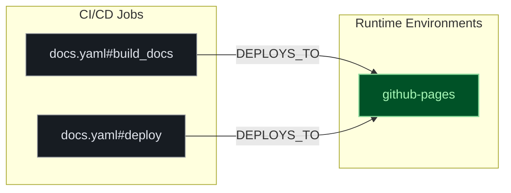
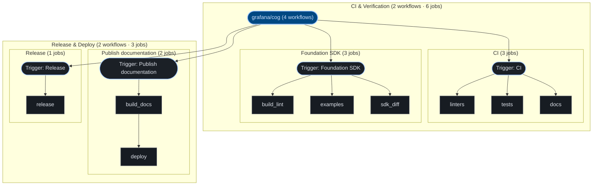

# Repository Architecture Analysis: grafana/cog

## Metadata
- **SHA**: `fbe5a852220d0b79aff53fc282c22c35662e1b02`
- **Primary Ecosystem**: Go

## Quality Metrics
- **ast_engine**: fallback
- **avg_cognitive_complexity**: 0.0
- **avg_cyclomatic_complexity**: 0.0
- **component_count**: 250
- **dead_code_count**: 0
- **dead_code_symbols**: 0 entry(ies)
- **duplication_pct**: 0.0
- **file_complexities**: 0 entry(ies)
- **files_analyzed**: 435
- **fitness_passed**: True
- **fitness_violation_count**: 0
- **framework**: Go Service
- **import_edges**: 0 entry(ies)
- **loc**: 57713
- **max_cognitive_complexity**: 0
- **max_cyclomatic_complexity**: 0
- **sloc**: 44421
- **test_file_count**: 74

# Architecture: grafana/cog

## Context
- **Repository**: `grafana/cog`
- **SHA**: `fbe5a852220d0b79aff53fc282c22c35662e1b02`
- **Ecosystem**: Go
- **Framework**: Go Service

## Building Block View

```mermaid
graph TD;
  classDef atlasRoot fill:#004882,stroke:#a3c9ff,stroke-width:2px,color:#d3e4ff
  classDef atlasCategory fill:#212428,stroke:#E87A48,stroke-width:1.5px,color:#dfe3eb
  classDef atlasWorkflow fill:#1b2026,stroke:#a3c9ff,stroke-width:1.5px,color:#dfe3eb
  classDef atlasJob fill:#171c22,stroke:#8d9199,stroke-width:1px,color:#dfe3eb
  classDef atlasTarget fill:#005227,stroke:#8bd99b,stroke-width:1.5px,color:#a7f6b6
  classDef atlasAlert fill:#93000a,stroke:#ffb4ab,stroke-width:1.5px,color:#ffdad6
  classDef atlasMore fill:#252a31,stroke:#8d9199,stroke-dasharray:4 4,color:#c3c6cf
    repo_root(["grafana/cog (250 components)"]):::atlasRoot
    subgraph sg_dir_0_internal["internal (171)"]
      direction TB
      dir_0_internal["internal (171)"]:::atlasCategory
      sub_0_0_jennies["jennies (108)"]:::atlasWorkflow
      dir_0_internal --> sub_0_0_jennies
      sub_0_1_codegen["codegen (14)"]:::atlasWorkflow
      dir_0_internal --> sub_0_1_codegen
      sub_0_2_veneers["veneers (13)"]:::atlasWorkflow
      dir_0_internal --> sub_0_2_veneers
      sub_0_more["+11 more submodules (36)"]:::atlasMore
      dir_0_internal --> sub_0_more
    end
    repo_root --> dir_0_internal
    subgraph sg_dir_1_pkg["pkg (64)"]
      direction TB
      dir_1_pkg["pkg (64)"]:::atlasCategory
      sub_1_0_ir["ir (59)"]:::atlasWorkflow
      dir_1_pkg --> sub_1_0_ir
      sub_1_1_apiref["apiref (2)"]:::atlasWorkflow
      dir_1_pkg --> sub_1_1_apiref
      sub_1_2_cue["cue (2)"]:::atlasWorkflow
      dir_1_pkg --> sub_1_2_cue
      sub_1_more["+1 more submodules (1)"]:::atlasMore
      dir_1_pkg --> sub_1_more
    end
    repo_root --> dir_1_pkg
    subgraph sg_dir_2_cmd["cmd (10)"]
      direction TB
      dir_2_cmd["cmd (10)"]:::atlasCategory
      sub_2_0_cli["cli (7)"]:::atlasWorkflow
      dir_2_cmd --> sub_2_0_cli
      sub_2_1_cog_config_schemas["cog-config-schemas (1)"]:::atlasWorkflow
      dir_2_cmd --> sub_2_1_cog_config_schemas
      sub_2_2_compiler_passes_docs["compiler-passes-docs (1)"]:::atlasWorkflow
      dir_2_cmd --> sub_2_2_compiler_passes_docs
      sub_2_more["+1 more submodules (1)"]:::atlasMore
      dir_2_cmd --> sub_2_more
    end
    repo_root --> dir_2_cmd
    dir_3__root_["(root) (3)"]:::atlasCategory
    repo_root --> dir_3__root_
    dir_4_examples["examples (2)"]:::atlasCategory
    repo_root --> dir_4_examples
```

## Component Details

Showing top 60 representative components out of 250 across 5 module group(s):

- **Module `internal`** (171 components — module: 171)
- **Module `pkg`** (64 components — module: 64)
- **Module `cmd`** (10 components — module: 10)
- **Module `(root)`** (3 components — module: 3)
- **Module `examples`** (2 components — module: 2)

- **actions** (`internal/veneers/builder/actions.go`): module
- **actions** (`internal/veneers/option/actions.go`): module
- **actions_test** (`internal/veneers/option/actions_test.go`): module
- **add_fields** (`pkg/ir/transforms/add_fields.go`): module
- **add_fields_test** (`pkg/ir/transforms/add_fields_test.go`): module
- **add_object** (`pkg/ir/transforms/add_object.go`): module
- **add_typehints_comments** (`internal/jennies/php/add_typehints_comments.go`): module
- **anonymous_enum** (`pkg/ir/transforms/anonymous_enum.go`): module
- **anonymous_enum_test** (`pkg/ir/transforms/anonymous_enum_test.go`): module
- **anonymous_structs_to_named** (`pkg/ir/transforms/anonymous_structs_to_named.go`): module
- **apiref** (`internal/jennies/golang/apiref.go`): module
- **apiref** (`internal/jennies/java/apiref.go`): module
- **apiref** (`internal/jennies/php/apiref.go`): module
- **apiref** (`internal/jennies/python/apiref.go`): module
- **apiref** (`internal/jennies/typescript/apiref.go`): module
- **apireference** (`pkg/apiref/apireference.go`): module
- **append_comment_objects** (`pkg/ir/transforms/append_comment_objects.go`): module
- **append_comment_objects_test** (`pkg/ir/transforms/append_comment_objects_test.go`): module
- **arrays** (`internal/tools/arrays.go`): module
- **attributes** (`internal/jennies/terraform/attributes.go`): module
- **builder** (`internal/jennies/golang/builder.go`): module
- **builder** (`internal/jennies/java/builder.go`): module
- **builder** (`internal/jennies/php/builder.go`): module
- **builder** (`internal/jennies/python/builder.go`): module
- **builder** (`internal/jennies/typescript/builder.go`): module
- **builder** (`internal/yaml/builder.go`): module
- **builder** (`pkg/ir/builder.go`): module
- **builder_factories** (`pkg/ir/builder_factories.go`): module
- **builder_test** (`internal/jennies/golang/builder_test.go`): module
- **builder_test** (`internal/jennies/java/builder_test.go`): module
- **builder_test** (`internal/jennies/php/builder_test.go`): module
- **builder_test** (`internal/jennies/python/builder_test.go`): module
- **builder_test** (`internal/jennies/typescript/builder_test.go`): module
- **buildervisitor** (`pkg/ir/buildervisitor.go`): module
- **cleanup_k8_resource_name** (`pkg/ir/transforms/cleanup_k8_resource_name.go`): module
- **cleanup_k8_resource_name_test** (`pkg/ir/transforms/cleanup_k8_resource_name_test.go`): module
- **command** (`cmd/cli/config/command.go`): module
- **command** (`cmd/cli/create-plugin/command.go`): module
- **command** (`cmd/cli/generate/command.go`): module
- **command** (`cmd/cli/inspect/command.go`): module
- **compiler** (`internal/yaml/compiler.go`): module
- **constant_to_enum** (`pkg/ir/transforms/constant_to_enum.go`): module
- **constant_to_enum_test** (`pkg/ir/transforms/constant_to_enum_test.go`): module
- **constants** (`internal/testutils/constants.go`): module
- **converter** (`internal/builders/converter.go`): module
- **converter** (`internal/jennies/golang/converter.go`): module
- **converter** (`internal/jennies/java/converter.go`): module
- **converter** (`internal/jennies/php/converter.go`): module
- **converter_config** (`internal/yaml/converter_config.go`): module
- **converter_test** (`internal/jennies/golang/converter_test.go`): module
- **converter_test** (`internal/jennies/php/converter_test.go`): module
- **cue** (`internal/codegen/cue.go`): module
- **customtemplate** (`internal/jennies/common/customtemplate.go`): module
- **dataquery_identification** (`pkg/ir/transforms/dataquery_identification.go`): module
- **deprecate_object** (`pkg/ir/transforms/deprecate_object.go`): module
- **deserializers** (`internal/jennies/java/deserializers.go`): module
- **deserializers_test** (`internal/jennies/java/deserializers_test.go`): module
- **disjunction_of_constants_to_enum** (`pkg/ir/transforms/disjunction_of_constants_to_enum.go`): module
- **disjunction_of_constants_to_enum_test** (`pkg/ir/transforms/disjunction_of_constants_to_enum_test.go`): module
- **disjunction_propagate_variant** (`pkg/ir/transforms/disjunction_propagate_variant.go`): module

## 6-Dimension Repository Scorecard

- **Overall Grade**: `C` (73.15/100)
- **Technical Debt Score**: 26.85
- **Estimated Remediation Effort**: 20.71h

| Dimension | Grade | Score | Weight | Details |
| :--- | :---: | :---: | :---: | :--- |
| Code Quality | `A` | 100.00 | 0.20 | avg_cc=0.00, max_cc=0, duplication=0.00%, dead_code=0 |
| Dependency Health | `B` | 85.00 | 0.15 | dependencies=72, outdated=0, vulnerable=0, has_lockfile=False |
| Maintainability | `A` | 100.00 | 0.15 | avg_cognitive=0.00, max_cognitive=0, fitness_violations=0, oversized_files=0 |
| Pipeline Health | `F` | 46.00 | 0.15 | workflows=4, operational_antipatterns=11, parallel_branches=True |
| Security | `F` | 40.00 | 0.20 | vulnerabilities=0, secrets=0, pipeline_security_findings=3 |
| Test Coverage | `C` | 70.00 | 0.15 | coverage=unavailable, ci_test_job=True, test_files_detected=True |

## Supply Chain Dependencies, Vulnerabilities & Secrets

- **Dependencies Parsed**: 72 | **Vulnerabilities**: 0 | **Secrets**: 0

### Inventory Sample
- `mypy` `2.4.0` (PyPI, `requirements.txt`)
- `mypy-extensions` `1.1.0` (PyPI, `requirements.txt`)
- `zensical` `0.0.73` (PyPI, `requirements.txt`)
- `cuelang.org/go` `0.11.0` (golang, `go.mod`)
- `github.com/davecgh/go-spew` `1.1.1` (golang, `examples/language-plugin/go.mod`)
- `github.com/fatih/color` `1.19.0` (golang, `go.mod`)
- `github.com/getkin/kin-openapi` `0.152.0` (golang, `go.mod`)
- `github.com/goccy/go-yaml` `1.19.2` (golang, `go.mod`)
- `github.com/google/go-cmp` `0.7.0` (golang, `go.mod`)
- `github.com/grafana/codejen` `0.0.4` (golang, `examples/language-plugin/go.mod`)
- `github.com/grafana/codejen` `0.0.4` (golang, `go.mod`)
- `github.com/grafana/cog` `0.0.0-00010101000000-000000000000` (golang, `examples/language-plugin/go.mod`)
- `github.com/hashicorp/go-hclog` `1.6.3` (golang, `go.mod`)
- `github.com/hashicorp/go-plugin` `1.8.0` (golang, `go.mod`)
- `github.com/huandu/xstrings` `1.6.3` (golang, `go.mod`)
- `github.com/invopop/jsonschema` `0.14.0` (golang, `go.mod`)
- `github.com/santhosh-tekuri/jsonschema/v6` `6.0.3` (golang, `go.mod`)
- `github.com/spf13/cobra` `1.10.2` (golang, `go.mod`)
- `github.com/stretchr/testify` `1.12.1` (golang, `go.mod`)
- `golang.org/x/mod` `0.42.0` (golang, `go.mod`)
- `golang.org/x/text` `0.43.0` (golang, `go.mod`)
- `golang.org/x/tools` `0.52.0` (golang, `go.mod`)
- `cuelabs.dev/go/oci/ociregistry` `0.0.0-20261026160121-545c0455168d` (golang, `go.mod`)
- `github.com/bahlo/generic-list-go` `0.2.0` (golang, `go.mod`)
- `github.com/buger/jsonparser` `1.6.1` (golang, `go.mod`)
- `github.com/cockroachdb/apd/v3` `3.2.3` (golang, `go.mod`)
- `github.com/emicklei/proto` `1.14.3` (golang, `go.mod`)
- `github.com/fatih/color` `1.19.0` (golang, `examples/language-plugin/go.mod`)
- `github.com/go-openapi/jsonpointer` `1.0.2` (golang, `go.mod`)
- `github.com/golang/protobuf` `1.5.4` (golang, `examples/language-plugin/go.mod`)
- ... (+42 more dependencies)

## Section 7: Code-to-Cloud Deployment Traceability

- `docs.yaml#build_docs` (ci_job) --[DEPLOYS_TO]--> `github-pages` (environment)
- `docs.yaml#deploy` (ci_job) --[DEPLOYS_TO]--> `github-pages` (environment)

## CI/CD Pipeline Topology

