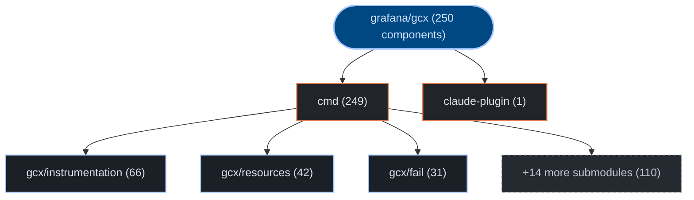
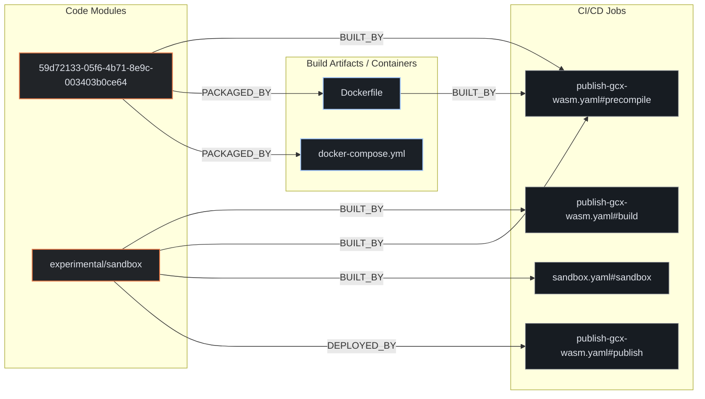

# Repository Architecture Analysis: grafana/gcx

## Metadata
- **SHA**: `465ba1e44cd1b63c82c4d69b810d9d7c857b0363`
- **Primary Ecosystem**: Go

## Quality Metrics
- **ast_engine**: fallback
- **avg_cognitive_complexity**: 0.0
- **avg_cyclomatic_complexity**: 0.0
- **component_count**: 250
- **dead_code_count**: 0
- **dead_code_symbols**: 0 entry(ies)
- **duplication_pct**: 0.0
- **file_complexities**: 0 entry(ies)
- **files_analyzed**: 1976
- **fitness_passed**: True
- **fitness_violation_count**: 0
- **framework**: Go Service
- **import_edges**: 0 entry(ies)
- **loc**: 422309
- **max_cognitive_complexity**: 0
- **max_cyclomatic_complexity**: 0
- **sloc**: 342454
- **test_file_count**: 1008

# Architecture: grafana/gcx

## Context
- **Repository**: `grafana/gcx`
- **SHA**: `465ba1e44cd1b63c82c4d69b810d9d7c857b0363`
- **Ecosystem**: Go
- **Framework**: Go Service

## Building Block View

## Component Details

Showing top 60 representative components out of 250 across 2 module group(s):

- **Module `cmd`** (249 components — module: 249)
- **Module `claude-plugin`** (1 components — module: 1)

- **agent_output_contract_test** (`cmd/gcx/api/agent_output_contract_test.go`): module
- **agent_output_contract_test** (`cmd/gcx/config/agent_output_contract_test.go`): module
- **agent_output_contract_test** (`cmd/gcx/dev/agent_output_contract_test.go`): module
- **agent_output_contract_test** (`cmd/gcx/linter/agent_output_contract_test.go`): module
- **agentconformance_test** (`cmd/gcx/root/agentconformance_test.go`): module
- **agento11y_config_routing_test** (`cmd/gcx/root/agento11y_config_routing_test.go`): module
- **agento11y_test** (`cmd/gcx/fail/agento11y_test.go`): module
- **agento11y_workflow_test** (`cmd/gcx/resources/agento11y_workflow_test.go`): module
- **agenttelemetry_process_test** (`cmd/gcx/agenttelemetry_process_test.go`): module
- **appo11y_config_routing_test** (`cmd/gcx/root/appo11y_config_routing_test.go`): module
- **assets** (`claude-plugin/assets.go`): module
- **assistant_test** (`cmd/gcx/fail/assistant_test.go`): module
- **auth_remediation_test** (`cmd/gcx/fail/auth_remediation_test.go`): module
- **basic_test** (`cmd/gcx/login/basic_test.go`): module
- **batchvolume_test** (`cmd/gcx/resources/batchvolume_test.go`): module
- **capture** (`cmd/gcx/fail/capture.go`): module
- **capture_guard_test** (`cmd/gcx/fail/capture_guard_test.go`): module
- **capture_test** (`cmd/gcx/fail/capture_test.go`): module
- **check_test** (`cmd/gcx/config/check_test.go`): module
- **clear** (`cmd/gcx/instrumentation/services/clear.go`): module
- **clear_test** (`cmd/gcx/instrumentation/services/clear_test.go`): module
- **client** (`cmd/gcx/instrumentation/clusters/client.go`): module
- **client_test** (`cmd/gcx/instrumentation/clusters/client_test.go`): module
- **cloud_orgs** (`cmd/gcx/fail/cloud_orgs.go`): module
- **cloud_orgs_errors_test** (`cmd/gcx/root/cloud_orgs_errors_test.go`): module
- **cloud_orgs_test** (`cmd/gcx/fail/cloud_orgs_test.go`): module
- **codec** (`cmd/gcx/instrumentation/check/codec.go`): module
- **codec_notruncate_test** (`cmd/gcx/resources/codec_notruncate_test.go`): module
- **command** (`cmd/gcx/agent/command.go`): module
- **command** (`cmd/gcx/api/command.go`): module
- **command** (`cmd/gcx/cloud/command.go`): module
- **command** (`cmd/gcx/commands/command.go`): module
- **command** (`cmd/gcx/config/command.go`): module
- **command** (`cmd/gcx/datasources/command.go`): module
- **command** (`cmd/gcx/dev/command.go`): module
- **command** (`cmd/gcx/docs/command.go`): module
- **command** (`cmd/gcx/helptree/command.go`): module
- **command** (`cmd/gcx/instrumentation/check/command.go`): module
- **command** (`cmd/gcx/instrumentation/clusters/apps/command.go`): module
- **command** (`cmd/gcx/instrumentation/clusters/command.go`): module
- **command** (`cmd/gcx/instrumentation/command.go`): module
- **command** (`cmd/gcx/instrumentation/explain/command.go`): module
- **command** (`cmd/gcx/instrumentation/services/command.go`): module
- **command** (`cmd/gcx/instrumentation/setup/command.go`): module
- **command** (`cmd/gcx/instrumentation/status/command.go`): module
- **command** (`cmd/gcx/linter/command.go`): module
- **command** (`cmd/gcx/login/command.go`): module
- **command** (`cmd/gcx/providers/command.go`): module
- **command** (`cmd/gcx/resources/command.go`): module
- **command** (`cmd/gcx/root/command.go`): module
- **command_config_test** (`cmd/gcx/resources/command_config_test.go`): module
- **command_test** (`cmd/gcx/api/command_test.go`): module
- **command_test** (`cmd/gcx/cloud/command_test.go`): module
- **command_test** (`cmd/gcx/commands/command_test.go`): module
- **command_test** (`cmd/gcx/config/command_test.go`): module
- **command_test** (`cmd/gcx/docs/command_test.go`): module
- **command_test** (`cmd/gcx/instrumentation/command_test.go`): module
- **command_test** (`cmd/gcx/instrumentation/explain/command_test.go`): module
- **command_test** (`cmd/gcx/login/command_test.go`): module
- **command_test** (`cmd/gcx/providers/command_test.go`): module

## 6-Dimension Repository Scorecard

- **Overall Grade**: `C` (77.05/100)
- **Technical Debt Score**: 22.95
- **Estimated Remediation Effort**: 23.74h

| Dimension | Grade | Score | Weight | Details |
| :--- | :---: | :---: | :---: | :--- |
| Code Quality | `A` | 100.00 | 0.20 | avg_cc=0.00, max_cc=0, duplication=0.00%, dead_code=0 |
| Dependency Health | `B` | 85.00 | 0.15 | dependencies=180, outdated=0, vulnerable=0, has_lockfile=False |
| Maintainability | `A` | 100.00 | 0.15 | avg_cognitive=0.00, max_cognitive=0, fitness_violations=0, oversized_files=0 |
| Pipeline Health | `F` | 0.00 | 0.15 | workflows=9, operational_antipatterns=20, parallel_branches=True |
| Security | `A` | 94.00 | 0.20 | vulnerabilities=0, secrets=0, pipeline_security_findings=1 |
| Test Coverage | `C` | 70.00 | 0.15 | coverage=unavailable, ci_test_job=True, test_files_detected=True |

## Supply Chain Dependencies, Vulnerabilities & Secrets

- **Dependencies Parsed**: 180 | **Vulnerabilities**: 0 | **Secrets**: 0

### Inventory Sample
- `charm.land/glamour/v2` `2.0.1` (golang, `go.mod`)
- `charm.land/huh/v2` `2.0.3` (golang, `go.mod`)
- `charm.land/lipgloss/v2` `2.0.6` (golang, `go.mod`)
- `github.com/Masterminds/semver/v3` `3.5.0` (golang, `go.mod`)
- `github.com/NimbleMarkets/ntcharts/v2` `2.9.0` (golang, `go.mod`)
- `github.com/dustin/go-humanize` `1.1.0` (golang, `go.mod`)
- `github.com/fatih/color` `1.19.0` (golang, `go.mod`)
- `github.com/fsnotify/fsnotify` `1.10.1` (golang, `go.mod`)
- `github.com/go-chi/chi/v5` `5.5.0` (golang, `go.mod`)
- `github.com/go-logfmt/logfmt` `0.6.1` (golang, `go.mod`)
- `github.com/go-logr/logr` `1.4.4` (golang, `go.mod`)
- `github.com/go-openapi/runtime` `0.33.4` (golang, `go.mod`)
- `github.com/go-openapi/strfmt` `0.27.4` (golang, `go.mod`)
- `github.com/goccy/go-yaml` `1.19.2` (golang, `go.mod`)
- `github.com/godbus/dbus/v5` `5.2.4` (golang, `go.mod`)
- `github.com/gofrs/flock` `0.13.1` (golang, `go.mod`)
- `github.com/google/go-cmp` `0.7.0` (golang, `go.mod`)
- `github.com/google/uuid` `1.6.0` (golang, `go.mod`)
- `github.com/gorilla/websocket` `1.5.4-0.20250319132907-e064f32e3674` (golang, `go.mod`)
- `github.com/grafana/authlib/types` `0.0.0-20260427145542-9c256e2dbcb2` (golang, `go.mod`)
- `github.com/grafana/grafana-app-sdk/logging` `0.61.1` (golang, `go.mod`)
- `github.com/grafana/grafana-foundation-sdk/go` `0.0.22` (golang, `go.mod`)
- `github.com/grafana/grafana-openapi-client-go` `0.0.0-20260414120814-5b95bb183fae` (golang, `go.mod`)
- `github.com/grafana/grafana/pkg/apimachinery` `0.0.0-20250903133002-4e28cba1c53a` (golang, `go.mod`)
- `github.com/grafana/mcp-doc-server` `1.0.0` (golang, `go.mod`)
- `github.com/grafana/mcp-grafana/lokiguard` `0.1.0` (golang, `go.mod`)
- `github.com/grafana/otel-checker` `0.4.0` (golang, `go.mod`)
- `github.com/grafana/promql-builder/go` `0.0.6` (golang, `go.mod`)
- `github.com/invopop/jsonschema` `0.14.0` (golang, `go.mod`)
- `github.com/itchyny/gojq` `0.12.20` (golang, `go.mod`)
- ... (+150 more dependencies)

## Section 7: Code-to-Cloud Deployment Traceability

- `59d72133-05f6-4b71-8e9c-003403b0ce64` (code_module) --[BUILT_BY]--> `publish-gcx-wasm.yaml#precompile` (ci_job)
- `59d72133-05f6-4b71-8e9c-003403b0ce64` (code_module) --[PACKAGED_BY]--> `Dockerfile` (container)
- `59d72133-05f6-4b71-8e9c-003403b0ce64` (code_module) --[PACKAGED_BY]--> `docker-compose.yml` (container)
- `experimental/sandbox` (code_module) --[BUILT_BY]--> `publish-gcx-wasm.yaml#build` (ci_job)
- `experimental/sandbox` (code_module) --[BUILT_BY]--> `publish-gcx-wasm.yaml#precompile` (ci_job)
- `experimental/sandbox` (code_module) --[BUILT_BY]--> `sandbox.yaml#sandbox` (ci_job)
- `experimental/sandbox` (code_module) --[DEPLOYED_BY]--> `publish-gcx-wasm.yaml#publish` (ci_job)
- `Dockerfile` (container) --[BUILT_BY]--> `publish-gcx-wasm.yaml#precompile` (ci_job)

## CI/CD Pipeline Topology

```mermaid
graph TD;
  classDef atlasRoot fill:#004882,stroke:#a3c9ff,stroke-width:2px,color:#d3e4ff
  classDef atlasCategory fill:#212428,stroke:#E87A48,stroke-width:1.5px,color:#dfe3eb
  classDef atlasWorkflow fill:#1b2026,stroke:#a3c9ff,stroke-width:1.5px,color:#dfe3eb
  classDef atlasJob fill:#171c22,stroke:#8d9199,stroke-width:1px,color:#dfe3eb
  classDef atlasTarget fill:#005227,stroke:#8bd99b,stroke-width:1.5px,color:#a7f6b6
  classDef atlasAlert fill:#93000a,stroke:#ffb4ab,stroke-width:1.5px,color:#ffdad6
  classDef atlasMore fill:#252a31,stroke:#8d9199,stroke-dasharray:4 4,color:#c3c6cf
  pipeline_root(["grafana/gcx (9 workflows)"]):::atlasRoot
  grp_0_Release___Deploy["Release & Deploy (5 workflows · 7 jobs)"]:::atlasCategory
  pipeline_root --> grp_0_Release___Deploy
  wf_3_Deploy_pr_preview["Deploy pr preview (1 jobs)"]:::atlasWorkflow
  grp_0_Release___Deploy --> wf_3_Deploy_pr_preview
  job_3_deploy_pr_preview["deploy-pr-preview"]:::atlasJob
  wf_3_Deploy_pr_preview --> job_3_deploy_pr_preview
  wf_4_Publish_gcx_wasm["Publish gcx.wasm (3 jobs)"]:::atlasWorkflow
  grp_0_Release___Deploy --> wf_4_Publish_gcx_wasm
  job_4_build["build"]:::atlasJob
  job_4_precompile["precompile"]:::atlasJob
  job_4_publish["publish"]:::atlasJob
  wf_4_Publish_gcx_wasm --> job_4_build
  job_4_build --> job_4_precompile
  job_4_build --> job_4_publish
  job_4_precompile --> job_4_publish
  wf_5_Publish_Homebrew_Formula["Publish Homebrew Formula (1 jobs)"]:::atlasWorkflow
  grp_0_Release___Deploy --> wf_5_Publish_Homebrew_Formula
  job_5_publish["publish"]:::atlasJob
  wf_5_Publish_Homebrew_Formula --> job_5_publish
  wf_6_Release["Release (1 jobs)"]:::atlasWorkflow
  grp_0_Release___Deploy --> wf_6_Release
  job_6_release["release"]:::atlasJob
  wf_6_Release --> job_6_release
  wf_8_Windows_release_smoke["Windows release smoke (1 jobs)"]:::atlasWorkflow
  grp_0_Release___Deploy --> wf_8_Windows_release_smoke
  job_8_smoke["smoke"]:::atlasJob
  wf_8_Windows_release_smoke --> job_8_smoke
  grp_1_CI___Verification["CI & Verification (4 workflows · 8 jobs)"]:::atlasCategory
  pipeline_root --> grp_1_CI___Verification
  wf_0_CI["CI (5 jobs)"]:::atlasWorkflow
  grp_1_CI___Verification --> wf_0_CI
  job_0_linters["linters"]:::atlasJob
  job_0_tests["tests"]:::atlasJob
  job_0_windows["windows"]:::atlasJob
  wf_0_CI --> job_0_linters
  wf_0_CI --> job_0_tests
  wf_0_CI --> job_0_windows
  wf_1_Claude_Code_Review["Claude Code Review (1 jobs)"]:::atlasWorkflow
  grp_1_CI___Verification --> wf_1_Claude_Code_Review
  job_1_claude_review["claude-review"]:::atlasJob
  wf_1_Claude_Code_Review --> job_1_claude_review
  wf_2_Claude_Code["Claude Code (1 jobs)"]:::atlasWorkflow
  grp_1_CI___Verification --> wf_2_Claude_Code
  job_2_claude["claude"]:::atlasJob
  wf_2_Claude_Code --> job_2_claude
  wf_7_Sandbox["Sandbox (1 jobs)"]:::atlasWorkflow
  grp_1_CI___Verification --> wf_7_Sandbox
  job_7_sandbox["sandbox"]:::atlasJob
  wf_7_Sandbox --> job_7_sandbox
```

