# Repository Architecture Analysis: grafana/grafana-ansible-collection

## Metadata
- **SHA**: `1f32a13821386f28f9cebafd5e1b6c8f786df33d`
- **Primary Ecosystem**: Python

## Quality Metrics
- **ast_engine**: tree-sitter
- **avg_cognitive_complexity**: 3.87
- **avg_cyclomatic_complexity**: 3.33
- **component_count**: 0
- **dead_code_count**: 0
- **dead_code_symbols**: 0 entry(ies)
- **duplication_pct**: 93.42
- **file_complexities**: 16 entry(ies)
- **files_analyzed**: 16
- **fitness_passed**: False
- **fitness_violation_count**: 2
- **framework**: Unknown
- **import_edges**: 50 entry(ies)
- **loc**: 2364
- **max_cognitive_complexity**: 41
- **max_cyclomatic_complexity**: 16
- **sloc**: 1943
- **test_file_count**: 20

## 6-Dimension Repository Scorecard

- **Overall Grade**: `D` (68.49/100)
- **Technical Debt Score**: 31.51
- **Estimated Remediation Effort**: 44.56h

| Dimension | Grade | Score | Weight | Details |
| :--- | :---: | :---: | :---: | :--- |
| Code Quality | `C` | 72.18 | 0.20 | avg_cc=3.33, max_cc=16, duplication=93.42%, dead_code=0 |
| Dependency Health | `B` | 85.00 | 0.15 | dependencies=10, outdated=0, vulnerable=0, has_lockfile=False |
| Maintainability | `D` | 63.00 | 0.15 | avg_cognitive=3.87, max_cognitive=41, fitness_violations=2, oversized_files=0 |
| Pipeline Health | `F` | 9.00 | 0.15 | workflows=10, operational_antipatterns=21, parallel_branches=True |
| Security | `A` | 100.00 | 0.20 | vulnerabilities=0, secrets=0, pipeline_security_findings=0 |
| Test Coverage | `C` | 70.00 | 0.15 | coverage=unavailable, ci_test_job=True, test_files_detected=True |

## Architecture Fitness & Workspace Boundaries

- **[MEDIUM] `ATRUSS-ARCH-005` (COMPLEXITY_THRESHOLD)**: Repository duplication_pct (93.42) exceeds policy threshold (15.0).
- **[MEDIUM] `ATRUSS-ARCH-005` (COMPLEXITY_THRESHOLD)**: Repository max_cognitive_complexity (41.0) exceeds policy threshold (25.0).

## Supply Chain Dependencies, Vulnerabilities & Secrets

- **Dependencies Parsed**: 10 | **Vulnerabilities**: 0 | **Secrets**: 0

### Inventory Sample
- `ansible-lint` `6.13.1` (PyPI, `requirements.txt`)
- `pylint` `2.16.2` (PyPI, `requirements.txt`)
- `requests` `*` (PyPI, `tests/integration/requirements.txt`)
- `yamllint` `1.35.1` (PyPI, `requirements.txt`)
- `editorconfig-checker` `5.0.1` (npm, `package.json`)
- `markdownlint-cli2` `0.6.0` (npm, `package.json`)
- `textlint` `12.5.1` (npm, `package.json`)
- `textlint-rule-common-misspellings` `1.0.1` (npm, `package.json`)
- `textlint-rule-no-todo` `2.0.1` (npm, `package.json`)
- `textlint-rule-terminology` `3.0.4` (npm, `package.json`)

## CI/CD Pipeline Topology

```mermaid
graph TD;
  classDef atlasRoot fill:#004882,stroke:#a3c9ff,stroke-width:2px,color:#d3e4ff
  classDef atlasCategory fill:#212428,stroke:#E87A48,stroke-width:1.5px,color:#dfe3eb
  classDef atlasWorkflow fill:#1b2026,stroke:#a3c9ff,stroke-width:1.5px,color:#dfe3eb
  classDef atlasJob fill:#171c22,stroke:#8d9199,stroke-width:1px,color:#dfe3eb
  classDef atlasTarget fill:#005227,stroke:#8bd99b,stroke-width:1.5px,color:#a7f6b6
  classDef atlasAlert fill:#93000a,stroke:#ffb4ab,stroke-width:1.5px,color:#ffdad6
  classDef atlasMore fill:#252a31,stroke:#8d9199,stroke-dasharray:4 4,color:#c3c6cf
  pipeline_root(["grafana/grafana-ansible-collection (10 workflows)"]):::atlasRoot
  subgraph sg_grp_0_CI___Verification["CI & Verification (6 workflows · 6 jobs)"]
    direction TB
    subgraph sg_wf_0_Alloy_Molecule["Alloy Molecule (1 jobs)"]
      direction TB
      wf_0_Alloy_Molecule(["Trigger: Alloy Molecule"]):::atlasWorkflow
      job_0_molecule["molecule"]:::atlasJob
      wf_0_Alloy_Molecule --> job_0_molecule
    end
    pipeline_root --> wf_0_Alloy_Molecule
    subgraph sg_wf_2_Lint["Lint (1 jobs)"]
      direction TB
      wf_2_Lint(["Trigger: Lint"]):::atlasWorkflow
      job_2_lint["lint"]:::atlasJob
      wf_2_Lint --> job_2_lint
    end
    pipeline_root --> wf_2_Lint
    subgraph sg_wf_3_Loki_Molecule["Loki Molecule (1 jobs)"]
      direction TB
      wf_3_Loki_Molecule(["Trigger: Loki Molecule"]):::atlasWorkflow
      job_3_molecule["molecule"]:::atlasJob
      wf_3_Loki_Molecule --> job_3_molecule
    end
    pipeline_root --> wf_3_Loki_Molecule
    subgraph sg_wf_4_Mimir_Molecule["Mimir Molecule (1 jobs)"]
      direction TB
      wf_4_Mimir_Molecule(["Trigger: Mimir Molecule"]):::atlasWorkflow
      job_4_molecule["molecule"]:::atlasJob
      wf_4_Mimir_Molecule --> job_4_molecule
    end
    pipeline_root --> wf_4_Mimir_Molecule
    subgraph sg_wf_6_OpenTelemetry_Collector_Molecule["OpenTelemetry Collector Molecule (1 jobs)"]
      direction TB
      wf_6_OpenTelemetry_Collector_Molecule(["Trigger: OpenTelemetry Collector Molecule"]):::atlasWorkflow
      job_6_molecule["molecule"]:::atlasJob
      wf_6_OpenTelemetry_Collector_Molecule --> job_6_molecule
    end
    pipeline_root --> wf_6_OpenTelemetry_Collector_Molecule
    subgraph sg_wf_7_Promtail_Molecule["Promtail Molecule (1 jobs)"]
      direction TB
      wf_7_Promtail_Molecule(["Trigger: Promtail Molecule"]):::atlasWorkflow
      job_7_molecule["molecule"]:::atlasJob
      wf_7_Promtail_Molecule --> job_7_molecule
    end
    pipeline_root --> wf_7_Promtail_Molecule
  end
  subgraph sg_grp_1_Scheduled___Manual["Scheduled & Manual (3 workflows · 5 jobs)"]
    direction TB
    subgraph sg_wf_1_Full_Integration_Test["Full Integration Test (1 jobs)"]
      direction TB
      wf_1_Full_Integration_Test(["Trigger: Full Integration Test"]):::atlasWorkflow
      job_1_integration["integration"]:::atlasJob
      wf_1_Full_Integration_Test --> job_1_integration
    end
    pipeline_root --> wf_1_Full_Integration_Test
    subgraph sg_wf_5_Modules_Test["Modules Test (2 jobs)"]
      direction TB
      wf_5_Modules_Test(["Trigger: Modules Test"]):::atlasWorkflow
      job_5_sanity["sanity"]:::atlasJob
      job_5_integration["integration"]:::atlasJob
      wf_5_Modules_Test --> job_5_sanity
      wf_5_Modules_Test --> job_5_integration
    end
    pipeline_root --> wf_5_Modules_Test
    subgraph sg_wf_9_Roles_Test["Roles Test (2 jobs)"]
      direction TB
      wf_9_Roles_Test(["Trigger: Roles Test"]):::atlasWorkflow
      job_9_sanity["sanity"]:::atlasJob
      job_9_integration["integration"]:::atlasJob
      wf_9_Roles_Test --> job_9_sanity
      wf_9_Roles_Test --> job_9_integration
    end
    pipeline_root --> wf_9_Roles_Test
  end
  subgraph sg_grp_2_Release___Deploy["Release & Deploy (1 workflows · 4 jobs)"]
    direction TB
    subgraph sg_wf_8_GitHub_Release["GitHub Release (4 jobs)"]
      direction TB
      wf_8_GitHub_Release(["Trigger: GitHub Release"]):::atlasWorkflow
      job_8_sanity["sanity"]:::atlasJob
      job_8_integration["integration"]:::atlasJob
      job_8_publish["publish"]:::atlasJob
      wf_8_GitHub_Release --> job_8_sanity
      wf_8_GitHub_Release --> job_8_integration
      job_8_sanity --> job_8_publish
      job_8_integration --> job_8_publish
    end
    pipeline_root --> wf_8_GitHub_Release
  end
```

