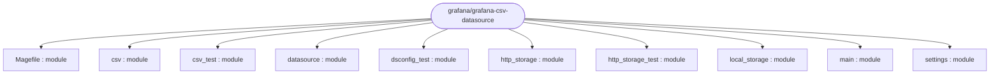
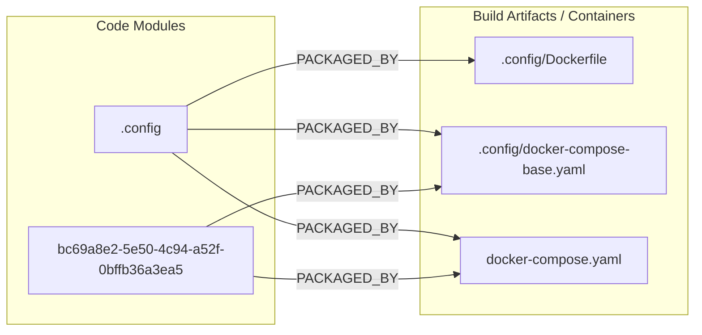
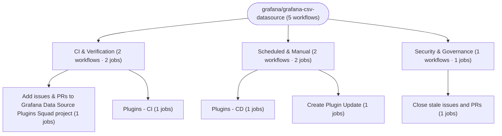

# Repository Architecture Analysis: grafana/grafana-csv-datasource

## Metadata
- **SHA**: `37d4eb52886ce418997fe8f3403b0a899d86c069`
- **Primary Ecosystem**: Go

## Quality Metrics
- **ast_engine**: tree-sitter
- **avg_cognitive_complexity**: 1.05
- **avg_cyclomatic_complexity**: 1.73
- **component_count**: 11
- **dead_code_count**: 0
- **dead_code_symbols**: 0 entry(ies)
- **duplication_pct**: 10.26
- **file_complexities**: 15 entry(ies)
- **files_analyzed**: 26
- **fitness_passed**: True
- **fitness_violation_count**: 0
- **framework**: Go Service
- **import_edges**: 47 entry(ies)
- **loc**: 2402
- **max_cognitive_complexity**: 9
- **max_cyclomatic_complexity**: 10
- **sloc**: 1982
- **test_file_count**: 5

# Architecture: grafana/grafana-csv-datasource

## Context
- **Repository**: `grafana/grafana-csv-datasource`
- **SHA**: `37d4eb52886ce418997fe8f3403b0a899d86c069`
- **Ecosystem**: Go
- **Framework**: Go Service

## Building Block View

## Component Details
- **Magefile** (`Magefile.go`): module
- **csv** (`pkg/csv.go`): module
- **csv_test** (`pkg/csv_test.go`): module
- **datasource** (`pkg/datasource.go`): module
- **http_storage** (`pkg/http_storage.go`): module
- **http_storage_test** (`pkg/http_storage_test.go`): module
- **local_storage** (`pkg/local_storage.go`): module
- **main** (`pkg/main.go`): module
- **settings** (`pkg/settings.go`): module
- **settings** (`pkg/models/settings.go`): module
- **dsconfig_test** (`pkg/schema/dsconfig_test.go`): module

## 6-Dimension Repository Scorecard

- **Overall Grade**: `B` (84.17/100)
- **Technical Debt Score**: 15.83
- **Estimated Remediation Effort**: 12.51h

| Dimension | Grade | Score | Weight | Details |
| :--- | :---: | :---: | :---: | :--- |
| Code Quality | `B` | 84.61 | 0.20 | avg_cc=1.73, max_cc=10, duplication=10.26%, dead_code=0 |
| Dependency Health | `A` | 100.00 | 0.15 | dependencies=1718, outdated=0, vulnerable=0, has_lockfile=True |
| Maintainability | `A` | 100.00 | 0.15 | avg_cognitive=1.05, max_cognitive=9, fitness_violations=0, oversized_files=0 |
| Pipeline Health | `F` | 45.00 | 0.15 | workflows=5, operational_antipatterns=7, parallel_branches=False |
| Security | `A` | 100.00 | 0.20 | vulnerabilities=0, secrets=0, pipeline_security_findings=0 |
| Test Coverage | `C` | 70.00 | 0.15 | coverage=unavailable, ci_test_job=False, test_files_detected=True |

## Supply Chain Dependencies, Vulnerabilities & Secrets

- **Dependencies Parsed**: 1718 | **Vulnerabilities**: 0 | **Secrets**: 0

### Inventory Sample
- `github.com/grafana/dsconfig/schema` `0.0.13` (golang, `go.mod`)
- `github.com/grafana/grafana-plugin-sdk-go` `0.299.0` (golang, `go.mod`)
- `@babel/core` `8.0.7` (npm, `package-lock.json`)
- `@babel/core` `8.0.7` (npm, `package.json`)
- `@changesets/cli` `3.0.3` (npm, `package-lock.json`)
- `@changesets/cli` `3.0.3` (npm, `package.json`)
- `@emotion/css` `11.13.5` (npm, `package-lock.json`)
- `@emotion/css` `11.13.5` (npm, `package.json`)
- `@grafana/data` `13.2.4` (npm, `package-lock.json`)
- `@grafana/data` `13.2.4` (npm, `package.json`)
- `@grafana/e2e-selectors` `13.2.4` (npm, `package-lock.json`)
- `@grafana/e2e-selectors` `13.2.4` (npm, `package.json`)
- `@grafana/eslint-config` `9.0.0` (npm, `package-lock.json`)
- `@grafana/eslint-config` `9.0.0` (npm, `package.json`)
- `@grafana/i18n` `13.2.4` (npm, `package-lock.json`)
- `@grafana/i18n` `13.2.4` (npm, `package.json`)
- `@grafana/plugin-e2e` `4.0.0` (npm, `package-lock.json`)
- `@grafana/plugin-e2e` `4.0.0` (npm, `package.json`)
- `@grafana/plugin-ui` `0.17.8` (npm, `package-lock.json`)
- `@grafana/plugin-ui` `0.17.8` (npm, `package.json`)
- `@grafana/runtime` `13.2.4` (npm, `package-lock.json`)
- `@grafana/runtime` `13.2.4` (npm, `package.json`)
- `@grafana/schema` `13.2.4` (npm, `package-lock.json`)
- `@grafana/schema` `13.2.4` (npm, `package.json`)
- `@grafana/sign-plugin` `4.0.0` (npm, `package-lock.json`)
- `@grafana/sign-plugin` `4.0.0` (npm, `package.json`)
- `@grafana/tsconfig` `2.2.0` (npm, `package-lock.json`)
- `@grafana/tsconfig` `2.2.0` (npm, `package.json`)
- `@grafana/ui` `13.2.4` (npm, `package-lock.json`)
- `@grafana/ui` `13.2.4` (npm, `package.json`)
- ... (+1688 more dependencies)

## Section 7: Code-to-Cloud Deployment Traceability

- `.config` (code_module) --[PACKAGED_BY]--> `.config/Dockerfile` (container)
- `.config` (code_module) --[PACKAGED_BY]--> `.config/docker-compose-base.yaml` (container)
- `.config` (code_module) --[PACKAGED_BY]--> `docker-compose.yaml` (container)
- `bc69a8e2-5e50-4c94-a52f-0bffb36a3ea5` (code_module) --[PACKAGED_BY]--> `.config/docker-compose-base.yaml` (container)
- `bc69a8e2-5e50-4c94-a52f-0bffb36a3ea5` (code_module) --[PACKAGED_BY]--> `docker-compose.yaml` (container)

## CI/CD Pipeline Topology

