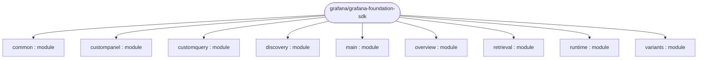
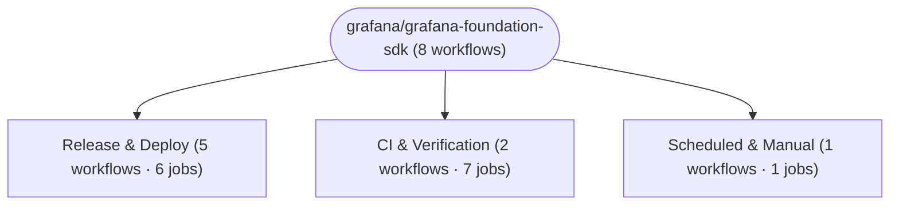

# Repository Architecture Analysis: grafana/grafana-foundation-sdk

## Metadata
- **SHA**: `72b873117be02d3cd352c4ac8590b6555b0d1ce2`
- **Primary Ecosystem**: Java

## Quality Metrics
- **ast_engine**: tree-sitter
- **avg_cognitive_complexity**: 0.64
- **avg_cyclomatic_complexity**: 1.67
- **component_count**: 17
- **dead_code_count**: 3
- **dead_code_symbols**: 3 entry(ies)
- **duplication_pct**: 98.32
- **file_complexities**: 25 entry(ies)
- **files_analyzed**: 1651
- **fitness_passed**: False
- **fitness_violation_count**: 3
- **framework**: Java Maven/Gradle
- **import_edges**: 100 entry(ies)
- **loc**: 115950
- **max_cognitive_complexity**: 52
- **max_cyclomatic_complexity**: 35
- **sloc**: 97111
- **test_file_count**: 2

# Architecture: grafana/grafana-foundation-sdk

## Context
- **Repository**: `grafana/grafana-foundation-sdk`
- **SHA**: `72b873117be02d3cd352c4ac8590b6555b0d1ce2`
- **Ecosystem**: Java
- **Framework**: Java Maven/Gradle

## Building Block View

## Component Details
- **runtime** (`.cog/templates/go/extra/cog/runtime.go`): module
- **variants** (`.cog/templates/go/extra/cog/plugins/variants.go`): module
- **variants** (`.cog/templates/go/extra/cog/variants/variants.go`): module
- **main** (`examples/go/alert-rule/main.go`): module
- **custompanel** (`examples/go/custom-panel/custompanel.go`): module
- **main** (`examples/go/custom-panel/main.go`): module
- **customquery** (`examples/go/custom-query/customquery.go`): module
- **main** (`examples/go/custom-query/main.go`): module
- **main** (`examples/go/dashboardv1-with-expr-queries/main.go`): module
- **main** (`examples/go/dashboardv2beta1-with-expr-queries/main.go`): module
- **main** (`examples/go/dashboardv2beta1-with-tabs-and-rows/main.go`): module
- **common** (`examples/go/grafana-agent-overview/common.go`): module
- **discovery** (`examples/go/grafana-agent-overview/discovery.go`): module
- **main** (`examples/go/grafana-agent-overview/main.go`): module
- **overview** (`examples/go/grafana-agent-overview/overview.go`): module
- **retrieval** (`examples/go/grafana-agent-overview/retrieval.go`): module
- **main** (`examples/go/grafana-openapi-client-go/main.go`): module

## 6-Dimension Repository Scorecard

- **Overall Grade**: `F` (43.85/100)
- **Technical Debt Score**: 56.15
- **Estimated Remediation Effort**: 96.45h

| Dimension | Grade | Score | Weight | Details |
| :--- | :---: | :---: | :---: | :--- |
| Code Quality | `F` | 44.00 | 0.20 | avg_cc=1.67, max_cc=35, duplication=98.32%, dead_code=3 |
| Dependency Health | `A` | 100.00 | 0.15 | dependencies=539, outdated=0, vulnerable=0, has_lockfile=True |
| Maintainability | `F` | 37.00 | 0.15 | avg_cognitive=0.64, max_cognitive=52, fitness_violations=3, oversized_files=17 |
| Pipeline Health | `F` | 0.00 | 0.15 | workflows=8, operational_antipatterns=24, parallel_branches=True |
| Security | `F` | 20.00 | 0.20 | vulnerabilities=0, secrets=0, pipeline_security_findings=6 |
| Test Coverage | `C` | 70.00 | 0.15 | coverage=unavailable, ci_test_job=True, test_files_detected=True |

## Architecture Fitness & Workspace Boundaries

- **[MEDIUM] `ATRUSS-ARCH-005` (COMPLEXITY_THRESHOLD)**: Repository duplication_pct (98.32) exceeds policy threshold (15.0).
- **[MEDIUM] `ATRUSS-ARCH-005` (COMPLEXITY_THRESHOLD)**: Repository max_cognitive_complexity (52.0) exceeds policy threshold (25.0).
- **[MEDIUM] `ATRUSS-ARCH-005` (COMPLEXITY_THRESHOLD)**: Repository max_cyclomatic_complexity (35.0) exceeds policy threshold (20.0).

## Supply Chain Dependencies, Vulnerabilities & Secrets

- **Dependencies Parsed**: 539 | **Vulnerabilities**: 0 | **Secrets**: 0

### Inventory Sample
- `com.fasterxml.jackson.core:jackson-databind` `2.19.1` (Maven, `.cog/templates/java/extra/build.gradle`)
- `com.fasterxml.jackson.core:jackson-databind` `2.19.1` (Maven, `java/build.gradle`)
- `com.grafana:grafana-foundation-sdk` `0.0.6` (Maven, `examples/java/alert-rule/build.gradle`)
- `com.grafana:grafana-foundation-sdk` `0.0.6` (Maven, `examples/java/custom-panel/build.gradle`)
- `com.grafana:grafana-foundation-sdk` `0.0.6` (Maven, `examples/java/custom-query/build.gradle`)
- `com.grafana:grafana-foundation-sdk` `0.0.6` (Maven, `examples/java/grafana-agent-overview/build.gradle`)
- `com.grafana:grafana-foundation-sdk` `0.0.6` (Maven, `examples/java/linux-node-overview/build.gradle`)
- `com.grafana:grafana-foundation-sdk` `0.0.6` (Maven, `examples/java/red-method/build.gradle`)
- `Babel` `2.18.0` (PyPI, `requirements.txt`)
- `Jinja2` `3.1.6` (PyPI, `requirements.txt`)
- `Markdown` `3.11.2` (PyPI, `requirements.txt`)
- `MarkupSafe` `3.0.4` (PyPI, `requirements.txt`)
- `PyYAML` `6.0.3` (PyPI, `requirements.txt`)
- `Pygments` `2.20.0` (PyPI, `requirements.txt`)
- `brotlicffi` `1.2.1.0` (PyPI, `requirements.txt`)
- `certifi` `2026.10.23` (PyPI, `requirements.txt`)
- `cffi` `2.1.1` (PyPI, `requirements.txt`)
- `charset-normalizer` `3.5.2` (PyPI, `requirements.txt`)
- `click` `8.5.0` (PyPI, `requirements.txt`)
- `colorama` `0.4.6` (PyPI, `requirements.txt`)
- `ghp-import` `2.1.0` (PyPI, `requirements.txt`)
- `grafana_foundation_sdk` `*` (PyPI, `examples/pulumi/python/requirements.txt`)
- `grafana_foundation_sdk` `0.0.11` (PyPI, `examples/python/dashboardv2beta1-with-tabs-and-rows/requirements.txt`)
- `grafana_foundation_sdk` `0.0.6` (PyPI, `examples/python/alert-rule/requirements.txt`)
- `grafana_foundation_sdk` `0.0.6` (PyPI, `examples/python/custom-panel/requirements.txt`)
- `grafana_foundation_sdk` `0.0.6` (PyPI, `examples/python/custom-query/requirements.txt`)
- `grafana_foundation_sdk` `0.0.6` (PyPI, `examples/python/grafana-agent-overview/requirements.txt`)
- `grafana_foundation_sdk` `0.0.6` (PyPI, `examples/python/linux-node-overview/requirements.txt`)
- `grafana_foundation_sdk` `0.0.6` (PyPI, `examples/python/red-method/requirements.txt`)
- `idna` `3.20` (PyPI, `requirements.txt`)
- ... (+509 more dependencies)

## Section 7: Code-to-Cloud Deployment Traceability

```mermaid
flowchart LR
    subgraph code_modules["Code Modules"]
        mod_examples_go_custom_panel["examples/go/custom-panel"]
        mod_examples_go_custom_query["examples/go/custom-query"]
        mod_examples_go_grafana_agent_overview["examples/go/grafana-agent-overview"]
        mod_examples_go_linux_node_overview["examples/go/linux-node-overview"]
        mod_examples_go_red_method["examples/go/red-method"]
        mod_examples_java_custom_panel["examples/java/custom-panel"]
        mod_examples_java_custom_query["examples/java/custom-query"]
        mod_examples_java_grafana_agent_overview["examples/java/grafana-agent-overview"]
        mod_examples_java_linux_node_overview["examples/java/linux-node-overview"]
        mod_examples_java_red_method["examples/java/red-method"]
        mod_examples_php_custom_panel["examples/php/custom-panel"]
        mod_examples_php_custom_query["examples/php/custom-query"]
        mod_examples_php_grafana_agent_overview["examples/php/grafana-agent-overview"]
        mod_examples_php_linux_node_overview["examples/php/linux-node-overview"]
        mod_examples_php_red_method["examples/php/red-method"]
        mod_examples_pulumi_go["examples/pulumi/go"]
        mod_examples_python_custom_panel["examples/python/custom-panel"]
        mod_examples_python_custom_query["examples/python/custom-query"]
        mod_examples_python_grafana_agent_overview["examples/python/grafana-agent-overview"]
        mod_examples_python_linux_node_overview["examples/python/linux-node-overview"]
        mod_examples_python_red_method["examples/python/red-method"]
        mod_examples_typescript_custom_panel["examples/typescript/custom-panel"]
        mod_examples_typescript_custom_query["examples/typescript/custom-query"]
        mod_examples_typescript_grafana_agent_overview["examples/typescript/grafana-agent-overview"]
        mod_examples_typescript_linux_node_overview["examples/typescript/linux-node-overview"]
        mod_examples_typescript_red_method["examples/typescript/red-method"]
        mod_go["go"]
        mod_java["java"]
        mod_python["python"]
        mod_scripts_dashboard_converter["scripts/dashboard-converter"]
        mod_typescript["typescript"]
    end
    subgraph build_artifacts["Build Artifacts / Containers"]
        art_examples_terraform_dashboards_tf["examples/terraform/dashboards.tf"]
        art_scripts_dashboard_converter_Dockerfile["scripts/dashboard-converter/Dockerfile"]
    end
    subgraph ci_jobs["CI/CD Jobs"]
        job_dashboard_converter_yaml_build_and_export_digest["dashboard-converter.yaml#build-and-export-digest"]
        job_dashboard_converter_yaml_test["dashboard-converter.yaml#test"]
        job_docs_yaml_build["docs.yaml#build"]
        job_docs_yaml_deploy["docs.yaml#deploy"]
        job_java_release_yaml_release["java-release.yaml#release"]
        job_python_release_yaml_release["python-release.yaml#release"]
        job_sdk_ci_yaml_diff_preview["sdk-ci.yaml#diff_preview"]
        job_typescript_release_yaml_release["typescript-release.yaml#release"]
    end
    subgraph runtime_envs["Runtime Environments"]
        env_github_pages["github-pages"]
        env_pypi["pypi"]
        env_typescript["typescript"]
    end
    job_docs_yaml_build -->|DEPLOYS_TO| env_github_pages
    job_docs_yaml_deploy -->|DEPLOYS_TO| env_github_pages
    job_python_release_yaml_release -->|DEPLOYS_TO| env_pypi
    job_typescript_release_yaml_release -->|DEPLOYS_TO| env_typescript
    mod_examples_go_custom_panel -->|PACKAGED_BY| art_examples_terraform_dashboards_tf
    mod_examples_go_custom_query -->|PACKAGED_BY| art_examples_terraform_dashboards_tf
    mod_examples_go_grafana_agent_overview -->|PACKAGED_BY| art_examples_terraform_dashboards_tf
    mod_examples_go_linux_node_overview -->|PACKAGED_BY| art_examples_terraform_dashboards_tf
    mod_examples_go_red_method -->|PACKAGED_BY| art_examples_terraform_dashboards_tf
    mod_examples_java_custom_panel -->|PACKAGED_BY| art_examples_terraform_dashboards_tf
    mod_examples_java_custom_query -->|PACKAGED_BY| art_examples_terraform_dashboards_tf
    mod_examples_java_grafana_agent_overview -->|PACKAGED_BY| art_examples_terraform_dashboards_tf
    mod_examples_java_linux_node_overview -->|PACKAGED_BY| art_examples_terraform_dashboards_tf
    mod_examples_java_red_method -->|PACKAGED_BY| art_examples_terraform_dashboards_tf
    mod_examples_php_custom_panel -->|PACKAGED_BY| art_examples_terraform_dashboards_tf
    mod_examples_php_custom_query -->|PACKAGED_BY| art_examples_terraform_dashboards_tf
    mod_examples_php_grafana_agent_overview -->|PACKAGED_BY| art_examples_terraform_dashboards_tf
    mod_examples_php_linux_node_overview -->|PACKAGED_BY| art_examples_terraform_dashboards_tf
    mod_examples_php_red_method -->|PACKAGED_BY| art_examples_terraform_dashboards_tf
    mod_examples_pulumi_go -->|PACKAGED_BY| art_scripts_dashboard_converter_Dockerfile
    mod_examples_pulumi_go -->|PACKAGED_BY| art_examples_terraform_dashboards_tf
    mod_examples_python_custom_panel -->|PACKAGED_BY| art_examples_terraform_dashboards_tf
    mod_examples_python_custom_query -->|PACKAGED_BY| art_examples_terraform_dashboards_tf
    mod_examples_python_grafana_agent_overview -->|PACKAGED_BY| art_examples_terraform_dashboards_tf
    mod_examples_python_linux_node_overview -->|PACKAGED_BY| art_examples_terraform_dashboards_tf
    mod_examples_python_red_method -->|PACKAGED_BY| art_examples_terraform_dashboards_tf
    mod_examples_typescript_custom_panel -->|PACKAGED_BY| art_examples_terraform_dashboards_tf
    mod_examples_typescript_custom_query -->|PACKAGED_BY| art_examples_terraform_dashboards_tf
    mod_examples_typescript_grafana_agent_overview -->|PACKAGED_BY| art_examples_terraform_dashboards_tf
    mod_examples_typescript_linux_node_overview -->|PACKAGED_BY| art_examples_terraform_dashboards_tf
    mod_examples_typescript_red_method -->|PACKAGED_BY| art_examples_terraform_dashboards_tf
    mod_go -->|PACKAGED_BY| art_scripts_dashboard_converter_Dockerfile
    mod_go -->|PACKAGED_BY| art_examples_terraform_dashboards_tf
    mod_java -->|DEPLOYED_BY| job_java_release_yaml_release
    mod_python -->|DEPLOYED_BY| job_python_release_yaml_release
    mod_scripts_dashboard_converter -->|BUILT_BY| job_dashboard_converter_yaml_build_and_export_digest
    mod_scripts_dashboard_converter -->|BUILT_BY| job_dashboard_converter_yaml_test
    mod_scripts_dashboard_converter -->|PACKAGED_BY| art_scripts_dashboard_converter_Dockerfile
    mod_typescript -->|BUILT_BY| job_sdk_ci_yaml_diff_preview
    mod_typescript -->|DEPLOYED_BY| job_typescript_release_yaml_release
    art_scripts_dashboard_converter_Dockerfile -->|BUILT_BY| job_dashboard_converter_yaml_build_and_export_digest
```

- `docs.yaml#build` (ci_job) --[DEPLOYS_TO]--> `github-pages` (environment)
- `docs.yaml#deploy` (ci_job) --[DEPLOYS_TO]--> `github-pages` (environment)
- `python-release.yaml#release` (ci_job) --[DEPLOYS_TO]--> `pypi` (environment)
- `typescript-release.yaml#release` (ci_job) --[DEPLOYS_TO]--> `typescript` (environment)
- `examples/go/custom-panel` (code_module) --[PACKAGED_BY]--> `examples/terraform/dashboards.tf` (iac)
- `examples/go/custom-query` (code_module) --[PACKAGED_BY]--> `examples/terraform/dashboards.tf` (iac)
- `examples/go/grafana-agent-overview` (code_module) --[PACKAGED_BY]--> `examples/terraform/dashboards.tf` (iac)
- `examples/go/linux-node-overview` (code_module) --[PACKAGED_BY]--> `examples/terraform/dashboards.tf` (iac)
- `examples/go/red-method` (code_module) --[PACKAGED_BY]--> `examples/terraform/dashboards.tf` (iac)
- `examples/java/custom-panel` (code_module) --[PACKAGED_BY]--> `examples/terraform/dashboards.tf` (iac)
- `examples/java/custom-query` (code_module) --[PACKAGED_BY]--> `examples/terraform/dashboards.tf` (iac)
- `examples/java/grafana-agent-overview` (code_module) --[PACKAGED_BY]--> `examples/terraform/dashboards.tf` (iac)
- `examples/java/linux-node-overview` (code_module) --[PACKAGED_BY]--> `examples/terraform/dashboards.tf` (iac)
- `examples/java/red-method` (code_module) --[PACKAGED_BY]--> `examples/terraform/dashboards.tf` (iac)
- `examples/php/custom-panel` (code_module) --[PACKAGED_BY]--> `examples/terraform/dashboards.tf` (iac)
- `examples/php/custom-query` (code_module) --[PACKAGED_BY]--> `examples/terraform/dashboards.tf` (iac)
- `examples/php/grafana-agent-overview` (code_module) --[PACKAGED_BY]--> `examples/terraform/dashboards.tf` (iac)
- `examples/php/linux-node-overview` (code_module) --[PACKAGED_BY]--> `examples/terraform/dashboards.tf` (iac)
- `examples/php/red-method` (code_module) --[PACKAGED_BY]--> `examples/terraform/dashboards.tf` (iac)
- `examples/pulumi/go` (code_module) --[PACKAGED_BY]--> `scripts/dashboard-converter/Dockerfile` (container)
- `examples/pulumi/go` (code_module) --[PACKAGED_BY]--> `examples/terraform/dashboards.tf` (iac)
- `examples/python/custom-panel` (code_module) --[PACKAGED_BY]--> `examples/terraform/dashboards.tf` (iac)
- `examples/python/custom-query` (code_module) --[PACKAGED_BY]--> `examples/terraform/dashboards.tf` (iac)
- `examples/python/grafana-agent-overview` (code_module) --[PACKAGED_BY]--> `examples/terraform/dashboards.tf` (iac)
- `examples/python/linux-node-overview` (code_module) --[PACKAGED_BY]--> `examples/terraform/dashboards.tf` (iac)
- `examples/python/red-method` (code_module) --[PACKAGED_BY]--> `examples/terraform/dashboards.tf` (iac)
- `examples/typescript/custom-panel` (code_module) --[PACKAGED_BY]--> `examples/terraform/dashboards.tf` (iac)
- `examples/typescript/custom-query` (code_module) --[PACKAGED_BY]--> `examples/terraform/dashboards.tf` (iac)
- `examples/typescript/grafana-agent-overview` (code_module) --[PACKAGED_BY]--> `examples/terraform/dashboards.tf` (iac)
- `examples/typescript/linux-node-overview` (code_module) --[PACKAGED_BY]--> `examples/terraform/dashboards.tf` (iac)
- `examples/typescript/red-method` (code_module) --[PACKAGED_BY]--> `examples/terraform/dashboards.tf` (iac)
- `go` (code_module) --[PACKAGED_BY]--> `scripts/dashboard-converter/Dockerfile` (container)
- `go` (code_module) --[PACKAGED_BY]--> `examples/terraform/dashboards.tf` (iac)
- `java` (code_module) --[DEPLOYED_BY]--> `java-release.yaml#release` (ci_job)
- `python` (code_module) --[DEPLOYED_BY]--> `python-release.yaml#release` (ci_job)
- `scripts/dashboard-converter` (code_module) --[BUILT_BY]--> `dashboard-converter.yaml#build-and-export-digest` (ci_job)
- `scripts/dashboard-converter` (code_module) --[BUILT_BY]--> `dashboard-converter.yaml#test` (ci_job)
- `scripts/dashboard-converter` (code_module) --[PACKAGED_BY]--> `scripts/dashboard-converter/Dockerfile` (container)
- `typescript` (code_module) --[BUILT_BY]--> `sdk-ci.yaml#diff_preview` (ci_job)
- `typescript` (code_module) --[DEPLOYED_BY]--> `typescript-release.yaml#release` (ci_job)

## CI/CD Pipeline Topology

