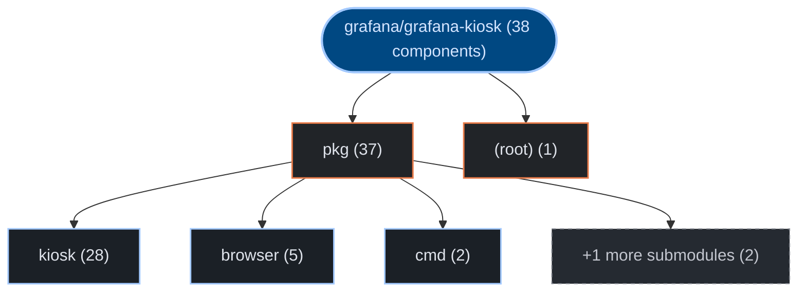
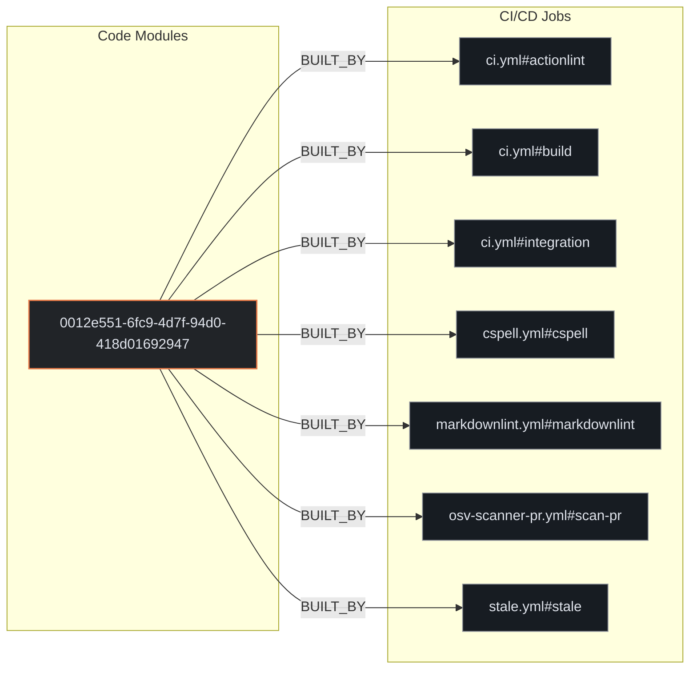
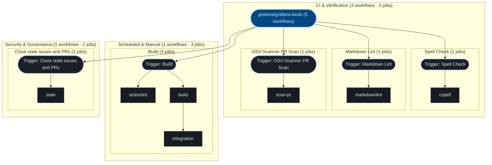

# Repository Architecture Analysis: grafana/grafana-kiosk

## Metadata
- **SHA**: `c5fa9c45a1b464069e836c96f832f793623de77f`
- **Primary Ecosystem**: Go

## Quality Metrics
- **ast_engine**: fallback
- **avg_cognitive_complexity**: 0.0
- **avg_cyclomatic_complexity**: 0.0
- **component_count**: 38
- **dead_code_count**: 0
- **dead_code_symbols**: 0 entry(ies)
- **duplication_pct**: 0.0
- **file_complexities**: 0 entry(ies)
- **files_analyzed**: 38
- **fitness_passed**: True
- **fitness_violation_count**: 0
- **framework**: Go Service
- **import_edges**: 0 entry(ies)
- **loc**: 4436
- **max_cognitive_complexity**: 0
- **max_cyclomatic_complexity**: 0
- **sloc**: 3656
- **test_file_count**: 19

# Architecture: grafana/grafana-kiosk

## Context
- **Repository**: `grafana/grafana-kiosk`
- **SHA**: `c5fa9c45a1b464069e836c96f832f793623de77f`
- **Ecosystem**: Go
- **Framework**: Go Service

## Building Block View

## Component Details
- **Magefile** (`Magefile.go`): module
- **browser** (`pkg/browser/browser.go`): module
- **chromedp** (`pkg/browser/chromedp.go`): module
- **chromedp_test** (`pkg/browser/chromedp_test.go`): module
- **mock** (`pkg/browser/browsertest/mock.go`): module
- **mock_test** (`pkg/browser/browsertest/mock_test.go`): module
- **main** (`pkg/cmd/grafana-kiosk/main.go`): module
- **main_test** (`pkg/cmd/grafana-kiosk/main_test.go`): module
- **lxde** (`pkg/initialize/lxde.go`): module
- **lxde_test** (`pkg/initialize/lxde_test.go`): module
- **utils** (`pkg/kiosk/utils.go`): module
- **utils_test** (`pkg/kiosk/utils_test.go`): module
- **config** (`pkg/kiosk/config/config.go`): module
- **anonymous_test** (`pkg/kiosk/integration/anonymous_test.go`): module
- **helpers_test** (`pkg/kiosk/integration/helpers_test.go`): module
- **local_test** (`pkg/kiosk/integration/local_test.go`): module
- **smoke_test** (`pkg/kiosk/integration/smoke_test.go`): module
- **anonymous** (`pkg/kiosk/login/anonymous/anonymous.go`): module
- **anonymous_test** (`pkg/kiosk/login/anonymous/anonymous_test.go`): module
- **apikey** (`pkg/kiosk/login/apikey/apikey.go`): module
- **apikey_test** (`pkg/kiosk/login/apikey/apikey_test.go`): module
- **aws** (`pkg/kiosk/login/aws/aws.go`): module
- **aws_test** (`pkg/kiosk/login/aws/aws_test.go`): module
- **azuread** (`pkg/kiosk/login/azuread/azuread.go`): module
- **azuread_test** (`pkg/kiosk/login/azuread/azuread_test.go`): module
- **gcom** (`pkg/kiosk/login/gcom/gcom.go`): module
- **gcom_test** (`pkg/kiosk/login/gcom/gcom_test.go`): module
- **goauth** (`pkg/kiosk/login/goauth/goauth.go`): module
- **goauth_test** (`pkg/kiosk/login/goauth/goauth_test.go`): module
- **idtoken** (`pkg/kiosk/login/idtoken/idtoken.go`): module
- **idtoken_test** (`pkg/kiosk/login/idtoken/idtoken_test.go`): module
- **local** (`pkg/kiosk/login/local/local.go`): module
- **local_test** (`pkg/kiosk/login/local/local_test.go`): module
- **browser_events** (`pkg/kiosk/login/shared/browser_events.go`): module
- **chromedp_utils** (`pkg/kiosk/login/shared/chromedp_utils.go`): module
- **chromedp_utils_test** (`pkg/kiosk/login/shared/chromedp_utils_test.go`): module
- **flow_utils** (`pkg/kiosk/login/shared/flow_utils.go`): module
- **flow_utils_test** (`pkg/kiosk/login/shared/flow_utils_test.go`): module

## 6-Dimension Repository Scorecard

- **Overall Grade**: `B` (89.65/100)
- **Technical Debt Score**: 10.35
- **Estimated Remediation Effort**: 7.09h

| Dimension | Grade | Score | Weight | Details |
| :--- | :---: | :---: | :---: | :--- |
| Code Quality | `A` | 100.00 | 0.20 | avg_cc=0.00, max_cc=0, duplication=0.00%, dead_code=0 |
| Dependency Health | `B` | 85.00 | 0.15 | dependencies=80, outdated=0, vulnerable=0, has_lockfile=False |
| Maintainability | `A` | 100.00 | 0.15 | avg_cognitive=0.00, max_cognitive=0, fitness_violations=0, oversized_files=0 |
| Pipeline Health | `B` | 84.00 | 0.15 | workflows=5, operational_antipatterns=7, parallel_branches=True |
| Security | `A` | 94.00 | 0.20 | vulnerabilities=0, secrets=0, pipeline_security_findings=1 |
| Test Coverage | `C` | 70.00 | 0.15 | coverage=unavailable, ci_test_job=True, test_files_detected=True |

## Supply Chain Dependencies, Vulnerabilities & Secrets

- **Dependencies Parsed**: 80 | **Vulnerabilities**: 0 | **Secrets**: 0

### Inventory Sample
- `github.com/chromedp/cdproto` `0.0.0-20260804232424-e85f50dbfd32` (golang, `go.mod`)
- `github.com/chromedp/chromedp` `0.16.0` (golang, `go.mod`)
- `github.com/ilyakaznacheev/cleanenv` `1.5.0` (golang, `go.mod`)
- `github.com/magefile/mage` `1.17.2` (golang, `go.mod`)
- `github.com/smartystreets/goconvey` `1.8.1` (golang, `go.mod`)
- `github.com/testcontainers/testcontainers-go` `0.44.0` (golang, `go.mod`)
- `google.golang.org/api` `0.297.0` (golang, `go.mod`)
- `cloud.google.com/go/auth` `0.23.2` (golang, `go.mod`)
- `cloud.google.com/go/auth/oauth2adapt` `0.2.8` (golang, `go.mod`)
- `cloud.google.com/go/compute/metadata` `0.9.0` (golang, `go.mod`)
- `dario.cat/mergo` `1.0.2` (golang, `go.mod`)
- `github.com/Azure/go-ansiterm` `0.0.0-20250102033503-faa5f7b0171c` (golang, `go.mod`)
- `github.com/BurntSushi/toml` `1.6.0` (golang, `go.mod`)
- `github.com/Microsoft/go-winio` `0.6.2` (golang, `go.mod`)
- `github.com/cenkalti/backoff/v4` `4.3.0` (golang, `go.mod`)
- `github.com/cespare/xxhash/v2` `2.3.0` (golang, `go.mod`)
- `github.com/chromedp/sysutil` `1.1.0` (golang, `go.mod`)
- `github.com/containerd/errdefs` `1.0.0` (golang, `go.mod`)
- `github.com/containerd/errdefs/pkg` `0.3.0` (golang, `go.mod`)
- `github.com/containerd/log` `0.1.0` (golang, `go.mod`)
- `github.com/containerd/platforms` `0.2.1` (golang, `go.mod`)
- `github.com/cpuguy83/dockercfg` `0.3.2` (golang, `go.mod`)
- `github.com/distribution/reference` `0.6.0` (golang, `go.mod`)
- `github.com/docker/go-connections` `0.8.1` (golang, `go.mod`)
- `github.com/docker/go-units` `0.5.0` (golang, `go.mod`)
- `github.com/ebitengine/purego` `0.11.0` (golang, `go.mod`)
- `github.com/felixge/httpsnoop` `1.1.0` (golang, `go.mod`)
- `github.com/go-json-experiment/json` `0.0.0-20260820222146-c27c302e5fc3` (golang, `go.mod`)
- `github.com/go-logr/logr` `1.4.4` (golang, `go.mod`)
- `github.com/go-logr/stdr` `1.2.2` (golang, `go.mod`)
- ... (+50 more dependencies)

## Section 7: Code-to-Cloud Deployment Traceability

- `0012e551-6fc9-4d7f-94d0-418d01692947` (code_module) --[BUILT_BY]--> `ci.yml#actionlint` (ci_job)
- `0012e551-6fc9-4d7f-94d0-418d01692947` (code_module) --[BUILT_BY]--> `ci.yml#build` (ci_job)
- `0012e551-6fc9-4d7f-94d0-418d01692947` (code_module) --[BUILT_BY]--> `ci.yml#integration` (ci_job)
- `0012e551-6fc9-4d7f-94d0-418d01692947` (code_module) --[BUILT_BY]--> `cspell.yml#cspell` (ci_job)
- `0012e551-6fc9-4d7f-94d0-418d01692947` (code_module) --[BUILT_BY]--> `markdownlint.yml#markdownlint` (ci_job)
- `0012e551-6fc9-4d7f-94d0-418d01692947` (code_module) --[BUILT_BY]--> `osv-scanner-pr.yml#scan-pr` (ci_job)
- `0012e551-6fc9-4d7f-94d0-418d01692947` (code_module) --[BUILT_BY]--> `stale.yml#stale` (ci_job)

## CI/CD Pipeline Topology

