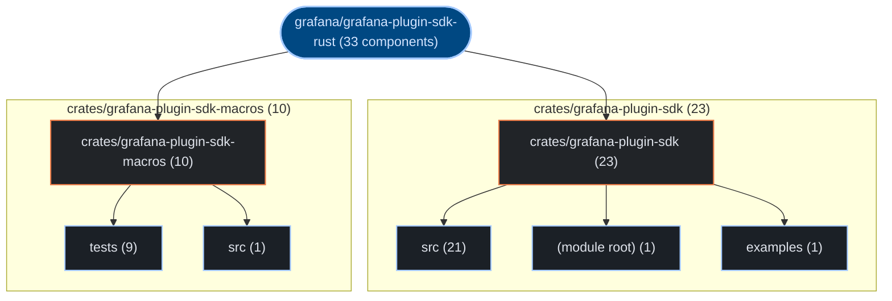
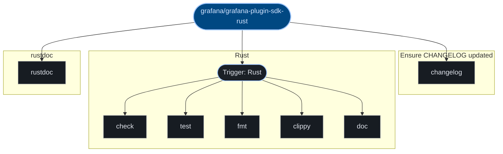

# Repository Architecture Analysis: grafana/grafana-plugin-sdk-rust

## Metadata
- **SHA**: `96473bd5697104e25e2c264acf5b4cf900a63996`
- **Primary Ecosystem**: Rust

## Quality Metrics
- **ast_engine**: fallback
- **avg_cognitive_complexity**: 0.0
- **avg_cyclomatic_complexity**: 0.0
- **component_count**: 33
- **dead_code_count**: 0
- **dead_code_symbols**: 0 entry(ies)
- **duplication_pct**: 0.0
- **file_complexities**: 0 entry(ies)
- **files_analyzed**: 33
- **fitness_passed**: True
- **fitness_violation_count**: 0
- **framework**: Rust Cargo
- **import_edges**: 0 entry(ies)
- **loc**: 11222
- **max_cognitive_complexity**: 0
- **max_cyclomatic_complexity**: 0
- **sloc**: 7098
- **test_file_count**: 14

# Architecture: grafana/grafana-plugin-sdk-rust

## Context
- **Repository**: `grafana/grafana-plugin-sdk-rust`
- **SHA**: `96473bd5697104e25e2c264acf5b4cf900a63996`
- **Ecosystem**: Rust
- **Framework**: Rust Cargo

## Building Block View

## Component Details
- **build** (`crates/grafana-plugin-sdk/build.rs`): module
- **main** (`crates/grafana-plugin-sdk/examples/main.rs`): module
- **lib** (`crates/grafana-plugin-sdk/src/lib.rs`): module
- **data** (`crates/grafana-plugin-sdk/src/backend/data.rs`): module
- **diagnostics** (`crates/grafana-plugin-sdk/src/backend/diagnostics.rs`): module
- **error_source** (`crates/grafana-plugin-sdk/src/backend/error_source.rs`): module
- **grafana_config** (`crates/grafana-plugin-sdk/src/backend/grafana_config.rs`): module
- **mod** (`crates/grafana-plugin-sdk/src/backend/mod.rs`): module
- **noop** (`crates/grafana-plugin-sdk/src/backend/noop.rs`): module
- **resource** (`crates/grafana-plugin-sdk/src/backend/resource.rs`): module
- **stream** (`crates/grafana-plugin-sdk/src/backend/stream.rs`): module
- **tracing_fmt** (`crates/grafana-plugin-sdk/src/backend/tracing_fmt.rs`): module
- **error** (`crates/grafana-plugin-sdk/src/data/error.rs`): module
- **field** (`crates/grafana-plugin-sdk/src/data/field.rs`): module
- **field_type** (`crates/grafana-plugin-sdk/src/data/field_type.rs`): module
- **mod** (`crates/grafana-plugin-sdk/src/data/mod.rs`): module
- **de** (`crates/grafana-plugin-sdk/src/data/frame/de.rs`): module
- **mod** (`crates/grafana-plugin-sdk/src/data/frame/mod.rs`): module
- **ser** (`crates/grafana-plugin-sdk/src/data/frame/ser.rs`): module
- **to_arrow** (`crates/grafana-plugin-sdk/src/data/frame/to_arrow.rs`): module
- **channel** (`crates/grafana-plugin-sdk/src/live/channel.rs`): module
- **mod** (`crates/grafana-plugin-sdk/src/live/mod.rs`): module
- **pluginv2** (`crates/grafana-plugin-sdk/src/pluginv2/pluginv2.rs`): module
- **lib** (`crates/grafana-plugin-sdk-macros/src/lib.rs`): module
- **test** (`crates/grafana-plugin-sdk-macros/tests/test.rs`): module
- **duplicate_services** (`crates/grafana-plugin-sdk-macros/tests/ui-fail/duplicate_services.rs`): module
- **invalid_init_subscriber** (`crates/grafana-plugin-sdk-macros/tests/ui-fail/invalid_init_subscriber.rs`): module
- **invalid_shutdown_handler** (`crates/grafana-plugin-sdk-macros/tests/ui-fail/invalid_shutdown_handler.rs`): module
- **missing_services** (`crates/grafana-plugin-sdk-macros/tests/ui-fail/missing_services.rs`): module
- **non_impl_service** (`crates/grafana-plugin-sdk-macros/tests/ui-fail/non_impl_service.rs`): module
- **basic** (`crates/grafana-plugin-sdk-macros/tests/ui-pass/basic.rs`): module
- **init_subscriber** (`crates/grafana-plugin-sdk-macros/tests/ui-pass/init_subscriber.rs`): module
- **shutdown_handler** (`crates/grafana-plugin-sdk-macros/tests/ui-pass/shutdown_handler.rs`): module

## 6-Dimension Repository Scorecard

- **Overall Grade**: `A` (90.85/100)
- **Technical Debt Score**: 9.15
- **Estimated Remediation Effort**: 5.79h

| Dimension | Grade | Score | Weight | Details |
| :--- | :---: | :---: | :---: | :--- |
| Code Quality | `A` | 100.00 | 0.20 | avg_cc=0.00, max_cc=0, duplication=0.00%, dead_code=0 |
| Dependency Health | `B` | 85.00 | 0.15 | dependencies=43, outdated=0, vulnerable=0, has_lockfile=False |
| Maintainability | `A` | 100.00 | 0.15 | avg_cognitive=0.00, max_cognitive=0, fitness_violations=0, oversized_files=0 |
| Pipeline Health | `B` | 84.00 | 0.15 | workflows=3, operational_antipatterns=7, parallel_branches=True |
| Security | `A` | 100.00 | 0.20 | vulnerabilities=0, secrets=0, pipeline_security_findings=0 |
| Test Coverage | `C` | 70.00 | 0.15 | coverage=unavailable, ci_test_job=True, test_files_detected=True |

## Architecture Fitness & Workspace Boundaries

### Workspace Packages
- **grafana-plugin-sdk** (`crates/grafana-plugin-sdk`, rust, cargo) -> internal deps: `grafana-plugin-sdk-macros`
- **grafana-plugin-sdk-macros** (`crates/grafana-plugin-sdk-macros`, rust, cargo) -> internal deps: `grafana-plugin-sdk`

## Supply Chain Dependencies, Vulnerabilities & Secrets

- **Dependencies Parsed**: 43 | **Vulnerabilities**: 0 | **Secrets**: 0

### Inventory Sample
- `arrow` `60.0.0` (cargo, `crates/grafana-plugin-sdk/Cargo.toml`)
- `cfg-if` `1.0.0` (cargo, `crates/grafana-plugin-sdk/Cargo.toml`)
- `chrono` `0.4.26` (cargo, `crates/grafana-plugin-sdk/Cargo.toml`)
- `darling` `0.24.1` (cargo, `crates/grafana-plugin-sdk-macros/Cargo.toml`)
- `futures-core` `0.3.28` (cargo, `crates/grafana-plugin-sdk/Cargo.toml`)
- `futures-util` `0.3.28` (cargo, `crates/grafana-plugin-sdk/Cargo.toml`)
- `grafana-plugin-sdk-macros` `0.5.0` (cargo, `crates/grafana-plugin-sdk/Cargo.toml`)
- `http` `1.0.0` (cargo, `crates/grafana-plugin-sdk/Cargo.toml`)
- `itertools` `0.15.0` (cargo, `crates/grafana-plugin-sdk/Cargo.toml`)
- `num-traits` `0.2.15` (cargo, `crates/grafana-plugin-sdk/Cargo.toml`)
- `proc-macro2` `1.0.60` (cargo, `crates/grafana-plugin-sdk-macros/Cargo.toml`)
- `prost` `0.14.1` (cargo, `crates/grafana-plugin-sdk/Cargo.toml`)
- `quote` `1.0.28` (cargo, `crates/grafana-plugin-sdk-macros/Cargo.toml`)
- `reqwest_lib` `0.13.0` (cargo, `crates/grafana-plugin-sdk/Cargo.toml`)
- `serde` `1.0.164` (cargo, `crates/grafana-plugin-sdk/Cargo.toml`)
- `serde_json` `1.0.96` (cargo, `crates/grafana-plugin-sdk/Cargo.toml`)
- `serde_with` `3.21.0` (cargo, `crates/grafana-plugin-sdk/Cargo.toml`)
- `syn` `3.0.0` (cargo, `crates/grafana-plugin-sdk-macros/Cargo.toml`)
- `thiserror` `2.0.11` (cargo, `crates/grafana-plugin-sdk/Cargo.toml`)
- `time` `0.3.47` (cargo, `crates/grafana-plugin-sdk/Cargo.toml`)
- `tokio` `1.51.6` (cargo, `crates/grafana-plugin-sdk/Cargo.toml`)
- `tokio-stream` `0.1.14` (cargo, `crates/grafana-plugin-sdk/Cargo.toml`)
- `tonic` `0.14.2` (cargo, `crates/grafana-plugin-sdk/Cargo.toml`)
- `tonic-health` `0.14.2` (cargo, `crates/grafana-plugin-sdk/Cargo.toml`)
- `tonic-prost` `0.14.2` (cargo, `crates/grafana-plugin-sdk/Cargo.toml`)
- `tracing` `0.1.37` (cargo, `crates/grafana-plugin-sdk/Cargo.toml`)
- `tracing-core` `0.1.31` (cargo, `crates/grafana-plugin-sdk/Cargo.toml`)
- `tracing-log` `0.2.0` (cargo, `crates/grafana-plugin-sdk/Cargo.toml`)
- `tracing-serde` `0.2.0` (cargo, `crates/grafana-plugin-sdk/Cargo.toml`)
- `tracing-subscriber` `0.3.20` (cargo, `crates/grafana-plugin-sdk/Cargo.toml`)
- ... (+13 more dependencies)

## CI/CD Pipeline Topology

