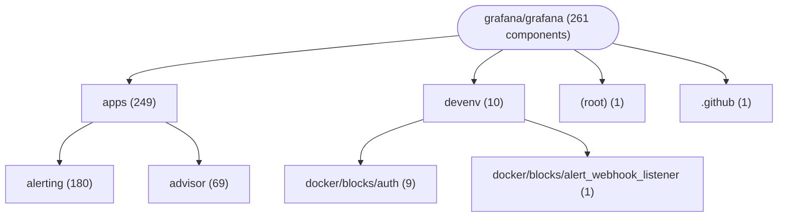
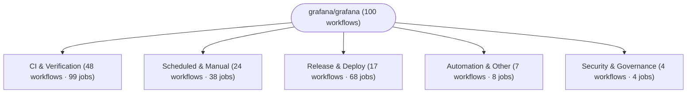

# Repository Architecture Analysis: grafana/grafana

## Metadata
- **SHA**: `3f36380cfd6240f348c2a6226f6fb07647746d60`
- **Primary Ecosystem**: Go

## Quality Metrics
- **ast_engine**: tree-sitter
- **avg_cognitive_complexity**: 4.88
- **avg_cyclomatic_complexity**: 3.5
- **component_count**: 261
- **dead_code_count**: 0
- **dead_code_symbols**: 0 entry(ies)
- **duplication_pct**: 0.01
- **file_complexities**: 3 entry(ies)
- **files_analyzed**: 7126
- **fitness_passed**: True
- **fitness_violation_count**: 0
- **framework**: Go Service
- **import_edges**: 10 entry(ies)
- **loc**: 1785860
- **max_cognitive_complexity**: 25
- **max_cyclomatic_complexity**: 12
- **sloc**: 1458480
- **test_file_count**: 6254

# Architecture: grafana/grafana

## Context
- **Repository**: `grafana/grafana`
- **SHA**: `3f36380cfd6240f348c2a6226f6fb07647746d60`
- **Ecosystem**: Go
- **Framework**: Go Service

## Building Block View



## Component Details

Showing top 60 representative components out of 261 across 4 module group(s):

- **Module `apps`** (249 components — module: 249)
- **Module `devenv`** (10 components — module: 10)
- **Module `(root)`** (1 components — module: 1)
- **Module `.github`** (1 components — MODULE: 1)

- **advisor_manifest** (`apps/advisor/pkg/apis/advisor_manifest.go`): module
- **alertenrichment_client_gen** (`apps/alerting/alertenrichment/pkg/generated/alertenrichment/v1beta1/alertenrichment_client_gen.go`): module
- **alertenrichment_codec_gen** (`apps/alerting/alertenrichment/pkg/generated/alertenrichment/v1beta1/alertenrichment_codec_gen.go`): module
- **alertenrichment_manifest** (`apps/alerting/alertenrichment/pkg/generated/manifestdata/alertenrichment_manifest.go`): module
- **alertenrichment_object_gen** (`apps/alerting/alertenrichment/pkg/generated/alertenrichment/v1beta1/alertenrichment_object_gen.go`): module
- **alertenrichment_schema_gen** (`apps/alerting/alertenrichment/pkg/generated/alertenrichment/v1beta1/alertenrichment_schema_gen.go`): module
- **alertenrichment_spec_gen** (`apps/alerting/alertenrichment/pkg/generated/alertenrichment/v1beta1/alertenrichment_spec_gen.go`): module
- **alertingnotifications_manifest** (`apps/alerting/notifications/pkg/apis/alertingnotifications_manifest.go`): module
- **alertrule_client_gen** (`apps/alerting/rules/pkg/apis/alerting/v0alpha1/alertrule_client_gen.go`): module
- **alertrule_client_gen** (`apps/alerting/rules/pkg/apis/alerting/v1beta1/alertrule_client_gen.go`): module
- **alertrule_codec_gen** (`apps/alerting/rules/pkg/apis/alerting/v0alpha1/alertrule_codec_gen.go`): module
- **alertrule_codec_gen** (`apps/alerting/rules/pkg/apis/alerting/v1beta1/alertrule_codec_gen.go`): module
- **alertrule_ext** (`apps/alerting/rules/pkg/apis/alerting/v0alpha1/alertrule_ext.go`): module
- **alertrule_ext** (`apps/alerting/rules/pkg/apis/alerting/v1beta1/alertrule_ext.go`): module
- **alertrule_object_gen** (`apps/alerting/rules/pkg/apis/alerting/v0alpha1/alertrule_object_gen.go`): module
- **alertrule_object_gen** (`apps/alerting/rules/pkg/apis/alerting/v1beta1/alertrule_object_gen.go`): module
- **alertrule_schema_gen** (`apps/alerting/rules/pkg/apis/alerting/v0alpha1/alertrule_schema_gen.go`): module
- **alertrule_schema_gen** (`apps/alerting/rules/pkg/apis/alerting/v1beta1/alertrule_schema_gen.go`): module
- **alertrule_spec_gen** (`apps/alerting/rules/pkg/apis/alerting/v0alpha1/alertrule_spec_gen.go`): module
- **alertrule_spec_gen** (`apps/alerting/rules/pkg/apis/alerting/v1beta1/alertrule_spec_gen.go`): module
- **alertrule_status_gen** (`apps/alerting/rules/pkg/apis/alerting/v0alpha1/alertrule_status_gen.go`): module
- **alertrule_status_gen** (`apps/alerting/rules/pkg/apis/alerting/v1beta1/alertrule_status_gen.go`): module
- **app** (`apps/advisor/pkg/app/app.go`): module
- **app** (`apps/alerting/notifications/pkg/app/app.go`): module
- **changelog** (`.github/actions/changelog/package.json`): MODULE
- **check** (`apps/advisor/pkg/app/checks/authchecks/check.go`): module
- **check** (`apps/advisor/pkg/app/checks/configchecks/check.go`): module
- **check** (`apps/advisor/pkg/app/checks/datasourcecheck/check.go`): module
- **check** (`apps/advisor/pkg/app/checks/instancechecks/check.go`): module
- **check** (`apps/advisor/pkg/app/checks/plugincheck/check.go`): module
- **check_client_gen** (`apps/advisor/pkg/apis/advisor/v0alpha1/check_client_gen.go`): module
- **check_codec_gen** (`apps/advisor/pkg/apis/advisor/v0alpha1/check_codec_gen.go`): module
- **check_object_gen** (`apps/advisor/pkg/apis/advisor/v0alpha1/check_object_gen.go`): module
- **check_schema_gen** (`apps/advisor/pkg/apis/advisor/v0alpha1/check_schema_gen.go`): module
- **check_spec_gen** (`apps/advisor/pkg/apis/advisor/v0alpha1/check_spec_gen.go`): module
- **check_status_gen** (`apps/advisor/pkg/apis/advisor/v0alpha1/check_status_gen.go`): module
- **check_test** (`apps/advisor/pkg/app/checks/authchecks/check_test.go`): module
- **check_test** (`apps/advisor/pkg/app/checks/datasourcecheck/check_test.go`): module
- **check_test** (`apps/advisor/pkg/app/checks/instancechecks/check_test.go`): module
- **check_test** (`apps/advisor/pkg/app/checks/plugincheck/check_test.go`): module
- **checkregistry** (`apps/advisor/pkg/app/checkregistry/checkregistry.go`): module
- **checkregistry_test** (`apps/advisor/pkg/app/checkregistry/checkregistry_test.go`): module
- **checkscheduler** (`apps/advisor/pkg/app/checkscheduler/checkscheduler.go`): module
- **checkscheduler_test** (`apps/advisor/pkg/app/checkscheduler/checkscheduler_test.go`): module
- **checktype_client_gen** (`apps/advisor/pkg/apis/advisor/v0alpha1/checktype_client_gen.go`): module
- **checktype_codec_gen** (`apps/advisor/pkg/apis/advisor/v0alpha1/checktype_codec_gen.go`): module
- **checktype_object_gen** (`apps/advisor/pkg/apis/advisor/v0alpha1/checktype_object_gen.go`): module
- **checktype_schema_gen** (`apps/advisor/pkg/apis/advisor/v0alpha1/checktype_schema_gen.go`): module
- **checktype_spec_gen** (`apps/advisor/pkg/apis/advisor/v0alpha1/checktype_spec_gen.go`): module
- **checktype_status_gen** (`apps/advisor/pkg/apis/advisor/v0alpha1/checktype_status_gen.go`): module
- **checktyperegisterer** (`apps/advisor/pkg/app/checktyperegisterer/checktyperegisterer.go`): module
- **checktyperegisterer_test** (`apps/advisor/pkg/app/checktyperegisterer/checktyperegisterer_test.go`): module
- **client_gen** (`apps/advisor/pkg/apis/advisor/v0alpha1/client_gen.go`): module
- **client_gen** (`apps/alerting/notifications/pkg/apis/alertingnotifications/v0alpha1/client_gen.go`): module
- **client_gen** (`apps/alerting/notifications/pkg/apis/alertingnotifications/v1beta1/client_gen.go`): module
- **client_gen** (`apps/alerting/rules/pkg/apis/alerting/v0alpha1/client_gen.go`): module
- **config** (`apps/alerting/notifications/pkg/app/config.go`): module
- **config_client_gen** (`apps/alerting/notifications/pkg/apis/alertingnotifications/v0alpha1/config_client_gen.go`): module
- **config_client_gen** (`apps/alerting/notifications/pkg/apis/alertingnotifications/v1beta1/config_client_gen.go`): module
- **config_client_gen** (`apps/alerting/rules/pkg/apis/alerting/v0alpha1/config_client_gen.go`): module

## 6-Dimension Repository Scorecard

- **Overall Grade**: `F` (56.72/100)
- **Technical Debt Score**: 43.28
- **Estimated Remediation Effort**: 275.82h

| Dimension | Grade | Score | Weight | Details |
| :--- | :---: | :---: | :---: | :--- |
| Code Quality | `A` | 97.98 | 0.20 | avg_cc=3.50, max_cc=12, duplication=0.01%, dead_code=0 |
| Dependency Health | `B` | 85.00 | 0.15 | dependencies=5610, outdated=0, vulnerable=0, has_lockfile=False |
| Maintainability | `A` | 92.50 | 0.15 | avg_cognitive=4.88, max_cognitive=25, fitness_violations=0, oversized_files=0 |
| Pipeline Health | `F` | 0.00 | 0.15 | workflows=100, operational_antipatterns=239, parallel_branches=True |
| Security | `F` | 0.00 | 0.20 | vulnerabilities=0, secrets=4, pipeline_security_findings=64 |
| Test Coverage | `C` | 70.00 | 0.15 | coverage=unavailable, ci_test_job=True, test_files_detected=True |

## Architecture Fitness & Workspace Boundaries

### Workspace Packages
- **github.com/grafana/grafana** (`.`, go, go) -> internal deps: `github.com/grafana/grafana/apps/advisor, github.com/grafana/grafana/apps/alerting/alertenrichment, github.com/grafana/grafana/apps/alerting/alertrulequality, github.com/grafana/grafana/apps/alerting/notifications, github.com/grafana/grafana/apps/alerting/rules, github.com/grafana/grafana/apps/annotation, github.com/grafana/grafana/apps/collections, github.com/grafana/grafana/apps/correlations, github.com/grafana/grafana/apps/dashboard, github.com/grafana/grafana/apps/dashvalidator, github.com/grafana/grafana/apps/example, github.com/grafana/grafana/apps/folder, github.com/grafana/grafana/apps/iam, github.com/grafana/grafana/apps/live, github.com/grafana/grafana/apps/logsdrilldown, github.com/grafana/grafana/apps/playlist, github.com/grafana/grafana/apps/plugins, github.com/grafana/grafana/apps/preferences, github.com/grafana/grafana/apps/provisioning, github.com/grafana/grafana/apps/quotas, github.com/grafana/grafana/apps/scope, github.com/grafana/grafana/apps/secret, github.com/grafana/grafana/apps/shorturl, github.com/grafana/grafana/pkg/apimachinery, github.com/grafana/grafana/pkg/apiserver, github.com/grafana/grafana/pkg/infra/features, github.com/grafana/grafana/pkg/infra/log, github.com/grafana/grafana/pkg/infra/metrics, github.com/grafana/grafana/pkg/infra/slugify, github.com/grafana/grafana/pkg/infra/tracing, github.com/grafana/grafana/pkg/legacyapi, github.com/grafana/grafana/pkg/plugins, github.com/grafana/grafana/pkg/storage/dbproxy, github.com/grafana/grafana/pkg/storage/unified/apistore, github.com/grafana/grafana/pkg/storage/unified/resource/kv, github.com/grafana/grafana/pkg/storage/unified/resourceclient, github.com/grafana/grafana/pkg/storage/unified/resourcepb, github.com/grafana/grafana/pkg/util/sqlite`
- **github.com/grafana/grafana/apps/advisor** (`apps/advisor`, go, go) -> internal deps: `github.com/grafana/grafana, github.com/grafana/grafana/apps/provisioning, github.com/grafana/grafana/apps/secret, github.com/grafana/grafana/pkg/apimachinery, github.com/grafana/grafana/pkg/apiserver, github.com/grafana/grafana/pkg/infra/features, github.com/grafana/grafana/pkg/infra/log, github.com/grafana/grafana/pkg/infra/metrics, github.com/grafana/grafana/pkg/infra/slugify, github.com/grafana/grafana/pkg/infra/tracing, github.com/grafana/grafana/pkg/plugins, github.com/grafana/grafana/pkg/storage/unified/resourcepb, github.com/grafana/grafana/pkg/util/sqlite`
- **github.com/grafana/grafana/apps/alerting/alertenrichment** (`apps/alerting/alertenrichment`, go, go) -> internal deps: `github.com/grafana/grafana/pkg/apimachinery`
- **github.com/grafana/grafana/apps/alerting/alertrulequality** (`apps/alerting/alertrulequality`, go, go)
- **github.com/grafana/grafana/apps/alerting/notifications** (`apps/alerting/notifications`, go, go)
- **github.com/grafana/grafana/apps/alerting/rules** (`apps/alerting/rules`, go, go)
- **github.com/grafana/grafana/apps/annotation** (`apps/annotation`, go, go)
- **github.com/grafana/grafana/apps/collections** (`apps/collections`, go, go) -> internal deps: `github.com/grafana/grafana/pkg/apimachinery`
- **github.com/grafana/grafana/apps/correlations** (`apps/correlations`, go, go)
- **github.com/grafana/grafana/apps/dashboard** (`apps/dashboard`, go, go) -> internal deps: `github.com/grafana/grafana/pkg/apimachinery`
- **github.com/grafana/grafana/apps/dashvalidator** (`apps/dashvalidator`, go, go) -> internal deps: `github.com/grafana/grafana, github.com/grafana/grafana/apps/annotation, github.com/grafana/grafana/apps/dashboard, github.com/grafana/grafana/apps/folder, github.com/grafana/grafana/apps/iam, github.com/grafana/grafana/apps/provisioning, github.com/grafana/grafana/apps/secret, github.com/grafana/grafana/pkg/apimachinery, github.com/grafana/grafana/pkg/apiserver, github.com/grafana/grafana/pkg/infra/features, github.com/grafana/grafana/pkg/infra/log, github.com/grafana/grafana/pkg/infra/metrics, github.com/grafana/grafana/pkg/infra/slugify, github.com/grafana/grafana/pkg/infra/tracing, github.com/grafana/grafana/pkg/plugins, github.com/grafana/grafana/pkg/storage/unified/resourcepb, github.com/grafana/grafana/pkg/util/sqlite`
- **github.com/grafana/grafana/apps/example** (`apps/example`, go, go) -> internal deps: `github.com/grafana/grafana/pkg/apimachinery`
- **github.com/grafana/grafana/apps/folder** (`apps/folder`, go, go) -> internal deps: `github.com/grafana/grafana/pkg/apimachinery`
- **github.com/grafana/grafana/apps/iam** (`apps/iam`, go, go) -> internal deps: `github.com/grafana/grafana, github.com/grafana/grafana/pkg/apimachinery`
- **github.com/grafana/grafana/apps/live** (`apps/live`, go, go) -> internal deps: `github.com/grafana/grafana/pkg/apimachinery, github.com/grafana/grafana/pkg/infra/log`
- **github.com/grafana/grafana/apps/logsdrilldown** (`apps/logsdrilldown`, go, go)
- **github.com/grafana/grafana/apps/playlist** (`apps/playlist`, go, go)
- **github.com/grafana/grafana/apps/plugins** (`apps/plugins`, go, go) -> internal deps: `github.com/grafana/grafana, github.com/grafana/grafana/pkg/apimachinery, github.com/grafana/grafana/pkg/apiserver, github.com/grafana/grafana/pkg/infra/features, github.com/grafana/grafana/pkg/infra/log, github.com/grafana/grafana/pkg/infra/metrics, github.com/grafana/grafana/pkg/infra/tracing, github.com/grafana/grafana/pkg/plugins`
- **github.com/grafana/grafana/apps/preferences** (`apps/preferences`, go, go) -> internal deps: `github.com/grafana/grafana/pkg/apimachinery`
- **github.com/grafana/grafana/apps/provisioning** (`apps/provisioning`, go, go) -> internal deps: `github.com/grafana/grafana/apps/dashboard, github.com/grafana/grafana/apps/secret, github.com/grafana/grafana/pkg/apimachinery`
- **github.com/grafana/grafana/apps/quotas** (`apps/quotas`, go, go) -> internal deps: `github.com/grafana/grafana/pkg/storage/unified/resourceclient, github.com/grafana/grafana/pkg/storage/unified/resourcepb`
- **github.com/grafana/grafana/apps/scope** (`apps/scope`, go, go) -> internal deps: `github.com/grafana/grafana/pkg/apimachinery`
- **github.com/grafana/grafana/apps/secret** (`apps/secret`, go, go) -> internal deps: `github.com/grafana/grafana/pkg/apimachinery`
- **github.com/grafana/grafana/apps/shorturl** (`apps/shorturl`, go, go) -> internal deps: `github.com/grafana/grafana/pkg/apimachinery`
- **github.com/grafana/grafana/pkg/apimachinery** (`pkg/apimachinery`, go, go)
- **github.com/grafana/grafana/pkg/apiserver** (`pkg/apiserver`, go, go) -> internal deps: `github.com/grafana/grafana/pkg/apimachinery`
- **github.com/grafana/grafana/pkg/build/wire** (`pkg/build/wire`, go, go)
- **github.com/grafana/grafana/pkg/codegen** (`pkg/codegen`, go, go)
- **github.com/grafana/grafana/pkg/infra/features** (`pkg/infra/features`, go, go)
- **github.com/grafana/grafana/pkg/infra/log** (`pkg/infra/log`, go, go)
- **github.com/grafana/grafana/pkg/infra/metrics** (`pkg/infra/metrics`, go, go)
- **github.com/grafana/grafana/pkg/infra/slugify** (`pkg/infra/slugify`, go, go)
- **github.com/grafana/grafana/pkg/infra/tracing** (`pkg/infra/tracing`, go, go) -> internal deps: `github.com/grafana/grafana/pkg/apimachinery, github.com/grafana/grafana/pkg/infra/log`
- **github.com/grafana/grafana/pkg/legacyapi** (`pkg/legacyapi`, go, go) -> internal deps: `github.com/grafana/grafana/apps/dashboard, github.com/grafana/grafana/pkg/apimachinery, github.com/grafana/grafana/pkg/infra/slugify`
- **github.com/grafana/grafana/pkg/plugins** (`pkg/plugins`, go, go) -> internal deps: `github.com/grafana/grafana/pkg/apimachinery`
- **github.com/grafana/grafana/pkg/plugins/codegen** (`pkg/plugins/codegen`, go, go) -> internal deps: `github.com/grafana/grafana/pkg/codegen`
- **github.com/grafana/grafana/pkg/storage/dbproxy** (`pkg/storage/dbproxy`, go, go)
- **github.com/grafana/grafana/pkg/storage/unified/apistore** (`pkg/storage/unified/apistore`, go, go) -> internal deps: `github.com/grafana/grafana/apps/alerting/alertrulequality, github.com/grafana/grafana/apps/dashboard, github.com/grafana/grafana/apps/folder, github.com/grafana/grafana/apps/provisioning, github.com/grafana/grafana/pkg/apimachinery, github.com/grafana/grafana/pkg/apiserver, github.com/grafana/grafana/pkg/storage/unified/resourceclient, github.com/grafana/grafana/pkg/storage/unified/resourcepb`
- **github.com/grafana/grafana/pkg/storage/unified/resource/kv** (`pkg/storage/unified/resource/kv`, go, go) -> internal deps: `github.com/grafana/grafana/pkg/util/sqlite`
- **github.com/grafana/grafana/pkg/storage/unified/resourceclient** (`pkg/storage/unified/resourceclient`, go, go) -> internal deps: `github.com/grafana/grafana/pkg/apimachinery, github.com/grafana/grafana/pkg/storage/unified/resourcepb`

## Supply Chain Dependencies, Vulnerabilities & Secrets

- **Dependencies Parsed**: 5610 | **Vulnerabilities**: 0 | **Secrets**: 4

### Secret Findings (Redacted)
- **[HIGH] `ATRUSS-SEC-005`** at `.github/workflows/community-release.yml:41` (`GRAFANABOT_FORUM_KEY=comm***REDACTED***`)
- **[HIGH] `ATRUSS-SEC-005`** at `.github/workflows/issue-opened.yml:63` (`AUTOTRIAGER_OPENAI_API_KEY=plug***REDACTED***`)
- **[HIGH] `ATRUSS-SEC-005`** at `.github/workflows/issue-opened.yml:191` (`AUTOTRIAGER_OPENAI_API_KEY=plug***REDACTED***`)
- **[HIGH] `ATRUSS-SEC-005`** at `apps/advisor/pkg/translations/ja-JP/grafana-advisor.json:13` (`"advisor.datasource.prom-dep-auth.description": "Prom***REDACTED***",`)

### Inventory Sample
- `Jinja2` `3.1.6` (PyPI, `devenv/docker/blocks/collectd/requirements.txt`)
- `MarkupSafe` `2.1.5` (PyPI, `devenv/docker/blocks/collectd/requirements.txt`)
- `envtpl` `0.7.0` (PyPI, `devenv/docker/blocks/collectd/requirements.txt`)
- `cloud.google.com/go/aiplatform` `1.126.0` (golang, `go.mod`)
- `cloud.google.com/go/discoveryengine` `1.33.0` (golang, `go.mod`)
- `cloud.google.com/go/kms` `1.32.0` (golang, `go.mod`)
- `cloud.google.com/go/storage` `1.67.1` (golang, `go.mod`)
- `cuelang.org/go` `0.17.1` (golang, `apps/dashboard/go.mod`)
- `cuelang.org/go` `0.17.1` (golang, `pkg/codegen/go.mod`)
- `cuelang.org/go` `0.17.1` (golang, `pkg/plugins/codegen/go.mod`)
- `dario.cat/mergo` `1.0.2` (golang, `go.mod`)
- `filippo.io/age` `1.3.2` (golang, `go.mod`)
- `github.com/Azure/azure-sdk-for-go` `68.0.0+incompatible` (golang, `go.mod`)
- `github.com/Azure/azure-sdk-for-go/sdk/azcore` `1.23.1` (golang, `go.mod`)
- `github.com/Azure/azure-sdk-for-go/sdk/azidentity` `1.14.1` (golang, `go.mod`)
- `github.com/Azure/azure-sdk-for-go/sdk/keyvault/azkeys` `0.10.0` (golang, `go.mod`)
- `github.com/Azure/azure-sdk-for-go/sdk/storage/azblob` `1.8.0` (golang, `go.mod`)
- `github.com/Azure/go-autorest/autorest` `0.11.30` (golang, `go.mod`)
- `github.com/Azure/go-autorest/autorest/adal` `0.9.24` (golang, `go.mod`)
- `github.com/Bose/minisentinel` `0.0.0-20200130220412-917c5a9223bb` (golang, `go.mod`)
- `github.com/BurntSushi/toml` `1.6.0` (golang, `go.mod`)
- `github.com/DATA-DOG/go-sqlmock` `1.5.2` (golang, `go.mod`)
- `github.com/DATA-DOG/go-sqlmock` `1.5.2` (golang, `pkg/storage/unified/resource/kv/go.mod`)
- `github.com/Machiel/slugify` `1.0.1` (golang, `pkg/plugins/go.mod`)
- `github.com/Masterminds/semver` `1.5.0` (golang, `go.mod`)
- `github.com/Masterminds/semver/v3` `3.5.0` (golang, `apps/advisor/go.mod`)
- `github.com/Masterminds/semver/v3` `3.5.0` (golang, `go.mod`)
- `github.com/Masterminds/semver/v3` `3.5.0` (golang, `pkg/plugins/go.mod`)
- `github.com/Masterminds/sprig/v3` `3.3.0` (golang, `go.mod`)
- `github.com/PaesslerAG/jsonpath` `0.1.1` (golang, `go.mod`)
- ... (+5580 more dependencies)

## Section 7: Code-to-Cloud Deployment Traceability

```mermaid
flowchart LR
    subgraph code_modules["Code Modules"]
        mod__citools_src_cue[".citools/src/cue"]
        mod__citools_src_govulncheck[".citools/src/govulncheck"]
        mod__github_actions_changelog[".github/actions/changelog"]
        mod_apps_dashboard["apps/dashboard"]
        mod_devenv_docker_blocks_alert_webhook_listener["devenv/docker/blocks/alert_webhook_listener"]
        mod_devenv_docker_blocks_auth_apache_proxy["devenv/docker/blocks/auth/apache_proxy"]
        mod_devenv_docker_blocks_auth_apache_proxy_mac["devenv/docker/blocks/auth/apache_proxy_mac"]
        mod_devenv_docker_blocks_auth_authentik["devenv/docker/blocks/auth/authentik"]
        mod_devenv_docker_blocks_auth_freeipa["devenv/docker/blocks/auth/freeipa"]
        mod_devenv_docker_blocks_auth_jwt_proxy["devenv/docker/blocks/auth/jwt_proxy"]
        mod_devenv_docker_blocks_auth_nginx_proxy["devenv/docker/blocks/auth/nginx_proxy"]
        mod_devenv_docker_blocks_auth_nginx_proxy_mac["devenv/docker/blocks/auth/nginx_proxy_mac"]
        mod_devenv_docker_blocks_auth_oauth["devenv/docker/blocks/auth/oauth"]
        mod_devenv_docker_blocks_auth_openldap["devenv/docker/blocks/auth/openldap"]
        mod_devenv_docker_blocks_auth_openldap_multiple["devenv/docker/blocks/auth/openldap-multiple"]
        mod_devenv_docker_blocks_auth_prometheus_basic_auth_proxy["devenv/docker/blocks/auth/prometheus_basic_auth_proxy"]
        mod_devenv_docker_blocks_auth_prometheus_oauth2_proxy_azure["devenv/docker/blocks/auth/prometheus_oauth2_proxy_azure"]
        mod_devenv_docker_blocks_caddy_tls["devenv/docker/blocks/caddy_tls"]
        mod_devenv_docker_blocks_clickhouse["devenv/docker/blocks/clickhouse"]
        mod_devenv_docker_blocks_collectd["devenv/docker/blocks/collectd"]
        mod_devenv_docker_blocks_elastic["devenv/docker/blocks/elastic"]
        mod_devenv_docker_blocks_elastic_data["devenv/docker/blocks/elastic/data"]
        mod_devenv_docker_blocks_elasticstack["devenv/docker/blocks/elasticstack"]
        mod_devenv_docker_blocks_etcd["devenv/docker/blocks/etcd"]
        mod_devenv_docker_blocks_grafana["devenv/docker/blocks/grafana"]
        mod_devenv_docker_blocks_graphite["devenv/docker/blocks/graphite"]
        mod_devenv_docker_blocks_graphite1["devenv/docker/blocks/graphite1"]
        mod_devenv_docker_blocks_influxdb["devenv/docker/blocks/influxdb"]
        mod_devenv_docker_blocks_influxdb1["devenv/docker/blocks/influxdb1"]
        mod_devenv_docker_blocks_jaeger["devenv/docker/blocks/jaeger"]
        mod_devenv_docker_blocks_jaegeronly["devenv/docker/blocks/jaegeronly"]
        mod_devenv_docker_blocks_loki["devenv/docker/blocks/loki"]
        mod_devenv_docker_blocks_loki_promtail["devenv/docker/blocks/loki-promtail"]
        mod_devenv_docker_blocks_loki_data["devenv/docker/blocks/loki/data"]
        mod_devenv_docker_blocks_maildev["devenv/docker/blocks/maildev"]
        mod_devenv_docker_blocks_mariadb["devenv/docker/blocks/mariadb"]
        mod_devenv_docker_blocks_memcached["devenv/docker/blocks/memcached"]
        mod_devenv_docker_blocks_mimir_backend["devenv/docker/blocks/mimir_backend"]
        mod_devenv_docker_blocks_mqtt["devenv/docker/blocks/mqtt"]
        mod_devenv_docker_blocks_mssql["devenv/docker/blocks/mssql"]
        mod_devenv_docker_blocks_mssql_arm64["devenv/docker/blocks/mssql_arm64"]
        mod_devenv_docker_blocks_mssql_tests["devenv/docker/blocks/mssql_tests"]
        mod_devenv_docker_blocks_mssql_tls["devenv/docker/blocks/mssql_tls"]
        mod_devenv_docker_blocks_mysql["devenv/docker/blocks/mysql"]
        mod_devenv_docker_blocks_mysql_exporter["devenv/docker/blocks/mysql_exporter"]
        mod_devenv_docker_blocks_mysql_opendata["devenv/docker/blocks/mysql_opendata"]
        mod_devenv_docker_blocks_mysql_tests["devenv/docker/blocks/mysql_tests"]
        mod_devenv_docker_blocks_opentsdb["devenv/docker/blocks/opentsdb"]
        mod_devenv_docker_blocks_pgvector["devenv/docker/blocks/pgvector"]
        mod_devenv_docker_blocks_postgres["devenv/docker/blocks/postgres"]
        mod_devenv_docker_blocks_postgres_tests["devenv/docker/blocks/postgres_tests"]
        mod_devenv_docker_blocks_prometheus["devenv/docker/blocks/prometheus"]
        mod_devenv_docker_blocks_prometheus_high_card["devenv/docker/blocks/prometheus_high_card"]
        mod_devenv_docker_blocks_prometheus_random_data["devenv/docker/blocks/prometheus_random_data"]
        mod_devenv_docker_blocks_prometheus_utf8["devenv/docker/blocks/prometheus_utf8"]
        mod_devenv_docker_blocks_pyroscope["devenv/docker/blocks/pyroscope"]
        mod_devenv_docker_blocks_redis["devenv/docker/blocks/redis"]
        mod_devenv_docker_blocks_self_instrumentation["devenv/docker/blocks/self-instrumentation"]
        mod_devenv_docker_blocks_sensugo["devenv/docker/blocks/sensugo"]
        mod_devenv_docker_blocks_slow_proxy["devenv/docker/blocks/slow_proxy"]
        mod_devenv_docker_blocks_smtp["devenv/docker/blocks/smtp"]
        mod_devenv_docker_blocks_stateful_webhook["devenv/docker/blocks/stateful_webhook"]
        mod_devenv_docker_blocks_tempo["devenv/docker/blocks/tempo"]
        mod_devenv_docker_blocks_traefik["devenv/docker/blocks/traefik"]
        mod_devenv_docker_blocks_webdav["devenv/docker/blocks/webdav"]
        mod_devenv_docker_blocks_zipkin["devenv/docker/blocks/zipkin"]
        mod_devenv_docker_buildcontainer["devenv/docker/buildcontainer"]
        mod_devenv_docker_debtest["devenv/docker/debtest"]
        mod_devenv_docker_ha_test_unified_alerting["devenv/docker/ha-test-unified-alerting"]
        mod_devenv_docker_ha_test["devenv/docker/ha_test"]
        mod_devenv_frontend_service["devenv/frontend-service"]
        mod_devenv_local_npm["devenv/local-npm"]
        mod_devenv_local_cdn["devenv/local_cdn"]
        mod_emails["emails"]
        mod_github_com_grafana_grafana["github.com/grafana/grafana"]
        mod_hack["hack"]
        mod_packages_grafana_data["packages/grafana-data"]
        mod_packages_grafana_e2e_selectors["packages/grafana-e2e-selectors"]
        mod_packages_grafana_schema["packages/grafana-schema"]
        mod_packaging_docker_custom["packaging/docker/custom"]
        mod_pkg_storage_dbproxy["pkg/storage/dbproxy"]
        mod_pkg_storage_unified_resourcepb["pkg/storage/unified/resourcepb"]
        mod_scripts_cli["scripts/cli"]
        mod_scripts_modowners["scripts/modowners"]
        mod_scripts_verify_repo_update["scripts/verify-repo-update"]
    end
    subgraph build_artifacts["Build Artifacts / Containers"]
        art_Dockerfile["Dockerfile"]
        art_devenv_docker_blocks_alert_webhook_listener_Dockerfile["devenv/docker/blocks/alert_webhook_listener/Dockerfile"]
        art_devenv_docker_blocks_alert_webhook_listener_docker_compose_yaml["devenv/docker/blocks/alert_webhook_listener/docker-compose.yaml"]
        art_devenv_docker_blocks_auth_apache_proxy_Dockerfile["devenv/docker/blocks/auth/apache_proxy/Dockerfile"]
        art_devenv_docker_blocks_auth_apache_proxy_docker_compose_yaml["devenv/docker/blocks/auth/apache_proxy/docker-compose.yaml"]
        art_devenv_docker_blocks_auth_apache_proxy_mac_Dockerfile["devenv/docker/blocks/auth/apache_proxy_mac/Dockerfile"]
        art_devenv_docker_blocks_auth_apache_proxy_mac_docker_compose_yaml["devenv/docker/blocks/auth/apache_proxy_mac/docker-compose.yaml"]
        art_devenv_docker_blocks_auth_authentik_docker_compose_yaml["devenv/docker/blocks/auth/authentik/docker-compose.yaml"]
        art_devenv_docker_blocks_auth_freeipa_docker_compose_yaml["devenv/docker/blocks/auth/freeipa/docker-compose.yaml"]
        art_devenv_docker_blocks_auth_jwt_proxy_docker_compose_yaml["devenv/docker/blocks/auth/jwt_proxy/docker-compose.yaml"]
        art_devenv_docker_blocks_auth_nginx_proxy_docker_compose_yaml["devenv/docker/blocks/auth/nginx_proxy/docker-compose.yaml"]
        art_devenv_docker_blocks_auth_nginx_proxy_mac_Dockerfile["devenv/docker/blocks/auth/nginx_proxy_mac/Dockerfile"]
        art_devenv_docker_blocks_auth_nginx_proxy_mac_docker_compose_yaml["devenv/docker/blocks/auth/nginx_proxy_mac/docker-compose.yaml"]
        art_devenv_docker_blocks_auth_oauth_docker_compose_yaml["devenv/docker/blocks/auth/oauth/docker-compose.yaml"]
        art_devenv_docker_blocks_auth_openldap_multiple_docker_compose_yaml["devenv/docker/blocks/auth/openldap-multiple/docker-compose.yaml"]
        art_devenv_docker_blocks_auth_openldap_docker_compose_yaml["devenv/docker/blocks/auth/openldap/docker-compose.yaml"]
        art_devenv_docker_blocks_auth_prometheus_basic_auth_proxy_Dockerfile["devenv/docker/blocks/auth/prometheus_basic_auth_proxy/Dockerfile"]
        art_devenv_docker_blocks_auth_prometheus_basic_auth_proxy_docker_compose_yaml["devenv/docker/blocks/auth/prometheus_basic_auth_proxy/docker-compose.yaml"]
        art_devenv_docker_blocks_auth_prometheus_oauth2_proxy_azure_docker_compose_yaml["devenv/docker/blocks/auth/prometheus_oauth2_proxy_azure/docker-compose.yaml"]
        art_devenv_docker_blocks_caddy_tls_docker_compose_yaml["devenv/docker/blocks/caddy_tls/docker-compose.yaml"]
        art_devenv_docker_blocks_clickhouse_docker_compose_yaml["devenv/docker/blocks/clickhouse/docker-compose.yaml"]
        art_devenv_docker_blocks_collectd_Dockerfile["devenv/docker/blocks/collectd/Dockerfile"]
        art_devenv_docker_blocks_collectd_docker_compose_yaml["devenv/docker/blocks/collectd/docker-compose.yaml"]
        art_devenv_docker_blocks_elastic_data_Dockerfile["devenv/docker/blocks/elastic/data/Dockerfile"]
        art_devenv_docker_blocks_elastic_docker_compose_yaml["devenv/docker/blocks/elastic/docker-compose.yaml"]
        art_devenv_docker_blocks_elasticstack_docker_compose_yaml["devenv/docker/blocks/elasticstack/docker-compose.yaml"]
        art_devenv_docker_blocks_etcd_docker_compose_yaml["devenv/docker/blocks/etcd/docker-compose.yaml"]
        art_devenv_docker_blocks_grafana_docker_compose_yaml["devenv/docker/blocks/grafana/docker-compose.yaml"]
        art_devenv_docker_blocks_graphite_docker_compose_yaml["devenv/docker/blocks/graphite/docker-compose.yaml"]
        art_devenv_docker_blocks_graphite1_docker_compose_yaml["devenv/docker/blocks/graphite1/docker-compose.yaml"]
        art_devenv_docker_blocks_influxdb_docker_compose_yaml["devenv/docker/blocks/influxdb/docker-compose.yaml"]
        art_devenv_docker_blocks_influxdb1_docker_compose_yaml["devenv/docker/blocks/influxdb1/docker-compose.yaml"]
        art_devenv_docker_blocks_jaeger_docker_compose_yaml["devenv/docker/blocks/jaeger/docker-compose.yaml"]
        art_devenv_docker_blocks_jaegeronly_docker_compose_yaml["devenv/docker/blocks/jaegeronly/docker-compose.yaml"]
        art_devenv_docker_blocks_loki_promtail_docker_compose_yaml["devenv/docker/blocks/loki-promtail/docker-compose.yaml"]
        art_devenv_docker_blocks_loki_data_Dockerfile["devenv/docker/blocks/loki/data/Dockerfile"]
        art_devenv_docker_blocks_loki_docker_compose_yaml["devenv/docker/blocks/loki/docker-compose.yaml"]
        art_devenv_docker_blocks_maildev_docker_compose_yaml["devenv/docker/blocks/maildev/docker-compose.yaml"]
        art_devenv_docker_blocks_mariadb_docker_compose_yaml["devenv/docker/blocks/mariadb/docker-compose.yaml"]
        art_devenv_docker_blocks_memcached_docker_compose_yaml["devenv/docker/blocks/memcached/docker-compose.yaml"]
        art_devenv_docker_blocks_mimir_backend_docker_compose_yaml["devenv/docker/blocks/mimir_backend/docker-compose.yaml"]
        art_devenv_docker_blocks_mqtt_docker_compose_yaml["devenv/docker/blocks/mqtt/docker-compose.yaml"]
        art_devenv_docker_blocks_mssql_docker_compose_yaml["devenv/docker/blocks/mssql/docker-compose.yaml"]
        art_devenv_docker_blocks_mssql_arm64_docker_compose_yaml["devenv/docker/blocks/mssql_arm64/docker-compose.yaml"]
        art_devenv_docker_blocks_mssql_tests_docker_compose_yaml["devenv/docker/blocks/mssql_tests/docker-compose.yaml"]
        art_devenv_docker_blocks_mssql_tls_docker_compose_yaml["devenv/docker/blocks/mssql_tls/docker-compose.yaml"]
        art_devenv_docker_blocks_mysql_docker_compose_yaml["devenv/docker/blocks/mysql/docker-compose.yaml"]
        art_devenv_docker_blocks_mysql_exporter_docker_compose_yaml["devenv/docker/blocks/mysql_exporter/docker-compose.yaml"]
        art_devenv_docker_blocks_mysql_opendata_Dockerfile["devenv/docker/blocks/mysql_opendata/Dockerfile"]
        art_devenv_docker_blocks_mysql_opendata_docker_compose_yaml["devenv/docker/blocks/mysql_opendata/docker-compose.yaml"]
        art_devenv_docker_blocks_mysql_tests_Dockerfile["devenv/docker/blocks/mysql_tests/Dockerfile"]
        art_devenv_docker_blocks_mysql_tests_docker_compose_yaml["devenv/docker/blocks/mysql_tests/docker-compose.yaml"]
        art_devenv_docker_blocks_opentsdb_docker_compose_yaml["devenv/docker/blocks/opentsdb/docker-compose.yaml"]
        art_devenv_docker_blocks_pgvector_docker_compose_yaml["devenv/docker/blocks/pgvector/docker-compose.yaml"]
        art_devenv_docker_blocks_postgres_docker_compose_yaml["devenv/docker/blocks/postgres/docker-compose.yaml"]
        art_devenv_docker_blocks_postgres_tests_Dockerfile["devenv/docker/blocks/postgres_tests/Dockerfile"]
        art_devenv_docker_blocks_postgres_tests_docker_compose_yaml["devenv/docker/blocks/postgres_tests/docker-compose.yaml"]
        art_devenv_docker_blocks_prometheus_Dockerfile["devenv/docker/blocks/prometheus/Dockerfile"]
        art_devenv_docker_blocks_prometheus_docker_compose_yaml["devenv/docker/blocks/prometheus/docker-compose.yaml"]
        art_devenv_docker_blocks_prometheus_high_card_Dockerfile["devenv/docker/blocks/prometheus_high_card/Dockerfile"]
        art_devenv_docker_blocks_prometheus_high_card_docker_compose_yaml["devenv/docker/blocks/prometheus_high_card/docker-compose.yaml"]
        art_devenv_docker_blocks_prometheus_random_data_Dockerfile["devenv/docker/blocks/prometheus_random_data/Dockerfile"]
        art_devenv_docker_blocks_prometheus_utf8_Dockerfile["devenv/docker/blocks/prometheus_utf8/Dockerfile"]
        art_devenv_docker_blocks_prometheus_utf8_docker_compose_yaml["devenv/docker/blocks/prometheus_utf8/docker-compose.yaml"]
        art_devenv_docker_blocks_pyroscope_docker_compose_yaml["devenv/docker/blocks/pyroscope/docker-compose.yaml"]
        art_devenv_docker_blocks_redis_docker_compose_yaml["devenv/docker/blocks/redis/docker-compose.yaml"]
        art_devenv_docker_blocks_self_instrumentation_docker_compose_yaml["devenv/docker/blocks/self-instrumentation/docker-compose.yaml"]
        art_devenv_docker_blocks_sensugo_docker_compose_yaml["devenv/docker/blocks/sensugo/docker-compose.yaml"]
        art_devenv_docker_blocks_slow_proxy_Dockerfile["devenv/docker/blocks/slow_proxy/Dockerfile"]
        art_devenv_docker_blocks_slow_proxy_docker_compose_yaml["devenv/docker/blocks/slow_proxy/docker-compose.yaml"]
        art_devenv_docker_blocks_smtp_Dockerfile["devenv/docker/blocks/smtp/Dockerfile"]
        art_devenv_docker_blocks_smtp_docker_compose_yaml["devenv/docker/blocks/smtp/docker-compose.yaml"]
        art_devenv_docker_blocks_stateful_webhook_Dockerfile["devenv/docker/blocks/stateful_webhook/Dockerfile"]
        art_devenv_docker_blocks_stateful_webhook_docker_compose_yaml["devenv/docker/blocks/stateful_webhook/docker-compose.yaml"]
        art_devenv_docker_blocks_tempo_docker_compose_yaml["devenv/docker/blocks/tempo/docker-compose.yaml"]
        art_devenv_docker_blocks_traefik_docker_compose_yml["devenv/docker/blocks/traefik/docker-compose.yml"]
        art_devenv_docker_blocks_webdav_docker_compose_yaml["devenv/docker/blocks/webdav/docker-compose.yaml"]
        art_devenv_docker_blocks_zipkin_docker_compose_yaml["devenv/docker/blocks/zipkin/docker-compose.yaml"]
        art_devenv_docker_buildcontainer_Dockerfile["devenv/docker/buildcontainer/Dockerfile"]
        art_devenv_docker_debtest_Dockerfile["devenv/docker/debtest/Dockerfile"]
        art_devenv_docker_ha_test_unified_alerting_Dockerfile["devenv/docker/ha-test-unified-alerting/Dockerfile"]
        art_devenv_docker_ha_test_unified_alerting_docker_compose_yaml["devenv/docker/ha-test-unified-alerting/docker-compose.yaml"]
        art_devenv_docker_ha_test_docker_compose_yaml["devenv/docker/ha_test/docker-compose.yaml"]
        art_devenv_frontend_service_docker_compose_yaml["devenv/frontend-service/docker-compose.yaml"]
        art_devenv_local_npm_docker_compose_yaml["devenv/local-npm/docker-compose.yaml"]
        art_devenv_local_cdn_docker_compose_yaml["devenv/local_cdn/docker-compose.yaml"]
        art_packaging_docker_custom_Dockerfile["packaging/docker/custom/Dockerfile"]
        art_scripts_verify_repo_update_Dockerfile_deb["scripts/verify-repo-update/Dockerfile.deb"]
        art_scripts_verify_repo_update_Dockerfile_rpm["scripts/verify-repo-update/Dockerfile.rpm"]
    end
    subgraph ci_jobs["CI/CD Jobs"]
        job_backend_code_checks_yml_validate_configs["backend-code-checks.yml#validate-configs"]
        job_changelog_yml_main["changelog.yml#main"]
        job_deploy_frontend_preview_yml_deploy["deploy-frontend-preview.yml#deploy"]
        job_deploy_storybook_preview_yml_deploy_storybook_preview["deploy-storybook-preview.yml#deploy-storybook-preview"]
        job_external_fr_weekly_digest_yml_digest["external-fr-weekly-digest.yml#digest"]
        job_external_issue_weekly_digest_yml_digest["external-issue-weekly-digest.yml#digest"]
        job_external_pr_weekly_digest_yml_report["external-pr-weekly-digest.yml#report"]
        job_govulncheck_yml_govulncheck["govulncheck.yml#govulncheck"]
        job_modowners_reviewers_yml_request["modowners-reviewers.yml#request"]
        job_pr_bundle_size_yml_build["pr-bundle-size.yml#build"]
        job_pr_bundle_size_yml_bundle_size["pr-bundle-size.yml#bundle-size"]
        job_pr_frontend_unit_tests_yml_generate_golden_files["pr-frontend-unit-tests.yml#generate-golden-files"]
        job_pr_k8s_codegen_check_yml_check["pr-k8s-codegen-check.yml#check"]
        job_pr_resource_search_result_format_yml_check["pr-resource-search-result-format.yml#check"]
        job_pr_test_integration_yml_postgres["pr-test-integration.yml#postgres"]
        job_pr_test_integration_yml_postgres_enterprise["pr-test-integration.yml#postgres-enterprise"]
        job_proto_breaking_changes_yml_generated["proto-breaking-changes.yml#generated"]
        job_release_npm_yml_publish["release-npm.yml#publish"]
        job_release_pr_yml_create_prs["release-pr.yml#create-prs"]
    end
    subgraph runtime_envs["Runtime Environments"]
        env_____github_event_name_____workflow_dispatch______manual_trigger__________["${{ github.event_name == 'workflow_dispatch' && 'manual-trigger' || '' }}"]
        env_frontend_preview_pr_____needs_check_outputs_pr_number___["frontend-preview-pr-${{ needs.check.outputs.pr-number }}"]
        env_npm_publish["npm-publish"]
        env_storybook_pr_preview_____github_event_pull_request_number___["storybook-pr-preview-${{ github.event.pull_request.number }}"]
    end
    job_deploy_frontend_preview_yml_deploy -->|DEPLOYS_TO| env_frontend_preview_pr_____needs_check_outputs_pr_number___
    job_deploy_storybook_preview_yml_deploy_storybook_preview -->|DEPLOYS_TO| env_storybook_pr_preview_____github_event_pull_request_number___
    job_external_fr_weekly_digest_yml_digest -->|DEPLOYS_TO| env_____github_event_name_____workflow_dispatch______manual_trigger__________
    job_external_issue_weekly_digest_yml_digest -->|DEPLOYS_TO| env_____github_event_name_____workflow_dispatch______manual_trigger__________
    job_external_pr_weekly_digest_yml_report -->|DEPLOYS_TO| env_____github_event_name_____workflow_dispatch______manual_trigger__________
    job_release_npm_yml_publish -->|DEPLOYS_TO| env_npm_publish
    mod__citools_src_cue -->|PACKAGED_BY| art_Dockerfile
    mod__citools_src_govulncheck -->|BUILT_BY| job_govulncheck_yml_govulncheck
    mod__github_actions_changelog -->|BUILT_BY| job_changelog_yml_main
    mod__github_actions_changelog -->|DEPLOYED_BY| job_release_pr_yml_create_prs
    mod_apps_dashboard -->|BUILT_BY| job_pr_frontend_unit_tests_yml_generate_golden_files
    mod_devenv_docker_blocks_alert_webhook_listener -->|PACKAGED_BY| art_devenv_docker_blocks_alert_webhook_listener_Dockerfile
    mod_devenv_docker_blocks_alert_webhook_listener -->|PACKAGED_BY| art_devenv_docker_blocks_alert_webhook_listener_docker_compose_yaml
    mod_devenv_docker_blocks_auth_apache_proxy -->|PACKAGED_BY| art_devenv_docker_blocks_auth_apache_proxy_Dockerfile
    mod_devenv_docker_blocks_auth_apache_proxy -->|PACKAGED_BY| art_devenv_docker_blocks_auth_apache_proxy_docker_compose_yaml
    mod_devenv_docker_blocks_auth_apache_proxy -->|PACKAGED_BY| art_devenv_docker_blocks_auth_apache_proxy_mac_docker_compose_yaml
    mod_devenv_docker_blocks_auth_apache_proxy_mac -->|PACKAGED_BY| art_devenv_docker_blocks_auth_apache_proxy_mac_Dockerfile
    mod_devenv_docker_blocks_auth_apache_proxy_mac -->|PACKAGED_BY| art_devenv_docker_blocks_auth_apache_proxy_mac_docker_compose_yaml
    mod_devenv_docker_blocks_auth_authentik -->|PACKAGED_BY| art_devenv_docker_blocks_auth_authentik_docker_compose_yaml
    mod_devenv_docker_blocks_auth_freeipa -->|PACKAGED_BY| art_devenv_docker_blocks_auth_freeipa_docker_compose_yaml
    mod_devenv_docker_blocks_auth_jwt_proxy -->|PACKAGED_BY| art_devenv_docker_blocks_auth_jwt_proxy_docker_compose_yaml
    mod_devenv_docker_blocks_auth_nginx_proxy -->|PACKAGED_BY| art_devenv_docker_blocks_auth_nginx_proxy_docker_compose_yaml
    mod_devenv_docker_blocks_auth_nginx_proxy -->|PACKAGED_BY| art_devenv_docker_blocks_auth_nginx_proxy_mac_docker_compose_yaml
    mod_devenv_docker_blocks_auth_nginx_proxy_mac -->|PACKAGED_BY| art_devenv_docker_blocks_auth_nginx_proxy_mac_Dockerfile
    mod_devenv_docker_blocks_auth_nginx_proxy_mac -->|PACKAGED_BY| art_devenv_docker_blocks_auth_nginx_proxy_mac_docker_compose_yaml
    mod_devenv_docker_blocks_auth_oauth -->|PACKAGED_BY| art_devenv_docker_blocks_auth_authentik_docker_compose_yaml
    mod_devenv_docker_blocks_auth_oauth -->|PACKAGED_BY| art_devenv_docker_blocks_auth_jwt_proxy_docker_compose_yaml
    mod_devenv_docker_blocks_auth_oauth -->|PACKAGED_BY| art_devenv_docker_blocks_auth_oauth_docker_compose_yaml
    mod_devenv_docker_blocks_auth_oauth -->|PACKAGED_BY| art_devenv_docker_blocks_auth_prometheus_oauth2_proxy_azure_docker_compose_yaml
    mod_devenv_docker_blocks_auth_openldap -->|PACKAGED_BY| art_devenv_docker_blocks_auth_openldap_multiple_docker_compose_yaml
    mod_devenv_docker_blocks_auth_openldap -->|PACKAGED_BY| art_devenv_docker_blocks_auth_openldap_docker_compose_yaml
    mod_devenv_docker_blocks_auth_openldap_multiple -->|PACKAGED_BY| art_devenv_docker_blocks_auth_openldap_multiple_docker_compose_yaml
    mod_devenv_docker_blocks_auth_prometheus_basic_auth_proxy -->|PACKAGED_BY| art_devenv_docker_blocks_auth_prometheus_basic_auth_proxy_Dockerfile
    mod_devenv_docker_blocks_auth_prometheus_basic_auth_proxy -->|PACKAGED_BY| art_devenv_docker_blocks_auth_prometheus_basic_auth_proxy_docker_compose_yaml
    mod_devenv_docker_blocks_auth_prometheus_oauth2_proxy_azure -->|PACKAGED_BY| art_devenv_docker_blocks_auth_prometheus_oauth2_proxy_azure_docker_compose_yaml
    mod_devenv_docker_blocks_caddy_tls -->|PACKAGED_BY| art_devenv_docker_blocks_caddy_tls_docker_compose_yaml
    mod_devenv_docker_blocks_clickhouse -->|PACKAGED_BY| art_devenv_docker_blocks_clickhouse_docker_compose_yaml
    mod_devenv_docker_blocks_collectd -->|PACKAGED_BY| art_devenv_docker_blocks_collectd_Dockerfile
    mod_devenv_docker_blocks_collectd -->|PACKAGED_BY| art_devenv_docker_blocks_collectd_docker_compose_yaml
    mod_devenv_docker_blocks_elastic -->|PACKAGED_BY| art_devenv_docker_blocks_elastic_docker_compose_yaml
    mod_devenv_docker_blocks_elastic -->|PACKAGED_BY| art_devenv_docker_blocks_elasticstack_docker_compose_yaml
    mod_devenv_docker_blocks_elastic_data -->|PACKAGED_BY| art_Dockerfile
    mod_devenv_docker_blocks_elastic_data -->|PACKAGED_BY| art_devenv_docker_blocks_auth_freeipa_docker_compose_yaml
    mod_devenv_docker_blocks_elastic_data -->|PACKAGED_BY| art_devenv_docker_blocks_elastic_data_Dockerfile
    mod_devenv_docker_blocks_elastic_data -->|PACKAGED_BY| art_devenv_docker_blocks_elastic_docker_compose_yaml
    mod_devenv_docker_blocks_elastic_data -->|PACKAGED_BY| art_devenv_docker_blocks_elasticstack_docker_compose_yaml
    mod_devenv_docker_blocks_elastic_data -->|PACKAGED_BY| art_devenv_docker_blocks_grafana_docker_compose_yaml
    mod_devenv_docker_blocks_elastic_data -->|PACKAGED_BY| art_devenv_docker_blocks_graphite_docker_compose_yaml
    mod_devenv_docker_blocks_elastic_data -->|PACKAGED_BY| art_devenv_docker_blocks_graphite1_docker_compose_yaml
    mod_devenv_docker_blocks_elastic_data -->|PACKAGED_BY| art_devenv_docker_blocks_influxdb_docker_compose_yaml
    mod_devenv_docker_blocks_elastic_data -->|PACKAGED_BY| art_devenv_docker_blocks_influxdb1_docker_compose_yaml
    mod_devenv_docker_blocks_elastic_data -->|PACKAGED_BY| art_devenv_docker_blocks_jaeger_docker_compose_yaml
    mod_devenv_docker_blocks_elastic_data -->|PACKAGED_BY| art_devenv_docker_blocks_loki_promtail_docker_compose_yaml
    mod_devenv_docker_blocks_elastic_data -->|PACKAGED_BY| art_devenv_docker_blocks_loki_data_Dockerfile
    mod_devenv_docker_blocks_elastic_data -->|PACKAGED_BY| art_devenv_docker_blocks_loki_docker_compose_yaml
    mod_devenv_docker_blocks_elastic_data -->|PACKAGED_BY| art_devenv_docker_blocks_mssql_docker_compose_yaml
    mod_devenv_docker_blocks_elastic_data -->|PACKAGED_BY| art_devenv_docker_blocks_mssql_tls_docker_compose_yaml
    mod_devenv_docker_blocks_elastic_data -->|PACKAGED_BY| art_devenv_docker_blocks_mysql_docker_compose_yaml
    mod_devenv_docker_blocks_elastic_data -->|PACKAGED_BY| art_devenv_docker_blocks_mysql_opendata_Dockerfile
    mod_devenv_docker_blocks_elastic_data -->|PACKAGED_BY| art_devenv_docker_blocks_mysql_opendata_docker_compose_yaml
    mod_devenv_docker_blocks_elastic_data -->|PACKAGED_BY| art_devenv_docker_blocks_mysql_tests_docker_compose_yaml
    mod_devenv_docker_blocks_elastic_data -->|PACKAGED_BY| art_devenv_docker_blocks_opentsdb_docker_compose_yaml
    mod_devenv_docker_blocks_elastic_data -->|PACKAGED_BY| art_devenv_docker_blocks_postgres_docker_compose_yaml
    mod_devenv_docker_blocks_elastic_data -->|PACKAGED_BY| art_devenv_docker_blocks_postgres_tests_docker_compose_yaml
    mod_devenv_docker_blocks_elastic_data -->|PACKAGED_BY| art_devenv_docker_blocks_prometheus_docker_compose_yaml
    mod_devenv_docker_blocks_elastic_data -->|PACKAGED_BY| art_devenv_docker_blocks_self_instrumentation_docker_compose_yaml
    mod_devenv_docker_blocks_elastic_data -->|PACKAGED_BY| art_devenv_docker_blocks_sensugo_docker_compose_yaml
    mod_devenv_docker_blocks_elastic_data -->|PACKAGED_BY| art_devenv_docker_blocks_tempo_docker_compose_yaml
    mod_devenv_docker_blocks_elastic_data -->|PACKAGED_BY| art_devenv_docker_blocks_webdav_docker_compose_yaml
    mod_devenv_docker_blocks_elastic_data -->|PACKAGED_BY| art_devenv_frontend_service_docker_compose_yaml
    mod_devenv_docker_blocks_elastic_data -->|PACKAGED_BY| art_devenv_local_cdn_docker_compose_yaml
    mod_devenv_docker_blocks_elasticstack -->|PACKAGED_BY| art_devenv_docker_blocks_elasticstack_docker_compose_yaml
    mod_devenv_docker_blocks_etcd -->|PACKAGED_BY| art_devenv_docker_blocks_etcd_docker_compose_yaml
    mod_devenv_docker_blocks_etcd -->|PACKAGED_BY| art_devenv_docker_blocks_sensugo_docker_compose_yaml
    mod_devenv_docker_blocks_grafana -->|PACKAGED_BY| art_Dockerfile
    mod_devenv_docker_blocks_grafana -->|PACKAGED_BY| art_devenv_docker_blocks_auth_apache_proxy_docker_compose_yaml
    mod_devenv_docker_blocks_grafana -->|PACKAGED_BY| art_devenv_docker_blocks_auth_apache_proxy_mac_docker_compose_yaml
    mod_devenv_docker_blocks_grafana -->|PACKAGED_BY| art_devenv_docker_blocks_auth_jwt_proxy_docker_compose_yaml
    mod_devenv_docker_blocks_grafana -->|PACKAGED_BY| art_devenv_docker_blocks_auth_nginx_proxy_docker_compose_yaml
    mod_devenv_docker_blocks_grafana -->|PACKAGED_BY| art_devenv_docker_blocks_auth_nginx_proxy_mac_docker_compose_yaml
    mod_devenv_docker_blocks_grafana -->|PACKAGED_BY| art_devenv_docker_blocks_auth_openldap_multiple_docker_compose_yaml
    mod_devenv_docker_blocks_grafana -->|PACKAGED_BY| art_devenv_docker_blocks_auth_openldap_docker_compose_yaml
    mod_devenv_docker_blocks_grafana -->|PACKAGED_BY| art_devenv_docker_blocks_elasticstack_docker_compose_yaml
    mod_devenv_docker_blocks_grafana -->|PACKAGED_BY| art_devenv_docker_blocks_grafana_docker_compose_yaml
    mod_devenv_docker_blocks_grafana -->|PACKAGED_BY| art_devenv_docker_blocks_graphite_docker_compose_yaml
    mod_devenv_docker_blocks_grafana -->|PACKAGED_BY| art_devenv_docker_blocks_graphite1_docker_compose_yaml
    mod_devenv_docker_blocks_grafana -->|PACKAGED_BY| art_devenv_docker_blocks_influxdb_docker_compose_yaml
    mod_devenv_docker_blocks_grafana -->|PACKAGED_BY| art_devenv_docker_blocks_influxdb1_docker_compose_yaml
    mod_devenv_docker_blocks_grafana -->|PACKAGED_BY| art_devenv_docker_blocks_jaeger_docker_compose_yaml
    mod_devenv_docker_blocks_grafana -->|PACKAGED_BY| art_devenv_docker_blocks_loki_promtail_docker_compose_yaml
    mod_devenv_docker_blocks_grafana -->|PACKAGED_BY| art_devenv_docker_blocks_loki_docker_compose_yaml
    mod_devenv_docker_blocks_grafana -->|PACKAGED_BY| art_devenv_docker_blocks_mariadb_docker_compose_yaml
    mod_devenv_docker_blocks_grafana -->|PACKAGED_BY| art_devenv_docker_blocks_mimir_backend_docker_compose_yaml
    mod_devenv_docker_blocks_grafana -->|PACKAGED_BY| art_devenv_docker_blocks_mssql_docker_compose_yaml
    mod_devenv_docker_blocks_grafana -->|PACKAGED_BY| art_devenv_docker_blocks_mssql_tests_docker_compose_yaml
    mod_devenv_docker_blocks_grafana -->|PACKAGED_BY| art_devenv_docker_blocks_mssql_tls_docker_compose_yaml
    mod_devenv_docker_blocks_grafana -->|PACKAGED_BY| art_devenv_docker_blocks_mysql_docker_compose_yaml
    mod_devenv_docker_blocks_grafana -->|PACKAGED_BY| art_devenv_docker_blocks_mysql_opendata_Dockerfile
    mod_devenv_docker_blocks_grafana -->|PACKAGED_BY| art_devenv_docker_blocks_mysql_opendata_docker_compose_yaml
    mod_devenv_docker_blocks_grafana -->|PACKAGED_BY| art_devenv_docker_blocks_mysql_tests_docker_compose_yaml
    mod_devenv_docker_blocks_grafana -->|PACKAGED_BY| art_devenv_docker_blocks_opentsdb_docker_compose_yaml
    mod_devenv_docker_blocks_grafana -->|PACKAGED_BY| art_devenv_docker_blocks_pgvector_docker_compose_yaml
    mod_devenv_docker_blocks_grafana -->|PACKAGED_BY| art_devenv_docker_blocks_postgres_docker_compose_yaml
    mod_devenv_docker_blocks_grafana -->|PACKAGED_BY| art_devenv_docker_blocks_postgres_tests_docker_compose_yaml
    mod_devenv_docker_blocks_grafana -->|PACKAGED_BY| art_devenv_docker_blocks_prometheus_docker_compose_yaml
    mod_devenv_docker_blocks_grafana -->|PACKAGED_BY| art_devenv_docker_blocks_pyroscope_docker_compose_yaml
    mod_devenv_docker_blocks_grafana -->|PACKAGED_BY| art_devenv_docker_blocks_self_instrumentation_docker_compose_yaml
    mod_devenv_docker_blocks_grafana -->|PACKAGED_BY| art_devenv_docker_blocks_tempo_docker_compose_yaml
    mod_devenv_docker_blocks_grafana -->|PACKAGED_BY| art_devenv_docker_blocks_traefik_docker_compose_yml
    mod_devenv_docker_blocks_grafana -->|PACKAGED_BY| art_devenv_docker_buildcontainer_Dockerfile
    mod_devenv_docker_blocks_grafana -->|PACKAGED_BY| art_devenv_docker_ha_test_unified_alerting_docker_compose_yaml
    mod_devenv_docker_blocks_grafana -->|PACKAGED_BY| art_devenv_docker_ha_test_docker_compose_yaml
    mod_devenv_docker_blocks_grafana -->|PACKAGED_BY| art_devenv_frontend_service_docker_compose_yaml
    mod_devenv_docker_blocks_grafana -->|PACKAGED_BY| art_devenv_local_cdn_docker_compose_yaml
    mod_devenv_docker_blocks_grafana -->|PACKAGED_BY| art_packaging_docker_custom_Dockerfile
    mod_devenv_docker_blocks_grafana -->|PACKAGED_BY| art_scripts_verify_repo_update_Dockerfile_deb
    mod_devenv_docker_blocks_grafana -->|PACKAGED_BY| art_scripts_verify_repo_update_Dockerfile_rpm
    mod_devenv_docker_blocks_graphite -->|PACKAGED_BY| art_devenv_docker_blocks_collectd_docker_compose_yaml
    mod_devenv_docker_blocks_graphite -->|PACKAGED_BY| art_devenv_docker_blocks_graphite_docker_compose_yaml
    mod_devenv_docker_blocks_graphite -->|PACKAGED_BY| art_devenv_docker_blocks_graphite1_docker_compose_yaml
    mod_devenv_docker_blocks_graphite1 -->|PACKAGED_BY| art_devenv_docker_blocks_graphite_docker_compose_yaml
    mod_devenv_docker_blocks_graphite1 -->|PACKAGED_BY| art_devenv_docker_blocks_graphite1_docker_compose_yaml
    mod_devenv_docker_blocks_influxdb -->|PACKAGED_BY| art_devenv_docker_blocks_influxdb_docker_compose_yaml
    mod_devenv_docker_blocks_influxdb -->|PACKAGED_BY| art_devenv_docker_blocks_influxdb1_docker_compose_yaml
    mod_devenv_docker_blocks_influxdb1 -->|PACKAGED_BY| art_devenv_docker_blocks_influxdb1_docker_compose_yaml
    mod_devenv_docker_blocks_jaeger -->|PACKAGED_BY| art_devenv_docker_blocks_jaeger_docker_compose_yaml
    mod_devenv_docker_blocks_jaeger -->|PACKAGED_BY| art_devenv_docker_blocks_jaegeronly_docker_compose_yaml
    mod_devenv_docker_blocks_jaeger -->|PACKAGED_BY| art_devenv_docker_blocks_tempo_docker_compose_yaml
    mod_devenv_docker_blocks_jaeger -->|PACKAGED_BY| art_devenv_frontend_service_docker_compose_yaml
    mod_devenv_docker_blocks_jaegeronly -->|PACKAGED_BY| art_devenv_docker_blocks_jaegeronly_docker_compose_yaml
    mod_devenv_docker_blocks_loki -->|PACKAGED_BY| art_devenv_docker_blocks_jaeger_docker_compose_yaml
    mod_devenv_docker_blocks_loki -->|PACKAGED_BY| art_devenv_docker_blocks_loki_promtail_docker_compose_yaml
    mod_devenv_docker_blocks_loki -->|PACKAGED_BY| art_devenv_docker_blocks_loki_docker_compose_yaml
    mod_devenv_docker_blocks_loki -->|PACKAGED_BY| art_devenv_docker_blocks_self_instrumentation_docker_compose_yaml
    mod_devenv_docker_blocks_loki -->|PACKAGED_BY| art_devenv_docker_blocks_tempo_docker_compose_yaml
    mod_devenv_docker_blocks_loki -->|PACKAGED_BY| art_devenv_docker_ha_test_docker_compose_yaml
    mod_devenv_docker_blocks_loki -->|PACKAGED_BY| art_devenv_frontend_service_docker_compose_yaml
    mod_devenv_docker_blocks_loki_promtail -->|PACKAGED_BY| art_devenv_docker_blocks_loki_promtail_docker_compose_yaml
    mod_devenv_docker_blocks_loki_data -->|PACKAGED_BY| art_Dockerfile
    mod_devenv_docker_blocks_loki_data -->|PACKAGED_BY| art_devenv_docker_blocks_auth_freeipa_docker_compose_yaml
    mod_devenv_docker_blocks_loki_data -->|PACKAGED_BY| art_devenv_docker_blocks_elastic_data_Dockerfile
    mod_devenv_docker_blocks_loki_data -->|PACKAGED_BY| art_devenv_docker_blocks_elastic_docker_compose_yaml
    mod_devenv_docker_blocks_loki_data -->|PACKAGED_BY| art_devenv_docker_blocks_elasticstack_docker_compose_yaml
    mod_devenv_docker_blocks_loki_data -->|PACKAGED_BY| art_devenv_docker_blocks_grafana_docker_compose_yaml
    mod_devenv_docker_blocks_loki_data -->|PACKAGED_BY| art_devenv_docker_blocks_graphite_docker_compose_yaml
    mod_devenv_docker_blocks_loki_data -->|PACKAGED_BY| art_devenv_docker_blocks_graphite1_docker_compose_yaml
    mod_devenv_docker_blocks_loki_data -->|PACKAGED_BY| art_devenv_docker_blocks_influxdb_docker_compose_yaml
    mod_devenv_docker_blocks_loki_data -->|PACKAGED_BY| art_devenv_docker_blocks_influxdb1_docker_compose_yaml
    mod_devenv_docker_blocks_loki_data -->|PACKAGED_BY| art_devenv_docker_blocks_jaeger_docker_compose_yaml
    mod_devenv_docker_blocks_loki_data -->|PACKAGED_BY| art_devenv_docker_blocks_loki_promtail_docker_compose_yaml
    mod_devenv_docker_blocks_loki_data -->|PACKAGED_BY| art_devenv_docker_blocks_loki_data_Dockerfile
    mod_devenv_docker_blocks_loki_data -->|PACKAGED_BY| art_devenv_docker_blocks_loki_docker_compose_yaml
    mod_devenv_docker_blocks_loki_data -->|PACKAGED_BY| art_devenv_docker_blocks_mssql_docker_compose_yaml
    mod_devenv_docker_blocks_loki_data -->|PACKAGED_BY| art_devenv_docker_blocks_mssql_tls_docker_compose_yaml
    mod_devenv_docker_blocks_loki_data -->|PACKAGED_BY| art_devenv_docker_blocks_mysql_docker_compose_yaml
    mod_devenv_docker_blocks_loki_data -->|PACKAGED_BY| art_devenv_docker_blocks_mysql_opendata_Dockerfile
    mod_devenv_docker_blocks_loki_data -->|PACKAGED_BY| art_devenv_docker_blocks_mysql_opendata_docker_compose_yaml
    mod_devenv_docker_blocks_loki_data -->|PACKAGED_BY| art_devenv_docker_blocks_mysql_tests_docker_compose_yaml
    mod_devenv_docker_blocks_loki_data -->|PACKAGED_BY| art_devenv_docker_blocks_opentsdb_docker_compose_yaml
    mod_devenv_docker_blocks_loki_data -->|PACKAGED_BY| art_devenv_docker_blocks_postgres_docker_compose_yaml
    mod_devenv_docker_blocks_loki_data -->|PACKAGED_BY| art_devenv_docker_blocks_postgres_tests_docker_compose_yaml
    mod_devenv_docker_blocks_loki_data -->|PACKAGED_BY| art_devenv_docker_blocks_prometheus_docker_compose_yaml
    mod_devenv_docker_blocks_loki_data -->|PACKAGED_BY| art_devenv_docker_blocks_self_instrumentation_docker_compose_yaml
    mod_devenv_docker_blocks_loki_data -->|PACKAGED_BY| art_devenv_docker_blocks_sensugo_docker_compose_yaml
    mod_devenv_docker_blocks_loki_data -->|PACKAGED_BY| art_devenv_docker_blocks_tempo_docker_compose_yaml
    mod_devenv_docker_blocks_loki_data -->|PACKAGED_BY| art_devenv_docker_blocks_webdav_docker_compose_yaml
    mod_devenv_docker_blocks_loki_data -->|PACKAGED_BY| art_devenv_frontend_service_docker_compose_yaml
    mod_devenv_docker_blocks_loki_data -->|PACKAGED_BY| art_devenv_local_cdn_docker_compose_yaml
    mod_devenv_docker_blocks_maildev -->|PACKAGED_BY| art_devenv_docker_blocks_maildev_docker_compose_yaml
    mod_devenv_docker_blocks_maildev -->|PACKAGED_BY| art_devenv_frontend_service_docker_compose_yaml
    mod_devenv_docker_blocks_mariadb -->|PACKAGED_BY| art_devenv_docker_blocks_mariadb_docker_compose_yaml
    mod_devenv_docker_blocks_memcached -->|PACKAGED_BY| art_devenv_docker_blocks_memcached_docker_compose_yaml
    mod_devenv_docker_blocks_mimir_backend -->|PACKAGED_BY| art_devenv_docker_blocks_mimir_backend_docker_compose_yaml
    mod_devenv_docker_blocks_mqtt -->|PACKAGED_BY| art_devenv_docker_blocks_mqtt_docker_compose_yaml
    mod_devenv_docker_blocks_mssql -->|PACKAGED_BY| art_devenv_docker_blocks_mssql_docker_compose_yaml
    mod_devenv_docker_blocks_mssql -->|PACKAGED_BY| art_devenv_docker_blocks_mssql_arm64_docker_compose_yaml
    mod_devenv_docker_blocks_mssql -->|PACKAGED_BY| art_devenv_docker_blocks_mssql_tests_docker_compose_yaml
    mod_devenv_docker_blocks_mssql -->|PACKAGED_BY| art_devenv_docker_blocks_mssql_tls_docker_compose_yaml
    mod_devenv_docker_blocks_mssql_arm64 -->|PACKAGED_BY| art_devenv_docker_blocks_mssql_arm64_docker_compose_yaml
    mod_devenv_docker_blocks_mssql_tests -->|PACKAGED_BY| art_devenv_docker_blocks_mssql_tests_docker_compose_yaml
    mod_devenv_docker_blocks_mssql_tls -->|PACKAGED_BY| art_devenv_docker_blocks_mssql_tls_docker_compose_yaml
    mod_devenv_docker_blocks_mysql -->|PACKAGED_BY| art_devenv_docker_blocks_mysql_docker_compose_yaml
    mod_devenv_docker_blocks_mysql -->|PACKAGED_BY| art_devenv_docker_blocks_mysql_exporter_docker_compose_yaml
    mod_devenv_docker_blocks_mysql -->|PACKAGED_BY| art_devenv_docker_blocks_mysql_opendata_Dockerfile
    mod_devenv_docker_blocks_mysql -->|PACKAGED_BY| art_devenv_docker_blocks_mysql_opendata_docker_compose_yaml
    mod_devenv_docker_blocks_mysql -->|PACKAGED_BY| art_devenv_docker_blocks_mysql_tests_Dockerfile
    mod_devenv_docker_blocks_mysql -->|PACKAGED_BY| art_devenv_docker_blocks_mysql_tests_docker_compose_yaml
    mod_devenv_docker_blocks_mysql -->|PACKAGED_BY| art_devenv_docker_ha_test_unified_alerting_docker_compose_yaml
    mod_devenv_docker_blocks_mysql -->|PACKAGED_BY| art_devenv_docker_ha_test_docker_compose_yaml
    mod_devenv_docker_blocks_mysql_exporter -->|PACKAGED_BY| art_devenv_docker_blocks_mysql_exporter_docker_compose_yaml
    mod_devenv_docker_blocks_mysql_opendata -->|PACKAGED_BY| art_devenv_docker_blocks_mysql_opendata_Dockerfile
    mod_devenv_docker_blocks_mysql_opendata -->|PACKAGED_BY| art_devenv_docker_blocks_mysql_opendata_docker_compose_yaml
    mod_devenv_docker_blocks_mysql_tests -->|PACKAGED_BY| art_devenv_docker_blocks_mysql_tests_Dockerfile
    mod_devenv_docker_blocks_mysql_tests -->|PACKAGED_BY| art_devenv_docker_blocks_mysql_tests_docker_compose_yaml
    mod_devenv_docker_blocks_opentsdb -->|PACKAGED_BY| art_devenv_docker_blocks_opentsdb_docker_compose_yaml
    mod_devenv_docker_blocks_pgvector -->|PACKAGED_BY| art_devenv_docker_blocks_pgvector_docker_compose_yaml
    mod_devenv_docker_blocks_postgres -->|BUILT_BY| job_pr_test_integration_yml_postgres
    mod_devenv_docker_blocks_postgres -->|BUILT_BY| job_pr_test_integration_yml_postgres_enterprise
    mod_devenv_docker_blocks_postgres -->|PACKAGED_BY| art_devenv_docker_blocks_auth_authentik_docker_compose_yaml
    mod_devenv_docker_blocks_postgres -->|PACKAGED_BY| art_devenv_docker_blocks_auth_jwt_proxy_docker_compose_yaml
    mod_devenv_docker_blocks_postgres -->|PACKAGED_BY| art_devenv_docker_blocks_auth_oauth_docker_compose_yaml
    mod_devenv_docker_blocks_postgres -->|PACKAGED_BY| art_devenv_docker_blocks_pgvector_docker_compose_yaml
    mod_devenv_docker_blocks_postgres -->|PACKAGED_BY| art_devenv_docker_blocks_postgres_docker_compose_yaml
    mod_devenv_docker_blocks_postgres -->|PACKAGED_BY| art_devenv_docker_blocks_postgres_tests_Dockerfile
    mod_devenv_docker_blocks_postgres -->|PACKAGED_BY| art_devenv_docker_blocks_postgres_tests_docker_compose_yaml
    mod_devenv_docker_blocks_postgres -->|PACKAGED_BY| art_devenv_docker_ha_test_docker_compose_yaml
    mod_devenv_docker_blocks_postgres -->|PACKAGED_BY| art_devenv_frontend_service_docker_compose_yaml
    mod_devenv_docker_blocks_postgres_tests -->|BUILT_BY| job_pr_test_integration_yml_postgres
    mod_devenv_docker_blocks_postgres_tests -->|BUILT_BY| job_pr_test_integration_yml_postgres_enterprise
    mod_devenv_docker_blocks_postgres_tests -->|PACKAGED_BY| art_devenv_docker_blocks_postgres_tests_Dockerfile
    mod_devenv_docker_blocks_postgres_tests -->|PACKAGED_BY| art_devenv_docker_blocks_postgres_tests_docker_compose_yaml
    mod_devenv_docker_blocks_prometheus -->|PACKAGED_BY| art_devenv_docker_blocks_auth_prometheus_basic_auth_proxy_docker_compose_yaml
    mod_devenv_docker_blocks_prometheus -->|PACKAGED_BY| art_devenv_docker_blocks_auth_prometheus_oauth2_proxy_azure_docker_compose_yaml
    mod_devenv_docker_blocks_prometheus -->|PACKAGED_BY| art_devenv_docker_blocks_prometheus_Dockerfile
    mod_devenv_docker_blocks_prometheus -->|PACKAGED_BY| art_devenv_docker_blocks_prometheus_docker_compose_yaml
    mod_devenv_docker_blocks_prometheus -->|PACKAGED_BY| art_devenv_docker_blocks_prometheus_high_card_docker_compose_yaml
    mod_devenv_docker_blocks_prometheus -->|PACKAGED_BY| art_devenv_docker_blocks_prometheus_random_data_Dockerfile
    mod_devenv_docker_blocks_prometheus -->|PACKAGED_BY| art_devenv_docker_blocks_prometheus_utf8_docker_compose_yaml
    mod_devenv_docker_blocks_prometheus -->|PACKAGED_BY| art_devenv_docker_blocks_self_instrumentation_docker_compose_yaml
    mod_devenv_docker_blocks_prometheus -->|PACKAGED_BY| art_devenv_docker_blocks_tempo_docker_compose_yaml
    mod_devenv_docker_blocks_prometheus -->|PACKAGED_BY| art_devenv_docker_ha_test_unified_alerting_docker_compose_yaml
    mod_devenv_docker_blocks_prometheus -->|PACKAGED_BY| art_devenv_docker_ha_test_docker_compose_yaml
    mod_devenv_docker_blocks_prometheus -->|PACKAGED_BY| art_devenv_frontend_service_docker_compose_yaml
    mod_devenv_docker_blocks_prometheus_high_card -->|PACKAGED_BY| art_devenv_docker_blocks_prometheus_docker_compose_yaml
    mod_devenv_docker_blocks_prometheus_high_card -->|PACKAGED_BY| art_devenv_docker_blocks_prometheus_high_card_Dockerfile
    mod_devenv_docker_blocks_prometheus_high_card -->|PACKAGED_BY| art_devenv_docker_blocks_prometheus_high_card_docker_compose_yaml
    mod_devenv_docker_blocks_prometheus_random_data -->|PACKAGED_BY| art_devenv_docker_blocks_prometheus_docker_compose_yaml
    mod_devenv_docker_blocks_prometheus_random_data -->|PACKAGED_BY| art_devenv_docker_blocks_prometheus_random_data_Dockerfile
    mod_devenv_docker_blocks_prometheus_utf8 -->|PACKAGED_BY| art_devenv_docker_blocks_prometheus_docker_compose_yaml
    mod_devenv_docker_blocks_prometheus_utf8 -->|PACKAGED_BY| art_devenv_docker_blocks_prometheus_utf8_Dockerfile
    mod_devenv_docker_blocks_prometheus_utf8 -->|PACKAGED_BY| art_devenv_docker_blocks_prometheus_utf8_docker_compose_yaml
    mod_devenv_docker_blocks_pyroscope -->|PACKAGED_BY| art_devenv_docker_blocks_pyroscope_docker_compose_yaml
    mod_devenv_docker_blocks_pyroscope -->|PACKAGED_BY| art_devenv_docker_blocks_self_instrumentation_docker_compose_yaml
    mod_devenv_docker_blocks_redis -->|PACKAGED_BY| art_devenv_docker_blocks_auth_authentik_docker_compose_yaml
    mod_devenv_docker_blocks_redis -->|PACKAGED_BY| art_devenv_docker_blocks_redis_docker_compose_yaml
    mod_devenv_docker_blocks_self_instrumentation -->|PACKAGED_BY| art_devenv_docker_blocks_self_instrumentation_docker_compose_yaml
    mod_devenv_docker_blocks_sensugo -->|PACKAGED_BY| art_devenv_docker_blocks_sensugo_docker_compose_yaml
    mod_devenv_docker_blocks_slow_proxy -->|PACKAGED_BY| art_devenv_docker_blocks_slow_proxy_Dockerfile
    mod_devenv_docker_blocks_slow_proxy -->|PACKAGED_BY| art_devenv_docker_blocks_slow_proxy_docker_compose_yaml
    mod_devenv_docker_blocks_smtp -->|PACKAGED_BY| art_devenv_docker_blocks_smtp_Dockerfile
    mod_devenv_docker_blocks_smtp -->|PACKAGED_BY| art_devenv_docker_blocks_smtp_docker_compose_yaml
    mod_devenv_docker_blocks_stateful_webhook -->|PACKAGED_BY| art_devenv_docker_blocks_stateful_webhook_Dockerfile
    mod_devenv_docker_blocks_stateful_webhook -->|PACKAGED_BY| art_devenv_docker_blocks_stateful_webhook_docker_compose_yaml
    mod_devenv_docker_blocks_tempo -->|PACKAGED_BY| art_devenv_docker_blocks_self_instrumentation_docker_compose_yaml
    mod_devenv_docker_blocks_tempo -->|PACKAGED_BY| art_devenv_docker_blocks_tempo_docker_compose_yaml
    mod_devenv_docker_blocks_tempo -->|PACKAGED_BY| art_devenv_frontend_service_docker_compose_yaml
    mod_devenv_docker_blocks_traefik -->|PACKAGED_BY| art_devenv_docker_blocks_traefik_docker_compose_yml
    mod_devenv_docker_blocks_webdav -->|PACKAGED_BY| art_devenv_docker_blocks_webdav_docker_compose_yaml
    mod_devenv_docker_blocks_zipkin -->|PACKAGED_BY| art_devenv_docker_blocks_zipkin_docker_compose_yaml
    mod_devenv_docker_buildcontainer -->|PACKAGED_BY| art_devenv_docker_buildcontainer_Dockerfile
    mod_devenv_docker_debtest -->|PACKAGED_BY| art_devenv_docker_debtest_Dockerfile
    mod_devenv_docker_ha_test_unified_alerting -->|PACKAGED_BY| art_devenv_docker_ha_test_unified_alerting_Dockerfile
    mod_devenv_docker_ha_test_unified_alerting -->|PACKAGED_BY| art_devenv_docker_ha_test_unified_alerting_docker_compose_yaml
    mod_devenv_docker_ha_test -->|PACKAGED_BY| art_devenv_docker_ha_test_docker_compose_yaml
    mod_devenv_frontend_service -->|PACKAGED_BY| art_devenv_frontend_service_docker_compose_yaml
    mod_devenv_local_npm -->|PACKAGED_BY| art_devenv_local_npm_docker_compose_yaml
    mod_devenv_local_cdn -->|PACKAGED_BY| art_devenv_local_cdn_docker_compose_yaml
    mod_emails -->|PACKAGED_BY| art_Dockerfile
    mod_github_com_grafana_grafana -->|PACKAGED_BY| art_Dockerfile
    mod_github_com_grafana_grafana -->|PACKAGED_BY| art_devenv_docker_ha_test_unified_alerting_docker_compose_yaml
    mod_github_com_grafana_grafana -->|PACKAGED_BY| art_devenv_frontend_service_docker_compose_yaml
    mod_hack -->|BUILT_BY| job_pr_k8s_codegen_check_yml_check
    mod_packages_grafana_data -->|PACKAGED_BY| art_Dockerfile
    mod_packages_grafana_e2e_selectors -->|DEPLOYED_BY| job_release_npm_yml_publish
    mod_packages_grafana_schema -->|PACKAGED_BY| art_Dockerfile
    mod_packaging_docker_custom -->|PACKAGED_BY| art_devenv_docker_blocks_auth_authentik_docker_compose_yaml
    mod_packaging_docker_custom -->|PACKAGED_BY| art_devenv_frontend_service_docker_compose_yaml
    mod_packaging_docker_custom -->|PACKAGED_BY| art_packaging_docker_custom_Dockerfile
    mod_pkg_storage_dbproxy -->|BUILT_BY| job_proto_breaking_changes_yml_generated
    mod_pkg_storage_unified_resourcepb -->|BUILT_BY| job_pr_resource_search_result_format_yml_check
    mod_pkg_storage_unified_resourcepb -->|BUILT_BY| job_proto_breaking_changes_yml_generated
    mod_scripts_cli -->|BUILT_BY| job_pr_bundle_size_yml_build
    mod_scripts_cli -->|BUILT_BY| job_pr_bundle_size_yml_bundle_size
    mod_scripts_cli -->|PACKAGED_BY| art_devenv_docker_blocks_auth_authentik_docker_compose_yaml
    mod_scripts_cli -->|PACKAGED_BY| art_devenv_docker_blocks_auth_jwt_proxy_docker_compose_yaml
    mod_scripts_cli -->|PACKAGED_BY| art_devenv_docker_blocks_auth_prometheus_oauth2_proxy_azure_docker_compose_yaml
    mod_scripts_cli -->|PACKAGED_BY| art_devenv_docker_blocks_clickhouse_docker_compose_yaml
    mod_scripts_cli -->|PACKAGED_BY| art_devenv_docker_blocks_prometheus_random_data_Dockerfile
    mod_scripts_cli -->|PACKAGED_BY| art_packaging_docker_custom_Dockerfile
    mod_scripts_modowners -->|BUILT_BY| job_backend_code_checks_yml_validate_configs
    mod_scripts_modowners -->|BUILT_BY| job_modowners_reviewers_yml_request
    mod_scripts_verify_repo_update -->|PACKAGED_BY| art_scripts_verify_repo_update_Dockerfile_deb
    mod_scripts_verify_repo_update -->|PACKAGED_BY| art_scripts_verify_repo_update_Dockerfile_rpm
    art_devenv_docker_blocks_postgres_tests_Dockerfile -->|BUILT_BY| job_pr_test_integration_yml_postgres
    art_devenv_docker_blocks_postgres_tests_Dockerfile -->|BUILT_BY| job_pr_test_integration_yml_postgres_enterprise
    art_devenv_docker_blocks_postgres_tests_docker_compose_yaml -->|BUILT_BY| job_pr_test_integration_yml_postgres
    art_devenv_docker_blocks_postgres_tests_docker_compose_yaml -->|BUILT_BY| job_pr_test_integration_yml_postgres_enterprise
```

- `deploy-frontend-preview.yml#deploy` (ci_job) --[DEPLOYS_TO]--> `frontend-preview-pr-${{ needs.check.outputs.pr-number }}` (environment)
- `deploy-storybook-preview.yml#deploy-storybook-preview` (ci_job) --[DEPLOYS_TO]--> `storybook-pr-preview-${{ github.event.pull_request.number }}` (environment)
- `external-fr-weekly-digest.yml#digest` (ci_job) --[DEPLOYS_TO]--> `${{ github.event_name == 'workflow_dispatch' && 'manual-trigger' || '' }}` (environment)
- `external-issue-weekly-digest.yml#digest` (ci_job) --[DEPLOYS_TO]--> `${{ github.event_name == 'workflow_dispatch' && 'manual-trigger' || '' }}` (environment)
- `external-pr-weekly-digest.yml#report` (ci_job) --[DEPLOYS_TO]--> `${{ github.event_name == 'workflow_dispatch' && 'manual-trigger' || '' }}` (environment)
- `release-npm.yml#publish` (ci_job) --[DEPLOYS_TO]--> `npm-publish` (environment)
- `.citools/src/cue` (code_module) --[PACKAGED_BY]--> `Dockerfile` (container)
- `.citools/src/govulncheck` (code_module) --[BUILT_BY]--> `govulncheck.yml#govulncheck` (ci_job)
- `.github/actions/changelog` (code_module) --[BUILT_BY]--> `changelog.yml#main` (ci_job)
- `.github/actions/changelog` (code_module) --[DEPLOYED_BY]--> `release-pr.yml#create-prs` (ci_job)
- `apps/dashboard` (code_module) --[BUILT_BY]--> `pr-frontend-unit-tests.yml#generate-golden-files` (ci_job)
- `devenv/docker/blocks/alert_webhook_listener` (code_module) --[PACKAGED_BY]--> `devenv/docker/blocks/alert_webhook_listener/Dockerfile` (container)
- `devenv/docker/blocks/alert_webhook_listener` (code_module) --[PACKAGED_BY]--> `devenv/docker/blocks/alert_webhook_listener/docker-compose.yaml` (container)
- `devenv/docker/blocks/auth/apache_proxy` (code_module) --[PACKAGED_BY]--> `devenv/docker/blocks/auth/apache_proxy/Dockerfile` (container)
- `devenv/docker/blocks/auth/apache_proxy` (code_module) --[PACKAGED_BY]--> `devenv/docker/blocks/auth/apache_proxy/docker-compose.yaml` (container)
- `devenv/docker/blocks/auth/apache_proxy` (code_module) --[PACKAGED_BY]--> `devenv/docker/blocks/auth/apache_proxy_mac/docker-compose.yaml` (container)
- `devenv/docker/blocks/auth/apache_proxy_mac` (code_module) --[PACKAGED_BY]--> `devenv/docker/blocks/auth/apache_proxy_mac/Dockerfile` (container)
- `devenv/docker/blocks/auth/apache_proxy_mac` (code_module) --[PACKAGED_BY]--> `devenv/docker/blocks/auth/apache_proxy_mac/docker-compose.yaml` (container)
- `devenv/docker/blocks/auth/authentik` (code_module) --[PACKAGED_BY]--> `devenv/docker/blocks/auth/authentik/docker-compose.yaml` (container)
- `devenv/docker/blocks/auth/freeipa` (code_module) --[PACKAGED_BY]--> `devenv/docker/blocks/auth/freeipa/docker-compose.yaml` (container)
- `devenv/docker/blocks/auth/jwt_proxy` (code_module) --[PACKAGED_BY]--> `devenv/docker/blocks/auth/jwt_proxy/docker-compose.yaml` (container)
- `devenv/docker/blocks/auth/nginx_proxy` (code_module) --[PACKAGED_BY]--> `devenv/docker/blocks/auth/nginx_proxy/docker-compose.yaml` (container)
- `devenv/docker/blocks/auth/nginx_proxy` (code_module) --[PACKAGED_BY]--> `devenv/docker/blocks/auth/nginx_proxy_mac/docker-compose.yaml` (container)
- `devenv/docker/blocks/auth/nginx_proxy_mac` (code_module) --[PACKAGED_BY]--> `devenv/docker/blocks/auth/nginx_proxy_mac/Dockerfile` (container)
- `devenv/docker/blocks/auth/nginx_proxy_mac` (code_module) --[PACKAGED_BY]--> `devenv/docker/blocks/auth/nginx_proxy_mac/docker-compose.yaml` (container)
- `devenv/docker/blocks/auth/oauth` (code_module) --[PACKAGED_BY]--> `devenv/docker/blocks/auth/authentik/docker-compose.yaml` (container)
- `devenv/docker/blocks/auth/oauth` (code_module) --[PACKAGED_BY]--> `devenv/docker/blocks/auth/jwt_proxy/docker-compose.yaml` (container)
- `devenv/docker/blocks/auth/oauth` (code_module) --[PACKAGED_BY]--> `devenv/docker/blocks/auth/oauth/docker-compose.yaml` (container)
- `devenv/docker/blocks/auth/oauth` (code_module) --[PACKAGED_BY]--> `devenv/docker/blocks/auth/prometheus_oauth2_proxy_azure/docker-compose.yaml` (container)
- `devenv/docker/blocks/auth/openldap` (code_module) --[PACKAGED_BY]--> `devenv/docker/blocks/auth/openldap-multiple/docker-compose.yaml` (container)
- `devenv/docker/blocks/auth/openldap` (code_module) --[PACKAGED_BY]--> `devenv/docker/blocks/auth/openldap/docker-compose.yaml` (container)
- `devenv/docker/blocks/auth/openldap-multiple` (code_module) --[PACKAGED_BY]--> `devenv/docker/blocks/auth/openldap-multiple/docker-compose.yaml` (container)
- `devenv/docker/blocks/auth/prometheus_basic_auth_proxy` (code_module) --[PACKAGED_BY]--> `devenv/docker/blocks/auth/prometheus_basic_auth_proxy/Dockerfile` (container)
- `devenv/docker/blocks/auth/prometheus_basic_auth_proxy` (code_module) --[PACKAGED_BY]--> `devenv/docker/blocks/auth/prometheus_basic_auth_proxy/docker-compose.yaml` (container)
- `devenv/docker/blocks/auth/prometheus_oauth2_proxy_azure` (code_module) --[PACKAGED_BY]--> `devenv/docker/blocks/auth/prometheus_oauth2_proxy_azure/docker-compose.yaml` (container)
- `devenv/docker/blocks/caddy_tls` (code_module) --[PACKAGED_BY]--> `devenv/docker/blocks/caddy_tls/docker-compose.yaml` (container)
- `devenv/docker/blocks/clickhouse` (code_module) --[PACKAGED_BY]--> `devenv/docker/blocks/clickhouse/docker-compose.yaml` (container)
- `devenv/docker/blocks/collectd` (code_module) --[PACKAGED_BY]--> `devenv/docker/blocks/collectd/Dockerfile` (container)
- `devenv/docker/blocks/collectd` (code_module) --[PACKAGED_BY]--> `devenv/docker/blocks/collectd/docker-compose.yaml` (container)
- `devenv/docker/blocks/elastic` (code_module) --[PACKAGED_BY]--> `devenv/docker/blocks/elastic/docker-compose.yaml` (container)


## CI/CD Pipeline Topology


