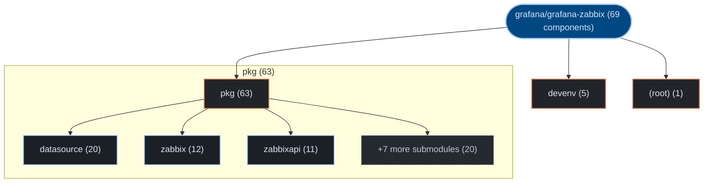

# Repository Architecture Analysis: grafana/grafana-zabbix

## Metadata
- **SHA**: `4e486f090c036b2db61547da01eb60edc167095d`
- **Primary Ecosystem**: Go

## Quality Metrics
- **ast_engine**: tree-sitter
- **avg_cognitive_complexity**: 1.09
- **avg_cyclomatic_complexity**: 1.77
- **component_count**: 69
- **dead_code_count**: 0
- **dead_code_symbols**: 0 entry(ies)
- **duplication_pct**: 1.99
- **file_complexities**: 15 entry(ies)
- **files_analyzed**: 84
- **fitness_passed**: True
- **fitness_violation_count**: 0
- **framework**: Unknown
- **import_edges**: 49 entry(ies)
- **loc**: 11513
- **max_cognitive_complexity**: 8
- **max_cyclomatic_complexity**: 9
- **sloc**: 8972
- **test_file_count**: 65

# Architecture: grafana/grafana-zabbix

## Context
- **Repository**: `grafana/grafana-zabbix`
- **SHA**: `4e486f090c036b2db61547da01eb60edc167095d`
- **Ecosystem**: Go
- **Framework**: Unknown

## Building Block View

## Component Details

Showing top 60 representative components out of 69 across 3 module group(s):

- **Module `pkg`** (63 components — module: 63)
- **Module `devenv`** (5 components — module: 5)
- **Module `(root)`** (1 components — module: 1)

- **Magefile** (`Magefile.go`): module
- **agg_functions** (`pkg/timeseries/agg_functions.go`): module
- **align** (`pkg/timeseries/align.go`): module
- **auth** (`pkg/datasource/auth.go`): module
- **auth_recovery_test** (`pkg/datasource/auth_recovery_test.go`): module
- **auth_test** (`pkg/datasource/auth_test.go`): module
- **cache** (`pkg/cache/cache.go`): module
- **cache** (`pkg/zabbix/cache.go`): module
- **cache_partition_test** (`pkg/zabbix/cache_partition_test.go`): module
- **context_auth_test** (`pkg/zabbixapi/context_auth_test.go`): module
- **datasource** (`pkg/datasource/datasource.go`): module
- **datasource_test** (`pkg/datasource/datasource_test.go`): module
- **docker-compose** (`devenv/zabbix50/docker-compose.yml`): module
- **docker-compose** (`devenv/zabbix60/docker-compose.yml`): module
- **docker-compose** (`devenv/zabbix70/docker-compose.yml`): module
- **docker-compose** (`devenv/zabbix72/docker-compose.yml`): module
- **docker-compose** (`devenv/zabbix74/docker-compose.yml`): module
- **functions** (`pkg/datasource/functions.go`): module
- **functions_test** (`pkg/datasource/functions_test.go`): module
- **grpc_settings** (`pkg/grpc_settings.go`): module
- **grpc_settings_test** (`pkg/grpc_settings_test.go`): module
- **gtime** (`pkg/gtime/gtime.go`): module
- **guardrails** (`pkg/datasource/guardrails.go`): module
- **guardrails_test** (`pkg/datasource/guardrails_test.go`): module
- **handler_smoke_test** (`pkg/datasource/handler_smoke_test.go`): module
- **httpclient** (`pkg/httpclient/httpclient.go`): module
- **methods** (`pkg/zabbix/methods.go`): module
- **methods_test** (`pkg/zabbix/methods_test.go`): module
- **metrics** (`pkg/metrics/metrics.go`): module
- **migration** (`pkg/zabbixapi/migration.go`): module
- **models** (`pkg/datasource/models.go`): module
- **models** (`pkg/settings/models.go`): module
- **models** (`pkg/timeseries/models.go`): module
- **models** (`pkg/zabbix/models.go`): module
- **moving_average** (`pkg/timeseries/moving_average.go`): module
- **perusertoken_test** (`pkg/zabbix/perusertoken_test.go`): module
- **plugin** (`pkg/plugin.go`): module
- **plugin_test** (`pkg/plugin_test.go`): module
- **resource_allowlist** (`pkg/datasource/resource_allowlist.go`): module
- **resource_allowlist_test** (`pkg/datasource/resource_allowlist_test.go`): module
- **resource_authz_test** (`pkg/datasource/resource_authz_test.go`): module
- **resource_handler** (`pkg/datasource/resource_handler.go`): module
- **resource_handler_test** (`pkg/datasource/resource_handler_test.go`): module
- **response_handler** (`pkg/datasource/response_handler.go`): module
- **response_handler_test** (`pkg/datasource/response_handler_test.go`): module
- **settings** (`pkg/settings/settings.go`): module
- **settings_test** (`pkg/settings/settings_test.go`): module
- **sort** (`pkg/timeseries/sort.go`): module
- **testing** (`pkg/zabbix/testing.go`): module
- **testing** (`pkg/zabbixapi/testing.go`): module
- **timeseries** (`pkg/timeseries/timeseries.go`): module
- **token_cache** (`pkg/cache/token_cache.go`): module
- **token_cache_test** (`pkg/cache/token_cache_test.go`): module
- **token_test** (`pkg/zabbixapi/token_test.go`): module
- **transform_functions** (`pkg/timeseries/transform_functions.go`): module
- **type_converters** (`pkg/zabbix/type_converters.go`): module
- **utils** (`pkg/zabbix/utils.go`): module
- **utils_test** (`pkg/zabbix/utils_test.go`): module
- **zabbix** (`pkg/datasource/zabbix.go`): module
- **zabbix** (`pkg/zabbix/zabbix.go`): module

## 6-Dimension Repository Scorecard

- **Overall Grade**: `B` (85.75/100)
- **Technical Debt Score**: 14.25
- **Estimated Remediation Effort**: 11.46h

| Dimension | Grade | Score | Weight | Details |
| :--- | :---: | :---: | :---: | :--- |
| Code Quality | `A` | 97.02 | 0.20 | avg_cc=1.77, max_cc=9, duplication=1.99%, dead_code=0 |
| Dependency Health | `A` | 100.00 | 0.15 | dependencies=1524, outdated=0, vulnerable=0, has_lockfile=True |
| Maintainability | `A` | 100.00 | 0.15 | avg_cognitive=1.09, max_cognitive=8, fitness_violations=0, oversized_files=0 |
| Pipeline Health | `F` | 39.00 | 0.15 | workflows=7, operational_antipatterns=9, parallel_branches=False |
| Security | `A` | 100.00 | 0.20 | vulnerabilities=0, secrets=0, pipeline_security_findings=0 |
| Test Coverage | `C` | 70.00 | 0.15 | coverage=unavailable, ci_test_job=True, test_files_detected=True |

## Supply Chain Dependencies, Vulnerabilities & Secrets

- **Dependencies Parsed**: 1524 | **Vulnerabilities**: 0 | **Secrets**: 0

### Inventory Sample
- `github.com/bitly/go-simplejson` `0.5.1` (golang, `go.mod`)
- `github.com/dlclark/regexp2` `1.12.0` (golang, `go.mod`)
- `github.com/grafana/grafana-plugin-sdk-go` `0.298.0` (golang, `go.mod`)
- `github.com/patrickmn/go-cache` `2.1.0+incompatible` (golang, `go.mod`)
- `github.com/prometheus/client_golang` `1.25.0` (golang, `go.mod`)
- `github.com/stretchr/testify` `1.12.1` (golang, `go.mod`)
- `golang.org/x/net` `0.62.0` (golang, `go.mod`)
- `golang.org/x/sync` `0.25.0` (golang, `go.mod`)
- `gotest.tools` `2.2.0+incompatible` (golang, `go.mod`)
- `@changesets/cli` `3.0.3` (npm, `package-lock.json`)
- `@changesets/cli` `3.0.3` (npm, `package.json`)
- `@emotion/css` `11.13.5` (npm, `package-lock.json`)
- `@emotion/css` `11.13.5` (npm, `package.json`)
- `@grafana/data` `13.1.9` (npm, `package-lock.json`)
- `@grafana/data` `13.1.9` (npm, `package.json`)
- `@grafana/eslint-config` `9.0.0` (npm, `package-lock.json`)
- `@grafana/eslint-config` `9.0.0` (npm, `package.json`)
- `@grafana/plugin-e2e` `4.0.0` (npm, `package-lock.json`)
- `@grafana/plugin-e2e` `4.0.0` (npm, `package.json`)
- `@grafana/plugin-ui` `0.17.3` (npm, `package-lock.json`)
- `@grafana/plugin-ui` `0.17.3` (npm, `package.json`)
- `@grafana/runtime` `13.1.9` (npm, `package-lock.json`)
- `@grafana/runtime` `13.1.9` (npm, `package.json`)
- `@grafana/schema` `13.1.9` (npm, `package-lock.json`)
- `@grafana/schema` `13.1.9` (npm, `package.json`)
- `@grafana/sign-plugin` `3.3.3` (npm, `package-lock.json`)
- `@grafana/sign-plugin` `3.3.3` (npm, `package.json`)
- `@grafana/tsconfig` `2.2.0` (npm, `package-lock.json`)
- `@grafana/tsconfig` `2.2.0` (npm, `package.json`)
- `@grafana/ui` `13.1.9` (npm, `package-lock.json`)
- ... (+1494 more dependencies)

## Section 7: Code-to-Cloud Deployment Traceability

```mermaid
flowchart LR
    classDef atlasCategory fill:#212428,stroke:#E87A48,stroke-width:1.5px,color:#dfe3eb
    classDef atlasWorkflow fill:#1b2026,stroke:#a3c9ff,stroke-width:1.5px,color:#dfe3eb
    classDef atlasJob fill:#171c22,stroke:#8d9199,stroke-width:1px,color:#dfe3eb
    classDef atlasTarget fill:#005227,stroke:#8bd99b,stroke-width:1.5px,color:#a7f6b6
    subgraph code_modules["Code Modules"]
        mod__config[".config"]:::atlasCategory
        mod_39ef70e7_6540_4e14_b7de_419996ebf995["39ef70e7-6540-4e14-b7de-419996ebf995"]:::atlasCategory
        mod_devenv_zabbix50["devenv/zabbix50"]:::atlasCategory
        mod_devenv_zabbix50_bootstrap["devenv/zabbix50/bootstrap"]:::atlasCategory
        mod_devenv_zabbix60["devenv/zabbix60"]:::atlasCategory
        mod_devenv_zabbix60_bootstrap["devenv/zabbix60/bootstrap"]:::atlasCategory
        mod_devenv_zabbix70["devenv/zabbix70"]:::atlasCategory
        mod_devenv_zabbix70_bootstrap["devenv/zabbix70/bootstrap"]:::atlasCategory
        mod_devenv_zabbix72["devenv/zabbix72"]:::atlasCategory
        mod_devenv_zabbix72_bootstrap["devenv/zabbix72/bootstrap"]:::atlasCategory
        mod_devenv_zabbix74["devenv/zabbix74"]:::atlasCategory
        mod_devenv_zabbix74_bootstrap["devenv/zabbix74/bootstrap"]:::atlasCategory
        mod_devenv_zas_agent["devenv/zas-agent"]:::atlasCategory
    end
    subgraph build_artifacts["Build Artifacts / Containers"]
        art__config_Dockerfile[".config/Dockerfile"]:::atlasWorkflow
        art__config_docker_compose_base_yaml[".config/docker-compose-base.yaml"]:::atlasWorkflow
        art_devenv_zabbix50_bootstrap_Dockerfile["devenv/zabbix50/bootstrap/Dockerfile"]:::atlasWorkflow
        art_devenv_zabbix50_docker_compose_yml["devenv/zabbix50/docker-compose.yml"]:::atlasWorkflow
        art_devenv_zabbix60_bootstrap_Dockerfile["devenv/zabbix60/bootstrap/Dockerfile"]:::atlasWorkflow
        art_devenv_zabbix60_docker_compose_yml["devenv/zabbix60/docker-compose.yml"]:::atlasWorkflow
        art_devenv_zabbix70_bootstrap_Dockerfile["devenv/zabbix70/bootstrap/Dockerfile"]:::atlasWorkflow
        art_devenv_zabbix70_docker_compose_yml["devenv/zabbix70/docker-compose.yml"]:::atlasWorkflow
        art_devenv_zabbix72_bootstrap_Dockerfile["devenv/zabbix72/bootstrap/Dockerfile"]:::atlasWorkflow
        art_devenv_zabbix72_docker_compose_yml["devenv/zabbix72/docker-compose.yml"]:::atlasWorkflow
        art_devenv_zabbix74_bootstrap_Dockerfile["devenv/zabbix74/bootstrap/Dockerfile"]:::atlasWorkflow
        art_devenv_zabbix74_docker_compose_yml["devenv/zabbix74/docker-compose.yml"]:::atlasWorkflow
        art_devenv_zas_agent_Dockerfile["devenv/zas-agent/Dockerfile"]:::atlasWorkflow
        art_docker_compose_yml["docker-compose.yml"]:::atlasWorkflow
    end
    subgraph ci_jobs["CI/CD Jobs"]
        job_integration_yml_integration["integration.yml#integration"]:::atlasJob
    end
    mod__config -->|PACKAGED_BY| art__config_Dockerfile
    mod__config -->|PACKAGED_BY| art__config_docker_compose_base_yaml
    mod__config -->|PACKAGED_BY| art_devenv_zabbix50_docker_compose_yml
    mod__config -->|PACKAGED_BY| art_devenv_zabbix60_docker_compose_yml
    mod__config -->|PACKAGED_BY| art_devenv_zabbix70_docker_compose_yml
    mod__config -->|PACKAGED_BY| art_devenv_zabbix72_docker_compose_yml
    mod__config -->|PACKAGED_BY| art_devenv_zabbix74_docker_compose_yml
    mod__config -->|PACKAGED_BY| art_docker_compose_yml
    mod_39ef70e7_6540_4e14_b7de_419996ebf995 -->|PACKAGED_BY| art__config_docker_compose_base_yaml
    mod_39ef70e7_6540_4e14_b7de_419996ebf995 -->|PACKAGED_BY| art_docker_compose_yml
    mod_devenv_zabbix50 -->|PACKAGED_BY| art_devenv_zabbix50_docker_compose_yml
    mod_devenv_zabbix50_bootstrap -->|PACKAGED_BY| art__config_Dockerfile
    mod_devenv_zabbix50_bootstrap -->|PACKAGED_BY| art_devenv_zabbix50_bootstrap_Dockerfile
    mod_devenv_zabbix50_bootstrap -->|PACKAGED_BY| art_devenv_zabbix50_docker_compose_yml
    mod_devenv_zabbix50_bootstrap -->|PACKAGED_BY| art_devenv_zabbix60_bootstrap_Dockerfile
    mod_devenv_zabbix50_bootstrap -->|PACKAGED_BY| art_devenv_zabbix60_docker_compose_yml
    mod_devenv_zabbix50_bootstrap -->|PACKAGED_BY| art_devenv_zabbix70_bootstrap_Dockerfile
    mod_devenv_zabbix50_bootstrap -->|PACKAGED_BY| art_devenv_zabbix70_docker_compose_yml
    mod_devenv_zabbix50_bootstrap -->|PACKAGED_BY| art_devenv_zabbix72_bootstrap_Dockerfile
    mod_devenv_zabbix50_bootstrap -->|PACKAGED_BY| art_devenv_zabbix72_docker_compose_yml
    mod_devenv_zabbix50_bootstrap -->|PACKAGED_BY| art_devenv_zabbix74_bootstrap_Dockerfile
    mod_devenv_zabbix50_bootstrap -->|PACKAGED_BY| art_devenv_zabbix74_docker_compose_yml
    mod_devenv_zabbix60 -->|PACKAGED_BY| art_devenv_zabbix60_docker_compose_yml
    mod_devenv_zabbix60_bootstrap -->|PACKAGED_BY| art__config_Dockerfile
    mod_devenv_zabbix60_bootstrap -->|PACKAGED_BY| art_devenv_zabbix50_bootstrap_Dockerfile
    mod_devenv_zabbix60_bootstrap -->|PACKAGED_BY| art_devenv_zabbix50_docker_compose_yml
    mod_devenv_zabbix60_bootstrap -->|PACKAGED_BY| art_devenv_zabbix60_bootstrap_Dockerfile
    mod_devenv_zabbix60_bootstrap -->|PACKAGED_BY| art_devenv_zabbix60_docker_compose_yml
    mod_devenv_zabbix60_bootstrap -->|PACKAGED_BY| art_devenv_zabbix70_bootstrap_Dockerfile
    mod_devenv_zabbix60_bootstrap -->|PACKAGED_BY| art_devenv_zabbix70_docker_compose_yml
    mod_devenv_zabbix60_bootstrap -->|PACKAGED_BY| art_devenv_zabbix72_bootstrap_Dockerfile
    mod_devenv_zabbix60_bootstrap -->|PACKAGED_BY| art_devenv_zabbix72_docker_compose_yml
    mod_devenv_zabbix60_bootstrap -->|PACKAGED_BY| art_devenv_zabbix74_bootstrap_Dockerfile
    mod_devenv_zabbix60_bootstrap -->|PACKAGED_BY| art_devenv_zabbix74_docker_compose_yml
    mod_devenv_zabbix70 -->|PACKAGED_BY| art_devenv_zabbix70_docker_compose_yml
    mod_devenv_zabbix70_bootstrap -->|PACKAGED_BY| art__config_Dockerfile
    mod_devenv_zabbix70_bootstrap -->|PACKAGED_BY| art_devenv_zabbix50_bootstrap_Dockerfile
    mod_devenv_zabbix70_bootstrap -->|PACKAGED_BY| art_devenv_zabbix50_docker_compose_yml
    mod_devenv_zabbix70_bootstrap -->|PACKAGED_BY| art_devenv_zabbix60_bootstrap_Dockerfile
    mod_devenv_zabbix70_bootstrap -->|PACKAGED_BY| art_devenv_zabbix60_docker_compose_yml
    mod_devenv_zabbix70_bootstrap -->|PACKAGED_BY| art_devenv_zabbix70_bootstrap_Dockerfile
    mod_devenv_zabbix70_bootstrap -->|PACKAGED_BY| art_devenv_zabbix70_docker_compose_yml
    mod_devenv_zabbix70_bootstrap -->|PACKAGED_BY| art_devenv_zabbix72_bootstrap_Dockerfile
    mod_devenv_zabbix70_bootstrap -->|PACKAGED_BY| art_devenv_zabbix72_docker_compose_yml
    mod_devenv_zabbix70_bootstrap -->|PACKAGED_BY| art_devenv_zabbix74_bootstrap_Dockerfile
    mod_devenv_zabbix70_bootstrap -->|PACKAGED_BY| art_devenv_zabbix74_docker_compose_yml
    mod_devenv_zabbix72 -->|PACKAGED_BY| art_devenv_zabbix72_docker_compose_yml
    mod_devenv_zabbix72_bootstrap -->|PACKAGED_BY| art__config_Dockerfile
    mod_devenv_zabbix72_bootstrap -->|PACKAGED_BY| art_devenv_zabbix50_bootstrap_Dockerfile
    mod_devenv_zabbix72_bootstrap -->|PACKAGED_BY| art_devenv_zabbix50_docker_compose_yml
    mod_devenv_zabbix72_bootstrap -->|PACKAGED_BY| art_devenv_zabbix60_bootstrap_Dockerfile
    mod_devenv_zabbix72_bootstrap -->|PACKAGED_BY| art_devenv_zabbix60_docker_compose_yml
    mod_devenv_zabbix72_bootstrap -->|PACKAGED_BY| art_devenv_zabbix70_bootstrap_Dockerfile
    mod_devenv_zabbix72_bootstrap -->|PACKAGED_BY| art_devenv_zabbix70_docker_compose_yml
    mod_devenv_zabbix72_bootstrap -->|PACKAGED_BY| art_devenv_zabbix72_bootstrap_Dockerfile
    mod_devenv_zabbix72_bootstrap -->|PACKAGED_BY| art_devenv_zabbix72_docker_compose_yml
    mod_devenv_zabbix72_bootstrap -->|PACKAGED_BY| art_devenv_zabbix74_bootstrap_Dockerfile
    mod_devenv_zabbix72_bootstrap -->|PACKAGED_BY| art_devenv_zabbix74_docker_compose_yml
    mod_devenv_zabbix74 -->|PACKAGED_BY| art_devenv_zabbix74_docker_compose_yml
    mod_devenv_zabbix74_bootstrap -->|PACKAGED_BY| art__config_Dockerfile
    mod_devenv_zabbix74_bootstrap -->|PACKAGED_BY| art_devenv_zabbix50_bootstrap_Dockerfile
    mod_devenv_zabbix74_bootstrap -->|PACKAGED_BY| art_devenv_zabbix50_docker_compose_yml
    mod_devenv_zabbix74_bootstrap -->|PACKAGED_BY| art_devenv_zabbix60_bootstrap_Dockerfile
    mod_devenv_zabbix74_bootstrap -->|PACKAGED_BY| art_devenv_zabbix60_docker_compose_yml
    mod_devenv_zabbix74_bootstrap -->|PACKAGED_BY| art_devenv_zabbix70_bootstrap_Dockerfile
    mod_devenv_zabbix74_bootstrap -->|PACKAGED_BY| art_devenv_zabbix70_docker_compose_yml
    mod_devenv_zabbix74_bootstrap -->|PACKAGED_BY| art_devenv_zabbix72_bootstrap_Dockerfile
    mod_devenv_zabbix74_bootstrap -->|PACKAGED_BY| art_devenv_zabbix72_docker_compose_yml
    mod_devenv_zabbix74_bootstrap -->|PACKAGED_BY| art_devenv_zabbix74_bootstrap_Dockerfile
    mod_devenv_zabbix74_bootstrap -->|PACKAGED_BY| art_devenv_zabbix74_docker_compose_yml
    mod_devenv_zas_agent -->|PACKAGED_BY| art_devenv_zabbix50_docker_compose_yml
    mod_devenv_zas_agent -->|PACKAGED_BY| art_devenv_zabbix60_docker_compose_yml
    mod_devenv_zas_agent -->|PACKAGED_BY| art_devenv_zabbix70_docker_compose_yml
    mod_devenv_zas_agent -->|PACKAGED_BY| art_devenv_zabbix72_docker_compose_yml
    mod_devenv_zas_agent -->|PACKAGED_BY| art_devenv_zabbix74_docker_compose_yml
    mod_devenv_zas_agent -->|PACKAGED_BY| art_devenv_zas_agent_Dockerfile
    art_docker_compose_yml -->|BUILT_BY| job_integration_yml_integration
```

- `.config` (code_module) --[PACKAGED_BY]--> `.config/Dockerfile` (container)
- `.config` (code_module) --[PACKAGED_BY]--> `.config/docker-compose-base.yaml` (container)
- `.config` (code_module) --[PACKAGED_BY]--> `devenv/zabbix50/docker-compose.yml` (container)
- `.config` (code_module) --[PACKAGED_BY]--> `devenv/zabbix60/docker-compose.yml` (container)
- `.config` (code_module) --[PACKAGED_BY]--> `devenv/zabbix70/docker-compose.yml` (container)
- `.config` (code_module) --[PACKAGED_BY]--> `devenv/zabbix72/docker-compose.yml` (container)
- `.config` (code_module) --[PACKAGED_BY]--> `devenv/zabbix74/docker-compose.yml` (container)
- `.config` (code_module) --[PACKAGED_BY]--> `docker-compose.yml` (container)
- `39ef70e7-6540-4e14-b7de-419996ebf995` (code_module) --[PACKAGED_BY]--> `.config/docker-compose-base.yaml` (container)
- `39ef70e7-6540-4e14-b7de-419996ebf995` (code_module) --[PACKAGED_BY]--> `docker-compose.yml` (container)
- `devenv/zabbix50` (code_module) --[PACKAGED_BY]--> `devenv/zabbix50/docker-compose.yml` (container)
- `devenv/zabbix50/bootstrap` (code_module) --[PACKAGED_BY]--> `.config/Dockerfile` (container)
- `devenv/zabbix50/bootstrap` (code_module) --[PACKAGED_BY]--> `devenv/zabbix50/bootstrap/Dockerfile` (container)
- `devenv/zabbix50/bootstrap` (code_module) --[PACKAGED_BY]--> `devenv/zabbix50/docker-compose.yml` (container)
- `devenv/zabbix50/bootstrap` (code_module) --[PACKAGED_BY]--> `devenv/zabbix60/bootstrap/Dockerfile` (container)
- `devenv/zabbix50/bootstrap` (code_module) --[PACKAGED_BY]--> `devenv/zabbix60/docker-compose.yml` (container)
- `devenv/zabbix50/bootstrap` (code_module) --[PACKAGED_BY]--> `devenv/zabbix70/bootstrap/Dockerfile` (container)
- `devenv/zabbix50/bootstrap` (code_module) --[PACKAGED_BY]--> `devenv/zabbix70/docker-compose.yml` (container)
- `devenv/zabbix50/bootstrap` (code_module) --[PACKAGED_BY]--> `devenv/zabbix72/bootstrap/Dockerfile` (container)
- `devenv/zabbix50/bootstrap` (code_module) --[PACKAGED_BY]--> `devenv/zabbix72/docker-compose.yml` (container)
- `devenv/zabbix50/bootstrap` (code_module) --[PACKAGED_BY]--> `devenv/zabbix74/bootstrap/Dockerfile` (container)
- `devenv/zabbix50/bootstrap` (code_module) --[PACKAGED_BY]--> `devenv/zabbix74/docker-compose.yml` (container)
- `devenv/zabbix60` (code_module) --[PACKAGED_BY]--> `devenv/zabbix60/docker-compose.yml` (container)
- `devenv/zabbix60/bootstrap` (code_module) --[PACKAGED_BY]--> `.config/Dockerfile` (container)
- `devenv/zabbix60/bootstrap` (code_module) --[PACKAGED_BY]--> `devenv/zabbix50/bootstrap/Dockerfile` (container)
- `devenv/zabbix60/bootstrap` (code_module) --[PACKAGED_BY]--> `devenv/zabbix50/docker-compose.yml` (container)
- `devenv/zabbix60/bootstrap` (code_module) --[PACKAGED_BY]--> `devenv/zabbix60/bootstrap/Dockerfile` (container)
- `devenv/zabbix60/bootstrap` (code_module) --[PACKAGED_BY]--> `devenv/zabbix60/docker-compose.yml` (container)
- `devenv/zabbix60/bootstrap` (code_module) --[PACKAGED_BY]--> `devenv/zabbix70/bootstrap/Dockerfile` (container)
- `devenv/zabbix60/bootstrap` (code_module) --[PACKAGED_BY]--> `devenv/zabbix70/docker-compose.yml` (container)
- `devenv/zabbix60/bootstrap` (code_module) --[PACKAGED_BY]--> `devenv/zabbix72/bootstrap/Dockerfile` (container)
- `devenv/zabbix60/bootstrap` (code_module) --[PACKAGED_BY]--> `devenv/zabbix72/docker-compose.yml` (container)
- `devenv/zabbix60/bootstrap` (code_module) --[PACKAGED_BY]--> `devenv/zabbix74/bootstrap/Dockerfile` (container)
- `devenv/zabbix60/bootstrap` (code_module) --[PACKAGED_BY]--> `devenv/zabbix74/docker-compose.yml` (container)
- `devenv/zabbix70` (code_module) --[PACKAGED_BY]--> `devenv/zabbix70/docker-compose.yml` (container)
- `devenv/zabbix70/bootstrap` (code_module) --[PACKAGED_BY]--> `.config/Dockerfile` (container)
- `devenv/zabbix70/bootstrap` (code_module) --[PACKAGED_BY]--> `devenv/zabbix50/bootstrap/Dockerfile` (container)
- `devenv/zabbix70/bootstrap` (code_module) --[PACKAGED_BY]--> `devenv/zabbix50/docker-compose.yml` (container)
- `devenv/zabbix70/bootstrap` (code_module) --[PACKAGED_BY]--> `devenv/zabbix60/bootstrap/Dockerfile` (container)
- `devenv/zabbix70/bootstrap` (code_module) --[PACKAGED_BY]--> `devenv/zabbix60/docker-compose.yml` (container)

## CI/CD Pipeline Topology

```mermaid
graph TD;
  classDef atlasRoot fill:#004882,stroke:#a3c9ff,stroke-width:2px,color:#d3e4ff
  classDef atlasCategory fill:#212428,stroke:#E87A48,stroke-width:1.5px,color:#dfe3eb
  classDef atlasWorkflow fill:#1b2026,stroke:#a3c9ff,stroke-width:1.5px,color:#dfe3eb
  classDef atlasJob fill:#171c22,stroke:#8d9199,stroke-width:1px,color:#dfe3eb
  classDef atlasTarget fill:#005227,stroke:#8bd99b,stroke-width:1.5px,color:#a7f6b6
  classDef atlasAlert fill:#93000a,stroke:#ffb4ab,stroke-width:1.5px,color:#ffdad6
  classDef atlasMore fill:#252a31,stroke:#8d9199,stroke-dasharray:4 4,color:#c3c6cf
  pipeline_root(["grafana/grafana-zabbix (7 workflows)"]):::atlasRoot
  subgraph sg_grp_0_Scheduled___Manual["Scheduled & Manual (4 workflows · 4 jobs)"]
    direction TB
    subgraph sg_wf_1_Integration_tests["Integration tests (1 jobs)"]
      direction TB
      wf_1_Integration_tests(["Trigger: Integration tests"]):::atlasWorkflow
      job_1_integration["integration"]:::atlasJob
      wf_1_Integration_tests --> job_1_integration
    end
    pipeline_root --> wf_1_Integration_tests
    subgraph sg_wf_2_Compatibility_check["Compatibility check (1 jobs)"]
      direction TB
      wf_2_Compatibility_check(["Trigger: Compatibility check"]):::atlasWorkflow
      job_2_compatibilitycheck["compatibilitycheck"]:::atlasJob
      wf_2_Compatibility_check --> job_2_compatibilitycheck
    end
    pipeline_root --> wf_2_Compatibility_check
    subgraph sg_wf_3_Plugins___CD["Plugins - CD (1 jobs)"]
      direction TB
      wf_3_Plugins___CD(["Trigger: Plugins - CD"]):::atlasWorkflow
      job_3_cd["cd"]:::atlasJob
      wf_3_Plugins___CD --> job_3_cd
    end
    pipeline_root --> wf_3_Plugins___CD
    subgraph sg_wf_6_Create_Plugin_Update["Create Plugin Update (1 jobs)"]
      direction TB
      wf_6_Create_Plugin_Update(["Trigger: Create Plugin Update"]):::atlasWorkflow
      job_6_release["release"]:::atlasJob
      wf_6_Create_Plugin_Update --> job_6_release
    end
    pipeline_root --> wf_6_Create_Plugin_Update
  end
  subgraph sg_grp_1_CI___Verification["CI & Verification (2 workflows · 2 jobs)"]
    direction TB
    subgraph sg_wf_0_Add_issues___PRs_to_Grafana_Data_Source_Plugins_Squad_project["Add issues & PRs to Grafana Data Source Plugins Squad project (1 jobs)"]
      direction TB
      wf_0_Add_issues___PRs_to_Grafana_Data_Source_Plugins_Squad_project(["Trigger: Add issues & PRs to Grafana Data Source Plugins Squad project"]):::atlasWorkflow
      job_0_add_to_project["add-to-project"]:::atlasJob
      wf_0_Add_issues___PRs_to_Grafana_Data_Source_Plugins_Squad_project --> job_0_add_to_project
    end
    pipeline_root --> wf_0_Add_issues___PRs_to_Grafana_Data_Source_Plugins_Squad_project
    subgraph sg_wf_4_Plugins___CI["Plugins - CI (1 jobs)"]
      direction TB
      wf_4_Plugins___CI(["Trigger: Plugins - CI"]):::atlasWorkflow
      job_4_ci["ci"]:::atlasJob
      wf_4_Plugins___CI --> job_4_ci
    end
    pipeline_root --> wf_4_Plugins___CI
  end
  subgraph sg_grp_2_Security___Governance["Security & Governance (1 workflows · 1 jobs)"]
    direction TB
    subgraph sg_wf_5_Close_stale_issues_and_PRs["Close stale issues and PRs (1 jobs)"]
      direction TB
      wf_5_Close_stale_issues_and_PRs(["Trigger: Close stale issues and PRs"]):::atlasWorkflow
      job_5_stale["stale"]:::atlasJob
      wf_5_Close_stale_issues_and_PRs --> job_5_stale
    end
    pipeline_root --> wf_5_Close_stale_issues_and_PRs
  end
```

