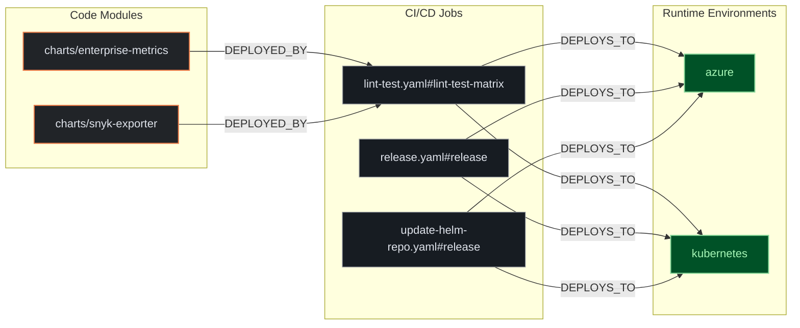

# Repository Architecture Analysis: grafana/helm-charts

## Metadata
- **SHA**: `89a1e8bb7dcd6307d1cc927008c1cafb10aecceb`
- **Primary Ecosystem**: Container / Helm / IaC

## Quality Metrics
- **ast_engine**: fallback
- **avg_cognitive_complexity**: 0.0
- **avg_cyclomatic_complexity**: 0.0
- **component_count**: 253
- **dead_code_count**: 0
- **dead_code_symbols**: 0 entry(ies)
- **duplication_pct**: 0.0
- **file_complexities**: 0 entry(ies)
- **files_analyzed**: 253
- **fitness_passed**: True
- **fitness_violation_count**: 0
- **framework**: Helm Chart
- **import_edges**: 0 entry(ies)
- **loc**: 25215
- **max_cognitive_complexity**: 0
- **max_cyclomatic_complexity**: 0
- **sloc**: 22482
- **test_file_count**: 4

# Architecture: grafana/helm-charts

## Context
- **Repository**: `grafana/helm-charts`
- **SHA**: `89a1e8bb7dcd6307d1cc927008c1cafb10aecceb`
- **Ecosystem**: Container / Helm / IaC
- **Framework**: Helm Chart

## Building Block View

```mermaid
graph TD;
  classDef atlasRoot fill:#004882,stroke:#a3c9ff,stroke-width:2px,color:#d3e4ff
  classDef atlasCategory fill:#212428,stroke:#E87A48,stroke-width:1.5px,color:#dfe3eb
  classDef atlasWorkflow fill:#1b2026,stroke:#a3c9ff,stroke-width:1.5px,color:#dfe3eb
  classDef atlasJob fill:#171c22,stroke:#8d9199,stroke-width:1px,color:#dfe3eb
  classDef atlasTarget fill:#005227,stroke:#8bd99b,stroke-width:1.5px,color:#a7f6b6
  classDef atlasAlert fill:#93000a,stroke:#ffb4ab,stroke-width:1.5px,color:#ffdad6
  classDef atlasMore fill:#252a31,stroke:#8d9199,stroke-dasharray:4 4,color:#c3c6cf
    repo_root(["grafana/helm-charts (253 components)"]):::atlasRoot
    subgraph sg_dir_0_charts_loki_distributed["charts/loki-distributed (93)"]
      direction TB
      dir_0_charts_loki_distributed["charts/loki-distributed (93)"]:::atlasCategory
      sub_0_0_templates["templates (86)"]:::atlasWorkflow
      dir_0_charts_loki_distributed --> sub_0_0_templates
      sub_0_1_ci["ci (4)"]:::atlasWorkflow
      dir_0_charts_loki_distributed --> sub_0_1_ci
      sub_0_2__module_root_["(module root) (3)"]:::atlasWorkflow
      dir_0_charts_loki_distributed --> sub_0_2__module_root_
    end
    repo_root --> dir_0_charts_loki_distributed
    subgraph sg_dir_1_charts_enterprise_metrics["charts/enterprise-metrics (43)"]
      direction TB
      dir_1_charts_enterprise_metrics["charts/enterprise-metrics (43)"]:::atlasCategory
      sub_1_0_templates["templates (36)"]:::atlasWorkflow
      dir_1_charts_enterprise_metrics --> sub_1_0_templates
      sub_1_1__module_root_["(module root) (6)"]:::atlasWorkflow
      dir_1_charts_enterprise_metrics --> sub_1_1__module_root_
      sub_1_2_ci["ci (1)"]:::atlasWorkflow
      dir_1_charts_enterprise_metrics --> sub_1_2_ci
    end
    repo_root --> dir_1_charts_enterprise_metrics
    subgraph sg_dir_2_charts_promtail["charts/promtail (26)"]
      direction TB
      dir_2_charts_promtail["charts/promtail (26)"]:::atlasCategory
      sub_2_0_templates["templates (19)"]:::atlasWorkflow
      dir_2_charts_promtail --> sub_2_0_templates
      sub_2_1_ci["ci (5)"]:::atlasWorkflow
      dir_2_charts_promtail --> sub_2_1_ci
      sub_2_2__module_root_["(module root) (2)"]:::atlasWorkflow
      dir_2_charts_promtail --> sub_2_2__module_root_
    end
    repo_root --> dir_2_charts_promtail
    subgraph sg_dir_3_charts_rollout_operator["charts/rollout-operator (20)"]
      direction TB
      dir_3_charts_rollout_operator["charts/rollout-operator (20)"]:::atlasCategory
      sub_3_0_templates["templates (14)"]:::atlasWorkflow
      dir_3_charts_rollout_operator --> sub_3_0_templates
      sub_3_1_charts["charts (4)"]:::atlasWorkflow
      dir_3_charts_rollout_operator --> sub_3_1_charts
      sub_3_2__module_root_["(module root) (2)"]:::atlasWorkflow
      dir_3_charts_rollout_operator --> sub_3_2__module_root_
    end
    repo_root --> dir_3_charts_rollout_operator
    subgraph sg_dir_4_charts_enterprise_logs["charts/enterprise-logs (18)"]
      direction TB
      dir_4_charts_enterprise_logs["charts/enterprise-logs (18)"]:::atlasCategory
      sub_4_0_templates["templates (14)"]:::atlasWorkflow
      dir_4_charts_enterprise_logs --> sub_4_0_templates
      sub_4_1__module_root_["(module root) (3)"]:::atlasWorkflow
      dir_4_charts_enterprise_logs --> sub_4_1__module_root_
      sub_4_2_ci["ci (1)"]:::atlasWorkflow
      dir_4_charts_enterprise_logs --> sub_4_2_ci
    end
    repo_root --> dir_4_charts_enterprise_logs
    dir_other_modules["+7 more modules (53)"]:::atlasMore
    repo_root --> dir_other_modules
```

## Component Details

Showing top 60 representative components out of 253 across 12 module group(s):

- **Module `charts/loki-distributed`** (93 components — module: 93)
- **Module `charts/enterprise-metrics`** (43 components — module: 43)
- **Module `charts/promtail`** (26 components — module: 26)
- **Module `charts/rollout-operator`** (20 components — module: 20)
- **Module `charts/enterprise-logs`** (18 components — module: 18)
- **Module `charts/agent-operator`** (15 components — module: 15)
- **Module `charts/fluent-bit`** (12 components — module: 12)
- **Module `charts/loki-canary`** (9 components — module: 9)
- **Module `charts/loki-stack`** (6 components — module: 6)
- **Module `charts/pdc-agent`** (5 components — module: 5)
- **Module `charts/grafana-sampling`** (4 components — module: 4)
- **Module `charts/lgtm-distributed`** (2 components — module: 2)

- **Chart** (`charts/agent-operator/Chart.yaml`): module
- **Chart** (`charts/enterprise-logs/Chart.yaml`): module
- **Chart** (`charts/enterprise-metrics/Chart.yaml`): module
- **Chart** (`charts/fluent-bit/Chart.yaml`): module
- **Chart** (`charts/grafana-sampling/Chart.yaml`): module
- **Chart** (`charts/lgtm-distributed/Chart.yaml`): module
- **Chart** (`charts/loki-canary/Chart.yaml`): module
- **Chart** (`charts/loki-distributed/Chart.yaml`): module
- **Chart** (`charts/loki-stack/Chart.yaml`): module
- **Chart** (`charts/pdc-agent/Chart.yaml`): module
- **Chart** (`charts/promtail/Chart.yaml`): module
- **Chart** (`charts/rollout-operator/Chart.yaml`): module
- **Chart** (`charts/rollout-operator/charts/crds/Chart.yaml`): module
- **_helpers** (`charts/enterprise-logs/templates/admin-api/_helpers.yaml`): module
- **_helpers** (`charts/enterprise-logs/templates/compactor/_helpers.yaml`): module
- **_helpers** (`charts/enterprise-logs/templates/gateway/_helpers.yaml`): module
- **_helpers** (`charts/enterprise-logs/templates/tokengen/_helpers.yaml`): module
- **admin-api-dep** (`charts/enterprise-metrics/templates/admin-api-dep.yaml`): module
- **admin-api-svc** (`charts/enterprise-metrics/templates/admin-api-svc.yaml`): module
- **alertmanager-dep** (`charts/enterprise-metrics/templates/alertmanager-dep.yaml`): module
- **alertmanager-statefulset** (`charts/enterprise-metrics/templates/alertmanager-statefulset.yaml`): module
- **alertmanager-svc** (`charts/enterprise-metrics/templates/alertmanager-svc.yaml`): module
- **alertmanager-svc-headless** (`charts/enterprise-metrics/templates/alertmanager-svc-headless.yaml`): module
- **autoscaled-deployment-values** (`charts/promtail/ci/autoscaled-deployment-values.yaml`): module
- **cache-values** (`charts/loki-distributed/ci/cache-values.yaml`): module
- **capped-large** (`charts/enterprise-metrics/capped-large.yaml`): module
- **capped-small** (`charts/enterprise-metrics/capped-small.yaml`): module
- **clusterrole** (`charts/fluent-bit/templates/clusterrole.yaml`): module
- **clusterrole** (`charts/promtail/templates/clusterrole.yaml`): module
- **clusterrolebinding** (`charts/fluent-bit/templates/clusterrolebinding.yaml`): module
- **clusterrolebinding** (`charts/promtail/templates/clusterrolebinding.yaml`): module
- **compactor-statefulset** (`charts/enterprise-metrics/templates/compactor-statefulset.yaml`): module
- **compactor-svc** (`charts/enterprise-metrics/templates/compactor-svc.yaml`): module
- **config-secret** (`charts/loki-distributed/templates/config-secret.yaml`): module
- **configmap** (`charts/fluent-bit/templates/configmap.yaml`): module
- **configmap** (`charts/loki-distributed/templates/configmap.yaml`): module
- **configmap** (`charts/promtail/templates/configmap.yaml`): module
- **configmap-gateway** (`charts/loki-distributed/templates/gateway/configmap-gateway.yaml`): module
- **configmap-ruler** (`charts/loki-distributed/templates/ruler/configmap-ruler.yaml`): module
- **configmap_deployment** (`charts/grafana-sampling/templates/configmap_deployment.yaml`): module
- **configmap_statefulset** (`charts/grafana-sampling/templates/configmap_statefulset.yaml`): module
- **daemonset** (`charts/fluent-bit/templates/daemonset.yaml`): module
- **daemonset** (`charts/loki-canary/templates/daemonset.yaml`): module
- **daemonset** (`charts/promtail/templates/daemonset.yaml`): module
- **datasources** (`charts/loki-stack/templates/datasources.yaml`): module
- **default-values** (`charts/loki-distributed/ci/default-values.yaml`): module
- **default-values** (`charts/promtail/ci/default-values.yaml`): module
- **deployment** (`charts/pdc-agent/templates/deployment.yaml`): module
- **deployment** (`charts/promtail/templates/deployment.yaml`): module
- **deployment** (`charts/rollout-operator/templates/deployment.yaml`): module
- **deployment-admin-api** (`charts/enterprise-logs/templates/admin-api/deployment-admin-api.yaml`): module
- **deployment-compactor** (`charts/loki-distributed/templates/compactor/deployment-compactor.yaml`): module
- **deployment-distributor** (`charts/loki-distributed/templates/distributor/deployment-distributor.yaml`): module
- **deployment-gateway** (`charts/enterprise-logs/templates/gateway/deployment-gateway.yaml`): module
- **deployment-gateway** (`charts/loki-distributed/templates/gateway/deployment-gateway.yaml`): module
- **deployment-ingester** (`charts/loki-distributed/templates/ingester/deployment-ingester.yaml`): module
- **deployment-querier** (`charts/loki-distributed/templates/querier/deployment-querier.yaml`): module
- **deployment-query-frontend** (`charts/loki-distributed/templates/query-frontend/deployment-query-frontend.yaml`): module
- **deployment-query-scheduler** (`charts/loki-distributed/templates/query-scheduler/deployment-query-scheduler.yaml`): module
- **deployment-ruler** (`charts/loki-distributed/templates/ruler/deployment-ruler.yaml`): module

## 6-Dimension Repository Scorecard

- **Overall Grade**: `D` (65.40/100)
- **Technical Debt Score**: 34.60
- **Estimated Remediation Effort**: 32.65h

| Dimension | Grade | Score | Weight | Details |
| :--- | :---: | :---: | :---: | :--- |
| Code Quality | `A` | 100.00 | 0.20 | avg_cc=0.00, max_cc=0, duplication=0.00%, dead_code=0 |
| Dependency Health | `A` | 90.00 | 0.15 | dependencies=0 (no manifests parsed) |
| Maintainability | `A` | 100.00 | 0.15 | avg_cognitive=0.00, max_cognitive=0, fitness_violations=0, oversized_files=0 |
| Pipeline Health | `F` | 0.00 | 0.15 | workflows=9, operational_antipatterns=19, parallel_branches=True |
| Security | `F` | 32.00 | 0.20 | vulnerabilities=0, secrets=0, pipeline_security_findings=5 |
| Test Coverage | `C` | 70.00 | 0.15 | coverage=unavailable, ci_test_job=True, test_files_detected=True |

## Section 7: Code-to-Cloud Deployment Traceability

- `lint-test.yaml#lint-test-matrix` (ci_job) --[DEPLOYS_TO]--> `azure` (environment)
- `lint-test.yaml#lint-test-matrix` (ci_job) --[DEPLOYS_TO]--> `kubernetes` (environment)
- `release.yaml#release` (ci_job) --[DEPLOYS_TO]--> `azure` (environment)
- `release.yaml#release` (ci_job) --[DEPLOYS_TO]--> `kubernetes` (environment)
- `update-helm-repo.yaml#release` (ci_job) --[DEPLOYS_TO]--> `azure` (environment)
- `update-helm-repo.yaml#release` (ci_job) --[DEPLOYS_TO]--> `kubernetes` (environment)
- `charts/enterprise-metrics` (code_module) --[DEPLOYED_BY]--> `lint-test.yaml#lint-test-matrix` (ci_job)
- `charts/snyk-exporter` (code_module) --[DEPLOYED_BY]--> `lint-test.yaml#lint-test-matrix` (ci_job)

## CI/CD Pipeline Topology

```mermaid
graph TD;
  classDef atlasRoot fill:#004882,stroke:#a3c9ff,stroke-width:2px,color:#d3e4ff
  classDef atlasCategory fill:#212428,stroke:#E87A48,stroke-width:1.5px,color:#dfe3eb
  classDef atlasWorkflow fill:#1b2026,stroke:#a3c9ff,stroke-width:1.5px,color:#dfe3eb
  classDef atlasJob fill:#171c22,stroke:#8d9199,stroke-width:1px,color:#dfe3eb
  classDef atlasTarget fill:#005227,stroke:#8bd99b,stroke-width:1.5px,color:#a7f6b6
  classDef atlasAlert fill:#93000a,stroke:#ffb4ab,stroke-width:1.5px,color:#ffdad6
  classDef atlasMore fill:#252a31,stroke:#8d9199,stroke-dasharray:4 4,color:#c3c6cf
  pipeline_root(["grafana/helm-charts (9 workflows)"]):::atlasRoot
  subgraph sg_grp_0_CI___Verification["CI & Verification (6 workflows · 9 jobs)"]
    direction TB
    subgraph sg_wf_0_Check_CODEOWNERS["Check CODEOWNERS (1 jobs)"]
      direction TB
      wf_0_Check_CODEOWNERS(["Trigger: Check CODEOWNERS"]):::atlasWorkflow
      job_0_build["build"]:::atlasJob
      wf_0_Check_CODEOWNERS --> job_0_build
    end
    pipeline_root --> wf_0_Check_CODEOWNERS
    subgraph sg_wf_1_CI["CI (3 jobs)"]
      direction TB
      wf_1_CI(["Trigger: CI"]):::atlasWorkflow
      job_1_call_check_codeowners["call-check-codeowners"]:::atlasJob
      job_1_call_lint["call-lint"]:::atlasJob
      job_1_call_lint_test["call-lint-test"]:::atlasJob
      wf_1_CI --> job_1_call_check_codeowners
      wf_1_CI --> job_1_call_lint
      wf_1_CI --> job_1_call_lint_test
    end
    pipeline_root --> wf_1_CI
    subgraph sg_wf_2_Lint_and_Test_Charts["Lint and Test Charts (2 jobs)"]
      direction TB
      wf_2_Lint_and_Test_Charts(["Trigger: Lint and Test Charts"]):::atlasWorkflow
      job_2_lint_test_matrix["lint-test-matrix"]:::atlasJob
      job_2_lint_test["lint-test"]:::atlasJob
      wf_2_Lint_and_Test_Charts --> job_2_lint_test_matrix
      job_2_lint_test_matrix --> job_2_lint_test
    end
    pipeline_root --> wf_2_Lint_and_Test_Charts
    subgraph sg_wf_3_Lint_Code_Base["Lint Code Base (1 jobs)"]
      direction TB
      wf_3_Lint_Code_Base(["Trigger: Lint Code Base"]):::atlasWorkflow
      job_3_build["build"]:::atlasJob
      wf_3_Lint_Code_Base --> job_3_build
    end
    pipeline_root --> wf_3_Lint_Code_Base
    subgraph sg_wf_6_sync_readme_yaml["sync-readme.yaml (1 jobs)"]
      direction TB
      wf_6_sync_readme_yaml(["Trigger: sync-readme.yaml"]):::atlasWorkflow
      job_6_build["build"]:::atlasJob
      wf_6_sync_readme_yaml --> job_6_build
    end
    pipeline_root --> wf_6_sync_readme_yaml
    subgraph sg_wf_8_Validate_Pull_Request["Validate Pull Request (1 jobs)"]
      direction TB
      wf_8_Validate_Pull_Request(["Trigger: Validate Pull Request"]):::atlasWorkflow
      job_8_validate["validate"]:::atlasJob
      wf_8_Validate_Pull_Request --> job_8_validate
    end
    pipeline_root --> wf_8_Validate_Pull_Request
  end
  subgraph sg_grp_1_Release___Deploy["Release & Deploy (3 workflows · 4 jobs)"]
    direction TB
    subgraph sg_wf_4_Publish_public_signing_key["Publish public signing key (1 jobs)"]
      direction TB
      wf_4_Publish_public_signing_key(["Trigger: Publish public signing key"]):::atlasWorkflow
      job_4_publish["publish"]:::atlasJob
      wf_4_Publish_public_signing_key --> job_4_publish
    end
    pipeline_root --> wf_4_Publish_public_signing_key
    subgraph sg_wf_5_Release_Charts["Release Charts (1 jobs)"]
      direction TB
      wf_5_Release_Charts(["Trigger: Release Charts"]):::atlasWorkflow
      job_5_release["release"]:::atlasJob
      wf_5_Release_Charts --> job_5_release
    end
    pipeline_root --> wf_5_Release_Charts
    subgraph sg_wf_7_Release_a_chart["Release a chart (2 jobs)"]
      direction TB
      wf_7_Release_a_chart(["Trigger: Release a chart"]):::atlasWorkflow
      job_7_setup["setup"]:::atlasJob
      job_7_release["release"]:::atlasJob
      wf_7_Release_a_chart --> job_7_setup
      job_7_setup --> job_7_release
    end
    pipeline_root --> wf_7_Release_a_chart
  end
```

