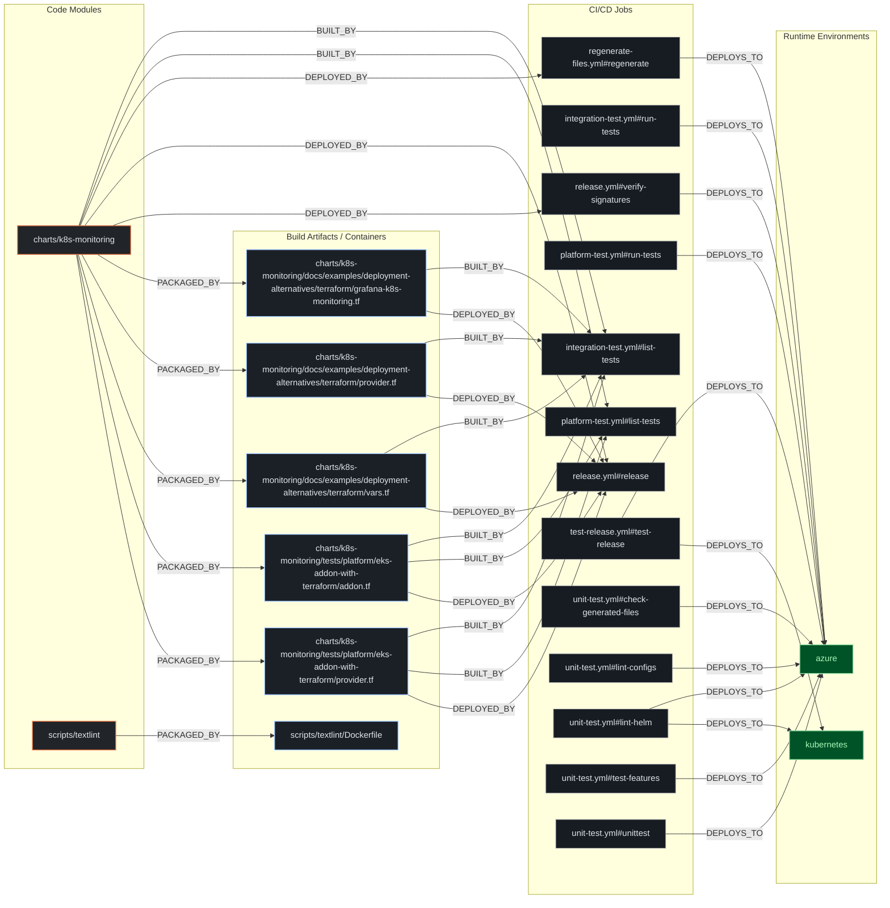

# Repository Architecture Analysis: grafana/k8s-monitoring-helm

## Metadata
- **SHA**: `765b7ef12fa6af30e65893c76878f2374a11225e`
- **Primary Ecosystem**: Container / Helm / IaC

## Quality Metrics
- **ast_engine**: fallback
- **avg_cognitive_complexity**: 0.0
- **avg_cyclomatic_complexity**: 0.0
- **component_count**: 250
- **dead_code_count**: 0
- **dead_code_symbols**: 0 entry(ies)
- **duplication_pct**: 0.0
- **file_complexities**: 0 entry(ies)
- **files_analyzed**: 888
- **fitness_passed**: True
- **fitness_violation_count**: 0
- **framework**: Helm Chart
- **import_edges**: 0 entry(ies)
- **loc**: 329290
- **max_cognitive_complexity**: 0
- **max_cyclomatic_complexity**: 0
- **sloc**: 287218
- **test_file_count**: 853

# Architecture: grafana/k8s-monitoring-helm

## Context
- **Repository**: `grafana/k8s-monitoring-helm`
- **SHA**: `765b7ef12fa6af30e65893c76878f2374a11225e`
- **Ecosystem**: Container / Helm / IaC
- **Framework**: Helm Chart

## Building Block View

```mermaid
graph TD;
  classDef atlasRoot fill:#004882,stroke:#a3c9ff,stroke-width:2px,color:#d3e4ff
  classDef atlasCategory fill:#212428,stroke:#E87A48,stroke-width:1.5px,color:#dfe3eb
  classDef atlasWorkflow fill:#1b2026,stroke:#a3c9ff,stroke-width:1.5px,color:#dfe3eb
  classDef atlasJob fill:#171c22,stroke:#8d9199,stroke-width:1px,color:#dfe3eb
  classDef atlasTarget fill:#005227,stroke:#8bd99b,stroke-width:1.5px,color:#a7f6b6
  classDef atlasAlert fill:#93000a,stroke:#ffb4ab,stroke-width:1.5px,color:#ffdad6
  classDef atlasMore fill:#252a31,stroke:#8d9199,stroke-dasharray:4 4,color:#c3c6cf
    repo_root(["grafana/k8s-monitoring-helm (250 components)"]):::atlasRoot
    dir_0_charts_k8s_monitoring_charts["charts/k8s-monitoring/charts (212)"]:::atlasCategory
    repo_root --> dir_0_charts_k8s_monitoring_charts
    sub_0_0_feature_integrations["feature-integrations (39)"]:::atlasWorkflow
    dir_0_charts_k8s_monitoring_charts --> sub_0_0_feature_integrations
    sub_0_1_feature_cluster_metrics["feature-cluster-metrics (22)"]:::atlasWorkflow
    dir_0_charts_k8s_monitoring_charts --> sub_0_1_feature_cluster_metrics
    sub_0_2_feature_host_metrics["feature-host-metrics (16)"]:::atlasWorkflow
    dir_0_charts_k8s_monitoring_charts --> sub_0_2_feature_host_metrics
    sub_0_more["+18 more submodules (135)"]:::atlasMore
    dir_0_charts_k8s_monitoring_charts --> sub_0_more
    dir_1_charts_k8s_monitoring_collectors["charts/k8s-monitoring/collectors (26)"]:::atlasCategory
    repo_root --> dir_1_charts_k8s_monitoring_collectors
    sub_1_0_presets["presets (22)"]:::atlasWorkflow
    dir_1_charts_k8s_monitoring_collectors --> sub_1_0_presets
    sub_1_1__module_root_["(module root) (3)"]:::atlasWorkflow
    dir_1_charts_k8s_monitoring_collectors --> sub_1_1__module_root_
    sub_1_2_upstream["upstream (1)"]:::atlasWorkflow
    dir_1_charts_k8s_monitoring_collectors --> sub_1_2_upstream
    dir_2_charts_k8s_monitoring["charts/k8s-monitoring (4)"]:::atlasCategory
    repo_root --> dir_2_charts_k8s_monitoring
    dir_3_charts_k8s_monitoring_destinations["charts/k8s-monitoring/destinations (4)"]:::atlasCategory
    repo_root --> dir_3_charts_k8s_monitoring_destinations
    dir_4_charts_k8s_monitoring_dataProcessors["charts/k8s-monitoring/dataProcessors (3)"]:::atlasCategory
    repo_root --> dir_4_charts_k8s_monitoring_dataProcessors
    dir_other_modules["+1 more modules (1)"]:::atlasMore
    repo_root --> dir_other_modules
```

## Component Details

Showing top 60 representative components out of 250 across 6 module group(s):

- **Module `charts/k8s-monitoring/charts`** (212 components — module: 212)
- **Module `charts/k8s-monitoring/collectors`** (26 components — module: 26)
- **Module `charts/k8s-monitoring`** (4 components — module: 4)
- **Module `charts/k8s-monitoring/destinations`** (4 components — module: 4)
- **Module `charts/k8s-monitoring/dataProcessors`** (3 components — module: 3)
- **Module `charts/k8s-monitoring/default-remove-lists`** (1 components — module: 1)

- **.ct** (`charts/k8s-monitoring/.ct.yaml`): module
- **.ct** (`charts/k8s-monitoring/charts/feature-prometheus-operator-objects/.ct.yaml`): module
- **.lintconf** (`charts/k8s-monitoring/.lintconf.yaml`): module
- **Chart** (`charts/k8s-monitoring/Chart.yaml`): module
- **Chart** (`charts/k8s-monitoring/charts/feature-annotation-autodiscovery/Chart.yaml`): module
- **Chart** (`charts/k8s-monitoring/charts/feature-application-observability/Chart.yaml`): module
- **Chart** (`charts/k8s-monitoring/charts/feature-auto-instrumentation/Chart.yaml`): module
- **Chart** (`charts/k8s-monitoring/charts/feature-cluster-events/Chart.yaml`): module
- **Chart** (`charts/k8s-monitoring/charts/feature-cluster-metrics/Chart.yaml`): module
- **Chart** (`charts/k8s-monitoring/charts/feature-cost-metrics/Chart.yaml`): module
- **Chart** (`charts/k8s-monitoring/charts/feature-host-metrics/Chart.yaml`): module
- **Chart** (`charts/k8s-monitoring/charts/feature-integrations/Chart.yaml`): module
- **Chart** (`charts/k8s-monitoring/charts/feature-kubernetes-manifests/Chart.yaml`): module
- **Chart** (`charts/k8s-monitoring/charts/feature-loki-logs-receiver/Chart.yaml`): module
- **Chart** (`charts/k8s-monitoring/charts/feature-node-logs/Chart.yaml`): module
- **Chart** (`charts/k8s-monitoring/charts/feature-pod-logs-objects/Chart.yaml`): module
- **Chart** (`charts/k8s-monitoring/charts/feature-pod-logs-via-kubernetes-api/Chart.yaml`): module
- **Chart** (`charts/k8s-monitoring/charts/feature-pod-logs-via-loki/Chart.yaml`): module
- **Chart** (`charts/k8s-monitoring/charts/feature-pod-logs-via-opentelemetry/Chart.yaml`): module
- **Chart** (`charts/k8s-monitoring/charts/feature-profiles-receiver/Chart.yaml`): module
- **Chart** (`charts/k8s-monitoring/charts/feature-profiling/Chart.yaml`): module
- **Chart** (`charts/k8s-monitoring/charts/feature-prometheus-metrics-receiver/Chart.yaml`): module
- **Chart** (`charts/k8s-monitoring/charts/feature-prometheus-operator-objects/Chart.yaml`): module
- **Chart** (`charts/k8s-monitoring/charts/feature-windows-event-logs/Chart.yaml`): module
- **Chart** (`charts/k8s-monitoring/charts/telemetry-services/Chart.yaml`): module
- **allow-arbitrary-file-access_test** (`charts/k8s-monitoring/charts/feature-prometheus-operator-objects/tests/allow-arbitrary-file-access_test.yaml`): module
- **alloy** (`charts/k8s-monitoring/charts/feature-integrations/default-allow-lists/alloy.yaml`): module
- **alloy-experimental** (`charts/k8s-monitoring/collectors/alloy-experimental.yaml`): module
- **alloy-public-preview** (`charts/k8s-monitoring/collectors/alloy-public-preview.yaml`): module
- **alloy-values** (`charts/k8s-monitoring/charts/feature-integrations/integrations/alloy-values.yaml`): module
- **alloy-values** (`charts/k8s-monitoring/collectors/alloy-values.yaml`): module
- **alloy-values** (`charts/k8s-monitoring/collectors/upstream/alloy-values.yaml`): module
- **alloy_source_test** (`charts/k8s-monitoring/charts/feature-host-metrics/tests/alloy_source_test.yaml`): module
- **alloy_test** (`charts/k8s-monitoring/charts/feature-integrations/tests/alloy_test.yaml`): module
- **alternative-discovery_test** (`charts/k8s-monitoring/charts/feature-cluster-metrics/tests/alternative-discovery_test.yaml`): module
- **beyla-scc** (`charts/k8s-monitoring/charts/feature-auto-instrumentation/templates/platform_specific/openshift/beyla-scc.yaml`): module
- **cadvisor** (`charts/k8s-monitoring/charts/feature-cluster-metrics/default-allow-lists/cadvisor.yaml`): module
- **cert-manager-values** (`charts/k8s-monitoring/charts/feature-integrations/integrations/cert-manager-values.yaml`): module
- **cert-manager_test** (`charts/k8s-monitoring/charts/feature-integrations/tests/cert-manager_test.yaml`): module
- **clustered** (`charts/k8s-monitoring/collectors/presets/clustered.yaml`): module
- **clustering_test** (`charts/k8s-monitoring/charts/feature-cluster-events/tests/clustering_test.yaml`): module
- **collector_validation_test** (`charts/k8s-monitoring/charts/feature-node-logs/tests/collector_validation_test.yaml`): module
- **collector_validation_test** (`charts/k8s-monitoring/charts/feature-pod-logs-objects/tests/collector_validation_test.yaml`): module
- **collector_validation_test** (`charts/k8s-monitoring/charts/feature-pod-logs-via-kubernetes-api/tests/collector_validation_test.yaml`): module
- **collector_validation_test** (`charts/k8s-monitoring/charts/feature-pod-logs-via-loki/tests/collector_validation_test.yaml`): module
- **collector_validation_test** (`charts/k8s-monitoring/charts/feature-pod-logs-via-opentelemetry/tests/collector_validation_test.yaml`): module
- **collector_validation_test** (`charts/k8s-monitoring/charts/feature-windows-event-logs/tests/collector_validation_test.yaml`): module
- **configmap** (`charts/k8s-monitoring/charts/feature-annotation-autodiscovery/templates/test/configmap.yaml`): module
- **configmap** (`charts/k8s-monitoring/charts/feature-application-observability/templates/test/configmap.yaml`): module
- **configmap** (`charts/k8s-monitoring/charts/feature-auto-instrumentation/templates/test/configmap.yaml`): module
- **configmap** (`charts/k8s-monitoring/charts/feature-cluster-events/templates/test/configmap.yaml`): module
- **configmap** (`charts/k8s-monitoring/charts/feature-cluster-metrics/templates/test/configmap.yaml`): module
- **configmap** (`charts/k8s-monitoring/charts/feature-cost-metrics/templates/test/configmap.yaml`): module
- **configmap** (`charts/k8s-monitoring/charts/feature-host-metrics/.debug/feature-host-metrics/templates/configmap.yaml`): module
- **configmap** (`charts/k8s-monitoring/charts/feature-host-metrics/templates/test/configmap.yaml`): module
- **configmap** (`charts/k8s-monitoring/charts/feature-integrations/templates/test/configmap.yaml`): module
- **configmap** (`charts/k8s-monitoring/charts/feature-loki-logs-receiver/templates/test/configmap.yaml`): module
- **configmap** (`charts/k8s-monitoring/charts/feature-node-logs/templates/test/configmap.yaml`): module
- **configmap** (`charts/k8s-monitoring/charts/feature-pod-logs-objects/templates/test/configmap.yaml`): module
- **configmap** (`charts/k8s-monitoring/charts/feature-pod-logs-via-kubernetes-api/templates/test/configmap.yaml`): module

## 6-Dimension Repository Scorecard

- **Overall Grade**: `D` (60.20/100)
- **Technical Debt Score**: 39.80
- **Estimated Remediation Effort**: 46.45h

| Dimension | Grade | Score | Weight | Details |
| :--- | :---: | :---: | :---: | :--- |
| Code Quality | `A` | 100.00 | 0.20 | avg_cc=0.00, max_cc=0, duplication=0.00%, dead_code=0 |
| Dependency Health | `A` | 90.00 | 0.15 | dependencies=0 (no manifests parsed) |
| Maintainability | `A` | 100.00 | 0.15 | avg_cognitive=0.00, max_cognitive=0, fitness_violations=0, oversized_files=0 |
| Pipeline Health | `F` | 0.00 | 0.15 | workflows=8, operational_antipatterns=35, parallel_branches=True |
| Security | `F` | 6.00 | 0.20 | vulnerabilities=0, secrets=1, pipeline_security_findings=5 |
| Test Coverage | `C` | 70.00 | 0.15 | coverage=unavailable, ci_test_job=True, test_files_detected=True |

## Supply Chain Dependencies, Vulnerabilities & Secrets

- **Dependencies Parsed**: 0 | **Vulnerabilities**: 0 | **Secrets**: 1

### Secret Findings (Redacted)
- **[HIGH] `ATRUSS-SEC-005`** at `charts/k8s-monitoring/tests/integration/auth/dependencies/passwords.yaml:4` (`htpasswd: YmFz***REDACTED***`)

## Section 7: Code-to-Cloud Deployment Traceability

- `integration-test.yml#run-tests` (ci_job) --[DEPLOYS_TO]--> `azure` (environment)
- `platform-test.yml#run-tests` (ci_job) --[DEPLOYS_TO]--> `azure` (environment)
- `regenerate-files.yml#regenerate` (ci_job) --[DEPLOYS_TO]--> `azure` (environment)
- `release.yml#verify-signatures` (ci_job) --[DEPLOYS_TO]--> `azure` (environment)
- `test-release.yml#test-release` (ci_job) --[DEPLOYS_TO]--> `azure` (environment)
- `test-release.yml#test-release` (ci_job) --[DEPLOYS_TO]--> `kubernetes` (environment)
- `unit-test.yml#check-generated-files` (ci_job) --[DEPLOYS_TO]--> `azure` (environment)
- `unit-test.yml#lint-configs` (ci_job) --[DEPLOYS_TO]--> `azure` (environment)
- `unit-test.yml#lint-helm` (ci_job) --[DEPLOYS_TO]--> `azure` (environment)
- `unit-test.yml#lint-helm` (ci_job) --[DEPLOYS_TO]--> `kubernetes` (environment)
- `unit-test.yml#test-features` (ci_job) --[DEPLOYS_TO]--> `azure` (environment)
- `unit-test.yml#unittest` (ci_job) --[DEPLOYS_TO]--> `azure` (environment)
- `charts/k8s-monitoring` (code_module) --[BUILT_BY]--> `integration-test.yml#list-tests` (ci_job)
- `charts/k8s-monitoring` (code_module) --[BUILT_BY]--> `platform-test.yml#list-tests` (ci_job)
- `charts/k8s-monitoring` (code_module) --[DEPLOYED_BY]--> `regenerate-files.yml#regenerate` (ci_job)
- `charts/k8s-monitoring` (code_module) --[DEPLOYED_BY]--> `release.yml#release` (ci_job)
- `charts/k8s-monitoring` (code_module) --[DEPLOYED_BY]--> `release.yml#verify-signatures` (ci_job)
- `charts/k8s-monitoring` (code_module) --[PACKAGED_BY]--> `charts/k8s-monitoring/docs/examples/deployment-alternatives/terraform/grafana-k8s-monitoring.tf` (iac)
- `charts/k8s-monitoring` (code_module) --[PACKAGED_BY]--> `charts/k8s-monitoring/docs/examples/deployment-alternatives/terraform/provider.tf` (iac)
- `charts/k8s-monitoring` (code_module) --[PACKAGED_BY]--> `charts/k8s-monitoring/docs/examples/deployment-alternatives/terraform/vars.tf` (iac)
- `charts/k8s-monitoring` (code_module) --[PACKAGED_BY]--> `charts/k8s-monitoring/tests/platform/eks-addon-with-terraform/addon.tf` (iac)
- `charts/k8s-monitoring` (code_module) --[PACKAGED_BY]--> `charts/k8s-monitoring/tests/platform/eks-addon-with-terraform/provider.tf` (iac)
- `scripts/textlint` (code_module) --[PACKAGED_BY]--> `scripts/textlint/Dockerfile` (container)
- `charts/k8s-monitoring/docs/examples/deployment-alternatives/terraform/grafana-k8s-monitoring.tf` (iac) --[BUILT_BY]--> `integration-test.yml#list-tests` (ci_job)
- `charts/k8s-monitoring/docs/examples/deployment-alternatives/terraform/grafana-k8s-monitoring.tf` (iac) --[DEPLOYED_BY]--> `release.yml#release` (ci_job)
- `charts/k8s-monitoring/docs/examples/deployment-alternatives/terraform/provider.tf` (iac) --[BUILT_BY]--> `integration-test.yml#list-tests` (ci_job)
- `charts/k8s-monitoring/docs/examples/deployment-alternatives/terraform/provider.tf` (iac) --[DEPLOYED_BY]--> `release.yml#release` (ci_job)
- `charts/k8s-monitoring/docs/examples/deployment-alternatives/terraform/vars.tf` (iac) --[BUILT_BY]--> `integration-test.yml#list-tests` (ci_job)
- `charts/k8s-monitoring/docs/examples/deployment-alternatives/terraform/vars.tf` (iac) --[DEPLOYED_BY]--> `release.yml#release` (ci_job)
- `charts/k8s-monitoring/tests/platform/eks-addon-with-terraform/addon.tf` (iac) --[BUILT_BY]--> `integration-test.yml#list-tests` (ci_job)
- `charts/k8s-monitoring/tests/platform/eks-addon-with-terraform/addon.tf` (iac) --[BUILT_BY]--> `platform-test.yml#list-tests` (ci_job)
- `charts/k8s-monitoring/tests/platform/eks-addon-with-terraform/addon.tf` (iac) --[DEPLOYED_BY]--> `release.yml#release` (ci_job)
- `charts/k8s-monitoring/tests/platform/eks-addon-with-terraform/provider.tf` (iac) --[BUILT_BY]--> `integration-test.yml#list-tests` (ci_job)
- `charts/k8s-monitoring/tests/platform/eks-addon-with-terraform/provider.tf` (iac) --[BUILT_BY]--> `platform-test.yml#list-tests` (ci_job)
- `charts/k8s-monitoring/tests/platform/eks-addon-with-terraform/provider.tf` (iac) --[DEPLOYED_BY]--> `release.yml#release` (ci_job)

## CI/CD Pipeline Topology

```mermaid
graph TD;
  classDef atlasRoot fill:#004882,stroke:#a3c9ff,stroke-width:2px,color:#d3e4ff
  classDef atlasCategory fill:#212428,stroke:#E87A48,stroke-width:1.5px,color:#dfe3eb
  classDef atlasWorkflow fill:#1b2026,stroke:#a3c9ff,stroke-width:1.5px,color:#dfe3eb
  classDef atlasJob fill:#171c22,stroke:#8d9199,stroke-width:1px,color:#dfe3eb
  classDef atlasTarget fill:#005227,stroke:#8bd99b,stroke-width:1.5px,color:#a7f6b6
  classDef atlasAlert fill:#93000a,stroke:#ffb4ab,stroke-width:1.5px,color:#ffdad6
  classDef atlasMore fill:#252a31,stroke:#8d9199,stroke-dasharray:4 4,color:#c3c6cf
  pipeline_root(["grafana/k8s-monitoring-helm (8 workflows)"]):::atlasRoot
  subgraph sg_grp_0_Scheduled___Manual["Scheduled & Manual (4 workflows · 19 jobs)"]
    direction TB
    subgraph sg_wf_0_Integration_Test["Integration Test (2 jobs)"]
      direction TB
      wf_0_Integration_Test(["Trigger: Integration Test"]):::atlasWorkflow
      job_0_list_tests["list-tests"]:::atlasJob
      job_0_run_tests["run-tests"]:::atlasJob
      wf_0_Integration_Test --> job_0_list_tests
      job_0_list_tests --> job_0_run_tests
    end
    pipeline_root --> wf_0_Integration_Test
    subgraph sg_wf_1_Lint["Lint (9 jobs)"]
      direction TB
      wf_1_Lint(["Trigger: Lint"]):::atlasWorkflow
      job_1_markdown["markdown"]:::atlasJob
      job_1_misspell["misspell"]:::atlasJob
      job_1_alex["alex"]:::atlasJob
      wf_1_Lint --> job_1_markdown
      wf_1_Lint --> job_1_misspell
      wf_1_Lint --> job_1_alex
    end
    pipeline_root --> wf_1_Lint
    subgraph sg_wf_2_Platform_Test["Platform Test (2 jobs)"]
      direction TB
      wf_2_Platform_Test(["Trigger: Platform Test"]):::atlasWorkflow
      job_2_list_tests["list-tests"]:::atlasJob
      job_2_run_tests["run-tests"]:::atlasJob
      wf_2_Platform_Test --> job_2_list_tests
      job_2_list_tests --> job_2_run_tests
    end
    pipeline_root --> wf_2_Platform_Test
    subgraph sg_wf_6_Unit_Test["Unit Test (6 jobs)"]
      direction TB
      wf_6_Unit_Test(["Trigger: Unit Test"]):::atlasWorkflow
      job_6_detect_changed_charts["detect-changed-charts"]:::atlasJob
      job_6_unittest["unittest"]:::atlasJob
      job_6_lint_helm["lint-helm"]:::atlasJob
      wf_6_Unit_Test --> job_6_detect_changed_charts
      job_6_detect_changed_charts --> job_6_unittest
      job_6_detect_changed_charts --> job_6_lint_helm
    end
    pipeline_root --> wf_6_Unit_Test
  end
  subgraph sg_grp_1_CI___Verification["CI & Verification (2 workflows · 2 jobs)"]
    direction TB
    subgraph sg_wf_3_Regenerate_Files["Regenerate Files (1 jobs)"]
      direction TB
      wf_3_Regenerate_Files(["Trigger: Regenerate Files"]):::atlasWorkflow
      job_3_regenerate["regenerate"]:::atlasJob
      wf_3_Regenerate_Files --> job_3_regenerate
    end
    pipeline_root --> wf_3_Regenerate_Files
    subgraph sg_wf_7_Verify_Commits["Verify Commits (1 jobs)"]
      direction TB
      wf_7_Verify_Commits(["Trigger: Verify Commits"]):::atlasWorkflow
      job_7_verify_commits["verify-commits"]:::atlasJob
      wf_7_Verify_Commits --> job_7_verify_commits
    end
    pipeline_root --> wf_7_Verify_Commits
  end
  subgraph sg_grp_2_Release___Deploy["Release & Deploy (2 workflows · 4 jobs)"]
    direction TB
    subgraph sg_wf_4_Release_Helm_chart["Release Helm chart (3 jobs)"]
      direction TB
      wf_4_Release_Helm_chart(["Trigger: Release Helm chart"]):::atlasWorkflow
      job_4_verify_signatures["verify-signatures"]:::atlasJob
      job_4_release_chart["release-chart"]:::atlasJob
      job_4_release["release"]:::atlasJob
      wf_4_Release_Helm_chart --> job_4_verify_signatures
      job_4_verify_signatures --> job_4_release_chart
      job_4_release_chart --> job_4_release
    end
    pipeline_root --> wf_4_Release_Helm_chart
    subgraph sg_wf_5_Test_Release["Test Release (1 jobs)"]
      direction TB
      wf_5_Test_Release(["Trigger: Test Release"]):::atlasWorkflow
      job_5_test_release["test-release"]:::atlasJob
      wf_5_Test_Release --> job_5_test_release
    end
    pipeline_root --> wf_5_Test_Release
  end
```

