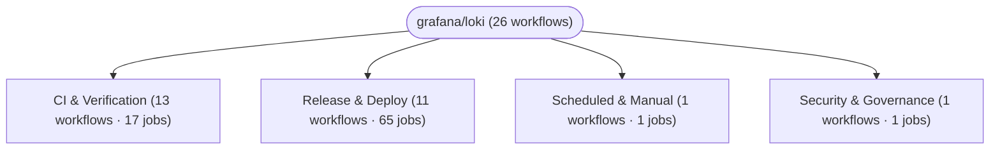

# Repository Architecture Analysis: grafana/loki

## Metadata
- **SHA**: `1dd2abbb8d672c316dd3a0d3a03f76acdc1e680f`
- **Primary Ecosystem**: Go

## Quality Metrics
- **ast_engine**: fallback
- **avg_cognitive_complexity**: 0.0
- **avg_cyclomatic_complexity**: 0.0
- **component_count**: 270
- **dead_code_count**: 0
- **dead_code_symbols**: 0 entry(ies)
- **duplication_pct**: 0.0
- **file_complexities**: 0 entry(ies)
- **files_analyzed**: 2630
- **fitness_passed**: True
- **fitness_violation_count**: 0
- **framework**: Go Service
- **import_edges**: 0 entry(ies)
- **loc**: 805635
- **max_cognitive_complexity**: 0
- **max_cyclomatic_complexity**: 0
- **sloc**: 659930
- **test_file_count**: 1083

# Architecture: grafana/loki

## Context
- **Repository**: `grafana/loki`
- **SHA**: `1dd2abbb8d672c316dd3a0d3a03f76acdc1e680f`
- **Ecosystem**: Go
- **Framework**: Go Service

## Building Block View

```mermaid
graph TD;
    repo_root(["grafana/loki (270 components)"])
    dir_0_pkg["pkg (111)"]
    repo_root --> dir_0_pkg
    sub_0_0_bloombuild["bloombuild (36)"]
    dir_0_pkg --> sub_0_0_bloombuild
    sub_0_1_bloomgateway["bloomgateway (20)"]
    dir_0_pkg --> sub_0_1_bloomgateway
    sub_0_2_columnar["columnar (20)"]
    dir_0_pkg --> sub_0_2_columnar
    sub_0_more["+3 more submodules (35)"]
    dir_0_pkg --> sub_0_more
    dir_1_clients["clients (97)"]
    repo_root --> dir_1_clients
    sub_1_0_pkg["pkg (69)"]
    dir_1_clients --> sub_1_0_pkg
    sub_1_1_cmd["cmd (28)"]
    dir_1_clients --> sub_1_1_cmd
    dir_2_cmd["cmd (41)"]
    repo_root --> dir_2_cmd
    sub_2_0_logline_util["logline-util (12)"]
    dir_2_cmd --> sub_2_0_logline_util
    sub_2_1_loki["loki (11)"]
    dir_2_cmd --> sub_2_1_loki
    sub_2_2_chunks_inspect["chunks-inspect (5)"]
    dir_2_cmd --> sub_2_2_chunks_inspect
    sub_2_more["+7 more submodules (13)"]
    dir_2_cmd --> sub_2_more
    dir_3_integration["integration (21)"]
    repo_root --> dir_3_integration
    sub_3_0__module_root_["(module root) (16)"]
    dir_3_integration --> sub_3_0__module_root_
    sub_3_1_cluster["cluster (3)"]
    dir_3_integration --> sub_3_1_cluster
    sub_3_2_client["client (1)"]
    dir_3_integration --> sub_3_2_client
    sub_3_more["+1 more submodules (1)"]
    dir_3_integration --> sub_3_more
```



## Component Details

Showing top 60 representative components out of 270 across 4 module group(s):

- **Module `pkg`** (111 components — module: 111)
- **Module `clients`** (97 components — module: 97)
- **Module `cmd`** (41 components — module: 41)
- **Module `integration`** (21 components — module: 21)

- **api** (`clients/pkg/util/api.go`): module
- **ast** (`clients/pkg/logentry/logql/ast.go`): module
- **batch** (`clients/cmd/logstash/lib/logstash/outputs/loki/batch.rb`): module
- **batch** (`clients/pkg/util/batch.go`): module
- **batch** (`pkg/bloombuild/builder/batch.go`): module
- **batch_test** (`pkg/bloombuild/builder/batch_test.go`): module
- **batched_push** (`pkg/canary/writer/batched_push.go`): module
- **bloom_building_test** (`integration/bloom_building_test.go`): module
- **bloomgateway** (`pkg/bloomgateway/bloomgateway.go`): module
- **bloomgateway_test** (`pkg/bloomgateway/bloomgateway_test.go`): module
- **buffer** (`clients/cmd/fluent-bit/buffer.go`): module
- **builder** (`pkg/bloombuild/builder/builder.go`): module
- **builder_test** (`pkg/bloombuild/builder/builder_test.go`): module
- **chunksize** (`pkg/bloombuild/planner/strategies/chunksize.go`): module
- **chunksize_test** (`pkg/bloombuild/planner/strategies/chunksize_test.go`): module
- **client** (`clients/cmd/fluent-bit/client.go`): module
- **client** (`clients/pkg/util/client.go`): module
- **client** (`integration/client/client.go`): module
- **client** (`pkg/bloomgateway/client.go`): module
- **client_pool** (`pkg/bloomgateway/client_pool.go`): module
- **client_pool_test** (`pkg/bloomgateway/client_pool_test.go`): module
- **client_test** (`pkg/bloomgateway/client_test.go`): module
- **clone** (`pkg/columnar/clone.go`): module
- **clone_test** (`pkg/columnar/clone_test.go`): module
- **cluster** (`integration/cluster/cluster.go`): module
- **columnar** (`pkg/columnar/columnar.go`): module
- **comparator** (`pkg/canary/comparator/comparator.go`): module
- **comparator_test** (`pkg/canary/comparator/comparator_test.go`): module
- **compare** (`cmd/logline-util/compare.go`): module
- **compat** (`pkg/bloombuild/protos/compat.go`): module
- **compat_test** (`pkg/bloombuild/protos/compat_test.go`): module
- **concat** (`pkg/columnar/concat.go`): module
- **concat_test** (`pkg/columnar/concat_test.go`): module
- **config** (`clients/cmd/docker-driver/config.go`): module
- **config** (`clients/cmd/fluent-bit/config.go`): module
- **config** (`clients/pkg/util/config.go`): module
- **config** (`pkg/bloombuild/builder/config.go`): module
- **config** (`pkg/bloombuild/config.go`): module
- **config** (`pkg/bloombuild/planner/config.go`): module
- **config** (`pkg/bloombuild/planner/queue/config.go`): module
- **config** (`pkg/bloomgateway/config.go`): module
- **config_labels_test** (`clients/cmd/fluent-bit/config_labels_test.go`): module
- **config_test** (`clients/cmd/docker-driver/config_test.go`): module
- **config_test** (`clients/cmd/fluent-bit/config_test.go`): module
- **convert** (`cmd/logline-util/convert.go`): module
- **convert_report** (`cmd/logline-util/convert_report.go`): module
- **convert_test** (`cmd/logline-util/convert_test.go`): module
- **counters** (`clients/pkg/logentry/metric/counters.go`): module
- **counters_test** (`clients/pkg/logentry/metric/counters_test.go`): module
- **counting_reader** (`cmd/logline-util/counting_reader.go`): module
- **datum_bool** (`pkg/columnar/datum_bool.go`): module
- **datum_null** (`pkg/columnar/datum_null.go`): module
- **datum_number** (`pkg/columnar/datum_number.go`): module
- **datum_struct** (`pkg/columnar/datum_struct.go`): module
- **datum_struct_test** (`pkg/columnar/datum_struct_test.go`): module
- **datum_test** (`pkg/columnar/datum_test.go`): module
- **datum_utf8** (`pkg/columnar/datum_utf8.go`): module
- **datum_utf8_test** (`pkg/columnar/datum_utf8_test.go`): module
- **decolorize** (`clients/pkg/logentry/stages/decolorize.go`): module
- **decolorize_test** (`clients/pkg/logentry/stages/decolorize_test.go`): module

## 6-Dimension Repository Scorecard

- **Overall Grade**: `F` (58.45/100)
- **Technical Debt Score**: 41.55
- **Estimated Remediation Effort**: 88.39h

| Dimension | Grade | Score | Weight | Details |
| :--- | :---: | :---: | :---: | :--- |
| Code Quality | `A` | 100.00 | 0.20 | avg_cc=0.00, max_cc=0, duplication=0.00%, dead_code=0 |
| Dependency Health | `B` | 85.00 | 0.15 | dependencies=398, outdated=0, vulnerable=0, has_lockfile=False |
| Maintainability | `A` | 100.00 | 0.15 | avg_cognitive=0.00, max_cognitive=0, fitness_violations=0, oversized_files=0 |
| Pipeline Health | `F` | 0.00 | 0.15 | workflows=26, operational_antipatterns=98, parallel_branches=True |
| Security | `F` | 1.00 | 0.20 | vulnerabilities=0, secrets=4, pipeline_security_findings=1 |
| Test Coverage | `C` | 70.00 | 0.15 | coverage=unavailable, ci_test_job=True, test_files_detected=True |

## Supply Chain Dependencies, Vulnerabilities & Secrets

- **Dependencies Parsed**: 398 | **Vulnerabilities**: 0 | **Secrets**: 4

### Secret Findings (Redacted)
- **[HIGH] `ATRUSS-SEC-005`** at `docs/sources/configure/examples/thanos-storage-configs.md:63` (`"private_key_id": "abcd***REDACTED***",`)
- **[CRITICAL] `ATRUSS-SEC-004`** at `docs/sources/configure/examples/thanos-storage-configs.md:64` (`-----BEGIN ... PRIVATE KEY----- [REDACTED]`)
- **[HIGH] `ATRUSS-SEC-005`** at `docs/sources/setup/install/helm/reference.md:1130` (`... "test-user-2"&lt;br&gt; passwordHash: "$2y$***REDACTED***" # generated using `htpasswd -nbBC10 te...`)
- **[HIGH] `ATRUSS-SEC-005`** at `docs/sources/setup/install/tanka.md:71` (`htpasswd_contents: 'loki***REDACTED***',`)

### Inventory Sample
- `codespell` `2.4.3` (PyPI, `vendor/go.opentelemetry.io/otel/requirements.txt`)
- `cgi` `*` (gem, `clients/cmd/logstash/Gemfile`)
- `fluent-plugin-multi-format-parser` `1.1.0` (gem, `clients/cmd/fluentd/docker/Gemfile`)
- `fluentd` `1.19.3` (gem, `clients/cmd/fluentd/docker/Gemfile`)
- `logstash-core` `*` (gem, `clients/cmd/logstash/Gemfile`)
- `logstash-core-plugin-api` `*` (gem, `clients/cmd/logstash/Gemfile`)
- `webmock` `3.8` (gem, `clients/cmd/logstash/Gemfile`)
- `cloud.google.com/go/storage` `1.70.0` (golang, `go.mod`)
- `dario.cat/mergo` `1.0.2` (golang, `go.mod`)
- `github.com/Azure/azure-sdk-for-go/sdk/azcore` `1.24.0` (golang, `go.mod`)
- `github.com/Azure/azure-sdk-for-go/sdk/azidentity` `1.15.0` (golang, `go.mod`)
- `github.com/Azure/azure-sdk-for-go/sdk/storage/azblob` `1.8.2` (golang, `go.mod`)
- `github.com/DataDog/sketches-go` `1.4.8` (golang, `go.mod`)
- `github.com/DmitriyVTitov/size` `1.5.0` (golang, `go.mod`)
- `github.com/IBM/go-sdk-core/v5` `5.25.3` (golang, `go.mod`)
- `github.com/IBM/ibm-cos-sdk-go` `1.15.2` (golang, `go.mod`)
- `github.com/Masterminds/sprig/v3` `3.3.0` (golang, `go.mod`)
- `github.com/NYTimes/gziphandler` `1.1.1` (golang, `go.mod`)
- `github.com/RoaringBitmap/roaring` `1.9.4` (golang, `go.mod`)
- `github.com/Workiva/go-datastructures` `1.1.8` (golang, `go.mod`)
- `github.com/alecthomas/chroma/v2` `2.27.0` (golang, `go.mod`)
- `github.com/alecthomas/kingpin/v2` `2.4.0` (golang, `go.mod`)
- `github.com/alicebob/miniredis/v2` `2.40.0` (golang, `go.mod`)
- `github.com/aliyun/aliyun-oss-go-sdk` `3.0.2+incompatible` (golang, `go.mod`)
- `github.com/aliyun/credentials-go` `1.4.14` (golang, `go.mod`)
- `github.com/apache/arrow-go/v18` `18.8.0` (golang, `go.mod`)
- `github.com/aws/aws-sdk-go-v2` `1.48.0` (golang, `go.mod`)
- `github.com/aws/aws-sdk-go-v2/config` `1.33.18` (golang, `go.mod`)
- `github.com/aws/aws-sdk-go-v2/credentials` `1.21.0` (golang, `go.mod`)
- `github.com/aws/aws-sdk-go-v2/service/s3` `1.114.10` (golang, `go.mod`)
- ... (+368 more dependencies)

## Section 7: Code-to-Cloud Deployment Traceability

```mermaid
flowchart LR
    subgraph code_modules["Code Modules"]
        mod_9c7bd5ec_d172_47c8_bbb4_31f9c525e9ef["9c7bd5ec-d172-47c8-bbb4-31f9c525e9ef"]
        mod_clients_cmd_docker_driver["clients/cmd/docker-driver"]
        mod_clients_cmd_fluent_bit["clients/cmd/fluent-bit"]
        mod_clients_cmd_fluentd["clients/cmd/fluentd"]
        mod_clients_cmd_fluentd_docker["clients/cmd/fluentd/docker"]
        mod_clients_cmd_logstash["clients/cmd/logstash"]
        mod_cmd_logcli["cmd/logcli"]
        mod_cmd_logql_analyzer["cmd/logql-analyzer"]
        mod_cmd_loki["cmd/loki"]
        mod_cmd_loki_canary["cmd/loki-canary"]
        mod_cmd_loki_canary_boringcrypto["cmd/loki-canary-boringcrypto"]
        mod_cmd_migrate["cmd/migrate"]
        mod_cmd_querytee["cmd/querytee"]
        mod_debug["debug"]
        mod_examples_getting_started["examples/getting-started"]
        mod_examples_ha_monolithic["examples/ha-monolithic"]
        mod_loki_build_image["loki-build-image"]
        mod_pkg_push["pkg/push"]
        mod_production_docker["production/docker"]
        mod_production_helm_loki["production/helm/loki"]
        mod_production_helm_loki_src_helm_test["production/helm/loki/src/helm-test"]
        mod_tools_dev_kafka["tools/dev/kafka"]
        mod_tools_dev_loki_tsdb_storage_s3["tools/dev/loki-tsdb-storage-s3"]
        mod_tools_kafka_plain["tools/kafka/plain"]
        mod_tools_kafka_sasl_plain["tools/kafka/sasl-plain"]
        mod_tools_kafka_sasl_scram["tools/kafka/sasl-scram"]
        mod_tools_kafka_sasl_ssl["tools/kafka/sasl-ssl"]
        mod_tools_kafka_ssl["tools/kafka/ssl"]
        mod_tools_stream_generator["tools/stream-generator"]
    end
    subgraph build_artifacts["Build Artifacts / Containers"]
        art_clients_cmd_docker_driver_Dockerfile["clients/cmd/docker-driver/Dockerfile"]
        art_clients_cmd_docker_driver_docker_compose_yaml["clients/cmd/docker-driver/docker-compose.yaml"]
        art_clients_cmd_fluent_bit_Dockerfile["clients/cmd/fluent-bit/Dockerfile"]
        art_clients_cmd_fluentd_Dockerfile["clients/cmd/fluentd/Dockerfile"]
        art_clients_cmd_fluentd_docker_docker_compose_yml["clients/cmd/fluentd/docker/docker-compose.yml"]
        art_clients_cmd_logstash_Dockerfile["clients/cmd/logstash/Dockerfile"]
        art_cmd_logcli_Dockerfile["cmd/logcli/Dockerfile"]
        art_cmd_logql_analyzer_Dockerfile["cmd/logql-analyzer/Dockerfile"]
        art_cmd_logql_analyzer_docker_compose_yaml["cmd/logql-analyzer/docker-compose.yaml"]
        art_cmd_loki_canary_boringcrypto_Dockerfile["cmd/loki-canary-boringcrypto/Dockerfile"]
        art_cmd_loki_canary_Dockerfile["cmd/loki-canary/Dockerfile"]
        art_cmd_loki_canary_Dockerfile_cross["cmd/loki-canary/Dockerfile.cross"]
        art_cmd_loki_Dockerfile["cmd/loki/Dockerfile"]
        art_cmd_loki_Dockerfile_cross["cmd/loki/Dockerfile.cross"]
        art_cmd_loki_Dockerfile_debug["cmd/loki/Dockerfile.debug"]
        art_cmd_migrate_Dockerfile["cmd/migrate/Dockerfile"]
        art_cmd_querytee_Dockerfile["cmd/querytee/Dockerfile"]
        art_debug_docker_compose_yaml["debug/docker-compose.yaml"]
        art_examples_getting_started_docker_compose_yaml["examples/getting-started/docker-compose.yaml"]
        art_examples_ha_monolithic_docker_compose_yaml["examples/ha-monolithic/docker-compose.yaml"]
        art_loki_build_image_Dockerfile["loki-build-image/Dockerfile"]
        art_production_docker_docker_compose_yaml["production/docker/docker-compose.yaml"]
        art_production_helm_loki_src_helm_test_Dockerfile["production/helm/loki/src/helm-test/Dockerfile"]
        art_production_terraform_modules_s3_main_tf["production/terraform/modules/s3/main.tf"]
        art_production_terraform_modules_s3_outputs_tf["production/terraform/modules/s3/outputs.tf"]
        art_production_terraform_modules_s3_variables_tf["production/terraform/modules/s3/variables.tf"]
        art_tools_dev_kafka_docker_compose_yaml["tools/dev/kafka/docker-compose.yaml"]
        art_tools_dev_loki_tsdb_storage_s3_docker_compose_yml["tools/dev/loki-tsdb-storage-s3/docker-compose.yml"]
        art_tools_kafka_plain_docker_compose_yml["tools/kafka/plain/docker-compose.yml"]
        art_tools_kafka_sasl_plain_docker_compose_yml["tools/kafka/sasl-plain/docker-compose.yml"]
        art_tools_kafka_sasl_scram_docker_compose_yml["tools/kafka/sasl-scram/docker-compose.yml"]
        art_tools_kafka_sasl_ssl_docker_compose_yml["tools/kafka/sasl-ssl/docker-compose.yml"]
        art_tools_kafka_ssl_docker_compose_yml["tools/kafka/ssl/docker-compose.yml"]
        art_tools_stream_generator_Dockerfile["tools/stream-generator/Dockerfile"]
        art_tools_stream_generator_docker_compose_yaml["tools/stream-generator/docker-compose.yaml"]
    end
    subgraph ci_jobs["CI/CD Jobs"]
        job_helm_ci_yml_call_test["helm-ci.yml#call-test"]
        job_helm_ci_yml_run_integration_tests["helm-ci.yml#run-integration-tests"]
        job_helm_diff_ci_yml_helm_diff["helm-diff-ci.yml#helm-diff"]
        job_helm_diff_ci_yml_summary_diff_outputs["helm-diff-ci.yml#summary-diff-outputs"]
        job_querytee_images_yml_loki_query_tee_image["querytee-images.yml#loki-query-tee-image"]
    end
    subgraph runtime_envs["Runtime Environments"]
        env_azure["azure"]
        env_kubernetes["kubernetes"]
    end
    job_helm_ci_yml_call_test -->|DEPLOYS_TO| env_azure
    job_helm_ci_yml_call_test -->|DEPLOYS_TO| env_kubernetes
    job_helm_ci_yml_run_integration_tests -->|DEPLOYS_TO| env_azure
    job_helm_ci_yml_run_integration_tests -->|DEPLOYS_TO| env_kubernetes
    job_helm_diff_ci_yml_helm_diff -->|DEPLOYS_TO| env_azure
    job_helm_diff_ci_yml_helm_diff -->|DEPLOYS_TO| env_kubernetes
    job_helm_diff_ci_yml_summary_diff_outputs -->|DEPLOYS_TO| env_kubernetes
    mod_9c7bd5ec_d172_47c8_bbb4_31f9c525e9ef -->|BUILT_BY| job_querytee_images_yml_loki_query_tee_image
    mod_9c7bd5ec_d172_47c8_bbb4_31f9c525e9ef -->|PACKAGED_BY| art_tools_dev_loki_tsdb_storage_s3_docker_compose_yml
    mod_clients_cmd_docker_driver -->|PACKAGED_BY| art_clients_cmd_docker_driver_Dockerfile
    mod_clients_cmd_docker_driver -->|PACKAGED_BY| art_clients_cmd_docker_driver_docker_compose_yaml
    mod_clients_cmd_fluent_bit -->|PACKAGED_BY| art_clients_cmd_fluent_bit_Dockerfile
    mod_clients_cmd_fluent_bit -->|PACKAGED_BY| art_clients_cmd_fluentd_docker_docker_compose_yml
    mod_clients_cmd_fluentd -->|PACKAGED_BY| art_clients_cmd_fluentd_Dockerfile
    mod_clients_cmd_fluentd -->|PACKAGED_BY| art_clients_cmd_fluentd_docker_docker_compose_yml
    mod_clients_cmd_fluentd_docker -->|PACKAGED_BY| art_clients_cmd_docker_driver_Dockerfile
    mod_clients_cmd_fluentd_docker -->|PACKAGED_BY| art_clients_cmd_docker_driver_docker_compose_yaml
    mod_clients_cmd_fluentd_docker -->|PACKAGED_BY| art_clients_cmd_fluentd_Dockerfile
    mod_clients_cmd_fluentd_docker -->|PACKAGED_BY| art_clients_cmd_fluentd_docker_docker_compose_yml
    mod_clients_cmd_fluentd_docker -->|PACKAGED_BY| art_cmd_logql_analyzer_docker_compose_yaml
    mod_clients_cmd_fluentd_docker -->|PACKAGED_BY| art_cmd_loki_canary_Dockerfile_cross
    mod_clients_cmd_fluentd_docker -->|PACKAGED_BY| art_cmd_loki_Dockerfile
    mod_clients_cmd_fluentd_docker -->|PACKAGED_BY| art_cmd_loki_Dockerfile_cross
    mod_clients_cmd_fluentd_docker -->|PACKAGED_BY| art_cmd_loki_Dockerfile_debug
    mod_clients_cmd_fluentd_docker -->|PACKAGED_BY| art_debug_docker_compose_yaml
    mod_clients_cmd_fluentd_docker -->|PACKAGED_BY| art_examples_getting_started_docker_compose_yaml
    mod_clients_cmd_fluentd_docker -->|PACKAGED_BY| art_examples_ha_monolithic_docker_compose_yaml
    mod_clients_cmd_fluentd_docker -->|PACKAGED_BY| art_tools_dev_kafka_docker_compose_yaml
    mod_clients_cmd_fluentd_docker -->|PACKAGED_BY| art_tools_dev_loki_tsdb_storage_s3_docker_compose_yml
    mod_clients_cmd_fluentd_docker -->|PACKAGED_BY| art_tools_kafka_plain_docker_compose_yml
    mod_clients_cmd_fluentd_docker -->|PACKAGED_BY| art_tools_kafka_sasl_plain_docker_compose_yml
    mod_clients_cmd_fluentd_docker -->|PACKAGED_BY| art_tools_kafka_sasl_scram_docker_compose_yml
    mod_clients_cmd_fluentd_docker -->|PACKAGED_BY| art_tools_stream_generator_docker_compose_yaml
    mod_clients_cmd_logstash -->|PACKAGED_BY| art_clients_cmd_logstash_Dockerfile
    mod_cmd_logcli -->|PACKAGED_BY| art_cmd_logcli_Dockerfile
    mod_cmd_logql_analyzer -->|PACKAGED_BY| art_cmd_logql_analyzer_Dockerfile
    mod_cmd_logql_analyzer -->|PACKAGED_BY| art_cmd_logql_analyzer_docker_compose_yaml
    mod_cmd_loki -->|PACKAGED_BY| art_clients_cmd_docker_driver_Dockerfile
    mod_cmd_loki -->|PACKAGED_BY| art_clients_cmd_docker_driver_docker_compose_yaml
    mod_cmd_loki -->|PACKAGED_BY| art_clients_cmd_fluent_bit_Dockerfile
    mod_cmd_loki -->|PACKAGED_BY| art_clients_cmd_fluentd_Dockerfile
    mod_cmd_loki -->|PACKAGED_BY| art_clients_cmd_fluentd_docker_docker_compose_yml
    mod_cmd_loki -->|PACKAGED_BY| art_clients_cmd_logstash_Dockerfile
    mod_cmd_loki -->|PACKAGED_BY| art_cmd_logcli_Dockerfile
    mod_cmd_loki -->|PACKAGED_BY| art_cmd_logql_analyzer_Dockerfile
    mod_cmd_loki -->|PACKAGED_BY| art_cmd_logql_analyzer_docker_compose_yaml
    mod_cmd_loki -->|PACKAGED_BY| art_cmd_loki_canary_boringcrypto_Dockerfile
    mod_cmd_loki -->|PACKAGED_BY| art_cmd_loki_canary_Dockerfile
    mod_cmd_loki -->|PACKAGED_BY| art_cmd_loki_canary_Dockerfile_cross
    mod_cmd_loki -->|PACKAGED_BY| art_cmd_loki_Dockerfile
    mod_cmd_loki -->|PACKAGED_BY| art_cmd_loki_Dockerfile_cross
    mod_cmd_loki -->|PACKAGED_BY| art_cmd_loki_Dockerfile_debug
    mod_cmd_loki -->|PACKAGED_BY| art_cmd_migrate_Dockerfile
    mod_cmd_loki -->|PACKAGED_BY| art_cmd_querytee_Dockerfile
    mod_cmd_loki -->|PACKAGED_BY| art_debug_docker_compose_yaml
    mod_cmd_loki -->|PACKAGED_BY| art_examples_getting_started_docker_compose_yaml
    mod_cmd_loki -->|PACKAGED_BY| art_examples_ha_monolithic_docker_compose_yaml
    mod_cmd_loki -->|PACKAGED_BY| art_loki_build_image_Dockerfile
    mod_cmd_loki -->|PACKAGED_BY| art_production_docker_docker_compose_yaml
    mod_cmd_loki -->|PACKAGED_BY| art_production_helm_loki_src_helm_test_Dockerfile
    mod_cmd_loki -->|PACKAGED_BY| art_tools_dev_kafka_docker_compose_yaml
    mod_cmd_loki -->|PACKAGED_BY| art_tools_dev_loki_tsdb_storage_s3_docker_compose_yml
    mod_cmd_loki -->|PACKAGED_BY| art_tools_stream_generator_Dockerfile
    mod_cmd_loki -->|PACKAGED_BY| art_tools_stream_generator_docker_compose_yaml
    mod_cmd_loki -->|PACKAGED_BY| art_production_terraform_modules_s3_main_tf
    mod_cmd_loki -->|PACKAGED_BY| art_production_terraform_modules_s3_outputs_tf
    mod_cmd_loki -->|PACKAGED_BY| art_production_terraform_modules_s3_variables_tf
    mod_cmd_loki_canary -->|PACKAGED_BY| art_cmd_loki_canary_boringcrypto_Dockerfile
    mod_cmd_loki_canary -->|PACKAGED_BY| art_cmd_loki_canary_Dockerfile
    mod_cmd_loki_canary -->|PACKAGED_BY| art_cmd_loki_canary_Dockerfile_cross
    mod_cmd_loki_canary_boringcrypto -->|PACKAGED_BY| art_cmd_loki_canary_boringcrypto_Dockerfile
    mod_cmd_migrate -->|PACKAGED_BY| art_cmd_migrate_Dockerfile
    mod_cmd_querytee -->|PACKAGED_BY| art_cmd_querytee_Dockerfile
    mod_debug -->|DEPLOYED_BY| job_helm_ci_yml_call_test
    mod_debug -->|DEPLOYED_BY| job_helm_ci_yml_run_integration_tests
    mod_debug -->|PACKAGED_BY| art_cmd_logcli_Dockerfile
    mod_debug -->|PACKAGED_BY| art_cmd_logql_analyzer_Dockerfile
    mod_debug -->|PACKAGED_BY| art_cmd_loki_canary_boringcrypto_Dockerfile
    mod_debug -->|PACKAGED_BY| art_cmd_loki_canary_Dockerfile
    mod_debug -->|PACKAGED_BY| art_cmd_loki_canary_Dockerfile_cross
    mod_debug -->|PACKAGED_BY| art_cmd_loki_Dockerfile_debug
    mod_debug -->|PACKAGED_BY| art_cmd_migrate_Dockerfile
    mod_debug -->|PACKAGED_BY| art_cmd_querytee_Dockerfile
    mod_debug -->|PACKAGED_BY| art_debug_docker_compose_yaml
    mod_debug -->|PACKAGED_BY| art_production_docker_docker_compose_yaml
    mod_debug -->|PACKAGED_BY| art_production_helm_loki_src_helm_test_Dockerfile
    mod_debug -->|PACKAGED_BY| art_tools_dev_loki_tsdb_storage_s3_docker_compose_yml
    mod_debug -->|PACKAGED_BY| art_tools_stream_generator_Dockerfile
    mod_debug -->|PACKAGED_BY| art_tools_stream_generator_docker_compose_yaml
    mod_examples_getting_started -->|PACKAGED_BY| art_examples_getting_started_docker_compose_yaml
    mod_examples_ha_monolithic -->|PACKAGED_BY| art_examples_ha_monolithic_docker_compose_yaml
    mod_loki_build_image -->|PACKAGED_BY| art_loki_build_image_Dockerfile
    mod_pkg_push -->|PACKAGED_BY| art_clients_cmd_docker_driver_docker_compose_yaml
    mod_pkg_push -->|PACKAGED_BY| art_examples_getting_started_docker_compose_yaml
    mod_pkg_push -->|PACKAGED_BY| art_tools_dev_kafka_docker_compose_yaml
    mod_pkg_push -->|PACKAGED_BY| art_tools_dev_loki_tsdb_storage_s3_docker_compose_yml
    mod_pkg_push -->|PACKAGED_BY| art_tools_stream_generator_docker_compose_yaml
    mod_production_docker -->|PACKAGED_BY| art_clients_cmd_docker_driver_Dockerfile
    mod_production_docker -->|PACKAGED_BY| art_clients_cmd_docker_driver_docker_compose_yaml
    mod_production_docker -->|PACKAGED_BY| art_clients_cmd_fluentd_Dockerfile
    mod_production_docker -->|PACKAGED_BY| art_clients_cmd_fluentd_docker_docker_compose_yml
    mod_production_docker -->|PACKAGED_BY| art_cmd_logql_analyzer_docker_compose_yaml
    mod_production_docker -->|PACKAGED_BY| art_cmd_loki_canary_Dockerfile_cross
    mod_production_docker -->|PACKAGED_BY| art_cmd_loki_Dockerfile
    mod_production_docker -->|PACKAGED_BY| art_cmd_loki_Dockerfile_cross
    mod_production_docker -->|PACKAGED_BY| art_cmd_loki_Dockerfile_debug
    mod_production_docker -->|PACKAGED_BY| art_debug_docker_compose_yaml
    mod_production_docker -->|PACKAGED_BY| art_examples_getting_started_docker_compose_yaml
    mod_production_docker -->|PACKAGED_BY| art_examples_ha_monolithic_docker_compose_yaml
    mod_production_docker -->|PACKAGED_BY| art_production_docker_docker_compose_yaml
    mod_production_docker -->|PACKAGED_BY| art_tools_dev_kafka_docker_compose_yaml
    mod_production_docker -->|PACKAGED_BY| art_tools_dev_loki_tsdb_storage_s3_docker_compose_yml
    mod_production_docker -->|PACKAGED_BY| art_tools_kafka_plain_docker_compose_yml
    mod_production_docker -->|PACKAGED_BY| art_tools_kafka_sasl_plain_docker_compose_yml
    mod_production_docker -->|PACKAGED_BY| art_tools_kafka_sasl_scram_docker_compose_yml
    mod_production_docker -->|PACKAGED_BY| art_tools_stream_generator_docker_compose_yaml
    mod_production_helm_loki -->|DEPLOYED_BY| job_helm_diff_ci_yml_helm_diff
    mod_production_helm_loki -->|PACKAGED_BY| art_clients_cmd_docker_driver_Dockerfile
    mod_production_helm_loki -->|PACKAGED_BY| art_clients_cmd_docker_driver_docker_compose_yaml
    mod_production_helm_loki -->|PACKAGED_BY| art_clients_cmd_fluent_bit_Dockerfile
    mod_production_helm_loki -->|PACKAGED_BY| art_clients_cmd_fluentd_Dockerfile
    mod_production_helm_loki -->|PACKAGED_BY| art_clients_cmd_fluentd_docker_docker_compose_yml
    mod_production_helm_loki -->|PACKAGED_BY| art_clients_cmd_logstash_Dockerfile
    mod_production_helm_loki -->|PACKAGED_BY| art_cmd_logcli_Dockerfile
    mod_production_helm_loki -->|PACKAGED_BY| art_cmd_logql_analyzer_Dockerfile
    mod_production_helm_loki -->|PACKAGED_BY| art_cmd_logql_analyzer_docker_compose_yaml
    mod_production_helm_loki -->|PACKAGED_BY| art_cmd_loki_canary_boringcrypto_Dockerfile
    mod_production_helm_loki -->|PACKAGED_BY| art_cmd_loki_canary_Dockerfile
    mod_production_helm_loki -->|PACKAGED_BY| art_cmd_loki_canary_Dockerfile_cross
    mod_production_helm_loki -->|PACKAGED_BY| art_cmd_loki_Dockerfile
    mod_production_helm_loki -->|PACKAGED_BY| art_cmd_loki_Dockerfile_cross
    mod_production_helm_loki -->|PACKAGED_BY| art_cmd_loki_Dockerfile_debug
    mod_production_helm_loki -->|PACKAGED_BY| art_cmd_migrate_Dockerfile
    mod_production_helm_loki -->|PACKAGED_BY| art_cmd_querytee_Dockerfile
    mod_production_helm_loki -->|PACKAGED_BY| art_debug_docker_compose_yaml
    mod_production_helm_loki -->|PACKAGED_BY| art_examples_getting_started_docker_compose_yaml
    mod_production_helm_loki -->|PACKAGED_BY| art_examples_ha_monolithic_docker_compose_yaml
    mod_production_helm_loki -->|PACKAGED_BY| art_loki_build_image_Dockerfile
    mod_production_helm_loki -->|PACKAGED_BY| art_production_docker_docker_compose_yaml
    mod_production_helm_loki -->|PACKAGED_BY| art_production_helm_loki_src_helm_test_Dockerfile
    mod_production_helm_loki -->|PACKAGED_BY| art_tools_dev_kafka_docker_compose_yaml
    mod_production_helm_loki -->|PACKAGED_BY| art_tools_dev_loki_tsdb_storage_s3_docker_compose_yml
    mod_production_helm_loki -->|PACKAGED_BY| art_tools_stream_generator_Dockerfile
    mod_production_helm_loki -->|PACKAGED_BY| art_tools_stream_generator_docker_compose_yaml
    mod_production_helm_loki -->|PACKAGED_BY| art_production_terraform_modules_s3_main_tf
    mod_production_helm_loki -->|PACKAGED_BY| art_production_terraform_modules_s3_outputs_tf
    mod_production_helm_loki -->|PACKAGED_BY| art_production_terraform_modules_s3_variables_tf
    mod_production_helm_loki_src_helm_test -->|PACKAGED_BY| art_production_helm_loki_src_helm_test_Dockerfile
    mod_tools_dev_kafka -->|PACKAGED_BY| art_tools_dev_kafka_docker_compose_yaml
    mod_tools_dev_kafka -->|PACKAGED_BY| art_tools_kafka_plain_docker_compose_yml
    mod_tools_dev_kafka -->|PACKAGED_BY| art_tools_kafka_sasl_plain_docker_compose_yml
    mod_tools_dev_kafka -->|PACKAGED_BY| art_tools_kafka_sasl_scram_docker_compose_yml
    mod_tools_dev_kafka -->|PACKAGED_BY| art_tools_kafka_sasl_ssl_docker_compose_yml
    mod_tools_dev_kafka -->|PACKAGED_BY| art_tools_kafka_ssl_docker_compose_yml
    mod_tools_dev_kafka -->|PACKAGED_BY| art_tools_stream_generator_docker_compose_yaml
    mod_tools_dev_loki_tsdb_storage_s3 -->|PACKAGED_BY| art_tools_dev_loki_tsdb_storage_s3_docker_compose_yml
    mod_tools_kafka_plain -->|PACKAGED_BY| art_tools_kafka_plain_docker_compose_yml
    mod_tools_kafka_sasl_plain -->|PACKAGED_BY| art_tools_kafka_sasl_plain_docker_compose_yml
    mod_tools_kafka_sasl_scram -->|PACKAGED_BY| art_tools_kafka_sasl_scram_docker_compose_yml
    mod_tools_kafka_sasl_ssl -->|PACKAGED_BY| art_tools_kafka_sasl_ssl_docker_compose_yml
    mod_tools_kafka_ssl -->|PACKAGED_BY| art_cmd_loki_canary_boringcrypto_Dockerfile
    mod_tools_kafka_ssl -->|PACKAGED_BY| art_cmd_loki_Dockerfile_debug
    mod_tools_kafka_ssl -->|PACKAGED_BY| art_tools_kafka_sasl_ssl_docker_compose_yml
    mod_tools_kafka_ssl -->|PACKAGED_BY| art_tools_kafka_ssl_docker_compose_yml
    mod_tools_stream_generator -->|PACKAGED_BY| art_tools_stream_generator_Dockerfile
    mod_tools_stream_generator -->|PACKAGED_BY| art_tools_stream_generator_docker_compose_yaml
    art_cmd_loki_Dockerfile -->|PACKAGED_BY| art_production_terraform_modules_s3_main_tf
    art_cmd_loki_Dockerfile -->|PACKAGED_BY| art_production_terraform_modules_s3_outputs_tf
    art_cmd_loki_Dockerfile -->|PACKAGED_BY| art_production_terraform_modules_s3_variables_tf
    art_cmd_loki_Dockerfile_cross -->|PACKAGED_BY| art_production_terraform_modules_s3_main_tf
    art_cmd_loki_Dockerfile_cross -->|PACKAGED_BY| art_production_terraform_modules_s3_outputs_tf
    art_cmd_loki_Dockerfile_cross -->|PACKAGED_BY| art_production_terraform_modules_s3_variables_tf
    art_cmd_loki_Dockerfile_debug -->|PACKAGED_BY| art_production_terraform_modules_s3_main_tf
    art_cmd_loki_Dockerfile_debug -->|PACKAGED_BY| art_production_terraform_modules_s3_outputs_tf
    art_cmd_loki_Dockerfile_debug -->|PACKAGED_BY| art_production_terraform_modules_s3_variables_tf
    art_cmd_querytee_Dockerfile -->|BUILT_BY| job_querytee_images_yml_loki_query_tee_image
```

- `helm-ci.yml#call-test` (ci_job) --[DEPLOYS_TO]--> `azure` (environment)
- `helm-ci.yml#call-test` (ci_job) --[DEPLOYS_TO]--> `kubernetes` (environment)
- `helm-ci.yml#run-integration-tests` (ci_job) --[DEPLOYS_TO]--> `azure` (environment)
- `helm-ci.yml#run-integration-tests` (ci_job) --[DEPLOYS_TO]--> `kubernetes` (environment)
- `helm-diff-ci.yml#helm-diff` (ci_job) --[DEPLOYS_TO]--> `azure` (environment)
- `helm-diff-ci.yml#helm-diff` (ci_job) --[DEPLOYS_TO]--> `kubernetes` (environment)
- `helm-diff-ci.yml#summary-diff-outputs` (ci_job) --[DEPLOYS_TO]--> `kubernetes` (environment)
- `9c7bd5ec-d172-47c8-bbb4-31f9c525e9ef` (code_module) --[BUILT_BY]--> `querytee-images.yml#loki-query-tee-image` (ci_job)
- `9c7bd5ec-d172-47c8-bbb4-31f9c525e9ef` (code_module) --[PACKAGED_BY]--> `tools/dev/loki-tsdb-storage-s3/docker-compose.yml` (container)
- `clients/cmd/docker-driver` (code_module) --[PACKAGED_BY]--> `clients/cmd/docker-driver/Dockerfile` (container)
- `clients/cmd/docker-driver` (code_module) --[PACKAGED_BY]--> `clients/cmd/docker-driver/docker-compose.yaml` (container)
- `clients/cmd/fluent-bit` (code_module) --[PACKAGED_BY]--> `clients/cmd/fluent-bit/Dockerfile` (container)
- `clients/cmd/fluent-bit` (code_module) --[PACKAGED_BY]--> `clients/cmd/fluentd/docker/docker-compose.yml` (container)
- `clients/cmd/fluentd` (code_module) --[PACKAGED_BY]--> `clients/cmd/fluentd/Dockerfile` (container)
- `clients/cmd/fluentd` (code_module) --[PACKAGED_BY]--> `clients/cmd/fluentd/docker/docker-compose.yml` (container)
- `clients/cmd/fluentd/docker` (code_module) --[PACKAGED_BY]--> `clients/cmd/docker-driver/Dockerfile` (container)
- `clients/cmd/fluentd/docker` (code_module) --[PACKAGED_BY]--> `clients/cmd/docker-driver/docker-compose.yaml` (container)
- `clients/cmd/fluentd/docker` (code_module) --[PACKAGED_BY]--> `clients/cmd/fluentd/Dockerfile` (container)
- `clients/cmd/fluentd/docker` (code_module) --[PACKAGED_BY]--> `clients/cmd/fluentd/docker/docker-compose.yml` (container)
- `clients/cmd/fluentd/docker` (code_module) --[PACKAGED_BY]--> `cmd/logql-analyzer/docker-compose.yaml` (container)
- `clients/cmd/fluentd/docker` (code_module) --[PACKAGED_BY]--> `cmd/loki-canary/Dockerfile.cross` (container)
- `clients/cmd/fluentd/docker` (code_module) --[PACKAGED_BY]--> `cmd/loki/Dockerfile` (container)
- `clients/cmd/fluentd/docker` (code_module) --[PACKAGED_BY]--> `cmd/loki/Dockerfile.cross` (container)
- `clients/cmd/fluentd/docker` (code_module) --[PACKAGED_BY]--> `cmd/loki/Dockerfile.debug` (container)
- `clients/cmd/fluentd/docker` (code_module) --[PACKAGED_BY]--> `debug/docker-compose.yaml` (container)
- `clients/cmd/fluentd/docker` (code_module) --[PACKAGED_BY]--> `examples/getting-started/docker-compose.yaml` (container)
- `clients/cmd/fluentd/docker` (code_module) --[PACKAGED_BY]--> `examples/ha-monolithic/docker-compose.yaml` (container)
- `clients/cmd/fluentd/docker` (code_module) --[PACKAGED_BY]--> `tools/dev/kafka/docker-compose.yaml` (container)
- `clients/cmd/fluentd/docker` (code_module) --[PACKAGED_BY]--> `tools/dev/loki-tsdb-storage-s3/docker-compose.yml` (container)
- `clients/cmd/fluentd/docker` (code_module) --[PACKAGED_BY]--> `tools/kafka/plain/docker-compose.yml` (container)
- `clients/cmd/fluentd/docker` (code_module) --[PACKAGED_BY]--> `tools/kafka/sasl-plain/docker-compose.yml` (container)
- `clients/cmd/fluentd/docker` (code_module) --[PACKAGED_BY]--> `tools/kafka/sasl-scram/docker-compose.yml` (container)
- `clients/cmd/fluentd/docker` (code_module) --[PACKAGED_BY]--> `tools/stream-generator/docker-compose.yaml` (container)
- `clients/cmd/logstash` (code_module) --[PACKAGED_BY]--> `clients/cmd/logstash/Dockerfile` (container)
- `cmd/logcli` (code_module) --[PACKAGED_BY]--> `cmd/logcli/Dockerfile` (container)
- `cmd/logql-analyzer` (code_module) --[PACKAGED_BY]--> `cmd/logql-analyzer/Dockerfile` (container)
- `cmd/logql-analyzer` (code_module) --[PACKAGED_BY]--> `cmd/logql-analyzer/docker-compose.yaml` (container)
- `cmd/loki` (code_module) --[PACKAGED_BY]--> `clients/cmd/docker-driver/Dockerfile` (container)
- `cmd/loki` (code_module) --[PACKAGED_BY]--> `clients/cmd/docker-driver/docker-compose.yaml` (container)
- `cmd/loki` (code_module) --[PACKAGED_BY]--> `clients/cmd/fluent-bit/Dockerfile` (container)


## CI/CD Pipeline Topology


