# Repository Architecture Analysis: grafana/mimir

## Metadata
- **SHA**: `06de3ebd2b12aa22861b96e6863b93a162c31e3c`
- **Primary Ecosystem**: Go

## Quality Metrics
- **ast_engine**: fallback
- **avg_cognitive_complexity**: 0.0
- **avg_cyclomatic_complexity**: 0.0
- **component_count**: 306
- **dead_code_count**: 0
- **dead_code_symbols**: 0 entry(ies)
- **duplication_pct**: 0.0
- **file_complexities**: 0 entry(ies)
- **files_analyzed**: 1864
- **fitness_passed**: True
- **fitness_violation_count**: 0
- **framework**: Go Service
- **import_edges**: 0 entry(ies)
- **loc**: 715023
- **max_cognitive_complexity**: 0
- **max_cyclomatic_complexity**: 0
- **sloc**: 576404
- **test_file_count**: 3210

# Architecture: grafana/mimir

## Context
- **Repository**: `grafana/mimir`
- **SHA**: `06de3ebd2b12aa22861b96e6863b93a162c31e3c`
- **Ecosystem**: Go
- **Framework**: Go Service

## Building Block View

```mermaid
graph TD;
  classDef atlasRoot fill:#004882,stroke:#a3c9ff,stroke-width:2px,color:#d3e4ff
  classDef atlasCategory fill:#212428,stroke:#E87A48,stroke-width:1.5px,color:#dfe3eb
  classDef atlasWorkflow fill:#1b2026,stroke:#a3c9ff,stroke-width:1.5px,color:#dfe3eb
  classDef atlasJob fill:#171c22,stroke:#8d9199,stroke-width:1px,color:#dfe3eb
  classDef atlasTarget fill:#005227,stroke:#8bd99b,stroke-width:1.5px,color:#a7f6b6
  classDef atlasAlert fill:#93000a,stroke:#ffb4ab,stroke-width:1.5px,color:#ffdad6
  classDef atlasMore fill:#252a31,stroke:#8d9199,stroke-dasharray:4 4,color:#c3c6cf
    repo_root(["grafana/mimir (306 components)"]):::atlasRoot
    dir_0_pkg["pkg (183)"]:::atlasCategory
    repo_root --> dir_0_pkg
    sub_0_0_compactor["compactor (55)"]:::atlasWorkflow
    dir_0_pkg --> sub_0_0_compactor
    sub_0_1_alertmanager["alertmanager (45)"]:::atlasWorkflow
    dir_0_pkg --> sub_0_1_alertmanager
    sub_0_2_blockbuilder["blockbuilder (29)"]:::atlasWorkflow
    dir_0_pkg --> sub_0_2_blockbuilder
    sub_0_more["+6 more submodules (54)"]:::atlasMore
    dir_0_pkg --> sub_0_more
    dir_1_integration["integration (57)"]:::atlasCategory
    repo_root --> dir_1_integration
    sub_1_0__module_root_["(module root) (48)"]:::atlasWorkflow
    dir_1_integration --> sub_1_0__module_root_
    sub_1_1_e2emimir["e2emimir (7)"]:::atlasWorkflow
    dir_1_integration --> sub_1_1_e2emimir
    sub_1_2_ca["ca (1)"]:::atlasWorkflow
    dir_1_integration --> sub_1_2_ca
    sub_1_more["+1 more submodules (1)"]:::atlasMore
    dir_1_integration --> sub_1_more
    dir_2_development["development (46)"]:::atlasCategory
    repo_root --> dir_2_development
    sub_2_0_mimir_microservices_mode["mimir-microservices-mode (13)"]:::atlasWorkflow
    dir_2_development --> sub_2_0_mimir_microservices_mode
    sub_2_1_mimir_monolithic_mode["mimir-monolithic-mode (10)"]:::atlasWorkflow
    dir_2_development --> sub_2_1_mimir_monolithic_mode
    sub_2_2_mimir_compartments["mimir-compartments (9)"]:::atlasWorkflow
    dir_2_development --> sub_2_2_mimir_compartments
    sub_2_more["+2 more submodules (14)"]:::atlasMore
    dir_2_development --> sub_2_more
    dir_3_cmd["cmd (7)"]:::atlasCategory
    repo_root --> dir_3_cmd
    dir_4_operations["operations (7)"]:::atlasCategory
    repo_root --> dir_4_operations
    dir_other_modules["+1 more modules (6)"]:::atlasMore
    repo_root --> dir_other_modules
```

## Component Details

Showing top 60 representative components out of 306 across 6 module group(s):

- **Module `pkg`** (183 components — module: 183)
- **Module `integration`** (57 components — module: 57)
- **Module `development`** (46 components — module: 46)
- **Module `cmd`** (7 components — module: 7)
- **Module `operations`** (7 components — module: 7)
- **Module `docs`** (6 components — module: 6)

- **active_tracker** (`pkg/costattribution/active_tracker.go`): module
- **active_tracker_test** (`pkg/costattribution/active_tracker_test.go`): module
- **activity_tracking** (`pkg/api/activity_tracking.go`): module
- **activity_tracking_test** (`pkg/api/activity_tracking_test.go`): module
- **alertmanager** (`development/mimir-microservices-mode/config/alertmanager.yaml`): module
- **alertmanager** (`pkg/alertmanager/alertmanager.go`): module
- **alertmanager-fallback-config** (`development/mimir-compartments/config/alertmanager-fallback-config.yaml`): module
- **alertmanager-fallback-config** (`development/mimir-ingest-storage/config/alertmanager-fallback-config.yaml`): module
- **alertmanager-fallback-config** (`docs/sources/mimir/get-started/play-with-grafana-mimir/config/alertmanager-fallback-config.yaml`): module
- **alertmanager.pb** (`pkg/alertmanager/alertmanagerpb/alertmanager.pb.go`): module
- **alertmanager_client** (`pkg/alertmanager/alertmanager_client.go`): module
- **alertmanager_config** (`pkg/alertmanager/alertmanager_config.go`): module
- **alertmanager_config_test** (`pkg/alertmanager/alertmanager_config_test.go`): module
- **alertmanager_grpc.pb** (`pkg/alertmanager/alertmanagerpb/alertmanager_grpc.pb.go`): module
- **alertmanager_http** (`pkg/alertmanager/alertmanager_http.go`): module
- **alertmanager_http_test** (`pkg/alertmanager/alertmanager_http_test.go`): module
- **alertmanager_metrics** (`pkg/alertmanager/alertmanager_metrics.go`): module
- **alertmanager_metrics_test** (`pkg/alertmanager/alertmanager_metrics_test.go`): module
- **alertmanager_ring** (`pkg/alertmanager/alertmanager_ring.go`): module
- **alertmanager_ring_test** (`pkg/alertmanager/alertmanager_ring_test.go`): module
- **alertmanager_template** (`pkg/alertmanager/alertmanager_template.go`): module
- **alertmanager_template_test** (`pkg/alertmanager/alertmanager_template_test.go`): module
- **alertmanager_test** (`integration/alertmanager_test.go`): module
- **alertmanager_test** (`pkg/alertmanager/alertmanager_test.go`): module
- **alerts.pb** (`pkg/alertmanager/alertspb/alerts.pb.go`): module
- **api** (`pkg/alertmanager/api.go`): module
- **api** (`pkg/api/api.go`): module
- **api_endpoints_test** (`integration/api_endpoints_test.go`): module
- **api_test** (`pkg/alertmanager/api_test.go`): module
- **api_test** (`pkg/api/api_test.go`): module
- **asserts** (`integration/asserts.go`): module
- **asserts_test** (`integration/asserts_test.go`): module
- **backfill_test** (`integration/backfill_test.go`): module
- **backward_compatibility** (`integration/backward_compatibility.go`): module
- **backward_compatibility_test** (`integration/backward_compatibility_test.go`): module
- **batch_caching_meta_fetcher** (`pkg/compactor/batch_caching_meta_fetcher.go`): module
- **batch_caching_meta_fetcher_test** (`pkg/compactor/batch_caching_meta_fetcher_test.go`): module
- **block_upload** (`pkg/compactor/block_upload.go`): module
- **block_upload_test** (`pkg/compactor/block_upload_test.go`): module
- **blockbuilder** (`pkg/blockbuilder/blockbuilder.go`): module
- **blockbuilder_test** (`pkg/blockbuilder/blockbuilder_test.go`): module
- **blocks_cleaner** (`pkg/compactor/blocks_cleaner.go`): module
- **blocks_cleaner_test** (`pkg/compactor/blocks_cleaner_test.go`): module
- **bucket_client** (`pkg/alertmanager/alertstore/bucketclient/bucket_client.go`): module
- **bucket_client_test** (`pkg/alertmanager/alertstore/bucketclient/bucket_client_test.go`): module
- **bucket_compactor** (`pkg/compactor/bucket_compactor.go`): module
- **bucket_compactor_e2e_test** (`pkg/compactor/bucket_compactor_e2e_test.go`): module
- **bucket_compactor_test** (`pkg/compactor/bucket_compactor_test.go`): module
- **ca** (`integration/ca/ca.go`): module
- **certs** (`integration/certs.go`): module
- **client** (`integration/e2emimir/client.go`): module
- **client** (`pkg/blockbuilder/schedulerpb/client.go`): module
- **client** (`pkg/continuoustest/client.go`): module
- **client_test** (`pkg/blockbuilder/schedulerpb/client_test.go`): module
- **client_test** (`pkg/continuoustest/client_test.go`): module
- **common-config** (`operations/compare-helm-with-jsonnet/components/config/common-config.yaml`): module
- **compactor** (`pkg/compactor/compactor.go`): module
- **compactor_compartments_test** (`pkg/compactor/compactor_compartments_test.go`): module
- **compactor_http** (`pkg/compactor/compactor_http.go`): module
- **compactor_ring** (`pkg/compactor/compactor_ring.go`): module

## 6-Dimension Repository Scorecard

- **Overall Grade**: `C` (76.50/100)
- **Technical Debt Score**: 23.50
- **Estimated Remediation Effort**: 9.88h

| Dimension | Grade | Score | Weight | Details |
| :--- | :---: | :---: | :---: | :--- |
| Code Quality | `A` | 100.00 | 0.20 | avg_cc=0.00, max_cc=0, duplication=0.00%, dead_code=0 |
| Dependency Health | `A` | 100.00 | 0.15 | dependencies=750, outdated=0, vulnerable=0, has_lockfile=True |
| Maintainability | `A` | 100.00 | 0.15 | avg_cognitive=0.00, max_cognitive=0, fitness_violations=0, oversized_files=0 |
| Pipeline Health | `F` | 40.00 | 0.15 | workflows=0 |
| Security | `F` | 50.00 | 0.20 | vulnerabilities=0, secrets=2, pipeline_security_findings=0 |
| Test Coverage | `C` | 70.00 | 0.15 | coverage=unavailable, ci_test_job=False, test_files_detected=True |

## Supply Chain Dependencies, Vulnerabilities & Secrets

- **Dependencies Parsed**: 750 | **Vulnerabilities**: 0 | **Secrets**: 2

### Secret Findings (Redacted)
- **[CRITICAL] `ATRUSS-SEC-004`** at `cmd/mimir/main_test.go:369` (`-----BEGIN ... PRIVATE KEY----- [REDACTED]`)
- **[CRITICAL] `ATRUSS-SEC-004`** at `docs/sources/mimir/configure/configure-object-storage-backend.md:102` (`-----BEGIN ... PRIVATE KEY----- [REDACTED]`)

### Inventory Sample
- `codespell` `2.4.3` (PyPI, `vendor/go.opentelemetry.io/otel/requirements.txt`)
- `cloud.google.com/go/storage` `1.62.3` (golang, `go.mod`)
- `github.com/Azure/azure-sdk-for-go/sdk/storage/azblob` `1.8.3` (golang, `go.mod`)
- `github.com/DmitriyVTitov/size` `1.5.0` (golang, `go.mod`)
- `github.com/alecthomas/chroma/v2` `2.27.0` (golang, `go.mod`)
- `github.com/alecthomas/kingpin/v2` `2.4.0` (golang, `go.mod`)
- `github.com/alecthomas/units` `0.0.0-20240927000941-0f3dac36c52b` (golang, `go.mod`)
- `github.com/antithesishq/antithesis-sdk-go` `0.7.2-default-no-op` (golang, `go.mod`)
- `github.com/aws/aws-sdk-go-v2/service/s3` `1.104.0` (golang, `go.mod`)
- `github.com/benbjohnson/clock` `1.3.5` (golang, `go.mod`)
- `github.com/cespare/xxhash/v2` `2.3.0` (golang, `go.mod`)
- `github.com/chromedp/cdproto` `0.0.0-20260321001828-e3e3800016bc` (golang, `operations/mimir-mixin-tools/screenshots/go.mod`)
- `github.com/chromedp/chromedp` `0.15.1` (golang, `operations/mimir-mixin-tools/screenshots/go.mod`)
- `github.com/cortexproject/promqlsmith` `0.0.0-20260205231645-0c8ef5fe46a5` (golang, `go.mod`)
- `github.com/dennwc/varint` `1.0.0` (golang, `go.mod`)
- `github.com/dustin/go-humanize` `1.0.1` (golang, `go.mod`)
- `github.com/edsrzf/mmap-go` `1.2.1-0.20241212181136-fad1cd13edbd` (golang, `go.mod`)
- `github.com/facette/natsort` `0.0.0-20181210072756-2cd4dd1e2dcb` (golang, `go.mod`)
- `github.com/failsafe-go/failsafe-go` `0.9.6` (golang, `go.mod`)
- `github.com/felixge/fgprof` `0.9.5` (golang, `go.mod`)
- `github.com/go-kit/log` `0.2.1` (golang, `go.mod`)
- `github.com/go-kit/log` `0.2.1` (golang, `operations/mimir-mixin-tools/screenshots/go.mod`)
- `github.com/go-logfmt/logfmt` `0.6.1` (golang, `go.mod`)
- `github.com/go-openapi/strfmt` `0.27.4` (golang, `go.mod`)
- `github.com/go-openapi/swag/jsonutils` `0.29.2` (golang, `go.mod`)
- `github.com/gogo/protobuf` `1.3.2` (golang, `go.mod`)
- `github.com/gogo/status` `1.1.1` (golang, `go.mod`)
- `github.com/golang/protobuf` `1.5.4` (golang, `go.mod`)
- `github.com/golang/snappy` `1.0.0` (golang, `go.mod`)
- `github.com/google/go-cmp` `0.7.0` (golang, `go.mod`)
- ... (+720 more dependencies)

## CI/CD Pipeline Topology

```mermaid
graph TD;
  classDef atlasRoot fill:#004882,stroke:#a3c9ff,stroke-width:2px,color:#d3e4ff
  classDef atlasCategory fill:#212428,stroke:#E87A48,stroke-width:1.5px,color:#dfe3eb
  classDef atlasWorkflow fill:#1b2026,stroke:#a3c9ff,stroke-width:1.5px,color:#dfe3eb
  classDef atlasJob fill:#171c22,stroke:#8d9199,stroke-width:1px,color:#dfe3eb
  classDef atlasTarget fill:#005227,stroke:#8bd99b,stroke-width:1.5px,color:#a7f6b6
  classDef atlasAlert fill:#93000a,stroke:#ffb4ab,stroke-width:1.5px,color:#ffdad6
  classDef atlasMore fill:#252a31,stroke:#8d9199,stroke-dasharray:4 4,color:#c3c6cf
  pipeline_root(["grafana/mimir (19 workflows)"]):::atlasRoot
  grp_0_CI___Verification["CI & Verification (11 workflows · 43 jobs)"]:::atlasCategory
  pipeline_root --> grp_0_CI___Verification
  wf_9_helm_ci["helm-ci (4 jobs)"]:::atlasWorkflow
  grp_0_CI___Verification --> wf_9_helm_ci
  job_9_call_lint["call-lint"]:::atlasJob
  job_9_call_lint_test["call-lint-test"]:::atlasJob
  job_9_prepare["prepare"]:::atlasJob
  wf_9_helm_ci --> job_9_call_lint
  wf_9_helm_ci --> job_9_call_lint_test
  wf_9_helm_ci --> job_9_prepare
  wf_12_Build_and_Push_mimir_build_image["Build and Push mimir-build-image (3 jobs)"]:::atlasWorkflow
  grp_0_CI___Verification --> wf_12_Build_and_Push_mimir_build_image
  job_12_prepare["prepare"]:::atlasJob
  job_12_build_push_multiarch["build-push-multiarch"]:::atlasJob
  job_12_build_and_push["build_and_push"]:::atlasJob
  wf_12_Build_and_Push_mimir_build_image --> job_12_prepare
  job_12_prepare --> job_12_build_push_multiarch
  job_12_prepare --> job_12_build_and_push
  job_12_build_push_multiarch --> job_12_build_and_push
  wf_15_ci["ci (24 jobs)"]:::atlasWorkflow
  grp_0_CI___Verification --> wf_15_ci
  job_15_prepare["prepare"]:::atlasJob
  job_15_goversion["goversion"]:::atlasJob
  job_15_lint["lint"]:::atlasJob
  wf_15_ci --> job_15_prepare
  job_15_prepare --> job_15_goversion
  job_15_prepare --> job_15_lint
  grp_1_Release___Deploy["Release & Deploy (4 workflows · 4 jobs)"]:::atlasCategory
  pipeline_root --> grp_1_Release___Deploy
  wf_5_Deploy_pr_preview__Helm_charts_["Deploy pr preview (Helm charts) (1 jobs)"]:::atlasWorkflow
  grp_1_Release___Deploy --> wf_5_Deploy_pr_preview__Helm_charts_
  job_5_deploy_pr_preview["deploy-pr-preview"]:::atlasJob
  wf_5_Deploy_pr_preview__Helm_charts_ --> job_5_deploy_pr_preview
  wf_6_Deploy_pr_preview__Mimir_["Deploy pr preview (Mimir) (1 jobs)"]:::atlasWorkflow
  grp_1_Release___Deploy --> wf_6_Deploy_pr_preview__Mimir_
  job_6_deploy_pr_preview["deploy-pr-preview"]:::atlasJob
  wf_6_Deploy_pr_preview__Mimir_ --> job_6_deploy_pr_preview
  wf_10_helm_release["helm-release (1 jobs)"]:::atlasWorkflow
  grp_1_Release___Deploy --> wf_10_helm_release
  job_10_call_update_helm_repo["call-update-helm-repo"]:::atlasJob
  wf_10_helm_release --> job_10_call_update_helm_repo
  grp_2_Scheduled___Manual["Scheduled & Manual (2 workflows · 2 jobs)"]:::atlasCategory
  pipeline_root --> grp_2_Scheduled___Manual
  wf_7_Flaky_Tests_Detection["Flaky Tests Detection (1 jobs)"]:::atlasWorkflow
  grp_2_Scheduled___Manual --> wf_7_Flaky_Tests_Detection
  job_7_analyze_flaky_tests["analyze-flaky-tests"]:::atlasJob
  wf_7_Flaky_Tests_Detection --> job_7_analyze_flaky_tests
  wf_18_Update_mimir_prometheus_dependency["Update mimir-prometheus dependency (1 jobs)"]:::atlasWorkflow
  grp_2_Scheduled___Manual --> wf_18_Update_mimir_prometheus_dependency
  job_18_update_mimir_prometheus["update-mimir-prometheus"]:::atlasJob
  wf_18_Update_mimir_prometheus_dependency --> job_18_update_mimir_prometheus
  grp_3_Security___Governance["Security & Governance (2 workflows · 2 jobs)"]:::atlasCategory
  pipeline_root --> grp_3_Security___Governance
  wf_3_CodeQL["CodeQL (1 jobs)"]:::atlasWorkflow
  grp_3_Security___Governance --> wf_3_CodeQL
  job_3_analyze["analyze"]:::atlasJob
  wf_3_CodeQL --> job_3_analyze
  wf_14_Label_and_close_stale_PRs["Label and close stale PRs (1 jobs)"]:::atlasWorkflow
  grp_3_Security___Governance --> wf_14_Label_and_close_stale_PRs
  job_14_stale["stale"]:::atlasJob
  wf_14_Label_and_close_stale_PRs --> job_14_stale
  wf_more["+9 more workflows"]:::atlasMore
  pipeline_root --> wf_more
```

