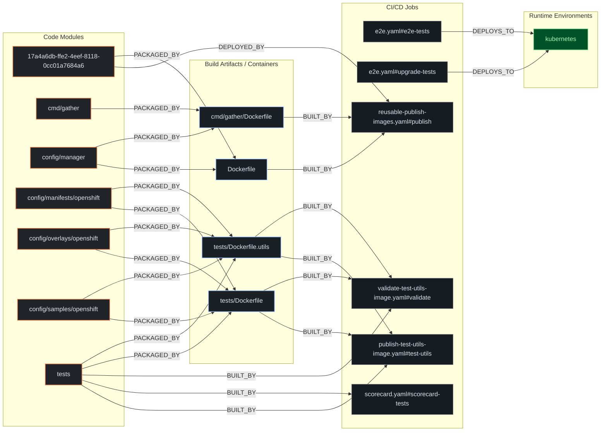

# Repository Architecture Analysis: grafana/tempo-operator

## Metadata
- **SHA**: `91735ba8e45764590161f68ab7c32a3b55233472`
- **Primary Ecosystem**: Go

## Quality Metrics
- **ast_engine**: fallback
- **avg_cognitive_complexity**: 0.0
- **avg_cyclomatic_complexity**: 0.0
- **component_count**: 300
- **dead_code_count**: 0
- **dead_code_symbols**: 0 entry(ies)
- **duplication_pct**: 0.0
- **file_complexities**: 0 entry(ies)
- **files_analyzed**: 309
- **fitness_passed**: True
- **fitness_violation_count**: 0
- **framework**: Go Service
- **import_edges**: 0 entry(ies)
- **loc**: 68079
- **max_cognitive_complexity**: 0
- **max_cyclomatic_complexity**: 0
- **sloc**: 59507
- **test_file_count**: 927

# Architecture: grafana/tempo-operator

## Context
- **Repository**: `grafana/tempo-operator`
- **SHA**: `91735ba8e45764590161f68ab7c32a3b55233472`
- **Ecosystem**: Go
- **Framework**: Go Service

## Building Block View

```mermaid
graph TD;
  classDef atlasRoot fill:#004882,stroke:#a3c9ff,stroke-width:2px,color:#d3e4ff
  classDef atlasCategory fill:#212428,stroke:#E87A48,stroke-width:1.5px,color:#dfe3eb
  classDef atlasWorkflow fill:#1b2026,stroke:#a3c9ff,stroke-width:1.5px,color:#dfe3eb
  classDef atlasJob fill:#171c22,stroke:#8d9199,stroke-width:1px,color:#dfe3eb
  classDef atlasTarget fill:#005227,stroke:#8bd99b,stroke-width:1.5px,color:#a7f6b6
  classDef atlasAlert fill:#93000a,stroke:#ffb4ab,stroke-width:1.5px,color:#ffdad6
  classDef atlasMore fill:#252a31,stroke:#8d9199,stroke-dasharray:4 4,color:#c3c6cf
    repo_root(["grafana/tempo-operator (300 components)"]):::atlasRoot
    dir_0_internal["internal (217)"]:::atlasCategory
    repo_root --> dir_0_internal
    sub_0_0_manifests["manifests (120)"]:::atlasWorkflow
    dir_0_internal --> sub_0_0_manifests
    sub_0_1_handlers["handlers (19)"]:::atlasWorkflow
    dir_0_internal --> sub_0_1_handlers
    sub_0_2_certrotation["certrotation (17)"]:::atlasWorkflow
    dir_0_internal --> sub_0_2_certrotation
    sub_0_more["+8 more submodules (61)"]:::atlasMore
    dir_0_internal --> sub_0_more
    dir_1_config["config (50)"]:::atlasCategory
    repo_root --> dir_1_config
    sub_1_0_rbac["rbac (14)"]:::atlasWorkflow
    dir_1_config --> sub_1_0_rbac
    sub_1_1_crd["crd (10)"]:::atlasWorkflow
    dir_1_config --> sub_1_1_crd
    sub_1_2_overlays["overlays (9)"]:::atlasWorkflow
    dir_1_config --> sub_1_2_overlays
    sub_1_more["+5 more submodules (17)"]:::atlasMore
    dir_1_config --> sub_1_more
    dir_2_api["api (20)"]:::atlasCategory
    repo_root --> dir_2_api
    sub_2_0_tempo["tempo (14)"]:::atlasWorkflow
    dir_2_api --> sub_2_0_tempo
    sub_2_1_config["config (6)"]:::atlasWorkflow
    dir_2_api --> sub_2_1_config
    dir_3_cmd["cmd (13)"]:::atlasCategory
    repo_root --> dir_3_cmd
    sub_3_0_gather["gather (5)"]:::atlasWorkflow
    dir_3_cmd --> sub_3_0_gather
    sub_3_1_root["root (3)"]:::atlasWorkflow
    dir_3_cmd --> sub_3_1_root
    sub_3_2_generate["generate (2)"]:::atlasWorkflow
    dir_3_cmd --> sub_3_2_generate
    sub_3_more["+3 more submodules (3)"]:::atlasMore
    dir_3_cmd --> sub_3_more
```

## Component Details

Showing top 60 representative components out of 300 across 4 module group(s):

- **Module `internal`** (217 components — module: 217)
- **Module `config`** (50 components — module: 50)
- **Module `api`** (20 components — module: 20)
- **Module `cmd`** (13 components — module: 13)

- **affinity** (`internal/manifests/manifestutils/affinity.go`): module
- **affinity_test** (`internal/manifests/manifestutils/affinity_test.go`): module
- **annotations** (`internal/manifests/manifestutils/annotations.go`): module
- **annotations** (`internal/manifests/monolithic/annotations.go`): module
- **annotations_test** (`internal/manifests/manifestutils/annotations_test.go`): module
- **auth** (`api/tempo/v1alpha1/auth.go`): module
- **azure_secret** (`internal/handlers/storage/azure_secret.go`): module
- **azure_secret_test** (`internal/handlers/storage/azure_secret_test.go`): module
- **basedomain** (`internal/handlers/gateway/basedomain.go`): module
- **basedomain_test** (`internal/handlers/gateway/basedomain_test.go`): module
- **bootstrap** (`internal/crdmetrics/bootstrap.go`): module
- **build** (`internal/certrotation/build.go`): module
- **build** (`internal/manifests/alerts/build.go`): module
- **build** (`internal/manifests/config/build.go`): module
- **build** (`internal/manifests/monolithic/build.go`): module
- **build_test** (`internal/certrotation/build_test.go`): module
- **build_test** (`internal/manifests/alerts/build_test.go`): module
- **build_test** (`internal/manifests/config/build_test.go`): module
- **build_test** (`internal/manifests/monolithic/build_test.go`): module
- **cabundle** (`internal/certrotation/cabundle.go`): module
- **cabundle_test** (`internal/certrotation/cabundle_test.go`): module
- **cainjection_in_config.tempo_projectconfigs** (`config/crd/patches/cainjection_in_config.tempo_projectconfigs.yaml`): module
- **cainjection_in_tempomonolithics** (`config/crd/patches/cainjection_in_tempomonolithics.yaml`): module
- **cainjection_in_tempostacks** (`config/crd/patches/cainjection_in_tempostacks.yaml`): module
- **certificate** (`config/certmanager/certificate.yaml`): module
- **certificates** (`internal/manifests/monolithic/certificates.go`): module
- **certrotation_controller** (`internal/controller/tempo/certrotation_controller.go`): module
- **certrotation_controller_test** (`internal/controller/tempo/certrotation_controller_test.go`): module
- **certrotation_discovery** (`internal/certrotation/handlers/certrotation_discovery.go`): module
- **certrotation_monolithic_controller** (`internal/controller/tempo/certrotation_monolithic_controller.go`): module
- **check_cert_expiry** (`internal/certrotation/handlers/check_cert_expiry.go`): module
- **client** (`internal/status/client.go`): module
- **client_test** (`internal/status/client_test.go`): module
- **client_test** (`internal/tlsprofile/client_test.go`): module
- **cloudcredentials** (`internal/manifests/manifestutils/cloudcredentials.go`): module
- **cluster** (`cmd/gather/cluster/cluster.go`): module
- **cluster_monitoring_role_binding** (`config/overlays/openshift/cluster_monitoring_role_binding.yaml`): module
- **cluster_monitoring_view_role** (`config/overlays/openshift/cluster_monitoring_view_role.yaml`): module
- **cluster_test** (`cmd/gather/cluster/cluster_test.go`): module
- **common** (`internal/controller/tempo/common.go`): module
- **common_types** (`api/tempo/v1alpha1/common_types.go`): module
- **compactor** (`internal/manifests/compactor/compactor.go`): module
- **compactor_test** (`internal/manifests/compactor/compactor_test.go`): module
- **components** (`internal/manifests/networkpolicies/components.go`): module
- **components** (`internal/status/components.go`): module
- **components_test** (`internal/manifests/networkpolicies/components_test.go`): module
- **components_test** (`internal/status/components_test.go`): module
- **conditions** (`internal/status/conditions.go`): module
- **conditions_test** (`internal/status/conditions_test.go`): module
- **config** (`cmd/gather/config/config.go`): module
- **config.tempo_projectconfig_editor_role** (`config/rbac/config.tempo_projectconfig_editor_role.yaml`): module
- **config.tempo_projectconfig_viewer_role** (`config/rbac/config.tempo_projectconfig_viewer_role.yaml`): module
- **configdns_crd** (`internal/handlers/gateway/testdata/configdns_crd.go`): module
- **configmap** (`internal/manifests/config/configmap.go`): module
- **configmap** (`internal/manifests/monolithic/configmap.go`): module
- **configmap_test** (`internal/manifests/config/configmap_test.go`): module
- **configmap_test** (`internal/manifests/monolithic/configmap_test.go`): module
- **configs** (`internal/manifests/gateway/configs.go`): module
- **configs_test** (`internal/manifests/gateway/configs_test.go`): module
- **const** (`internal/envconfig/const.go`): module

## 6-Dimension Repository Scorecard

- **Overall Grade**: `F` (58.25/100)
- **Technical Debt Score**: 41.75
- **Estimated Remediation Effort**: 84.44h

| Dimension | Grade | Score | Weight | Details |
| :--- | :---: | :---: | :---: | :--- |
| Code Quality | `A` | 100.00 | 0.20 | avg_cc=0.00, max_cc=0, duplication=0.00%, dead_code=0 |
| Dependency Health | `B` | 85.00 | 0.15 | dependencies=135, outdated=0, vulnerable=0, has_lockfile=False |
| Maintainability | `A` | 100.00 | 0.15 | avg_cognitive=0.00, max_cognitive=0, fitness_violations=0, oversized_files=0 |
| Pipeline Health | `F` | 0.00 | 0.15 | workflows=13, operational_antipatterns=35, parallel_branches=True |
| Security | `F` | 0.00 | 0.20 | vulnerabilities=0, secrets=18, pipeline_security_findings=2 |
| Test Coverage | `C` | 70.00 | 0.15 | coverage=unavailable, ci_test_job=True, test_files_detected=True |

## Supply Chain Dependencies, Vulnerabilities & Secrets

- **Dependencies Parsed**: 135 | **Vulnerabilities**: 0 | **Secrets**: 18

### Secret Findings (Redacted)
- **[HIGH] `ATRUSS-SEC-005`** at `tests/e2e-openshift-tls-profile/01-tls-profile-override-mono/01-install-storage.yaml:17` (`private.key: LS0t***REDACTED***`)
- **[HIGH] `ATRUSS-SEC-005`** at `tests/e2e-openshift-tls-profile/02-tls-profile-override-stack/01-install-storage.yaml:17` (`private.key: LS0t***REDACTED***`)
- **[HIGH] `ATRUSS-SEC-005`** at `tests/e2e-openshift-tls-profile/03-tls-profile/00-install-storage.yaml:17` (`private.key: LS0t***REDACTED***`)
- **[HIGH] `ATRUSS-SEC-005`** at `tests/e2e-openshift/monolithic-multitenancy-openshift/00-install-storage.yaml:21` (`private.key: LS0t***REDACTED***`)
- **[CRITICAL] `ATRUSS-SEC-004`** at `tests/e2e-openshift/monolithic-route/README.md:256` (`-----BEGIN ... PRIVATE KEY----- [REDACTED]`)
- **[HIGH] `ATRUSS-SEC-005`** at `tests/e2e-openshift/multitenancy/00-install-storage.yaml:21` (`private.key: LS0t***REDACTED***`)
- **[CRITICAL] `ATRUSS-SEC-004`** at `tests/e2e-openshift/route/README.md:605` (`-----BEGIN ... PRIVATE KEY----- [REDACTED]`)
- **[HIGH] `ATRUSS-SEC-005`** at `tests/e2e/ca-bundle/00-install-storage.yaml:44` (`private.key: LS0t***REDACTED***`)
- **[HIGH] `ATRUSS-SEC-005`** at `tests/e2e/custom-ca/00-install-storage.yaml:6` (`private.key: LS0t***REDACTED***`)
- **[HIGH] `ATRUSS-SEC-005`** at `tests/e2e/monolithic-ca-bundle/00-install-storage.yaml:44` (`private.key: LS0t***REDACTED***`)
- **[HIGH] `ATRUSS-SEC-005`** at `tests/e2e/monolithic-ingestion-mtls/01-install-tempo.yaml:56` (`tls.key: LS0t***REDACTED***`)
- **[HIGH] `ATRUSS-SEC-005`** at `tests/e2e/monolithic-ingestion-mtls/02-install-otel.yaml:7` (`tls.key: LS0t***REDACTED***`)
- **[HIGH] `ATRUSS-SEC-005`** at `tests/e2e/monolithic-receivers-tls/01-install-tempo.yaml:66` (`tls.key: LS0t***REDACTED***`)
- **[HIGH] `ATRUSS-SEC-005`** at `tests/e2e/monolithic-s3-tls/00-install-storage.yaml:6` (`private.key: LS0t***REDACTED***`)
- **[HIGH] `ATRUSS-SEC-005`** at `tests/e2e/receivers-mtls/01-install-tempo.yaml:54` (`tls.key: LS0t***REDACTED***`)
- **[HIGH] `ATRUSS-SEC-005`** at `tests/e2e/receivers-mtls/02-install-otel.yaml:7` (`tls.key: LS0t***REDACTED***`)
- **[HIGH] `ATRUSS-SEC-005`** at `tests/e2e/receivers-tls/01-install-tempo.yaml:53` (`tls.key: LS0t***REDACTED***`)
- **[HIGH] `ATRUSS-SEC-005`** at `tests/e2e/receivers-tls/02-install-otel.yaml:7` (`tls.key: LS0t***REDACTED***`)

### Inventory Sample
- `github.com/Masterminds/semver/v3` `3.5.0` (golang, `go.mod`)
- `github.com/ViaQ/logerr/v2` `2.1.0` (golang, `go.mod`)
- `github.com/go-logr/logr` `1.4.4` (golang, `go.mod`)
- `github.com/go-logr/zapr` `1.3.0` (golang, `go.mod`)
- `github.com/google/go-cmp` `0.7.0` (golang, `go.mod`)
- `github.com/grafana/grafana-operator/v5` `5.24.0` (golang, `go.mod`)
- `github.com/imdario/mergo` `0.3.16` (golang, `go.mod`)
- `github.com/novln/docker-parser` `1.0.0` (golang, `go.mod`)
- `github.com/onsi/ginkgo/v2` `2.32.1` (golang, `go.mod`)
- `github.com/onsi/gomega` `1.44.0` (golang, `go.mod`)
- `github.com/openshift/api` `0.0.0-20261002115817-f8795cdde518` (golang, `go.mod`)
- `github.com/openshift/cloud-credential-operator` `0.0.0-20250417173756-8ff60a024ed9` (golang, `go.mod`)
- `github.com/openshift/controller-runtime-common` `0.0.0-20261008111711-8ec0dc844066` (golang, `go.mod`)
- `github.com/openshift/library-go` `0.0.0-20261001144932-192662696fc7` (golang, `go.mod`)
- `github.com/operator-framework/api` `0.45.0` (golang, `go.mod`)
- `github.com/operator-framework/operator-lib` `0.19.0` (golang, `go.mod`)
- `github.com/prometheus-operator/prometheus-operator/pkg/apis/monitoring` `0.74.0` (golang, `go.mod`)
- `github.com/prometheus/client_golang` `1.25.0` (golang, `go.mod`)
- `github.com/prometheus/common` `0.72.0` (golang, `go.mod`)
- `github.com/spf13/cobra` `1.10.2` (golang, `go.mod`)
- `github.com/spf13/pflag` `1.0.10` (golang, `go.mod`)
- `github.com/stretchr/testify` `1.12.1` (golang, `go.mod`)
- `go.opentelemetry.io/otel` `1.45.0` (golang, `go.mod`)
- `go.opentelemetry.io/otel/exporters/prometheus` `0.66.0` (golang, `go.mod`)
- `go.opentelemetry.io/otel/metric` `1.45.0` (golang, `go.mod`)
- `go.opentelemetry.io/otel/sdk/metric` `1.45.0` (golang, `go.mod`)
- `go.uber.org/zap` `1.28.0` (golang, `go.mod`)
- `gopkg.in/yaml.v2` `2.4.0` (golang, `go.mod`)
- `gopkg.in/yaml.v3` `3.0.1` (golang, `go.mod`)
- `k8s.io/api` `0.37.1` (golang, `go.mod`)
- ... (+105 more dependencies)

## Section 7: Code-to-Cloud Deployment Traceability

- `e2e.yaml#e2e-tests` (ci_job) --[DEPLOYS_TO]--> `kubernetes` (environment)
- `e2e.yaml#upgrade-tests` (ci_job) --[DEPLOYS_TO]--> `kubernetes` (environment)
- `17a4a6db-ffe2-4eef-8118-0cc01a7684a6` (code_module) --[DEPLOYED_BY]--> `reusable-publish-images.yaml#publish` (ci_job)
- `17a4a6db-ffe2-4eef-8118-0cc01a7684a6` (code_module) --[PACKAGED_BY]--> `Dockerfile` (container)
- `cmd/gather` (code_module) --[PACKAGED_BY]--> `cmd/gather/Dockerfile` (container)
- `config/manager` (code_module) --[PACKAGED_BY]--> `Dockerfile` (container)
- `config/manager` (code_module) --[PACKAGED_BY]--> `cmd/gather/Dockerfile` (container)
- `config/manifests/openshift` (code_module) --[PACKAGED_BY]--> `tests/Dockerfile` (container)
- `config/manifests/openshift` (code_module) --[PACKAGED_BY]--> `tests/Dockerfile.utils` (container)
- `config/overlays/openshift` (code_module) --[PACKAGED_BY]--> `tests/Dockerfile` (container)
- `config/overlays/openshift` (code_module) --[PACKAGED_BY]--> `tests/Dockerfile.utils` (container)
- `config/samples/openshift` (code_module) --[PACKAGED_BY]--> `tests/Dockerfile` (container)
- `config/samples/openshift` (code_module) --[PACKAGED_BY]--> `tests/Dockerfile.utils` (container)
- `tests` (code_module) --[BUILT_BY]--> `publish-test-utils-image.yaml#test-utils` (ci_job)
- `tests` (code_module) --[BUILT_BY]--> `scorecard.yaml#scorecard-tests` (ci_job)
- `tests` (code_module) --[BUILT_BY]--> `validate-test-utils-image.yaml#validate` (ci_job)
- `tests` (code_module) --[PACKAGED_BY]--> `tests/Dockerfile` (container)
- `tests` (code_module) --[PACKAGED_BY]--> `tests/Dockerfile.utils` (container)
- `Dockerfile` (container) --[BUILT_BY]--> `reusable-publish-images.yaml#publish` (ci_job)
- `cmd/gather/Dockerfile` (container) --[BUILT_BY]--> `reusable-publish-images.yaml#publish` (ci_job)
- `tests/Dockerfile` (container) --[BUILT_BY]--> `publish-test-utils-image.yaml#test-utils` (ci_job)
- `tests/Dockerfile` (container) --[BUILT_BY]--> `validate-test-utils-image.yaml#validate` (ci_job)
- `tests/Dockerfile.utils` (container) --[BUILT_BY]--> `publish-test-utils-image.yaml#test-utils` (ci_job)
- `tests/Dockerfile.utils` (container) --[BUILT_BY]--> `validate-test-utils-image.yaml#validate` (ci_job)

## CI/CD Pipeline Topology

```mermaid
graph TD;
  classDef atlasRoot fill:#004882,stroke:#a3c9ff,stroke-width:2px,color:#d3e4ff
  classDef atlasCategory fill:#212428,stroke:#E87A48,stroke-width:1.5px,color:#dfe3eb
  classDef atlasWorkflow fill:#1b2026,stroke:#a3c9ff,stroke-width:1.5px,color:#dfe3eb
  classDef atlasJob fill:#171c22,stroke:#8d9199,stroke-width:1px,color:#dfe3eb
  classDef atlasTarget fill:#005227,stroke:#8bd99b,stroke-width:1.5px,color:#a7f6b6
  classDef atlasAlert fill:#93000a,stroke:#ffb4ab,stroke-width:1.5px,color:#ffdad6
  classDef atlasMore fill:#252a31,stroke:#8d9199,stroke-dasharray:4 4,color:#c3c6cf
  pipeline_root(["grafana/tempo-operator (13 workflows)"]):::atlasRoot
  grp_0_CI___Verification["CI & Verification (6 workflows · 10 jobs)"]:::atlasCategory
  pipeline_root --> grp_0_CI___Verification
  wf_0_Actionlint["Actionlint (1 jobs)"]:::atlasWorkflow
  grp_0_CI___Verification --> wf_0_Actionlint
  job_0_run_actionlint["run-actionlint"]:::atlasJob
  wf_0_Actionlint --> job_0_run_actionlint
  wf_2_Continuous_Integration["Continuous Integration (4 jobs)"]:::atlasWorkflow
  grp_0_CI___Verification --> wf_2_Continuous_Integration
  job_2_unit_tests["unit-tests"]:::atlasJob
  job_2_security["security"]:::atlasJob
  job_2_dependency_review["dependency-review"]:::atlasJob
  wf_2_Continuous_Integration --> job_2_unit_tests
  wf_2_Continuous_Integration --> job_2_security
  wf_2_Continuous_Integration --> job_2_dependency_review
  wf_3_End_to_end_tests["End-to-end tests (2 jobs)"]:::atlasWorkflow
  grp_0_CI___Verification --> wf_3_End_to_end_tests
  job_3_e2e_tests["e2e-tests"]:::atlasJob
  job_3_upgrade_tests["upgrade-tests"]:::atlasJob
  wf_3_End_to_end_tests --> job_3_e2e_tests
  wf_3_End_to_end_tests --> job_3_upgrade_tests
  wf_11_Scorecard_tests["Scorecard tests (1 jobs)"]:::atlasWorkflow
  grp_0_CI___Verification --> wf_11_Scorecard_tests
  job_11_scorecard_tests["scorecard-tests"]:::atlasJob
  wf_11_Scorecard_tests --> job_11_scorecard_tests
  wf_12_Validate_test_utils_image["Validate test utils image (1 jobs)"]:::atlasWorkflow
  grp_0_CI___Verification --> wf_12_Validate_test_utils_image
  job_12_validate["validate"]:::atlasJob
  wf_12_Validate_test_utils_image --> job_12_validate
  grp_1_Release___Deploy["Release & Deploy (6 workflows · 10 jobs)"]:::atlasCategory
  pipeline_root --> grp_1_Release___Deploy
  wf_4_Publish_to_operatorHUB["Publish to operatorHUB (2 jobs)"]:::atlasWorkflow
  grp_1_Release___Deploy --> wf_4_Publish_to_operatorHUB
  job_4_operator_hub_prod_release["operator-hub-prod-release"]:::atlasJob
  job_4_operator_hub_community_release["operator-hub-community-release"]:::atlasJob
  wf_4_Publish_to_operatorHUB --> job_4_operator_hub_prod_release
  wf_4_Publish_to_operatorHUB --> job_4_operator_hub_community_release
  wf_5_Prepare_the_release["Prepare the release (1 jobs)"]:::atlasWorkflow
  grp_1_Release___Deploy --> wf_5_Prepare_the_release
  job_5_prepare_release["prepare-release"]:::atlasJob
  wf_5_Prepare_the_release --> job_5_prepare_release
  wf_6_Publish_operator["Publish operator (1 jobs)"]:::atlasWorkflow
  grp_1_Release___Deploy --> wf_6_Publish_operator
  job_6_publish_images["publish-images"]:::atlasJob
  wf_6_Publish_operator --> job_6_publish_images
  wf_8_Release["Release (4 jobs)"]:::atlasWorkflow
  grp_1_Release___Deploy --> wf_8_Release
  job_8_release["release"]:::atlasJob
  job_8_publish_images["publish-images"]:::atlasJob
  job_8_operator_hub_prod_release["operator-hub-prod-release"]:::atlasJob
  wf_8_Release --> job_8_release
  job_8_release --> job_8_publish_images
  job_8_publish_images --> job_8_operator_hub_prod_release
  grp_2_Automation___Other["Automation & Other (1 workflows · 1 jobs)"]:::atlasCategory
  pipeline_root --> grp_2_Automation___Other
  wf_9_Reusable___Create_operator_hub_pull_request["Reusable - Create operator hub pull request (1 jobs)"]:::atlasWorkflow
  grp_2_Automation___Other --> wf_9_Reusable___Create_operator_hub_pull_request
  job_9_create_operator_pull_request["create-operator-pull-request"]:::atlasJob
  wf_9_Reusable___Create_operator_hub_pull_request --> job_9_create_operator_pull_request
  wf_more["+3 more workflows"]:::atlasMore
  pipeline_root --> wf_more
```

