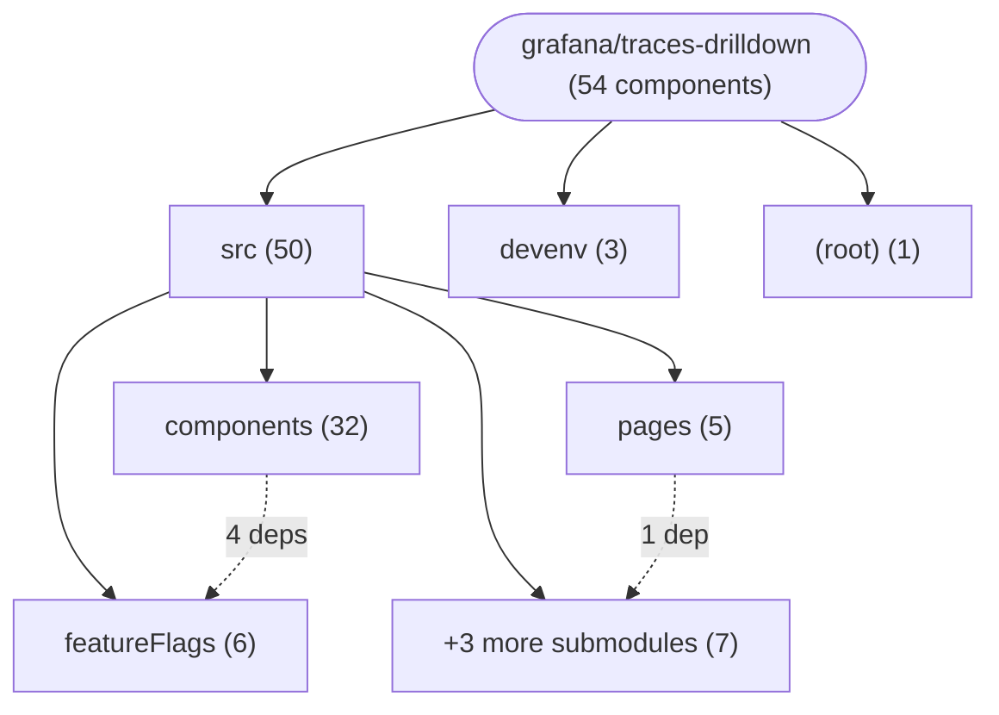
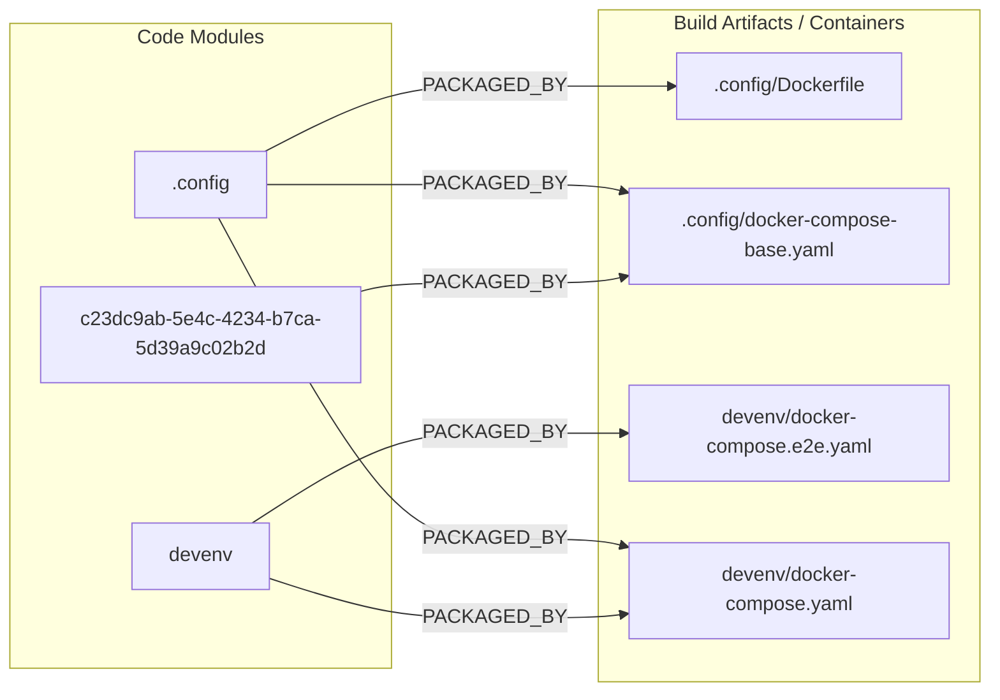
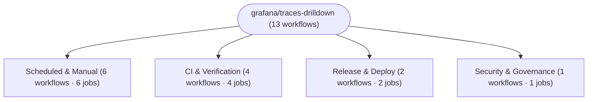

# Repository Architecture Analysis: grafana/traces-drilldown

## Metadata
- **SHA**: `54a8a1e0011d30d6cecc40b1a9c6017b105b5efe`
- **Primary Ecosystem**: JavaScript/TypeScript

## Quality Metrics
- **ast_engine**: tree-sitter
- **avg_cognitive_complexity**: 2.6
- **avg_cyclomatic_complexity**: 2.92
- **component_count**: 54
- **dead_code_count**: 1
- **dead_code_symbols**: 1 entry(ies)
- **duplication_pct**: 76.24
- **file_complexities**: 25 entry(ies)
- **files_analyzed**: 219
- **fitness_passed**: False
- **fitness_violation_count**: 4
- **framework**: React (Vite)
- **import_edges**: 100 entry(ies)
- **loc**: 29437
- **max_cognitive_complexity**: 102
- **max_cyclomatic_complexity**: 63
- **sloc**: 24522
- **test_file_count**: 58

# Architecture: grafana/traces-drilldown

## Context
- **Repository**: `grafana/traces-drilldown`
- **SHA**: `54a8a1e0011d30d6cecc40b1a9c6017b105b5efe`
- **Ecosystem**: JavaScript/TypeScript
- **Framework**: React (Vite)

## Building Block View

## Component Details
- **exploretraces-app** (`package.json`): MODULE
- **EntityAssertionsWidget** (`src/addedComponents/EntityAssertionsWidget/EntityAssertionsWidget.tsx`): UI_COMPONENT
- **PluginInfo** (`src/components/App/header/PluginInfo.tsx`): UI_COMPONENT (deps: TempoLogo)
- **TempoLogo** (`src/components/App/header/TempoLogo.tsx`): UI_COMPONENT
- **AttributesSidebar** (`src/components/Explore/AttributesSidebar.tsx`): UI_COMPONENT
- **PAGE_SIZE** (`src/components/Explore/ByFrameRepeater.tsx`): UI_COMPONENT (deps: SAVED_SEARCHES_KEY, Search)
- **SkeletonComponent** (`src/components/Explore/ByFrameRepeater.tsx`): UI_COMPONENT (deps: SAVED_SEARCHES_KEY, Search)
- **Search** (`src/components/Explore/Search.tsx`): UI_COMPONENT
- **StreamingIndicator** (`src/components/Explore/StreamingIndicator.tsx`): UI_COMPONENT
- **TraceQLConfigWarning** (`src/components/Explore/TraceQLIssueDetector.tsx`): UI_COMPONENT
- **LoadSearchModal** (`src/components/Explore/SavedSearches/LoadSearchModal.tsx`): UI_COMPONENT (deps: SAVED_SEARCHES_KEY)
- **SaveSearchButton** (`src/components/Explore/SavedSearches/SaveSearchButton.tsx`): UI_COMPONENT (deps: SAVED_SEARCHES_KEY, SaveSearchModal)
- **SaveSearchModal** (`src/components/Explore/SavedSearches/SaveSearchModal.tsx`): UI_COMPONENT (deps: SAVED_SEARCHES_KEY)
- **SAVED_SEARCHES_KEY** (`src/components/Explore/SavedSearches/saveSearch.ts`): UI_COMPONENT (deps: GRAFANA_OPEN_FEATURE_DOMAIN, KG_ANNOTATIONS_FEATURE_FLAG_KEY, TIME_SEEKER_FEATURE_FLAG_KEY, TRACES_DRILLDOWN_USE_VALUE_TYPE_FILTER)
- **MINI_PANEL_HEIGHT** (`src/components/Explore/TracesByService/TracesByServiceScene.tsx`): UI_COMPONENT
- **AttributesDescription** (`src/components/Explore/TracesByService/Tabs/Breakdown/AttributesDescription.tsx`): UI_COMPONENT
- **PercentilesSelect** (`src/components/Explore/TracesByService/Tabs/Breakdown/PercentilesSelect.tsx`): UI_COMPONENT
- **ExceptionsTable** (`src/components/Explore/TracesByService/Tabs/Exceptions/ExceptionsTable.tsx`): UI_COMPONENT (deps: ExceptionAccordionContent, SparklineCell)
- **SparklineCell** (`src/components/Explore/TracesByService/Tabs/Exceptions/SparklineCell.tsx`): UI_COMPONENT
- **ExceptionAccordionContent** (`src/components/Explore/TracesByService/Tabs/Exceptions/accordion/ExceptionAccordion.tsx`): UI_COMPONENT (deps: ExceptionComparison, ExceptionTraceResults, ExceptionsTable)
- **ExceptionComparison** (`src/components/Explore/TracesByService/Tabs/Exceptions/accordion/ExceptionComparison.tsx`): UI_COMPONENT
- **ExceptionTraceResults** (`src/components/Explore/TracesByService/Tabs/Exceptions/accordion/ExceptionTraceResults.tsx`): UI_COMPONENT
- **IncludeExcludeButtons** (`src/components/Explore/actions/IncludeExcludeButtons.tsx`): UI_COMPONENT
- **ShareExplorationAction** (`src/components/Explore/actions/ShareExplorationAction.tsx`): UI_COMPONENT
- **AddToDashboardModal** (`src/components/Explore/actions/addToDashboard/AddToDashboardModal.tsx`): UI_COMPONENT
- **TimeSeeker** (`src/components/Explore/seeker/TimeSeeker.tsx`): UI_COMPONENT (deps: TimeSeekerChart, TimeSeekerControls, TimeSeekerProvider)
- **TimeSeekerChart** (`src/components/Explore/seeker/TimeSeekerChart.tsx`): UI_COMPONENT (deps: TimeSeekerDragOverlay, TimeSeekerLoadingOverlay, TimeSeekerProvider)
- **TimeSeekerProvider** (`src/components/Explore/seeker/TimeSeekerContext.tsx`): UI_COMPONENT
- **TimeSeekerControls** (`src/components/Explore/seeker/TimeSeekerControls.tsx`): UI_COMPONENT (deps: TimeSeekerProvider)
- **TimeSeekerDragOverlay** (`src/components/Explore/seeker/TimeSeekerDragOverlay.tsx`): UI_COMPONENT (deps: TimeSeekerProvider)
- **TimeSeekerLoadingOverlay** (`src/components/Explore/seeker/TimeSeekerLoadingOverlay.tsx`): UI_COMPONENT (deps: TimeSeekerProvider)
- **AppRoutes** (`src/components/Routes/Routes.tsx`): UI_COMPONENT
- **EmptyState** (`src/components/states/EmptyState/EmptyState.tsx`): UI_COMPONENT (deps: GrotNotFound)
- **GrotNotFound** (`src/components/states/EmptyState/GrotNotFound.tsx`): UI_COMPONENT
- **SuspendedOpenInExploreTracesButton** (`src/exposedComponents/index.tsx`): UI_COMPONENT
- **SuspendedEmbeddedTraceExploration** (`src/exposedComponents/index.tsx`): UI_COMPONENT
- **EmbeddedTraceExploration** (`src/exposedComponents/EmbeddedTraceExploration/EmbeddedTraceExploration.tsx`): UI_COMPONENT
- **OpenInExploreTracesButton** (`src/exposedComponents/OpenInExploreTracesButton/OpenInExploreTracesButton.tsx`): UI_COMPONENT
- **GRAFANA_OPEN_FEATURE_DOMAIN** (`src/featureFlags/featureFlags.tsx`): UI_COMPONENT (deps: OpenFeaturePluginScope, PLUGIN_OPEN_FEATURE_DOMAIN)
- **TIME_SEEKER_FEATURE_FLAG_KEY** (`src/featureFlags/featureFlags.tsx`): UI_COMPONENT (deps: OpenFeaturePluginScope, PLUGIN_OPEN_FEATURE_DOMAIN)
- **TRACES_DRILLDOWN_USE_VALUE_TYPE_FILTER** (`src/featureFlags/featureFlags.tsx`): UI_COMPONENT (deps: OpenFeaturePluginScope, PLUGIN_OPEN_FEATURE_DOMAIN)
- **KG_ANNOTATIONS_FEATURE_FLAG_KEY** (`src/featureFlags/featureFlags.tsx`): UI_COMPONENT (deps: OpenFeaturePluginScope, PLUGIN_OPEN_FEATURE_DOMAIN)
- **PLUGIN_OPEN_FEATURE_DOMAIN** (`src/featureFlags/openFeature.tsx`): UI_COMPONENT
- **OpenFeaturePluginScope** (`src/featureFlags/openFeature.tsx`): UI_COMPONENT
- **DataLinksCustomContext** (`src/pages/Explore/DataLinksCustomContext.tsx`): UI_COMPONENT
- **Drawer** (`src/pages/Explore/Drawer.tsx`): UI_COMPONENT
- **DropdownIndicator** (`src/pages/Explore/PrimarySignalVariable.tsx`): UI_COMPONENT
- **SmartDrawer** (`src/pages/Explore/SmartDrawer.tsx`): UI_COMPONENT (deps: Drawer)
- **TraceExplorationView** (`src/pages/Explore/TraceExplorationPage.tsx`): UI_COMPONENT (deps: EmbeddedTraceExploration)
- **LightModeRocket** (`src/utils/rockets.tsx`): UI_COMPONENT
- **DarkModeRocket** (`src/utils/rockets.tsx`): UI_COMPONENT
- **docker-compose.e2e** (`devenv/docker-compose.e2e.yaml`): module
- **docker-compose** (`devenv/docker-compose.yaml`): module
- **tempo** (`devenv/tempo.yaml`): module

## 6-Dimension Repository Scorecard

- **Overall Grade**: `F` (56.45/100)
- **Technical Debt Score**: 43.55
- **Estimated Remediation Effort**: 54.89h

| Dimension | Grade | Score | Weight | Details |
| :--- | :---: | :---: | :---: | :--- |
| Code Quality | `F` | 48.00 | 0.20 | avg_cc=2.92, max_cc=63, duplication=76.24%, dead_code=1 |
| Dependency Health | `A` | 100.00 | 0.15 | dependencies=1287, outdated=0, vulnerable=0, has_lockfile=True |
| Maintainability | `F` | 25.00 | 0.15 | avg_cognitive=2.60, max_cognitive=102, fitness_violations=4, oversized_files=5 |
| Pipeline Health | `F` | 0.00 | 0.15 | workflows=13, operational_antipatterns=13, parallel_branches=False |
| Security | `B` | 88.00 | 0.20 | vulnerabilities=0, secrets=0, pipeline_security_findings=1 |
| Test Coverage | `C` | 70.00 | 0.15 | coverage=unavailable, ci_test_job=True, test_files_detected=True |

## Architecture Fitness & Workspace Boundaries

- **[HIGH] `ATRUSS-ARCH-004` (CIRCULAR_DEPENDENCY)**: Circular dependency detected between architectural components. (ExceptionAccordionContent -> ExceptionsTable -> ExceptionAccordionContent)
- **[MEDIUM] `ATRUSS-ARCH-005` (COMPLEXITY_THRESHOLD)**: Repository duplication_pct (76.24) exceeds policy threshold (15.0).
- **[MEDIUM] `ATRUSS-ARCH-005` (COMPLEXITY_THRESHOLD)**: Repository max_cognitive_complexity (102.0) exceeds policy threshold (25.0).
- **[MEDIUM] `ATRUSS-ARCH-005` (COMPLEXITY_THRESHOLD)**: Repository max_cyclomatic_complexity (63.0) exceeds policy threshold (20.0).

## Supply Chain Dependencies, Vulnerabilities & Secrets

- **Dependencies Parsed**: 1287 | **Vulnerabilities**: 0 | **Secrets**: 0

### Inventory Sample
- `@emotion/css` `11.10.6` (npm, `package.json`)
- `@emotion/css` `11.10.6` (npm, `pnpm-lock.yaml`)
- `@emotion/css` `11.13.5` (npm, `pnpm-lock.yaml`)
- `@grafana/data` `13.2.3` (npm, `package.json`)
- `@grafana/data` `13.2.3` (npm, `pnpm-lock.yaml`)
- `@grafana/e2e-selectors` `12.4.13` (npm, `pnpm-lock.yaml`)
- `@grafana/e2e-selectors` `13.2.3` (npm, `package.json`)
- `@grafana/e2e-selectors` `13.2.3` (npm, `pnpm-lock.yaml`)
- `@grafana/eslint-config` `10.0.0` (npm, `package.json`)
- `@grafana/eslint-config` `10.0.0` (npm, `pnpm-lock.yaml`)
- `@grafana/faro-web-sdk` `2.13.0` (npm, `pnpm-lock.yaml`)
- `@grafana/faro-web-sdk` `2.8.0` (npm, `package.json`)
- `@grafana/faro-web-sdk` `2.8.0` (npm, `pnpm-lock.yaml`)
- `@grafana/i18n` `13.2.3` (npm, `package.json`)
- `@grafana/i18n` `13.2.3` (npm, `pnpm-lock.yaml`)
- `@grafana/lezer-traceql` `0.0.23` (npm, `package.json`)
- `@grafana/lezer-traceql` `0.0.23` (npm, `pnpm-lock.yaml`)
- `@grafana/plugin-compat` `0.5.0` (npm, `package.json`)
- `@grafana/plugin-compat` `0.5.0` (npm, `pnpm-lock.yaml`)
- `@grafana/plugin-e2e` `2.2.0` (npm, `package.json`)
- `@grafana/plugin-e2e` `2.2.0` (npm, `pnpm-lock.yaml`)
- `@grafana/plugin-types` `0.0.39` (npm, `package.json`)
- `@grafana/plugin-types` `0.0.39` (npm, `pnpm-lock.yaml`)
- `@grafana/runtime` `13.2.3` (npm, `package.json`)
- `@grafana/runtime` `13.2.3` (npm, `pnpm-lock.yaml`)
- `@grafana/scenes` `9.2.2` (npm, `package.json`)
- `@grafana/scenes` `9.2.2` (npm, `pnpm-lock.yaml`)
- `@grafana/schema` `13.2.3` (npm, `package.json`)
- `@grafana/schema` `13.2.3` (npm, `pnpm-lock.yaml`)
- `@grafana/sign-plugin` `4.0.0` (npm, `package.json`)
- ... (+1257 more dependencies)

## Section 7: Code-to-Cloud Deployment Traceability

- `.config` (code_module) --[PACKAGED_BY]--> `.config/Dockerfile` (container)
- `.config` (code_module) --[PACKAGED_BY]--> `.config/docker-compose-base.yaml` (container)
- `.config` (code_module) --[PACKAGED_BY]--> `devenv/docker-compose.yaml` (container)
- `c23dc9ab-5e4c-4234-b7ca-5d39a9c02b2d` (code_module) --[PACKAGED_BY]--> `.config/docker-compose-base.yaml` (container)
- `devenv` (code_module) --[PACKAGED_BY]--> `devenv/docker-compose.e2e.yaml` (container)
- `devenv` (code_module) --[PACKAGED_BY]--> `devenv/docker-compose.yaml` (container)

## CI/CD Pipeline Topology

