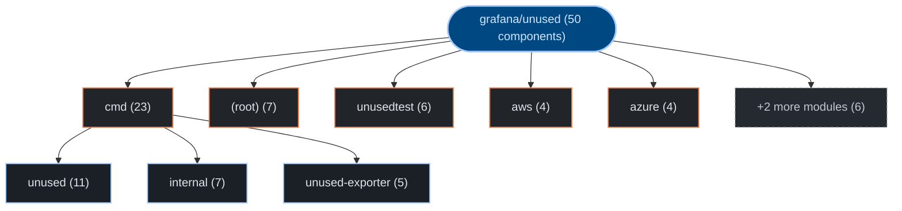
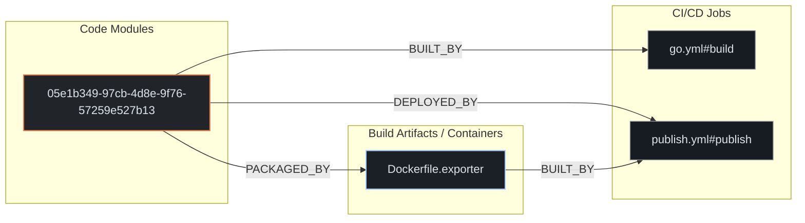
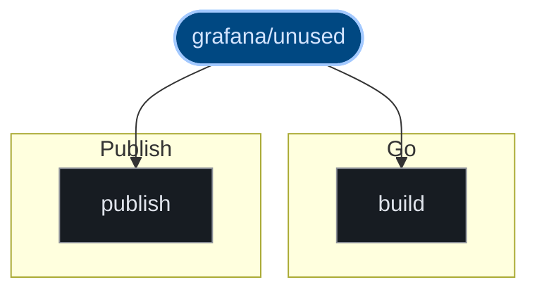

# Repository Architecture Analysis: grafana/unused

## Metadata
- **SHA**: `312ae11d31af594ef173eb7698109b069735fd20`
- **Primary Ecosystem**: Go

## Quality Metrics
- **ast_engine**: fallback
- **avg_cognitive_complexity**: 0.0
- **avg_cyclomatic_complexity**: 0.0
- **component_count**: 50
- **dead_code_count**: 0
- **dead_code_symbols**: 0 entry(ies)
- **duplication_pct**: 0.0
- **file_complexities**: 0 entry(ies)
- **files_analyzed**: 50
- **fitness_passed**: True
- **fitness_violation_count**: 0
- **framework**: Go Service
- **import_edges**: 0 entry(ies)
- **loc**: 4927
- **max_cognitive_complexity**: 0
- **max_cyclomatic_complexity**: 0
- **sloc**: 3869
- **test_file_count**: 16

# Architecture: grafana/unused

## Context
- **Repository**: `grafana/unused`
- **SHA**: `312ae11d31af594ef173eb7698109b069735fd20`
- **Ecosystem**: Go
- **Framework**: Go Service

## Building Block View

## Component Details
- **disk** (`disk.go`): module
- **disks** (`disks.go`): module
- **disks_test** (`disks_test.go`): module
- **doc** (`doc.go`): module
- **meta** (`meta.go`): module
- **meta_test** (`meta_test.go`): module
- **provider** (`provider.go`): module
- **disk** (`aws/disk.go`): module
- **disk_test** (`aws/disk_test.go`): module
- **provider** (`aws/provider.go`): module
- **provider_test** (`aws/provider_test.go`): module
- **disk** (`azure/disk.go`): module
- **disk_test** (`azure/disk_test.go`): module
- **provider** (`azure/provider.go`): module
- **provider_test** (`azure/provider_test.go`): module
- **age** (`cmd/internal/age.go`): module
- **age_test** (`cmd/internal/age_test.go`): module
- **providers** (`cmd/internal/providers.go`): module
- **providers_fake** (`cmd/internal/providers_fake.go`): module
- **providers_test** (`cmd/internal/providers_test.go`): module
- **string_slice_flag** (`cmd/internal/string_slice_flag.go`): module
- **string_slice_flag_test** (`cmd/internal/string_slice_flag_test.go`): module
- **main** (`cmd/unused/main.go`): module
- **group_table** (`cmd/unused/internal/ui/group_table.go`): module
- **interactive** (`cmd/unused/internal/ui/interactive.go`): module
- **table** (`cmd/unused/internal/ui/table.go`): module
- **ui** (`cmd/unused/internal/ui/ui.go`): module
- **ui_test** (`cmd/unused/internal/ui/ui_test.go`): module
- **delete_view** (`cmd/unused/internal/ui/interactive/delete_view.go`): module
- **keys** (`cmd/unused/internal/ui/interactive/keys.go`): module
- **model** (`cmd/unused/internal/ui/interactive/model.go`): module
- **provider_list** (`cmd/unused/internal/ui/interactive/provider_list.go`): module
- **provider_view** (`cmd/unused/internal/ui/interactive/provider_view.go`): module
- **config** (`cmd/unused-exporter/config.go`): module
- **exporter** (`cmd/unused-exporter/exporter.go`): module
- **exporter_test** (`cmd/unused-exporter/exporter_test.go`): module
- **main** (`cmd/unused-exporter/main.go`): module
- **server** (`cmd/unused-exporter/server.go`): module
- **disk** (`fake/disk.go`): module
- **provider** (`fake/provider.go`): module
- **disk** (`gcp/disk.go`): module
- **disk_test** (`gcp/disk_test.go`): module
- **provider** (`gcp/provider.go`): module
- **provider_test** (`gcp/provider_test.go`): module
- **disk** (`unusedtest/disk.go`): module
- **disk_test** (`unusedtest/disk_test.go`): module
- **meta** (`unusedtest/meta.go`): module
- **meta_test** (`unusedtest/meta_test.go`): module
- **provider** (`unusedtest/provider.go`): module
- **provider_test** (`unusedtest/provider_test.go`): module

## 6-Dimension Repository Scorecard

- **Overall Grade**: `B` (89.35/100)
- **Technical Debt Score**: 10.65
- **Estimated Remediation Effort**: 5.66h

| Dimension | Grade | Score | Weight | Details |
| :--- | :---: | :---: | :---: | :--- |
| Code Quality | `A` | 100.00 | 0.20 | avg_cc=0.00, max_cc=0, duplication=0.00%, dead_code=0 |
| Dependency Health | `B` | 85.00 | 0.15 | dependencies=75, outdated=0, vulnerable=0, has_lockfile=False |
| Maintainability | `A` | 100.00 | 0.15 | avg_cognitive=0.00, max_cognitive=0, fitness_violations=0, oversized_files=0 |
| Pipeline Health | `C` | 74.00 | 0.15 | workflows=2, operational_antipatterns=3, parallel_branches=False |
| Security | `A` | 100.00 | 0.20 | vulnerabilities=0, secrets=0, pipeline_security_findings=0 |
| Test Coverage | `C` | 70.00 | 0.15 | coverage=unavailable, ci_test_job=False, test_files_detected=True |

## Supply Chain Dependencies, Vulnerabilities & Secrets

- **Dependencies Parsed**: 75 | **Vulnerabilities**: 0 | **Secrets**: 0

### Inventory Sample
- `charm.land/bubbles/v2` `2.1.1` (golang, `go.mod`)
- `charm.land/bubbletea/v2` `2.0.8` (golang, `go.mod`)
- `charm.land/lipgloss/v2` `2.0.6` (golang, `go.mod`)
- `github.com/Azure/azure-sdk-for-go/sdk/azidentity` `1.14.0` (golang, `go.mod`)
- `github.com/Azure/azure-sdk-for-go/sdk/resourcemanager/compute/armcompute/v8` `8.2.0` (golang, `go.mod`)
- `github.com/aws/aws-sdk-go-v2` `1.43.7` (golang, `go.mod`)
- `github.com/aws/aws-sdk-go-v2/config` `1.32.38` (golang, `go.mod`)
- `github.com/aws/aws-sdk-go-v2/credentials` `1.19.37` (golang, `go.mod`)
- `github.com/aws/aws-sdk-go-v2/service/ec2` `1.322.0` (golang, `go.mod`)
- `github.com/aws/smithy-go` `1.27.8` (golang, `go.mod`)
- `github.com/evertras/bubble-table` `0.22.3` (golang, `go.mod`)
- `github.com/google/uuid` `1.6.0` (golang, `go.mod`)
- `github.com/prometheus/client_golang` `1.24.1` (golang, `go.mod`)
- `golang.org/x/sync` `0.25.0` (golang, `go.mod`)
- `google.golang.org/api` `0.293.0` (golang, `go.mod`)
- `cloud.google.com/go/auth` `0.23.0` (golang, `go.mod`)
- `cloud.google.com/go/auth/oauth2adapt` `0.2.8` (golang, `go.mod`)
- `cloud.google.com/go/compute/metadata` `0.9.0` (golang, `go.mod`)
- `github.com/Azure/azure-sdk-for-go/sdk/azcore` `1.23.0` (golang, `go.mod`)
- `github.com/Azure/azure-sdk-for-go/sdk/internal` `1.12.0` (golang, `go.mod`)
- `github.com/AzureAD/microsoft-authentication-library-for-go` `1.8.0` (golang, `go.mod`)
- `github.com/atotto/clipboard` `0.1.4` (golang, `go.mod`)
- `github.com/aws/aws-sdk-go-v2/feature/ec2/imds` `1.18.38` (golang, `go.mod`)
- `github.com/aws/aws-sdk-go-v2/internal/configsources` `1.4.38` (golang, `go.mod`)
- `github.com/aws/aws-sdk-go-v2/internal/endpoints/v2` `2.7.38` (golang, `go.mod`)
- `github.com/aws/aws-sdk-go-v2/internal/v4a` `1.4.39` (golang, `go.mod`)
- `github.com/aws/aws-sdk-go-v2/service/internal/accept-encoding` `1.13.17` (golang, `go.mod`)
- `github.com/aws/aws-sdk-go-v2/service/internal/presigned-url` `1.13.38` (golang, `go.mod`)
- `github.com/aws/aws-sdk-go-v2/service/signin` `1.5.7` (golang, `go.mod`)
- `github.com/aws/aws-sdk-go-v2/service/sso` `1.33.7` (golang, `go.mod`)
- ... (+45 more dependencies)

## Section 7: Code-to-Cloud Deployment Traceability

- `05e1b349-97cb-4d8e-9f76-57259e527b13` (code_module) --[BUILT_BY]--> `go.yml#build` (ci_job)
- `05e1b349-97cb-4d8e-9f76-57259e527b13` (code_module) --[DEPLOYED_BY]--> `publish.yml#publish` (ci_job)
- `05e1b349-97cb-4d8e-9f76-57259e527b13` (code_module) --[PACKAGED_BY]--> `Dockerfile.exporter` (container)
- `Dockerfile.exporter` (container) --[BUILT_BY]--> `publish.yml#publish` (ci_job)

## CI/CD Pipeline Topology

