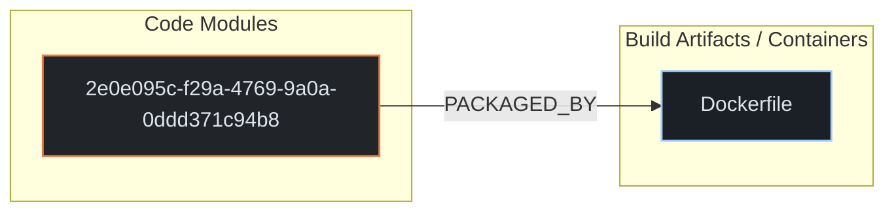

# Repository Architecture Analysis: hamvocke/spring-testing

## Metadata
- **SHA**: `9cff812e1a71e399bc231ce8323107d1283b9505`
- **Primary Ecosystem**: Java

## Quality Metrics
- **ast_engine**: tree-sitter
- **avg_cognitive_complexity**: 0.23
- **avg_cyclomatic_complexity**: 1.25
- **component_count**: 3
- **dead_code_count**: 0
- **dead_code_symbols**: 0 entry(ies)
- **duplication_pct**: 64.11
- **file_complexities**: 18 entry(ies)
- **files_analyzed**: 18
- **fitness_passed**: False
- **fitness_violation_count**: 1
- **framework**: Spring Boot
- **import_edges**: 100 entry(ies)
- **loc**: 812
- **max_cognitive_complexity**: 4
- **max_cyclomatic_complexity**: 6
- **sloc**: 635
- **test_file_count**: 14

# Architecture: hamvocke/spring-testing

## Context
- **Repository**: `hamvocke/spring-testing`
- **SHA**: `9cff812e1a71e399bc231ce8323107d1283b9505`
- **Ecosystem**: Java
- **Framework**: Spring Boot

## Building Block View

## Component Details
- **ExampleApplication** (`src/main/java/example/ExampleApplication.java`): CONFIG
- **ExampleController** (`src/main/java/example/ExampleController.java`): API_ROUTE
- **Person** (`src/main/java/example/person/Person.java`): DATA_ACCESS_LAYER

## 6-Dimension Repository Scorecard

- **Overall Grade**: `C` (78.35/100)
- **Technical Debt Score**: 21.65
- **Estimated Remediation Effort**: 19.73h

| Dimension | Grade | Score | Weight | Details |
| :--- | :---: | :---: | :---: | :--- |
| Code Quality | `C` | 75.00 | 0.20 | avg_cc=1.25, max_cc=6, duplication=64.11%, dead_code=0 |
| Dependency Health | `B` | 85.00 | 0.15 | dependencies=11, outdated=0, vulnerable=0, has_lockfile=False |
| Maintainability | `A` | 94.00 | 0.15 | avg_cognitive=0.23, max_cognitive=4, fitness_violations=1, oversized_files=0 |
| Pipeline Health | `F` | 40.00 | 0.15 | workflows=0 |
| Security | `A` | 100.00 | 0.20 | vulnerabilities=0, secrets=0, pipeline_security_findings=0 |
| Test Coverage | `C` | 70.00 | 0.15 | coverage=unavailable, ci_test_job=False, test_files_detected=True |

## Architecture Fitness & Workspace Boundaries

- **[MEDIUM] `ATRUSS-ARCH-005` (COMPLEXITY_THRESHOLD)**: Repository duplication_pct (64.11) exceeds policy threshold (15.0).

## Supply Chain Dependencies, Vulnerabilities & Secrets

- **Dependencies Parsed**: 11 | **Vulnerabilities**: 0 | **Secrets**: 0

### Inventory Sample
- `au.com.dius.pact.consumer:junit5` `4.6.17` (Maven, `build.gradle`)
- `au.com.dius.pact.provider:junit5spring` `4.6.17` (Maven, `build.gradle`)
- `com.h2database:h2` `*` (Maven, `build.gradle`)
- `io.github.bonigarcia:webdrivermanager` `6.3.2` (Maven, `build.gradle`)
- `io.rest-assured:rest-assured` `5.5.6` (Maven, `build.gradle`)
- `org.postgresql:postgresql` `*` (Maven, `build.gradle`)
- `org.seleniumhq.selenium:selenium-java` `*` (Maven, `build.gradle`)
- `org.springframework.boot:spring-boot-starter-data-jpa` `*` (Maven, `build.gradle`)
- `org.springframework.boot:spring-boot-starter-test` `*` (Maven, `build.gradle`)
- `org.springframework.boot:spring-boot-starter-web` `*` (Maven, `build.gradle`)
- `org.wiremock:wiremock-jetty12` `3.13.1` (Maven, `build.gradle`)

## Section 7: Code-to-Cloud Deployment Traceability

- `2e0e095c-f29a-4769-9a0a-0ddd371c94b8` (code_module) --[PACKAGED_BY]--> `Dockerfile` (container)

## CI/CD Pipeline Topology

