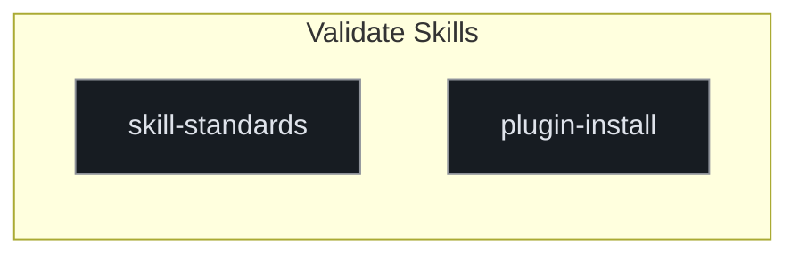

# Repository Architecture Analysis: harness/harness-skills

## Metadata
- **SHA**: `9c274a3c1cebc5cf26e5501c118e1ff03b63502f`
- **Primary Ecosystem**: Python

## Quality Metrics
- **ast_engine**: tree-sitter
- **avg_cognitive_complexity**: 3.83
- **avg_cyclomatic_complexity**: 3.46
- **component_count**: 0
- **dead_code_count**: 1
- **dead_code_symbols**: 1 entry(ies)
- **duplication_pct**: 61.62
- **file_complexities**: 16 entry(ies)
- **files_analyzed**: 16
- **fitness_passed**: False
- **fitness_violation_count**: 3
- **framework**: Unknown
- **import_edges**: 100 entry(ies)
- **loc**: 5023
- **max_cognitive_complexity**: 95
- **max_cyclomatic_complexity**: 56
- **sloc**: 4067
- **test_file_count**: 4

## 6-Dimension Repository Scorecard

- **Overall Grade**: `F` (52.73/100)
- **Technical Debt Score**: 47.27
- **Estimated Remediation Effort**: 46.89h

| Dimension | Grade | Score | Weight | Details |
| :--- | :---: | :---: | :---: | :--- |
| Code Quality | `F` | 46.16 | 0.20 | avg_cc=3.46, max_cc=56, duplication=61.62%, dead_code=1 |
| Dependency Health | `A` | 90.00 | 0.15 | dependencies=0 (no manifests parsed) |
| Maintainability | `F` | 37.00 | 0.15 | avg_cognitive=3.83, max_cognitive=95, fitness_violations=3, oversized_files=4 |
| Pipeline Health | `A` | 93.00 | 0.15 | workflows=1, operational_antipatterns=3, parallel_branches=True |
| Security | `F` | 0.00 | 0.20 | vulnerabilities=0, secrets=3, pipeline_security_findings=2 |
| Test Coverage | `C` | 70.00 | 0.15 | coverage=unavailable, ci_test_job=False, test_files_detected=True |

## Architecture Fitness & Workspace Boundaries

- **[MEDIUM] `ATRUSS-ARCH-005` (COMPLEXITY_THRESHOLD)**: Repository duplication_pct (61.62) exceeds policy threshold (15.0).
- **[MEDIUM] `ATRUSS-ARCH-005` (COMPLEXITY_THRESHOLD)**: Repository max_cognitive_complexity (95.0) exceeds policy threshold (25.0).
- **[MEDIUM] `ATRUSS-ARCH-005` (COMPLEXITY_THRESHOLD)**: Repository max_cyclomatic_complexity (56.0) exceeds policy threshold (20.0).

## Supply Chain Dependencies, Vulnerabilities & Secrets

- **Dependencies Parsed**: 0 | **Vulnerabilities**: 0 | **Secrets**: 3

### Secret Findings (Redacted)
- **[CRITICAL] `ATRUSS-SEC-001`** at `examples/connectors/cloud-connectors.yaml:15` (`accessKey: AKIA***REDACTED***`)
- **[CRITICAL] `ATRUSS-SEC-001`** at `examples/connectors/cloud-connectors.yaml:47` (`accessKey: AKIA***REDACTED***`)
- **[CRITICAL] `ATRUSS-SEC-001`** at `examples/connectors/registry-connectors.yaml:46` (`accessKey: AKIA***REDACTED***`)

## CI/CD Pipeline Topology

