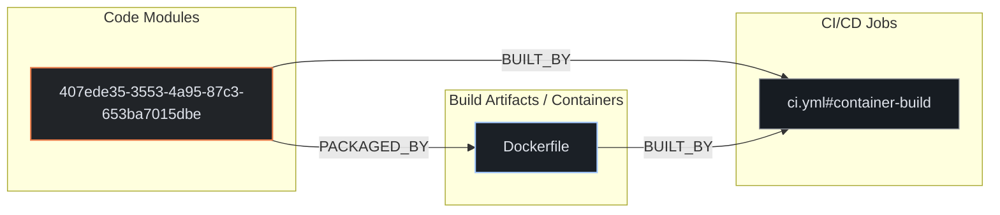
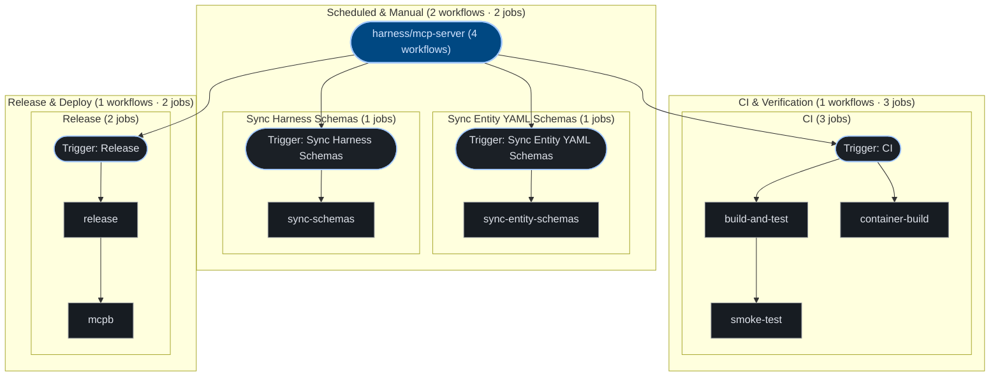

# Repository Architecture Analysis: harness/mcp-server

## Metadata
- **SHA**: `c9c4c89ae2acf039498bbf5bda46eb6137feefd7`
- **Primary Ecosystem**: JavaScript/TypeScript

## Quality Metrics
- **ast_engine**: tree-sitter
- **avg_cognitive_complexity**: 5.01
- **avg_cyclomatic_complexity**: 5.04
- **component_count**: 25
- **dead_code_count**: 2
- **dead_code_symbols**: 2 entry(ies)
- **duplication_pct**: 96.21
- **file_complexities**: 25 entry(ies)
- **files_analyzed**: 471
- **fitness_passed**: False
- **fitness_violation_count**: 3
- **framework**: React (Vite)
- **import_edges**: 100 entry(ies)
- **loc**: 537311
- **max_cognitive_complexity**: 492
- **max_cyclomatic_complexity**: 230
- **sloc**: 515368
- **test_file_count**: 450

# Architecture: harness/mcp-server

## Context
- **Repository**: `harness/mcp-server`
- **SHA**: `c9c4c89ae2acf039498bbf5bda46eb6137feefd7`
- **Ecosystem**: JavaScript/TypeScript
- **Framework**: React (Vite)

## Building Block View

## Component Details
- **harness-mcp-v2** (`package.json`): MODULE
- **StatusPill** (`apps/harness-app/src/components/card.tsx`): UI_COMPONENT
- **Card** (`apps/harness-app/src/components/card.tsx`): UI_COMPONENT
- **ChartPanel** (`apps/harness-app/src/views/chart-panel.tsx`): UI_COMPONENT
- **Dashboard** (`apps/harness-app/src/views/dashboard.tsx`): UI_COMPONENT
- **ExecutionCard** (`apps/harness-app/src/views/execution-card.tsx`): UI_COMPONENT
- **ResultCard** (`apps/harness-app/src/views/result-card.tsx`): UI_COMPONENT
- **GET_health** (`src/index.ts`): API_ROUTE
- **POST_mcp** (`src/index.ts`): API_ROUTE
- **GET_mcp** (`src/index.ts`): API_ROUTE
- **DELETE_mcp** (`src/index.ts`): API_ROUTE
- **HarnessClient** (`src/client/harness-client.ts`): SERVICE
- **GET_.well-known_oauth-authorization-server** (`src/utils/oauth-broker.ts`): API_ROUTE
- **GET_oauth_authorize** (`src/utils/oauth-broker.ts`): API_ROUTE
- **GET_oauth_upstream_callback** (`src/utils/oauth-broker.ts`): API_ROUTE
- **GET_oauth_harnessid_callback** (`src/utils/oauth-broker.ts`): API_ROUTE
- **POST_oauth_token** (`src/utils/oauth-broker.ts`): API_ROUTE
- **GET_probe** (`tests/integration/http-transport.test.ts`): API_ROUTE
- **GET_trust proxy** (`tests/integration/http-transport.test.ts`): API_ROUTE
- **POST_mcp** (`tests/integration/http-transport.test.ts`): API_ROUTE
- **GET_health** (`tests/utils/http-auth.test.ts`): API_ROUTE
- **GET_mcp** (`tests/utils/http-auth.test.ts`): API_ROUTE
- **GET_mcp** (`tests/utils/oauth-auth.test.ts`): API_ROUTE
- **POST_mcp** (`tests/utils/oauth-broker.test.ts`): API_ROUTE
- **POST_mcp** (`tests/utils/oauth-proxy.test.ts`): API_ROUTE

## 6-Dimension Repository Scorecard

- **Overall Grade**: `F` (44.31/100)
- **Technical Debt Score**: 55.69
- **Estimated Remediation Effort**: 101.16h

| Dimension | Grade | Score | Weight | Details |
| :--- | :---: | :---: | :---: | :--- |
| Code Quality | `F` | 37.84 | 0.20 | avg_cc=5.04, max_cc=230, duplication=96.21%, dead_code=2 |
| Dependency Health | `A` | 100.00 | 0.15 | dependencies=329, outdated=0, vulnerable=0, has_lockfile=True |
| Maintainability | `F` | 36.97 | 0.15 | avg_cognitive=5.01, max_cognitive=492, fitness_violations=3, oversized_files=22 |
| Pipeline Health | `F` | 38.00 | 0.15 | workflows=4, operational_antipatterns=10, parallel_branches=True |
| Security | `F` | 0.00 | 0.20 | vulnerabilities=0, secrets=0, pipeline_security_findings=14 |
| Test Coverage | `C` | 70.00 | 0.15 | coverage=unavailable, ci_test_job=True, test_files_detected=True |

## Architecture Fitness & Workspace Boundaries

- **[MEDIUM] `ATRUSS-ARCH-005` (COMPLEXITY_THRESHOLD)**: Repository duplication_pct (96.21) exceeds policy threshold (15.0).
- **[MEDIUM] `ATRUSS-ARCH-005` (COMPLEXITY_THRESHOLD)**: Repository max_cognitive_complexity (492.0) exceeds policy threshold (25.0).
- **[MEDIUM] `ATRUSS-ARCH-005` (COMPLEXITY_THRESHOLD)**: Repository max_cyclomatic_complexity (230.0) exceeds policy threshold (20.0).

## Supply Chain Dependencies, Vulnerabilities & Secrets

- **Dependencies Parsed**: 329 | **Vulnerabilities**: 0 | **Secrets**: 0

### Inventory Sample
- `@hono/node-server` `2.1.6` (npm, `package.json`)
- `@hono/node-server` `2.1.8` (npm, `pnpm-lock.yaml`)
- `@huggingface/transformers` `4.3.0` (npm, `pnpm-lock.yaml`)
- `@modelcontextprotocol/ext-apps` `1.7.5` (npm, `package.json`)
- `@modelcontextprotocol/ext-apps` `1.7.5` (npm, `pnpm-lock.yaml`)
- `@modelcontextprotocol/sdk` `1.31.0` (npm, `package.json`)
- `@modelcontextprotocol/sdk` `1.32.1` (npm, `pnpm-lock.yaml`)
- `@opentelemetry/api` `1.9.1` (npm, `package.json`)
- `@opentelemetry/api` `1.9.1` (npm, `pnpm-lock.yaml`)
- `@opentelemetry/exporter-trace-otlp-http` `0.220.0` (npm, `package.json`)
- `@opentelemetry/exporter-trace-otlp-http` `0.220.0` (npm, `pnpm-lock.yaml`)
- `@opentelemetry/resources` `2.9.0` (npm, `package.json`)
- `@opentelemetry/resources` `2.9.0` (npm, `pnpm-lock.yaml`)
- `@opentelemetry/sdk-trace-node` `2.9.0` (npm, `package.json`)
- `@opentelemetry/sdk-trace-node` `2.9.0` (npm, `pnpm-lock.yaml`)
- `@types/express` `5.0.6` (npm, `package.json`)
- `@types/express` `5.0.6` (npm, `pnpm-lock.yaml`)
- `@types/jsonwebtoken` `9.0.10` (npm, `package.json`)
- `@types/jsonwebtoken` `9.0.10` (npm, `pnpm-lock.yaml`)
- `@types/node` `22.13.5` (npm, `package.json`)
- `@types/node` `22.19.12` (npm, `pnpm-lock.yaml`)
- `adm-zip` `0.6.1` (npm, `package.json`)
- `adm-zip` `0.6.1` (npm, `pnpm-lock.yaml`)
- `chart.js` `4.6.1` (npm, `package.json`)
- `chart.js` `4.6.1` (npm, `pnpm-lock.yaml`)
- `dotenv` `17.3.1` (npm, `package.json`)
- `dotenv` `17.3.1` (npm, `pnpm-lock.yaml`)
- `express` `5.2.1` (npm, `package.json`)
- `express` `5.2.1` (npm, `pnpm-lock.yaml`)
- `hono` `4.13.16` (npm, `package.json`)
- ... (+299 more dependencies)

## Section 7: Code-to-Cloud Deployment Traceability

- `407ede35-3553-4a95-87c3-653ba7015dbe` (code_module) --[BUILT_BY]--> `ci.yml#container-build` (ci_job)
- `407ede35-3553-4a95-87c3-653ba7015dbe` (code_module) --[PACKAGED_BY]--> `Dockerfile` (container)
- `Dockerfile` (container) --[BUILT_BY]--> `ci.yml#container-build` (ci_job)

## CI/CD Pipeline Topology

