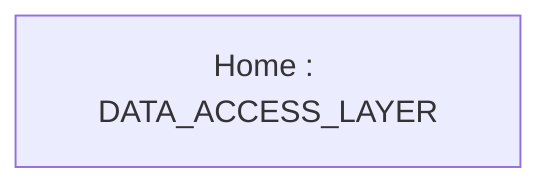
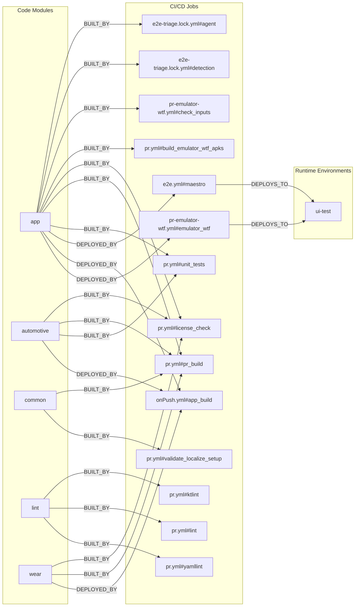
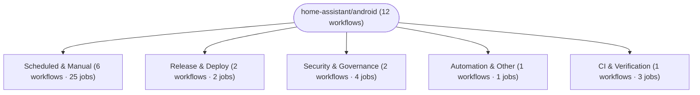

# Repository Architecture Analysis: home-assistant/android

## Metadata
- **SHA**: `6f48337910158c5ca1a3965e499143114bd6a3d3`
- **Primary Ecosystem**: Java

## Quality Metrics
- **ast_engine**: tree-sitter
- **avg_cognitive_complexity**: 6.56
- **avg_cyclomatic_complexity**: 11.56
- **component_count**: 1
- **dead_code_count**: 0
- **dead_code_symbols**: 0 entry(ies)
- **duplication_pct**: 85.47
- **file_complexities**: 25 entry(ies)
- **files_analyzed**: 1341
- **fitness_passed**: False
- **fitness_violation_count**: 3
- **framework**: Unknown
- **import_edges**: 100 entry(ies)
- **loc**: 195015
- **max_cognitive_complexity**: 526
- **max_cyclomatic_complexity**: 339
- **sloc**: 156508
- **test_file_count**: 296

# Architecture: home-assistant/android

## Context
- **Repository**: `home-assistant/android`
- **SHA**: `6f48337910158c5ca1a3965e499143114bd6a3d3`
- **Ecosystem**: Java
- **Framework**: Unknown

## Building Block View

## Component Details
- **Home** (`lint/src/test/kotlin/io/homeassistant/lint/room/RoomEntityMutablePropertiesIssueTest.kt`): DATA_ACCESS_LAYER

## 6-Dimension Repository Scorecard

- **Overall Grade**: `F` (34.35/100)
- **Technical Debt Score**: 65.65
- **Estimated Remediation Effort**: 172.51h

| Dimension | Grade | Score | Weight | Details |
| :--- | :---: | :---: | :---: | :--- |
| Code Quality | `F` | 20.00 | 0.20 | avg_cc=11.56, max_cc=339, duplication=85.47%, dead_code=0 |
| Dependency Health | `A` | 100.00 | 0.15 | dependencies=2, outdated=0, vulnerable=0, has_lockfile=False |
| Maintainability | `F` | 32.32 | 0.15 | avg_cognitive=6.56, max_cognitive=526, fitness_violations=3, oversized_files=15 |
| Pipeline Health | `F` | 0.00 | 0.15 | workflows=12, operational_antipatterns=39, parallel_branches=True |
| Security | `F` | 0.00 | 0.20 | vulnerabilities=0, secrets=1, pipeline_security_findings=50 |
| Test Coverage | `C` | 70.00 | 0.15 | coverage=unavailable, ci_test_job=True, test_files_detected=True |

## Architecture Fitness & Workspace Boundaries

- **[MEDIUM] `ATRUSS-ARCH-005` (COMPLEXITY_THRESHOLD)**: Repository duplication_pct (85.47) exceeds policy threshold (15.0).
- **[MEDIUM] `ATRUSS-ARCH-005` (COMPLEXITY_THRESHOLD)**: Repository max_cognitive_complexity (526.0) exceeds policy threshold (25.0).
- **[MEDIUM] `ATRUSS-ARCH-005` (COMPLEXITY_THRESHOLD)**: Repository max_cyclomatic_complexity (339.0) exceeds policy threshold (20.0).

## Supply Chain Dependencies, Vulnerabilities & Secrets

- **Dependencies Parsed**: 2 | **Vulnerabilities**: 0 | **Secrets**: 1

### Secret Findings (Redacted)
- **[HIGH] `ATRUSS-SEC-005`** at `.github/e2e/homeassistant/.storage/auth_provider.homeassistant:9` (`"password": "JDJi***REDACTED***"`)

### Inventory Sample
- `fastlane` `*` (gem, `Gemfile`)
- `fastlane-plugin-amazon_app_submission` `*` (gem, `Gemfile`)

## Section 7: Code-to-Cloud Deployment Traceability

- `e2e.yml#maestro` (ci_job) --[DEPLOYS_TO]--> `ui-test` (environment)
- `pr-emulator-wtf.yml#emulator_wtf` (ci_job) --[DEPLOYS_TO]--> `ui-test` (environment)
- `app` (code_module) --[BUILT_BY]--> `e2e-triage.lock.yml#agent` (ci_job)
- `app` (code_module) --[BUILT_BY]--> `e2e-triage.lock.yml#detection` (ci_job)
- `app` (code_module) --[BUILT_BY]--> `pr-emulator-wtf.yml#check_inputs` (ci_job)
- `app` (code_module) --[BUILT_BY]--> `pr.yml#build_emulator_wtf_apks` (ci_job)
- `app` (code_module) --[BUILT_BY]--> `pr.yml#license_check` (ci_job)
- `app` (code_module) --[BUILT_BY]--> `pr.yml#pr_build` (ci_job)
- `app` (code_module) --[BUILT_BY]--> `pr.yml#unit_tests` (ci_job)
- `app` (code_module) --[DEPLOYED_BY]--> `e2e.yml#maestro` (ci_job)
- `app` (code_module) --[DEPLOYED_BY]--> `onPush.yml#app_build` (ci_job)
- `app` (code_module) --[DEPLOYED_BY]--> `pr-emulator-wtf.yml#emulator_wtf` (ci_job)
- `automotive` (code_module) --[BUILT_BY]--> `pr.yml#license_check` (ci_job)
- `automotive` (code_module) --[BUILT_BY]--> `pr.yml#pr_build` (ci_job)
- `automotive` (code_module) --[BUILT_BY]--> `pr.yml#unit_tests` (ci_job)
- `automotive` (code_module) --[DEPLOYED_BY]--> `onPush.yml#app_build` (ci_job)
- `common` (code_module) --[BUILT_BY]--> `pr.yml#pr_build` (ci_job)
- `common` (code_module) --[BUILT_BY]--> `pr.yml#validate_localize_setup` (ci_job)
- `lint` (code_module) --[BUILT_BY]--> `pr.yml#ktlint` (ci_job)
- `lint` (code_module) --[BUILT_BY]--> `pr.yml#lint` (ci_job)
- `lint` (code_module) --[BUILT_BY]--> `pr.yml#yamllint` (ci_job)
- `wear` (code_module) --[BUILT_BY]--> `pr.yml#license_check` (ci_job)
- `wear` (code_module) --[BUILT_BY]--> `pr.yml#pr_build` (ci_job)
- `wear` (code_module) --[DEPLOYED_BY]--> `onPush.yml#app_build` (ci_job)

## CI/CD Pipeline Topology

