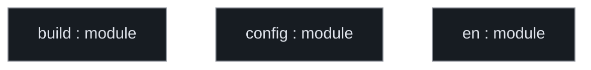
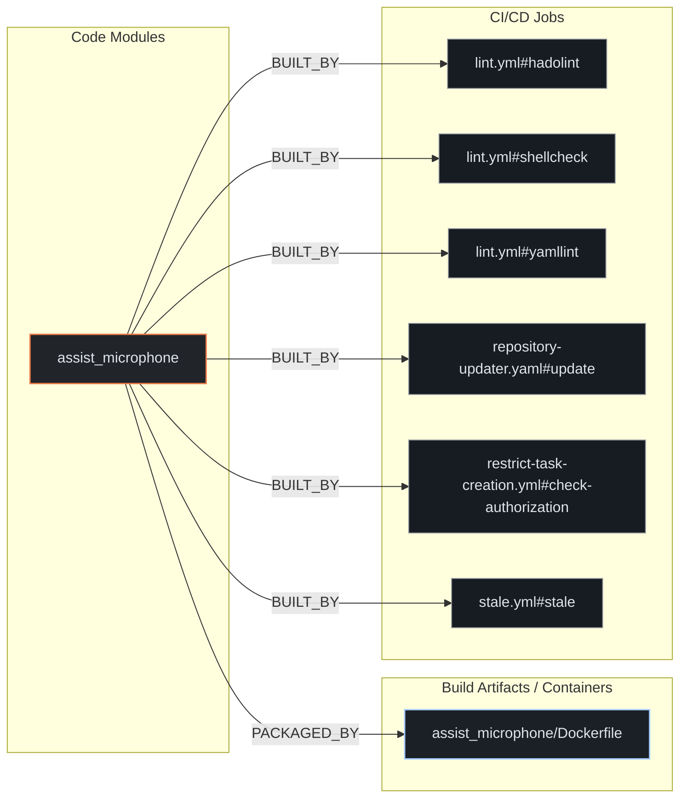
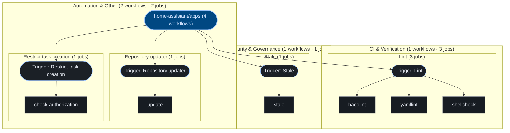

# Repository Architecture Analysis: home-assistant/apps

## Metadata
- **SHA**: `c0f85bb9935683b4cdc0e9a871ed1853e1c69821`
- **Primary Ecosystem**: Container / Helm / IaC

## Quality Metrics
- **ast_engine**: fallback
- **avg_cognitive_complexity**: 0.0
- **avg_cyclomatic_complexity**: 0.0
- **component_count**: 3
- **dead_code_count**: 0
- **dead_code_symbols**: 0 entry(ies)
- **duplication_pct**: 0.0
- **file_complexities**: 0 entry(ies)
- **files_analyzed**: 3
- **fitness_passed**: True
- **fitness_violation_count**: 0
- **framework**: Container
- **import_edges**: 0 entry(ies)
- **loc**: 99
- **max_cognitive_complexity**: 0
- **max_cyclomatic_complexity**: 0
- **sloc**: 99

# Architecture: home-assistant/apps

## Context
- **Repository**: `home-assistant/apps`
- **SHA**: `c0f85bb9935683b4cdc0e9a871ed1853e1c69821`
- **Ecosystem**: Container / Helm / IaC
- **Framework**: Container

## Building Block View

## Component Details
- **build** (`assist_microphone/build.yaml`): module
- **config** (`assist_microphone/config.yaml`): module
- **en** (`assist_microphone/translations/en.yaml`): module

## 6-Dimension Repository Scorecard

- **Overall Grade**: `C` (78.45/100)
- **Technical Debt Score**: 21.55
- **Estimated Remediation Effort**: 14.39h

| Dimension | Grade | Score | Weight | Details |
| :--- | :---: | :---: | :---: | :--- |
| Code Quality | `A` | 100.00 | 0.20 | avg_cc=0.00, max_cc=0, duplication=0.00%, dead_code=0 |
| Dependency Health | `A` | 90.00 | 0.15 | dependencies=0 (no manifests parsed) |
| Maintainability | `A` | 100.00 | 0.15 | avg_cognitive=0.00, max_cognitive=0, fitness_violations=0, oversized_files=0 |
| Pipeline Health | `B` | 87.00 | 0.15 | workflows=4, operational_antipatterns=6, parallel_branches=True |
| Security | `F` | 32.00 | 0.20 | vulnerabilities=0, secrets=3, pipeline_security_findings=0 |
| Test Coverage | `C` | 70.00 | 0.15 | coverage=unavailable, ci_test_job=True, test_files_detected=False |

## Supply Chain Dependencies, Vulnerabilities & Secrets

- **Dependencies Parsed**: 0 | **Vulnerabilities**: 0 | **Secrets**: 3

### Secret Findings (Redacted)
- **[CRITICAL] `ATRUSS-SEC-004`** at `git_pull/DOCS.md:58` (`-----BEGIN ... PRIVATE KEY----- [REDACTED]`)
- **[CRITICAL] `ATRUSS-SEC-004`** at `letsencrypt/DOCS.md:1494` (`-----BEGIN ... PRIVATE KEY----- [REDACTED]`)
- **[HIGH] `ATRUSS-SEC-005`** at `mosquitto/DOCS.md:69` (`password: "PBKD***REDACTED***"`)

## Section 7: Code-to-Cloud Deployment Traceability

- `assist_microphone` (code_module) --[BUILT_BY]--> `lint.yml#hadolint` (ci_job)
- `assist_microphone` (code_module) --[BUILT_BY]--> `lint.yml#shellcheck` (ci_job)
- `assist_microphone` (code_module) --[BUILT_BY]--> `lint.yml#yamllint` (ci_job)
- `assist_microphone` (code_module) --[BUILT_BY]--> `repository-updater.yaml#update` (ci_job)
- `assist_microphone` (code_module) --[BUILT_BY]--> `restrict-task-creation.yml#check-authorization` (ci_job)
- `assist_microphone` (code_module) --[BUILT_BY]--> `stale.yml#stale` (ci_job)
- `assist_microphone` (code_module) --[PACKAGED_BY]--> `assist_microphone/Dockerfile` (container)

## CI/CD Pipeline Topology

