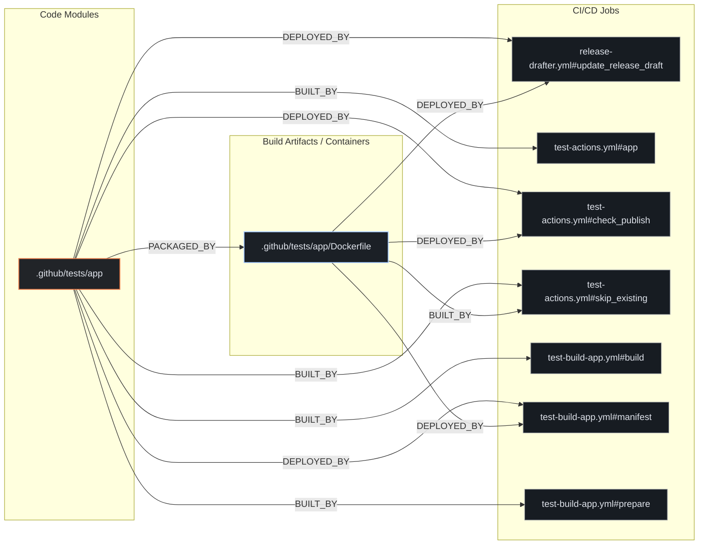
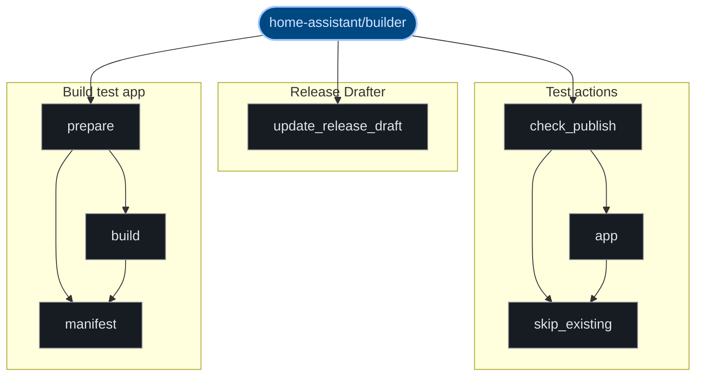

# Repository Architecture Analysis: home-assistant/builder

## Metadata
- **SHA**: `9b2658ea6ddfd83d528e5d8e37393893bf5e92d7`
- **Primary Ecosystem**: Container / Helm / IaC

## Quality Metrics
- **ast_engine**: fallback
- **avg_cognitive_complexity**: 0.0
- **avg_cyclomatic_complexity**: 0.0
- **component_count**: 1
- **dead_code_count**: 0
- **dead_code_symbols**: 0 entry(ies)
- **duplication_pct**: 0.0
- **file_complexities**: 0 entry(ies)
- **files_analyzed**: 1
- **fitness_passed**: True
- **fitness_violation_count**: 0
- **framework**: Container
- **import_edges**: 0 entry(ies)
- **loc**: 14
- **max_cognitive_complexity**: 0
- **max_cyclomatic_complexity**: 0
- **sloc**: 14
- **test_file_count**: 2

# Architecture: home-assistant/builder

## Context
- **Repository**: `home-assistant/builder`
- **SHA**: `9b2658ea6ddfd83d528e5d8e37393893bf5e92d7`
- **Ecosystem**: Container / Helm / IaC
- **Framework**: Container

## Building Block View

## Component Details
- **config** (`.github/tests/app/config.yaml`): module

## 6-Dimension Repository Scorecard

- **Overall Grade**: `C` (79.60/100)
- **Technical Debt Score**: 20.40
- **Estimated Remediation Effort**: 17.60h

| Dimension | Grade | Score | Weight | Details |
| :--- | :---: | :---: | :---: | :--- |
| Code Quality | `A` | 100.00 | 0.20 | avg_cc=0.00, max_cc=0, duplication=0.00%, dead_code=0 |
| Dependency Health | `A` | 90.00 | 0.15 | dependencies=0 (no manifests parsed) |
| Maintainability | `A` | 100.00 | 0.15 | avg_cognitive=0.00, max_cognitive=0, fitness_violations=0, oversized_files=0 |
| Pipeline Health | `F` | 20.00 | 0.15 | workflows=3, operational_antipatterns=12, parallel_branches=True |
| Security | `B` | 88.00 | 0.20 | vulnerabilities=0, secrets=0, pipeline_security_findings=1 |
| Test Coverage | `C` | 70.00 | 0.15 | coverage=unavailable, ci_test_job=True, test_files_detected=True |

## Section 7: Code-to-Cloud Deployment Traceability

- `.github/tests/app` (code_module) --[BUILT_BY]--> `test-actions.yml#app` (ci_job)
- `.github/tests/app` (code_module) --[BUILT_BY]--> `test-actions.yml#skip_existing` (ci_job)
- `.github/tests/app` (code_module) --[BUILT_BY]--> `test-build-app.yml#build` (ci_job)
- `.github/tests/app` (code_module) --[BUILT_BY]--> `test-build-app.yml#prepare` (ci_job)
- `.github/tests/app` (code_module) --[DEPLOYED_BY]--> `release-drafter.yml#update_release_draft` (ci_job)
- `.github/tests/app` (code_module) --[DEPLOYED_BY]--> `test-actions.yml#check_publish` (ci_job)
- `.github/tests/app` (code_module) --[DEPLOYED_BY]--> `test-build-app.yml#manifest` (ci_job)
- `.github/tests/app` (code_module) --[PACKAGED_BY]--> `.github/tests/app/Dockerfile` (container)
- `.github/tests/app/Dockerfile` (container) --[BUILT_BY]--> `test-actions.yml#skip_existing` (ci_job)
- `.github/tests/app/Dockerfile` (container) --[DEPLOYED_BY]--> `release-drafter.yml#update_release_draft` (ci_job)
- `.github/tests/app/Dockerfile` (container) --[DEPLOYED_BY]--> `test-actions.yml#check_publish` (ci_job)
- `.github/tests/app/Dockerfile` (container) --[DEPLOYED_BY]--> `test-build-app.yml#manifest` (ci_job)

## CI/CD Pipeline Topology

