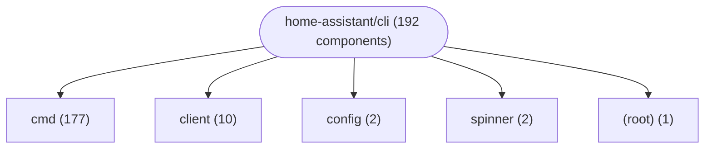
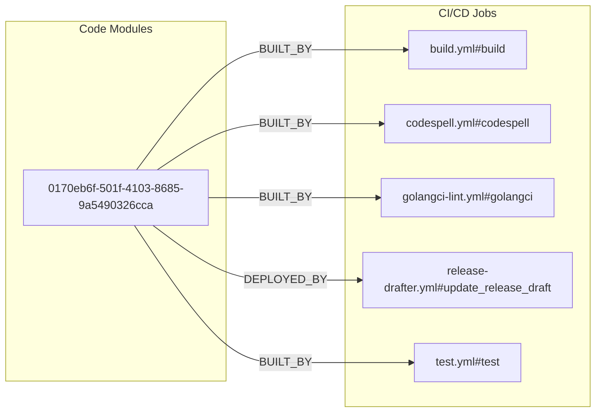
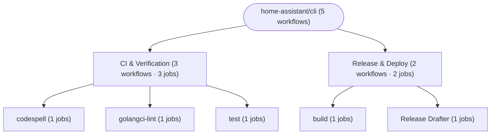

# Repository Architecture Analysis: home-assistant/cli

## Metadata
- **SHA**: `a9bea5764909a7592500a1483efaf2f5a1cc7440`
- **Primary Ecosystem**: Go

## Quality Metrics
- **ast_engine**: fallback
- **avg_cognitive_complexity**: 0.0
- **avg_cyclomatic_complexity**: 0.0
- **component_count**: 192
- **dead_code_count**: 0
- **dead_code_symbols**: 0 entry(ies)
- **duplication_pct**: 0.0
- **file_complexities**: 0 entry(ies)
- **files_analyzed**: 192
- **fitness_passed**: True
- **fitness_violation_count**: 0
- **framework**: Go Service
- **import_edges**: 0 entry(ies)
- **loc**: 11847
- **max_cognitive_complexity**: 0
- **max_cyclomatic_complexity**: 0
- **sloc**: 9833
- **test_file_count**: 6

# Architecture: home-assistant/cli

## Context
- **Repository**: `home-assistant/cli`
- **SHA**: `a9bea5764909a7592500a1483efaf2f5a1cc7440`
- **Ecosystem**: Go
- **Framework**: Go Service

## Building Block View

## Component Details

Showing top 60 representative components out of 192 across 5 module group(s):

- **Module `cmd`** (177 components — module: 177)
- **Module `client`** (10 components — module: 10)
- **Module `config`** (2 components — module: 2)
- **Module `spinner`** (2 components — module: 2)
- **Module `(root)`** (1 components — module: 1)

- **apps** (`cmd/apps.go`): module
- **apps_changelog** (`cmd/apps_changelog.go`): module
- **apps_info** (`cmd/apps_info.go`): module
- **apps_install** (`cmd/apps_install.go`): module
- **apps_logs** (`cmd/apps_logs.go`): module
- **apps_rebuild** (`cmd/apps_rebuild.go`): module
- **apps_restart** (`cmd/apps_restart.go`): module
- **apps_start** (`cmd/apps_start.go`): module
- **apps_stats** (`cmd/apps_stats.go`): module
- **apps_stop** (`cmd/apps_stop.go`): module
- **apps_uninstall** (`cmd/apps_uninstall.go`): module
- **apps_update** (`cmd/apps_update.go`): module
- **audio** (`cmd/audio.go`): module
- **audio_default** (`cmd/audio_default.go`): module
- **audio_default_input** (`cmd/audio_default_input.go`): module
- **audio_default_output** (`cmd/audio_default_output.go`): module
- **audio_info** (`cmd/audio_info.go`): module
- **audio_logs** (`cmd/audio_logs.go`): module
- **audio_profile** (`cmd/audio_profile.go`): module
- **audio_reload** (`cmd/audio_reload.go`): module
- **audio_restart** (`cmd/audio_restart.go`): module
- **audio_stats** (`cmd/audio_stats.go`): module
- **audio_update** (`cmd/audio_update.go`): module
- **audio_volume** (`cmd/audio_volume.go`): module
- **audio_volume_input** (`cmd/audio_volume_input.go`): module
- **audio_volume_output** (`cmd/audio_volume_output.go`): module
- **auth** (`cmd/auth.go`): module
- **auth_cache** (`cmd/auth_cache.go`): module
- **auth_list** (`cmd/auth_list.go`): module
- **auth_reset** (`cmd/auth_reset.go`): module
- **available_updates** (`cmd/available_updates.go`): module
- **backups** (`cmd/backups.go`): module
- **backups_freeze** (`cmd/backups_freeze.go`): module
- **backups_info** (`cmd/backups_info.go`): module
- **backups_new** (`cmd/backups_new.go`): module
- **backups_options** (`cmd/backups_options.go`): module
- **backups_reload** (`cmd/backups_reload.go`): module
- **backups_remove** (`cmd/backups_remove.go`): module
- **backups_restore** (`cmd/backups_restore.go`): module
- **backups_thaw** (`cmd/backups_thaw.go`): module
- **banner** (`cmd/banner.go`): module
- **character_sets** (`spinner/character_sets.go`): module
- **cli** (`cmd/cli.go`): module
- **cli_info** (`cmd/cli_info.go`): module
- **cli_stats** (`cmd/cli_stats.go`): module
- **cli_update** (`cmd/cli_update.go`): module
- **client** (`client/client.go`): module
- **config** (`config/config.go`): module
- **config_test** (`config/config_test.go`): module
- **core** (`cmd/core.go`): module
- **core_check** (`cmd/core_check.go`): module
- **core_info** (`cmd/core_info.go`): module
- **core_logs** (`cmd/core_logs.go`): module
- **core_options** (`cmd/core_options.go`): module
- **core_rebuild** (`cmd/core_rebuild.go`): module
- **core_restart** (`cmd/core_restart.go`): module
- **core_start** (`cmd/core_start.go`): module
- **core_stats** (`cmd/core_stats.go`): module
- **core_stop** (`cmd/core_stop.go`): module
- **core_update** (`cmd/core_update.go`): module

## 6-Dimension Repository Scorecard

- **Overall Grade**: `C` (73.60/100)
- **Technical Debt Score**: 26.40
- **Estimated Remediation Effort**: 20.10h

| Dimension | Grade | Score | Weight | Details |
| :--- | :---: | :---: | :---: | :--- |
| Code Quality | `A` | 100.00 | 0.20 | avg_cc=0.00, max_cc=0, duplication=0.00%, dead_code=0 |
| Dependency Health | `B` | 85.00 | 0.15 | dependencies=6, outdated=0, vulnerable=0, has_lockfile=False |
| Maintainability | `A` | 100.00 | 0.15 | avg_cognitive=0.00, max_cognitive=0, fitness_violations=0, oversized_files=0 |
| Pipeline Health | `D` | 65.00 | 0.15 | workflows=5, operational_antipatterns=6, parallel_branches=False |
| Security | `F` | 28.00 | 0.20 | vulnerabilities=0, secrets=0, pipeline_security_findings=6 |
| Test Coverage | `C` | 70.00 | 0.15 | coverage=unavailable, ci_test_job=True, test_files_detected=True |

## Supply Chain Dependencies, Vulnerabilities & Secrets

- **Dependencies Parsed**: 6 | **Vulnerabilities**: 0 | **Secrets**: 0

### Inventory Sample
- `github.com/spf13/cobra` `1.10.2` (golang, `go.mod`)
- `github.com/spf13/pflag` `1.0.10` (golang, `go.mod`)
- `go.yaml.in/yaml/v3` `3.0.6` (golang, `go.mod`)
- `golang.org/x/term` `0.46.0` (golang, `go.mod`)
- `github.com/inconshreveable/mousetrap` `1.1.0` (golang, `go.mod`)
- `golang.org/x/sys` `0.48.0` (golang, `go.mod`)

## Section 7: Code-to-Cloud Deployment Traceability

- `0170eb6f-501f-4103-8685-9a5490326cca` (code_module) --[BUILT_BY]--> `build.yml#build` (ci_job)
- `0170eb6f-501f-4103-8685-9a5490326cca` (code_module) --[BUILT_BY]--> `codespell.yml#codespell` (ci_job)
- `0170eb6f-501f-4103-8685-9a5490326cca` (code_module) --[BUILT_BY]--> `golangci-lint.yml#golangci` (ci_job)
- `0170eb6f-501f-4103-8685-9a5490326cca` (code_module) --[BUILT_BY]--> `test.yml#test` (ci_job)
- `0170eb6f-501f-4103-8685-9a5490326cca` (code_module) --[DEPLOYED_BY]--> `release-drafter.yml#update_release_draft` (ci_job)

## CI/CD Pipeline Topology

