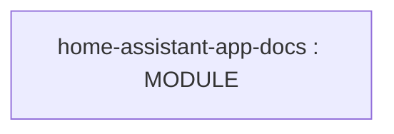
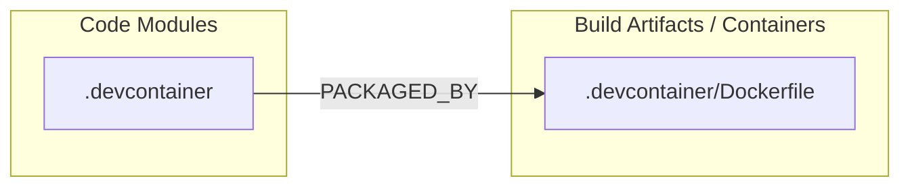

# Repository Architecture Analysis: home-assistant/companion.home-assistant

## Metadata
- **SHA**: `c2d8fc4eb8c437640e06e311cbe2532c86220c99`
- **Primary Ecosystem**: JavaScript/TypeScript

## Quality Metrics
- **ast_engine**: tree-sitter
- **avg_cognitive_complexity**: 0.2
- **avg_cyclomatic_complexity**: 1.4
- **component_count**: 1
- **dead_code_count**: 0
- **dead_code_symbols**: 0 entry(ies)
- **duplication_pct**: 76.33
- **file_complexities**: 4 entry(ies)
- **files_analyzed**: 4
- **fitness_passed**: False
- **fitness_violation_count**: 1
- **framework**: React (Vite)
- **import_edges**: 11 entry(ies)
- **loc**: 440
- **max_cognitive_complexity**: 1
- **max_cyclomatic_complexity**: 3
- **sloc**: 424

# Architecture: home-assistant/companion.home-assistant

## Context
- **Repository**: `home-assistant/companion.home-assistant`
- **SHA**: `c2d8fc4eb8c437640e06e311cbe2532c86220c99`
- **Ecosystem**: JavaScript/TypeScript
- **Framework**: React (Vite)

## Building Block View

## Component Details
- **home-assistant-app-docs** (`package.json`): MODULE

## 6-Dimension Repository Scorecard

- **Overall Grade**: `C` (73.85/100)
- **Technical Debt Score**: 26.15
- **Estimated Remediation Effort**: 23.30h

| Dimension | Grade | Score | Weight | Details |
| :--- | :---: | :---: | :---: | :--- |
| Code Quality | `C` | 75.00 | 0.20 | avg_cc=1.40, max_cc=3, duplication=76.33%, dead_code=0 |
| Dependency Health | `B` | 85.00 | 0.15 | dependencies=8, outdated=0, vulnerable=0, has_lockfile=False |
| Maintainability | `A` | 94.00 | 0.15 | avg_cognitive=0.20, max_cognitive=1, fitness_violations=1, oversized_files=0 |
| Pipeline Health | `F` | 40.00 | 0.15 | workflows=0 |
| Security | `A` | 100.00 | 0.20 | vulnerabilities=0, secrets=0, pipeline_security_findings=0 |
| Test Coverage | `F` | 40.00 | 0.15 | coverage=unavailable, ci_test_job=False, test_files_detected=False |

## Architecture Fitness & Workspace Boundaries

- **[MEDIUM] `ATRUSS-ARCH-005` (COMPLEXITY_THRESHOLD)**: Repository duplication_pct (76.33) exceeds policy threshold (15.0).

## Supply Chain Dependencies, Vulnerabilities & Secrets

- **Dependencies Parsed**: 8 | **Vulnerabilities**: 0 | **Secrets**: 0

### Inventory Sample
- `@docusaurus/core` `3.10.2` (npm, `package.json`)
- `@docusaurus/preset-classic` `3.10.2` (npm, `package.json`)
- `@easyops-cn/docusaurus-search-local` `0.55.3` (npm, `package.json`)
- `@mdx-js/react` `3.1.1` (npm, `package.json`)
- `by-node-env` `2.0.1` (npm, `package.json`)
- `clsx` `2.1.1` (npm, `package.json`)
- `react` `19.3.0` (npm, `package.json`)
- `react-dom` `19.3.0` (npm, `package.json`)

## Section 7: Code-to-Cloud Deployment Traceability

- `.devcontainer` (code_module) --[PACKAGED_BY]--> `.devcontainer/Dockerfile` (container)

## CI/CD Pipeline Topology

