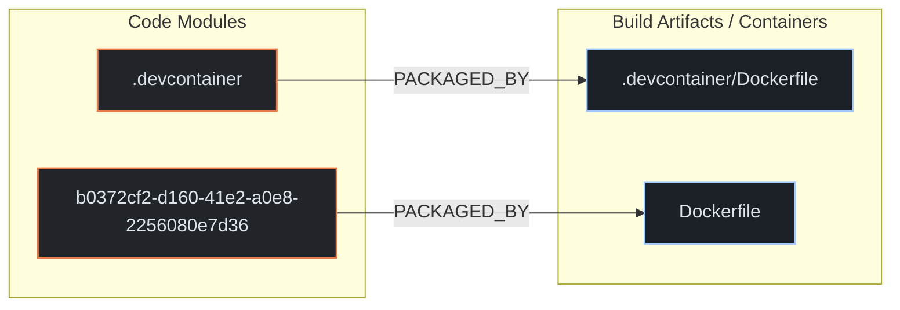
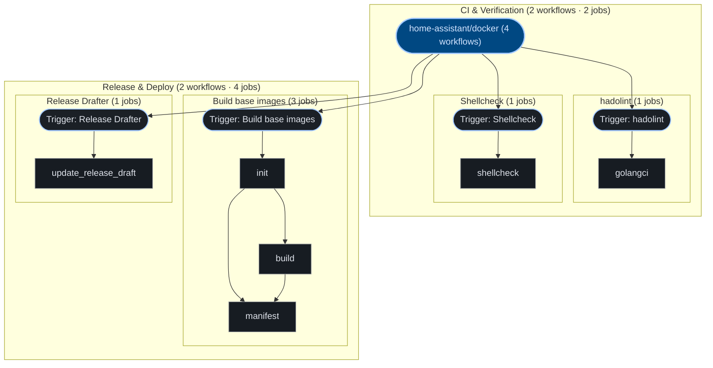

# Repository Architecture Analysis: home-assistant/docker

## Metadata
- **SHA**: `2b9dfe4d4908e07a3704a0efad09e221ea046f10`
- **Primary Ecosystem**: Python

## Quality Metrics
- **ast_engine**: tree-sitter
- **avg_cognitive_complexity**: 0.0
- **avg_cyclomatic_complexity**: 0.0
- **component_count**: 0
- **dead_code_count**: 0
- **dead_code_symbols**: 0 entry(ies)
- **duplication_pct**: 0.0
- **file_complexities**: 0 entry(ies)
- **files_analyzed**: 0
- **fitness_passed**: True
- **fitness_violation_count**: 0
- **framework**: Unknown
- **import_edges**: 0 entry(ies)
- **loc**: 0
- **max_cognitive_complexity**: 0
- **max_cyclomatic_complexity**: 0
- **sloc**: 0

## 6-Dimension Repository Scorecard

- **Overall Grade**: `C` (76.00/100)
- **Technical Debt Score**: 24.00
- **Estimated Remediation Effort**: 19.50h

| Dimension | Grade | Score | Weight | Details |
| :--- | :---: | :---: | :---: | :--- |
| Code Quality | `A` | 100.00 | 0.20 | avg_cc=0.00, max_cc=0, duplication=0.00%, dead_code=0 |
| Dependency Health | `B` | 85.00 | 0.15 | dependencies=3, outdated=0, vulnerable=0, has_lockfile=False |
| Maintainability | `A` | 100.00 | 0.15 | avg_cognitive=0.00, max_cognitive=0, fitness_violations=0, oversized_files=0 |
| Pipeline Health | `F` | 49.00 | 0.15 | workflows=4, operational_antipatterns=9, parallel_branches=True |
| Security | `F` | 52.00 | 0.20 | vulnerabilities=0, secrets=0, pipeline_security_findings=4 |
| Test Coverage | `C` | 70.00 | 0.15 | coverage=unavailable, ci_test_job=True, test_files_detected=False |

## Supply Chain Dependencies, Vulnerabilities & Secrets

- **Dependencies Parsed**: 3 | **Vulnerabilities**: 0 | **Secrets**: 0

### Inventory Sample
- `Brotli` `1.2.1` (PyPI, `requirements.txt`)
- `mysqlclient` `2.3.0` (PyPI, `requirements.txt`)
- `psycopg2` `2.9.13` (PyPI, `requirements.txt`)

## Section 7: Code-to-Cloud Deployment Traceability

- `.devcontainer` (code_module) --[PACKAGED_BY]--> `.devcontainer/Dockerfile` (container)
- `b0372cf2-d160-41e2-a0e8-2256080e7d36` (code_module) --[PACKAGED_BY]--> `Dockerfile` (container)

## CI/CD Pipeline Topology

