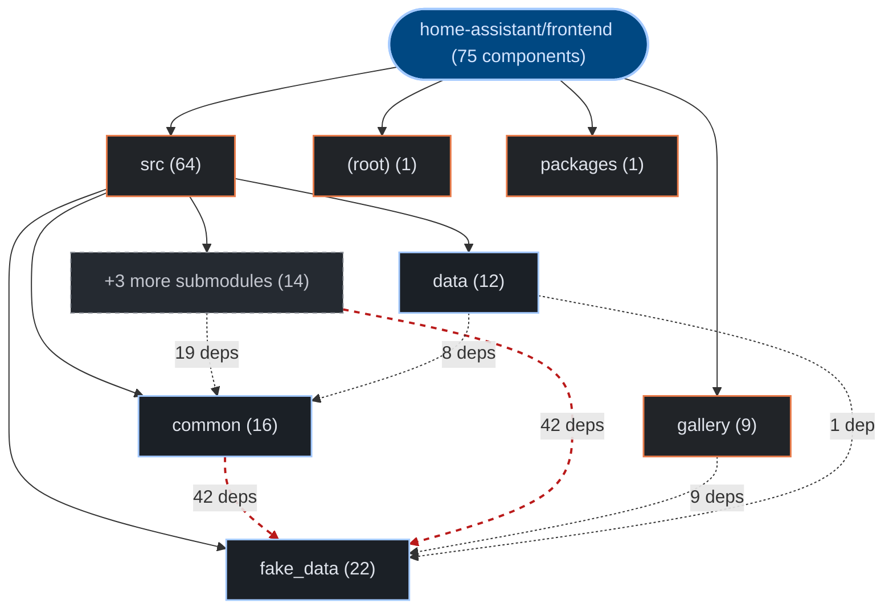

# Repository Architecture Analysis: home-assistant/frontend

## Metadata
- **SHA**: `e65584e7243d8cdfa2e6425adc063211324dfb2a`
- **Primary Ecosystem**: JavaScript/TypeScript

## Quality Metrics
- **ast_engine**: tree-sitter
- **avg_cognitive_complexity**: 3.11
- **avg_cyclomatic_complexity**: 3.47
- **component_count**: 75
- **dead_code_count**: 1548
- **dead_code_symbols**: 50 entry(ies)
- **duplication_pct**: 80.64
- **file_complexities**: 25 entry(ies)
- **files_analyzed**: 3617
- **fitness_passed**: False
- **fitness_violation_count**: 66
- **framework**: TypeScript
- **import_edges**: 100 entry(ies)
- **loc**: 718669
- **max_cognitive_complexity**: 348
- **max_cyclomatic_complexity**: 160
- **sloc**: 632146
- **test_file_count**: 502

# Architecture: home-assistant/frontend

## Context
- **Repository**: `home-assistant/frontend`
- **SHA**: `e65584e7243d8cdfa2e6425adc063211324dfb2a`
- **Ecosystem**: JavaScript/TypeScript
- **Framework**: TypeScript

## Building Block View

## Component Details

Showing top 60 representative components out of 75 across 4 module group(s):

- **Module `src`** (64 components — API_ROUTE: 24, DATA_ACCESS_LAYER: 21, UI_COMPONENT: 19)
- **Module `gallery`** (9 components — DATA_ACCESS_LAYER: 9)
- **Module `(root)`** (1 components — MODULE: 1)
- **Module `packages`** (1 components — MODULE: 1)

- **MAP_CARD_MARKER_LABEL_MODES** (`src/components/map/ha-map.ts`): UI_COMPONENT (deps: ContextController, ContextSubscriptionController, MockAlarmControlPanelEntity, MockAutomationEntity, MockBaseEntity, MockClimateEntity (+17 more))
- **TargetExclusionsController** (`src/components/target-picker/target-exclusions-controller.ts`): API_ROUTE (deps: ContextController, ContextSubscriptionController, MockAlarmControlPanelEntity, MockAutomationEntity, MockBaseEntity, MockClimateEntity (+17 more))
- **DOMAIN_OPTIONS_ATTRIBUTES** (`src/common/entity/get_states.ts`): UI_COMPONENT (deps: MockAlarmControlPanelEntity, MockAutomationEntity, MockBaseEntity, MockClimateEntity, MockCoverEntity, MockFanEntity (+15 more))
- **FIXED_DOMAIN_STATES** (`src/common/entity/get_states.ts`): UI_COMPONENT (deps: MockAlarmControlPanelEntity, MockAutomationEntity, MockBaseEntity, MockClimateEntity, MockCoverEntity, MockFanEntity (+15 more))
- **ConditionalListenerMixin** (`src/mixins/conditional-listener-mixin.ts`): UI_COMPONENT (deps: ConditionEvaluatorController, ContextController, ContextSubscriptionController)
- **DEFAULT_CHART_WIDTH** (`src/components/chart/ha-chart-base.ts`): UI_COMPONENT (deps: ContextController, ContextSubscriptionController, LegendFitController)
- **MIN_TIME_BETWEEN_UPDATES** (`src/components/chart/ha-chart-base.ts`): UI_COMPONENT (deps: ContextController, ContextSubscriptionController, LegendFitController)
- **ServiceInfoController** (`src/data/service-info-controller.ts`): API_ROUTE (deps: ContextController, ContextSubscriptionController, ENTITY_COMPONENT_ICONS)
- **AutomationPathController** (`src/panels/config/automation/automation-path.ts`): API_ROUTE (deps: ContextController, ContextSubscriptionController)
- **AutomationTriggerController** (`src/panels/config/automation/trigger/automation-trigger-controller.ts`): API_ROUTE (deps: ContextController, ContextSubscriptionController)
- **ConnectionSubscriptionController** (`src/data/connection-subscription-controller.ts`): API_ROUTE (deps: ContextController, ContextSubscriptionController)
- **ESPHomeSetupController** (`src/panels/config/devices/device-detail/integration-elements/esphome/esphome-setup-controller.ts`): API_ROUTE (deps: ContextController, ContextSubscriptionController)
- **EnergyCollectionController** (`src/data/energy-collection-controller.ts`): API_ROUTE (deps: ContextController, ContextSubscriptionController)
- **NavigationPathInfoController** (`src/data/navigation-path-controller.ts`): API_ROUTE (deps: ContextController, ContextSubscriptionController)
- **DataTableSettingsController** (`src/common/controllers/data-table-settings-controller.ts`): API_ROUTE (deps: QueryParamsController)
- **DemoAlarmPanelEntity** (`gallery/src/pages/lovelace/alarm-panel-card.ts`): DATA_ACCESS_LAYER (deps: ENTITY_COMPONENT_ICONS)
- **DemoButtonEntity** (`gallery/src/pages/lovelace/entity-button-card.ts`): DATA_ACCESS_LAYER (deps: ENTITY_COMPONENT_ICONS)
- **DemoGaugeEntity** (`gallery/src/pages/lovelace/gauge-card.ts`): DATA_ACCESS_LAYER (deps: ENTITY_COMPONENT_ICONS)
- **DemoGlanceEntity** (`gallery/src/pages/lovelace/glance-card.ts`): DATA_ACCESS_LAYER (deps: ENTITY_COMPONENT_ICONS)
- **DemoLightEntity** (`gallery/src/pages/lovelace/light-card.ts`): DATA_ACCESS_LAYER (deps: ENTITY_COMPONENT_ICONS)
- **DemoPictureEntity** (`gallery/src/pages/lovelace/picture-entity-card.ts`): DATA_ACCESS_LAYER (deps: ENTITY_COMPONENT_ICONS)
- **DemoPlantEntity** (`gallery/src/pages/lovelace/plant-card.ts`): DATA_ACCESS_LAYER (deps: ENTITY_COMPONENT_ICONS)
- **DemoThermostatEntity** (`gallery/src/pages/lovelace/thermostat-card.ts`): DATA_ACCESS_LAYER (deps: ENTITY_COMPONENT_ICONS)
- **DemoTodoListEntity** (`gallery/src/pages/lovelace/todo-list-card.ts`): DATA_ACCESS_LAYER (deps: ENTITY_COMPONENT_ICONS)
- **MockAlarmControlPanelEntity** (`src/fake_data/entities/alarm-control-panel-entity.ts`): DATA_ACCESS_LAYER (deps: MockBaseEntity)
- **MockAutomationEntity** (`src/fake_data/entities/automation-entity.ts`): DATA_ACCESS_LAYER (deps: MockToggleEntity)
- **MockClimateEntity** (`src/fake_data/entities/climate-entity.ts`): DATA_ACCESS_LAYER (deps: MockBaseEntity)
- **MockCoverEntity** (`src/fake_data/entities/cover-entity.ts`): DATA_ACCESS_LAYER (deps: MockBaseEntity)
- **MockFanEntity** (`src/fake_data/entities/fan-entity.ts`): DATA_ACCESS_LAYER (deps: MockBaseEntity)
- **MockGenericEntity** (`src/fake_data/entities/generic-entity.ts`): DATA_ACCESS_LAYER (deps: MockBaseEntity)
- **MockGroupEntity** (`src/fake_data/entities/group-entity.ts`): DATA_ACCESS_LAYER (deps: MockBaseEntity)
- **MockHumidifierEntity** (`src/fake_data/entities/humidifier-entity.ts`): DATA_ACCESS_LAYER (deps: MockBaseEntity)
- **MockInputNumberEntity** (`src/fake_data/entities/input-number-entity.ts`): DATA_ACCESS_LAYER (deps: MockBaseEntity)
- **MockInputSelectEntity** (`src/fake_data/entities/input-select-entity.ts`): DATA_ACCESS_LAYER (deps: MockBaseEntity)
- **MockInputTextEntity** (`src/fake_data/entities/input-text-entity.ts`): DATA_ACCESS_LAYER (deps: MockBaseEntity)
- **MockLawnMowerEntity** (`src/fake_data/entities/lawn-mower-entity.ts`): DATA_ACCESS_LAYER (deps: MockBaseEntity)
- **MockLightEntity** (`src/fake_data/entities/light-entity.ts`): DATA_ACCESS_LAYER (deps: MockBaseEntity)
- **MockLocationEntity** (`src/fake_data/entities/location-entity.ts`): DATA_ACCESS_LAYER (deps: MockBaseEntity)
- **MockLockEntity** (`src/fake_data/entities/lock-entity.ts`): DATA_ACCESS_LAYER (deps: MockBaseEntity)
- **MockMediaPlayerEntity** (`src/fake_data/entities/media-player-entity.ts`): DATA_ACCESS_LAYER (deps: MockBaseEntity)
- **MockToggleEntity** (`src/fake_data/entities/toggle-entity.ts`): DATA_ACCESS_LAYER (deps: MockBaseEntity)
- **MockVacuumEntity** (`src/fake_data/entities/vacuum-entity.ts`): DATA_ACCESS_LAYER (deps: MockBaseEntity)
- **MockValveEntity** (`src/fake_data/entities/valve-entity.ts`): DATA_ACCESS_LAYER (deps: MockBaseEntity)
- **MockWaterHeaterEntity** (`src/fake_data/entities/water-heater-entity.ts`): DATA_ACCESS_LAYER (deps: MockBaseEntity)
- **@home-assistant/components** (`packages/components/package.json`): MODULE
- **CalendarEventsController** (`src/data/calendar-events-controller.ts`): API_ROUTE
- **ConditionEvaluatorController** (`src/common/controllers/condition-evaluator-controller.ts`): API_ROUTE
- **ContextController** (`src/common/decorators/consume.ts`): API_ROUTE
- **ContextSubscriptionController** (`src/common/decorators/consume.ts`): API_ROUTE
- **DOMAIN_DEVICE_CLASSES** (`src/data/device_classes.ts`): UI_COMPONENT
- **DragScrollController** (`src/common/controllers/drag-scroll-controller.ts`): API_ROUTE
- **ENTITIES_SECTION_GROUPS** (`src/panels/lovelace/strategies/entities/entities-section-strategy.ts`): UI_COMPONENT
- **ENTITY_COMPONENT_ICONS** (`src/fake_data/entity_component_icons.ts`): UI_COMPONENT
- **FilterPanelController** (`src/common/controllers/filter-panel-controller.ts`): API_ROUTE
- **LegendFitController** (`src/common/controllers/legend-fit-controller.ts`): API_ROUTE
- **MediaProgressController** (`src/common/controllers/media-progress-controller.ts`): API_ROUTE
- **MockBaseEntity** (`src/fake_data/entities/base-entity.ts`): DATA_ACCESS_LAYER
- **PickerMixin** (`src/mixins/picker-mixin.ts`): UI_COMPONENT
- **PreserveScrollPositionController** (`src/common/controllers/preserve-scroll-position-controller.ts`): API_ROUTE
- **ProvideHassLitMixin** (`src/mixins/provide-hass-lit-mixin.ts`): UI_COMPONENT

## 6-Dimension Repository Scorecard

- **Overall Grade**: `F` (55.62/100)
- **Technical Debt Score**: 44.38
- **Estimated Remediation Effort**: 610.72h

| Dimension | Grade | Score | Weight | Details |
| :--- | :---: | :---: | :---: | :--- |
| Code Quality | `F` | 28.12 | 0.20 | avg_cc=3.47, max_cc=160, duplication=80.64%, dead_code=1548 |
| Dependency Health | `A` | 90.00 | 0.15 | dependencies=0 (no manifests parsed) |
| Maintainability | `F` | 0.00 | 0.15 | avg_cognitive=3.11, max_cognitive=348, fitness_violations=66, oversized_files=23 |
| Pipeline Health | `F` | 40.00 | 0.15 | workflows=0 |
| Security | `A` | 100.00 | 0.20 | vulnerabilities=0, secrets=0, pipeline_security_findings=0 |
| Test Coverage | `C` | 70.00 | 0.15 | coverage=unavailable, ci_test_job=False, test_files_detected=True |

## Architecture Fitness & Workspace Boundaries

- **[HIGH] `ATRUSS-ARCH-002` (LAYER_VIOLATION)**: UI_COMPONENT cannot directly import DATA_ACCESS_LAYER. (DOMAIN_OPTIONS_ATTRIBUTES -> MockAlarmControlPanelEntity)
- **[HIGH] `ATRUSS-ARCH-002` (LAYER_VIOLATION)**: UI_COMPONENT cannot directly import DATA_ACCESS_LAYER. (DOMAIN_OPTIONS_ATTRIBUTES -> MockAutomationEntity)
- **[HIGH] `ATRUSS-ARCH-002` (LAYER_VIOLATION)**: UI_COMPONENT cannot directly import DATA_ACCESS_LAYER. (DOMAIN_OPTIONS_ATTRIBUTES -> MockBaseEntity)
- **[HIGH] `ATRUSS-ARCH-002` (LAYER_VIOLATION)**: UI_COMPONENT cannot directly import DATA_ACCESS_LAYER. (DOMAIN_OPTIONS_ATTRIBUTES -> MockClimateEntity)
- **[HIGH] `ATRUSS-ARCH-002` (LAYER_VIOLATION)**: UI_COMPONENT cannot directly import DATA_ACCESS_LAYER. (DOMAIN_OPTIONS_ATTRIBUTES -> MockCoverEntity)
- **[HIGH] `ATRUSS-ARCH-002` (LAYER_VIOLATION)**: UI_COMPONENT cannot directly import DATA_ACCESS_LAYER. (DOMAIN_OPTIONS_ATTRIBUTES -> MockFanEntity)
- **[HIGH] `ATRUSS-ARCH-002` (LAYER_VIOLATION)**: UI_COMPONENT cannot directly import DATA_ACCESS_LAYER. (DOMAIN_OPTIONS_ATTRIBUTES -> MockGenericEntity)
- **[HIGH] `ATRUSS-ARCH-002` (LAYER_VIOLATION)**: UI_COMPONENT cannot directly import DATA_ACCESS_LAYER. (DOMAIN_OPTIONS_ATTRIBUTES -> MockGroupEntity)
- **[HIGH] `ATRUSS-ARCH-002` (LAYER_VIOLATION)**: UI_COMPONENT cannot directly import DATA_ACCESS_LAYER. (DOMAIN_OPTIONS_ATTRIBUTES -> MockHumidifierEntity)
- **[HIGH] `ATRUSS-ARCH-002` (LAYER_VIOLATION)**: UI_COMPONENT cannot directly import DATA_ACCESS_LAYER. (DOMAIN_OPTIONS_ATTRIBUTES -> MockInputNumberEntity)
- **[HIGH] `ATRUSS-ARCH-002` (LAYER_VIOLATION)**: UI_COMPONENT cannot directly import DATA_ACCESS_LAYER. (DOMAIN_OPTIONS_ATTRIBUTES -> MockInputSelectEntity)
- **[HIGH] `ATRUSS-ARCH-002` (LAYER_VIOLATION)**: UI_COMPONENT cannot directly import DATA_ACCESS_LAYER. (DOMAIN_OPTIONS_ATTRIBUTES -> MockInputTextEntity)
- **[HIGH] `ATRUSS-ARCH-002` (LAYER_VIOLATION)**: UI_COMPONENT cannot directly import DATA_ACCESS_LAYER. (DOMAIN_OPTIONS_ATTRIBUTES -> MockLawnMowerEntity)
- **[HIGH] `ATRUSS-ARCH-002` (LAYER_VIOLATION)**: UI_COMPONENT cannot directly import DATA_ACCESS_LAYER. (DOMAIN_OPTIONS_ATTRIBUTES -> MockLightEntity)
- **[HIGH] `ATRUSS-ARCH-002` (LAYER_VIOLATION)**: UI_COMPONENT cannot directly import DATA_ACCESS_LAYER. (DOMAIN_OPTIONS_ATTRIBUTES -> MockLocationEntity)
- **[HIGH] `ATRUSS-ARCH-002` (LAYER_VIOLATION)**: UI_COMPONENT cannot directly import DATA_ACCESS_LAYER. (DOMAIN_OPTIONS_ATTRIBUTES -> MockLockEntity)
- **[HIGH] `ATRUSS-ARCH-002` (LAYER_VIOLATION)**: UI_COMPONENT cannot directly import DATA_ACCESS_LAYER. (DOMAIN_OPTIONS_ATTRIBUTES -> MockMediaPlayerEntity)
- **[HIGH] `ATRUSS-ARCH-002` (LAYER_VIOLATION)**: UI_COMPONENT cannot directly import DATA_ACCESS_LAYER. (DOMAIN_OPTIONS_ATTRIBUTES -> MockToggleEntity)
- **[HIGH] `ATRUSS-ARCH-002` (LAYER_VIOLATION)**: UI_COMPONENT cannot directly import DATA_ACCESS_LAYER. (DOMAIN_OPTIONS_ATTRIBUTES -> MockVacuumEntity)
- **[HIGH] `ATRUSS-ARCH-002` (LAYER_VIOLATION)**: UI_COMPONENT cannot directly import DATA_ACCESS_LAYER. (DOMAIN_OPTIONS_ATTRIBUTES -> MockValveEntity)
- **[HIGH] `ATRUSS-ARCH-002` (LAYER_VIOLATION)**: UI_COMPONENT cannot directly import DATA_ACCESS_LAYER. (DOMAIN_OPTIONS_ATTRIBUTES -> MockWaterHeaterEntity)
- **[HIGH] `ATRUSS-ARCH-002` (LAYER_VIOLATION)**: UI_COMPONENT cannot directly import DATA_ACCESS_LAYER. (FIXED_DOMAIN_STATES -> MockAlarmControlPanelEntity)
- **[HIGH] `ATRUSS-ARCH-002` (LAYER_VIOLATION)**: UI_COMPONENT cannot directly import DATA_ACCESS_LAYER. (FIXED_DOMAIN_STATES -> MockAutomationEntity)
- **[HIGH] `ATRUSS-ARCH-002` (LAYER_VIOLATION)**: UI_COMPONENT cannot directly import DATA_ACCESS_LAYER. (FIXED_DOMAIN_STATES -> MockBaseEntity)
- **[HIGH] `ATRUSS-ARCH-002` (LAYER_VIOLATION)**: UI_COMPONENT cannot directly import DATA_ACCESS_LAYER. (FIXED_DOMAIN_STATES -> MockClimateEntity)
- **[HIGH] `ATRUSS-ARCH-002` (LAYER_VIOLATION)**: UI_COMPONENT cannot directly import DATA_ACCESS_LAYER. (FIXED_DOMAIN_STATES -> MockCoverEntity)
- **[HIGH] `ATRUSS-ARCH-002` (LAYER_VIOLATION)**: UI_COMPONENT cannot directly import DATA_ACCESS_LAYER. (FIXED_DOMAIN_STATES -> MockFanEntity)
- **[HIGH] `ATRUSS-ARCH-002` (LAYER_VIOLATION)**: UI_COMPONENT cannot directly import DATA_ACCESS_LAYER. (FIXED_DOMAIN_STATES -> MockGenericEntity)
- **[HIGH] `ATRUSS-ARCH-002` (LAYER_VIOLATION)**: UI_COMPONENT cannot directly import DATA_ACCESS_LAYER. (FIXED_DOMAIN_STATES -> MockGroupEntity)
- **[HIGH] `ATRUSS-ARCH-002` (LAYER_VIOLATION)**: UI_COMPONENT cannot directly import DATA_ACCESS_LAYER. (FIXED_DOMAIN_STATES -> MockHumidifierEntity)
- **[HIGH] `ATRUSS-ARCH-002` (LAYER_VIOLATION)**: UI_COMPONENT cannot directly import DATA_ACCESS_LAYER. (FIXED_DOMAIN_STATES -> MockInputNumberEntity)
- **[HIGH] `ATRUSS-ARCH-002` (LAYER_VIOLATION)**: UI_COMPONENT cannot directly import DATA_ACCESS_LAYER. (FIXED_DOMAIN_STATES -> MockInputSelectEntity)
- **[HIGH] `ATRUSS-ARCH-002` (LAYER_VIOLATION)**: UI_COMPONENT cannot directly import DATA_ACCESS_LAYER. (FIXED_DOMAIN_STATES -> MockInputTextEntity)
- **[HIGH] `ATRUSS-ARCH-002` (LAYER_VIOLATION)**: UI_COMPONENT cannot directly import DATA_ACCESS_LAYER. (FIXED_DOMAIN_STATES -> MockLawnMowerEntity)
- **[HIGH] `ATRUSS-ARCH-002` (LAYER_VIOLATION)**: UI_COMPONENT cannot directly import DATA_ACCESS_LAYER. (FIXED_DOMAIN_STATES -> MockLightEntity)
- **[HIGH] `ATRUSS-ARCH-002` (LAYER_VIOLATION)**: UI_COMPONENT cannot directly import DATA_ACCESS_LAYER. (FIXED_DOMAIN_STATES -> MockLocationEntity)
- **[HIGH] `ATRUSS-ARCH-002` (LAYER_VIOLATION)**: UI_COMPONENT cannot directly import DATA_ACCESS_LAYER. (FIXED_DOMAIN_STATES -> MockLockEntity)
- **[HIGH] `ATRUSS-ARCH-002` (LAYER_VIOLATION)**: UI_COMPONENT cannot directly import DATA_ACCESS_LAYER. (FIXED_DOMAIN_STATES -> MockMediaPlayerEntity)
- **[HIGH] `ATRUSS-ARCH-002` (LAYER_VIOLATION)**: UI_COMPONENT cannot directly import DATA_ACCESS_LAYER. (FIXED_DOMAIN_STATES -> MockToggleEntity)
- **[HIGH] `ATRUSS-ARCH-002` (LAYER_VIOLATION)**: UI_COMPONENT cannot directly import DATA_ACCESS_LAYER. (FIXED_DOMAIN_STATES -> MockVacuumEntity)
- ... (+26 more fitness violations)

## CI/CD Pipeline Topology

```mermaid
graph TD;
  classDef atlasRoot fill:#004882,stroke:#a3c9ff,stroke-width:2px,color:#d3e4ff
  classDef atlasCategory fill:#212428,stroke:#E87A48,stroke-width:1.5px,color:#dfe3eb
  classDef atlasWorkflow fill:#1b2026,stroke:#a3c9ff,stroke-width:1.5px,color:#dfe3eb
  classDef atlasJob fill:#171c22,stroke:#8d9199,stroke-width:1px,color:#dfe3eb
  classDef atlasTarget fill:#005227,stroke:#8bd99b,stroke-width:1.5px,color:#a7f6b6
  classDef atlasAlert fill:#93000a,stroke:#ffb4ab,stroke-width:1.5px,color:#ffdad6
  classDef atlasMore fill:#252a31,stroke:#8d9199,stroke-dasharray:4 4,color:#c3c6cf
  pipeline_root(["home-assistant/frontend (23 workflows)"]):::atlasRoot
  grp_0_Scheduled___Manual["Scheduled & Manual (8 workflows · 21 jobs)"]:::atlasCategory
  pipeline_root --> grp_0_Scheduled___Manual
  wf_3_CI["CI (4 jobs)"]:::atlasWorkflow
  grp_0_Scheduled___Manual --> wf_3_CI
  job_3_prepare_dependencies["prepare-dependencies"]:::atlasJob
  job_3_lint["lint"]:::atlasJob
  job_3_test["test"]:::atlasJob
  wf_3_CI --> job_3_prepare_dependencies
  job_3_prepare_dependencies --> job_3_lint
  job_3_prepare_dependencies --> job_3_test
  wf_7_Dependency_review["Dependency review (2 jobs)"]:::atlasWorkflow
  grp_0_Scheduled___Manual --> wf_7_Dependency_review
  job_7_dependency_review["dependency-review"]:::atlasJob
  job_7_npm_metadata["npm-metadata"]:::atlasJob
  wf_7_Dependency_review --> job_7_dependency_review
  wf_7_Dependency_review --> job_7_npm_metadata
  wf_10_E2E_Tests["E2E Tests (9 jobs)"]:::atlasWorkflow
  grp_0_Scheduled___Manual --> wf_10_E2E_Tests
  job_10_prepare_dependencies["prepare-dependencies"]:::atlasJob
  job_10_prepare_container_dependencies["prepare-container-dependencies"]:::atlasJob
  job_10_build_demo["build-demo"]:::atlasJob
  wf_10_E2E_Tests --> job_10_prepare_dependencies
  wf_10_E2E_Tests --> job_10_prepare_container_dependencies
  job_10_prepare_dependencies --> job_10_build_demo
  grp_1_CI___Verification["CI & Verification (5 workflows · 6 jobs)"]:::atlasCategory
  pipeline_root --> grp_1_CI___Verification
  wf_9_Design_preview["Design preview (1 jobs)"]:::atlasWorkflow
  grp_1_CI___Verification --> wf_9_Design_preview
  job_9_preview["preview"]:::atlasJob
  wf_9_Design_preview --> job_9_preview
  wf_15_RelativeCI["RelativeCI (2 jobs)"]:::atlasWorkflow
  grp_1_CI___Verification --> wf_15_RelativeCI
  job_15_upload_frontend_modern["upload-frontend-modern"]:::atlasJob
  job_15_upload_frontend_legacy["upload-frontend-legacy"]:::atlasJob
  wf_15_RelativeCI --> job_15_upload_frontend_modern
  wf_15_RelativeCI --> job_15_upload_frontend_legacy
  grp_2_Release___Deploy["Release & Deploy (5 workflows · 9 jobs)"]:::atlasCategory
  pipeline_root --> grp_2_Release___Deploy
  wf_2_Cast_deployment["Cast deployment (2 jobs)"]:::atlasWorkflow
  grp_2_Release___Deploy --> wf_2_Cast_deployment
  job_2_deploy_dev["deploy_dev"]:::atlasJob
  job_2_deploy_master["deploy_master"]:::atlasJob
  wf_2_Cast_deployment --> job_2_deploy_dev
  wf_2_Cast_deployment --> job_2_deploy_master
  wf_17_Release["Release (3 jobs)"]:::atlasWorkflow
  grp_2_Release___Deploy --> wf_17_Release
  job_17_release["release"]:::atlasJob
  job_17_wheels_init["wheels-init"]:::atlasJob
  job_17_release_landing_page["release-landing-page"]:::atlasJob
  wf_17_Release --> job_17_release
  job_17_release --> job_17_wheels_init
  wf_17_Release --> job_17_release_landing_page
  grp_3_Security___Governance["Security & Governance (4 workflows · 4 jobs)"]:::atlasCategory
  pipeline_root --> grp_3_Security___Governance
  wf_4_CodeQL["CodeQL (1 jobs)"]:::atlasWorkflow
  grp_3_Security___Governance --> wf_4_CodeQL
  wf_12_Lock["Lock (1 jobs)"]:::atlasWorkflow
  grp_3_Security___Governance --> wf_12_Lock
  grp_4_Automation___Other["Automation & Other (1 workflows · 2 jobs)"]:::atlasCategory
  pipeline_root --> grp_4_Automation___Other
  wf_18_Restrict_task_creation["Restrict task creation (2 jobs)"]:::atlasWorkflow
  grp_4_Automation___Other --> wf_18_Restrict_task_creation
  wf_more["+13 more workflows"]:::atlasMore
  pipeline_root --> wf_more
```

