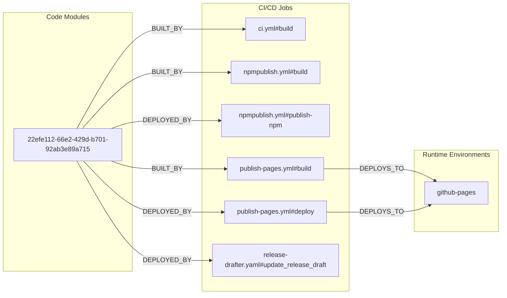
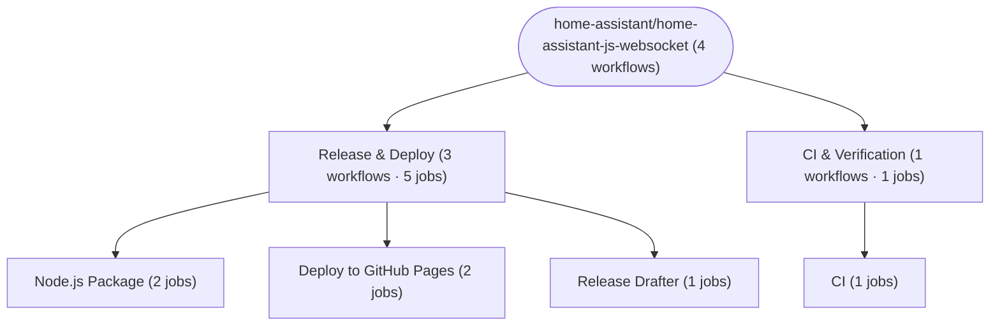

# Repository Architecture Analysis: home-assistant/home-assistant-js-websocket

## Metadata
- **SHA**: `ddc91ec9b8ba02e802b4a7fb0d2cb46ee8933db2`
- **Primary Ecosystem**: JavaScript/TypeScript

## Quality Metrics
- **ast_engine**: tree-sitter
- **avg_cognitive_complexity**: 2.87
- **avg_cyclomatic_complexity**: 2.51
- **component_count**: 1
- **dead_code_count**: 0
- **dead_code_symbols**: 0 entry(ies)
- **duplication_pct**: 50.45
- **file_complexities**: 24 entry(ies)
- **files_analyzed**: 24
- **fitness_passed**: False
- **fitness_violation_count**: 3
- **framework**: TypeScript
- **import_edges**: 100 entry(ies)
- **loc**: 3705
- **max_cognitive_complexity**: 59
- **max_cyclomatic_complexity**: 23
- **sloc**: 2971
- **test_file_count**: 8

# Architecture: home-assistant/home-assistant-js-websocket

## Context
- **Repository**: `home-assistant/home-assistant-js-websocket`
- **SHA**: `ddc91ec9b8ba02e802b4a7fb0d2cb46ee8933db2`
- **Ecosystem**: JavaScript/TypeScript
- **Framework**: TypeScript

## Building Block View

## Component Details
- **home-assistant-js-websocket** (`package.json`): MODULE

## 6-Dimension Repository Scorecard

- **Overall Grade**: `F` (57.80/100)
- **Technical Debt Score**: 42.20
- **Estimated Remediation Effort**: 44.64h

| Dimension | Grade | Score | Weight | Details |
| :--- | :---: | :---: | :---: | :--- |
| Code Quality | `D` | 63.00 | 0.20 | avg_cc=2.51, max_cc=23, duplication=50.45%, dead_code=0 |
| Dependency Health | `B` | 85.00 | 0.15 | dependencies=9, outdated=0, vulnerable=0, has_lockfile=False |
| Maintainability | `F` | 47.00 | 0.15 | avg_cognitive=2.87, max_cognitive=59, fitness_violations=3, oversized_files=2 |
| Pipeline Health | `F` | 14.00 | 0.15 | workflows=4, operational_antipatterns=13, parallel_branches=False |
| Security | `D` | 64.00 | 0.20 | vulnerabilities=0, secrets=0, pipeline_security_findings=3 |
| Test Coverage | `C` | 70.00 | 0.15 | coverage=unavailable, ci_test_job=True, test_files_detected=True |

## Architecture Fitness & Workspace Boundaries

- **[MEDIUM] `ATRUSS-ARCH-005` (COMPLEXITY_THRESHOLD)**: Repository duplication_pct (50.45) exceeds policy threshold (15.0).
- **[MEDIUM] `ATRUSS-ARCH-005` (COMPLEXITY_THRESHOLD)**: Repository max_cognitive_complexity (59.0) exceeds policy threshold (25.0).
- **[MEDIUM] `ATRUSS-ARCH-005` (COMPLEXITY_THRESHOLD)**: Repository max_cyclomatic_complexity (23.0) exceeds policy threshold (20.0).

## Supply Chain Dependencies, Vulnerabilities & Secrets

- **Dependencies Parsed**: 9 | **Vulnerabilities**: 0 | **Secrets**: 0

### Inventory Sample
- `@types/assert` `1.4.7` (npm, `package.json`)
- `@types/mocha` `10.0.9` (npm, `package.json`)
- `assert` `2.0.0` (npm, `package.json`)
- `husky` `9.0.0` (npm, `package.json`)
- `lint-staged` `17.0.7` (npm, `package.json`)
- `mocha` `12.0.0` (npm, `package.json`)
- `prettier` `3.0.0` (npm, `package.json`)
- `rollup` `4.3.0` (npm, `package.json`)
- `typescript` `7.0.0` (npm, `package.json`)

## Section 7: Code-to-Cloud Deployment Traceability

- `publish-pages.yml#build` (ci_job) --[DEPLOYS_TO]--> `github-pages` (environment)
- `publish-pages.yml#deploy` (ci_job) --[DEPLOYS_TO]--> `github-pages` (environment)
- `22efe112-66e2-429d-b701-92ab3e89a715` (code_module) --[BUILT_BY]--> `ci.yml#build` (ci_job)
- `22efe112-66e2-429d-b701-92ab3e89a715` (code_module) --[BUILT_BY]--> `npmpublish.yml#build` (ci_job)
- `22efe112-66e2-429d-b701-92ab3e89a715` (code_module) --[BUILT_BY]--> `publish-pages.yml#build` (ci_job)
- `22efe112-66e2-429d-b701-92ab3e89a715` (code_module) --[DEPLOYED_BY]--> `npmpublish.yml#publish-npm` (ci_job)
- `22efe112-66e2-429d-b701-92ab3e89a715` (code_module) --[DEPLOYED_BY]--> `publish-pages.yml#deploy` (ci_job)
- `22efe112-66e2-429d-b701-92ab3e89a715` (code_module) --[DEPLOYED_BY]--> `release-drafter.yaml#update_release_draft` (ci_job)

## CI/CD Pipeline Topology

