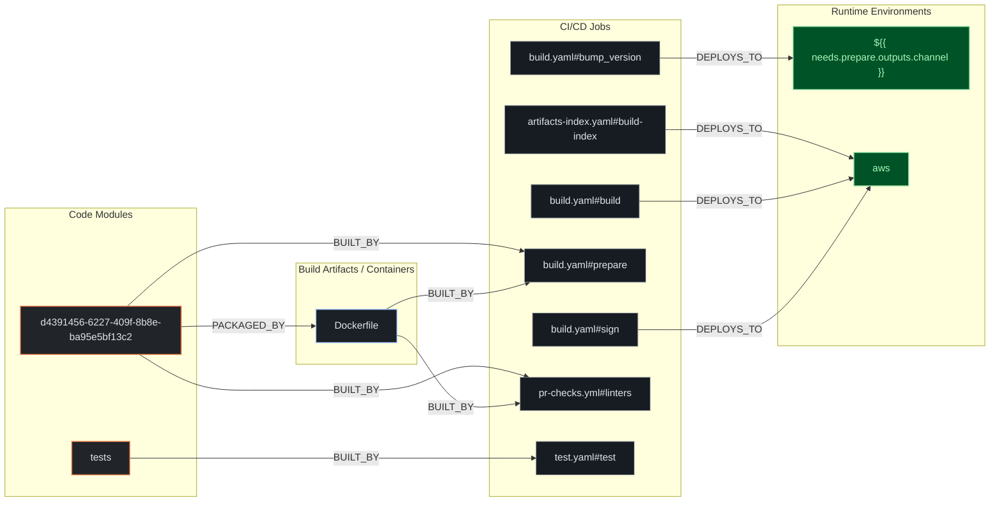

# Repository Architecture Analysis: home-assistant/operating-system

## Metadata
- **SHA**: `945ba38d88e7e7d7321d42294b222b8deb2208d2`
- **Primary Ecosystem**: Python

## Quality Metrics
- **ast_engine**: tree-sitter
- **avg_cognitive_complexity**: 6.44
- **avg_cyclomatic_complexity**: 4.53
- **component_count**: 0
- **dead_code_count**: 1
- **dead_code_symbols**: 1 entry(ies)
- **duplication_pct**: 55.07
- **file_complexities**: 8 entry(ies)
- **files_analyzed**: 8
- **fitness_passed**: False
- **fitness_violation_count**: 3
- **framework**: Unknown
- **import_edges**: 65 entry(ies)
- **loc**: 8090
- **max_cognitive_complexity**: 89
- **max_cyclomatic_complexity**: 45
- **sloc**: 5113
- **test_file_count**: 12

## 6-Dimension Repository Scorecard

- **Overall Grade**: `F` (38.78/100)
- **Technical Debt Score**: 61.22
- **Estimated Remediation Effort**: 62.57h

| Dimension | Grade | Score | Weight | Details |
| :--- | :---: | :---: | :---: | :--- |
| Code Quality | `F` | 41.88 | 0.20 | avg_cc=4.53, max_cc=45, duplication=55.07%, dead_code=1 |
| Dependency Health | `B` | 85.00 | 0.15 | dependencies=3, outdated=0, vulnerable=0, has_lockfile=False |
| Maintainability | `F` | 47.68 | 0.15 | avg_cognitive=6.44, max_cognitive=89, fitness_violations=3, oversized_files=1 |
| Pipeline Health | `F` | 0.00 | 0.15 | workflows=9, operational_antipatterns=19, parallel_branches=True |
| Security | `F` | 0.00 | 0.20 | vulnerabilities=0, secrets=1, pipeline_security_findings=9 |
| Test Coverage | `C` | 70.00 | 0.15 | coverage=unavailable, ci_test_job=True, test_files_detected=True |

## Architecture Fitness & Workspace Boundaries

- **[MEDIUM] `ATRUSS-ARCH-005` (COMPLEXITY_THRESHOLD)**: Repository duplication_pct (55.07) exceeds policy threshold (15.0).
- **[MEDIUM] `ATRUSS-ARCH-005` (COMPLEXITY_THRESHOLD)**: Repository max_cognitive_complexity (89.0) exceeds policy threshold (25.0).
- **[MEDIUM] `ATRUSS-ARCH-005` (COMPLEXITY_THRESHOLD)**: Repository max_cyclomatic_complexity (45.0) exceeds policy threshold (20.0).

## Supply Chain Dependencies, Vulnerabilities & Secrets

- **Dependencies Parsed**: 3 | **Vulnerabilities**: 0 | **Secrets**: 1

### Secret Findings (Redacted)
- **[CRITICAL] `ATRUSS-SEC-004`** at `.github/workflows/build.yaml:326` (`-----BEGIN ... PRIVATE KEY----- [REDACTED]`)

### Inventory Sample
- `labgrid` `26.0.1` (PyPI, `tests/requirements.txt`)
- `pytest-dependency` `0.6.1` (PyPI, `tests/requirements.txt`)
- `pytest-timeout` `2.4.0` (PyPI, `tests/requirements.txt`)

## Section 7: Code-to-Cloud Deployment Traceability

- `artifacts-index.yaml#build-index` (ci_job) --[DEPLOYS_TO]--> `aws` (environment)
- `build.yaml#build` (ci_job) --[DEPLOYS_TO]--> `aws` (environment)
- `build.yaml#bump_version` (ci_job) --[DEPLOYS_TO]--> `${{ needs.prepare.outputs.channel }}` (environment)
- `build.yaml#sign` (ci_job) --[DEPLOYS_TO]--> `aws` (environment)
- `d4391456-6227-409f-8b8e-ba95e5bf13c2` (code_module) --[BUILT_BY]--> `build.yaml#prepare` (ci_job)
- `d4391456-6227-409f-8b8e-ba95e5bf13c2` (code_module) --[BUILT_BY]--> `pr-checks.yml#linters` (ci_job)
- `d4391456-6227-409f-8b8e-ba95e5bf13c2` (code_module) --[PACKAGED_BY]--> `Dockerfile` (container)
- `tests` (code_module) --[BUILT_BY]--> `test.yaml#test` (ci_job)
- `Dockerfile` (container) --[BUILT_BY]--> `build.yaml#prepare` (ci_job)
- `Dockerfile` (container) --[BUILT_BY]--> `pr-checks.yml#linters` (ci_job)

## CI/CD Pipeline Topology

```mermaid
graph TD;
  classDef atlasRoot fill:#004882,stroke:#a3c9ff,stroke-width:2px,color:#d3e4ff
  classDef atlasCategory fill:#212428,stroke:#E87A48,stroke-width:1.5px,color:#dfe3eb
  classDef atlasWorkflow fill:#1b2026,stroke:#a3c9ff,stroke-width:1.5px,color:#dfe3eb
  classDef atlasJob fill:#171c22,stroke:#8d9199,stroke-width:1px,color:#dfe3eb
  classDef atlasTarget fill:#005227,stroke:#8bd99b,stroke-width:1.5px,color:#a7f6b6
  classDef atlasAlert fill:#93000a,stroke:#ffb4ab,stroke-width:1.5px,color:#ffdad6
  classDef atlasMore fill:#252a31,stroke:#8d9199,stroke-dasharray:4 4,color:#c3c6cf
  pipeline_root(["home-assistant/operating-system (9 workflows)"]):::atlasRoot
  grp_0_CI___Verification["CI & Verification (2 workflows · 2 jobs)"]:::atlasCategory
  pipeline_root --> grp_0_CI___Verification
  wf_1_OS_build__PR_["OS build (PR) (1 jobs)"]:::atlasWorkflow
  grp_0_CI___Verification --> wf_1_OS_build__PR_
  job_1_build["build"]:::atlasJob
  wf_1_OS_build__PR_ --> job_1_build
  wf_5_PR_checks["PR checks (1 jobs)"]:::atlasWorkflow
  grp_0_CI___Verification --> wf_5_PR_checks
  job_5_linters["linters"]:::atlasJob
  wf_5_PR_checks --> job_5_linters
  grp_1_Release___Deploy["Release & Deploy (2 workflows · 7 jobs)"]:::atlasCategory
  pipeline_root --> grp_1_Release___Deploy
  wf_2_OS_build["OS build (6 jobs)"]:::atlasWorkflow
  grp_1_Release___Deploy --> wf_2_OS_build
  job_2_prepare["prepare"]:::atlasJob
  job_2_build["build"]:::atlasJob
  job_2_test["test"]:::atlasJob
  wf_2_OS_build --> job_2_prepare
  job_2_prepare --> job_2_build
  job_2_build --> job_2_test
  job_2_prepare --> job_2_test
  wf_6_Release_Drafter["Release Drafter (1 jobs)"]:::atlasWorkflow
  grp_1_Release___Deploy --> wf_6_Release_Drafter
  job_6_update_release_draft["update_release_draft"]:::atlasJob
  wf_6_Release_Drafter --> job_6_update_release_draft
  grp_2_Scheduled___Manual["Scheduled & Manual (2 workflows · 2 jobs)"]:::atlasCategory
  pipeline_root --> grp_2_Scheduled___Manual
  wf_0_Update_artifacts_index["Update artifacts index (1 jobs)"]:::atlasWorkflow
  grp_2_Scheduled___Manual --> wf_0_Update_artifacts_index
  job_0_build_index["build-index"]:::atlasJob
  wf_0_Update_artifacts_index --> job_0_build_index
  wf_8_Test_HAOS_image["Test HAOS image (1 jobs)"]:::atlasWorkflow
  grp_2_Scheduled___Manual --> wf_8_Test_HAOS_image
  job_8_test["test"]:::atlasJob
  wf_8_Test_HAOS_image --> job_8_test
  grp_3_Security___Governance["Security & Governance (2 workflows · 2 jobs)"]:::atlasCategory
  pipeline_root --> grp_3_Security___Governance
  wf_4_Lock["Lock (1 jobs)"]:::atlasWorkflow
  grp_3_Security___Governance --> wf_4_Lock
  job_4_lock["lock"]:::atlasJob
  wf_4_Lock --> job_4_lock
  wf_7_Stale["Stale (1 jobs)"]:::atlasWorkflow
  grp_3_Security___Governance --> wf_7_Stale
  job_7_stale["stale"]:::atlasJob
  wf_7_Stale --> job_7_stale
  grp_4_Automation___Other["Automation & Other (1 workflows · 1 jobs)"]:::atlasCategory
  pipeline_root --> grp_4_Automation___Other
  wf_3_Label_Actions["Label Actions (1 jobs)"]:::atlasWorkflow
  grp_4_Automation___Other --> wf_3_Label_Actions
  job_3_action["action"]:::atlasJob
  wf_3_Label_Actions --> job_3_action
```

