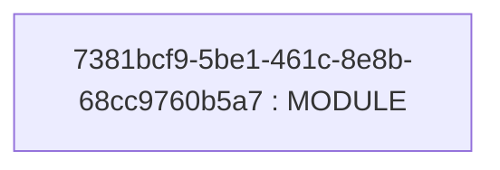
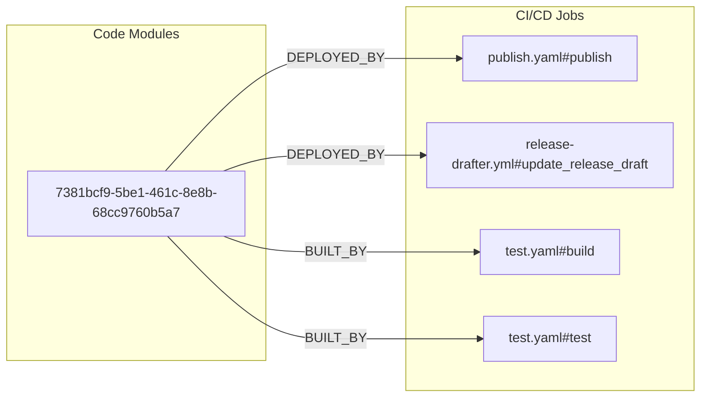
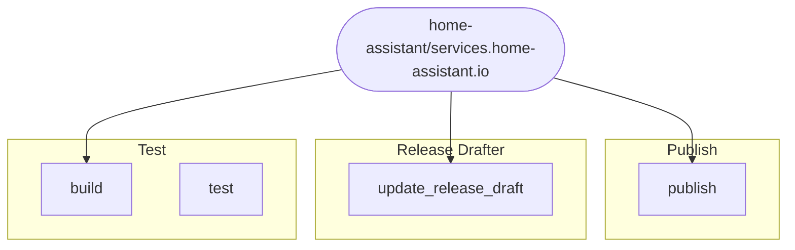

# Repository Architecture Analysis: home-assistant/services.home-assistant.io

## Metadata
- **SHA**: `82b5a04d9f1b6bc14eb0d73101703c7d904e03ff`
- **Primary Ecosystem**: JavaScript/TypeScript

## Quality Metrics
- **ast_engine**: tree-sitter
- **avg_cognitive_complexity**: 2.53
- **avg_cyclomatic_complexity**: 3.37
- **component_count**: 1
- **dead_code_count**: 0
- **dead_code_symbols**: 0 entry(ies)
- **duplication_pct**: 69.69
- **file_complexities**: 11 entry(ies)
- **files_analyzed**: 11
- **fitness_passed**: False
- **fitness_violation_count**: 1
- **framework**: TypeScript
- **import_edges**: 37 entry(ies)
- **loc**: 1114
- **max_cognitive_complexity**: 19
- **max_cyclomatic_complexity**: 17
- **sloc**: 1004
- **test_file_count**: 4

# Architecture: home-assistant/services.home-assistant.io

## Context
- **Repository**: `home-assistant/services.home-assistant.io`
- **SHA**: `82b5a04d9f1b6bc14eb0d73101703c7d904e03ff`
- **Ecosystem**: JavaScript/TypeScript
- **Framework**: TypeScript

## Building Block View

## Component Details
- **7381bcf9-5be1-461c-8e8b-68cc9760b5a7** (`package.json`): MODULE

## 6-Dimension Repository Scorecard

- **Overall Grade**: `C` (70.40/100)
- **Technical Debt Score**: 29.60
- **Estimated Remediation Effort**: 35.34h

| Dimension | Grade | Score | Weight | Details |
| :--- | :---: | :---: | :---: | :--- |
| Code Quality | `C` | 70.52 | 0.20 | avg_cc=3.37, max_cc=17, duplication=69.69%, dead_code=0 |
| Dependency Health | `B` | 85.00 | 0.15 | dependencies=11, outdated=0, vulnerable=0, has_lockfile=False |
| Maintainability | `A` | 94.00 | 0.15 | avg_cognitive=2.53, max_cognitive=19, fitness_violations=1, oversized_files=0 |
| Pipeline Health | `F` | 41.00 | 0.15 | workflows=3, operational_antipatterns=8, parallel_branches=True |
| Security | `D` | 64.00 | 0.20 | vulnerabilities=0, secrets=0, pipeline_security_findings=3 |
| Test Coverage | `C` | 70.00 | 0.15 | coverage=unavailable, ci_test_job=True, test_files_detected=True |

## Architecture Fitness & Workspace Boundaries

- **[MEDIUM] `ATRUSS-ARCH-005` (COMPLEXITY_THRESHOLD)**: Repository duplication_pct (69.69) exceeds policy threshold (15.0).

## Supply Chain Dependencies, Vulnerabilities & Secrets

- **Dependencies Parsed**: 11 | **Vulnerabilities**: 0 | **Secrets**: 0

### Inventory Sample
- `@cloudflare/workers-types` `4.20260629.1` (npm, `package.json`)
- `@types/jest` `30.0.0` (npm, `package.json`)
- `@types/node` `26.6.2` (npm, `package.json`)
- `jest` `30.5.2` (npm, `package.json`)
- `toucan-js` `4.1.1` (npm, `package.json`)
- `ts-jest` `29.4.12` (npm, `package.json`)
- `ts-loader` `9.6.2` (npm, `package.json`)
- `typescript` `4.9.5` (npm, `package.json`)
- `webpack` `5.111.1` (npm, `package.json`)
- `webpack-cli` `7.2.3` (npm, `package.json`)
- `wrangler` `4.135.0` (npm, `package.json`)

## Section 7: Code-to-Cloud Deployment Traceability

- `7381bcf9-5be1-461c-8e8b-68cc9760b5a7` (code_module) --[BUILT_BY]--> `test.yaml#build` (ci_job)
- `7381bcf9-5be1-461c-8e8b-68cc9760b5a7` (code_module) --[BUILT_BY]--> `test.yaml#test` (ci_job)
- `7381bcf9-5be1-461c-8e8b-68cc9760b5a7` (code_module) --[DEPLOYED_BY]--> `publish.yaml#publish` (ci_job)
- `7381bcf9-5be1-461c-8e8b-68cc9760b5a7` (code_module) --[DEPLOYED_BY]--> `release-drafter.yml#update_release_draft` (ci_job)

## CI/CD Pipeline Topology

